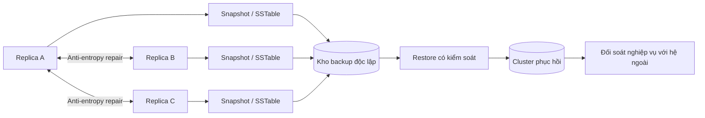
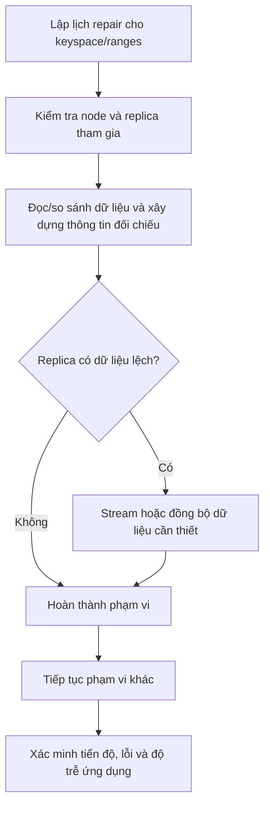
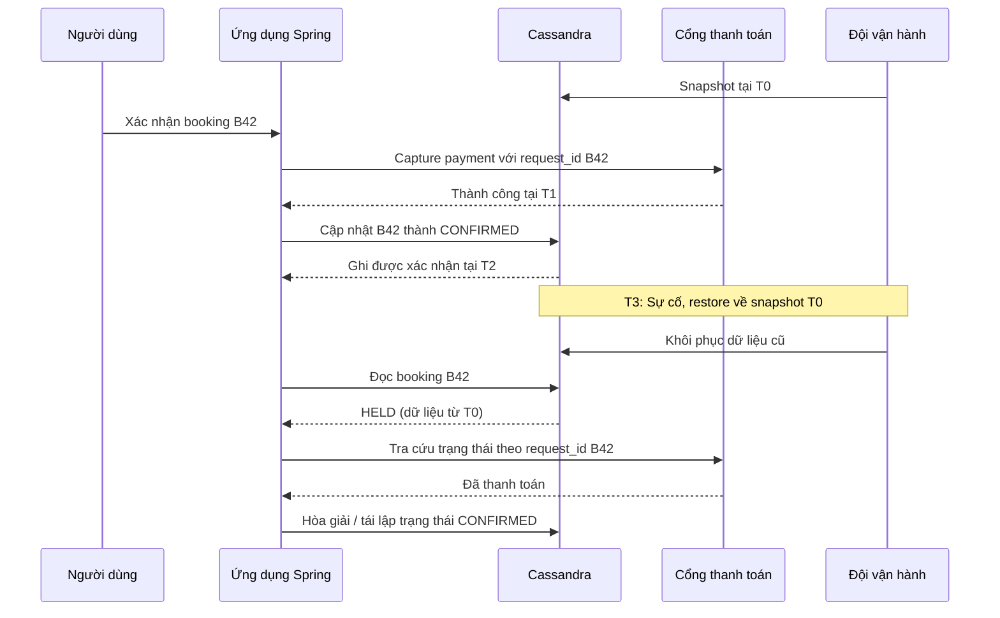

# Ảnh hưởng của repair, backup và khôi phục tới ứng dụng

Trong **SPRING_DATA_CASSANDRA**, ứng dụng Java truy cập Apache Cassandra bằng entity mapping, repository, `CassandraTemplate` và truy vấn CQL. Vì Cassandra phân tán dữ liệu trên nhiều replica, tính đúng đắn và độ ổn định của ứng dụng không chỉ phụ thuộc vào câu lệnh `save()` hoặc `SELECT`. Các công việc vận hành như **repair**, **backup** và **khôi phục (restore)** có thể thay đổi mức sử dụng tài nguyên, trạng thái đồng bộ giữa replica, độ mới của dữ liệu và khả năng xử lý request.

Bài thuộc chương **Quan sát và vận hành**, tập trung giải thích cơ chế của ba hoạt động này và những gì một ứng dụng Spring Data Cassandra cần chuẩn bị: xác định partition key và consistency level, đo độ trễ, kiểm soát retry, giữ thao tác idempotent, chủ động thiết kế RPO/RTO và kiểm thử phục hồi dữ liệu. Trong mô hình dữ liệu phân tán, “request thành công”, “dữ liệu đã được sao lưu” và “có thể khôi phục nghiệp vụ” là **ba lời bảo đảm khác nhau**.

## 1. Tình huống dẫn nhập: ứng dụng vẫn chạy nhưng kết quả thay đổi

Xét một dịch vụ đặt lịch có hai bảng Cassandra:

- `reservation_by_slot`: tra cứu theo `(resource_id, slot_start)` và xác định yêu cầu nào đang sở hữu một khung giờ; đây là nguồn sự thật cho việc chống đặt trùng.
- `reservation_by_user`: hiển thị lịch sử đặt của từng người dùng; đây là bảng phục vụ một mẫu truy vấn khác, có thể được cập nhật sau từ sự kiện nghiệp vụ.

Các request đi qua repository hoặc `CassandraTemplate`, trong khi một số thao tác tranh chấp dùng CQL điều kiện (`IF NOT EXISTS` hoặc `IF state = ...`). Ứng dụng còn gọi một cổng thanh toán ngoài Cassandra.

Ba tình huống có thể xảy ra:

1. Trong lúc **repair**, các replica trao đổi dữ liệu và dùng thêm CPU, disk I/O, network. API vẫn trả kết quả nhưng độ trễ p99 tăng, một số request timeout.
2. Trong lúc **backup**, snapshot đang lưu trạng thái ở nhiều node, nhưng giao dịch mới vẫn tiếp tục ghi. Bản backup không mặc nhiên là một ảnh chụp ACID toàn cluster tại đúng một thời điểm.
3. Sau khi **restore** từ bản cũ, hàng đặt lịch hoặc bảng projection có thể trở lại trạng thái trước một khoản thanh toán đã hoàn tất. Nếu ứng dụng chỉ đọc Cassandra mà không đối soát với hệ thống thanh toán, kết quả nghiệp vụ có thể sai dù Cassandra khởi động bình thường.

Vì vậy, ứng dụng cần **hợp đồng nhất quán và phục hồi**, còn đội vận hành cần một runbook có thể kiểm chứng. Repair, backup và restore giải quyết những lỗi khác nhau.

## 2. Phân biệt repair, backup và restore

| Hoạt động | Mục tiêu chính | Thay đổi gì trong Cassandra? | Không bảo đảm điều gì? |
| --- | --- | --- | --- |
| **Repair** | Đối soát dữ liệu giữa các replica còn khả dụng để chúng hội tụ theo cơ chế anti-entropy. | So sánh các phạm vi token, phát hiện khác biệt và đồng bộ dữ liệu cần thiết; tạo tải validation/streaming. | Không tạo bản sao lưu chống mất toàn bộ replica; không rollback một giao dịch; không tạo snapshot toàn cluster. |
| **Backup** | Lưu bản sao dữ liệu có thể dùng khi sự cố, xóa nhầm hoặc mất dữ liệu. | Snapshot SSTable, có thể thu thập incremental backup và commitlog tùy chính sách. | Không tự có point-in-time recovery (PITR), RPO=0, tính nhất quán toàn cụm hay bảo đảm khôi phục thành công. |
| **Restore** | Đưa dữ liệu được lưu về một môi trường Cassandra phù hợp. | Nạp dữ liệu từ bản sao, khôi phục schema và/hoặc phát lại log theo quy trình của phiên bản. | Không tự đồng bộ trạng thái với thanh toán, message broker, cache hoặc các hệ thống đã có tác dụng phụ sau thời điểm backup. |

Một bản backup có thể **rất tốt về mặt file** nhưng **không đủ về mặt nghiệp vụ** nếu thiếu schema, metadata, quy trình tái phát sự kiện và khả năng đối soát dữ liệu ngoài Cassandra. Ngược lại, repair thành công không cứu được trường hợp toàn bộ các replica cùng xóa mất một bản ghi theo cùng mutation hợp lệ.



## 3. Vì sao replica có thể lệch nhau?

Cassandra phân phối mỗi partition theo token và replication strategy. Với replication factor **RF = 3**, ba replica chịu trách nhiệm lưu cùng một phần dữ liệu logic; một write có thể được ghi nhận thành công khi số replica phản hồi đạt consistency level mà client yêu cầu, **chưa nhất thiết tất cả replica đều có cùng giá trị ngay lúc đó**.

Ví dụ trong một data center có RF=3:

| Thao tác | Điều kiện phản hồi, ví dụ | Điều ứng dụng nhìn thấy |
| --- | --- | --- |
| Ghi ở `LOCAL_ONE` | Một replica trong local data center phản hồi. | Có thể có replica chưa nhận mutation tại thời điểm response. |
| Ghi ở `LOCAL_QUORUM` | Hai trong ba replica local phản hồi. | Tăng số replica xác nhận, nhưng vẫn có thể còn một replica chậm. |
| Đọc ở `LOCAL_ONE` | Một replica local đáp ứng yêu cầu đọc. | Có thể đọc được dữ liệu cũ nếu replica đó chưa hội tụ. |
| Đọc ở `LOCAL_QUORUM` | Hai trong ba replica local đáp ứng yêu cầu đọc. | Quorum đọc/ghi giao nhau trong các điều kiện tương ứng, tăng khả năng quan sát ghi đã xác nhận. |

Quy tắc phổ biến `R + W > RF` cho quorum giao nhau hữu ích khi các giả định về replication, topology, thao tác và thời gian được thỏa mãn. Nó **không** biến chuỗi thao tác CQL thành ACID transaction, không thay thế LWT khi cần chống tranh chấp và không khiến mọi replica có dữ liệu giống hệt nhau tức thì.

Replica bị gián đoạn do mạng, node chết tạm thời hoặc bị quá tải có thể bỏ lỡ mutation. Cassandra có các cơ chế khác nhau để giúp dữ liệu hội tụ, như hints, read repair trong những phạm vi được hỗ trợ và **anti-entropy repair**. Những cơ chế này có vai trò khác nhau: một lượt đọc có cơ hội sửa một số khác biệt không tương đương với một đợt repair định kỳ quét toàn bộ các phạm vi token cần thiết.

**Kết nối với ứng dụng:** Chọn `LOCAL_QUORUM` cho một luồng ghi/đọc không giúp bỏ qua kế hoạch repair. Nếu replica bị bỏ lỡ một write và sau đó quay lại, đội vận hành cần bảo đảm nó được đối soát đúng trước khi các tombstone có liên quan bị loại bỏ.

## 4. Repair là gì và ảnh hưởng như thế nào?

### 4.1. Anti-entropy repair thực hiện những công việc nào?

Repair phối hợp các replica cho một hoặc nhiều phạm vi token, đối chiếu dữ liệu và đồng bộ phần khác biệt. Tùy phiên bản Cassandra và chế độ repair, hệ thống dùng những bước như validation, xây dựng cấu trúc đối chiếu (ví dụ Merkle tree), truyền dữ liệu và đánh dấu trạng thái repaired/unrepaired của SSTable.

Luồng khái quát:



Lưu ý các thuật ngữ:

- **Full repair** và **incremental repair** có cách chọn tập dữ liệu cần xử lý và quản lý trạng thái repaired khác nhau; chi tiết, mặc định và giới hạn thay đổi theo phiên bản Cassandra.
- Repair có thể được chia theo **token range, keyspace, table hoặc data center** để kiểm soát tài nguyên.
- Một lệnh repair báo kết thúc **chưa đủ** để tuyên bố mọi replica và mọi bảng đã được xử lý theo lịch; cần kiểm tra phạm vi đã chạy, các node tham gia và báo cáo lỗi.
- Nếu mọi replica của một partition đều đã mất dữ liệu hợp lệ, repair không thể tự tái tạo dữ liệu từ một nguồn độc lập như backup.

Chỉ chọn full/incremental và các tùy chọn song song sau khi đã xác minh đúng hướng dẫn vận hành của **phiên bản Cassandra đang triển khai**. Không trộn các chế độ repair hoặc chạy những chiến dịch chồng lấn một cách tùy tiện.

### 4.2. Repair tác động tới CPU, I/O và network

Repair không chỉ là “một câu lệnh quản trị chạy nền”. Việc quét SSTable, đối chiếu và streaming có thể cạnh tranh tài nguyên với request sản xuất.

| Tài nguyên | Vì sao tăng tải? | Tác động có thể thấy từ Spring Data Cassandra |
| --- | --- | --- |
| Disk read I/O | Validation đọc các vùng dữ liệu, có thể trên nhiều SSTable. | `SELECT` chậm hơn, tail latency tăng. |
| Disk write I/O | Streaming và compaction có thể bổ sung dữ liệu/SSTable. | Ghi kéo dài, throughput giảm, hàng đợi tăng. |
| CPU/heap | Validation, checksum/đối chiếu, serialization, compaction. | Coordinator trả lời chậm; driver nhận timeout. |
| Network | Replica truyền dữ liệu để đồng bộ. | Băng thông giữa node/vùng bị chiếm, ảnh hưởng đọc/ghi phân tán. |
| Dung lượng disk | SSTable và dữ liệu đồng bộ cần không gian tạm. | Nếu disk gần đầy, node có thể hoạt động kém ổn định hoặc gặp lỗi. |
| Repair workers/concurrency | Nhiều repair/range chạy đồng thời. | Cạnh tranh tài nguyên, tăng p95/p99 dù lưu lượng client không đổi. |

Không phải đợt repair nào cũng gây suy giảm đáng kể; kết quả phụ thuộc kích thước dữ liệu, lượng lệch replica, loại disk, concurrency, topology và headroom. **Đừng đặt mục tiêu duy nhất là repair chạy xong nhanh nhất** nếu việc đó khiến API vượt SLO.

### 4.3. Lịch repair và tombstone: nguy cơ dữ liệu đã xóa “xuất hiện lại”

Cassandra biểu diễn nhiều thao tác xóa dưới dạng **tombstone**; TTL hết hạn cũng tạo trạng thái xóa ở mức dữ liệu. Tombstone phải tồn tại đủ lâu để các replica chưa nhận thao tác xóa còn có cơ hội biết rằng giá trị cũ đã bị xóa.

Tham số `gc_grace_seconds` của bảng liên quan đến thời gian bảo vệ tombstone trước khi nó **có thể đủ điều kiện** bị loại bởi compaction. Điều này không có nghĩa tombstone biến mất đúng thời điểm đồng hồ chạm ngưỡng; compaction, overlapping SSTables và các điều kiện an toàn khác còn ảnh hưởng việc purge.

Xem ví dụ:

```text
T0: Replica A và B có hàng X; replica C mất kết nối.
T1: Client DELETE hàng X, A/B ghi tombstone; C vẫn giữ X.
T2: Hết thời gian grace, và tombstone trên A/B thực sự bị purge.
T3: Replica C trở lại với bản X cũ mà không thấy tombstone.
T4: Dữ liệu cũ có nguy cơ được lan truyền/quan sát lại.
```

Đây là một dạng rủi ro **zombie data**. Hệ quả đối với ứng dụng có thể rất nặng: bản ghi đã hủy lại xuất hiện trong lịch sử đặt chỗ, token đã thu hồi trông như còn hợp lệ hoặc dữ liệu đã xóa quay trở lại.

Các nguyên tắc vận hành:

1. Lịch repair phải bảo đảm **các phạm vi liên quan được repair thành công và đủ thường xuyên trong cửa sổ grace**, tính cả thời gian sửa chữa sự cố, chậm lịch và outage; không chỉ lên lịch một job rồi mặc định nó luôn thành công.
2. Khi một replica bị offline lâu hơn cửa sổ an toàn, cần quy trình đánh giá **rebuild/replace** hoặc biện pháp phù hợp thay vì đưa nó trở lại và mặc nhiên tin dữ liệu cũ.
3. Không tùy tiện giảm `gc_grace_seconds` để giảm tombstone hoặc tiết kiệm disk nếu chưa có bằng chứng và thiết kế vận hành bảo đảm không tái xuất hiện dữ liệu.
4. Repair không thay thế việc thiết kế TTL/compaction hợp lý và giám sát tombstone trên các query nóng.

**Với Spring Data Cassandra:** `repository.deleteById(...)` có thể trả thành công theo consistency level đã chọn, nhưng nếu vận hành repair và tombstone sai, trạng thái xóa có thể không an toàn về dài hạn. Kết quả của một request không thể thay thế theo dõi lifecycle dữ liệu giữa replica.

### 4.4. Repair không phải transaction và không phải nút “đồng bộ tức thì”

Repair không khóa toàn bộ cluster để tạo một ảnh chụp thống nhất theo thời gian. Ứng dụng có thể tiếp tục ghi trong lúc repair. Do đó, một khoảng thời gian dữ liệu giữa các replica chưa hội tụ vẫn có thể tồn tại; đợt repair hoàn thành cũng không có nghĩa mọi request đồng thời đều được xử lý theo một thứ tự tuần tự toàn cụm.

Tương tự, chạy repair sau khi ghi bảng `reservation_by_slot` và `reservation_by_user` không tạo atomic commit giữa hai bảng. Nếu cần nhất quán nghiệp vụ qua nhiều partition, vẫn cần nguồn sự thật, mô hình trạng thái, idempotency và cơ chế đối soát dữ liệu.

## 5. Backup dữ liệu Cassandra: snapshot chỉ là một phần

### 5.1. Snapshot dựa trên SSTable

Cassandra lưu dữ liệu trên disk ở dạng **SSTable**, là các file bất biến. Công cụ snapshot của Cassandra tạo các **hard link** đến thành phần SSTable phù hợp tại thời điểm snapshot trên từng node. Điều này thường khiến snapshot được tạo nhanh và không phải nhân đôi ngay toàn bộ byte dữ liệu.

Tuy nhiên:

- Snapshot nằm ở **disk của node** cho tới khi được chuyển đi; node mất disk vẫn có thể làm mất cả bản gốc lẫn snapshot.
- Các hard link giữ SSTable cũ tồn tại ngay cả sau compaction; dung lượng thực bị giữ lại có thể tăng dần nếu không quản lý retention.
- Snapshot được thực hiện trên **từng node**, và không tạo một global transaction snapshot với trạng thái nhất quán tuyệt đối ở tất cả data center.
- Snapshot các SSTable chưa tự cung cấp đầy đủ metadata cần để dựng một cluster mới, như schema, cấu hình topology và bí mật/kết nối được quản lý riêng.

Một ví dụ lệnh quản trị để nhận diện thao tác (kiểm tra cú pháp theo phiên bản và runbook trước khi chạy):

```bash
# Ví dụ minh họa trên node Cassandra:
nodetool snapshot -t before_upgrade_01 application_ks
nodetool listsnapshots
```

Không nên coi việc chạy thành công lệnh trên một node là “đã backup cả cluster”. Quy trình phải biết **node nào đã chụp, keyspace/table nào, tag nào, thời gian nào, bộ file nào và nơi lưu trữ độc lập**.

### 5.2. Incremental backup và commitlog archiving

Cassandra có thể tạo **incremental backups** bằng cách lưu liên kết/bản sao của SSTable mới được tạo sau khi cấu hình bật cơ chế tương ứng. Loại backup này bổ sung những thay đổi đã được flush thành SSTable kể từ các điểm lưu; nó **không đồng nghĩa** một luồng sự kiện CQL cho từng mutation.

**Commitlog** ghi lại các mutation để hỗ trợ độ bền của write và recovery khi node restart. Một chính sách archiving commitlog phù hợp có thể là thành phần của quy trình khôi phục chi tiết hơn hoặc point-in-time recovery (PITR), nhưng đòi hỏi đồng bộ checkpoint, lưu trữ log, công cụ phát lại và giới hạn thời gian. **PITR không tự xuất hiện chỉ vì đã bật snapshot và incremental backups.**

| Thành phần | Lưu được gì? | Cần chú ý khi phục hồi |
| --- | --- | --- |
| Full snapshot theo node/table | Tập SSTable tại thời điểm chụp trên node đó. | Phải thu thập đủ phạm vi, file thành phần, schema và liên hệ với node/topology. |
| Incremental backup | SSTable được ghi thêm sau khi bật cơ chế; bổ sung thay đổi đã flush. | Phải có baseline phù hợp, manifest/timeline và chính sách lưu trữ nhất quán. |
| Archived commitlog | Lịch sử mutation được lưu theo cơ chế archiving cấu hình riêng. | Cần replay có giới hạn thời gian và xác minh kết quả; không mặc nhiên khôi phục logic cross-service. |
| Schema/metadata/configuration | Keyspace, table, replication, option TTL/compaction, phiên bản và topology. | Khôi phục đúng ngữ nghĩa trước khi nạp SSTable; chú ý thay đổi schema qua thời gian. |
| Backup catalog/manifest | Tag, thời gian, checkpoint, checksum, node, table, keyspace, trạng thái upload. | Phải biết chính xác bộ file nào tạo thành một restore point hợp lệ. |

Backup theo lịch cần đánh giá **RPO** và **RTO** chứ không chỉ kiểm tra “file có xuất hiện không”.

### 5.3. RPO, RTO và những gì ứng dụng cần cam kết

- **RPO (Recovery Point Objective):** có thể mất tối đa bao nhiêu dữ liệu mới nhất, tính theo thời điểm đã ghi vào hệ thống so với điểm phục hồi đủ tin cậy.
- **RTO (Recovery Time Objective):** có thể chấp nhận hệ thống gián đoạn hoặc giảm chức năng tối đa bao lâu trước khi phục hồi dịch vụ theo tiêu chí đã cam kết.

Giả sử chỉ backup thành công lúc 00:00 mỗi ngày và không có cơ chế giữ các mutation sau snapshot. Nếu phải restore trước mốc backup kế tiếp, khoảng dữ liệu chưa nằm trong bản backup có thể **gần 24 giờ**, kể cả khi mọi ghi trước khi xảy ra sự cố đã trả HTTP 200. Đây là ví dụ minh họa, không phải cam kết RPO thật: backup thực tế còn phải hoàn tất upload, validate, xét phạm vi replica và retention.

RTO không chỉ là thời gian download file. Nó gồm phát hiện sự cố, đưa ra quyết định, chuẩn bị cluster, phục hồi schema/data, khôi phục routing, khởi động các service, kiểm tra chất lượng dữ liệu, đối soát hệ thống ngoài và mở lại lưu lượng.

| Yêu cầu sản phẩm | Hệ quả thiết kế backup/restore |
| --- | --- |
| Mất tối đa vài phút ghi mới | Snapshot hằng ngày một mình không đủ; cân nhắc phương án log archiving/replication/event log bền vững phù hợp. |
| Khôi phục hoạt động trong một giờ | Phải đo toàn bộ quy trình với kích thước dữ liệu thật và tốc độ truyền/restore khả dụng. |
| Dữ liệu đã thanh toán không được mất dấu | Cần nguồn sự thật và công cụ đối soát với cổng thanh toán, không chỉ SSTable backup. |
| Hỗ trợ xóa dữ liệu theo yêu cầu | Backup retention/restore phải tôn trọng quy tắc xóa, tombstone và lịch xử lý dữ liệu bị xóa. |
| Khôi phục một bảng riêng lẻ | Phải xác định tính phụ thuộc giữa bảng authoritative, projection, index và các thay đổi schema. |

### 5.4. Tính nhất quán của backup khi ứng dụng tiếp tục ghi

Một backup chạy tuần tự trên các node có thể thu được dữ liệu ở các mốc thời gian hơi khác nhau. Ngoài ra, các write có consistency level thấp hơn RF có thể chưa nằm trên mọi replica. Một bản snapshot tự thân không biết giao dịch nào ở hệ thống thanh toán đã hoàn tất hoặc event nào đã được phát.

Nếu yêu cầu nghiệp vụ cần một **điểm khôi phục nhất quán xuyên nhiều hệ thống**, phải thiết kế quy trình phối hợp: xác định checkpoint, theo dõi offset/event ID, tạm dừng một số mutation ở thời điểm thích hợp, hoặc sử dụng hệ thống nguồn sự thật có transaction semantics phù hợp. Không suy ra tính nhất quán xuyên nhiều dịch vụ từ các file snapshot độc lập.

## 6. Restore là hoạt động phục hồi có rủi ro, không phải rollback

### 6.1. Phân loại bài toán khôi phục

Các sự cố khác nhau cần quy trình khác nhau:

| Tình huống | Hướng xử lý thường được đánh giá | Điều cần tránh |
| --- | --- | --- |
| Một node mất disk nhưng các replica còn đủ dữ liệu tốt | Thường cân nhắc replace/bootstrap và streaming theo topology phù hợp. | Vội restore snapshot cũ để đưa node vào ring khi không đánh giá stale data. |
| Xóa nhầm một bảng hoặc một tập dữ liệu | Phục hồi từ backup phù hợp vào môi trường cách ly, trích xuất/đối soát dữ liệu cần thiết. | Nạp nguyên một snapshot cũ lên cluster đang ghi mà không xét timestamp, tombstone và trạng thái mới. |
| Nhiều replica/cluster mất dữ liệu | Dựng cluster và thực hiện restore từ bộ backup đã được xác minh. | Giả định chỉ cần `nodetool repair` là tái tạo được dữ liệu đã mất ở mọi replica. |
| Muốn quay về trước một mutation sai | Cần cơ chế PITR đã được thiết kế và kiểm thử hoặc phục hồi lựa chọn có kiểm soát. | Giả định snapshot + SSTable tự hỗ trợ rollback CQL đến mili giây bất kỳ. |
| Dữ liệu projection sai nhưng authoritative còn đúng | Rebuild projection từ nguồn sự thật/sự kiện bền vững. | Restore toàn cụm chỉ để sửa một bảng dẫn xuất. |

Trong một số phiên bản, công cụ như `sstableloader` hoặc các thao tác import/refresh SSTable có thể hỗ trợ những kiểu restore cụ thể. Quy trình chính xác phụ thuộc **phiên bản Cassandra, cách tạo SSTable, schema, token ownership, node state và topology**. Không lấy một lệnh `nodetool refresh` rồi áp dụng cho mọi tình huống: có bước yêu cầu node offline hoặc data directory được chuẩn bị riêng, có bước cần cluster đích trống hoặc data loader hỗ trợ.

### 6.2. Dựng lại cluster và vấn đề schema/topology

Trước khi nạp dữ liệu, nhóm vận hành phải xác minh:

1. **Phiên bản và định dạng SSTable:** bản backup có tương thích với Cassandra đích không? Có cần công cụ chuyển đổi dữ liệu theo phiên bản không?
2. **Schema:** keyspace, table, column type, partition/clustering key, replication factor, TTL, compaction và index có đúng với thời điểm dữ liệu không?
3. **Topology:** data center, rack, node/token assignment, replication strategy và local data center client được cấu hình đúng không?
4. **Thứ tự dữ liệu và log:** có baseline, incremental backup và commitlog đủ để đạt điểm phục hồi mong muốn không?
5. **Tài nguyên:** storage và băng thông đủ tải dữ liệu, xây dựng lại index/materialized view (nếu có) và chịu compaction sau restore không?
6. **Giới hạn thao tác:** cluster phục hồi phải được cách ly để chưa nhận ghi production trước khi dữ liệu và routing được xác minh.

Một bảng được nạp mà thiếu schema hoặc có schema khác có thể không đọc được từ repository, hoặc lỗi mapping/conversion khi truy vấn. Một bảng đúng schema nhưng đặt sai topology có thể làm người dùng chịu độ trễ cao hoặc gặp unavailable.

### 6.3. Tombstone, TTL và dữ liệu cũ sau restore

Restore làm xuất hiện lại **dữ liệu có timestamp và thông tin xóa theo lịch sử**. Cần đặc biệt thận trọng với:

- **Giá trị đã bị xóa sau thời điểm backup:** nếu phục hồi snapshot trước khi xóa, có nguy cơ đưa giá trị cũ trở lại.
- **Tombstone đã bị purge:** việc nạp SSTable cũ vào cluster sống có thể tạo xung đột với dữ liệu/xóa mới. Không thực hiện trước khi có quy trình chống resurrection.
- **TTL đã hết hạn:** SSTable phục hồi không có nghĩa mọi hàng tự có vòng đời mới. Dữ liệu có TTL cần được kiểm tra theo timestamp/expiration thực, thay vì coi backup là một lần `INSERT` mới.
- **Các ghi xảy ra sau restore point:** có thể đã được client xác nhận và kích hoạt email, webhook, thanh toán hoặc event ngoài Cassandra.

Do đó, một restore an toàn thường phục hồi **vào môi trường độc lập**, xác minh data model, so sánh với authoritative logs/hệ ngoài rồi mới chuyển dịch vụ hoặc tái nhập dữ liệu cần thiết theo chính sách được thiết kế.

## 7. Ảnh hưởng trực tiếp tới Spring Data Cassandra

### 7.1. Khi repair đang chạy

Các lớp `CassandraRepository`, `CassandraTemplate` và driver vẫn gửi request bình thường. Nhưng chúng có thể quan sát:

- `save()` hoặc `selectOne()` chậm hơn, nhất là tail latency.
- Timeout, unavailable hoặc lỗi kết nối khi node quá tải/tái cấu hình.
- Một số lượt đọc nhìn thấy dữ liệu khác nhau do replica đang hội tụ và consistency level của thao tác.
- Độ trễ tăng khi lấy các trang sau của một truy vấn paging.
- Backpressure hoặc hàng đợi request tăng nếu số request đồng thời không được kiểm soát.

**Không nên lập tức tăng timeout thật lớn để “che” tác động của repair.** Timeout quá dài làm giữ thread, connection và request đang chờ, có thể lan sự chậm chạp sang toàn ứng dụng. Hãy đo p95/p99, chọn timeout theo SLO và giới hạn concurrency; phối hợp đội vận hành giảm tốc độ repair khi cần.

### 7.2. Khi backup đang chạy

Snapshot chủ yếu tác động lên disk metadata/dung lượng và khả năng giữ SSTable; upload bản backup có thể dùng disk read/network I/O. Ứng dụng thường không cần dừng đọc/ghi chỉ vì tạo snapshot, nhưng phải giám sát:

- Disk free trước và sau snapshot; compaction có thể không giải phóng được dung lượng đang được snapshot giữ.
- Latency read/write, pending compaction, disk throughput và network throughput.
- Độ dài/thời gian upload, trạng thái hoàn tất của backup và nguy cơ chồng lấn với repair.
- Trường hợp backup được tạo đúng trong đợt traffic cao hoặc migration schema.

Nếu chính sách đòi hỏi application-level checkpoint, một phần ghi có thể được tạm ngừng có chủ đích. Phải mô tả rõ các endpoint nào chuyển sang chế độ hạn chế và cách client nhận biết, thay vì để request timeout không có thông báo.

### 7.3. Khi restore hoặc thay cluster đang diễn ra

Ứng dụng có thể đối diện với:

- Contact point không còn hợp lệ, topology thay đổi, driver phải khám phá lại node và metadata.
- Keyspace/table chưa sẵn sàng hoặc schema chưa agreement.
- Query chưa có dữ liệu mới nhất so với trạng thái client đã thấy trước sự cố.
- Query kết quả không khớp cache, materialized projection, message consumer state hoặc trạng thái hệ thanh toán.
- Một số write tiếp tục tạo dữ liệu vào cluster cũ trong khi hệ mới đang restore, dẫn tới **split-brain ở mức luồng ứng dụng** nếu chuyển traffic sai.

Đừng chỉ xác minh `CqlSession` kết nối thành công rồi bật toàn bộ endpoint. Cần các **gating checks** về schema, dữ liệu, độ trễ, trạng thái replay, checkpoint consumer, idempotency và tuyến ghi duy nhất.

### 7.4. Không có rollback Cassandra kiểu JDBC

`@Transactional` trong Spring có ý nghĩa theo transaction manager và tài nguyên nó quản lý. Giao dịch JDBC/JPA không tự bao phủ mutation Cassandra, backup/restore hay lời gọi thanh toán. Một chuỗi gồm hai lần `repository.save()` và một HTTP call **không trở thành atomic transaction** chỉ vì thêm annotation.

Trong thiết kế ứng dụng phân tán, phải ghi nhận trạng thái nhiều bước, chấp nhận kết quả chưa xác định khi timeout và có cơ chế bù trừ/đối soát. Điều này đặc biệt quan trọng nếu cần tiếp tục xử lý sau một lần restore về điểm cũ.

## 8. Quy tắc cho lỗi, retry và idempotency

### 8.1. Timeout không chứng minh dữ liệu chưa được ghi

Giả sử client gửi CQL ghi `reservation_by_slot` rồi gặp timeout trong lúc repair đang dùng nhiều tài nguyên. Có hai khả năng quan trọng: mutation chưa được áp dụng đủ để xác nhận, hoặc mutation đã được áp dụng nhưng response không về kịp. Nếu retry bằng **request ID mới**, ứng dụng có thể vô tình gây thao tác nghiệp vụ lặp.

Một cách mô tả kết quả đáng tin:

```text
try:
    ghi có điều kiện bằng request_id ổn định
    nếu [applied] = true:
        trạng thái = APPLIED
    nếu [applied] = false:
        đọc bản ghi hiện tại và kiểm tra owner/request_id
        nếu bản ghi thuộc request_id này: ALREADY_APPLIED
        nếu thuộc request khác: CONFLICT
catch timeout / unavailable:
    trạng thái = UNKNOWN
    ghi nhận để đối soát; retry có giới hạn với cùng request_id
```

Đây là **mẫu thuật toán**, không phải Java code chạy ngay. Trong hệ thực, lần đọc hòa giải phải dùng consistency/điều kiện phù hợp để tránh kết luận vội từ một replica quá cũ. Với mutation non-idempotent, phải xác định riêng semantics của operation và chính sách retry của Java driver.

Trường hợp cổng thanh toán đã chấp nhận lệnh nhưng Cassandra được phục hồi từ snapshot cũ, ứng dụng cũng phải **giữ idempotency key ở phía hệ thanh toán** và có nguồn đối soát để tránh thu tiền hai lần.

### 8.2. Phân loại phản ứng ở API

| Tình huống quan sát | Phản ứng phù hợp để đánh giá | Vì sao |
| --- | --- | --- |
| Cassandra tạm thời unavailable, chưa bắt đầu mutation nghiệp vụ | Từ chối có kiểm soát theo hợp đồng API, ví dụ HTTP 503 với retry guidance. | Tránh giữ request vô hạn và gây quá tải lan rộng. |
| Ghi có thể đã thành công nhưng client timeout | Trả trạng thái chưa xác định hoặc yêu cầu kiểm tra kết quả bằng operation ID. | Không hứa “thất bại chắc chắn”, không sinh tác dụng phụ lần nữa. |
| LWT trả `[applied] = false` và owner là request khác | Báo xung đột, ví dụ HTTP 409, theo hợp đồng sản phẩm. | Đây là tranh chấp nghiệp vụ, không phải sự cố repair. |
| Đọc projection có thể chậm sau restore | Hiển thị trạng thái chờ đồng bộ/đối soát hoặc lấy dữ liệu authoritative. | Không biến projection chưa phục hồi thành kết luận sai về sở hữu/thanh toán. |
| Toàn bộ cluster đang phục hồi và chưa đạt tiêu chí an toàn | Chặn những mutation không thể bảo đảm, chỉ mở API phù hợp. | Ngăn phát sinh trạng thái mới trên dữ liệu chưa được kiểm chứng. |

Mã HTTP và giao diện phản hồi chỉ là ví dụ. Yêu cầu quan trọng là **ngữ nghĩa kết quả được thiết kế, nhất quán và có thể phục hồi**.

## 9. Ví dụ xuyên hệ thống: một khoản thanh toán sau điểm backup

Giả sử snapshot hoàn tất khi booking `B42` vẫn ở trạng thái `HELD`.



Nếu code không có bước đối soát, có thể:

- Cho người khác giữ lại cùng khung giờ dù booking đã được thanh toán.
- Gọi capture lần hai khi người dùng nhấn “thử lại”.
- Gửi email hủy nhầm hoặc hiển thị đơn “chưa trả tiền”.
- Phát lại event nghiệp vụ mà downstream đã xử lý.

Vì vậy, ngoài backup Cassandra, cần có một **nguồn đối soát sự kiện/transaction bên ngoài**, khóa yêu cầu ổn định và một **state machine** phân biệt `HELD`, `PAYMENT_PENDING`, `CONFIRMED`, `RECONCILING`, `RELEASED`.

Cụ thể, bảng `reservation_by_slot` có thể là nguồn sự thật cho quyền chiếm khung giờ **khi cluster đang hoạt động bình thường**, nhưng khi restore về T0, thông tin thanh toán ở T1 vẫn là sự thật bên cổng thanh toán. Chính sách phục hồi phải định nghĩa rõ cách kết hợp hai nguồn thông tin. Nếu sản phẩm bắt buộc không mất giao dịch đã được xác nhận, kiến trúc lưu trạng thái có thể cần một transactional store hoặc event log bền vững hơn một snapshot Cassandra định kỳ.

## 10. Quan sát sự cố: kết nối metric ứng dụng và metric cluster

Chỉ nhìn `nodetool repair` đã hoàn tất hoặc backup upload thành công là chưa đủ. Cần đặt metric Cassandra cạnh metric của Spring Boot/Java Driver và gắn với mốc thời gian của hoạt động vận hành.

| Phạm vi | Tín hiệu nên theo dõi | Cách diễn giải khi repair/backup/restore |
| --- | --- | --- |
| API ứng dụng | Request rate, success/error rate, p50/p95/p99, queue, circuit breaker, saturation. | Phát hiện khách hàng đang chịu ảnh hưởng ngay cả khi cluster chưa báo lỗi nghiêm trọng. |
| Java driver | CQL request latency, timeouts, unavailable, retries, in-flight requests, pool health, coordinator/host errors. | Xem request chậm ở đường nào; kiểm tra timeout có làm tăng retry storm không. |
| Cassandra node | CPU, memory/GC, disk latency/IOPS, disk free, network saturation. | Phân biệt tài nguyên nghẽn do repair/streaming/backup với tải ứng dụng. |
| Repair | Job/range progress, failures, duration, validation/streaming, lần repair thành công gần nhất. | Xác minh cửa sổ tombstone an toàn, đánh giá repair có cần throttle hay tách lịch. |
| Backup | Snapshot age, upload completion, checksum/manifest, lưu trữ off-node, retention, lần restore drill thành công. | Đo **recoverability**, không chỉ số lượng file. |
| Restore | Data loaded/validated, schema agreement, replica health, replay position, projection lag, reconciliation backlog. | Quyết định lúc nào được mở đọc/ghi production. |
| Dữ liệu nghiệp vụ | Số booking chưa rõ trạng thái, payment mismatches, duplicate operation IDs, độ trễ projection. | Phát hiện trường hợp hệ thống phục hồi về mặt kỹ thuật nhưng nghiệp vụ chưa đúng. |

Tên metric cụ thể phụ thuộc phiên bản Java Driver, Cassandra, Micrometer/Actuator, JMX và hệ quan sát đang dùng. Khi cấu hình dashboard, hãy ưu tiên metric **có thể giải thích và hành động**; đừng hard-code một metric name chỉ dựa trên ví dụ phiên bản khác.

### 10.1. Tín hiệu trong log và trace

Để điều tra request chậm, nên liên kết:

- `request_id` hoặc `operation_id` ở API với CQL operation/query shape.
- Keyspace/table và loại truy vấn; có dùng LWT hoặc paging không.
- Consistency level và execution timeout.
- Thời gian bắt đầu/kết thúc repair hoặc snapshot upload.
- Node/coordinator liên quan khi driver cho phép quan sát.
- Trạng thái cuối cùng của operation, kể cả `UNKNOWN` và lần đối soát sau đó.

Không log trực tiếp token, khóa partition hay toàn bộ bind values nếu chúng chứa dữ liệu cá nhân/định danh nhạy cảm. Có thể dùng hash có kiểm soát, sampling hoặc nhóm theo partition để phát hiện hotspot mà vẫn bảo vệ thông tin người dùng.

### 10.2. Alert nào thực sự hữu ích?

| Điều kiện | Hành động ưu tiên |
| --- | --- |
| Repair thất bại hoặc một phạm vi không repair thành công gần tới giới hạn an toàn tombstone | Điều tra node/range lỗi, điều chỉnh lịch/throttle, đánh giá replica offline lâu ngày. |
| p99 API tăng cùng thời điểm validation/streaming | Giảm concurrency repair, kiểm tra disk/network headroom và request retry. |
| Disk free giảm liên tục sau nhiều snapshot | Kiểm tra retention, snapshot hard link và lịch compaction; bảo vệ khả năng ghi của cluster. |
| Backup “thành công” nhưng checksum/upload hoặc manifest thiếu node | Đánh dấu restore point không đủ tin cậy, sửa pipeline backup. |
| Khôi phục xong nhưng reconciliation backlog tăng | Giữ hạn chế những mutation nhạy cảm và ưu tiên đối soát nghiệp vụ. |
| Data query trả kết quả khác với payment/event log | Điều tra restore point, projection lag, replay và khả năng replay lặp. |

Cảnh báo nên thể hiện **mốc deadline theo chính sách** chứ không chỉ ngưỡng CPU. Ví dụ: “nhóm partition X chưa được repair thành công trong cửa sổ cần thiết” có ý nghĩa dữ liệu cao hơn một alert CPU 80% ngắn hạn.

## 11. Runbook trước, trong và sau repair

### 11.1. Trước khi chạy

1. Kiểm tra phiên bản Cassandra, replication strategy, RF, số data center và tình trạng node/rack.
2. Xác định keyspace/table/range cần repair và lần repair thành công gần nhất.
3. Đánh giá `gc_grace_seconds`, thời gian offline của replica và kế hoạch xử lý node quá hạn an toàn.
4. Xem headroom disk/network/CPU; tránh chồng nhiều việc nặng như compaction thủ công, bootstrap, snapshot upload hoặc schema migration.
5. Chọn khoảng thời gian, concurrency và kế hoạch giảm tải nếu p99/API error vượt ngưỡng.
6. Ghi nhận baseline metric và thông báo cho nhóm ứng dụng về dự kiến biến động.

### 11.2. Trong khi chạy

- Theo dõi repair range completion và lỗi, không chỉ tiến trình của process lệnh.
- So sánh p95/p99, error rate, retries, request queue và node saturation với baseline.
- Nếu thấy retry storm, cần giới hạn retry/concurrency tại ứng dụng; không giảm bảo đảm dữ liệu tùy tiện để khắc phục.
- Đánh giá giảm tốc độ repair hoặc tạm dừng theo runbook khi SLO bị ảnh hưởng.
- Ghi lại node/range nào chưa hoàn thành để có kế hoạch chạy bù.

### 11.3. Sau khi chạy

- Xác minh **đủ phạm vi** và những replica cần thiết đã được repair thành công.
- Kiểm tra disk free, compaction/streaming backlog, latency API đã trở về baseline.
- Chốt lần repair thành công mới trong hệ theo dõi; không dùng thời gian job bắt đầu để thay cho thời gian hoàn thành.
- Xem lại lịch và dung lượng dự phòng nếu repair kéo dài sát hoặc vượt cửa sổ an toàn.

**Không có một câu lệnh `nodetool repair` chung phù hợp mọi phiên bản và mọi topology.** Quy trình phải ghi rõ full/incremental, phạm vi data center, mức song song và lịch chạy tương thích cluster.

## 12. Runbook backup và khôi phục

### 12.1. Trước và trong backup

| Bước | Yêu cầu kiểm chứng |
| --- | --- |
| Chọn restore point | RPO và phạm vi keyspace/table đã được xác định; điểm bắt đầu kết hợp snapshot/log rõ ràng. |
| Kiểm tra dung lượng | Node có disk headroom cho snapshot và compaction; kho lưu trữ ngoài node đủ chỗ. |
| Tạo backup theo runbook | Ghi tag, mốc thời gian, node, keyspace, schema version và collection status. |
| Chuyển bản sao ra nơi độc lập | Copy/upload có kiểm tra checksum và quyền truy cập, không chỉ giữ hard link cùng disk. |
| Xác minh catalog | Có manifest và tập file đầy đủ của restore point; biết bộ backup nào đạt yêu cầu. |
| Thực thi retention | Có lịch xóa backup hết hạn và chính sách lưu trữ đáp ứng yêu cầu pháp lý/nghiệp vụ. |

Nếu backup pipeline chỉ báo thành công sau bước tạo hard link mà chưa upload/validate, ứng dụng và vận hành sẽ **đánh giá sai RPO**. Cần tách trạng thái `SNAPSHOT_CREATED`, `UPLOADED`, `VERIFIED`, `RESTORABLE` trong dashboard hoặc catalog phù hợp.

### 12.2. Thực hành phục hồi vào môi trường cách ly

Một bài diễn tập đáng tin nên chạy như sau:

1. **Chọn sự cố và restore point:** ví dụ mất cluster hoặc xóa nhầm một bảng; chọn bản backup có manifest đầy đủ.
2. **Dựng đích độc lập:** Cassandra đúng phiên bản/topology được kiểm chứng; không trỏ nhầm Spring Boot production vào cluster thử.
3. **Khôi phục schema và dữ liệu:** dùng công cụ/quy trình của phiên bản, theo đúng thứ tự baseline, incremental và log nếu đã thiết kế.
4. **Kiểm tra tính nhất quán:** kiểm tra node health, schema agreement, khả năng truy vấn theo partition key và sample dữ liệu quan trọng.
5. **Đối soát nghiệp vụ:** so sánh booking authoritative với payment/event log; xử lý tombstone/TTL, projection, duplicate IDs.
6. **Đo RTO thực:** từ khi phát hiện sự cố cho tới khi API đáp ứng đủ điều kiện mở traffic; ghi rõ thao tác tay và thời gian chờ.
7. **Xác nhận RPO thực:** xác định transaction mới nhất có thể khôi phục, các khoảng dữ liệu bị thiếu và hướng phục hồi từ nguồn khác.
8. **Diễn tập traffic cutover:** đảm bảo chỉ có một tuyến ghi authoritative; kiểm tra rollback/cutback plan nếu cluster phục hồi gặp lỗi.

Bản backup chỉ được xem là đã kiểm chứng khi **restore drill thành công** với dữ liệu đại diện và các điều kiện quan trọng của sản phẩm. Việc liệt kê các file trên object storage chưa đủ.

### 12.3. Tiêu chí mở lại ứng dụng sau restore

| Cửa kiểm tra | Tiêu chí tối thiểu gợi ý |
| --- | --- |
| Hạ tầng Cassandra | Cluster ổn định, node/replica cần thiết sẵn sàng, đủ disk/CPU/network để nhận tải. |
| Schema và mapping | Repository/`CassandraTemplate` truy vấn được các bảng cần thiết, schema khớp ứng dụng đang deploy. |
| Dữ liệu authoritative | Các bảng nguồn sự thật được kiểm tra bằng mẫu dữ liệu thực; các bất biến quan trọng không bị phá vỡ. |
| Replay và projection | Event replay có checkpoint, consumer idempotent, projection lag ở mức chấp nhận. |
| Hệ thống ngoài | Payment/identity/message broker đã được đối soát tới mốc đã thỏa thuận. |
| Ứng dụng | p95/p99, error rate, timeout/retry và sức chứa đạt ngưỡng mở traffic; endpoint nhạy cảm có cơ chế hạn chế khi cần. |
| Runbook | Đã ghi lại restore point, known gaps, hành động bù trừ và người chịu trách nhiệm đóng sự cố. |

## 13. Thiết kế ứng dụng để chịu được bảo trì và phục hồi

### 13.1. Tách nguồn sự thật khỏi bảng phục vụ đọc

Cassandra thường có nhiều bảng cho cùng một thực thể để tối ưu mẫu truy vấn:

```sql
-- Bảng authoritative cho quyền sở hữu khung giờ
CREATE TABLE reservation_by_slot (
    resource_id uuid,
    slot_start  timestamp,
    request_id  uuid,
    state       text,
    PRIMARY KEY ((resource_id), slot_start)
);

-- Bảng projection để đọc lịch sử một user
CREATE TABLE reservation_by_user (
    user_id     uuid,
    created_at  timestamp,
    request_id  uuid,
    state       text,
    PRIMARY KEY ((user_id), created_at, request_id)
) WITH CLUSTERING ORDER BY (created_at DESC);
```

Bảng đầu và bảng sau có partition key khác nhau; không có một transaction ACID tự động bao phủ hai lần ghi `repository.save()`. Sau restore, một projection có thể lệch hoặc thiếu dữ liệu; cần cách **rebuild** từ nguồn sự thật hoặc event log bền vững.

Một lưu ý bổ sung: nếu partition của `reservation_by_slot` theo `resource_id` có thể tăng không giới hạn, cần xem xét bucket theo ngày/chu kỳ mà vẫn giữ mọi request tranh chấp cùng khung giờ ở **cùng khóa quyết định**. Thiết kế partition kém sẽ làm repair/backup/restore nặng hơn vì skew/hotspot, chứ không chỉ làm `SELECT` chậm.

### 13.2. Chọn consistency level theo hợp đồng dữ liệu

Với một data center, `LOCAL_QUORUM` thường là lựa chọn được đánh giá cho thao tác cần mức xác nhận replica cao hơn `LOCAL_ONE`, nhưng sẽ phụ thuộc nhiều replica sẵn sàng hơn và có thể tăng độ trễ. Phải kiểm tra RF, topology, latency, SLO và loại thao tác. Quorum **không tự tạo isolation** cho bài toán nhiều request cùng giành quyền: cần conditional write/LWT khi invariant yêu cầu.

Trong restore, việc tăng consistency level không “kéo” dữ liệu mới từ bên ngoài nếu cả cluster đã được phục hồi về trạng thái cũ. Khi không còn bản sao mới hơn, phải dùng backup/log/event/payment source phù hợp và quy trình đối soát.

### 13.3. Giới hạn retry và giữ idempotency xuyên nhiều hệ thống

Một driver có thể retry một số lỗi theo policy; service cũng có thể retry ở tầng business và client có thể gửi lại HTTP. Nhiều tầng retry chồng nhau tạo **retry amplification** đúng lúc repair/restore làm cluster yếu nhất.

Hướng thiết kế:

- Gắn `operation_id`/`request_id` ổn định cho một hành động nghiệp vụ; giữ nguyên qua các lần retry.
- Phân biệt thao tác an toàn lặp với thao tác có side effect; không bật retry vô điều kiện cho mutation non-idempotent.
- Có exponential backoff, jitter, deadline và giới hạn tổng số lần thử ở các tầng.
- Cung cấp endpoint/worker đối soát cho kết quả `UNKNOWN` hoặc `PENDING`.
- Dùng idempotency key riêng tại hệ thanh toán/broker consumer; không giả định Cassandra có transaction xuyên hệ thống.
- Giám sát tỷ lệ retry, backlog và số operation chưa rõ kết quả.

### 13.4. Quy hoạch paging và độ ổn định khi dữ liệu thay đổi

Trong thời gian repair/restore, một truy vấn phân trang theo partition có thể chịu biến động latency; khi dữ liệu được nạp lại hoặc cập nhật đồng thời, danh sách có thể thay đổi giữa các page. Paging state không phải ảnh chụp ACID bất biến của cluster.

Với ứng dụng hiển thị lịch sử:

1. Thiết kế clustering key và cursor/paging state theo API được hỗ trợ.
2. Đặt page size và deadline phù hợp, không gọi `all()` để tải vô hạn.
3. Định nghĩa hành vi khi cursor hết hạn hoặc nguồn dữ liệu vừa được restore/rebuilt.
4. Nếu UI yêu cầu một snapshot logic có version, phải thiết kế contract dữ liệu riêng; Cassandra paging state tự thân không cung cấp điều đó.

## 14. Kiểm thử giả lập các tình huống vận hành

Một bài unit test repository không thể chứng minh hệ thống phục hồi từ backup. Cần xây dựng các bài thử có **cluster Cassandra thật trong môi trường riêng**; có thể kết hợp Testcontainers cho kiểm thử tích hợp nhỏ và cluster nhiều replica cho các tình huống failure/quorum/repair thực tế.

| Tình huống | Hành động mô phỏng | Điều cần xác minh |
| --- | --- | --- |
| Repair tạo tải I/O | Chạy repair trong cluster test chứa dữ liệu đại diện. | p95/p99, timeouts, request queue và job progress không vượt giới hạn đã chọn. |
| Một replica offline qua một phần cửa sổ grace | Làm gián đoạn node theo bài thử an toàn, ghi/xóa dữ liệu, đưa node trở lại đúng quy trình. | Repair/rebuild xử lý dữ liệu cũ; không cho phép zombie data vi phạm invariant. |
| Backup lúc ứng dụng ghi liên tục | Tạo snapshot/backup trong lúc có load ghi và lưu manifest. | Có thể xác định chính xác restore point và các khoảng dữ liệu chưa được bảo vệ. |
| Restore từ bản cách thời điểm sự cố | Phục hồi vào cluster cách ly, chạy truy vấn authoritative/projection. | RPO đo được; dữ liệu mất sau điểm backup được ghi nhận rõ. |
| Payment thành công sau snapshot | Khôi phục booking cũ nhưng giữ payment test bên hệ ngoài. | Đối soát không capture lần hai và không cấp trùng quyền đặt chỗ. |
| Projection thiếu dữ liệu | Chỉ phục hồi authoritative, rồi tái tạo projection. | Người dùng cuối nhận dữ liệu đúng sau khi backlog về mức cho phép. |
| Failover/topology đổi | Chuyển sang cluster thay thế đã chuẩn bị. | Driver reconnect, keyspace/schema đúng, chỉ còn một tuyến ghi. |
| Tombstone và TTL | Tạo dữ liệu có TTL/xóa, đợi và khôi phục theo kế hoạch test dài hạn. | Hệ thống không vô tình biến dữ liệu đã xóa thành dữ liệu nghiệp vụ hợp lệ. |

Các thử nghiệm ảnh hưởng node, xóa dữ liệu hoặc phục hồi **phải được thực hiện trên môi trường test cách ly**. Đừng biến runbook thực nghiệm thành một thao tác phá dữ liệu production chỉ để “kiểm chứng là chạy được”.

### Một bài diễn tập tối thiểu có ý nghĩa

Giả sử mục tiêu sản phẩm là “khôi phục danh sách đặt chỗ của một ngày, không mất dấu payment thành công”. Có thể thiết kế bài drill:

1. Ghi 100 booking thử với `request_id` độc nhất; xác nhận một số booking qua payment sandbox.
2. Tạo snapshot và sao chép ra kho backup test; ghi manifest và thời điểm hoàn thành.
3. Ghi thêm booking/phát thêm payment sau snapshot.
4. Phục hồi dữ liệu vào cluster khác; truy vấn với repository hoặc `CassandraTemplate` theo partition key.
5. So sánh danh sách từ Cassandra phục hồi với ledger payment sandbox, phát hiện booking bị thiếu/đã lùi trạng thái.
6. Chạy worker reconciliation với idempotency key; kiểm tra không tạo thanh toán trùng.
7. Kiểm tra projection theo user và paging; đo thời gian phục hồi tới khi API đủ điều kiện phục vụ.
8. Ghi **RPO thực tế, RTO thực tế, số operation cần bù trừ, tỷ lệ lỗi và các bước thủ công**.

Bài drill chỉ có ý nghĩa khi nhóm đo được kết quả và sửa runbook từ những điểm thất bại. “Phục hồi được một vài dòng” không chứng minh hệ thống đã khôi phục đúng nghiệp vụ.

## 15. Những ngộ nhận nên tránh

| Ngộ nhận | Cách hiểu đúng |
| --- | --- |
| “Repair là backup vì nó copy dữ liệu giữa các replica.” | Repair đối soát replica đang có, không tạo nguồn sao lưu độc lập chống mất dữ liệu hàng loạt. |
| “Repair xong là mọi request quan sát cùng dữ liệu tại cùng một thời điểm.” | Repair không tạo một global ACID snapshot và có thể diễn ra song song với các write mới. |
| “Snapshot thành công nghĩa là có thể restore nguyên cluster ngay.” | Cần off-node copy, schema/metadata, manifest, kiểm thử restore, data reconciliation. |
| “Snapshot không tốn disk vì chỉ tạo hard link.” | Ban đầu tạo nhanh, nhưng có thể giữ SSTable cũ khiến dung lượng bị chiếm sau compaction. |
| “Có incremental backup nghĩa là đã có PITR tự động.” | Phải thiết kế và kiểm thử cơ chế lưu/replay theo mốc thời gian, có thể cần commitlog archives và checkpoint. |
| “Restore là rollback dữ liệu và mọi side effect.” | Hệ ngoài như payment, email, Kafka đã có thay đổi riêng; restore Cassandra không đảo ngược chúng. |
| “Timeout khi repair nghĩa là write chắc chắn thất bại.” | Kết quả có thể chưa xác định; retry phải an toàn và có đối soát. |
| “Hạ `gc_grace_seconds` sẽ giải quyết mọi tombstone.” | Có thể gây mất khả năng truyền trạng thái xóa sang replica cũ; phải chứng minh lịch repair an toàn. |
| “`@Transactional` sẽ giúp khôi phục chuỗi repository + payment.” | Annotation không tạo transaction ACID xuyên Cassandra và hệ ngoài. |
| “`LOCAL_QUORUM` sẽ khôi phục dữ liệu đã mất khi restore cũ.” | CL quyết định phản hồi replica của dữ liệu hiện có, không tái tạo dữ liệu đã mất khỏi toàn cluster. |

## 16. Quy trình ra quyết định cho vận hành và phát triển

Khi nhận yêu cầu “cần repair/backup/restore Cassandra mà không ảnh hưởng ứng dụng”, thay vì hứa không có ảnh hưởng, hãy đặt ra những câu hỏi đo lường được:

1. **Bảo đảm dữ liệu:** Bảng nào authoritative, query pattern nào quan trọng, thao tác nào cần uniqueness/LWT và data loss tối đa chấp nhận là bao nhiêu?
2. **Replication và repair:** RF, data center, consistency level và `gc_grace_seconds` là gì? Lần repair thành công cho mọi phạm vi bắt buộc gần nhất khi nào?
3. **Khả năng chịu tải:** Repair và backup dùng bao nhiêu disk I/O, network, CPU? SLO nào buộc phải giảm concurrency hoặc dừng đợt bảo trì?
4. **Backup có thể dùng:** Điểm khôi phục đã hoàn tất off-node và có manifest/checksum chưa? Schema và topology được lưu ra sao?
5. **Restore thật sự:** Đã từng khôi phục vào cluster cách ly chưa? RPO và RTO **đo được** là bao nhiêu với dữ liệu gần production?
6. **Ngữ nghĩa ứng dụng:** Khi timeout, stale read hoặc dữ liệu phục hồi cũ, API và worker sẽ phân biệt `APPLIED`, `CONFLICT`, `UNKNOWN` như thế nào?
7. **Liên hệ hệ ngoài:** Sau restore, làm cách nào đối soát payment, message offset, event log và projection mà không tạo side effect lặp?
8. **Quyền mở lưu lượng:** Những tiêu chí định lượng nào cho phép bật lại từng nhóm endpoint và đảm bảo chỉ một cluster nhận ghi?

### Câu hỏi tự kiểm tra

1. Vì sao repair không thể thay thế backup nếu tất cả replica đều đã mất một phần dữ liệu?
2. Việc repair đọc/stream SSTable ảnh hưởng tới p99 của repository query ra sao, và metric nào giúp chứng minh nguyên nhân?
3. Vai trò của `gc_grace_seconds` đối với tombstone là gì? Tại sao một node offline quá lâu có thể tạo nguy cơ zombie data?
4. Snapshot được tạo bằng hard link trên node có đủ để tuyên bố đã có backup an toàn chưa?
5. Điểm khác nhau giữa snapshot, incremental backup và commitlog archiving là gì? Vì sao PITR cần quy trình riêng?
6. Khi restore Cassandra về T0 nhưng payment đã hoàn tất tại T1, ứng dụng cần đối soát và idempotency như thế nào?
7. Tại sao `LOCAL_QUORUM` hoặc `@Transactional` không tự giải quyết chuyện mất dữ liệu sau restore?
8. Một bản backup có thể restore được bảng CQL nhưng vẫn chưa đạt RTO sản phẩm vì những bước nào?
9. Nếu API đang bị timeout trong repair, khi nào có thể retry an toàn và khi nào cần đánh dấu kết quả `UNKNOWN`?
10. Một bài kiểm thử restore drill nên đo RPO/RTO và bất biến nghiệp vụ bằng dữ liệu nào?

**Điểm cần nắm:** Repair giúp replica Cassandra hội tụ, backup tạo nguồn dữ liệu để phục hồi, restore đưa dữ liệu trở lại môi trường có thể phục vụ. Cả ba đều có **ranh giới về độ mới, chi phí tài nguyên và tác dụng phụ nghiệp vụ**. Ứng dụng Spring Data Cassandra vận hành đáng tin khi thiết kế đúng partition key và consistency level, kiểm soát retry/idempotency, quan sát SLO và thường xuyên **diễn tập restore gắn với đối soát dữ liệu thực tế**.
