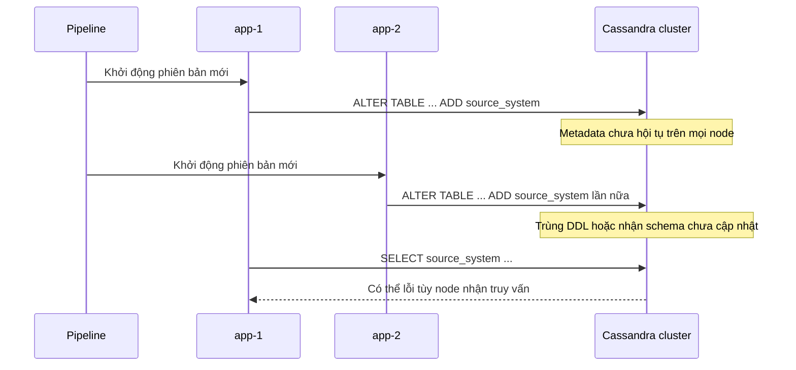
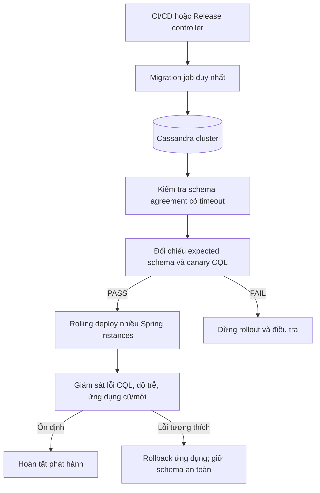

# Quản lý schema agreement trong triển khai nhiều instance

Một hệ thống **Spring Data Cassandra** thường chạy nhiều instance ứng dụng phía trước một cụm Apache Cassandra gồm nhiều node, thậm chí nhiều datacenter. Khi triển khai phiên bản mới, ứng dụng có thể cần thêm cột, tạo bảng truy vấn mới hoặc cập nhật ánh xạ entity. Nếu mỗi instance tự chạy CQL thay đổi schema ngay khi khởi động, các lệnh có thể chồng chéo, một phần node chưa kịp nhận schema mới, còn một phần ứng dụng đã gửi truy vấn tới cột vừa được thêm. Kết quả là lỗi chỉ xuất hiện ngắt quãng: instance A chạy được nhưng instance B báo “unknown column” hoặc không chuẩn bị được truy vấn.

Trong chương **Quan sát và vận hành**, nhiệm vụ là kiểm soát **schema agreement** — trạng thái các node Cassandra nhìn nhận cùng một phiên bản schema — trước khi chuyển lưu lượng sang ứng dụng phụ thuộc schema mới. Bài học gắn với cách Spring Data Cassandra ánh xạ entity, vận hành `CassandraRepository`/`CassandraTemplate` và truy vấn CQL, đồng thời làm rõ ranh giới giữa schema, dữ liệu phân tán và quá trình rolling deployment.

## 1. Schema agreement thực sự có nghĩa gì?

Trong Cassandra, schema bao gồm các định nghĩa như keyspace, bảng, cột, kiểu dữ liệu, index và một số đối tượng liên quan. Khi nhận CQL DDL như `CREATE TABLE` hoặc `ALTER TABLE`, coordinator thực hiện thay đổi metadata rồi các node khác cập nhật schema của mình theo cơ chế phân phối metadata của phiên bản Cassandra đang chạy. Việc hội tụ **không nhất thiết diễn ra tức thời** trên mọi node.

**Schema agreement** thường được hiểu là các node liên quan, ở trạng thái có thể quan sát được, báo cùng một `schema_version`. Đây là một điều kiện kỹ thuật quan trọng sau DDL, nhưng có phạm vi giới hạn:

| Trạng thái | Có thể kết luận | Chưa thể kết luận |
| --- | --- | --- |
| Các node đang hoạt động có cùng schema version | Các node được quan sát đã hội tụ về một phiên bản schema | Schema đó đúng với yêu cầu của bản phát hành |
| Migration chạy xong, CQL DDL trả thành công | Coordinator đã xử lý yêu cầu ở mức được xác nhận | Mọi node, mọi datacenter và mọi driver đều đã sẵn sàng |
| Driver có thể chuẩn bị truy vấn mới trên một node | Node được truy cập hiểu câu CQL và schema liên quan | Tất cả đường đi qua load balancer đều hoạt động |
| Dữ liệu đọc lại với `LOCAL_QUORUM` | Một mức bảo đảm đọc dữ liệu theo replica và topology đã chọn | Có schema agreement hoặc transaction xuyên partition |
| Tất cả ứng dụng đều dùng chung schema mới | Các instance triển khai có thể truy cập cùng định nghĩa bảng | Mọi instance tương thích với cấu trúc mới hoặc dữ liệu đã backfill |

**Ba khái niệm không được đánh đồng:**

- **Schema agreement:** các node Cassandra hội tụ về metadata schema.
- **Schema migration completed:** chuỗi thay đổi mong muốn đã được áp dụng và kiểm tra theo phiên bản/phát hành.
- **Application compatibility:** cả phiên bản ứng dụng cũ và mới có thể hoạt động với schema ở từng giai đoạn triển khai.

Cluster vẫn có thể “agreement” trên **schema sai** — ví dụ migration bỏ sót một cột — hoặc trên schema mới mà ứng dụng cũ không còn tương thích. Vì vậy, cổng kiểm tra triển khai phải xác nhận cả *agreement* lẫn *expected schema* và các truy vấn quan trọng.

## 2. Vì sao nhiều instance làm sự cố dễ xảy ra?

Giả sử có ba instance Spring Boot cùng truy cập Cassandra: `app-1`, `app-2`, `app-3`. Phiên bản mới thêm cột `source_system` vào bảng sự kiện.



Tình huống này thường xuất hiện khi:

1. Nhiều replica chạy một cấu hình tự tạo/cập nhật schema khi khởi động.
2. Pipeline migration và rollout ứng dụng chạy song song.
3. Có hai pipeline phát hành cùng thay đổi một keyspace.
4. DDL đã được chấp nhận nhưng việc kiểm tra agreement hết thời gian hoặc network bị phân hoạch.
5. Đợt rollout mới dùng câu CQL có cột mới trước khi tất cả node phục vụ truy vấn đã sẵn sàng.

Cassandra không cung cấp transaction DDL tổng quát cho **cả chuỗi** thay đổi schema. Chạy nhiều lệnh `ALTER TABLE` rồi gặp lỗi ở giữa có thể để lại trạng thái đã áp dụng một phần; đừng coi cả tập lệnh như một transaction có thể rollback tự động.

## 3. Kiến trúc triển khai: một bên quản lý schema, nhiều bên sử dụng

Điểm kiểm soát quan trọng nhất là **chỉ một luồng có thẩm quyền thực thi migration cho cùng một cluster/keyspace ở một thời điểm**. Các instance ứng dụng sử dụng schema đã được chuẩn bị sẵn.



Với ứng dụng Spring Boot 3.x, khi đã có migration được quản lý độc lập, cấu hình mẫu:

```yaml
spring:
  cassandra:
    keyspace-name: application_data
    schema-action: none
```

Giá trị `none` có nghĩa quá trình khởi tạo Spring Data Cassandra **không tự tạo, cập nhật hoặc xóa schema**. Tên thuộc tính có thể khác giữa các nhánh Spring Boot/Spring Data; kiểm tra cấu hình thực của phiên bản đang chạy. `keyspace-name` ở đây chỉ là tên minh họa.

Ở cấp vận hành, có thể dùng một migration job trong pipeline, Kubernetes Job hoặc công cụ quản lý schema do tổ chức chọn. **Một Kubernetes Job không tự đảm bảo “exactly once”**: retry hoặc nhiều pipeline vẫn có thể tạo nhiều lần chạy. Cần chính sách serialization theo môi trường, khóa phát hành hoặc coordinator chuyên dụng, cùng cơ chế đối soát sau lỗi.

| Thành phần | Trách nhiệm |
| --- | --- |
| Migration job | Áp dụng các thay đổi CQL đã được review theo thứ tự có kiểm soát |
| Release controller | Không mở rollout khi migration hoặc schema check thất bại |
| Spring instance | Dùng schema hiện có, chuẩn bị truy vấn và phục vụ nghiệp vụ |
| Health/readiness | Đánh giá khả năng instance xử lý request, không tự chạy DDL |
| Observability | Theo dõi phiên bản triển khai, trạng thái schema, lỗi CQL và độ trễ |

Không nên dùng việc “mỗi pod startup đều gọi `CREATE TABLE IF NOT EXISTS`” làm cơ chế migration chính. Một câu lệnh idempotent riêng lẻ không giải quyết trình tự nhiều bước, cạnh tranh giữa phiên bản ứng dụng hoặc xác thực cấu trúc bảng hiện hữu.

## 4. Ví dụ thực tế: thêm cột mà vẫn hỗ trợ rolling deployment

Ứng dụng lưu sự kiện theo tenant và tháng; khóa chính được chọn theo truy vấn, không chọn tùy tiện theo entity Java.

Schema trước khi nâng cấp:

```sql
CREATE TABLE activity_by_tenant_month (
    tenant_id text,
    month_bucket text,
    occurred_at timestamp,
    event_id uuid,
    event_type text,
    PRIMARY KEY ((tenant_id, month_bucket), occurred_at, event_id)
) WITH CLUSTERING ORDER BY (occurred_at DESC, event_id ASC);
```

Yêu cầu mới: lưu tên hệ thống phát sinh sự kiện trong cột `source_system`. Chiến lược **expand–migrate–contract** đặt thay đổi tương thích lên trước:

**Giai đoạn 1 — Expand schema (migration M1):**

```sql
ALTER TABLE activity_by_tenant_month
ADD source_system text;
```

Sau đó chờ schema agreement, đối chiếu định nghĩa cột trong metadata và chạy truy vấn canary theo đúng partition key. Nếu cột đã tồn tại từ lần chạy trước, job phải **kiểm tra kiểu và định nghĩa thực tế** trước khi quyết định bỏ qua; không lặp `ADD` một cách mù quáng.

**Giai đoạn 2 — Deploy ứng dụng tương thích:**

- Phiên bản cũ tiếp tục truy vấn những cột cũ; cột mới không làm thay đổi partition key.
- Phiên bản mới ánh xạ `source_system`, ghi dữ liệu nếu có và chấp nhận `null`/thiếu cột ở các dòng được tạo trước migration.
- Đảm bảo các truy vấn theo `tenant_id` và `month_bucket` vẫn đúng, không thêm `ALLOW FILTERING` chỉ vì có trường mới.

Ví dụ phần ánh xạ trong một entity Spring Data Cassandra:

```java
import org.springframework.data.cassandra.core.mapping.Column;

// Thành viên của @Table("activity_by_tenant_month") đã có @PrimaryKey.
@Column("source_system")
private String sourceSystem;
```

Đây là đoạn minh họa **một trường** trong entity, không phải toàn bộ lớp có thể biên dịch riêng. Phần mềm cần xử lý `sourceSystem == null` khi đọc lịch sử cũ; Cassandra không tự backfill cột mới cho các bản ghi trước đó.

**Giai đoạn 3 — Backfill có kiểm soát (nếu nghiệp vụ cần):** xử lý dữ liệu theo partition/bucket, phân trang và giới hạn concurrency, theo dõi timeout, lượng dữ liệu còn thiếu. Một lệnh quét toàn cluster hoặc cập nhật từng hàng thiếu partition key có thể ảnh hưởng hiệu năng rất lớn.

**Giai đoạn 4 — Contract ở bản phát hành sau:** chỉ loại bỏ cột/đường đọc cũ nếu chắc chắn không còn phiên bản ứng dụng nào cần nó. Với Cassandra, đổi kiểu hoặc xóa cột có thể ảnh hưởng dữ liệu và compatibility; không giả định có rollback DDL đối xứng, tức thời và không mất dữ liệu.

### Vì sao không đổi schema và deploy cùng một lúc?

Hãy xem mốc thời gian:

| Mốc | Trạng thái Cassandra | Ứng dụng đang chạy | Hành động |
| --- | --- | --- | --- |
| T0 | Schema cũ đã ổn định | 100% phiên bản V1 | Chuẩn bị migration và kế hoạch rollback |
| T1 | M1 vừa chạy, đang hội tụ | V1 | Chưa deploy code cần cột mới |
| T2 | M1 agreement, schema đúng, canary PASS | V1 | Bắt đầu rolling deploy V2 |
| T3 | Schema mới ổn định | V1 + V2 | Giám sát truy vấn của cả hai phiên bản |
| T4 | Schema mới ổn định | 100% V2 | Hoàn tất rollout |
| T5 | Sau một khoảng tương thích phù hợp | Phiên bản mới | Xem xét backfill/cleanup độc lập |

Mô hình này giảm số lần thay đổi có thể xảy ra đồng thời, làm rõ điểm dừng khi phát sinh sự cố và cho phép rollback ứng dụng mà không phải vội vàng đảo ngược schema mới.

## 5. Kiểm tra schema agreement bằng công cụ Cassandra

### 5.1 Quan sát toàn cụm

Khi có quyền vận hành cụm, hai lệnh thường dùng:

```text
nodetool status
nodetool describecluster
```

- `nodetool status` cho biết tình trạng thành viên, datacenter và những node đang up/down. Lệnh này giúp đánh giá một nút có đang mất kết nối hay không.
- `nodetool describecluster` hiển thị thông tin cụm và **schema versions theo các node mà nó quan sát được**. Khi có nhiều phiên bản schema trong danh sách, đây là dấu hiệu cluster chưa hội tụ hoặc có vấn đề cần điều tra.

Một hình dung rút gọn (minh họa, không phải output chính xác của mọi phiên bản):

```text
Cluster: production
Schema versions:
  6b... : [node-a, node-b]
  8d... : [node-c]
```

Trường hợp trên **chưa đạt schema agreement** giữa các node được liệt kê. Nếu node-c đang down hoặc không reachable, cần xác định tác động và chính sách triển khai; việc chỉ nhìn node đang healthy rồi gắn nhãn `AGREED` không tự chứng minh toàn bộ cụm đã đồng bộ.

### 5.2 Đối chiếu qua system tables

Cassandra 4.x có thể cho phép truy vấn thông tin schema version mà một node biết:

```sql
SELECT schema_version FROM system.local;

SELECT peer, peer_port, schema_version
FROM system.peers_v2;
```

Trong một số phiên bản cũ, metadata của peer nằm ở `system.peers`, không phải `system.peers_v2`. Truy vấn system tables trên **một coordinator** chỉ phản ánh góc nhìn của nó tại thời điểm đọc; thông tin peer có thể chưa mới hoặc thiếu node không reachable. Không dùng một câu `SELECT DISTINCT schema_version FROM system.peers_v2` từ một node làm điều kiện triển khai duy nhất.

Để kiểm tra thực tế, kết hợp: trạng thái node, danh sách node dự kiến, schema versions từ nguồn quan sát thích hợp và việc xác nhận schema mong muốn đã tồn tại. Nếu dùng driver có API phát hiện schema agreement, cần hiểu phạm vi node mà API kiểm tra, thời gian chờ và hành vi khi mất node.

### 5.3 Xác minh expected schema và canary CQL

Ngay cả khi các node có chung schema version, migration vẫn có thể thiếu cột, định nghĩa sai kiểu hoặc sai primary key. Nên đối chiếu các thông tin quan trọng như `keyspace`, cột, kiểu dữ liệu và khóa trong schema metadata với manifest migration đã duyệt.

Sau khi kiểm tra, thực hiện **canary read** có giới hạn theo khóa chính:

```sql
SELECT occurred_at, event_id, event_type, source_system
FROM activity_by_tenant_month
WHERE tenant_id = ?
  AND month_bucket = ?
LIMIT 1;
```

Canary giúp phát hiện truy vấn mới chưa được schema hỗ trợ, nhưng một kết quả thành công từ một coordinator **không thay thế** kiểm tra agreement toàn cụm. Nếu cần tin cậy hơn, thực hiện kiểm tra có phạm vi bao quát các đường đi và datacenter quan trọng. Hạn chế dùng canary ghi nếu có nguy cơ tạo bản ghi nghiệp vụ ngoài ý muốn; test ghi nên dùng dữ liệu/cụm kiểm thử được kiểm soát.

## 6. Đặt cổng kiểm tra trong CI/CD có thời hạn rõ ràng

Một pipeline triển khai nên có thứ tự phụ thuộc và điều kiện dừng tường minh:

```text
preflight:
  - kiểm tra trạng thái node/datacenter và thay đổi đồng thời
  - xác nhận snapshot/backup/khả năng phục hồi nếu migration rủi ro
  - xác nhận không có migration job khác trên cùng keyspace

run-migration:
  - lấy quyền chạy độc quyền theo môi trường
  - áp dụng CQL đã được review, ghi nhận migration ID/checksum

wait-and-verify:                         # Pseudocode
  deadline = monotonic_now + 120 seconds  # Chỉ là ví dụ, đo theo cụm
  loop while monotonic_now < deadline:
      if expected_nodes_healthy
         and schema_versions_converged
         and expected_schema_matches
         and canary_queries_pass:
          PASS
      backoff_with_limit()
  FAIL_AND_STOP_ROLLOUT

rolling-deploy:
  - triển khai phiên bản ứng dụng mới từng đợt
  - theo dõi lỗi CQL, tỷ lệ lỗi HTTP, độ trễ và node health
  - dừng/can thiệp khi ngưỡng cảnh báo bị vượt
```

Đây là **pseudo-workflow**, không phải lệnh chạy trực tiếp. Các mục `expected_nodes_healthy`, `schema_versions_converged` và `expected_schema_matches` cần triển khai bằng công cụ quan sát đáng tin cậy trong môi trường cụ thể.

Timeout phải hữu hạn và có điều kiện rõ. Đừng thay việc quan sát agreement bằng `sleep 30`: cụm có thể hội tụ trong vài giây hoặc chưa xong sau 30 giây. Khi hết thời gian chờ, **chặn rollout**, lưu thông tin node/version và mở sự cố cần kiểm tra thay vì cho ứng dụng mới chạy mù.

### Migration ledger và tình huống timeout sau DDL

Nếu dùng bảng ghi lịch sử migration với ID, checksum, người chạy, thời điểm và trạng thái, hãy nhớ rằng **ghi ledger và thay đổi DDL không nằm trong cùng một transaction Cassandra**. Có thể xảy ra:

1. DDL thực tế đã được áp dụng.
2. Kết nối với migration runner timeout trước khi nhận phản hồi.
3. Runner chưa kịp đánh dấu migration thành công trong ledger.

Lần chạy lại phải **đọc schema hiện tại và đối chiếu định nghĩa kỳ vọng** trước khi quyết định retry. Chỉ dựa vào `IF NOT EXISTS` để bỏ qua lỗi có thể che mất một bảng cùng tên nhưng sai partition key hoặc sai kiểu. Ledger cũng không tự thay thế cơ chế ngăn hai release chạy migration đồng thời.

## 7. Những rủi ro khi triển khai nhiều datacenter

Trong Cassandra nhiều datacenter, hệ thống thường có các topology và mục tiêu sẵn sàng khác nhau. Một câu ghi ở consistency `LOCAL_QUORUM` hay `LOCAL_ONE` nói về **độ nhất quán dữ liệu trong thao tác đọc/ghi**, không phải schema agreement của cả cluster.

Những tình huống cần kiểm tra riêng:

- **Datacenter ở xa mất kết nối:** datacenter gần có thể cập nhật schema trước, còn datacenter xa chưa nhận được. Nếu hệ thống vẫn định phục vụ traffic ở cả hai nơi, không thể xem việc một DC đã xong là đủ.
- **Node down trong migration:** node có thể cần cập nhật schema khi quay lại. Tùy chính sách phát hành, phải chặn hoặc yêu cầu đánh giá rủi ro rõ ràng; không tự ý bỏ qua node chỉ vì ứng dụng có thể tạm phục vụ bằng những node khác.
- **Driver của các instance theo dõi metadata khác thời điểm:** một số instance có thể refresh/prepare truy vấn sớm hơn số khác. Xác nhận cluster state và sẵn sàng của ứng dụng sau migration, nhất là với các prepared statement.
- **Tương thích phiên bản Cassandra:** cú pháp DDL, bảng system và hành vi thông báo schema có thể khác theo Cassandra 3.x/4.x/5.x; phải thử migration trên phiên bản tương thích với production.

Schema agreement chỉ kiểm tra một phần của quá trình triển khai; nó không bảo đảm keyspace có replication factor đúng, partition được phân bố tốt, read/write đạt quorum hay dữ liệu mới đã được backfill.

## 8. Quan sát những tín hiệu nào để biết triển khai đang an toàn?

Không phải bản phân phối Cassandra nào cũng xuất sẵn một metric `schema_agreement_status` theo cùng tên. Khi cần dashboard triển khai, có thể **tự xây dựng checker** định kỳ đọc trạng thái schema và xuất các metric thuộc hệ thống quan sát của tổ chức. Phân biệt rõ metric tự định nghĩa với metric có sẵn của Cassandra/driver.

| Nhóm tín hiệu | Ví dụ thông tin thu thập | Ý nghĩa vận hành |
| --- | --- | --- |
| Schema | Số schema version khác nhau giữa các node dự kiến; trạng thái agreement | Xác định cluster đã hội tụ hay chưa |
| Migration | Migration ID, checksum, thời điểm bắt đầu/kết thúc, số lần retry, trạng thái | Biết phát hành đang chờ ở bước nào |
| Cassandra node | Node up/down, lỗi kết nối, cảnh báo hệ thống | Phát hiện node bị thiếu khỏi phạm vi kiểm tra |
| Driver/CQL | Lỗi `InvalidQueryException`, lỗi prepare, timeout, unavailable, retry | Phát hiện ứng dụng đọc schema chưa đúng hoặc cụm gặp sự cố |
| Ứng dụng | Phiên bản đang chạy theo instance, readiness, lỗi API và độ trễ p95/p99 | Biết lỗi chỉ xảy ra ở bản mới hay lan cả bản cũ |
| Hiệu năng | Latency truy vấn, số retry, tombstone/partition bất thường sau migration | Phát hiện schema/query mới gây tải ngoài dự kiến |

Ví dụ đặt tên **metric tự định nghĩa** để mô tả dashboard:

```text
deployment_schema_agreement{cluster="main"} = 1
deployment_schema_mismatch_nodes{cluster="main"} = 0
deployment_migration_in_progress{cluster="main"} = 0
deployment_migration_last_success_timestamp_seconds{cluster="main"} = ...
```

Giá trị và tên ở trên **không được coi là metric Cassandra/Spring Boot mặc định**. Checker phải định nghĩa rõ cách phân biệt `0 = không agreement` với `unknown = không đủ dữ liệu`. Nếu checker không kết nối được cụm, không nên tự xuất `agreement = 1` chỉ vì không thấy mismatch.

Gắn trace/log của lỗi CQL với `deployment_id`, `application_version`, keyspace và tên thao tác logic; tránh nhồi partition key chứa dữ liệu người dùng, paging state hoặc giá trị nhạy cảm vào log. Ghi nhận migration ID trong log để liên hệ sự cố với thay đổi đã áp dụng.

### Phân loại cảnh báo đúng mức

- **Migration đang chạy và chưa agreement:** có thể là trạng thái chuyển tiếp bình thường, nhưng phải theo dõi thời lượng.
- **Đã vượt deadline mà vẫn chưa agreement:** chặn triển khai; cảnh báo kèm node/version và trạng thái kết nối.
- **Agreement đạt nhưng canary query lỗi:** kiểm tra expected schema, quyền truy cập, metadata driver và câu CQL; không kết luận migration đã hoàn chỉnh.
- **Sau rollout tăng đột biến lỗi unknown column:** ưu tiên điều tra thứ tự triển khai, schema metadata, các instance còn dùng query cũ/mới.
- **Có nhiều phiên bản ứng dụng hoạt động nhưng schema không tương thích:** dừng rollout và xem xét rollback ứng dụng trước khi can thiệp bằng DDL phá hủy.

## 9. Runbook khi schema không hội tụ

Khi rollout bị kẹt tại bước schema agreement, người vận hành nên xử lý theo trình tự có thể kiểm chứng:

1. **Đóng băng đợt rollout mới** trên keyspace liên quan; bảo đảm chỉ còn migration runner đã được chỉ định.
2. **Ghi lại hiện trạng:** migration ID, thời điểm, DDL đã gửi, phiên bản Cassandra, topology, node up/down, schema versions và log lỗi của driver.
3. **Đối chiếu schema thực tế** với manifest mong muốn; kiểm tra cột, kiểu dữ liệu, partition key và index theo yêu cầu, không chỉ so UUID schema version.
4. **Kiểm tra node khác biệt** bằng công cụ quản trị và log Cassandra; phân biệt node mất kết nối với node sống nhưng chưa cập nhật metadata.
5. **Xử lý nguyên nhân cụ thể:** khôi phục kết nối/giải quyết lỗi node, xác nhận migration đã áp dụng một phần hoặc sửa câu DDL sai bằng thay đổi được review.
6. **Chạy lại kiểm tra bounded** với danh sách node dự kiến và canary query sau khi đã xử lý nguyên nhân; không dùng vòng retry vô hạn.
7. **Chỉ tiếp tục rollout** sau khi schema đúng, mức agreement yêu cầu đạt và các query cần thiết có thể thực thi.

Không nên xử lý bằng cách xóa schema version, cưỡng ép node ghi đè metadata hoặc chạy đi chạy lại `DROP/CREATE TABLE`. Những thao tác này có thể dẫn đến mất dữ liệu hoặc làm sự cố nghiêm trọng hơn. Với cluster có node down lâu hoặc topology bất thường, cần quy trình vận hành Cassandra phù hợp và xem xét ảnh hưởng tới mọi datacenter trước khi thay đổi.

### Các tình huống hay gặp

| Dấu hiệu | Giả thuyết cần kiểm tra | Hành động đầu tiên |
| --- | --- | --- |
| `describecluster` có nhiều schema version | Node chưa cập nhật hoặc mất liên lạc | Kiểm tra `nodetool status`, mạng và log node |
| Agreement báo đạt nhưng `SELECT new_column` lỗi | Expected schema sai, chạy thiếu migration hoặc driver/query dùng nhầm keyspace | Đối chiếu metadata cột, keyspace và canary trên đường truy cập thực |
| Migration runner timeout | DDL đã áp dụng nhưng phản hồi bị mất | Kiểm tra schema hiện tại và ledger trước khi retry |
| Pod mới crash, pod cũ chạy tốt | Code mới đòi schema chưa sẵn sàng hoặc mapping không tương thích | Tạm dừng rolling deploy, kiểm tra CQL/annotation |
| Schema ổn nhưng query mới tăng timeout | Thay đổi access pattern, partition lớn, fan-out hoặc index không phù hợp | So sánh latency/trace/truy vấn theo partition key |
| Pipeline A và B cùng chạy migration | Thiếu serialization theo release/keyspace | Dừng pipeline cạnh tranh và đối chiếu đã chạy bước nào |

## 10. Kiểm thử chiến lược migration trước production

Không thể kiểm chứng hành vi **schema hội tụ giữa các node** chỉ bằng unit test hay Cassandra container một node. Nên tách các lớp kiểm thử:

**Unit test cho release checker:** giả lập danh sách node dự kiến, schema version, node mất kết nối, timeout và expected schema khác nhau. Test điều kiện “không đủ bằng chứng” không được trả PASS. Không cần Cassandra thật để kiểm tra bộ đếm thời gian, chính sách retry hoặc logic chặn rollout.

**Integration test trên Cassandra thật:** khởi tạo keyspace/bảng, áp dụng migration thêm cột, chạy `CassandraRepository`/`CassandraTemplate` hoặc CQL canary để xác nhận mapping và truy vấn hoạt động. Testcontainers một node phù hợp cho cú pháp DDL, kiểu dữ liệu và khả năng đọc bản ghi cũ có cột mới `null`; nó không chứng minh hội tụ nhiều node.

**Staging nhiều node, nếu nghiệp vụ yêu cầu:** mô phỏng node cập nhật chậm hoặc không reachable, kiểm tra số lần retry, deadline, cách controller dừng rollout. Thực hiện cả tình huống nhiều instance V1/V2 chạy đồng thời với bảng cũ/mới.

**Contract test tương thích hai chiều:** sau migration M1, V1 vẫn đọc/ghi được; V2 đọc được dữ liệu V1, bao gồm hàng thiếu `source_system`; chỉ có V2 sử dụng cột mới sau khi schema đủ điều kiện. Những test này có giá trị hơn việc chỉ chạy thử một bản phát hành mới trên schema mới hoàn toàn.

Đối với migration lớn có backfill, thêm kiểm thử tải có giới hạn, paging và consistency để không làm bão hòa cluster. Thời gian chạy migration phụ thuộc số node, trạng thái mạng và tải; do đó SLO/timeout nên dựa trên kết quả đo của môi trường tương ứng.

## 11. Checklist vận hành cho một đợt rollout nhiều instance

1. Có một migration owner duy nhất cho keyspace và cơ chế ngăn các pipeline phát hành đồng thời.
2. Các Spring instance production dùng chế độ không tự tạo/xóa schema trong startup, theo đúng phiên bản Spring Boot.
3. Mỗi migration có ID, thứ tự, checksum và expected schema rõ; chạy lại sau timeout phải dựa trên trạng thái thực.
4. DDL được review về tương thích V1/V2, loại thay đổi, khóa chính, CQL và kế hoạch backfill/cleanup nếu có.
5. Trước rollout, biết danh sách node/datacenter dự kiến và có số liệu sức khỏe cụm.
6. Cổng chờ agreement dùng deadline hữu hạn và kiểm tra được các node liên quan, không phụ thuộc một lần ngủ cố định.
7. Sau agreement, đối chiếu expected schema và chạy canary query thực tế, có phân biệt keyspace và partition.
8. Rolling deploy theo đợt với theo dõi lỗi CQL, readiness, latency và tỷ lệ ứng dụng V1/V2.
9. Có chiến lược rollback ứng dụng mà không yêu cầu DDL phá hủy ngay lập tức.
10. Có runbook ghi nhận node/version, lỗi migration và cách dừng hoặc khôi phục rollout khi chưa hội tụ.

**Nguyên tắc ghi nhớ:** trong Spring Data Cassandra, **schema agreement là một cổng kiểm soát trạng thái metadata của Cassandra cluster**, không phải giấy chứng nhận toàn bộ migration hoặc ứng dụng đã an toàn. Vận hành ổn định cần một luồng quản lý DDL, thay đổi schema tương thích qua các phiên bản, kiểm tra có thời hạn trên các node liên quan, xác nhận CQL thực tế và quan sát trong toàn bộ quá trình triển khai nhiều instance.
