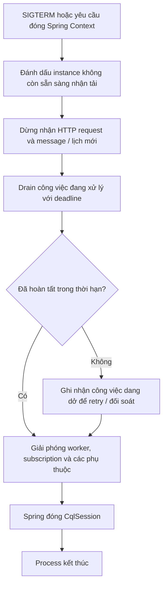
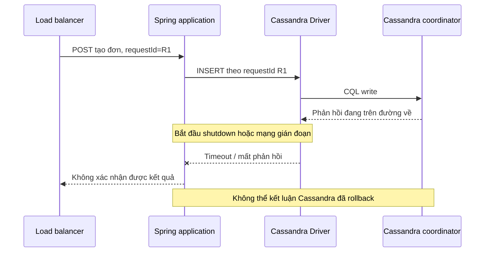

# Dừng ứng dụng có kiểm soát và đóng session trong Spring Data Cassandra

Khi một ứng dụng **Spring Data Cassandra** nhận tín hiệu dừng, công việc không kết thúc ngay tại thời điểm HTTP server ngừng nhận kết nối mới. Ứng dụng có thể vẫn đang ghi dữ liệu qua `CassandraRepository`, đọc nhiều trang bằng `CassandraTemplate`, chạy CQL qua `CqlSession`, hoặc xử lý message từ queue. Nếu đóng Cassandra session trước khi các tác vụ này hoàn tất, request đang chạy có thể lỗi, công việc bị bỏ dở và kết quả ghi trở thành **chưa xác định** từ góc nhìn của ứng dụng.

Bài thuộc nhóm **Quan sát và vận hành**, tập trung vào **graceful shutdown** (dừng có kiểm soát), thứ tự đóng tài nguyên, quản lý vòng đời Cassandra Java Driver và cách kiểm thử, theo dõi quá trình dừng. Ví dụ dùng Spring Boot 3.x, Spring Data Cassandra và Cassandra Java Driver 4.x; tên API/cấu hình cần được đối chiếu với phiên bản thực tế của dự án.

## 1. Mục tiêu của một lần shutdown an toàn

Khi triển khai phiên bản mới, scale down hoặc nhận `SIGTERM`, một lần dừng tốt cần đạt những mục tiêu sau:

1. **Ngừng tiếp nhận công việc mới:** các HTTP request, message, lịch chạy và lệnh ghi nền mới không tiếp tục tràn vào instance đang dừng.
2. **Cho công việc đã tiếp nhận cơ hội hoàn tất:** những request đang dùng Cassandra được drain trong một khoảng thời gian có giới hạn.
3. **Bảo toàn khả năng phục hồi:** thao tác không thể hoàn tất phải có cơ chế tiếp tục hoặc đối soát; đừng mặc định rollback chỉ vì timeout.
4. **Đóng tài nguyên sau cùng:** chỉ đóng `CqlSession` khi các thành phần dùng nó đã dừng hoặc được xử lý theo phương án lỗi có kiểm soát.
5. **Kết thúc trong ngân sách thời gian:** process thoát trước thời hạn môi trường triển khai buộc phải kill.
6. **Để lại tín hiệu quan sát được:** log, metric và tracing cho biết instance đã vào trạng thái draining, còn bao nhiêu tác vụ và vì sao kết thúc.

Tư duy quan trọng: **graceful shutdown là quy trình nhiều bước, không phải một lệnh `session.close()`**. Đóng driver đúng cách là bước cuối của một chuỗi quyết định về request, message và dữ liệu.



Hình trên thể hiện **thứ tự mong muốn**. Spring Boot hỗ trợ graceful shutdown HTTP và vòng đời bean, nhưng một listener Kafka, scheduler tự tạo hay worker tùy biến có thể cần cơ chế dừng riêng để thực hiện đầy đủ các bước.

## 2. Điều gì xảy ra khi Cassandra session đóng?

`CqlSession` của Cassandra Java Driver là tài nguyên lâu sống, quản lý metadata cluster, connection pool, định tuyến request, statement execution và các tài nguyên nội bộ. Spring Data Cassandra dùng session này làm nền tảng cho repository và template.

- `session.close()` đóng session và đợi quá trình đóng hoàn tất theo hành vi của driver; sau đó không được gửi request mới vào session.
- `session.closeAsync()` cung cấp cách đóng bất đồng bộ, hữu ích nếu ứng dụng tự quản lý vòng đời và cần phối hợp completion của thao tác đóng.
- Việc đóng session **không phải rollback** cho request đã gửi đến Cassandra; request có thể đã ghi dữ liệu dù phía client không nhận được ACK.
- Đóng session cũng **không đồng nghĩa đã drain toàn bộ công việc nghiệp vụ**. Nếu một tác vụ reactive, một HTTP handler hoặc một message consumer còn tham chiếu session, nó có thể lỗi khi thử sử dụng tài nguyên đã đóng.

Không tạo một `CqlSession` mới cho từng request và không gọi `close()` trong phương thức repository/service sau mỗi lần truy vấn. Driver thiết kế session dùng chung để tái sử dụng kết nối; mất một node Cassandra cũng không phải lý do để tự đóng và tạo lại session sau từng exception.

### Ai sở hữu session và ai chịu trách nhiệm đóng?

| Cách tạo session | Chủ sở hữu vòng đời | Cách đóng phù hợp |
|---|---|---|
| Spring Boot tự cấu hình `CqlSession` từ `spring.cassandra.*` | Spring `ApplicationContext` | Để Spring quản lý và đóng khi context shutdown. |
| Ứng dụng khai báo singleton `@Bean` trả về `CqlSession` | Spring `ApplicationContext` | Khai báo destroy callback phù hợp, ví dụ `@Bean(destroyMethod = "close")`. |
| Ứng dụng standalone tự `CqlSession.builder().build()` ngoài Spring | Chính đoạn code tạo session | Dùng `try-with-resources` hoặc đóng trong `finally` ở điểm kết thúc vòng đời ứng dụng. |
| Component chỉ **inject** `CqlSession`, `CassandraTemplate` hoặc repository | Component là người sử dụng, không sở hữu session | Không tự đóng session trong request handler hoặc listener. |

Spring thường tự suy luận phương thức hủy `close`/`shutdown` cho một số bean phù hợp, nhưng khai báo rõ `destroyMethod = "close"` khi **tự tạo bean session** giúp diễn đạt ý định. Nếu dùng auto-configuration của Spring Boot, **không tạo thêm session thủ công chỉ để triển khai shutdown**.

## 3. Bật graceful shutdown trong Spring Boot

Ví dụ cấu hình cho một ứng dụng Spring Boot:

```yaml
server:
  shutdown: graceful

spring:
  lifecycle:
    timeout-per-shutdown-phase: 40s
  cassandra:
    contact-points: 127.0.0.1:9042
    local-datacenter: datacenter1
    keyspace-name: app_keyspace

management:
  endpoint:
    health:
      probes:
        enabled: true
```

Trong đó:

- `server.shutdown=graceful` yêu cầu web server tích hợp dừng tiếp nhận request mới theo cơ chế của server và cho các request đang xử lý thời gian kết thúc. Chi tiết cách từ chối kết nối/request mới phụ thuộc Tomcat, Jetty, Undertow hay Reactor Netty.
- `spring.lifecycle.timeout-per-shutdown-phase` là thời gian Spring cho **mỗi pha shutdown lifecycle**, không phải cam kết toàn bộ process chắc chắn thoát sau đúng 40 giây.
- Actuator health probes cho phép môi trường triển khai quan sát **readiness**; cần kiểm tra cấu hình public endpoint và chính sách truy cập trước khi dùng trong production.
- `spring.cassandra.*` là ví dụ cấu hình Cassandra; giá trị contact points, datacenter và keyspace phải được thay theo môi trường. Secret và cấu hình bảo mật nên lấy từ cơ chế cấu hình an toàn, không ghi cứng vào tài liệu hoặc mã nguồn.

**Giới hạn quan trọng:** graceful shutdown của web server chủ yếu xử lý traffic qua HTTP server đó. Nó không tự bảo đảm Kafka listener đã dừng poll, `@Scheduled` không tạo việc mới, task trong `ExecutorService` đã chạy hết, hay một `Flux` dài đã hoàn tất.

### Thứ tự liên quan readiness và request mới

Khi chuẩn bị dừng một instance phía sau load balancer / Kubernetes:

1. Đưa instance sang trạng thái **không sẵn sàng nhận request mới** hoặc bắt đầu quy trình dừng mà hệ thống điều phối nhận biết.
2. Cho hệ thống cân bằng tải cơ hội cập nhật endpoint; lưu ý có độ trễ lan truyền và kết nối đang mở.
3. Dừng nhận công việc mới từ các nguồn không đi qua HTTP load balancer, như message broker hoặc scheduler.
4. Chờ request và công việc đã nhận hoàn tất trong khoảng thời gian cho phép.
5. Đóng session và thoát process.

Spring Boot có cơ chế availability state và readiness probes. Nếu cần chủ động đổi trạng thái trong ứng dụng, có thể phát sự kiện `AvailabilityChangeEvent` với `ReadinessState.REFUSING_TRAFFIC`. Việc đổi readiness **không ngăn tức thì** tất cả request đến đang trên đường mạng; vẫn cần cơ chế drain khi context thực sự dừng.

## 4. Thứ tự dừng giữa worker và Cassandra session

Một thứ tự dễ gây lỗi:

```text
SIGTERM
  ├─ session.close()
  ├─ worker tiếp tục gọi repository.save(...)
  └─ request lỗi vì session đã đóng; công việc có thể chưa rõ kết quả
```

Thứ tự mong muốn:

```text
SIGTERM
  ├─ từ chối công việc mới / dừng poll và schedule
  ├─ drain request, tác vụ async và các lần ghi đang chạy
  ├─ ghi nhận tác vụ chưa xác định để retry/đối soát
  ├─ giải phóng worker và các component đang sử dụng session
  └─ đóng CqlSession một lần qua Spring ApplicationContext
```

### 4.1. Dùng vòng đời bean của Spring

Với Spring Boot tự tạo `CqlSession`, một service thường chỉ cần constructor injection:

```java
import com.datastax.oss.driver.api.core.CqlSession;
import org.springframework.stereotype.Service;

@Service
public class OrderLookupService {
    private final CqlSession session;

    public OrderLookupService(CqlSession session) {
        this.session = session;
    }

    // Dùng session khi ứng dụng hoạt động; không close() trong phương thức này.
}
```

Spring biết quan hệ phụ thuộc giữa bean dùng `CqlSession` và bean session; thông thường nó hủy component phụ thuộc trước khi hủy dependency. Khi component chứa worker bất đồng bộ hoặc tài nguyên tạo ngoài Spring, **đừng chỉ dựa vào việc có dependency injection để suy ra mọi task đã chạy xong**. Component đó cần chủ động ngừng nhận việc và chờ hoàn tất trong phương thức lifecycle.

Nếu có lý do cụ thể để tự tạo session bean thay cho auto-configuration:

```java
import java.net.InetSocketAddress;

import com.datastax.oss.driver.api.core.CqlSession;
import org.springframework.context.annotation.Bean;
import org.springframework.context.annotation.Configuration;

@Configuration
public class CassandraSessionConfig {
    @Bean(destroyMethod = "close")
    CqlSession cqlSession() {
        return CqlSession.builder()
            .addContactPoint(new InetSocketAddress("127.0.0.1", 9042))
            .withLocalDatacenter("datacenter1")
            .withKeyspace("app_keyspace")
            .build();
    }
}
```

Đây là **ví dụ thay thế cách tạo session**, không phải bean bổ sung song song cho cấu hình tự động sẵn có. Sử dụng thông số môi trường và credential phù hợp. Với một bean do Spring sở hữu, tránh gọi `close()` lần nữa trong `@PreDestroy` của service khác.

### 4.2. Ví dụ dừng một worker ghi CQL đồng bộ

Giả sử ứng dụng tự tạo một pool để xử lý tác vụ ghi. Ví dụ dưới đây minh họa cách chặn việc mới, drain tác vụ đang trong pool và để Spring đóng session **sau** component phụ thuộc. Đây là ví dụ cho tác vụ **đồng bộ trong executor**; nếu code khởi chạy `executeAsync()` rồi trả về ngay thì phải theo dõi cả future của driver, không chỉ chờ executor hết task.

```java
import java.util.concurrent.CompletableFuture;
import java.util.concurrent.ExecutorService;
import java.util.concurrent.Executors;
import java.util.concurrent.RejectedExecutionException;
import java.util.concurrent.TimeUnit;
import java.util.concurrent.atomic.AtomicBoolean;

import com.datastax.oss.driver.api.core.CqlSession;
import com.datastax.oss.driver.api.core.cql.BoundStatement;
import jakarta.annotation.PreDestroy;
import org.springframework.stereotype.Component;

@Component
public class CassandraWriteWorker {
    private final CqlSession session;
    private final ExecutorService workers = Executors.newFixedThreadPool(4);
    private final AtomicBoolean accepting = new AtomicBoolean(true);

    public CassandraWriteWorker(CqlSession session) {
        this.session = session;
    }

    public CompletableFuture<Void> submit(BoundStatement statement) {
        if (!accepting.get()) {
            return CompletableFuture.failedFuture(
                new RejectedExecutionException("Instance is draining"));
        }
        try {
            return CompletableFuture.runAsync(
                () -> session.execute(statement), workers);
        } catch (RejectedExecutionException ex) {
            // Race khi shutdown bắt đầu giữa kiểm tra cờ và enqueue.
            return CompletableFuture.failedFuture(ex);
        }
    }

    @PreDestroy
    public void stop() {
        accepting.set(false);
        workers.shutdown(); // Không nhận task mới, cho task đã nhận chạy tiếp.
        try {
            if (!workers.awaitTermination(20, TimeUnit.SECONDS)) {
                // Cần theo dõi và đối soát task còn dang dở theo nghiệp vụ.
                workers.shutdownNow();
            }
        } catch (InterruptedException ex) {
            workers.shutdownNow();
            Thread.currentThread().interrupt();
        }
        // Không đóng session: Spring quản lý tài nguyên được inject.
    }
}
```

**Cảnh báo cho ví dụ:** `shutdownNow()` chỉ gửi yêu cầu ngắt các task và trả về một số task chưa chạy; không bảo đảm CQL đã hủy trên server hoặc công việc đã được ghi bền vững. Để ứng dụng chịu được crash / kill cưỡng bức, input cho worker cần nguồn có thể phát lại (ví dụ message broker với cơ chế ack phù hợp) hoặc bảng trạng thái/idempotency key để tiếp tục xử lý. Một queue chỉ nằm trong RAM có thể mất việc khi process bị kill. Nếu hết thời hạn drain mà task vẫn chạy, không được báo tất cả là thành công.

### 4.3. Khi cần điều phối nhiều pha shutdown

Spring cung cấp `SmartLifecycle` với `start()`, `stop(Runnable callback)`, `isRunning()` và `getPhase()`. Trong cơ chế này, bean có phase cao hơn thường được dừng **trước** bean có phase thấp hơn; các bean cùng pha có thể được dừng đồng thời. Khi triển khai shutdown bất đồng bộ, phải gọi `callback.run()` sau khi đã hoàn tất phần dừng mà bean chịu trách nhiệm, nếu không coordinator phải chờ đến timeout pha.

Có thể tổ chức thành:

| Thành phần | Việc cần làm khi dừng | Lưu ý |
|---|---|---|
| HTTP server | Ngừng nhận request mới, chờ request đang chạy | Dùng graceful shutdown Spring Boot. |
| Listener / scheduler | Dừng poll, ngừng phát việc mới | Dùng lifecycle của Kafka/Rabbit/Scheduler, không chỉ đóng session. |
| Worker sử dụng Cassandra | Chặn enqueue, drain task/future | Hoàn tất trước khi session đóng; có deadline và đường xử lý lỗi. |
| `CqlSession` | Giải phóng connection pool và tài nguyên driver | Do Spring destroy callback hoặc chủ sở hữu explicit thực hiện. |

Không đặt một giá trị phase “ma thuật” và giả định luôn khớp phase web server của mọi phiên bản Spring Boot. Kiểm tra thứ tự thực tế qua log trong integration test, bởi thư viện messaging và web server có lifecycle riêng.

## 5. Reactive, paging và tác vụ bất đồng bộ lúc dừng

### 5.1. Reactive Cassandra

Với `ReactiveCassandraTemplate` hoặc `ReactiveCassandraRepository`, việc xây dựng một `Mono` / `Flux` thường **chưa thực thi truy vấn** cho tới khi có subscription. Một request reactive đang hoạt động có thể có nhiều CQL fetch, chuyển trang hoặc ghi nối tiếp.

- Dừng nhận **subscription mới** từ nguồn traffic đã ngừng phục vụ.
- Theo dõi và cho **subscription đang chạy** thời gian kết thúc, hoặc hủy chúng theo chính sách được thiết kế.
- Đừng giả định `cancel()` hay `timeout()` rollback một lệnh Cassandra đã gửi.
- Khi dùng retry bằng Reactor, giữ khóa yêu cầu cố định và chỉ retry tác vụ idempotent; một ghi mất phản hồi có thể đã thành công.
- Nếu cần đếm tác vụ còn sống, theo dõi từ khi subscription bắt đầu đến khi terminal signal/cancel (chẳng hạn qua `doFinally`), không chỉ đo thời gian tạo publisher.

### 5.2. Paging nhiều trang

Một tác vụ xuất dữ liệu có thể đi qua hàng trăm trang CQL. Nếu dừng giữa chừng:

1. Không tiếp tục fetch trang mới sau khi hết thời hạn drain.
2. Ghi lại checkpoint phù hợp nếu workflow hỗ trợ resume; không xem paging state là token có thể giữ vĩnh viễn.
3. Không đóng session khi future của trang đang đọc vẫn được xem như “hoàn tất bắt buộc”.
4. Ghi nhận đã xuất đến đâu, để tránh xuất lặp hoặc mất bản ghi nếu chạy lại.

Paging state của Cassandra gắn với truy vấn và bối cảnh thực thi; việc resume sau restart cần xử lý tương thích, quyền truy cập và biến động dữ liệu. Với job dài, checkpoint theo clustering key hoặc watermark nghiệp vụ có thể phù hợp hơn việc phụ thuộc token opaque.

### 5.3. Message consumer và scheduler

Với message consumer, cần hiểu điểm nào được coi là “đã hoàn thành”: xử lý Cassandra xong, commit offset/ack thành công, hay đã gửi kết quả cho hệ thống khác. Nếu ack trước khi dữ liệu được ghi bền vững, shutdown có thể gây mất việc. Nếu ghi xong nhưng ack bị mất, broker có thể giao lại, nên xử lý phải chịu được **at-least-once delivery** qua idempotency key.

Với `@Scheduled`, executor tự tạo hoặc `@Async`, không tự động suy ra chúng đã dừng chỉ vì HTTP server ngừng nhận request. Dùng cấu hình shutdown/await-termination phù hợp cho executor do Spring quản lý và giải phóng các executor tự tạo ở bean lifecycle của chính chúng.

## 6. Kết quả ghi chưa xác định và ý nghĩa trong shutdown

Một tình huống thường gặp:



Trong hệ Cassandra phân tán, coordinator có thể đã nhận đủ ACK ở consistency level yêu cầu, nhưng phản hồi không về kịp client. Vì vậy:

- **Ghi nhận kết quả `UNKNOWN`:** timeout, mất kết nối hoặc process bị kill không đồng nghĩa chưa ghi.
- **Dùng request ID cố định:** retry sau restart không tạo thêm order ID hoặc tác dụng phụ mới.
- **Đối soát theo partition key:** kiểm tra trạng thái bằng truy vấn có khóa chính phù hợp, không scan toàn bảng.
- **Tránh retry mù:** counter increment, thao tác tính tiền hoặc ghi với giá trị sinh lại mỗi lần có thể nhân đôi tác dụng.
- **Không lạm dụng LWT/batch:** LWT `IF NOT EXISTS` giúp claim cùng khóa; logged batch có quy tắc áp dụng riêng nhưng không tạo transaction xuyên các hệ thống.

**Đóng session không thay thế quy trình nghiệp vụ khôi phục sau lỗi.** Đây là lý do một ứng dụng có khả năng phục hồi phải vừa drain tốt, vừa chấp nhận rằng luôn có trường hợp process bị kill hoặc mạng đứt ngoài ý muốn.

## 7. Thiết kế ngân sách thời gian shutdown

Trong container/Kubernetes, process thường có một **khoảng grace period** sau tín hiệu dừng trước khi có thể bị kill cưỡng bức. Thời gian dừng ứng dụng phải nằm trong ngân sách đó, có dự phòng cho độ trễ loại instance khỏi load balancer và thời gian đóng tài nguyên.

Ví dụ **ngân sách tham khảo**, không phải mặc định cho mọi hệ thống:

| Hạng mục | Phần ngân sách dự tính |
|---|---:|
| Phát tín hiệu readiness / loại traffic khỏi endpoint | 10 giây |
| Drain HTTP và các tác vụ Cassandra đang chạy | 40 giây |
| Dừng worker, giải phóng session và tài nguyên khác | 20 giây |
| Dự phòng trước khi bị kill | 10 giây |
| **Tổng** | **80 giây** |

Nếu chọn ngân sách kiểu này, hãy đảm bảo deadline do nền tảng cấp **lớn hơn tổng thời gian dự tính** (ví dụ 90 giây). Các lifecycle phase của Spring có thể nối tiếp hoặc chạy đồng thời tùy cấu hình; thông số `timeout-per-shutdown-phase` không tự tạo ra ngân sách tổng. Ngoài ra, cơ chế `preStop` và cách orchestrator chuyển readiness cũng có thể tiêu thụ thời gian của grace period.

Cần đo **p99 thời gian request/job** để chọn thời hạn drain. Nếu một job hợp lệ cần nhiều phút, một lần shutdown chỉ cho chờ vài chục giây sẽ luôn phải ngắt job đó. Giải pháp là chuyển job sang xử lý có checkpoint và tái chạy, hoặc cấp ngân sách phù hợp nếu môi trường cho phép.

### Khi timeout shutdown bị vượt

Một quy trình ứng phó hợp lý:

1. Không mở lại cổng tiếp nhận việc để “thử cho kịp”.
2. Ghi số tác vụ đang chạy và loại công việc chưa hoàn tất, tránh log dữ liệu nhạy cảm.
3. Ngừng phát sinh attempt mới; chuyển công việc chưa rõ trạng thái sang cơ chế retry/đối soát bền vững.
4. Cho các lifecycle callback kết thúc ở trạng thái được kiểm soát; xử lý ngoại lệ và interruption.
5. Để hệ thống orchestration thực hiện bước kết thúc còn lại theo policy, rồi giám sát lần khởi động kế tiếp.

Không đặt timeout vô hạn để một instance treo mãi khi Cassandra không sẵn sàng. Đồng thời, không tuyên bố hoàn tất nghiệp vụ khi chỉ mới gọi `shutdownNow()`.

## 8. Observability: cần thấy gì khi ứng dụng đang dừng?

### 8.1. Log có cấu trúc theo mốc lifecycle

Các sự kiện nên có:

```text
shutdown.start         reason=SIGTERM instance=app-7
readiness.draining     accepting_requests=false
consumer.pause         source=order-queue
drain.progress         in_flight=23 remaining_budget_ms=18000
drain.complete         in_flight=0 duration_ms=12400
cassandra.session.close.start
cassandra.session.close.complete duration_ms=730
shutdown.complete      duration_ms=13700
```

Đây là **tên sự kiện minh họa do ứng dụng tự phát**, không phải log tự động bảo đảm có sẵn từ Spring Boot/driver. Dùng cùng `instance_id`, `trace_id` (khi thích hợp) và thông tin deadline xuyên các thành phần để điều tra thứ tự đóng. Không ghi password, credential, toàn bộ statement chứa dữ liệu nhạy cảm hay paging token vào log.

### 8.2. Metric cần theo dõi

| Metric đề xuất | Ý nghĩa | Dấu hiệu bất thường |
|---|---|---|
| `app.shutdown.duration` | Tổng thời gian từ tín hiệu dừng đến khi thoát | Tăng sát mức grace period. |
| `app.shutdown.inflight` | Số tác vụ/HTTP request còn đang chạy | Không giảm sau khi đã chặn việc mới. |
| `app.shutdown.unfinished` | Số tác vụ chưa xác nhận hoàn tất | Tăng sau deploy; cần đối soát. |
| `app.cassandra.session.close.duration` | Thời gian driver giải phóng tài nguyên | Bất thường so với baseline. |
| `app.cassandra.request.timeout` | Timeout trong thời gian drain | Spike khi đóng sớm hoặc cluster quá tải. |
| `app.consumer.replayed` | Số message được giao lại sau restart | Cao bất thường hoặc gây trùng tác dụng. |
| Readiness state | Instance có còn nhận traffic không | Vẫn được route request khi đã draining. |

Các tên bắt đầu bằng `app.` là **tên metric tùy biến gợi ý**. Nếu bật Micrometer / driver metrics, dùng tên thực tế của phiên bản thư viện và thiết lập tag/cardinality phù hợp; không mặc định các timer trên xuất hiện tự động. Tránh đưa `orderId`, `requestId`, raw partition key hoặc full CQL vào metric labels vì sẽ tạo cardinality cao.

### 8.3. Readiness và liveness phục vụ mục đích khác nhau

- **Readiness** phản ánh instance có thể nhận công việc mới hay không. Instance đang draining nên báo không sẵn sàng.
- **Liveness** cho biết process có cần restart để tự phục hồi hay không. Đừng buộc liveness phụ thuộc trực tiếp vào Cassandra đang sẵn sàng từng giây: một sự cố Cassandra tạm thời có thể khiến mọi pod bị restart hàng loạt, làm tình hình xấu thêm.

Nếu có Actuator `/actuator/health/readiness`, cần kiểm tra dữ liệu thực tế, cách group được cấu hình và quyền truy cập trước khi đưa vào probe của orchestrator.

## 9. Kiểm thử graceful shutdown với Cassandra thật

Unit test cho phương thức `@PreDestroy` có thể xác nhận rằng worker ngừng nhận việc, nhưng không chứng minh Cassandra driver kết thúc request đúng trong môi trường có connection pool và node thực. Vì vậy nên có **integration test với Cassandra thật** (ví dụ Testcontainers để kiểm tra chức năng) và test trong môi trường triển khai gần production cho drain/load balancer/SIGTERM.

### Ma trận tình huống

| Tình huống | Điều cần xác minh |
|---|---|
| Idle, không có request | Session đóng đúng một lần, process thoát, log đủ các mốc. |
| Một HTTP request đang đọc Cassandra | Request có cơ hội hoàn tất trong grace period; không bị đóng session ngay giữa request. |
| Nhiều write request song song | Instance ngừng nhận việc mới; in-flight giảm về 0 hoặc được đánh dấu chưa hoàn tất đúng thời hạn. |
| Background worker còn task trong queue | Worker không nhận thêm task; task đã nhận được drain hoặc còn checkpoint/retry rõ ràng. |
| Message đã ghi Cassandra nhưng chưa ack | Sau restart có thể giao lại; idempotency ngăn nhân đôi tác dụng. |
| Reactive stream đang chạy hoặc đang fetch trang tiếp | Không fetch vô hạn sau deadline; kết quả cancel/timeout không được hiểu là rollback. |
| Cassandra node chậm hoặc đứt kết nối lúc drain | Không treo vô hạn; có log timeout/unknown outcome và cơ chế đối soát. |
| Gửi hai lần tín hiệu dừng | Cleanup idempotent, không tạo exception từ việc đóng lặp hoặc callback chạy lại. |
| Buộc kill trước khi kết thúc grace period | Công việc đã tiếp nhận không bị “coi như thành công”; hệ thống phục hồi qua broker/checkpoint hoặc khóa yêu cầu. |

### Quy trình kiểm thử trên môi trường staging

1. Khởi động Spring Boot kết nối đến Cassandra và seed đủ dữ liệu qua repository/template/CQL.
2. Tạo tải gồm request ngắn, request đọc nhiều trang và một số tác vụ ghi dài hoặc giữ lại kết quả có chủ đích.
3. Yêu cầu instance shutdown theo phương thức deploy thực tế (`SIGTERM` / scale down) trong khi vẫn còn request đang chạy.
4. Quan sát readiness chuyển trạng thái, số việc in-flight, thứ tự log của worker và `CqlSession`, kết quả request và thời gian process thoát.
5. Khởi động instance mới, đối soát các request chưa nhận được phản hồi bằng **request ID cố định** và kiểm tra không mất/trùng dữ liệu.
6. Lặp lại khi Cassandra chậm, mất một node (nếu có cluster nhiều node) và khi hết ngân sách shutdown.

**Tiêu chí đạt:** không nhận vô hạn công việc mới khi đang draining; các tác vụ còn lại được hoàn tất hoặc có khả năng khôi phục; session được đóng bởi đúng chủ sở hữu; process thoát trong ngân sách; metric/log cho phép xác định chính xác lần shutdown đã diễn ra thế nào.

## 10. Sai lầm phổ biến

**“Gọi `session.close()` sớm để giải phóng kết nối rồi đợi task sau.”** Task còn chạy sẽ mất tài nguyên cần thiết. Hãy ngừng nguồn việc, drain và giải phóng task trước khi session đóng.

**“Có `server.shutdown=graceful` thì Kafka/`@Scheduled`/`@Async` cũng đã dừng.”** Graceful shutdown HTTP không tự bảo đảm vòng đời của mọi worker; phải kiểm tra cấu hình và lifecycle từng nguồn.

**“`timeout()` hay cancel ở client nghĩa là Cassandra hủy ghi.”** Ghi có thể đã được replica áp dụng. Phải giữ idempotency key và đối soát khi kết quả chưa xác định.

**“Dùng `try (CqlSession session = ...)` trong mỗi request cho an toàn.”** Cách đó tạo/đóng pool liên tục, tăng latency và nguy cơ lỗi. Session là tài nguyên dùng chung có vòng đời theo ứng dụng.

**“Chỉ cần đợi executor rỗng là mọi Cassandra async request đã hoàn thành.”** Nếu task chỉ gửi `executeAsync()` rồi kết thúc, future vẫn có thể đang xử lý. Phải theo dõi kết quả driver hoặc subscription thực tế.

**“Đóng session sẽ tự commit toàn bộ các lệnh trước đó.”** Cassandra không có bước global flush/commit theo nghĩa “khi client close thì mọi nghiệp vụ đều hoàn tất”. Mỗi lệnh có kết quả và consistency level riêng.

**“Đặt timeout shutdown thật dài sẽ tránh mọi mất mát.”** Process vẫn có thể bị kill, máy lỗi hoặc mạng đứt. Cần thiết kế dữ liệu và workflow chịu được restart.

## 11. Checklist vận hành trước khi triển khai

- [ ] Có một `CqlSession` dùng chung theo ApplicationContext và xác định rõ ai sở hữu việc đóng.
- [ ] Đã bật graceful shutdown phù hợp cho HTTP server và kiểm tra readiness khi draining.
- [ ] Tất cả listener, scheduler, executor và reactive workflow đều có quy trình ngừng nhận việc mới.
- [ ] Đã xác định cách theo dõi **in-flight request, future và subscription**, không chỉ đếm task đã submit.
- [ ] Worker dừng/drain trước khi bean `CqlSession` bị hủy; đã kiểm tra thứ tự bằng log/test.
- [ ] Có ngân sách shutdown theo grace period của môi trường triển khai, kèm dự phòng và giới hạn hợp lý.
- [ ] Khi timeout hoặc bị kill, các request có khóa idempotency, checkpoint, broker redelivery hoặc cơ chế đối soát.
- [ ] Không retry mù các ghi có tác dụng phụ, counter hoặc thao tác sinh khóa mới trên mỗi attempt.
- [ ] Log có sự kiện start/drain/close/complete; metric theo dõi duration, in-flight, unfinished và errors.
- [ ] Liveness/readiness phản ánh đúng mục đích, không gây restart hàng loạt khi Cassandra tạm gián đoạn.
- [ ] Đã test idle, in-flight HTTP, message, reactive stream, slow Cassandra, SIGTERM và kill cưỡng bức.
- [ ] Đã xác định đường ứng phó khi vẫn còn task chưa hoàn tất sau khi hết thời gian drain.

**Ghi nhớ:** Trong ứng dụng **Spring Data Cassandra**, trình tự dừng an toàn là **ngừng nhận việc → chờ hoặc ghi nhận việc đang chạy → đóng các thành phần dùng Cassandra → đóng `CqlSession` → thoát process**. Session được Spring quản lý cần được đóng theo vòng đời của Spring; tính đúng đắn của nghiệp vụ khi gặp shutdown, timeout hoặc mất node vẫn phụ thuộc vào idempotency, consistency level và khả năng đối soát trên mô hình dữ liệu phân tán.
