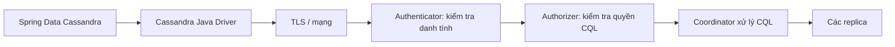

# Xác thực kết nối và quản lý vai trò Cassandra

Khi ứng dụng **Spring Data Cassandra** gọi `CassandraRepository`, `CassandraTemplate` hoặc gửi CQL thông qua `CqlSession`, kết nối đó sử dụng một danh tính để truy cập Apache Cassandra. Nếu cluster không xác thực hoặc ứng dụng đăng nhập bằng tài khoản quản trị có quá nhiều quyền, một lỗi cấu hình, truy vấn ngoài dự kiến hay việc lộ thông tin kết nối có thể dẫn đến đọc, sửa hoặc xóa dữ liệu ngoài phạm vi nghiệp vụ.

Bài thuộc chương **Bảo mật** của `SPRING_DATA_CASSANDRA`, hướng dẫn cấu hình xác thực ở phía Cassandra, tạo và phân quyền các vai trò (*roles*), cấu hình tài khoản kết nối trong Spring Boot/Spring Data Cassandra, bảo vệ thông tin bí mật, kiểm tra quyền và xử lý các lỗi xác thực/phân quyền. Các ví dụ áp dụng cho mô hình truy cập bảng được thiết kế theo truy vấn và partition key trong cơ sở dữ liệu phân tán.

> **Phạm vi:** Ví dụ CQL sử dụng cơ chế `PasswordAuthenticator`, `CassandraAuthorizer` và role-based access control (RBAC) của Apache Cassandra. Cách cấu hình file, cache và các tùy chọn bảo mật có thể khác nhau giữa các phiên bản Cassandra hoặc dịch vụ Cassandra được quản lý. Kiểm tra phiên bản và chính sách vận hành trước khi áp dụng vào cluster thật.

## 1. Xác thực, phân quyền và mã hóa là ba lớp khác nhau

| Lớp bảo vệ | Câu hỏi giải quyết | Ví dụ trong Spring Data Cassandra |
| --- | --- | --- |
| **Authentication (xác thực)** | Client đang kết nối là ai? | Java Driver gửi username/password của tài khoản `orders_api`. |
| **Authorization (phân quyền)** | Tài khoản đó được thực hiện thao tác nào trên tài nguyên nào? | `orders_api` được `SELECT` bảng đơn hàng nhưng không được `DROP TABLE`. |
| **Transport encryption (TLS)** | Thông tin xác thực và dữ liệu CQL có được bảo vệ trên đường truyền không? | Client thiết lập TLS tới cổng native transport Cassandra và kiểm tra chứng chỉ server. |

Ba lớp không thay thế cho nhau: **đăng nhập thành công không có nghĩa được phép đọc mọi bảng**; password authentication không tự động mã hóa lưu lượng; TLS bảo vệ kết nối nhưng không tự tạo chính sách truy cập bảng.

Một kết nối còn phải vượt qua các điều kiện ngoài cơ chế RBAC như mạng, firewall, TLS handshake, tên datacenter, tính sẵn sàng của coordinator và chính sách vận hành của cluster.



Nếu xác thực thành công nhưng quyền không đủ, lỗi xuất hiện ở bước kiểm tra quyền. Nếu username/password sai, thường không thể tạo session hợp lệ ngay từ đầu. Điều này giúp định hướng điều tra thay vì tăng timeout hoặc thay đổi consistency level khi gặp lỗi quyền.

## 2. Bật xác thực và phân quyền ở phía Cassandra

Cassandra tự quản lý hỗ trợ các thành phần cấu hình như sau trong `cassandra.yaml`:

```yaml
# Chỉ minh họa các khóa cấu hình liên quan đến xác thực/phân quyền.
authenticator: PasswordAuthenticator
authorizer: CassandraAuthorizer
role_manager: CassandraRoleManager
```

Ý nghĩa:

- `PasswordAuthenticator` yêu cầu client xác thực bằng username/password do hệ thống vai trò quản lý.
- `CassandraAuthorizer` kiểm tra quyền trên các tài nguyên CQL, chẳng hạn keyspace, table và role.
- `CassandraRoleManager` lưu và quản lý role, bao gồm quyền đăng nhập, quyền superuser và quan hệ kế thừa role.

Các tên class ngắn ở trên là cách cấu hình thường gặp; tùy phiên bản và bản phân phối, một số tùy chọn khác có thể thay đổi. Với dịch vụ Cassandra được quản lý, cơ chế xác thực có thể do nhà cung cấp quản lý; không mặc định được sửa trực tiếp `cassandra.yaml`.

**Lưu ý vận hành khi bật trên cluster đang chạy:**

1. Xác định cơ chế hiện tại và kế hoạch chuyển đổi. Đổi từ cấu hình cho phép truy cập rộng sang `PasswordAuthenticator`/`CassandraAuthorizer` là thay đổi ảnh hưởng **mọi ứng dụng kết nối**, không chỉ ứng dụng Spring đang phát triển.
2. Chuẩn bị tài khoản quản trị, role ứng dụng, nơi lưu secret, cách triển khai cấu hình đồng nhất trên các node và phương án phục hồi quyền truy cập.
3. Kiểm tra replication và tính sẵn sàng của keyspace nội bộ `system_auth`. Trong cluster nhiều node/datacenter, cấu hình replication quá thấp cho dữ liệu xác thực có thể tạo rủi ro khi node lỗi. Việc thay đổi replication cần tuân thủ quy trình vận hành/repair phù hợp.
4. Thử trên môi trường tương đương trước. Khi triển khai, thực hiện theo quy trình khởi động lại node có kiểm soát và xác minh mỗi bước; thay đổi file cấu hình thường không tự áp dụng cho những process đang chạy.
5. Kiểm tra kết nối với tài khoản ứng dụng thực tế, bao gồm trường hợp đăng nhập sai và quyền bị từ chối; sau đó mới chuyển toàn bộ traffic.

Một cluster Cassandra mới có thể có tài khoản superuser khởi tạo sẵn như `cassandra` với thông tin xác thực mặc định tùy cấu hình/phiên bản. **Không dùng thông tin mặc định trong ứng dụng hoặc duy trì mật khẩu mặc định ở môi trường triển khai**; thay đổi và bảo quản tài khoản quản trị bằng quy trình riêng.

## 3. Mô hình role và nguyên tắc cấp quyền tối thiểu

Trong Cassandra, một **role** có thể đại diện cho tài khoản đăng nhập hoặc một nhóm quyền được kế thừa. Các thuộc tính quan trọng:

| Thuộc tính/quan hệ | Ý nghĩa | Cách sử dụng |
| --- | --- | --- |
| `LOGIN = true` | Role có thể được dùng để đăng nhập, nếu có cơ chế xác thực tương ứng. | Tài khoản kỹ thuật của ứng dụng như `orders_api`. |
| `LOGIN = false` | Role không dùng để đăng nhập trực tiếp. | Role nhóm quyền như `orders_readers`. |
| `SUPERUSER = true` | Quyền quản trị rộng, có khả năng vượt qua kiểm tra phân quyền thông thường. | Chỉ tài khoản vận hành được quản lý chặt, không cấp cho ứng dụng. |
| `GRANT child_role TO login_role` | Login role kế thừa quyền của role được cấp. | Gán nhóm quyền đọc cho tài khoản ứng dụng. |
| Quyền CQL trên tài nguyên | Quy định được đọc/ghi hoặc quản lý đối tượng nào. | Chỉ cấp `SELECT` trên bảng cần đọc; `MODIFY` khi cần ghi. |

Nguyên tắc **least privilege** nghĩa là ứng dụng chỉ có quyền cần thiết để chạy các truy vấn dự kiến. Tài khoản đọc dữ liệu không cần quyền thay đổi schema; tài khoản xử lý giao dịch thông thường không cần `AUTHORIZE`, `DROP`, `ALTER` hoặc `SUPERUSER`.

Một số nhóm quyền CQL thường dùng:

| Quyền | Tác dụng chính | Rủi ro khi cấp quá rộng |
| --- | --- | --- |
| `SELECT` | Đọc dữ liệu trên bảng/đối tượng thích hợp. | Đọc dữ liệu ngoài phạm vi dịch vụ. |
| `MODIFY` | Thực hiện các thao tác sửa dữ liệu như `INSERT`, `UPDATE`, `DELETE`. | Có thể xóa hoặc thay đổi dữ liệu, không chỉ thêm bản ghi. |
| `CREATE`, `ALTER`, `DROP` | Tạo, thay đổi hoặc xóa đối tượng schema trên tài nguyên phù hợp. | Ứng dụng có thể tác động cấu trúc cơ sở dữ liệu. |
| `AUTHORIZE` | Cấp hoặc thu hồi quyền phù hợp trên tài nguyên. | Cho phép mở rộng quyền của danh tính khác. |

Tập quyền cụ thể và phạm vi tài nguyên phụ thuộc phiên bản Cassandra. Đặc biệt, `MODIFY` **không** phải quyền chỉ-ghi-thêm: nếu cấp `MODIFY` trên bảng, không thể mặc định rằng role chỉ được `INSERT` nhưng không được `DELETE`. Nếu nghiệp vụ cần giới hạn chi tiết hơn, phải thiết kế kiểm soát ở tầng ứng dụng, dịch vụ hoặc kiến trúc dữ liệu.

## 4. Ví dụ tạo role và phân quyền theo bảng

Giả sử ứng dụng có keyspace `orders_app`, bảng `orders_by_customer` dùng `customer_id` làm partition key và `created_at`, `order_id` làm clustering key. Nhóm nghiệp vụ chỉ cần đọc danh sách đơn theo khách và ghi trạng thái đơn trong một số workflow.

**Điều kiện trước:** keyspace và bảng đã được tạo bởi tài khoản có quyền quản trị schema. Chạy CQL quản lý role bằng tài khoản quản trị trong môi trường kiểm soát; không đặt CQL chứa mật khẩu vào migration công khai, repository Git hoặc log ứng dụng.

### Bước 1: Tạo role nhóm quyền đọc

```sql
CREATE ROLE IF NOT EXISTS orders_readers
WITH LOGIN = false
AND SUPERUSER = false;

GRANT SELECT ON TABLE orders_app.orders_by_customer
TO orders_readers;
```

`orders_readers` không phải tài khoản đăng nhập. Role này chỉ đại diện cho tập quyền đọc đã cấp. Nếu cần thêm một bảng đọc khác, có thể cấp quyền riêng trên bảng đó; **tránh** chuyển sang `GRANT SELECT ON KEYSPACE orders_app` chỉ để sửa một lỗi thiếu quyền, vì quyền theo keyspace mở rộng phạm vi truy cập.

### Bước 2: Tạo tài khoản ứng dụng với secret riêng

```sql
-- Chỉ là minh họa cú pháp. Giá trị giả này KHÔNG phải mật khẩu sử dụng được.
-- Trong thực tế, provisioning lấy mật khẩu từ secret manager qua kênh tin cậy.
CREATE ROLE IF NOT EXISTS orders_api
WITH PASSWORD = '<SECRET_FROM_SECURE_PROVISIONING>'
AND LOGIN = true
AND SUPERUSER = false;

GRANT orders_readers TO orders_api;
```

Thao tác `GRANT orders_readers TO orders_api` giúp role đăng nhập kế thừa quyền đọc từ nhóm. Khi đổi tập bảng được đọc, có thể quản lý quyền tập trung ở `orders_readers` và áp dụng đến các tài khoản có kế thừa role này.

Nếu một service khác chỉ đọc dữ liệu, tạo **role đăng nhập riêng** và gán `orders_readers`, không chia sẻ password `orders_api` cho nhiều hệ thống. Điều đó giúp thu hồi hoặc xoay vòng secret cho từng service mà không ảnh hưởng mọi client.

### Bước 3: Cấp quyền ghi đúng nhu cầu

Ví dụ service `orders_api` có chức năng tạo/cập nhật đơn; khi đó:

```sql
GRANT MODIFY ON TABLE orders_app.orders_by_customer
TO orders_api;
```

Sau lệnh trên, role có thể thực hiện những thao tác ghi thuộc quyền `MODIFY` trên **toàn bộ bảng**. Nếu service chỉ cần đọc, **bỏ hẳn bước cấp `MODIFY`**. Nếu nghiệp vụ chỉ cho phép đổi trường `status`, không thể dựa vào một quyền `MODIFY` ở Cassandra để giới hạn theo cột hoặc theo loại câu lệnh một cách tổng quát; cần kiểm soát đầu vào và đường ghi của service.

### Bước 4: Kiểm tra role và quyền thực tế

```sql
-- Chạy với tài khoản quản trị có quyền xem các role/permission tương ứng.
LIST ROLES;
LIST ROLES OF orders_api;
LIST ALL PERMISSIONS OF orders_api;
```

Khi đánh giá kết quả, kiểm tra cả **quyền trực tiếp** và quyền nhận từ role kế thừa. Sau đó đăng nhập thử bằng chính `orders_api` và chạy một truy vấn hợp lệ, vì chỉ đọc kết quả `GRANT` chưa thay thế phép kiểm thử end-to-end.

## 5. Kết nối Spring Boot với role Cassandra

Ứng dụng Spring Data Cassandra thường dùng `CqlSession` do Spring Boot cấu hình, rồi truyền session này cho repository và `CassandraTemplate`. Với Spring Boot 3.x, các thuộc tính kết nối có thể khai báo trong `application.yml` như sau:

```yaml
spring:
  cassandra:
    contact-points: ${CASSANDRA_CONTACT_POINTS}
    port: ${CASSANDRA_PORT:9042}
    local-datacenter: ${CASSANDRA_LOCAL_DC}
    keyspace-name: orders_app
    username: ${CASSANDRA_USERNAME}
    password: ${CASSANDRA_PASSWORD}
```

Ở môi trường chạy thật:

- `CASSANDRA_USERNAME` có thể là `orders_api` hoặc một role service chuyên dụng.
- `CASSANDRA_PASSWORD` được cấp vào môi trường chạy từ secret manager hoặc cơ chế quản lý bí mật của nền tảng; không ghi giá trị thật vào `application.yml`, `.properties`, Docker image hoặc Git.
- `CASSANDRA_LOCAL_DC` phải khớp với datacenter mà driver dùng để chọn node phù hợp. Tên ví dụ như `dc1` hoặc `datacenter1` **không phải giá trị chung cho mọi cluster**.
- Cấu hình kết nối và quyền role độc lập với entity mapping: `@Table`, `@PrimaryKey`, `@Column`, `@UserDefinedType` giúp ánh xạ dữ liệu nhưng **không tự cấp quyền Cassandra**.
- Cơ chế TLS cho kết nối phải được cấu hình tương thích với cluster, bổ sung cho username/password (xem phần tiếp theo).

Khi có nhiều profile `dev`, `test`, `prod`, dùng **tài khoản và keyspace tương ứng**, tránh để ứng dụng ở môi trường thấp có secret production. Lỗi thường gặp là test chạy được bằng superuser của cluster local nhưng production dùng role giới hạn nên bị từ chối `SELECT` hoặc thao tác tạo schema.

### Dùng Java Driver trực tiếp khi cần xác minh kết nối

Ví dụ bên dưới cho thấy bản chất của việc xác thực ở tầng driver. Đây là mã minh họa kiểm tra kết nối, **không thay thế** `CqlSession` đã được Spring quản lý trong ứng dụng thực tế:

```java
import com.datastax.oss.driver.api.core.CqlIdentifier;
import com.datastax.oss.driver.api.core.CqlSession;
import com.datastax.oss.driver.api.core.cql.Row;
import com.datastax.oss.driver.api.core.cql.SimpleStatement;
import java.net.InetSocketAddress;
import java.util.Objects;
import java.util.UUID;

public final class CassandraAuthenticationSmokeTest {
    public static void main(String[] args) {
        String host = Objects.requireNonNull(System.getenv("CASSANDRA_HOST"));
        String dc = Objects.requireNonNull(System.getenv("CASSANDRA_LOCAL_DC"));
        String username = Objects.requireNonNull(System.getenv("CASSANDRA_USERNAME"));
        String password = Objects.requireNonNull(System.getenv("CASSANDRA_PASSWORD"));

        try (CqlSession session = CqlSession.builder()
                .addContactPoint(new InetSocketAddress(host, 9042))
                .withLocalDatacenter(dc)
                .withKeyspace(CqlIdentifier.fromCql("orders_app"))
                .withAuthCredentials(username, password)
                // Cấu hình TLS/truststore phù hợp phải được bổ sung cho môi trường thật.
                .build()) {

            UUID customerId = UUID.fromString("2b06b38a-3d2c-4aad-93c2-95bd8bac960b");
            SimpleStatement query = SimpleStatement.builder("""
                    SELECT order_id, created_at, status
                    FROM orders_by_customer
                    WHERE customer_id = ?
                    """)
                .addPositionalValue(customerId)
                .setIdempotent(true)
                .build();

            Row row = session.execute(query).one();
            System.out.println(row == null ? "No sample order" : "Read access OK");
        }
    }
}
```

Truy vấn trên giả định bảng `orders_by_customer` có `customer_id` làm partition key. Nó dùng **binding** thay cho ghép chuỗi dữ liệu người dùng vào CQL. Cách làm này giúp tránh đưa giá trị input trực tiếp vào cú pháp CQL. Khi cần thay đổi động tên bảng/keyspace (identifier không được bind như value), phải giới hạn chúng bằng danh sách cho phép ở tầng ứng dụng.

Đoạn code không in password ra log, nhưng lấy bí mật qua biến môi trường **không tự bảo đảm** secret an toàn nếu môi trường có quyền đọc process metadata hoặc bị cấu hình log sai. Ưu tiên nguồn secret mà nền tảng hỗ trợ, giới hạn người được đọc và chính sách xoay vòng định kỳ.

## 6. Bảo vệ credential bằng TLS và secret management

`PasswordAuthenticator` xác thực danh tính; nếu driver kết nối không mã hóa, thông tin và dữ liệu trên đường truyền có thể bị lộ tùy cấu hình network/authentication. Trong môi trường triển khai thật, nên dùng **client-to-node TLS** với chứng chỉ được kiểm tra đúng danh tính server và chính sách trust phù hợp.

Các điểm cần xác nhận cùng nhóm vận hành Cassandra:

| Thành phần | Kiểm tra bảo mật |
| --- | --- |
| Cassandra native transport | Cổng client chỉ mở cho mạng ứng dụng được phép, không công khai không cần thiết. |
| `client_encryption_options` | Phía server hỗ trợ/bắt buộc TLS theo cấu hình/version đang chạy. |
| Java Driver/Spring | Bật SSL/TLS, kiểm tra chuỗi chứng chỉ và danh tính máy chủ phù hợp; dùng truststore/CA được quản lý. |
| TLS mutual authentication (nếu dùng) | Quản lý chứng chỉ client và private key riêng; không nhầm với quyền role CQL. |
| Secrets | Username/password và key material lấy từ secret manager, có quyền truy cập tối thiểu và audit. |

**Không** tạo SSL context chấp nhận mọi chứng chỉ (`trust-all`), tắt hostname verification một cách tùy tiện hoặc commit truststore có private key/mật khẩu vào repository. Tùy phiên bản Spring Boot và Java Driver, TLS có thể được cấu hình bằng properties hoặc qua custom `CqlSessionBuilderCustomizer`/driver configuration. Cần kiểm tra cách tích hợp của **đúng phiên bản** thay vì sao chép cấu hình SSL giữa các dự án.

Lưu ý thêm rằng TLS bảo vệ **trên đường truyền**; quyền role giúp giới hạn **thao tác CQL**; mã hóa dữ liệu lưu trữ và chính sách truy cập backup là các kiểm soát bổ sung, không mặc nhiên được bật khi bật hai tính năng trên.

## 7. Phân quyền cho migration tách khỏi tài khoản runtime

Một lỗi thiết kế phổ biến là cấp `CREATE`, `ALTER`, `DROP` cho `orders_api` vì framework hoặc một đoạn khởi tạo schema cần tạo bảng. Điều này mở rộng tác động của một sự cố từ dữ liệu lên cả cấu trúc cơ sở dữ liệu.

Đề xuất phân tách:

| Danh tính | Nhiệm vụ | Quyền điển hình |
| --- | --- | --- |
| `orders_api` | Đọc/ghi dữ liệu trong lúc phục vụ request | `SELECT`, `MODIFY` trên đúng bảng cần thiết. |
| `orders_readonly` | Tác vụ báo cáo chỉ đọc | `SELECT` trên các bảng được duyệt. |
| `orders_migrator` | Chạy DDL/migration đã được kiểm soát | Quyền tạo/sửa schema giới hạn trên keyspace cần triển khai; chỉ dùng trong pipeline. |
| Admin vận hành | Quản lý role, chính sách cluster và sự cố | Quyền quản trị đặc biệt, audit chặt. |

Khi ứng dụng chạy, chỉ dùng role runtime; pipeline triển khai schema chạy bằng danh tính riêng. Nếu Spring Data Cassandra được cấu hình tự tạo bảng/UDT trong quá trình startup, cần quyết định rõ ai sở hữu schema và vô hiệu hóa hành vi tự sửa schema ở runtime khi áp dụng mô hình này. Không sửa lỗi `Unauthorized` bằng cách cấp superuser cho ứng dụng.

Một role migration cũng không cần mặc định quyền trên **mọi keyspace**. Cần xem cú pháp và phạm vi quyền `CREATE`/`ALTER`/`DROP` theo phiên bản Cassandra, rồi cấp trên tài nguyên hẹp nhất được hỗ trợ cho pipeline đó.

## 8. Role inheritance, thu hồi quyền và nguyên tắc kiểm chứng

Với một service chỉ đọc đã được cấp `orders_readers`, việc thay đổi quyền nhóm có thể tác động tới nhiều login role. Trước khi thu hồi hoặc chuyển quyền, cần xác định tất cả vai trò phụ thuộc.

Ví dụ khi một tài khoản không còn cần quyền đọc:

```sql
-- Thu hồi quan hệ kế thừa role đọc từ một tài khoản cụ thể.
REVOKE orders_readers FROM orders_api;

-- Nếu cần ngừng đăng nhập bằng chính role này:
ALTER ROLE orders_api WITH LOGIN = false;
```

Khi muốn bỏ quyền của cả nhóm:

```sql
REVOKE SELECT ON TABLE orders_app.orders_by_customer
FROM orders_readers;
```

Hai lệnh có phạm vi khác nhau: `REVOKE orders_readers FROM orders_api` chỉ ngắt quyền kế thừa của **một tài khoản**, còn `REVOKE SELECT ... FROM orders_readers` làm thay đổi quyền của **mọi role đang kế thừa nhóm**. Cần xem tác động tới các dịch vụ khác trước khi dùng cách thứ hai.

**Cảnh báo về tính tức thời:** Cassandra có cache xác thực/quyền/role để giảm chi phí kiểm tra. Thời điểm thay đổi có hiệu lực trên từng node hoặc kết nối đang mở phụ thuộc cấu hình cache và trạng thái kết nối. Một session đã xác thực từ trước không tự chứng minh được rằng role vừa bị vô hiệu hóa sẽ lập tức mất mọi khả năng sử dụng. Khi xử lý sự cố khẩn cấp, phối hợp thu hồi quyền, ngắt kết nối, quản lý secret, chính sách mạng và xác minh bằng **kết nối mới** với thời gian chờ theo quy định vận hành.

## 9. Thay đổi mật khẩu và xoay vòng tài khoản an toàn

Mật khẩu không nên tồn tại mãi trong cấu hình triển khai. Có hai chiến lược thường gặp:

**Thay mật khẩu trên cùng role:**

```sql
-- Chỉ minh họa cú pháp; secret thật do quy trình provisioning quản lý.
ALTER ROLE orders_api
WITH PASSWORD = '<NEW_SECRET_FROM_SECURE_PROVISIONING>';
```

Sau khi đổi password, các kết nối mới phải dùng secret mới. Các session đã đăng nhập có thể chưa bị ngắt ngay, nên cần kế hoạch làm mới connection pool/session và kiểm tra cả kết nối mới lẫn cũ. Thay đổi password không đảm bảo tính nguyên tử xuyên mọi instance ứng dụng.

**Xoay vòng bằng hai role (thích hợp cho triển khai nhiều instance):**

1. Tạo login role mới, chẳng hạn `orders_api_v2`, với secret mới và các quyền tối thiểu tương đương role cũ.
2. Triển khai cấu hình ứng dụng sử dụng role mới theo từng đợt; kiểm tra authentication, `SELECT`/`MODIFY` cần thiết, lỗi, latency và trạng thái kết nối mới.
3. Xác nhận không còn instance/job nào dựa vào role cũ; vô hiệu hóa login của role cũ và thu hồi quyền sau thời gian chuyển đổi phù hợp.
4. Đảm bảo giám sát/audit phát hiện kết nối còn dùng role cũ; sau đó loại bỏ secret cũ theo chính sách.

Cách này giảm khoảng trống giữa thời điểm role/password được đổi và thời điểm các ứng dụng cập nhật secret, nhưng cần quản lý rõ hai danh tính trong giai đoạn chuyển đổi. Nếu thay đổi thất bại, phương án rollback phải dựa trên quyền và secret còn được phép dùng, không khôi phục mật khẩu mặc định.

## 10. Cassandra RBAC không thay thế kiểm tra quyền ở tầng nghiệp vụ

Giả sử bảng lưu nhiều khách hàng:

```sql
CREATE TABLE orders_app.orders_by_customer (
    tenant_id uuid,
    customer_id uuid,
    created_at timestamp,
    order_id uuid,
    status text,
    PRIMARY KEY ((tenant_id, customer_id), created_at, order_id)
);
```

Partition key `(tenant_id, customer_id)` giúp truy vấn hiệu quả theo tenant và khách hàng, nhưng một role có `SELECT` trên bảng về nguyên tắc có thể truy vấn **mọi partition** mà role đó được cấp quyền trên bảng. Cassandra RBAC **không tự thực hiện row-level security theo tenant** như một số hệ quản trị khác.

Do đó, ứng dụng Spring cần:

- Lấy `tenant_id` từ danh tính/claims đã được xác thực và kiểm chứng, **không** tin trực tiếp một `tenant_id` tùy ý do client gửi.
- Ràng buộc tenant ở service/query gateway trước khi gọi `Repository` hoặc `CassandraTemplate`.
- Sử dụng parameter binding cho giá trị trong CQL và kiểm tra input/danh sách identifier được phép.
- Khi mức cách ly bắt buộc cao hơn, cân nhắc kiến trúc keyspace/role riêng hoặc cơ chế tách biệt phù hợp với yêu cầu hệ thống; đánh giá chi phí vận hành và số lượng schema.

`@PrimaryKey`, `@PartitionKey` và thiết kế bảng theo query đảm bảo **cách lưu/truy vấn hiệu quả**; chúng không thay thế xác thực người dùng cuối hoặc authorization cho từng đối tượng nghiệp vụ.

## 11. Chẩn đoán lỗi đăng nhập và thiếu quyền

Khi ứng dụng không truy cập Cassandra được, trước tiên xác định lỗi nằm ở **mạng/TLS**, **authentication**, **authorization** hay **schema/CQL**. Đây là những nhóm nguyên nhân khác nhau.

| Dấu hiệu | Nguyên nhân thường gặp | Cách kiểm tra |
| --- | --- | --- |
| Kết nối bị từ chối hoặc không bắt tay TLS được | Port/firewall, CA hoặc chứng chỉ không hợp lệ, server không hỗ trợ kiểu TLS client dùng | Kiểm tra network, native transport, chứng chỉ, log TLS của client/server. |
| Lỗi authentication hoặc thông báo credentials không hợp lệ | Sai username/password; role `LOGIN=false`; auth config khác dự kiến | Xác minh secret và role bằng kết nối mới; tránh in password vào log. |
| Lỗi authorization/permission khi `SELECT` | Thiếu quyền `SELECT` trên bảng hoặc role inheritance không đúng | Kiểm tra `LIST ROLES OF ...`, `LIST ALL PERMISSIONS OF ...` bằng admin và đăng nhập thử bằng role ứng dụng. |
| Ứng dụng đọc được nhưng ghi bị từ chối | Role chỉ có `SELECT`, không có `MODIFY` | Kiểm tra nghiệp vụ có thật sự cần ghi; chỉ cấp `MODIFY` trên bảng cần thiết. |
| Spring startup lỗi khi `CREATE TABLE`/`CREATE TYPE` | Runtime role không có quyền DDL, hoặc schema chưa được migration tạo | Kiểm tra ownership schema; tách migration khỏi startup ứng dụng. |
| Kết nối được nhưng lỗi query sau deploy | Bảng/UDT chưa tồn tại, tên keyspace sai, query không hợp primary key | Kiểm tra schema và CQL; không mặc định mọi lỗi truy vấn là lỗi quyền. |
| Sau khi thu hồi quyền, một số request vẫn thành công | Role/permission cache và session đã xác thực | Kiểm tra cache, thời gian hiệu lực, kết nối mới và kế hoạch ngắt phiên. |
| Môi trường local chạy, production không | Local không bật auth, role quá rộng hoặc TLS/namespace khác | Kiểm tra test giống prod ở mức cấu hình auth/role/SSL cần thiết. |

Các ngoại lệ cụ thể và thông điệp phụ thuộc phiên bản Java Driver và Spring. Driver 4.x có thể bọc nhiều lỗi kết nối vào `AllNodesFailedException`; cần xem nguyên nhân theo từng node (và thông tin root cause) thay vì kết luận rằng mọi node thực sự đã ngừng hoạt động. Không gửi toàn bộ chuỗi kết nối hoặc secrets vào hệ thống log khi điều tra.

### Quy trình xử lý một lỗi thiếu quyền

1. Xác định `operation`, keyspace, bảng, CQL shape và danh tính Cassandra mà **session đang dùng**; role từ file cấu hình dự kiến chưa chắc là role mà process đã nạp.
2. Phân biệt lỗi xảy ra lúc đăng nhập hay khi chạy CQL. Lỗi timeout/naming/consistency không tự biến thành permission issue.
3. Kiểm tra danh sách quyền trực tiếp và kế thừa của role, rồi thử lại bằng **tài khoản ứng dụng thật** trong môi trường kiểm thử.
4. Chỉ cấp bổ sung quyền hẹp nhất cần thiết; kiểm thử lại cả thao tác được phép và thao tác đáng ra phải bị chặn.
5. Lưu thay đổi trong quy trình cấu hình/infra/migration và audit, tránh sửa tay không có dấu vết dẫn tới khác biệt giữa các môi trường.

## 12. Kiểm thử bảo mật với Spring Data Cassandra

Unit test mock repository có thể kiểm tra logic service, nhưng không chứng minh role Cassandra thực sự được cấp quyền đúng. Những phép kiểm thử sau cần một **Cassandra test instance có bật xác thực và phân quyền**, chẳng hạn cluster kiểm thử chuyên dụng hoặc Testcontainers được cấu hình phù hợp.

| Bài kiểm thử | Điều mong đợi |
| --- | --- |
| Đăng nhập bằng `orders_api` và đọc bảng được phép | Kết nối thành công; `SELECT` trả kết quả đúng theo fixture. |
| Đăng nhập bằng mật khẩu sai | Bị từ chối xác thực, không truy cập được dữ liệu. |
| Đăng nhập bằng role `LOGIN=false` | Không thể sử dụng role nhóm quyền để đăng nhập trực tiếp. |
| Tài khoản chỉ đọc thử `INSERT`/`UPDATE`/`DELETE` | Bị từ chối vì thiếu `MODIFY`. |
| Runtime role thử `CREATE TABLE` hoặc `DROP TABLE` test | Bị từ chối vì không có quyền DDL (thực hiện trên keyspace test). |
| Tài khoản báo cáo truy vấn bảng không được cấp quyền | Bị từ chối `SELECT` dù biết tên bảng. |
| Role kế thừa `orders_readers` rồi thu hồi quan hệ kế thừa | Quyền thay đổi theo kỳ vọng sau khi cache/hệ thống đã đồng bộ. |
| Spring `Repository`/`CassandraTemplate` với role runtime | Ánh xạ entity, truy vấn qua partition key và CRUD chỉ hoạt động theo quyền thực tế. |

Lưu ý: Cassandra container mặc định trong một môi trường thử nghiệm có thể đang cho phép truy cập mà **không bật auth**. Nếu test vẫn pass với một password giả và không có cấu hình `PasswordAuthenticator`, đó không phải bằng chứng hệ thống đã kiểm thử xác thực. Khởi tạo schema và role bằng **admin session tách biệt**, sau đó thực hiện assertions bằng session của role ứng dụng. Không dùng admin session để thay thế cho kết quả của test phân quyền.

Với test thu hồi quyền và xoay vòng mật khẩu, tạo **kết nối mới** sau thay đổi, đồng thời tính đến cache và propagation; không đưa `Thread.sleep(...)` cố định làm điều kiện duy nhất để kết luận đúng/sai. Kiểm thử cần sử dụng keyspace/tài khoản riêng, tránh đụng quyền đang phục vụ traffic thật.

## 13. Audit, quan sát và vận hành quyền

Khi vận hành dài hạn, không chỉ cần bảo đảm cấu hình ban đầu đúng mà còn phải phát hiện thay đổi bất thường:

- Ghi nhận **ai** tạo/sửa/xóa role, cấp/thu hồi quyền và **khi nào**, bằng cơ chế audit phù hợp với Cassandra/bản phân phối và hệ quản trị hạ tầng đang dùng.
- Theo dõi tỷ lệ thất bại authentication, authorization, lỗi kết nối TLS và bất thường sau mỗi đợt triển khai hoặc rotation.
- Phân quyền truy cập vào log, metrics, secret manager và cơ chế backup; tránh để người xem log có thể lấy được password hoặc token dùng lại.
- Định kỳ đối chiếu danh sách login role và quyền thực tế với danh sách service đang hoạt động, xóa role không còn sử dụng theo quy trình có kiểm tra phụ thuộc.
- Theo dõi `system_auth` như thành phần vận hành quan trọng trong cluster, đặc biệt replication, sẵn sàng của node và ảnh hưởng cache khi thay đổi quyền.

**Không giả định mọi phiên bản Cassandra đều cung cấp audit log giống nhau.** Cơ chế audit logging phụ thuộc phiên bản và bản phân phối; nơi cần yêu cầu kiểm toán nghiêm ngặt phải xác minh tính năng hỗ trợ và retention thực tế. Log phục vụ chẩn đoán nên ghi tên operation, loại lỗi và correlation ID, **không** lưu toàn bộ password, private key hoặc CQL có literal chứa bí mật.

## 14. Checklist trước khi đưa ứng dụng vào vận hành

- [ ] Cluster bật cơ chế authentication và authorization đúng theo chính sách, cấu hình đồng nhất và có phương án vận hành khi node lỗi.
- [ ] Thông tin mặc định của tài khoản quản trị đã được xử lý; ứng dụng không dùng superuser.
- [ ] Mỗi service/môi trường có login role riêng, `SUPERUSER = false` và chỉ được cấp quyền trên bảng cần thiết.
- [ ] Role nhóm `LOGIN = false` được dùng để tái sử dụng quyền khi phù hợp; đã kiểm tra role inheritance.
- [ ] Runtime role không cần `CREATE`/`ALTER`/`DROP`/`AUTHORIZE`; migration dùng danh tính tách biệt.
- [ ] `spring.cassandra.username/password` lấy từ nguồn secret được quản lý, không nằm trong Git, image, log hay cấu hình công khai.
- [ ] Kết nối Java Driver dùng TLS/trust configuration phù hợp; native transport chỉ mở cho mạng được phép.
- [ ] Tenant/ownership được kiểm tra ở tầng ứng dụng; partition key và role theo bảng không được xem là row-level authorization.
- [ ] Có integration test cho phép và từ chối quyền, bao gồm trường hợp mật khẩu sai, thiếu `SELECT`, thiếu `MODIFY` và thiếu quyền DDL.
- [ ] Có quy trình rotate password/role, kiểm tra session mới, thu hồi role cũ và theo dõi cache/propagation.
- [ ] Có cơ chế audit các thay đổi role/permission và theo dõi lỗi xác thực/phân quyền mà không lộ bí mật.

**Ghi nhớ:** bảo mật kết nối Spring Data Cassandra bắt đầu từ **xác thực đúng danh tính**, tiếp đến là **phân quyền tối thiểu trên tài nguyên CQL**, và được bổ sung bằng **TLS, quản lý secrets, kiểm thử quyền thực tế và quy trình vận hành role**. `Repository` và `CassandraTemplate` chỉ sử dụng quyền của session đã cấu hình; chúng không thay thế chính sách RBAC của Cassandra hoặc authorization theo tenant của ứng dụng.
