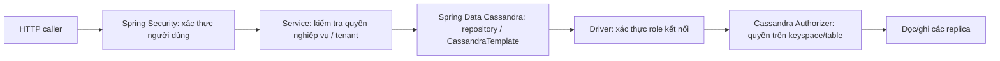

# Phân quyền theo keyspace, bảng và thao tác cần thiết

Khi ứng dụng truy cập Apache Cassandra bằng **Spring Data Cassandra**, việc kết nối được bằng username/password mới chỉ chứng minh danh tính của *dịch vụ*. Một ứng dụng quản lý đơn hàng thường chỉ cần đọc hoặc ghi vào một vài bảng nhất định; nó không cần tạo keyspace, xóa bảng hay cấp quyền cho tài khoản khác. Nếu tài khoản ứng dụng có quá nhiều quyền, một lỗi CQL, thao tác quản trị nhầm hoặc sự cố lộ thông tin đăng nhập có thể ảnh hưởng cả những dữ liệu không liên quan.

Bài này thuộc chương **Bảo mật** của module **SPRING_DATA_CASSANDRA**. Bạn sẽ học cách phân quyền theo **keyspace**, **table** và **thao tác thực tế**; thiết kế role theo nguyên tắc đặc quyền tối thiểu (*least privilege*); cấu hình ứng dụng dùng credential riêng; và xác minh cả trường hợp được phép lẫn bị từ chối. Các ví dụ có thể áp dụng về mặt ý tưởng cho repository, `CassandraTemplate` và câu truy vấn CQL. Cú pháp/quyền cụ thể cần được đối chiếu với phiên bản Apache Cassandra và môi trường triển khai (tự quản lý hay dịch vụ managed).

## 1. Phân biệt xác thực, phân quyền và kiểm soát truy cập nghiệp vụ

Ba vấn đề thường bị nhầm với nhau:

| Vấn đề | Câu hỏi cần trả lời | Ví dụ |
| --- | --- | --- |
| **Authentication – xác thực** | Client nào đang kết nối vào Cassandra? | Ứng dụng Spring Boot đăng nhập bằng role `orders_api`. |
| **Authorization – phân quyền Cassandra** | Role đó được thao tác gì trên resource nào? | `orders_api` được `SELECT` trên `shop.orders_by_customer`. |
| **Business authorization – phân quyền nghiệp vụ** | Người dùng HTTP này được xem đơn của khách hàng nào? | Nhân viên chỉ xem các đơn thuộc tổ chức được phân công. |

Một ứng dụng có thể dùng **một Cassandra login role chung** cho nhiều người dùng HTTP. Cassandra chỉ nhìn thấy role đăng nhập của ứng dụng; nó không tự biết người dùng cuối nào đang gửi yêu cầu. Do đó, Cassandra RBAC không thay thế kiểm tra quyền trong Spring Security hoặc service.



**Partition key dùng để định tuyến và giới hạn dữ liệu, không phải ranh giới phân quyền theo người dùng.** Nếu cấp `SELECT` trên một bảng chứa nhiều tenant, role Cassandra thường có khả năng đọc dữ liệu của **mọi tenant trong bảng**, miễn câu CQL hợp lệ. Một `WHERE tenant_id = ?` đúng về hiệu năng không tự biến thành chính sách row-level security.

## 2. Tài nguyên và loại quyền trong Cassandra

### 2.1. Phạm vi tài nguyên

Đối với dữ liệu CQL thông thường, có thể hình dung các phạm vi:

```text
ALL KEYSPACES
  └── KEYSPACE shop
        ├── TABLE orders_by_customer
        ├── TABLE orders_by_id
        └── TABLE order_status_by_day
```

Cassandra đánh giá các quyền theo **phạm vi tài nguyên**. Quyền cấp ở keyspace có thể áp dụng cho các bảng nằm trong keyspace ấy; cấp quyền ở một table sẽ giới hạn hơn. Điều này có nghĩa:

- `GRANT SELECT ON TABLE shop.orders_by_id ...`: phục vụ yêu cầu đọc **bảng cụ thể**.
- `GRANT SELECT ON KEYSPACE shop ...`: phạm vi **rộng hơn**, gồm các bảng trong keyspace. Việc thêm bảng mới có thể khiến phạm vi đọc thực tế tăng theo.
- Quyền trên `ALL KEYSPACES` quá rộng với tài khoản chạy API thông thường.

Không phải mọi loại quyền đều hợp lệ trên mọi loại resource. Cassandra còn có resource dành cho role, function và các đối tượng khác tùy phiên bản. Với mục tiêu bài học này, hãy tập trung vào **keyspace/table** và tách tài khoản quản trị khỏi runtime.

### 2.2. Các quyền thường cần khi làm việc với bảng

| Quyền Cassandra | Tác dụng chính | Ai có thể cần? |
| --- | --- | --- |
| `SELECT` | Đọc dữ liệu ở tài nguyên được cấp; bao gồm truy vấn `SELECT` hợp lệ. | API đọc, báo cáo, job kiểm tra dữ liệu. |
| `MODIFY` | Thay đổi dữ liệu bằng các thao tác CQL được hỗ trợ như `INSERT`, `UPDATE`, `DELETE`. | API/worker ghi dữ liệu. |
| `CREATE` | Tạo đối tượng schema trong phạm vi thích hợp (ví dụ tạo bảng trong keyspace). | Migration/schema owner. |
| `ALTER` | Thay đổi schema/resource được cấp. | Migration/schema owner. |
| `DROP` | Xóa đối tượng schema trong phạm vi được cấp. | Migration/schema owner, theo quy trình kiểm soát. |
| `AUTHORIZE` | Quản lý/cấp quyền trên resource được phép ủy quyền. | Quản trị bảo mật/role owner. |

**Không có quyền Cassandra tiêu chuẩn tách riêng `INSERT` và `DELETE` để cấp trên cùng một bảng**: nếu vai trò có `MODIFY`, đừng kỳ vọng database sẽ ngăn hành vi xóa dữ liệu chỉ nhờ quy tắc RBAC. Nếu ứng dụng chỉ được phép ghi thêm, hãy kết hợp logic nghiệp vụ, thiết kế các bảng/đường ghi riêng và kiểm soát endpoint.

Một số phiên bản Cassandra có thêm quyền như `DESCRIBE`, `EXECUTE` hoặc cơ chế bảo mật mở rộng. Chỉ cấp khi có nhu cầu đã xác minh với phiên bản và tính năng đang chạy. **Không dùng `ALL PERMISSIONS` như một phép sửa lỗi nhanh** cho tài khoản runtime.

### 2.3. Quyền ở mức keyspace hay table?

Giả sử API cần xem đơn theo khách hàng từ `shop.orders_by_customer`:

```sql
GRANT SELECT ON TABLE shop.orders_by_customer TO orders_reader;
```

Đây là phạm vi hẹp. Ngược lại:

```sql
GRANT SELECT ON KEYSPACE shop TO orders_reader;
```

Lệnh thứ hai có thể cho phép đọc nhiều bảng trong `shop`, bao gồm bảng không dùng bởi API. Chỉ chọn quyền keyspace khi actor thực sự cần bao phủ phần lớn hoặc toàn bộ các bảng, và đã đánh giá tác động với bảng sẽ được tạo về sau. Nếu cần quản lý chỉ một bảng, **grant table-level** dễ kiểm soát hơn.

## 3. Điều kiện tiên quyết: bật cơ chế kiểm soát quyền thực sự

Các lệnh `GRANT`/`REVOKE` chỉ có ý nghĩa khi cluster đã cấu hình xác thực/phân quyền phù hợp. Với một cluster **Apache Cassandra tự quản lý**, kiểm tra `cassandra.yaml` (ví dụ khái niệm, không phải cấu hình có thể sao chép trực tiếp vào production):

```yaml
authenticator: PasswordAuthenticator
authorizer: CassandraAuthorizer
role_manager: CassandraRoleManager
```

Các bản phân phối/phiên bản có thể có giá trị mặc định khác nhau; cấu hình kiểu `AllowAllAuthenticator` hoặc `AllowAllAuthorizer` **không** cung cấp kiểm soát đăng nhập/quyền tương đương. Một môi trường managed Cassandra có thể dùng cơ chế xác thực/ủy quyền bên ngoài hoặc giới hạn cú pháp quản lý role; phải đọc tài liệu của nhà cung cấp trước khi áp dụng.

Trước khi bật/chuyển cơ chế xác thực trên một cluster đang vận hành:

1. Kiểm kê client, background job, tài khoản quản trị, driver và kết nối đến mọi datacenter.
2. Thiết lập cơ chế bootstrap role quản trị an toàn, bảo đảm không tự khóa quyền vận hành của cluster.
3. Chuẩn bị secret manager, luân chuyển credential và phân quyền truy cập bí mật.
4. Xác minh replication, khả dụng và cơ chế khôi phục của keyspace lưu dữ liệu xác thực/role (thường là `system_auth` trên Cassandra tự quản lý).
5. Bật **TLS cho kết nối client–node** với xác minh certificate phù hợp; password authentication không tự mã hóa nội dung CQL trên mạng.
6. Thử lần lượt ở môi trường thử nghiệm, có rollback, rollout/rolling restart theo runbook của cluster.

Bật xác thực chỉ là lớp nền. Kết nối TLS, hạn chế mạng truy cập, ghi log/audit có chọn lọc, sao lưu và cách quản trị superuser vẫn là những biện pháp độc lập. **Không đặt password minh họa hoặc cấu hình xác thực chưa kiểm tra vào production.**

## 4. Từ truy vấn nghiệp vụ đến ma trận quyền

Xét ứng dụng xử lý đơn hàng có các bảng được thiết kế theo truy vấn:

```sql
CREATE TABLE shop.orders_by_customer (
    customer_id uuid,
    created_at timestamp,
    order_id uuid,
    status text,
    total_amount decimal,
    PRIMARY KEY ((customer_id), created_at, order_id)
) WITH CLUSTERING ORDER BY (created_at DESC, order_id ASC);

CREATE TABLE shop.orders_by_id (
    order_id uuid PRIMARY KEY,
    customer_id uuid,
    created_at timestamp,
    status text,
    total_amount decimal
);
```

Đây là hai bản trình bày dữ liệu phục vụ hai mẫu truy cập: đọc đơn theo khách hàng/khoảng thời gian và đọc đơn theo ID. Việc nhân bản dữ liệu giữa hai bảng làm cho **chính sách quyền** phải bao phủ mọi bảng mà một thao tác có thể truy cập.

| Actor/chương trình | Tác vụ CQL | Resource | Quyền tối thiểu thường cần |
| --- | --- | --- | --- |
| `orders_query_api` | Tìm đơn theo khách hàng/thời gian | `shop.orders_by_customer` | `SELECT` |
| `orders_query_api` | Tìm một đơn bằng ID | `shop.orders_by_id` | `SELECT` |
| `orders_write_worker` | Ghi/cập nhật bản trình bày của đơn | Cả hai bảng trên | `MODIFY` trên từng bảng |
| `orders_report_job` | Đọc bảng tổng hợp báo cáo | `shop.order_status_by_day` (nếu có) | `SELECT` chỉ trên bảng báo cáo |
| `schema_migrator` | Tạo/sửa bảng, index hoặc schema | Keyspace/bảng tương ứng | Quyền DDL cụ thể cần cho migration |
| `security_admin` | Cấp/thu hồi quyền truy cập | Resource được quản trị | Quyền `AUTHORIZE` và các quyền quản trị phù hợp |

Bảng này là **bản kê nhu cầu**, không phải khẳng định rằng mọi câu CQL chỉ cần chính xác một quyền trong mọi phiên bản. Ví dụ, một số dạng conditional write/LWT và thao tác schema có thể có thêm điều kiện/permission; phải thử bằng account thật và đối chiếu quy tắc phiên bản hiện tại.

Một API “chỉ ghi” vẫn phải được rà soát nếu code có truy vấn đọc trước ghi; ngược lại, một job chỉ chạy `SELECT` không cần `MODIFY`. **Truy từ code thực thi và CQL được tạo ra**, không đoán qua tên service.

## 5. Tạo role theo nhiệm vụ và cấp đúng bảng

### 5.1. Tách login role khỏi permission role

Cassandra có **role** và có thể cấp một role cho role khác. Một cách tổ chức dễ quản trị là:

- **Permission role**, `LOGIN = false`: gom các quyền cho một nhóm tác vụ.
- **Login role**, `LOGIN = true`: danh tính kết nối của ứng dụng/job, nhận các permission role phù hợp.

Ví dụ dưới đây giả sử chạy từ **tài khoản quản trị đã được phép tạo role và cấp quyền**. Tên role là minh họa và keyspace/bảng đã tồn tại:

```sql
-- Các role chỉ giữ quyền, không đăng nhập.
CREATE ROLE IF NOT EXISTS orders_read_policy WITH LOGIN = false;
CREATE ROLE IF NOT EXISTS orders_write_policy WITH LOGIN = false;

-- Chỉ cấp quyền đọc trên hai bảng cần đọc.
GRANT SELECT ON TABLE shop.orders_by_customer TO orders_read_policy;
GRANT SELECT ON TABLE shop.orders_by_id TO orders_read_policy;

-- Job ghi được thay đổi dữ liệu trên hai bảng liên quan.
GRANT MODIFY ON TABLE shop.orders_by_customer TO orders_write_policy;
GRANT MODIFY ON TABLE shop.orders_by_id TO orders_write_policy;

-- Login role cho API đọc: mật khẩu chỉ là PLACEHOLDER trong ví dụ.
CREATE ROLE IF NOT EXISTS orders_query_api
WITH LOGIN = true AND PASSWORD = '<generate-and-store-in-secret-manager>';
GRANT orders_read_policy TO orders_query_api;

-- Login role riêng cho job ghi.
CREATE ROLE IF NOT EXISTS orders_write_worker
WITH LOGIN = true AND PASSWORD = '<different-generated-secret>';
GRANT orders_write_policy TO orders_write_worker;
```

**Hai chuỗi password trên không phải mật khẩu sử dụng được trong production.** Khi provision thực tế, tạo bí mật ngẫu nhiên qua kênh quản trị an toàn, tránh ghi lệnh chứa mật khẩu vào repository, log, lịch sử terminal hoặc công cụ quản lý issue. Quá trình tạo/cập nhật role có thể phải tuân thủ cơ chế secret injection và rotation của môi trường.

Cú pháp `IF NOT EXISTS` không chứng minh role hiện hữu đã đúng trạng thái mong muốn. Quy trình triển khai vẫn cần **so sánh các quyền thực tế** và sửa drift nếu role đã tồn tại với quyền rộng hơn.

### 5.2. Khi API thật sự cần cả đọc và ghi

Giả sử một dịch vụ vừa đọc vừa ghi, có thể gán cả hai permission role nếu đã kiểm kê rằng nó thật sự cần:

```sql
GRANT orders_read_policy TO orders_main_api;
GRANT orders_write_policy TO orders_main_api;
```

Lệnh trên giả định `orders_main_api` đã được tạo. **Không lấy ví dụ này làm cấu hình mặc định cho mọi API**; một endpoint chỉ đọc nên chạy bằng credential chỉ đọc hoặc thông qua một dịch vụ có phạm vi tác vụ tương xứng.

### 5.3. Vì sao không grant quyền rộng từ đầu?

Tránh các phương án như:

```sql
-- Phạm vi quá rộng đối với API chỉ đọc một bảng:
GRANT ALL PERMISSIONS ON KEYSPACE shop TO orders_query_api;

-- Cũng quá rộng nếu API chỉ cần hai bảng:
GRANT SELECT ON KEYSPACE shop TO orders_query_api;
```

Một keyspace thường chứa dữ liệu của nhiều tính năng; permission cấp trên keyspace có thể bao trùm các bảng được thêm vào sau này. `ALL PERMISSIONS` còn đưa cả quyền ngoài nhu cầu CRUD đơn thuần vào phạm vi tài khoản.

**Chọn resource hẹp nhất đáp ứng các câu CQL thực tế.** Khi một job cần truy cập nhiều bảng, liệt kê grant cho từng bảng để dễ audit; chỉ nâng cấp lên phạm vi keyspace khi việc mở rộng đó đã được xác nhận là đúng thiết kế bảo mật.

## 6. Thu hồi quyền, quan sát role và tránh đặc quyền kế thừa

Việc sửa code không tự động thu hồi quyền cũ. Sau khi tách job ghi khỏi API đọc, thu hồi role hoặc permission dư thừa:

```sql
-- Tháo quyền ghi gián tiếp của một login role (nếu từng được cấp).
REVOKE orders_write_policy FROM orders_query_api;

-- Thu hồi quyền trên một bảng khỏi permission role.
REVOKE MODIFY ON TABLE shop.orders_by_id FROM orders_write_policy;
```

**Chú ý:** dòng thứ hai thay đổi quyền của *mọi login role kế thừa* `orders_write_policy`; nếu worker vẫn cần ghi `orders_by_id`, không thực hiện lệnh đó. Cần đọc ma trận ảnh hưởng trước khi thu hồi quyền dùng chung.

Các truy vấn kiểm kê từ vai trò có quyền quản trị phù hợp:

```sql
LIST ROLES;
LIST ROLES OF orders_query_api;
LIST ALL PERMISSIONS OF orders_query_api;
LIST ALL PERMISSIONS ON TABLE shop.orders_by_customer;
```

Kết quả và cú pháp tùy phiên bản/authorizer, nhưng đây là những thao tác kiểm kê thường dùng trong Apache Cassandra. Khi audit, phân biệt **quyền cấp trực tiếp** với **quyền hiệu lực do kế thừa qua role**, đồng thời xem role còn được cấp quyền ở phạm vi keyspace hoặc rộng hơn không.

Thu hồi quyền có thể **không có hiệu lực quan sát được tức thời trên mọi node** vì role/permission caches và cơ chế propagation của phiên bản đang chạy. Thử lại với kết nối và node liên quan, kiểm tra TTL/cache/invalidation theo runbook. Với sự cố lộ credential, ngoài `REVOKE` cần luân chuyển/khóa bí mật, xử lý session đang tồn tại và thực hiện quy trình ứng cứu.

Không tùy tiện xóa role dùng chung để “dọn dẹp” nếu chưa kiểm tra mọi login role kế thừa; thao tác quản lý role phải thuộc quy trình change management.
## 7. Cấu hình Spring Data Cassandra với credential đúng phạm vi

### 7.1. Mỗi thành phần dùng một danh tính database riêng

Với Spring Boot 3, thuộc tính Cassandra thông thường được cấu hình theo namespace `spring.cassandra.*`. Ví dụ `application.yml`:

```yaml
spring:
  cassandra:
    contact-points: ${CASSANDRA_CONTACT_POINTS}
    port: ${CASSANDRA_PORT:9042}
    local-datacenter: ${CASSANDRA_LOCAL_DC}
    keyspace-name: shop
    username: ${CASSANDRA_USERNAME}
    password: ${CASSANDRA_PASSWORD}
```

Ứng dụng chỉ đọc sẽ nhận username/password của `orders_query_api`; worker ghi sẽ nhận danh tính của `orders_write_worker`. Giá trị bí mật cần lấy từ **secret manager hoặc nguồn cấu hình được bảo vệ**, không commit vào Git, không in log và không trả qua API debug. Các phiên bản Spring Boot cũ hoặc ứng dụng tự dựng `CqlSession` có cách cấu hình khác, cần kiểm tra đúng phiên bản sử dụng.

**Chọn `keyspace-name: shop` không khóa quyền ở keyspace `shop`.** Nếu role được grant ở keyspace khác, nó vẫn có thể dùng CQL đầy đủ tên keyspace để truy cập. Ngược lại, tên keyspace đúng không giúp một role thiếu `SELECT`/`MODIFY`.

TLS và xác minh certificate cần cấu hình thông qua Java driver/SSL context và truststore thích hợp. Không xem username/password trong file cấu hình là bằng chứng kết nối được mã hóa. Nếu dùng mTLS hoặc danh tính do nhà cung cấp cloud quản lý, cấu hình có thể khác.

### 7.2. Repository và CassandraTemplate dùng quyền của login role

Giả sử entity `OrderByCustomer` cùng `OrderKey` đã ánh xạ đúng bảng `shop.orders_by_customer`:

```java
public interface OrdersByCustomerRepository
        extends CassandraRepository<OrderByCustomer, OrderKey> {

    @Query("SELECT * FROM orders_by_customer " +
           "WHERE customer_id = ?0 " +
           "AND created_at >= ?1 AND created_at < ?2")
    List<OrderByCustomer> findOrders(
            UUID customerId, Instant fromInclusive, Instant toExclusive);
}
```

Câu `SELECT` này cần quyền `SELECT` trên `orders_by_customer`. Nếu gọi `repository.save(entity)` thì lệnh ghi thực tế cần quyền thay đổi dữ liệu; role chỉ đọc sẽ bị từ chối dù code có thể gọi phương thức Java.

Tương tự, `CassandraTemplate` có thể truy vấn bằng tiêu chí:

```java
Query query = Query.query(Criteria.where("customer_id").is(customerId))
    .and(Criteria.where("created_at").gte(fromInclusive))
    .and(Criteria.where("created_at").lt(toExclusive));

List<OrderByCustomer> orders =
    cassandraTemplate.select(query, OrderByCustomer.class);
```

`WHERE` này phù hợp với partition key `customer_id` và clustering key `created_at`. **Hai API có cùng quyền Cassandra khi dùng cùng CqlSession/login role**: thay repository bằng template không nâng quyền và không giải quyết việc grant thiếu. Với kết quả lớn cần paging/fetch size, cân nhắc kích thước partition, consistency và thời gian thực thi.

Một repository method có thể tạo ra câu CQL khác điều bạn suy luận từ tên: chẳng hạn save, delete, query theo field hoặc batch. Đối chiếu **statement thực tế** và kiểm thử với account có quyền giới hạn. Nếu một service ghi hai bảng denormalized (`orders_by_customer` và `orders_by_id`), cần kiểm kê cả hai bảng và cả luồng retry/conditional write.

## 8. Cassandra RBAC không thay thế phân quyền theo người dùng HTTP

Giả sử role `orders_query_api` có `SELECT` trên bảng chứa đơn của nhiều khách hàng. Người dùng A gọi:

```http
GET /customers/{customerId}/orders?from=...&to=...
Authorization: Bearer <access-token>
```

Nếu controller truyền thẳng `customerId` do client gửi đến repository, Cassandra có thể đọc đơn của khách hàng B **hợp lệ theo database role**. Đây là lỗi phân quyền nghiệp vụ tại API.

Phải kiểm tra quyền dựa trên danh tính đã xác thực cùng ACL/membership đáng tin cậy trước khi truy vấn:

```java
public List<OrderByCustomer> listOrders(
        Authentication authenticatedUser,
        UUID requestedCustomerId,
        Instant fromInclusive,
        Instant toExclusive) {

    customerAccessPolicy.requireCanReadOrders(
            authenticatedUser, requestedCustomerId);

    return repository.findOrders(
            requestedCustomerId, fromInclusive, toExclusive);
}
```

Đây là **mã minh họa**: `customerAccessPolicy` và `repository` là các dependency; `requireCanReadOrders` phải thực hiện kiểm tra server-side theo nghiệp vụ, không chỉ tin một trường trong request. Khi hỗ trợ nhiều tenant, các job xuất dữ liệu, tìm kiếm, báo cáo và endpoint phân trang cũng phải tuân theo cùng ranh giới truy cập.

### 8.1. Keyspace riêng mỗi tenant có nên dùng?

Một keyspace/table riêng có thể tạo ranh giới phân quyền theo tenant ở mức resource, nhưng số lượng schema objects, migration, role/grants và chi phí vận hành tăng. Cassandra RBAC thông thường cấp quyền theo resource, **không tự tạo chính sách row-level** dựa trên `tenant_id`. Một bảng nhiều tenant với `WHERE tenant_id = ?` vẫn cần kiểm tra quyền tenant ở ứng dụng. Partition key được dùng để phân phối và truy vấn dữ liệu, không thay thế ACL.

### 8.2. Paging state không phải mã cấp quyền

Khi client nhận paging token từ API, không cho phép tùy ý dùng token của người dùng A trong phiên truy vấn của người dùng B. Bảo vệ hoặc ký token theo identity, tenant và các điều kiện truy vấn; kiểm tra quyền lại với **mỗi request lấy trang tiếp theo**. Paging state là thông tin để tiếp tục đọc dữ liệu, không phải bằng chứng được phép đọc.

## 9. Tách quyền DDL và quản trị khỏi runtime

API/worker runtime nên ưu tiên quyền `SELECT`/`MODIFY`. Thao tác thay đổi schema (ví dụ `CREATE TABLE`, `ALTER TABLE`, `DROP TABLE`) nên chạy từ **migration role** riêng, trong pipeline có kiểm soát.

Ví dụ định hướng khi role `schema_migrator` đã tồn tại:

```sql
-- Quyền tạo đối tượng trong keyspace shop.
GRANT CREATE ON KEYSPACE shop TO schema_migrator;

-- Quyền thay đổi một bảng được lựa chọn.
GRANT ALTER ON TABLE shop.orders_by_customer TO schema_migrator;
```

Quyền cho DDL cụ thể, tạo index và các đối tượng mới có thể phụ thuộc phiên bản, resource và loại câu CQL. **Không cấp `DROP` toàn keyspace theo thói quen** để chạy migration. Nếu pipeline tạo bảng mới, xác minh quyền của chủ thể trên bảng đó sau migration; không tự suy luận rằng runtime được dùng bảng mới.

| Danh tính | Quyền phục vụ công việc | Quyền không cần mặc định |
| --- | --- | --- |
| API đọc | `SELECT` trên bảng phục vụ các query của API | `MODIFY`, DDL, cấp role |
| Worker ghi | `MODIFY` trên đúng những bảng được cập nhật | Tạo keyspace, cấp quyền |
| Báo cáo | `SELECT` trên bảng tổng hợp cần đọc | Toàn bộ bảng nghiệp vụ |
| Pipeline migration | DDL được phê duyệt theo bước triển khai | Credential runtime API |
| Security administrator | Quản lý role và grants theo phạm vi ủy quyền | Dùng credential quản trị cho web API |

Với tài khoản quản trị và pipeline, cần kiểm tra **ai được truy cập secret, ai được sửa role, ai kiểm soát log và ai phê duyệt migration**. Phân quyền hiệu quả bao gồm cả vòng đời credential và quy trình thay đổi.

## 10. Kiểm thử quyền được phép và bị từ chối

Một ma trận kiểm thử cần có cả **positive** và **negative cases**. Chỉ chạy một câu `SELECT` thành công chưa chứng minh API không có quyền ghi hoặc tạo bảng.

| Role | Thao tác | Kết quả kỳ vọng |
| --- | --- | --- |
| `orders_query_api` | `SELECT` hợp lệ trên `shop.orders_by_customer` | Được phép; kết quả có thể rỗng. |
| `orders_query_api` | `SELECT` trên `shop.order_status_by_day` (nếu bảng tồn tại mà role không được grant) | Bị từ chối quyền. |
| `orders_query_api` | `UPDATE` dữ liệu `orders_by_customer` | Bị từ chối do thiếu `MODIFY`. |
| `orders_query_api` | `CREATE TABLE` trong `shop` | Bị từ chối do không có `CREATE`. |
| `orders_write_worker` | Ghi dữ liệu thử trên hai bảng được cấp | Thành công khi CQL/đầu vào hợp lệ. |
| `orders_write_worker` | Đọc bảng nếu chỉ có `MODIFY` và không thừa hưởng quyền đọc khác | Bị từ chối. |
| `schema_migrator` | DDL được grant có chủ đích | Thành công nếu đủ quyền và schema hợp lệ. |
| Người dùng HTTP ở tenant khác | Gọi `GET /customers/{id}/orders` | Bị từ chối tại service, thường HTTP `403`. |

Chạy các bài test có thay đổi dữ liệu **trên môi trường thử nghiệm** và dữ liệu dành riêng cho test. Với negative test đọc, câu CQL phải hợp lệ theo partition key/index/kiểu dữ liệu, nếu không có thể nhận lỗi CQL thay vì lỗi quyền. Không thử `DROP` bảng production chỉ để xác nhận từ chối quyền.

Ví dụ truy vấn đọc theo khóa hợp lệ:

```sql
SELECT order_id, created_at, status
FROM shop.orders_by_customer
WHERE customer_id = 00000000-0000-0000-0000-000000000001
LIMIT 1;
```

UUID ở đây là dữ liệu test. Truy vấn trả rỗng vẫn có thể chứng minh một role được phép `SELECT`, nếu câu CQL được server chấp nhận. Với test `MODIFY`, dùng dữ liệu có thể dọn sạch và môi trường staging để không thay đổi đơn hàng thật.

Khi thêm bảng báo cáo `shop.order_status_by_day`, hãy kiểm tra tài khoản báo cáo được `SELECT` phù hợp trong khi role API thông thường **không tự mở rộng** tới bảng mới nếu trước đó chỉ được grant table-level. Một role được grant `SELECT ON KEYSPACE shop` sẽ có phạm vi khác; cần review mỗi lần schema mở rộng.
## 11. Phân loại lỗi quyền và phản hồi API an toàn

Cassandra từ chối đăng nhập hoặc từ chối CQL **không nhất thiết** có nghĩa người gọi HTTP không đủ quyền. Hai hệ thống danh tính cần được phân biệt:

| Tình huống | Nơi phát hiện | Phản hồi/hướng xử lý phù hợp |
| --- | --- | --- |
| Người dùng HTTP chưa xác thực hoặc token sai | Spring Security/gateway | `401 Unauthorized` theo hợp đồng API. |
| Người dùng HTTP hợp lệ nhưng không được xem đơn của tenant khác | Chính sách nghiệp vụ/service | Thường `403 Forbidden` hoặc `404` theo chính sách tránh lộ tồn tại tài nguyên. |
| Username/password Cassandra sai, hết hạn hoặc bị thu hồi | Khởi tạo session/driver/cluster | Sự cố cấu hình danh tính dịch vụ; điều tra secret/rotation, thường phản hồi `500` hoặc `503` theo bản chất. |
| Cassandra role thiếu `SELECT` hoặc `MODIFY` | Cassandra authorizer khi thực thi CQL | Sự cố grant/triển khai ở server; không tự quy thành HTTP `403`. |
| Cassandra unavailable hoặc timeout | Driver/cluster/tải/consistency | Phân loại riêng, phản hồi an toàn, retry có giới hạn nếu thao tác cho phép. |

Tùy phiên bản driver và cơ chế Spring Data exception translation, lỗi có thể hiển thị dưới dạng `UnauthorizedException` từ Cassandra driver, lỗi xác thực khi tạo `CqlSession`, hoặc `DataAccessException` bao ngoài. Xem **root cause, thao tác CQL, role và resource** để xác định tình huống thực tế.

Không trả raw driver exception/CQL/username, danh sách keyspace hay thông tin node cho client. Response nên có mã lỗi ổn định, nội dung ngắn và correlation ID; log nội bộ ghi tên operation, loại exception và resource (nếu được phép theo chính sách dữ liệu), tuyệt đối không ghi password hay bound values nhạy cảm.

Khi nhận lỗi thiếu quyền, **không tự động cấp quyền rộng hơn trong catch block hoặc pipeline chữa lỗi**. Việc cấp thêm quyền chỉ diễn ra sau khi so sánh với ma trận và phê duyệt thay đổi thích hợp.

## 12. Những giới hạn bảo mật cần nhớ khi tối ưu Cassandra

### 12.1. Prepared statements và kiểm soát input

Repository/`CassandraTemplate` nên bind values đúng kiểu thay vì nối CQL từ chuỗi do người dùng kiểm soát:

```java
// Không làm: chuỗi CQL chứa trực tiếp input không tin cậy.
String cql = "SELECT * FROM orders_by_customer WHERE status = '"
        + untrustedStatus + "'";
```

Ngoài rủi ro injection, query trên còn lọc theo `status` không phải partition key ở schema ví dụ. Bind parameter chỉ áp dụng cho **giá trị**, không thể thay thế tên keyspace/bảng tùy ý; nếu chọn table động, phải có allowlist phía server. Prepared statement không thay thế kiểm tra tenant và quyền `SELECT`.

### 12.2. Index, ALLOW FILTERING, consistency và paging

- **Secondary index/SAI** có thể giúp một mẫu truy vấn cụ thể, nhưng không tự cấp quyền đọc bảng và không tạo ACL cho từng hàng.
- **`ALLOW FILTERING`** có thể cho phép lọc đắt đỏ khi Cassandra hỗ trợ, nhưng không vượt qua authorizer.
- **Consistency** (`LOCAL_ONE`, `LOCAL_QUORUM`...) quyết định mức replica tham gia và ảnh hưởng latency/khả dụng, không phải cơ chế phân quyền.
- **Paging** giới hạn dữ liệu mỗi lượt tải; paging state phải được bảo vệ trong API và quyền nghiệp vụ phải được đánh giá lại khi chuyển trang.

### 12.3. Môi trường và vận hành

Không dùng superuser Cassandra làm credential mặc định cho web API. Tách role/secret cho dev, staging, production, lên lịch rotation và quản lý vòng đời quyền. Khi thay đổi/thu hồi quyền, lưu ý permission caches và thời điểm client thật thấy cập nhật; đo kiểm trên các node/đường kết nối cần thiết.

Kiểm soát thêm audit (nếu phiên bản/hạ tầng hỗ trợ), lỗi đăng nhập, số lần bị từ chối quyền, secret exposure, trạng thái `system_auth` ở cluster tự quản lý, và các truy cập qua công cụ hỗ trợ kỹ thuật. Không biến UUID, username cá nhân hoặc raw query parameters thành metrics labels có cardinality cao.

## 13. Quy trình triển khai least privilege

Có thể áp dụng cho mỗi ứng dụng mới:

1. **Liệt kê truy cập thực tế:** từ HTTP endpoint/service đến repository/`CassandraTemplate`, xác định CQL, keyspace và table bị chạm ở đường chạy thành công và các nhánh lỗi/retry.
2. **Phân nhóm vai trò:** API đọc, worker ghi, báo cáo, migration, quản trị; phân biệt login role và permission role.
3. **Lập ma trận actor–action–resource:** ghi rõ lý do cần quyền và cấp ở table khi có thể. Xem xét cả quyền inherited từ role khác.
4. **Provision an toàn:** tạo role trong kênh quản trị, phân phối secret qua hạ tầng bảo vệ, dùng TLS, kiểm tra replication/khả dụng của hệ thống auth.
5. **Kiểm thử cả hai chiều:** role thực hiện được thao tác cần thiết nhưng không được làm các thao tác không thuộc nhiệm vụ; test bằng identity thật từ Spring Data.
6. **Kiểm tra quyền người dùng HTTP:** xác minh tenant/owner bằng dữ liệu phía server, kể cả endpoint phân trang, export và job.
7. **Giám sát và rà soát:** ghi nhận lỗi auth/authorization không lộ secret, điều tra role drift, audit khi thêm bảng hoặc thay đổi service.
8. **Chuẩn bị rollback/rotation:** dự trù trường hợp revocation cache chưa cập nhật hoặc secret cần thay gấp; không xử lý bằng cách nâng quyền bừa bãi.

Checklist kiểm tra một API chỉ đọc:

| Câu hỏi | Tiêu chí đạt |
| --- | --- |
| Đã liệt kê tất cả bảng API dùng? | Có inventory CQL và keyspace/table cho từng luồng. |
| Role chỉ có `SELECT` trên bảng cần đọc? | Đã kiểm tra cả grant trực tiếp và kế thừa. |
| Runtime không có quyền DDL/`AUTHORIZE`? | Có xác minh bằng role inspection và negative tests. |
| Credentials không nằm trong Git/log và có TLS? | Có nguồn secret và xác minh kết nối phù hợp. |
| Không thể đọc bảng khác hoặc ghi xóa bảng? | Negative tests thành công trong môi trường an toàn. |
| Mỗi request được kiểm tra theo tenant/owner? | Có chính sách server-side độc lập với partition key. |
| Schema mới có kích hoạt rà soát quyền? | Có review trong quy trình migration và triển khai. |

## 14. Tình huống thực hành: API đọc đơn dùng nhầm tài khoản quản trị

Một đội xây dựng endpoint `GET /customers/{id}/orders`. Ban đầu service kết nối bằng credential quản trị để tránh lỗi khởi động. Khi chuyển sang `orders_query_api` chỉ có `SELECT ON TABLE shop.orders_by_customer`, truy vấn đọc vẫn chạy nhưng một lệnh `CREATE TABLE` do ứng dụng tự chạy lúc startup bị từ chối.

**Chẩn đoán:** cấu hình cũ trộn hai trách nhiệm **schema migration** và **runtime querying**. Lỗi từ chối DDL khi chạy dưới quyền chỉ đọc cho thấy luồng khởi tạo schema phải được đưa ra khỏi runtime; nó không chứng minh tài khoản API cần quyền `CREATE`.

**Cách xử lý:** đưa thay đổi schema vào pipeline migration với credential riêng; kiểm tra bảng đã sẵn sàng trước khi cho service nhận traffic. Giữ `orders_query_api` chỉ đọc. Thử `SELECT` theo partition key, thử âm `MODIFY`/`CREATE`, và kiểm tra rằng một người dùng HTTP không xem được đơn của tenant khác.

**Kết quả cần đạt:** API hoạt động với credential tối thiểu, schema do luồng riêng quản lý, secret không lộ trong cấu hình/log, kiểm soát quyền theo tenant ở ứng dụng và quy trình rà soát grant rõ ràng khi thêm bảng.

## Ghi nhớ

- **Xác thực** nhận diện Cassandra login role; **Cassandra authorization** giới hạn thao tác trên resource; **business authorization** quyết định người dùng HTTP có quyền với tài nguyên nghiệp vụ nào.
- Cấp `SELECT`/`MODIFY` trên **từng table** khi có thể. Grant trên keyspace và `ALL PERMISSIONS` có tác động rộng hơn, kể cả khi schema mở rộng.
- Tách **permission role**, **login role**, **migration role** và **admin**; kiểm tra cả quyền kế thừa chứ không chỉ grant trực tiếp.
- Repository và `CassandraTemplate` thực thi bằng quyền của cùng Cassandra session; thay đổi API Java không tự thay đổi quyền database.
- Partition key, index, consistency, paging và prepared statements giải quyết các vấn đề khác nhau, **không tự tạo** chính sách row-level/tenant.
- Chứng minh phạm vi quyền bằng cả **positive** và **negative tests**; lỗi từ Cassandra authorizer của dịch vụ phải được điều tra như vấn đề cấu hình/quyền server, không đánh đồng với HTTP `403` từ người dùng.


