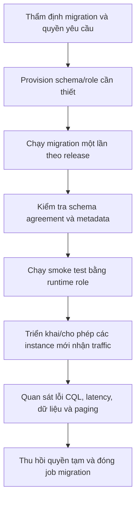

# Tách tài khoản ứng dụng, kiểm thử và di trú lược đồ trong Spring Data Cassandra

## 1. Mục tiêu và tình huống thực tế

Một dịch vụ **Spring Data Cassandra** thường dùng repository, `CassandraTemplate` và `CqlSession` để đọc/ghi Apache Cassandra. Dịch vụ cũng cần tạo bảng lúc triển khai, chạy kiểm thử tích hợp và đôi khi thực hiện chuyển dữ liệu khi thay đổi mô hình truy vấn. Nếu tất cả công việc đó sử dụng **cùng một tài khoản Cassandra có quyền cao**, một lỗi cấu hình hoặc một thao tác ngoài ý muốn của ứng dụng có thể ảnh hưởng đến lược đồ và dữ liệu vượt quá phạm vi nghiệp vụ.

Ví dụ: API đơn hàng chỉ cần đọc/ghi bảng `commerce.orders_by_customer`. Nếu API dùng luôn tài khoản có quyền `DROP`, một đoạn mã chạy nhầm lệnh xóa bảng hoặc một script quản trị bị gọi sai sẽ có phạm vi tác động rất lớn. Ngược lại, nếu tài khoản API chỉ có quyền truy cập đúng những bảng cần thiết, một số thao tác ngoài phạm vi sẽ bị Cassandra từ chối.

Bài học thuộc chương **Bảo mật**, tập trung vào cách phân tách quyền cho ba loại công việc:

1. **Ứng dụng runtime:** phục vụ request của người dùng, đọc/ghi các bảng được cấp phép.
2. **Kiểm thử:** chạy test với dữ liệu và keyspace riêng, có quyền vừa đủ để chuẩn bị và dọn fixture.
3. **Di trú lược đồ (schema migration):** chạy DDL và các bước chuyển đổi dữ liệu trong pipeline triển khai, có kiểm soát và có dấu vết.

Kết thúc bài, bạn cần giải thích được vì sao ba tài khoản này không nên dùng chung; cấu hình authentication/authorization, phân quyền bằng CQL, kết nối Spring Boot bằng bí mật riêng, kiểm thử cả thao tác cho phép và bị cấm, và tổ chức migration không làm hỏng các truy vấn theo partition key, consistency hay paging.

## 2. Phân biệt xác thực, phân quyền và kiểm soát ở tầng nghiệp vụ

| Cơ chế | Câu hỏi | Ví dụ trong Cassandra | Giới hạn |
| --- | --- | --- | --- |
| Authentication (xác thực) | Ai đang kết nối? | Role có `LOGIN = true`, xác thực bằng mật khẩu hoặc cơ chế hỗ trợ khác | Xác thực thành công không đồng nghĩa được đọc bảng |
| Authorization (phân quyền) | Role được phép làm gì trên tài nguyên nào? | `GRANT SELECT ON TABLE commerce.orders_by_customer ...` | Chủ yếu kiểm soát keyspace/table/resource, không tự thực thi quyền truy cập theo từng khách hàng |
| Application authorization | Người dùng cuối được xem dữ liệu của ai? | API lấy tenant/customer từ principal đã xác minh và tạo truy vấn theo partition key | Phải do tầng ứng dụng/thiết kế dữ liệu triển khai |
| Network và transport security | Kết nối có được bảo vệ không? | TLS, chính sách mạng và xác minh certificate | Không thay thế quyền `SELECT`/`MODIFY` |
| Audit và observability | Ai đã thay đổi quyền, schema hoặc dữ liệu? | Log triển khai, audit theo khả năng hệ thống, metrics | Không tự ngăn được thao tác đã có quyền |

**Điểm mấu chốt:** trong mô hình multi-tenant, `GRANT SELECT ON TABLE orders_by_customer` không có nghĩa “chỉ đọc được đơn hàng của một `customer_id`”. Tài khoản được cấp quyền trên bảng có thể truy cập những hàng mà CQL và schema cho phép. Ứng dụng vẫn phải xác thực người dùng cuối, kiểm tra quyền truy cập tenant, dựng `WHERE` dựa trên thông tin đã xác minh và có kiểm thử chống đọc chéo tenant.

## 3. Bật bảo vệ trên cluster trước khi thiết kế role

### 3.1. Mặc định Cassandra có thể chưa thực thi RBAC

Apache Cassandra cho phép cấu hình các backend xác thực và phân quyền trong `cassandra.yaml`. Với cơ chế nội bộ thông dụng, hai cấu hình cốt lõi là:

```yaml
# Ví dụ phần cấu hình cluster Apache Cassandra; không phải application.yml.
authenticator: PasswordAuthenticator
authorizer: CassandraAuthorizer
role_manager: CassandraRoleManager
```

Tên cấu hình có thể cần viết đầy đủ tên lớp tùy phiên bản/cách đóng gói. Hãy kiểm tra phiên bản Cassandra và quy trình triển khai cluster trước khi thay đổi. Khi dùng `PasswordAuthenticator`, mật khẩu được lưu dưới dạng hash trong hạ tầng phân quyền của Cassandra; cần cấu hình độ sẵn sàng/replication thích hợp cho keyspace hệ thống `system_auth` theo tài liệu vận hành.

Ở một số cấu hình mặc định của Cassandra, `AllowAllAuthenticator` không xác thực kết nối và `AllowAllAuthorizer` không kiểm tra quyền. Trong môi trường như vậy, việc viết `GRANT` không cung cấp lớp bảo vệ mà bạn đang mong đợi. Phải kiểm tra backend đang bật và **thử thật bằng tài khoản ít quyền** trước khi kết luận hệ thống đã thực thi quyền tối thiểu.

Việc thay đổi authentication/authorization trên một cluster đang phục vụ là thao tác vận hành cấp cluster: cần quy trình rollout, tài khoản quản trị thay thế, phương án phục hồi và tính sẵn sàng của `system_auth`. Không áp dụng trực tiếp thay đổi bảo mật vào production chỉ từ một ví dụ YAML.

### 3.2. Quyền kế thừa theo phạm vi tài nguyên

Cassandra có cây tài nguyên dữ liệu:

```text
ALL KEYSPACES
└── KEYSPACE commerce
    ├── TABLE orders_by_customer
    ├── TABLE order_events
    └── TABLE customer_profiles
```

Quyền cấp tại `KEYSPACE commerce` áp dụng cho các bảng con theo quy tắc phân quyền; quyền cấp trực tiếp tại `TABLE` giới hạn vào bảng đó. Vì thế:

- `GRANT SELECT ON TABLE commerce.orders_by_customer` hẹp hơn `GRANT SELECT ON KEYSPACE commerce`.
- `GRANT MODIFY ON KEYSPACE commerce` cho phép thay đổi dữ liệu trên tất cả bảng phù hợp trong keyspace, bao gồm bảng được tạo về sau.
- `GRANT ALL PERMISSIONS` trên keyspace thường rộng hơn rất nhiều nhu cầu của runtime.
- `SUPERUSER = true` bỏ qua kiểm soát quyền thông thường; không nên gắn với kết nối dịch vụ.

Các permission thường gặp:

| Permission | Phạm vi sử dụng | Lưu ý |
| --- | --- | --- |
| `SELECT` | Đọc bảng bằng CQL | Không bảo đảm lọc tenant hay truy vấn hiệu quả |
| `MODIFY` | `INSERT`, `UPDATE`, `DELETE`, và cả `TRUNCATE` trên bảng được cấp quyền | Cassandra không tách riêng “chỉ INSERT, không DELETE/TRUNCATE” bằng permission cơ bản này |
| `CREATE` | Tạo tài nguyên phù hợp, ví dụ bảng trong keyspace | Dành cho migration/schema provisioning |
| `ALTER` | Thay đổi schema/keyspace/table theo phạm vi được cấp | Không dành cho API runtime |
| `DROP` | Xóa tài nguyên theo phạm vi được cấp | Chỉ cấp cho bước có kiểm soát, tránh để mặc định |
| `AUTHORIZE` | Cấp/thu hồi quyền tương ứng | Thường dành cho quản trị quyền |
| `SUPERUSER` | Quyền đặc biệt ở mức cao nhất | Dành cho kênh quản trị cực hạn, không phải tài khoản ứng dụng |

Bảng này mô tả quyền trên tài nguyên dữ liệu; Cassandra còn có permission đối với role, function, MBean và các tài nguyên khác. Một permission không phải lúc nào cũng áp dụng cho mọi loại tài nguyên. Khi cấp quyền ở phạm vi cha, cần kiểm tra quyền kế thừa và những role đã được `GRANT` vào role đăng nhập.

**Lưu ý quan trọng về `MODIFY`:** nếu runtime được phép ghi một bảng, Cassandra native RBAC cũng cho phép một số lệnh dữ liệu nguy hiểm như `TRUNCATE` trên bảng đó. Tách tài khoản chỉ giảm phạm vi truy cập; để ngăn xóa dữ liệu vô ý vẫn cần giới hạn code path, quy trình vận hành, sao lưu/khôi phục và quyền triển khai phù hợp.

## 4. Thiết kế ma trận tài khoản theo công việc

Giả sử hệ thống có keyspace production `commerce` và keyspace kiểm thử `commerce_it`.

| Danh tính/role đăng nhập | Môi trường | Quyền tối thiểu dự kiến | Không nên có |
| --- | --- | --- | --- |
| `orders_runtime` | Production | `SELECT`, `MODIFY` trên bảng đơn hàng cần thiết | `CREATE`, `ALTER`, `DROP`, `AUTHORIZE`, `SUPERUSER` |
| `orders_report_reader` | Production | `SELECT` trên bảng báo cáo hoặc projection đã cho phép | `MODIFY` và DDL |
| `orders_test_runner` | Integration | `SELECT`/`MODIFY` trên bảng test; quyền chuẩn bị fixture theo nhu cầu | Quyền trên `commerce` production |
| `orders_schema_migrator` | Production qua CI/CD | `CREATE`/`ALTER` ở phạm vi cần thiết; `SELECT`/`MODIFY` bổ sung chỉ khi backfill | Quyền superuser; `DROP` mặc định |
| `security_admin` | Kênh quản trị | Tạo role, grant/revoke, bootstrap tài nguyên | Credential được nhúng trong ứng dụng hoặc image |

Tài khoản runtime và migrator có vòng đời khác nhau. Runtime chạy liên tục, nên có số quyền ít nhất; migrator chạy trong **một job phát hành ngắn hạn**, có quyền DDL được cấp theo kế hoạch. Tài khoản test dùng để làm sạch fixture và thử quyền bị từ chối, nên chỉ tồn tại trong môi trường riêng.

Có thể dùng **role quyền không đăng nhập** làm nhóm quyền, rồi cấp vai trò đó cho các login role. Phương án này hữu ích khi nhiều service có cùng quyền, nhưng phải rà soát kế thừa để không cấp rộng ngoài ý muốn. Ví dụ:

```sql
-- Role nhóm quyền; mặc định LOGIN và SUPERUSER đều false.
CREATE ROLE commerce_orders_rw WITH LOGIN = false
    AND SUPERUSER = false;

GRANT SELECT ON TABLE commerce.orders_by_customer
    TO commerce_orders_rw;
GRANT MODIFY ON TABLE commerce.orders_by_customer
    TO commerce_orders_rw;

-- Được thực hiện bởi tài khoản có quyền quản trị phù hợp.
GRANT commerce_orders_rw TO orders_runtime;
```

Trong trường hợp chỉ có một service, cấp quyền trực tiếp trên table cho login role cũng có thể đơn giản hơn. Dù dùng nhóm hay quyền trực tiếp, phải kiểm tra **tổng quyền thực tế** của login role, bao gồm quyền kế thừa.

## 5. Cấp tài khoản và permission bằng CQL

### 5.1. Khởi tạo role bằng kênh quản trị

Đoạn sau minh họa cách định nghĩa ba login role. Chạy bằng tài khoản quản trị đã được bảo vệ, **không đưa mật khẩu thật vào Git, log CI hay tài liệu**. Các chuỗi bên dưới là placeholder, không phải mật khẩu sử dụng được:

```sql
-- Minh họa bootstrap roles; dùng công cụ provisioning bảo mật
-- để phát hành mật khẩu hoặc credential thực tế.
CREATE ROLE orders_runtime
WITH LOGIN = true
AND SUPERUSER = false
AND PASSWORD = '<PROVISION_AT_RUNTIME>';

CREATE ROLE orders_test_runner
WITH LOGIN = true
AND SUPERUSER = false
AND PASSWORD = '<PROVISION_IN_TEST_ENV>';

CREATE ROLE orders_schema_migrator
WITH LOGIN = true
AND SUPERUSER = false
AND PASSWORD = '<PROVISION_FOR_MIGRATION_JOB>';
```

CQL `CREATE ROLE` yêu cầu quyền quản lý role thích hợp. Trong một hệ thống có secret manager, nên để quy trình provisioning tạo mật khẩu an toàn và truyền credential qua kênh được kiểm soát; tránh script SQL tĩnh chứa credential. Đừng dựa vào `CREATE ROLE IF NOT EXISTS` để xoay vòng mật khẩu: khi role đã tồn tại, lệnh sẽ không tự đồng bộ password/permission theo trạng thái mong đợi.

### 5.2. Cấp quyền runtime đúng bảng

Giả sử API ghi/đọc một bảng được thiết kế theo truy vấn “đơn hàng của khách hàng”:

```sql
CREATE TABLE IF NOT EXISTS commerce.orders_by_customer (
    customer_id text,
    created_at timestamp,
    order_id uuid,
    status text,
    total decimal,
    PRIMARY KEY ((customer_id), created_at, order_id)
) WITH CLUSTERING ORDER BY (created_at DESC, order_id ASC);

-- Chạy bởi người hoặc pipeline có quyền cấp permission.
GRANT SELECT ON TABLE commerce.orders_by_customer
    TO orders_runtime;

GRANT MODIFY ON TABLE commerce.orders_by_customer
    TO orders_runtime;
```

Trong môi trường thực, bảng phải được tạo qua **schema migration job** trước khi chạy phần cấp quyền. Lệnh `CREATE TABLE` ở đây chỉ mô tả fixture của ví dụ. Không cấu hình runtime tự tạo lại bảng bằng entity mapping.

Nếu ứng dụng chỉ đọc, chỉ cấp `SELECT`. Nếu một endpoint chỉ cần đọc bảng `customer_profiles`, không nên cấp `MODIFY` trên bảng đó. Khi service sử dụng nhiều bảng phục vụ các mẫu truy vấn khác nhau, lập danh sách riêng từng bảng và thao tác CQL cần thiết.

Không dùng `GRANT ALL PERMISSIONS ON ALL KEYSPACES` hoặc `GRANT ALL ON KEYSPACE commerce` như cách sửa nhanh lỗi quyền. Cấp rộng làm mất ý nghĩa phân tách tài khoản.

### 5.3. Cấp quyền di trú lược đồ có kiểm soát

Migrator chỉ cần quyền trên keyspace mà nó quản lý. Các ví dụ sau cho phép tạo bảng và thay đổi schema trong `commerce`:

```sql
GRANT CREATE ON KEYSPACE commerce
    TO orders_schema_migrator;

GRANT ALTER ON KEYSPACE commerce
    TO orders_schema_migrator;

-- Không cấp DROP mặc định.
-- Chỉ cấp thêm SELECT/MODIFY trên bảng cụ thể nếu migration
-- thật sự cần đọc hoặc backfill dữ liệu.
```

Có thể cấp `ALTER` trên bảng cụ thể thay vì cả keyspace nếu migration chỉ sửa một tập tài nguyên xác định. Tuy nhiên tạo **bảng mới** cần `CREATE` trên keyspace liên quan; vì vậy quyền của migration job phải phản ánh đúng loại thay đổi. Khi role tạo một tài nguyên mới, Cassandra có cơ chế tự cấp quyền tương ứng cho role tạo tài nguyên đó. Sau mỗi migration phải kiểm tra effective permissions để tránh tích lũy quyền ngoài kế hoạch.

Quyền `DROP` chỉ nên cấp tạm thời cho release có bước phá hủy schema được phê duyệt; đối với thay đổi bất tương thích, thường nên tạo bảng mới, chuyển dữ liệu rồi xóa bảng cũ ở một release sau.

### 5.4. Cấp quyền test trên keyspace riêng

Trong môi trường integration test, cấp quyền cho `orders_test_runner` trên **keyspace test đã được tạo bởi quy trình bootstrap**:

```sql
GRANT SELECT ON KEYSPACE commerce_it
    TO orders_test_runner;
GRANT MODIFY ON KEYSPACE commerce_it
    TO orders_test_runner;

-- Nếu chính test runner cần tự tạo bảng fixture:
GRANT CREATE ON KEYSPACE commerce_it
    TO orders_test_runner;
GRANT ALTER ON KEYSPACE commerce_it
    TO orders_test_runner;
```

Nếu test chỉ thực thi repository trên bảng đã tạo sẵn, không cần `CREATE`/`ALTER`. Trường hợp test runner có quyền chuẩn bị schema, hãy giới hạn tài khoản đó vào cluster hoặc keyspace test, **không** tái sử dụng credential production. Cấu hình authorization của Cassandra không có khái niệm “tài khoản này là test nên câu CQL sẽ an toàn”; an toàn đến từ quyền và phạm vi môi trường đã định.

### 5.5. Kiểm tra và thu hồi quyền

Người quản trị có quyền phù hợp có thể kiểm tra:

```sql
LIST ALL PERMISSIONS OF orders_runtime;
LIST ALL PERMISSIONS OF orders_test_runner;
LIST ALL PERMISSIONS OF orders_schema_migrator;
```

Xem cả quyền được kế thừa từ nhóm role. Muốn thu hồi một quyền cấp trực tiếp:

```sql
REVOKE ALTER ON KEYSPACE commerce
    FROM orders_schema_migrator;
```

Không nên thu hồi rồi cho rằng mọi kết nối hiện tại tức khắc có cùng góc nhìn quyền mới: cơ chế cache authorization và thời điểm áp dụng thay đổi tùy cấu hình cluster. Khi xoay vòng hoặc rút quyền khẩn cấp, kiểm tra cả phiên đăng nhập hiện có, cache và thời gian chuyển đổi.

## 6. Spring Boot và Spring Data Cassandra dùng credential runtime

### 6.1. Cấu hình ứng dụng để không được phép sửa schema

Ví dụ với Spring Boot 3.x, sử dụng cấu hình username/password được cấp qua secret manager hoặc biến môi trường:

```yaml
spring:
  cassandra:
    contact-points:
      - cassandra-1.internal.example
      - cassandra-2.internal.example
    port: 9042
    local-datacenter: dc1
    keyspace-name: commerce
    username: ${CASSANDRA_RUNTIME_USERNAME}
    password: ${CASSANDRA_RUNTIME_PASSWORD}
    schema-action: NONE
    ssl:
      enabled: true
      verify-hostname: true
```

Tên máy và datacenter chỉ là ví dụ. Việc bật TLS cần **tin cậy đúng CA/certificate** và cấu hình TLS của server; không đủ chỉ đặt một cờ ở client. Với Spring Boot hiện đại có thể dùng SSL bundle khi cần cung cấp trust material. Không bỏ kiểm tra hostname để “sửa” lỗi chứng chỉ trong production.

`schema-action: NONE` biểu thị ứng dụng không tự thao tác schema khi khởi động. Đây là một lớp phòng vệ ở phía framework; **quyền Cassandra mới là lớp kiểm soát thực sự**. Nếu cấu hình vô tình đổi sang chế độ tạo/sửa schema, tài khoản runtime thiếu DDL vẫn phải bị server từ chối.

Repository và `CassandraTemplate` sử dụng `CqlSession` do Spring quản lý. Khi một ứng dụng có thể tự khởi tạo thêm session với credential khác, phải kiểm tra toàn bộ code path để tránh có một kết nối “ẩn” dùng tài khoản quản trị.

### 6.2. Không lưu bí mật trong mã nguồn hoặc log

Credential runtime, test và migrator nên được quản lý riêng; pipeline chỉ nhận secret đúng môi trường trong thời gian cần thiết. Tránh:

- Commit mật khẩu vào `application.yml`, file migration, unit test hoặc container image.
- Ghi nguyên username/password trong exception, debug output hoặc biến trace.
- Truyền secret trong tham số command line dễ lộ qua process listing hoặc lịch sử shell.
- Dùng cùng một secret cho tất cả môi trường và mọi service.

Có thể sử dụng biến môi trường, secret volume hoặc một secret manager theo hạ tầng đang dùng; chọn phương án phù hợp quy định bảo vệ secret của đội. Cần hạn chế quyền xem secret và giữ audit trail khi có truy cập hoặc thay đổi.

### 6.3. Xoay vòng credential không gián đoạn

Một phương án chuyển giao thường an toàn hơn đổi mật khẩu trên tài khoản duy nhất là dùng **hai login role luân phiên**:

1. Provision `orders_runtime_v2` với quyền giống role cũ, xác minh permission và thử kết nối.
2. Cập nhật secret cấu hình để các instance mới đăng nhập bằng role v2; triển khai lần lượt.
3. Kiểm tra tỷ lệ lỗi authentication, truy vấn đọc/ghi, latency và trạng thái connection pool.
4. Xác nhận những instance dùng role cũ đã dừng và không còn job phụ thuộc.
5. Thu hồi quyền/khả năng login của role cũ và dọn credential theo quy trình, tính tới cache và kết nối cũ.

Nếu chính sách bắt buộc giữ một username, có thể dùng thay đổi mật khẩu kèm rolling reconnect nhưng phải nắm rõ cách xác thực lại của driver và thời điểm cấu hình mới có hiệu lực. Dù cách nào, không công bố hoàn tất rotation chỉ vì secret manager đã cập nhật; cần thử kết nối và truy vấn qua phiên đăng nhập mới.

## 7. Tách bước di trú schema khỏi khởi động ứng dụng

### 7.1. Vì sao không để mỗi instance tự chạy DDL?

Giả sử 10 pod cùng khởi động, cả 10 đều chạy `CREATE TABLE` hoặc `ALTER TABLE`. Dù vài câu lệnh hỗ trợ `IF NOT EXISTS`, cách này dễ gây tranh chấp, tạo trạng thái không đồng nhất giữa thời điểm triển khai và mở rộng quyền cho runtime. DDL trong Cassandra phải cân nhắc schema agreement và các phiên bản ứng dụng đang cùng truy cập bảng.

Một pipeline phù hợp thường có trình tự:



Không bắt buộc mọi hệ thống dùng đúng công cụ migration. Điều bắt buộc là **có versioning, trạng thái áp dụng, cách phát hiện thất bại, quyền riêng và kiểm chứng kết quả**. Các công cụ phổ biến trong cơ sở dữ liệu SQL không tự động hỗ trợ mọi tính năng Cassandra; chỉ dùng runner/migration tool đã xác nhận tương thích với cluster và CQL đang chạy.

### 7.2. Ví dụ migration mở rộng schema

Giả sử cần bổ sung cột `source` vào `commerce.orders_by_customer`:

```sql
-- Migration V002, chạy bằng orders_schema_migrator.
ALTER TABLE commerce.orders_by_customer
ADD source text;
```

Cần kiểm tra schema ban đầu, lịch sử migration và điều kiện chạy lại trước khi thực thi. Nếu migration đã chạy một phần, pipeline phải phát hiện và xử lý trạng thái đó theo quy trình. Đừng sử dụng `CREATE TABLE IF NOT EXISTS` như công cụ xác nhận schema đúng: lệnh không chứng minh tất cả cột, kiểu và clustering order đang khớp với entity.

Quy trình triển khai tương thích:

1. **Expand:** thêm cột mới, nhưng code hiện hành vẫn chạy được khi cột còn `null`.
2. **Deploy:** phiên bản ứng dụng mới biết đọc cột tùy chọn và có thể bắt đầu ghi dữ liệu mới.
3. **Backfill:** nếu cần, thực hiện chuyển dữ liệu theo partition, có checkpoint và giới hạn tốc độ.
4. **Verify:** đối chiếu mẫu dữ liệu cũ/mới, tỷ lệ lỗi, paging và consistency theo use case.
5. **Contract:** chỉ khi những phiên bản cũ đã rút hết mới áp dụng ràng buộc nghiệp vụ mới hoặc ngừng tương thích với dữ liệu cũ.

Cassandra không có cơ chế transaction DDL bao trùm nhiều bước migration như mong đợi ở một số hệ quản trị SQL. Một migration thành công ở bước đầu rồi thất bại ở bước sau cần kế hoạch **tiếp tục/khôi phục theo từng bước**, không giả định rollback tự động toàn bộ schema.

### 7.3. Khi thay partition key hoặc clustering key

Trong Cassandra, thiết kế bảng bắt đầu từ truy vấn. Nếu API chuyển từ “liệt kê theo khách hàng” sang “liệt kê theo trạng thái trong một khoảng thời gian”, sửa repository hay `@Query` chưa đủ. Thường cần bảng truy vấn mới, ví dụ `orders_by_status_day`, với partition key và clustering key đáp ứng truy vấn đó.

Quy trình thận trọng:

- Tạo bảng mới bằng migration role, với primary key phù hợp và chính sách TTL/replication được xem xét.
- Bổ sung luồng cập nhật bảng mới (dual-write hoặc pipeline có đối soát), xử lý retry/idempotency.
- Backfill dữ liệu cũ theo các partition có giới hạn, tránh full scan gây quá tải.
- Kiểm tra truy vấn `@Query`, repository, paging state, thứ tự clustering và nhất quán ở bảng mới.
- Chuyển dần luồng đọc, quan sát chất lượng dữ liệu và latency; chỉ dọn bảng cũ sau khi đã hết phụ thuộc.

Đừng thêm `ALLOW FILTERING` để né nhu cầu thiết kế bảng mới. Nó có thể cho phép một số truy vấn nhưng không đảm bảo chi phí thấp, nhất là với bảng lớn hoặc điều kiện thiếu partition key.

### 7.4. Quyền schema chưa đồng nghĩa quyền backfill

Migrator được `CREATE`/`ALTER` trên keyspace không nhất thiết có quyền đọc/ghi **mọi bảng hiện hữu**. Nếu job backfill cần:

```sql
SELECT * FROM commerce.orders_by_customer
WHERE customer_id = ?;
```

thì phải xét cấp `SELECT` phù hợp; nếu ghi bảng đích thì cần `MODIFY` trên bảng đích. Không nên cấp `SELECT` và `MODIFY` trên toàn bộ keyspace nếu chỉ cần hai bảng cụ thể. Tương tự, thao tác xóa bảng ở cuối lộ trình cần phê duyệt và `DROP` thích hợp, có thể thực hiện bằng job bảo trì tách biệt.

Ngoài quyền, backfill cần quản lý throughput và paging: đọc theo partition/paging state thay vì giả định offset SQL, tránh vô tình tạo partition rất lớn; theo dõi consistency, timeout và retry để không gây áp lực lên cluster.

## 8. Kiểm thử bảo mật phải chạy với authorization thật

### 8.1. Vì sao mock repository không kiểm chứng được quyền?

Một bài test như:

```java
when(repository.findByKeyCustomerId("KH-01"))
    .thenReturn(List.of(order));
```

không đăng nhập vào Cassandra và không gửi CQL qua driver; nó không thể chứng minh `SELECT` được phép hay `CREATE TABLE` bị chặn.

Một bộ kiểm thử bảo mật nên có Cassandra thật với authentication và authorization **được bật**. Testcontainers là lựa chọn khả thi để cô lập môi trường, nhưng **container Cassandra dùng cấu hình mặc định có thể không bật RBAC**. Cần khởi động cluster test với `PasswordAuthenticator`/`CassandraAuthorizer` và bootstrap role, keyspace, bảng theo một fixture được kiểm soát trước khi thử negative test. Nếu bỏ bước này, test thao tác bị cấm có thể chạy thành công và tạo cảm giác an toàn giả.

### 8.2. Ma trận kiểm thử tích hợp cho từng vai trò

| Vai trò | Thao tác | Kết quả cần kiểm chứng |
| --- | --- | --- |
| Runtime read/write | `SELECT` đúng bảng | Thành công |
| Runtime read/write | `INSERT` đúng bảng | Thành công |
| Runtime read/write | `CREATE TABLE` trong keyspace test | Bị từ chối |
| Runtime read/write | `ALTER TABLE`/`DROP TABLE` bảng fixture | Bị từ chối |
| Runtime read/write | `SELECT` bảng nhạy cảm không được cấp | Bị từ chối |
| Reader | `SELECT` bảng được cấp | Thành công |
| Reader | `INSERT`/`DELETE` trên bảng được cấp đọc | Bị từ chối |
| Test runner | Đọc/ghi và dọn fixture thuộc `commerce_it` | Thành công trong quyền đã định |
| Test runner | Truy cập keyspace production | Bị từ chối/không tồn tại trong môi trường test |
| Migrator | `CREATE`/`ALTER` schema test được phân quyền | Thành công |
| Migrator | `DROP` nếu chưa được cấp | Bị từ chối |

Mỗi test cần kiểm tra **nguyên nhân** của thất bại. Câu lệnh có thể thất bại vì sai cú pháp, thiếu cột, kết nối hỏng hoặc sai datacenter; những lỗi đó không chứng minh phân quyền. Nếu driver trả lỗi authorization (chẳng hạn `UnauthorizedException`), kiểm tra cause chain phù hợp với phiên bản Spring Data và Cassandra Java Driver được dùng.

### 8.3. Ví dụ test trực tiếp với `CqlSession`

Ví dụ sau minh họa một phần kiểm thử với Java Driver 4, JUnit 5 và AssertJ. Session kết nối với một **cluster test riêng** đã có role `runtime_it`, chỉ được `SELECT`/`MODIFY` trên bảng `commerce_it.orders_by_customer`:

```java
@Test
void runtimeRoleCannotCreateTable() {
    try (CqlSession session = CqlSession.builder()
            .addContactPoint(
                new InetSocketAddress(testHost, testPort))
            .withLocalDatacenter(testDatacenter)
            .withAuthCredentials(
                testRuntimeUsername, testRuntimePassword)
            .build()) {

        assertThatThrownBy(() -> session.execute("""
            CREATE TABLE commerce_it.forbidden_by_runtime (
                id text PRIMARY KEY
            )
            """))
            .isInstanceOf(UnauthorizedException.class);
    }
}
```

Các import chính là `com.datastax.oss.driver.api.core.CqlSession`, `com.datastax.oss.driver.api.core.servererrors.UnauthorizedException`, `java.net.InetSocketAddress` và `org.assertj.core.api.Assertions.assertThatThrownBy`. Các biến `testHost`, `testPort`, `testDatacenter` và test credentials lấy từ fixture/cấu hình kiểm thử, không phải literal hardcoded trong mã nguồn.

Nếu test đi qua Spring Data Repository hoặc `CassandraTemplate`, framework có thể chuyển/bọc exception. Khi đó assertion cần duyệt `getCause()` để xác định lỗi authorization từ driver, thay vì kiểm tra trực tiếp lớp ngoài cùng.

**Không chạy ví dụ với keyspace production.** Negative test DDL chỉ nên dùng tài nguyên test hoặc môi trường tích hợp. Mọi câu lệnh cố ý phá giới hạn quyền đều cần scope rõ ràng.

### 8.4. Test cả quyền được phép

Chỉ kiểm tra “CREATE bị từ chối” là chưa đủ: role quá ít quyền cũng khiến tất cả request thực tế đều lỗi. Phải kiểm tra happy path:

```java
@Test
void runtimeRoleCanReadItsAllowedTable() {
    try (CqlSession session = connectAsTestRuntimeRole()) {
        PreparedStatement query = session.prepare("""
            SELECT customer_id, created_at, order_id
            FROM commerce_it.orders_by_customer
            WHERE customer_id = ?
            """);

        ResultSet result = session.execute(query.bind("KH-01"));
        assertThat(result.all()).hasSize(2);
    }
}
```

Trong test thực, helper `connectAsTestRuntimeRole()` phải tạo session với đúng credential đang kiểm tra; fixture cần chuẩn bị chính xác hai hàng thuộc partition `KH-01` trước khi chạy. Tương tự, test ghi cần `INSERT` bằng tham số bind và đọc lại để xác minh dữ liệu, không chỉ kết luận từ việc lệnh không ném exception.

Câu truy vấn có partition key là một phần thiết kế test: nếu viết `SELECT * FROM table` rồi bị Cassandra từ chối vì cấu trúc truy vấn hoặc chi phí filtering, đó là **lỗi mẫu CQL**, không nhất thiết là lỗi permission.

### 8.5. Test cô lập và giới hạn tác dụng phụ

Khi chạy nhiều test song song:

- Tạo keyspace/table fixture riêng theo suite hoặc giới hạn tính song song.
- Không dùng `TRUNCATE` trên bất kỳ bảng nào ngoài môi trường kiểm thử. Nhớ rằng `MODIFY` có thể bao gồm `TRUNCATE`.
- Chuẩn bị dữ liệu xác định, ít nhất hai partition nếu kiểm thử truy vấn theo khóa.
- Tạo script bootstrap cấp quyền trước suite, không để test tùy ý kết nối bằng superuser.
- Dọn tài nguyên bằng job có quyền và phạm vi riêng sau suite, không dùng lại tài khoản production.

Điều này vừa bảo vệ dữ liệu vừa giúp test có kết quả ổn định. Với CI/CD, nên khóa quyền truy cập từ job test tới cluster production ngay ở mạng/secret provisioning, không chỉ dựa vào lời hứa của code test.

## 9. Quyền trên bảng không thay thế kiểm thử chống lộ dữ liệu giữa tenant

Giả sử API có endpoint:

```text
GET /customers/KH-02/orders
```

Tài khoản runtime được phép `SELECT` bảng `orders_by_customer`. Nếu người dùng chỉ sở hữu `KH-01` nhưng API lấy nguyên `KH-02` từ URL rồi truyền vào repository, Cassandra vẫn có thể trả dữ liệu KH-02 vì permission native là ở **bảng**, không tự giới hạn theo customer ID.

Mẫu service an toàn hơn:

```java
public List<OrderByCustomer> ordersForCurrentCustomer(
        AuthenticatedPrincipal principal,
        String requestedCustomerId) {

    if (!principal.canAccessCustomer(requestedCustomerId)) {
        throw new AccessDeniedException("Customer access denied");
    }

    return repository.findByKeyCustomerId(requestedCustomerId);
}
```

Ví dụ này dùng giao diện domain `AuthenticatedPrincipal` mang tính minh họa; hãy thay bằng principal/authorization service thực tế và xác định quyền tenant từ nguồn đã xác minh. Có thể bỏ hẳn `requestedCustomerId` từ input nếu API chỉ cho truy cập khách hàng hiện tại.

Cần test hai hướng: (1) user KH-01 đọc KH-01 thành công và (2) user KH-01 không đọc được KH-02. Đừng chỉ kiểm tra role Cassandra, vì cả hai request đều có thể đi qua cùng một tài khoản runtime hợp lệ.

Đồng thời, giá trị `customer_id` cần được bind vào CQL; tránh ghép trực tiếp input:

```java
@Query("""
    SELECT * FROM orders_by_customer
    WHERE customer_id = ?0
    """)
List<OrderByCustomer> findByCustomerId(String customerId);
```

Bind parameter bảo vệ cấu trúc câu truy vấn; còn việc có được phép đọc customer ID đó hay không là trách nhiệm của application authorization.

## 10. Những sự cố hay gặp và cách chẩn đoán

| Triệu chứng | Nguyên nhân cần kiểm tra | Hành động đúng |
| --- | --- | --- |
| Kết nối lỗi sau khi bật xác thực | Username/password sai, role `LOGIN = false`, TLS hoặc local DC sai | Kiểm tra cấu hình driver và phiên đăng nhập bằng role tương ứng |
| Kết nối được nhưng `SELECT` bị từ chối | Thiếu `SELECT` đúng table/keyspace, role grant không kế thừa như dự kiến | Kiểm tra `LIST ALL PERMISSIONS OF ...` và đường role |
| Ứng dụng không khởi động sau thay schema | Runtime cố chạy DDL hoặc schema migration chưa hoàn tất | Giữ `schema-action: NONE`, chạy migration job riêng và kiểm tra schema |
| Migrator tạo được bảng nhưng không backfill | Có `CREATE` nhưng thiếu `SELECT` nguồn hoặc `MODIFY` đích | Cấp quyền dữ liệu chính xác cho bước backfill |
| Test “không được phép CREATE” lại thành công | Container test chưa bật CassandraAuthorizer; role đã được cấp quyền rộng | Kiểm tra RBAC backend và quyền effective |
| Runtime ghi thất bại vì schema mới | Bảng/cột chưa triển khai, schema agreement chưa ổn hoặc lệch keyspace | Dừng rollout, đối chiếu CQL schema thực tế và migration history |
| Chỉ một service lỗi sau rotation | Instance vẫn dùng secret cũ, pool chưa tái kết nối hoặc role cũ bị thu hồi quá sớm | Kiểm tra release, credential, reconnect và auth cache |
| Truy vấn timeout dù có `SELECT` | Partition lớn, query sai thiết kế, consistency không đủ replica, paging/tải | Điều tra CQL/cluster/độ trễ, không cấp thêm quyền để “sửa” timeout |
| Người dùng đọc nhầm tenant | API thiếu bước authorization theo tenant | Sửa kiểm tra quyền ở service và bổ sung test chéo tenant |

### Runbook khi release thất bại vì permission

1. **Khoanh vùng identity:** xác nhận instance đang dùng role nào và keyspace nào, qua cấu hình/metadata an toàn; không in password.
2. **Tìm lỗi gốc:** phân biệt thất bại xác thực, bị từ chối quyền, sai CQL/schema và timeout; xem root cause của driver/Spring Data.
3. **Kiểm tra quyền effective:** bằng kênh quản trị, xem quyền và role kế thừa của danh tính thực tế, không chỉ một câu `GRANT` trong script.
4. **Đối chiếu migration:** schema mới đã được áp dụng trên đúng cluster? Có yêu cầu `CREATE/ALTER/SELECT/MODIFY` mới hay không?
5. **Sửa đúng nơi:** nếu runtime cần một quyền dữ liệu hợp lệ, cập nhật cấp quyền hẹp và review; nếu runtime đang cố DDL, chuyển DDL sang migrator thay vì cấp `ALTER` cho runtime.
6. **Xác minh:** chạy smoke test bằng chính role runtime, thử một truy vấn đọc/ghi đại diện và một thao tác DDL bị từ chối trong môi trường test.
7. **Đóng sự cố:** theo dõi tỷ lệ lỗi, độ trễ, auth failures và audit trail; thu hồi quyền tạm nếu có.

**Không sửa sự cố bằng cách cấp superuser cho service.** Lỗi authorization là tín hiệu ranh giới bảo mật đang hoạt động; cần xác định thay đổi quyền nào thực sự hợp lệ theo thiết kế.

## 11. Bài tập tình huống

Một team đang triển khai hai thay đổi:

- Endpoint mới đọc danh sách đơn hàng từ bảng `commerce.orders_by_customer`; bảng đã tồn tại.
- Release cần tạo `commerce.orders_by_status_day` để hỗ trợ truy vấn theo trạng thái/ngày, backfill dữ liệu từ bảng cũ và sau đó cập nhật luồng ghi.

Đề xuất ban đầu là cấp:

```sql
GRANT ALL PERMISSIONS ON KEYSPACE commerce TO orders_runtime;
```

Vì “như vậy sẽ không bị lỗi permission”.

**Phân tích:** cách cấp này không phù hợp vì runtime nhận cả quyền schema và có thể truy cập rộng hơn phạm vi bảng cần thiết. Phân chia hợp lý hơn:

1. Runtime chỉ giữ `SELECT`/`MODIFY` trên những bảng thật sự dùng; cấp thêm quyền bảng mới sau khi có schema và trước khi release code đọc/ghi nó.
2. Migration job có `CREATE` trên `commerce` và những quyền dữ liệu cụ thể để đọc bảng cũ, ghi bảng đích; chỉ có `ALTER` khi script cần.
3. Backfill theo partition, giới hạn tốc độ, có checkpoint; xác minh số liệu và tính nhất quán trước khi chuyển đọc.
4. Kiểm thử tích hợp phải chạy dưới role tương ứng, xác minh query theo partition key và paging của bảng mới.
5. Quyền `DROP` trên bảng cũ chỉ được xem xét trong release dọn dẹp sau khi đã xác nhận không còn code sử dụng; không cấp quyền đó thường trực cho runtime.

Khi hoàn tất, team vừa có cơ chế phân quyền rõ ràng vừa có lộ trình migration phù hợp mô hình Cassandra thiết kế bảng theo truy vấn.

## 12. Checklist bảo mật và phát hành

- [ ] Cluster thực sự bật authentication và authorization; đã kiểm tra bằng login role ít quyền.
- [ ] Runtime, test và schema migration dùng danh tính/credential khác nhau.
- [ ] Runtime không có `SUPERUSER`, `CREATE`, `ALTER`, `DROP` hoặc `AUTHORIZE`.
- [ ] Quyền `SELECT`/`MODIFY` được giới hạn vào các bảng thực sự cần dùng.
- [ ] Đã ghi nhận rằng `MODIFY` bao gồm cả những thao tác như `TRUNCATE`; có kiểm soát bổ sung ngoài RBAC.
- [ ] Test runner chỉ truy cập keyspace/cluster test; test có authentication/authorization thật.
- [ ] Migrator có quyền DDL theo mục tiêu, quyền dữ liệu backfill chỉ khi cần, và chỉ chạy trong pipeline được kiểm soát.
- [ ] Spring Boot dùng `schema-action: NONE`, secret runtime lấy từ hệ thống quản lý bí mật và TLS xác minh server.
- [ ] Có trình tự migration versioned, schema verification, compatibility, backfill, rollback/roll-forward theo từng bước.
- [ ] Các test xác minh thao tác được phép **và** bị từ chối với loại lỗi đúng.
- [ ] API kiểm tra quyền tenant/customer ngoài quyền Cassandra; tham số CQL được bind.
- [ ] Có audit/monitoring cho thay đổi role, permission, schema, lỗi auth và hiệu năng.
- [ ] Credential rotation được kiểm chứng bằng session mới, không chỉ bằng việc cập nhật secret.
- [ ] Những quyền tạm thời được thu hồi sau migration; quyền effective được rà soát định kỳ.

## 13. Tài liệu chính thức để đối chiếu phiên bản

- [Apache Cassandra — Database Roles và CQL permission](https://cassandra.apache.org/doc/stable/cassandra/developing/cql/security.html): cú pháp `CREATE ROLE`, `GRANT`, `REVOKE`, phạm vi tài nguyên và vai trò kế thừa.
- [Apache Cassandra — Security Operations](https://cassandra.apache.org/doc/stable/cassandra/managing/operating/security.html): cấu hình authenticator/authorizer và những lưu ý khi bật RBAC trên cluster.
- [Spring Boot — Common Application Properties](https://docs.spring.io/spring-boot/appendix/application-properties/index.html): `spring.cassandra.username`, `password`, `schema-action`, SSL và các cấu hình kết nối.

**Ghi nhớ:** với **Spring Data Cassandra**, “ứng dụng kết nối được” chỉ chứng minh phiên đăng nhập tồn tại; “được đọc/ghi bảng” là permission Cassandra; “được đọc đơn hàng của khách hàng nào” là quyền nghiệp vụ. Tách tài khoản runtime, kiểm thử và di trú lược đồ giúp giới hạn tác động của mỗi loại thao tác. Khi kết hợp RBAC đúng phạm vi, secret/TLS, kiểm thử tích hợp có authorization thật và pipeline migration theo thiết kế bảng truy vấn, dịch vụ vừa an toàn hơn vừa dễ vận hành khi schema thay đổi.
