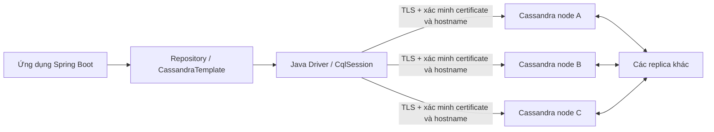
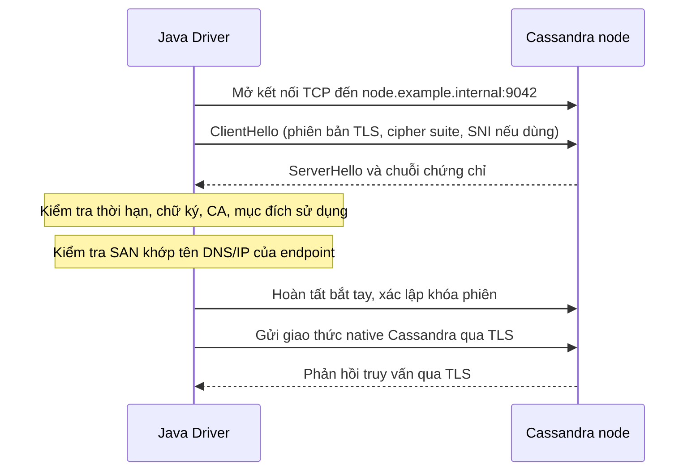
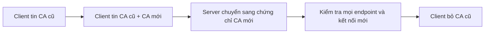

# TLS cho kết nối ứng dụng và xác minh chứng chỉ

## 1. Mục tiêu: kết nối Cassandra được mã hóa và xác thực đúng máy chủ

Trong **Spring Data Cassandra**, ứng dụng có thể truy cập Apache Cassandra bằng entity mapping, repository, `CassandraTemplate` hoặc câu lệnh CQL thông qua Java Driver. Dù API truy cập dữ liệu khác nhau, mọi thao tác đọc/ghi đều phụ thuộc vào kết nối mạng giữa **Java Driver** và các node Cassandra. Nếu đường truyền không được bảo vệ, thông tin xác thực và dữ liệu truy vấn có thể bị lộ hoặc bị can thiệp bởi tác nhân có khả năng quan sát luồng mạng.

**TLS (Transport Layer Security)** bảo vệ kết nối ứng dụng–Cassandra ở tầng truyền tải. Một cấu hình thực sự an toàn cần đạt **cả ba điều kiện**:

1. **Mã hóa** dữ liệu qua TLS với giao thức và cipher suite phù hợp.
2. **Kiểm tra chuỗi chứng chỉ** của server đến một CA/trust anchor mà ứng dụng chủ động tin cậy.
3. **Xác minh danh tính endpoint**: tên DNS hoặc IP mà client định kết nối phải khớp với thông tin nhận dạng hợp lệ trên chứng chỉ server.

Bài này thuộc chương **Bảo mật**, tập trung vào cấu hình TLS và **xác minh chứng chỉ** cho ứng dụng Spring Data Cassandra, không chỉ dừng ở việc bật tùy chọn `ssl.enabled`. Kết thúc bài, bạn cần có thể xây dựng truststore, hiểu sự khác biệt giữa TLS một chiều và mTLS, đánh giá cấu hình Java Driver, kiểm thử thất bại khi chứng chỉ không hợp lệ và lên kế hoạch xoay vòng chứng chỉ mà vẫn giữ tính sẵn sàng.

> **Điểm cốt lõi:** kết nối được mã hóa **chưa đủ**. Nếu client chấp nhận mọi chứng chỉ hoặc không kiểm tra hostname, kẻ trung gian vẫn có thể trình một chứng chỉ không đúng máy chủ và đọc/sửa dữ liệu trong kết nối TLS mà client tưởng là tin cậy.

## 2. TLS nằm ở đâu trong kiến trúc Spring Data Cassandra?



Khi ứng dụng gọi `repository.findById(id)` hoặc `cassandraTemplate.selectOne(...)`, Spring Data chuyển thao tác xuống Java Driver. Driver có thể mở **nhiều kết nối đến nhiều node** theo topology, load balancing và consistency level. Vì vậy, việc kiểm tra chứng chỉ phải có hiệu lực với **mọi endpoint mà driver thực sự kết nối**, không chỉ contact point đầu tiên.

Cần phân biệt rõ hai đường truyền:

| Kênh | Ai kết nối với ai? | Mục tiêu cấu hình |
|---|---|---|
| **Client-to-node / native transport TLS** | Ứng dụng dùng Java Driver ↔ Cassandra node | Mã hóa dữ liệu ứng dụng và xác minh danh tính node; đây là phạm vi chính của bài. |
| **Internode TLS** | Cassandra node ↔ Cassandra node | Bảo vệ giao tiếp giữa các replica/node; cấu hình riêng ở Cassandra. |

Bật client-to-node TLS **không tự động** bật internode TLS. Ngược lại, cấu hình internode TLS không bảo đảm ứng dụng Java đang dùng kết nối TLS.

Ngoài TLS, Cassandra có **authentication và authorization**. TLS xác thực máy chủ và bảo vệ đường truyền; quyền đọc/ghi theo role, keyspace và table vẫn phải cấu hình ở tầng Cassandra. Chứng chỉ client của mTLS cũng không mặc nhiên thay thế cơ chế đăng nhập hoặc phân quyền, trừ khi hệ thống thực sự triển khai một cơ chế xác thực tương ứng.

## 3. Chứng chỉ, CA, truststore và keystore khác nhau thế nào?

Một server Cassandra thường trình **chứng chỉ lá** (*leaf certificate*) và, khi cần, các chứng chỉ **CA trung gian**. Ứng dụng phải kiểm tra đường dẫn chứng chỉ đến một **trust anchor** đã được cấu hình. Chứng chỉ server thường chứa DNS/IP hợp lệ trong extension **Subject Alternative Name (SAN)**.

| Thành phần | Chứa gì? | Phía nào cần? |
|---|---|---|
| **Server certificate** | Public key, SAN, thời hạn, chữ ký CA, mục đích sử dụng chứng chỉ | Cassandra trình cho client khi bắt tay TLS. |
| **Server private key** | Khóa bí mật tương ứng chứng chỉ server | Chỉ lưu an toàn tại node/server hoặc kho bí mật phù hợp; **không** phân phối cho ứng dụng client. |
| **CA certificate / chain** | Chứng chỉ dùng để kiểm tra đường tin cậy | Client tin cậy CA được phép ký chứng chỉ Cassandra. |
| **Truststore** | Những CA hoặc chứng chỉ được client chủ động tin cậy | Ứng dụng Java/Java Driver dùng để xác minh server. |
| **Client certificate + private key** | Danh tính TLS của ứng dụng khi dùng mTLS | Ứng dụng giữ trong keystore/secret store; server kiểm tra khi yêu cầu client auth. |
| **Keystore** | Thường chứa khóa riêng + chuỗi chứng chỉ tương ứng | Server hoặc client mTLS, tùy vai trò. |

**Truststore không giống keystore.** Đối với TLS một chiều, ứng dụng thường chỉ cần truststore thích hợp; với **mTLS**, ứng dụng còn cần chứng chỉ và private key của chính mình.

Các định dạng thường gặp:

- **PEM:** file văn bản Base64 cho chứng chỉ hoặc khóa, thường dùng khi trao đổi với hệ thống PKI và công cụ CLI.
- **PKCS#12 (`.p12`/`.pfx`):** định dạng kho chứng chỉ/khóa được Java hỗ trợ tốt; thường thích hợp cho truststore và keystore.
- **JKS:** định dạng keystore truyền thống của Java; nhiều môi trường vẫn sử dụng.

Không đưa mật khẩu của keystore/truststore, file private key, hoặc toàn bộ nội dung secret vào repository. Thông tin này cần được quản lý bằng cơ chế secret của môi trường triển khai, phân quyền file và quy trình xoay vòng.

## 4. TLS handshake: điều gì phải được kiểm tra?



Các kiểm tra quan trọng gồm:

1. **Chuỗi tin cậy:** chứng chỉ server có đường dẫn hợp lệ đến CA được client tin cậy hay không? Có thiếu intermediate hoặc dùng một CA hoàn toàn khác không?
2. **Thời hạn:** chứng chỉ đang trong khoảng `notBefore`–`notAfter` hợp lệ? Đồng hồ hệ thống có đúng?
3. **Danh tính endpoint:** SAN có chứa đúng DNS/IP client dùng để kết nối? Không lấy CN làm lối tắt nếu SAN và policy yêu cầu không cho phép.
4. **Mục đích sử dụng:** các extension như key usage/extended key usage có phù hợp với server TLS?
5. **Thuật toán và giao thức:** chứng chỉ và phiên TLS có đáp ứng policy mật mã của JDK, Cassandra và tổ chức?
6. **Thu hồi:** kiểm tra CRL/OCSP không phải lúc nào cũng được bật mặc định trong mọi client Java; nếu chính sách yêu cầu, phải cấu hình và kiểm thử cơ chế thu hồi cụ thể.

Lưu ý rằng một `SSLContext` đã được cấp truststore **chưa tự chứng minh** bước kiểm tra hostname đã hoạt động. Việc xác minh hostname phụ thuộc cách `SSLEngine` được tạo, cấu hình endpoint identification và khả năng của Java Driver/SSL engine factory đang sử dụng.

### 4.1. Trust CA khác với tin cậy đúng máy chủ

Giả sử client kết nối `cass-node-01.prod.internal` và server trình chứng chỉ:

```text
Subject Alternative Name:
    DNS:cass-node-02.prod.internal
Issuer:
    CN=Company Cassandra CA
```

Chuỗi chứng chỉ có thể được ký bởi **CA đúng**, nhưng SAN không chứa `cass-node-01.prod.internal`. Client cần **từ chối** kết nối nếu hostname verification được cấu hình đúng.

Nếu ứng dụng kết nối bằng IP `10.20.30.11`, chứng chỉ cần có **IP SAN** tương ứng hoặc hệ thống phải thay đổi cách dùng endpoint theo một tên DNS đã được cấp trong SAN. DNS SAN `cass-node-01.prod.internal` không đương nhiên khớp địa chỉ IP.

**Nhiều node, nhiều chứng chỉ:** Driver thường phát hiện thêm host từ metadata của cluster. Tất cả địa chỉ mà driver dùng phải có chứng chỉ nhận dạng tương thích, kể cả địa chỉ quảng bá (*advertised address*) và endpoint sau khi chuyển node. Một seed/contact point hợp lệ không bảo đảm các node còn lại hợp lệ.

## 5. Chuẩn bị TLS ở phía Cassandra

Để ứng dụng kết nối bằng TLS, Cassandra phải bật **client-to-node encryption** trên native transport và có chứng chỉ/khóa tương ứng. Cú pháp `cassandra.yaml` cũng như cách nạp certificate/keystore có thể khác giữa Cassandra 3.x, 4.x, 5.x và các bản phân phối quản lý.

Ví dụ **minh họa ý nghĩa** của hai tùy chọn trong cấu hình server, chưa phải cấu hình triển khai hoàn chỉnh:

```yaml
client_encryption_options:
  enabled: true
  optional: false
  # Keystore chứa chứng chỉ và private key server,
  # cùng TLS protocol/cipher và tùy chọn client auth
  # phải được cấu hình đúng theo phiên bản Cassandra.
```

`optional: false` thể hiện chủ đích yêu cầu TLS ở client transport thay vì chấp nhận thêm kết nối không mã hóa, khi phiên bản Cassandra và topology hỗ trợ thuộc tính này. Không đưa cấu hình minh họa vào production khi chưa cấu hình đầy đủ certificate, private key, secret, port và quy trình restart/rollout.

Cần thống nhất cùng đội vận hành:

- Port native transport dùng cho client TLS và firewall tương ứng.
- SAN của chứng chỉ node khớp tên DNS/IP mà Java Driver nhìn thấy.
- Chuỗi CA hợp lệ và được chuyển tới client.
- Phiên bản TLS/cipher suite tương thích Java runtime và Cassandra; ưu tiên các phiên bản TLS hiện đại được cả hai phía hỗ trợ.
- Mức xác thực client: TLS một chiều hay yêu cầu client certificate (mTLS).
- Quy trình cấp lại chứng chỉ, restart/reload và quan sát lỗi handshake.

Không nên “xử lý” lỗi TLS bằng cách quay về kết nối plaintext trong ứng dụng. Nếu server được yêu cầu TLS, triển khai cần **fail closed** khi cấu hình không đúng.

## 6. Tạo truststore cho ứng dụng

Giả sử đội vận hành cung cấp **CA certificate** `cassandra-ca.pem` đã được xác minh qua kênh tin cậy. Ứng dụng có thể dùng `keytool` để tạo PKCS#12 truststore:

```bash
keytool -importcert \
  -alias cassandra-cluster-ca \
  -file cassandra-ca.pem \
  -keystore cassandra-truststore.p12 \
  -storetype PKCS12
```

Công cụ sẽ yêu cầu mật khẩu và xác nhận chứng chỉ. Trước khi chấp nhận, cần so sánh fingerprint và thông tin CA với nguồn đã xác thực. Nếu dùng mật khẩu trong quá trình tự động hóa, truyền bằng kênh bí mật chuyên dụng; tránh đưa password trực tiếp vào lịch sử shell.

Xác minh nội dung truststore:

```bash
keytool -list -v \
  -keystore cassandra-truststore.p12 \
  -storetype PKCS12
```

Một số nguyên tắc thiết kế truststore:

1. **Giới hạn phạm vi tin cậy**: chỉ thêm CA được phép ký chứng chỉ Cassandra; không tự động tin cậy mọi CA trong hệ điều hành nếu chính sách yêu cầu CA nội bộ riêng.
2. **Ưu tiên CA phù hợp thay vì pin một leaf** nếu cần xoay vòng chứng chỉ node thường xuyên. Pin leaf có thể hợp lý trong môi trường rất chặt chẽ, nhưng phải có quy trình cập nhật trước khi chứng chỉ đổi.
3. **Không nhập private key server vào ứng dụng.** Truststore client thường chứa chứng chỉ CA công khai.
4. **Bảo vệ nội dung và mật khẩu** bằng quyền file, secret store và môi trường triển khai; tách riêng dev/staging/prod nếu trust domain khác nhau.
5. **Đặt đường dẫn tuyệt đối hoặc mount ổn định** trong container để tránh lỗi tìm file khi thay đổi working directory.

Nếu Cassandra sử dụng CA đã có trong JVM truststore mặc định, vẫn cần kiểm tra chính sách bảo mật của tổ chức. Đối với cụm nội bộ, truststore riêng thường giúp giới hạn CA nào có thể xác thực máy chủ dữ liệu.

## 7. Java Driver 4.x: cấu hình TLS bằng SSLContext

Với Spring Data Cassandra hiện đại, Java Driver 4.x thường được sử dụng làm tầng kết nối. Một cách cấu hình là tạo `SSLContext` dựa trên truststore riêng rồi gắn vào `CqlSessionBuilder`.

Ví dụ Java cho **bước nạp truststore và xác thực chuỗi CA**:

```java
import java.io.InputStream;
import java.nio.file.Files;
import java.nio.file.Path;
import java.security.KeyStore;
import java.security.SecureRandom;

import javax.net.ssl.SSLContext;
import javax.net.ssl.TrustManagerFactory;

public final class CassandraTlsContexts {

    private CassandraTlsContexts() {}

    public static SSLContext fromTruststore(
            Path truststorePath,
            char[] truststorePassword) throws Exception {

        KeyStore truststore = KeyStore.getInstance("PKCS12");

        try (InputStream input = Files.newInputStream(truststorePath)) {
            truststore.load(input, truststorePassword);
        }

        TrustManagerFactory trustManagers =
            TrustManagerFactory.getInstance(
                TrustManagerFactory.getDefaultAlgorithm());

        trustManagers.init(truststore);

        SSLContext context = SSLContext.getInstance("TLS");
        context.init(null, trustManagers.getTrustManagers(),
            new SecureRandom());

        return context;
    }
}
```

Ví dụ sử dụng trong service chủ động quản lý `CqlSession`:

```java
import java.net.InetSocketAddress;
import java.nio.file.Path;
import java.util.Arrays;

import javax.net.ssl.SSLContext;

import com.datastax.oss.driver.api.core.CqlSession;

public class CassandraSessionFactory {

    public CqlSession open() throws Exception {
        String secret =
            System.getenv("CASSANDRA_TRUSTSTORE_PASSWORD");
        if (secret == null || secret.isBlank()) {
            throw new IllegalStateException(
                "Missing Cassandra truststore password");
        }
        char[] password = secret.toCharArray();

        try {
            SSLContext sslContext =
                CassandraTlsContexts.fromTruststore(
                    Path.of("/etc/security/cassandra-truststore.p12"),
                    password);

            return CqlSession.builder()
                .addContactPoint(new InetSocketAddress(
                    "cass-node-01.prod.internal", 9042))
                .withLocalDatacenter("dc1")
                .withSslContext(sslContext)
                .build();
        } finally {
            Arrays.fill(password, '\0');
        }
    }
}
```

Hai đoạn trên minh họa **cấu hình trust anchor và TLS**. Chúng **không được xem là một cấu hình production hoàn chỉnh cho hostname verification**: `SSLContext` không tự chỉ định hostname cần kiểm tra, còn cơ chế tạo `SSLEngine` và hostname validation có thể thay đổi theo phiên bản driver/SSL engine factory. Phải kiểm tra rõ chế độ endpoint identification và chạy ca test **sai SAN/hostname phải thất bại** ở Mục 11.

Ví dụ kiểm tra biến môi trường bị thiếu và xóa bản sao mật khẩu trong mảng ký tự sau khi tạo SSLContext. Tuy nhiên, biến môi trường kiểu `String` vẫn có vòng đời riêng trong JVM; với yêu cầu bảo mật cao, ưu tiên secret provider phù hợp và tránh in giá trị đó vào log. `CqlSession` cần được quản lý lifecycle bởi ứng dụng và đóng khi dừng, thay vì tạo session mới cho từng request.

### 7.1. Cấu hình qua Driver Config

Một số ứng dụng dùng cơ chế cấu hình HOCON của Java Driver 4.x, ví dụ:

```hocon
datastax-java-driver {
  advanced.ssl-engine-factory {
    class = DefaultSslEngineFactory
    truststore-path = "/etc/security/cassandra-truststore.p12"
    truststore-password = "<supplied-by-secret-provider>"
  }
}
```

Đây là **minh họa cấu trúc** cho default SSL engine factory; tên option, khả năng tự động kiểm tra hostname và cách chuyển mật khẩu từ secret provider phải được đối chiếu với tài liệu của **phiên bản Java Driver thực tế**. Không đặt chuỗi `<supplied-by-secret-provider>` làm mật khẩu thật và không commit secret vào file HOCON. Chọn một cách cấu hình chủ đạo cho `CqlSession`; tránh vô tình cài hai SSL engine factory/SSLContext mâu thuẫn.

### 7.2. TLS khác với username/password của Cassandra

Nếu cụm bật `PasswordAuthenticator`, ứng dụng vẫn phải cung cấp thông tin xác thực thích hợp, chẳng hạn qua `withAuthCredentials(...)` hoặc cơ chế cấu hình Spring Boot tương ứng. TLS bảo vệ mật khẩu khi truyền và xác minh server; TLS tự nó không gán quyền `SELECT`, `MODIFY`, `CREATE` cho role. Áp dụng nguyên tắc **quyền tối thiểu** cho tài khoản ứng dụng.

## 8. Tích hợp TLS với Spring Boot và Spring Data Cassandra

Trong ứng dụng Spring Boot 3.x, nhóm thuộc tính kết nối Cassandra thường nằm dưới `spring.cassandra`. Ví dụ cấu hình **địa chỉ và phạm vi dữ liệu**:

```yaml
spring:
  cassandra:
    contact-points:
      - cass-node-01.prod.internal:9042
      - cass-node-02.prod.internal:9042
    local-datacenter: dc1
    keyspace-name: booking_app
    username: app_booking
    # password được cấp từ secret store qua cấu hình môi trường
```

Địa chỉ, keyspace và local datacenter phải khớp môi trường thật. Các phiên bản Spring Boot khác nhau có thể dùng tên property/cách hỗ trợ SSL bundle khác nhau; hãy đối chiếu metadata của phiên bản dự án trước khi sao chép các tùy chọn SSL.

Đối với một cấu hình SSLContext được tạo riêng, Spring Boot có điểm tùy biến builder theo phiên bản. Ví dụ cho phiên bản có `CqlSessionBuilderCustomizer`:

```java
import javax.net.ssl.SSLContext;

import org.springframework.boot.autoconfigure.cassandra.CqlSessionBuilderCustomizer;
import org.springframework.context.annotation.Bean;
import org.springframework.context.annotation.Configuration;

@Configuration(proxyBeanMethods = false)
class CassandraTlsConfiguration {

    @Bean
    CqlSessionBuilderCustomizer cassandraTlsCustomizer(
            SSLContext cassandraSslContext) {
        return builder -> builder.withSslContext(cassandraSslContext);
    }
}
```

Đoạn code giả định ứng dụng đã tạo một **bean `SSLContext` đặt tên/qualifier phù hợp** từ truststore, và ứng dụng đang sử dụng phiên bản Spring Boot hỗ trợ customizer này. Nếu có nhiều bean `SSLContext`, cần chọn đúng bean. Đây là ví dụ điểm gắn TLS vào driver để Spring Data repository/`CassandraTemplate` sử dụng chung `CqlSession`; hostname validation và kiểm thử chứng chỉ vẫn là yêu cầu độc lập.

Không cần tự viết lại từng repository để dùng TLS: **một session được cấu hình đúng** sẽ phục vụ các thao tác CQL đi qua session đó. Nếu một phần ứng dụng tự tạo `CqlSession` ngoài cơ chế Spring Boot, phần đó cũng phải sử dụng cùng chính sách TLS và truststore.

## 9. Xác minh hostname: lớp bảo vệ phải kiểm tra riêng

Khi Java tạo `SSLEngine` với peer host và port, `SSLParameters` có thể cấu hình **endpoint identification algorithm**. Ví dụ mã **ở tầng TLS engine**, minh họa yêu cầu hostname validation:

```java
import javax.net.ssl.SSLEngine;
import javax.net.ssl.SSLContext;
import javax.net.ssl.SSLParameters;

static SSLEngine engineWithHostnameCheck(
        SSLContext context, String peerHost, int peerPort) {

    SSLEngine engine =
        context.createSSLEngine(peerHost, peerPort);
    engine.setUseClientMode(true);

    SSLParameters parameters = engine.getSSLParameters();
    parameters.setEndpointIdentificationAlgorithm("HTTPS");
    engine.setSSLParameters(parameters);

    return engine;
}
```

Chuỗi `"HTTPS"` ở đây là tên thuật toán xác định endpoint mà JSSE sử dụng để so sánh DNS/IP với SAN trong TLS, **không có nghĩa ứng dụng đang chạy giao thức HTTP**. Mấu chốt là `SSLEngine` phải nhận **đúng hostname mà ứng dụng định truy cập**; truyền một địa chỉ khác có thể làm phép kiểm tra không phản ánh endpoint thật.

**Quan trọng:** Hàm trên chỉ tạo `SSLEngine`; nó **không tự được Java Driver dùng** nếu bạn chỉ đặt hàm cạnh `CqlSession`. Khi driver/phiên bản đang dùng không bật hostname verification qua cơ chế cấu hình có sẵn, phải dùng cách mở rộng SSL engine factory được driver hỗ trợ và bảo đảm engine thực tế có endpoint identification đã bật. Sau đó kiểm tra bằng test sai hostname. Không giả định rằng gắn một `SSLContext` vào builder đã giải quyết bước này.

### 9.1. Khi DNS và IP khác nhau

Ba tình huống cần kiểm thử riêng:

- **DNS hợp lệ:** kết nối `cass-node-01.prod.internal`, SAN có `DNS:cass-node-01.prod.internal` → hợp lệ nếu chuỗi CA và thời hạn cũng đúng.
- **DNS không khớp:** kết nối `cass-node-01.prod.internal`, SAN chỉ có `DNS:cass-node-02.prod.internal` → phải từ chối.
- **IP không khớp:** kết nối `10.20.30.11`, SAN chỉ có `DNS:cass-node-01.prod.internal` → phải từ chối trong cấu hình xác minh IP chuẩn, trừ khi thiết kế endpoint sử dụng đúng tên DNS và được driver xác minh theo tên đó.

Đối với cluster, ưu tiên một cơ chế quản lý DNS và certificate SAN nhất quán với discovery/load balancing. Nếu DNS chuyển sang một node khác, chứng chỉ mà client nhận vẫn phải tương thích tên endpoint mà client sử dụng.

### 9.2. Vì sao `TrustAll` và bỏ qua hostname nguy hiểm?

Hai cách sửa nhanh sau phải bị loại khỏi code production:

```java
// MẪU PHẢN DIỆN: TUYỆT ĐỐI KHÔNG DÙNG Ở PRODUCTION.
// 1. TrustManager tự chấp nhận mọi server certificate.
// 2. SSLEngine không bật endpoint identification dù policy yêu cầu.
// 3. Bắt lỗi SSLHandshakeException rồi tự động chuyển sang plaintext.
```

Nếu client tin mọi certificate, kẻ trung gian có thể đưa chứng chỉ tự ký. Nếu tin CA nhưng bỏ qua hostname, một máy chủ khác có chứng chỉ cùng CA có thể bị nhầm là node Cassandra mong muốn. Nếu có fallback plaintext, dữ liệu và credential có thể bị gửi không mã hóa khi kết nối TLS gặp lỗi.

## 10. Khi nào cần mTLS?

**Mutual TLS (mTLS)** bổ sung bước **server kiểm tra chứng chỉ của client**. Server vẫn phải trình chứng chỉ hợp lệ và client vẫn phải xác minh server như TLS một chiều.

```mermaid
sequenceDiagram
    participant App as Ứng dụng + client cert
    participant Node as Cassandra + server cert
    App->>Node: ClientHello
    Node-->>App: Server certificate + yêu cầu client certificate
    Note over App: Kiểm tra CA + SAN của server
    App->>Node: Client certificate + bằng chứng giữ private key
    Note over Node: Kiểm tra chain/thuộc tính certificate client
    App<->>Node: Kết nối TLS hai chiều
```

mTLS phù hợp khi tổ chức cần danh tính máy khách ở tầng TLS, kiểm soát client workload hoặc kết nối theo chính sách zero trust. Tuy nhiên:

- Phía server phải bật `require_client_auth` hoặc cấu hình tương đương theo phiên bản.
- Client phải có **keystore chứa certificate và private key riêng**, ngoài truststore của CA server.
- Cassandra phải có trust chain để xác minh client certificate.
- Danh tính chứng chỉ client có được ánh xạ thành Cassandra role hay không **phụ thuộc cấu hình/plugin xác thực**; không suy luận rằng bật mTLS đã cấp quyền dữ liệu.

Ví dụ bổ sung `KeyManagerFactory` khi xây dựng SSLContext:

```java
KeyStore clientKeys = KeyStore.getInstance("PKCS12");
try (InputStream input = Files.newInputStream(clientKeystorePath)) {
    clientKeys.load(input, clientKeystorePassword);
}

KeyManagerFactory keyManagers =
    KeyManagerFactory.getInstance(
        KeyManagerFactory.getDefaultAlgorithm());
keyManagers.init(clientKeys, clientKeystorePassword);

SSLContext context = SSLContext.getInstance("TLS");
context.init(
    keyManagers.getKeyManagers(),
    trustManagers.getTrustManagers(),
    new SecureRandom()
);
```

Đoạn này cần đặt trong hàm có các `import` và biến `clientKeystorePath`, `clientKeystorePassword`, `trustManagers` được tạo như các phần trước; nó minh họa **phần khác biệt của mTLS**, chưa phải toàn bộ một class sẵn chạy. Private key client cần được bảo vệ nghiêm ngặt hơn cả certificate công khai.

## 11. Kiểm thử TLS và xác minh chứng chỉ

Một bài kiểm thử chỉ khẳng định “kết nối TLS thành công” **không đủ**. Cần chủ động tạo các trường hợp sai để chứng minh client **từ chối** certificate không đáng tin cậy hoặc không đúng endpoint.

### 11.1. Ma trận test nên có

| ID | Tình huống | Kết quả mong đợi |
|---|---|---|
| TLS01 | Certificate server do CA được phép ký, SAN đúng hostname, chưa hết hạn | Kết nối thành công; đọc/ghi CQL bình thường. |
| TLS02 | Server certificate được ký bởi CA **khác** với truststore | Handshake hoặc khởi tạo session thất bại; không gửi CQL ở chế độ plaintext. |
| TLS03 | Certificate CA hợp lệ nhưng SAN **không khớp** hostname | Kết nối thất bại do hostname verification. |
| TLS04 | Certificate hết hạn hoặc chưa đến thời điểm hiệu lực | Kết nối thất bại theo kiểm tra chain/time. |
| TLS05 | Server thiếu intermediate bắt buộc và không tìm được chain hợp lệ | Kết nối thất bại; cần sửa chuỗi trên server/truststore. |
| TLS06 | Ứng dụng chỉ có certificate cho contact point A nhưng driver tìm node B với SAN không phù hợp | Kết nối đến node B thất bại; kiểm tra **mọi discovered endpoint**. |
| TLS07 | Server yêu cầu mTLS, client không có chứng chỉ hợp lệ | Handshake thất bại; không tự chuyển thành TLS một chiều/ plaintext. |
| TLS08 | Server không bật TLS nhưng client bắt buộc dùng TLS | Kết nối thất bại có log đủ thông tin chẩn đoán. |
| TLS09 | Mật khẩu truststore sai, file không tồn tại hoặc định dạng sai | Khởi tạo SSLContext/session thất bại trước khi chạy nghiệp vụ. |
| TLS10 | Xoay certificate server từ CA cũ sang CA mới khi truststore chứa cả hai | Kết nối mới vẫn thành công trong giai đoạn chuyển tiếp; sau khi loại CA cũ, cert cũ bị từ chối. |

Với các trường hợp lỗi, Java Driver có thể đóng gói lỗi handshake trong `AllNodesFailedException`, lỗi tạo SSL factory hoặc chuỗi nguyên nhân bên dưới. Test nên xác minh **lý do thất bại về certificate/hostname** theo phiên bản đang dùng, thay vì ép buộc một lớp exception duy nhất cho mọi topology.

### 11.2. Dùng OpenSSL kiểm tra độc lập endpoint

Trên môi trường có công cụ OpenSSL tương thích, có thể kiểm tra certificate và hostname của một endpoint từ máy chạy ứng dụng:

```bash
openssl s_client \
  -connect cass-node-01.prod.internal:9042 \
  -servername cass-node-01.prod.internal \
  -CAfile cassandra-ca.pem \
  -verify_hostname cass-node-01.prod.internal \
  -verify_return_error
```

Lệnh trên hữu ích để kiểm tra TLS server, chuỗi tin cậy và hostname theo OpenSSL. Nhưng **thành công của OpenSSL chưa chứng minh Java Driver đã bật cùng chế độ xác minh**; cần kiểm thử chính CqlSession/Spring Data với cấu hình thực tế. SNI có thể liên quan khi TLS đi qua proxy hoặc dịch vụ quản lý; Cassandra native transport vẫn chạy bên trong phiên TLS sau handshake.

Trong mạng nội bộ, dùng hostname thật và một certificate chain được cấp cho **môi trường kiểm thử**, không thử cách tắt xác minh để làm lệnh thành công.

### 11.3. Kiểm thử kết nối thực tế bằng Spring Data

Trong một integration test dùng Cassandra đã bật TLS, các bước tối thiểu:

1. Dựng instance/cluster Cassandra với certificate test có SAN cố định và cấu hình client transport yêu cầu TLS.
2. Cấp CA test cho truststore của ứng dụng, cấu hình Java Driver hostname verification.
3. Khởi động Spring context, inject repository hoặc `CassandraTemplate` dùng cùng `CqlSession`.
4. Ghi một entity theo partition key phù hợp và đọc lại để xác nhận thao tác thực sự chạy trên session TLS.
5. Lặp lại với **CA sai**, **hostname sai** và **certificate hết hạn**; mỗi trường hợp phải thất bại mà không gửi được câu CQL.
6. Với cluster nhiều node, thử chuyển sang node thứ hai và xác minh certificate của node đó.

Testcontainers có thể dùng để chạy Cassandra trong integration test, nhưng image Cassandra mặc định thường **không tự có cấu hình TLS/certificate phù hợp**. Muốn kiểm thử TLS thực sự, cần mount keystore/certificate và cấu hình server trong container, chọn port và bật server TLS. Không gọi một test chỉ tạo CassandraContainer mặc định là “đã kiểm thử TLS”.

### 11.4. Test logic fail-closed ở tầng ứng dụng

Giả sử Spring Boot không khởi động được CqlSession do chứng chỉ không hợp lệ: hệ thống nên báo unhealthy/failed startup theo policy, không tự tạo một CqlSession không TLS để tiếp tục. Test có thể xác minh kết quả này qua failure-to-start hoặc health check và thử rằng repository không thể thực thi truy vấn ở đường fallback.

Không ghi nguyên nội dung credential, private key, access token hoặc password truststore vào log khi làm test. Có thể log **loại lỗi**, endpoint đã được chuẩn hóa, thời điểm và correlation ID, nhưng phải cân nhắc chính sách bảo mật log khi ghi hostname/địa chỉ cluster.

## 12. Các lỗi thường gặp và cách chẩn đoán

| Triệu chứng | Khả năng xảy ra | Hướng xử lý |
|---|---|---|
| `PKIX path building failed` | CA chưa được tin cậy, thiếu intermediate hoặc chain sai | Kiểm tra truststore, chuỗi certificate server và CA nguồn. |
| `No subject alternative DNS name matching ... found` | Hostname dùng để kết nối khác SAN | Sửa chứng chỉ/DNS/advertised endpoint; giữ hostname validation. |
| `certificate expired` / `not yet valid` | Certificate không nằm trong khoảng hiệu lực hoặc đồng hồ sai | Cấp lại certificate, kiểm tra NTP/đồng hồ; không bỏ qua kiểm tra thời gian. |
| `handshake_failure` | TLS version/cipher không tương thích, client auth thiếu hoặc cấu hình certificate sai | Kiểm tra policy hai phía, client cert nếu mTLS, log handshake. |
| `UnrecoverableKeyException` hoặc lỗi đọc PKCS#12 | Password/alias/định dạng keystore không đúng | Kiểm tra kho chứng chỉ và cách truyền secret. |
| Chỉ một số request lỗi TLS | Chứng chỉ của node được driver discovery không phù hợp | Kiểm tra tất cả node/địa chỉ được quảng bá, SAN và CA chain. |
| Kết nối thành công sau khi tắt xác minh | Cấu hình hiện tại chưa đáp ứng yêu cầu identity validation | Khôi phục xác minh và sửa certificate/endpoint; không giữ bypass. |
| Kết nối TCP được nhưng CQL timeout | Chưa chắc là lỗi TLS | Phân biệt handshake thất bại với lỗi consistency, partition, paging, tải replica hoặc truy vấn chậm. |

Khi điều tra sâu, có thể bật debug JSSE có kiểm soát:

```text
-Djavax.net.debug=ssl,handshake
```

Đây là tùy chọn chẩn đoán tạm thời trong môi trường kiểm thử hoặc thời gian ngắn được phép. Log bắt tay có thể chứa dữ liệu vận hành nhạy cảm như certificate chain, hostname và thông tin kết nối. Không bật debug chi tiết lâu dài trên production và không chia sẻ log thô ngoài phạm vi được phép.

**Không tự động retry vô hạn khi gặp lỗi certificate.** Lỗi CA/SAN/hết hạn thường là **lỗi cấu hình hoặc vòng đời chứng chỉ**, retry cùng cấu hình không tự sửa được. Cần báo lỗi và xử lý nguyên nhân. Retry chỉ phù hợp với lỗi mạng thật sự tạm thời trong một ngân sách được kiểm soát.

## 13. Xoay vòng chứng chỉ mà không làm gián đoạn ứng dụng

Chứng chỉ có thời hạn. Khi thay đổi certificate node hoặc CA, cần kế hoạch chuyển tiếp để tránh kết nối mới bị từ chối giữa quá trình rollout.

### 13.1. Xoay leaf certificate dưới cùng CA

Nếu CA vẫn giữ nguyên và leaf mới có SAN đúng:

1. Cấp certificate/secret mới cho từng node với thời hạn và key usage phù hợp.
2. Xác minh SAN khớp địa chỉ driver thực sự sử dụng.
3. Triển khai từng node theo khả năng reload/restart của phiên bản Cassandra; kiểm tra trạng thái cluster sau mỗi node.
4. Tạo kết nối mới và xác nhận handshake, đọc/ghi CQL bình thường.
5. Giám sát lỗi TLS, read/write latency, availability và kết nối của driver.

Kết nối TLS đã được thiết lập có thể tiếp tục sử dụng certificate cũ cho đến khi bị đóng. Vì vậy cần **kiểm tra cả kết nối mới**, không chỉ dựa vào yêu cầu qua connection pool đang hoạt động.

### 13.2. Xoay CA

Nếu CA thay đổi, áp dụng giai đoạn **trust overlap**:



Thứ tự quan trọng: **client phải tin CA mới trước khi server chuyển sang certificate do CA mới ký**. Khi tất cả node đã chuyển và không còn phụ thuộc CA cũ, có thể thu hẹp truststore. Cần lưu ý rằng thay đổi truststore trên đĩa không bảo đảm CqlSession đang chạy tự động reload; nhiều triển khai cần tái tạo SSLContext, session hoặc rolling restart ứng dụng theo khả năng của driver/framework.

### 13.3. Theo dõi hạn sử dụng trước khi đến ngày hết hạn

Cần theo dõi thời hạn chứng chỉ ở server node và client certificate (nếu mTLS), cảnh báo đủ sớm để cấp lại và triển khai. Nên có kiểm thử định kỳ kết nối mới đến mọi node, thay vì chỉ kiểm tra một seed. Các mốc cảnh báo 30/14/7 ngày chỉ là ví dụ về quy trình; chọn theo tốc độ cấp phát và chuẩn vận hành của tổ chức.

## 14. TLS và hiệu năng kết nối Cassandra

Bật TLS có thêm chi phí handshake và mã hóa/giải mã; hiệu ứng thực tế phụ thuộc CPU, TLS implementation, cipher, số connection được tái sử dụng và lưu lượng dữ liệu. Trong Spring Data Cassandra, Java Driver thường quản lý connection pool và multiplexing; ứng dụng nên **tái sử dụng CqlSession** để tránh handshake mới trên mỗi truy vấn.

Các nguyên tắc tối ưu hợp lý:

- Khởi tạo một **CqlSession được quản lý lifecycle** cho cùng nhóm cấu hình thay vì tạo trong mỗi phương thức repository/service.
- Dùng kết nối và địa chỉ node ổn định; tránh thay đổi DNS/contact points tùy tiện khiến kết nối phải dựng lại.
- Theo dõi handshake failure, connection establishment latency, pool saturation, timeout và CPU.
- Không tắt hostname verification hoặc giảm chất lượng TLS vì muốn giảm vài mili giây; tìm nguyên nhân ở pooling, truy vấn CQL, partition key, paging và tải cluster.
- Nếu cần benchmark, đo cả P95/P99 của API với cùng workload và consistency level, cùng số connection và cùng topology. Đừng so sánh kết quả TLS/non-TLS trên hai môi trường khác nhau rồi kết luận TLS là nút thắt.

Kết nối đã được bảo vệ bằng TLS **không làm câu truy vấn CQL trở nên hiệu quả hơn**. Chọn partition key đúng, tránh `ALLOW FILTERING` không cần thiết, dùng paging hợp lý và kiểm soát kích thước partition vẫn là trách nhiệm thiết kế dữ liệu phân tán.

## 15. Những sai lầm thường gặp

**“Chỉ cần `ssl.enabled = true` là đủ bảo mật.”** Chưa đủ. Phải xác minh chuỗi chứng chỉ, SAN/hostname, phiên bản TLS và cách driver xử lý các node được khám phá.

**“Truststore chứa đúng CA thì hostname tự động đúng.”** Sai. CA kiểm tra ai có quyền ký certificate; hostname kiểm tra certificate đó thuộc đúng endpoint đang truy cập. Hai bước độc lập.

**“Kết nối được contact point là các node khác cũng ổn.”** Không chắc. Driver có thể kết nối node khác với địa chỉ/SAN khác. Cần kiểm thử toàn cluster.

**“Có TLS thì không cần tài khoản Cassandra.”** Sai. TLS không thay thế role-based authorization hoặc authentication riêng. mTLS chỉ cung cấp thêm danh tính TLS khi server có cấu hình tương ứng.

**“Cho client dùng certificate server cùng private key là tiện nhất.”** Không an toàn. Server key không được phân phối cho client; nếu dùng mTLS, mỗi client/workload có key và certificate riêng theo chính sách PKI.

**“Nhập mọi certificate nhìn thấy bằng lệnh OpenSSL vào truststore là đủ.”** Không. Phải xác minh CA qua kênh đáng tin cậy, không học trust từ chính kết nối chưa được xác thực.

**“Bắt lỗi handshake rồi tự chuyển về plaintext để bảo đảm availability.”** Không an toàn. Ứng dụng nên từ chối kết nối không đạt policy và báo lỗi cấu hình.

**“Xóa CA cũ ngay khi cấp CA mới.”** Có thể gây downtime nếu node vẫn dùng certificate CA cũ. Dùng giai đoạn trust overlap và kiểm tra kết nối mới trước khi gỡ CA cũ.

**“Đặt `SSLContext` vào builder chắc chắn đã bật hostname validation.”** Không thể suy luận như vậy. Hãy xác minh cơ chế `SSLEngine` và kiểm thử hostname sai phải thất bại.

## 16. Quy trình review cấu hình trước khi triển khai

| Câu hỏi | Bằng chứng cần có |
|---|---|
| Native transport của mọi node có yêu cầu TLS không? | Cấu hình server theo phiên bản và kiểm thử kết nối plaintext bị từ chối. |
| Truststore chứa đúng CA được phê duyệt không? | Fingerprint CA, danh sách alias và quy trình cấp phát nguồn. |
| SAN khớp hostname/IP mà driver sử dụng không? | Danh sách contact points, discovered endpoints, kiểm tra certificate từng node. |
| Hostname verification thực sự bật trong Java Driver không? | Negative test CA đúng nhưng SAN sai phải thất bại. |
| Certificate đúng thời hạn và key usage không? | Kiểm tra certificate chain và test hết hạn/chưa hiệu lực. |
| Secret có được bảo vệ không? | Secret manager, quyền file, log được che, không có mật khẩu trong source. |
| Client mTLS có tách key khỏi server và được xác minh không? | Keystore client, cấu hình require client auth, negative test thiếu cert. |
| Tài khoản Cassandra có quyền tối thiểu không? | Role/permission phù hợp keyspace, table và câu lệnh ứng dụng cần. |
| Có kế hoạch xoay CA và kiểm thử new connection không? | Giai đoạn trust overlap, lịch cấp phát, cảnh báo gần hết hạn. |
| Có quan sát lỗi TLS riêng với lỗi CQL/consistency không? | Metric và log handshake, kết nối, retry, pool, lỗi truy vấn. |

Review cần ghi rõ **phiên bản Cassandra, Spring Boot, Spring Data Cassandra, Java Driver và JDK**. Các phiên bản này ảnh hưởng tên cấu hình, API và cơ chế SSL engine; không nên sao chép một snippet giữa các dự án mà không kiểm tra khả năng tương thích.

## 17. Bài tập thực hành

### Bài tập A — Phân biệt trust chain và hostname

Một node có chứng chỉ ký bởi `Company Cassandra CA`, SAN `DNS:cass-node-02.dev.internal`. Client tin CA này nhưng kết nối đến `cass-node-01.dev.internal`.

Hãy trả lời: (1) chuỗi CA có thể hợp lệ không, (2) hostname validation phải cho kết quả gì, (3) tại sao không sửa bằng cách tắt hostname validation, và (4) nên sửa DNS/certificate ở phía nào để giữ đúng danh tính endpoint.

### Bài tập B — Viết negative integration test

Chuẩn bị một server Cassandra test có TLS với CA do bạn kiểm soát. Viết ba kịch bản: truststore đúng + SAN đúng; truststore sai; truststore đúng + SAN sai. Với cả hai kịch bản sai, chứng minh Spring context hoặc CqlSession không thiết lập được phiên TLS hợp lệ và **không fallback sang plaintext**.

### Bài tập C — Xoay CA không gián đoạn

Cụm có ba node A/B/C, đang dùng CA v1. Lập kế hoạch chuyển CA v2 với quy trình cập nhật truststore client, thay chứng chỉ từng node, đo kết nối mới và rút CA v1. Phân tích vì sao nếu thay node A trước khi ứng dụng tin CA v2 có thể phát sinh lỗi khi driver chọn node A.

### Bài tập D — Spring Data dùng chung session

Ứng dụng có repository, `CassandraTemplate` và một DAO tự tạo `CqlSession`. Hãy chỉ ra nơi cần cấu hình TLS, secret và hostname verification. Thiết kế test bảo đảm cả ba đường truy cập sử dụng chính sách tương đương khi driver khám phá nhiều node.

## 18. Ghi nhớ

- **TLS một chiều**: client mã hóa và xác minh certificate server. **mTLS**: server còn kiểm tra certificate client; cả hai vẫn cần cấu hình authentication/authorization theo chính sách Cassandra.
- **Truststore** xác minh nguồn tin cậy; **SAN/hostname validation** chứng minh endpoint đang truy cập đúng danh tính; không bỏ qua bước nào.
- **Java Driver** là nơi kết nối thực sự được thiết lập. Spring Data repository và `CassandraTemplate` hưởng cấu hình của `CqlSession` mà chúng sử dụng.
- **Fail closed**: chứng chỉ sai CA, hết hạn hoặc sai SAN phải khiến kết nối thất bại, không được tự hạ xuống plaintext.
- **Toàn cluster**: kiểm tra không chỉ contact point mà mọi node/discovered endpoint có thể nhận truy vấn.
- **Vận hành**: quản lý CA, key, secret, hạn sử dụng và quy trình xoay vòng; cần test cả kết nối mới sau khi đổi certificate.
- **Kiểm thử là bằng chứng**: test âm tính với certificate không hợp lệ quan trọng ngang test kết nối thành công.

Khi review bảo mật một ứng dụng Spring Data Cassandra, câu hỏi quyết định không chỉ là **“đường truyền có TLS không?”** mà còn là **“client có chứng minh được mình đang nói chuyện với đúng node Cassandra đáng tin cậy ở mọi kết nối hay không?”**.

