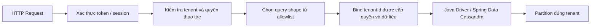
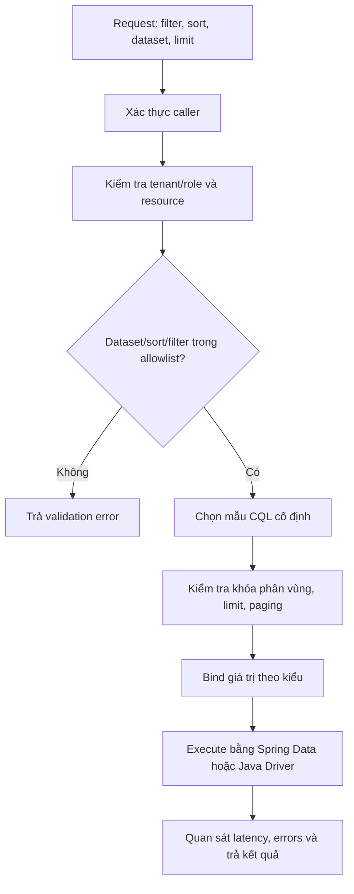

# Gắn tham số CQL và kiểm soát định danh động

Trong **Spring Data Cassandra**, dữ liệu được đọc/ghi qua `CassandraRepository`, `CassandraTemplate` hoặc trực tiếp bằng Apache Cassandra Java Driver và CQL (*Cassandra Query Language*). Một lỗi phổ biến là ghép dữ liệu người dùng vào chuỗi CQL để tạo truy vấn: vừa khiến truy vấn dễ lỗi cú pháp, vừa có thể mở đường cho **CQL injection**. Ngay cả khi giá trị được bind an toàn, ứng dụng vẫn có nguy cơ nếu cho người dùng chọn tùy ý **tên bảng, keyspace, cột, hướng sắp xếp hoặc cấu trúc điều kiện**.

Bài học thuộc chương **Bảo mật** của module `SPRING_DATA_CASSANDRA`, tập trung vào hai kỹ thuật phải dùng cùng nhau:

1. **Gắn tham số (parameter binding):** giữ dữ liệu đầu vào tách khỏi cấu trúc CQL bằng placeholder và giá trị bind có kiểu.
2. **Kiểm soát định danh động (dynamic identifiers):** chỉ cho phép lựa chọn từ các tên bảng, cột và mẫu truy vấn đã được ứng dụng định nghĩa, đồng thời kiểm tra quyền truy cập.

Vì Cassandra là hệ dữ liệu phân tán, cách thiết kế an toàn còn liên quan đến **partition key**, bảng theo truy vấn, consistency level, paging và hiệu năng. Một truy vấn không bị injection vẫn có thể nguy hiểm về phân quyền hoặc gây tải lớn nếu để người dùng yêu cầu lọc tùy ý.

Sau bài học, bạn có thể giải thích giới hạn của bind marker trong CQL, dùng prepared statement trong Java Driver, tổ chức truy vấn an toàn trong Spring Data Cassandra, xây dựng allowlist cho định danh động, và viết kiểm thử ngăn truy cập vượt phạm vi tenant.

## 1. Phân biệt dữ liệu được bind với cấu trúc CQL

Xét API tìm tài khoản theo email. Cách viết sau **không an toàn**:

```java
// Ví dụ SAI: không dùng trong ứng dụng.
String cql = "SELECT tenant_id, email, display_name " +
    "FROM users_by_tenant " +
    "WHERE tenant_id = " + tenantId +
    " AND email = '" + emailFromRequest + "'";

Row row = session.execute(cql).one();
```

Nếu `emailFromRequest` chứa dấu nháy hoặc ký tự có ý nghĩa với cú pháp CQL, giá trị đó bị đưa trực tiếp vào chuỗi lệnh. Tùy cú pháp và ngữ cảnh, câu lệnh có thể lỗi hoặc bị thay đổi ngoài dự kiến. Mối nguy **không chỉ nằm ở chuỗi “đáng ngờ”**: một email bình thường có dấu nháy cũng có thể làm câu lệnh bị lỗi.

Với prepared statement, cấu trúc lệnh được gửi riêng và từng giá trị được bind theo kiểu dữ liệu:

```java
import java.util.UUID;
import com.datastax.oss.driver.api.core.CqlSession;
import com.datastax.oss.driver.api.core.cql.PreparedStatement;
import com.datastax.oss.driver.api.core.cql.Row;

PreparedStatement findByEmail = session.prepare(
    "SELECT tenant_id, email, display_name " +
    "FROM users_by_tenant " +
    "WHERE tenant_id = ? AND email = ?");

UUID tenantId = authenticatedTenantId;
String email = emailFromRequest;

Row row = session.execute(findByEmail.bind(tenantId, email)).one();
```

Ở đây dấu `?` đánh dấu vị trí của **giá trị**, không đánh dấu một mảnh CQL tùy ý. Driver mã hóa `UUID` và `String` thành các giá trị tương ứng khi thực thi; nội dung của `email` không được dùng để phân tích lại thành toán tử hay tên cột.

**Parameter binding ngăn việc đầu vào trở thành cú pháp truy vấn.** Nó không tự xác minh người dùng có quyền xem bản ghi, không tự chọn partition key hiệu quả và không ngăn việc truy vấn cố ý trả về quá nhiều dữ liệu.

### 1.1. Những phần có thể và không thể bind

| Thành phần | Ví dụ | Cách xử lý |
| --- | --- | --- |
| Giá trị của khóa phân vùng | `WHERE tenant_id = ?` | Bind `UUID` hoặc kiểu CQL tương ứng |
| Giá trị clustering key | `AND email = ?` | Bind kiểu dữ liệu và kiểm tra nghiệp vụ |
| Giá trị được ghi | `SET display_name = ?` | Bind, kể cả chuỗi có dấu nháy và ký tự đặc biệt |
| Giá trị `LIMIT` | `LIMIT ?` trong các phiên bản CQL hỗ trợ | Bind số nguyên, đồng thời giới hạn khoảng hợp lệ ở ứng dụng |
| Tên keyspace/bảng | `FROM users_by_tenant` | **Không** bind thành tên bảng; chỉ chọn từ allowlist tin cậy |
| Tên cột | `SELECT display_name` hoặc `ORDER BY created_at` | **Không** bind thành tên cột; ánh xạ tên hiển thị sang cột cố định |
| Hướng sắp xếp | `ASC` / `DESC` | Chọn từ tập phương án cố định; xác nhận hợp lệ theo clustering key |
| Mảnh câu lệnh | `WHERE ...`, `ALLOW FILTERING`, `USING ...` | Chọn mẫu CQL cố định; không nối trực tiếp đoạn người dùng gửi |
| Consistency level, timeout, page size | Tùy chọn của statement/Driver | Đặt bằng API và chính sách ứng dụng, không nhận mảnh cú pháp tùy ý |

Một nhầm lẫn nguy hiểm:

```sql
-- KHÔNG đúng: bind marker không thay thế được tên bảng.
SELECT * FROM ? WHERE tenant_id = ?;

-- KHÔNG đúng: bind marker không thay thế được tên cột.
SELECT * FROM users_by_tenant WHERE ? = ?;
```

Nếu bảng, keyspace hoặc cột phải thay đổi theo tình huống nghiệp vụ, ứng dụng cần **chọn cấu trúc truy vấn trước**, sau đó mới bind các giá trị.

## 2. Prepared statement trong Apache Cassandra Java Driver

Ví dụ dùng API của **Java Driver 4.x** (`com.datastax.oss.driver.api...`). Đầu tiên tạo bảng theo truy vấn cụ thể:

```sql
CREATE TABLE IF NOT EXISTS users_by_tenant (
    tenant_id uuid,
    email text,
    display_name text,
    PRIMARY KEY ((tenant_id), email)
);
```

Trong thiết kế này, `tenant_id` là **partition key** và `email` là **clustering key**. Truy vấn từ mục 1 có điều kiện khóa đầy đủ, không cần quét toàn bảng. Đây là bảng minh họa: trong sản phẩm thật phải đánh giá phân bố dữ liệu, độ lớn partition, yêu cầu email không trùng và các đường truy vấn trước khi chọn schema.

### 2.1. Chuẩn bị cấu trúc truy vấn một lần

```java
import java.util.Optional;
import java.util.UUID;
import com.datastax.oss.driver.api.core.CqlSession;
import com.datastax.oss.driver.api.core.cql.PreparedStatement;
import com.datastax.oss.driver.api.core.cql.Row;

public final class TenantUserReader {
    private final CqlSession session;
    private final PreparedStatement findByEmail;

    public TenantUserReader(CqlSession session) {
        this.session = session;
        this.findByEmail = session.prepare(
            "SELECT tenant_id, email, display_name " +
            "FROM users_by_tenant " +
            "WHERE tenant_id = ? AND email = ?");
    }

    public Optional<String> findDisplayName(UUID authorizedTenantId,
                                             String email) {
        Row row = session.execute(
            findByEmail.bind(authorizedTenantId, email)).one();
        return row == null
            ? Optional.empty()
            : Optional.ofNullable(row.getString("display_name"));
    }
}
```

`PreparedStatement` đại diện cho cấu trúc CQL đã được chuẩn bị; từng lần gọi tạo `BoundStatement` với giá trị riêng. Cách viết này tránh ghép chuỗi từ input, giữ kiểu dữ liệu rõ ràng và tạo cơ hội cho Driver/cluster tái sử dụng thông tin chuẩn bị. Không cần `session.prepare(...)` cho từng request khi cấu trúc CQL cố định. Với những truy vấn khác nhau thật sự, số cấu trúc được chuẩn bị nên hữu hạn và có thể quản lý.

**Lưu ý vòng đời:** `CqlSession` thường có vòng đời dài theo ứng dụng. Đừng tạo session mới trên mỗi API request; đó là đối tượng quản lý kết nối và tài nguyên Driver. `PreparedStatement` gắn với phiên làm việc/thiết lập tương ứng; khi thay session hoặc thay schema, cần đảm bảo phần truy vấn chuẩn bị được cập nhật phù hợp.

### 2.2. Bind đúng kiểu và đúng vị trí

```java
PreparedStatement updateName = session.prepare(
    "UPDATE users_by_tenant " +
    "SET display_name = ? " +
    "WHERE tenant_id = ? AND email = ?");

session.execute(updateName.bind(
    displayNameFromRequest,  // String: vị trí 0
    authorizedTenantId,      // UUID: vị trí 1
    emailFromRequest         // String: vị trí 2
));
```

Sai thứ tự có thể gây lỗi kiểu hoặc cập nhật không đúng bản ghi. Với câu lệnh nhiều tham số, có thể dùng `boundStatementBuilder()` với vị trí hoặc bind marker đặt tên khi ngôn ngữ CQL/Driver đang dùng hỗ trợ và đã thống nhất quy ước; tên marker cũng là phần của câu CQL **do lập trình viên kiểm soát**.

Đừng biến mọi đầu vào thành chuỗi bằng `toString()` rồi nối vào CQL. Với `UUID`, `Instant`, số nguyên, collection và các kiểu khác, hãy bind bằng kiểu tương ứng và xác minh dữ liệu trước khi gọi Driver. Cần phân biệt `null` và `UNSET` trong mutation: tùy vị trí CQL, `null` có thể tạo tombstone còn `UNSET` có thể bỏ cập nhật cột. Hai trạng thái này không phải cơ chế để hợp thức hóa đầu vào hoặc bỏ qua xác thực.

### 2.3. Tham số hóa không đồng nghĩa với toàn bộ truy vấn được phép

Một statement vẫn có thể hoạt động sai dù mọi giá trị đều đã bind:

```java
// Cú pháp có thể an toàn khỏi injection, nhưng nghiệp vụ vẫn không an toàn
// nếu tenantId lấy trực tiếp từ body của request mà chưa xác thực quyền.
session.execute(findByEmail.bind(
    request.tenantId(), request.email()));
```

**Nguồn tenant ID phải đáng tin cậy**: ví dụ tenant được xác định từ principal đã xác thực và kiểm tra quyền trên đối tượng. Một prepared statement được bind bằng tenant ID của người khác vẫn có thể đọc dữ liệu người khác nếu ứng dụng cho phép.

## 3. Truy vấn an toàn trong Spring Data Cassandra

Khi dùng Spring Data Cassandra, nhiều câu truy vấn cố định có thể khai báo trực tiếp bằng repository, hoặc xây từ API `Query`/`Criteria` của `CassandraTemplate`. Mục tiêu là để **giá trị dữ liệu được truyền như tham số**, còn tên bảng/cột và đường truy vấn do code xác định.

### 3.1. Repository với CQL cố định

Ví dụ interface cho một entity `TenantUser` có primary key composite đã được mapping đúng theo bảng `users_by_tenant`:

```java
import java.util.Optional;
import java.util.UUID;
import org.springframework.data.cassandra.repository.CassandraRepository;
import org.springframework.data.cassandra.repository.Query;

public interface TenantUserRepository
        extends CassandraRepository<TenantUser, TenantUserKey> {

    @Query("""
        SELECT tenant_id, email, display_name
        FROM users_by_tenant
        WHERE tenant_id = ?0 AND email = ?1
        """)
    Optional<TenantUser> findOneInTenant(UUID tenantId, String email);
}
```

`?0` và `?1` ở đây là **placeholder tham số của Spring Data repository**, được framework xử lý khi tạo câu CQL. Chúng không có nghĩa “thay mọi phần văn bản bất kỳ vào query”. Tên bảng `users_by_tenant` và các cột được giữ cố định trong annotation. Cách mapping entity, khóa ghép và việc chuyển tham số thành câu truy vấn phải được kiểm chứng trong phiên bản Spring Data Cassandra đang dùng.

Không ghép tên bảng vào chuỗi annotation bằng giá trị từ request; annotation query là một mô tả CQL tĩnh được framework hỗ trợ.

### 3.2. `CassandraTemplate` với `Query` và `Criteria`

Với nhu cầu tạo điều kiện theo API Spring Data, có thể dùng tên cột cố định và đưa giá trị vào `Criteria`:

```java
import java.util.List;
import java.util.UUID;
import org.springframework.data.cassandra.core.CassandraTemplate;
import org.springframework.data.cassandra.core.query.Criteria;
import org.springframework.data.cassandra.core.query.Query;

public final class TenantUserLookup {
    private final CassandraTemplate template;

    public TenantUserLookup(CassandraTemplate template) {
        this.template = template;
    }

    public List<TenantUser> findOne(UUID authorizedTenantId,
                                    String emailFromRequest) {
        Query query = Query.query(
            Criteria.where("tenant_id").is(authorizedTenantId)
                .and("email").is(emailFromRequest)
        ).limit(1);

        return template.select(query, TenantUser.class);
    }
}
```

Đây là ví dụ theo phong cách API Spring Data Cassandra hiện đại; package/phương thức có thể thay đổi giữa các dòng phiên bản, nên điều chỉnh theo dependency đang sử dụng. Kiểm tra CQL thật khi test tích hợp. Khi dùng `Criteria.where("email")`, tên `email` là **chuỗi do code cố định**; không thay bằng `Criteria.where(request.field())` nếu chưa có allowlist chặt chẽ và thiết kế truy vấn phù hợp.

Một quy tắc hữu ích: **với mẫu truy vấn cố định, ưu tiên repository/Query API; với CQL chuyên biệt, dùng prepared statement của Driver và bind dữ liệu**. Dù chọn tầng nào, phải kiểm soát phân quyền, số lượng kết quả và consistency level.

## 4. Vì sao định danh động cần kiểm soát riêng?

Giả sử API cho phép người dùng chọn tập dữ liệu:

```http
GET /activities?dataset=recent
GET /activities?dataset=archive
```

Một cách triển khai rủi ro là lấy nguyên tham số `dataset` rồi ghép vào tên bảng:

```java
// SAI: input bên ngoài trở thành một phần cấu trúc CQL.
String cql = "SELECT * FROM " + request.getParameter("dataset")
    + " WHERE tenant_id = ?";
```

Cho dù điều kiện `tenant_id` được bind, người gọi vẫn kiểm soát phần `FROM ...`. Một chuỗi ký tự ràng buộc regex không biến tên bảng từ người dùng thành một lựa chọn đã được phê duyệt về nghiệp vụ.

### 4.1. Allowlist từ lựa chọn nghiệp vụ sang tên vật lý

Giải pháp là **ánh xạ** từ một lựa chọn hữu hạn sang tên bảng **được viết sẵn**:

```java
public enum ActivityDataset {
    RECENT,
    ARCHIVE
}

private static String tableFor(ActivityDataset dataset) {
    return switch (dataset) {
        case RECENT -> "activities_recent_by_tenant";
        case ARCHIVE -> "activities_archive_by_tenant";
    };
}
```

Truy vấn được xây bằng tên trong allowlist:

```java
String table = tableFor(dataset);
String cql =
    "SELECT tenant_id, activity_id, payload " +
    "FROM " + table + " WHERE tenant_id = ? AND activity_id = ?";

PreparedStatement prepared = session.prepare(cql);
Row row = session.execute(
    prepared.bind(authorizedTenantId, activityId)).one();
```

Các giá trị `RECENT` và `ARCHIVE` phải được parser/endpoint chuyển từ đầu vào bên ngoài theo quy tắc rõ ràng; giá trị không được hỗ trợ phải bị từ chối. Cả hai bảng cũng cần có schema tương thích với câu truy vấn minh họa. Nếu mỗi biến thể có CQL riêng, nên chuẩn bị và tái sử dụng **từng mẫu hữu hạn** thay vì liên tục tạo cấu trúc mới từ text bên ngoài.

Trong trường hợp này, phép nối chuỗi chỉ ghép **hằng số do code kiểm soát**. Trước khi cho phép người gọi chọn `ARCHIVE`, ứng dụng vẫn phải xác minh người đó có quyền sử dụng tập dữ liệu archive. **Allowlist chống tùy biến cấu trúc; authorization kiểm soát quyền sử dụng cấu trúc đó.**

### 4.2. Không dùng cách escape định danh như lớp bảo vệ duy nhất

CQL hỗ trợ identifier không có dấu nháy kép và *quoted identifier* với dấu nháy kép; cách xử lý chữ hoa/chữ thường khác nhau. Nhưng chỉ tự thêm dấu nháy, escape ký tự, hay giới hạn đầu vào bằng regex như `[A-Za-z0-9_]+` **không trả lời được** câu hỏi: tên bảng này có được ứng dụng cấp phép dùng hay không?

Ví dụ `system.local` hoặc tên một bảng nội bộ khác có thể là chuỗi định danh hợp lệ về cú pháp, nhưng tuyệt đối không được đưa vào câu query chỉ vì nó vượt qua regex. Ưu tiên:

1. **Không cho chọn định danh** nếu use case chỉ cần một bảng/cột.
2. Nếu cần tùy chọn, dùng **enum hoặc map cố định** từ tên hiển thị sang định danh vật lý.
3. Nếu thật sự quản lý đối tượng động do quản trị viên tạo, tách **luồng provisioning được cấp quyền** khỏi API đọc/ghi thường ngày; duy trì registry/tập đối tượng đã được chấp thuận và kiểm tra quyền trước khi dùng.

Builder API có thể giúp viết CQL đúng cú pháp, nhưng **không thay thế allowlist và phân quyền** nếu đầu vào của builder là tên cột/bảng không đáng tin cậy.

## 5. Các dạng động khác: sắp xếp, projection, bộ lọc và giới hạn

### 5.1. Sắp xếp phải phù hợp mô hình clustering

Không phải cứ có tên cột an toàn là có thể `ORDER BY` tùy ý trong Cassandra. `ORDER BY` bị ràng buộc bởi **partition key và clustering columns**; Cassandra không cung cấp cơ chế sắp xếp tùy ý như công cụ tìm kiếm.

Giả sử bảng phục vụ đọc sự kiện của từng người dùng trong tenant:

```sql
CREATE TABLE IF NOT EXISTS events_by_owner (
    tenant_id uuid,
    owner_id uuid,
    created_at timeuuid,
    payload text,
    PRIMARY KEY ((tenant_id, owner_id), created_at)
) WITH CLUSTERING ORDER BY (created_at DESC);
```

Vì `created_at` là clustering column, một mẫu query cố định có thể cho người gọi chọn hướng đọc trong một partition:

```java
public enum SortDirection {
    NEWEST,
    OLDEST
}

private static String orderClause(SortDirection direction) {
    return switch (direction) {
        case NEWEST -> "DESC";
        case OLDEST -> "ASC";
    };
}

public PreparedStatement buildEventsStatement(
        CqlSession session, SortDirection direction) {
    String cql =
        "SELECT tenant_id, owner_id, created_at, payload " +
        "FROM events_by_owner " +
        "WHERE tenant_id = ? AND owner_id = ? " +
        "ORDER BY created_at " + orderClause(direction) + " LIMIT ?";
    return session.prepare(cql);
}
```

Hai mẫu `ASC`/`DESC` được chọn từ enum do ứng dụng kiểm soát. Khi thực thi, bind `tenantId`, `ownerId` và một `limit` đã kiểm tra. Nếu query không buộc khóa phân vùng hoặc sắp xếp theo cột không hợp lệ, Cassandra có thể từ chối; **allowlist không làm biến mất giới hạn của CQL và partition model**.

### 5.2. Giới hạn số hàng và pagination

Giới hạn nên được xác thực ngay cả khi có thể bind:

```java
private static int checkedLimit(int requestedLimit) {
    if (requestedLimit < 1 || requestedLimit > 100) {
        throw new IllegalArgumentException(
            "limit phải nằm trong khoảng 1..100");
    }
    return requestedLimit;
}

int limit = checkedLimit(requestedLimit);
Row firstRow = session.execute(
    prepared.bind(authorizedTenantId, ownerId, limit)).one();
```

Ở đây `LIMIT ?` là bind marker **cho số**, không phải cho cú pháp CQL. Nếu API cần lấy danh sách, hãy xử lý `ResultSet` và paging theo mục đích thay vì chỉ lấy `one()`; đoạn trên chỉ minh họa việc bind giới hạn.

Cần phân biệt `LIMIT` với `page size` của Driver: `LIMIT` giới hạn số hàng CQL có thể trả trong truy vấn, còn page size điều tiết số hàng được lấy mỗi trang trong quá trình đọc kết quả. Một page size nhỏ không tự ngăn client tải toàn bộ tập dữ liệu nếu code duyệt hết các trang. Paging state do client truyền cũng phải được kiểm tra/cô lập trong ngữ cảnh query và người dùng; nó **không phải giấy phép** truy cập dữ liệu của tenant khác.

### 5.3. Bộ lọc và projection

Nếu API yêu cầu `sortBy=email`, `sortBy=createdAt`, `fields=...` hoặc `filter=...`, đừng nối nguyên chuỗi đó vào `SELECT`, `WHERE` hay `ORDER BY`. Hãy định nghĩa **các query shape được hỗ trợ**:

| Yêu cầu API | Cách xử lý phù hợp |
| --- | --- |
| `sort=recent` / `sort=oldest` | Ánh xạ sang hai mẫu sắp xếp cho clustering key hợp lệ |
| `fields=summary` / `fields=detail` | Ánh xạ sang hai danh sách cột cố định |
| `filter=status` | Chỉ cung cấp khi có bảng/query path cho điều kiện này; bind giá trị status |
| `filter=anyColumn` | Từ chối nếu không có query shape đã thiết kế |
| `ALLOW FILTERING` từ tham số client | Không cho phép client quyết định; đánh giá riêng truy vấn và chi phí dữ liệu |
| `limit=500000` | Từ chối hoặc đưa về giới hạn đã quy định, theo hợp đồng API |

**CQL injection và truy vấn tốn tài nguyên là hai nhóm rủi ro khác nhau.** Query đã bind an toàn vẫn có thể quét partition rất lớn, sinh hàng triệu tombstone hoặc đọc qua nhiều trang nếu endpoint mở quá nhiều tùy chọn.

## 6. Bảo mật dữ liệu đa tenant trong mô hình phân tán

Với hệ thống đa tenant, **tenant ID phải được đưa vào điều kiện khóa theo thiết kế bảng** và phải đến từ ngữ cảnh đã xác thực/được cấp quyền. Chỉ lọc theo email, order ID hoặc ID ngẫu nhiên mà thiếu ranh giới tenant có thể dẫn đến đọc dữ liệu sai phạm vi nếu schema cho phép.



Giả sử request có body chứa `tenantId`. Không dùng thẳng giá trị đó làm partition key cho câu truy vấn:

```java
// Không dùng: người gửi có thể tự thay tenantId.
UUID tenantId = request.tenantId();

// Nguyên tắc: xác thực/cấp quyền ở tầng ứng dụng trước khi bind.
UUID authorizedTenantId = accessContext.currentTenantId();
authorizeRead(accessContext, authorizedTenantId, requestedUserId);

session.execute(
    findByEmail.bind(authorizedTenantId, requestedEmail));
```

`accessContext` và `authorizeRead(...)` là API minh họa của tầng ứng dụng, không phải class sẵn có của Spring Data Cassandra. Với người có quyền truy cập nhiều tenant, có thể nhận tenant được chọn từ request **sau khi kiểm tra membership/role**. Điều cốt lõi là partition key được sử dụng để truy cập dữ liệu phải nằm trong phạm vi đã được cấp quyền.

### 6.1. Phân quyền ở đâu?

| Lớp | Vai trò |
| --- | --- |
| Authentication tại API | Xác định caller/principal đáng tin cậy |
| Authorization tại service | Kiểm tra tenant, loại dữ liệu, action và đối tượng được phép |
| Query shape + bind | Giữ truy vấn ở mẫu đã thiết kế và giá trị được gắn đúng kiểu |
| Cassandra role/grant | Giới hạn quyền của tài khoản kết nối đến keyspace/bảng được phép |
| TLS và quản lý bí mật | Bảo vệ kết nối và credential; không hardcode mật khẩu vào mã nguồn |
| Audit, logs, metrics | Ghi thao tác và lỗi ở mức phù hợp, tránh lộ payload và thông tin nhạy cảm |

Prepared statements **không thay thế** Cassandra roles/permissions hay kiểm tra tenant ở service. Tài khoản database của ứng dụng nên có **quyền tối thiểu** trên đúng keyspace/bảng cần dùng. Một tài khoản được phép truy vấn quá rộng sẽ làm hậu quả của lỗi ứng dụng nghiêm trọng hơn.

### 6.2. Tenant ID trong partition key là thiết kế, không phải cơ chế xác thực

Cassandra không tự suy ra danh tính của người dùng HTTP từ `tenant_id` trong CQL. Ngay cả khi partition key luôn bắt đầu bằng tenant ID, nếu code lấy ID đó từ đầu vào chưa xác thực, người dùng vẫn có thể chọn partition của người khác. Ngược lại, nếu service xác thực đúng nhưng bảng không hỗ trợ đường truy vấn cần thiết, việc thêm `ALLOW FILTERING` không phải giải pháp vận hành hoặc bảo mật bền vững.

Hệ thống có nhiều quy mô tenant khác nhau còn phải kiểm soát **kích thước partition**, lượng dữ liệu mỗi truy vấn, pagination và các bảng theo mẫu truy vấn. Có thể cần thêm bucket theo thời gian hoặc khóa khác, nhưng mọi query path vẫn phải bảo toàn kiểm tra quyền của tenant.

## 7. Lỗi thường gặp và cách khắc phục

| Lỗi | Vì sao nguy hiểm | Cách sửa |
| --- | --- | --- |
| Nối `email` vào CQL bằng dấu nháy đơn | Đầu vào trở thành văn bản truy vấn | `WHERE email = ?` và bind `String` |
| Dùng `String.format`/template cho giá trị | Chỉ đổi cách ghép chuỗi, không tách giá trị khỏi cú pháp | Dùng repository parameter hoặc bound statement |
| Bind giá trị nhưng ghép `request.table` | Người gọi điều khiển định danh động | Enum/map allowlist tên bảng do code quy định |
| Cho người dùng chọn tên cột tự do | Có thể truy vấn cột ngoài phạm vi hoặc query path không hợp lệ | Map field UI sang tập cột cho phép, kiểm tra quyền |
| Chỉ kiểm tra tên bằng regex | Cú pháp hợp lệ chưa chắc được cấp phép | Kiểm tra membership trong allowlist + authorization |
| Lấy `tenantId` trực tiếp từ request | Query được bind vẫn có thể đọc tenant khác | Lấy tenant từ security context hoặc xác thực quyền trên tenant được chọn |
| Dùng `ALLOW FILTERING` để đáp ứng mọi bộ lọc | Có thể tăng scan và latency, đẩy tải lên cluster | Thiết kế bảng theo truy vấn, giới hạn chức năng filter |
| Chuẩn bị CQL mới cho mọi lựa chọn tùy ý | Phân mảnh query shape, chi phí prepare và khó theo dõi | Dùng tập mẫu hữu hạn, tái sử dụng prepared statement |
| Ghi nguyên CQL kèm bind values vào log | Rò rỉ token, email, dữ liệu cá nhân hoặc nội dung nhạy cảm | Log operation ID, outcome, error category; che giá trị |
| Cho runtime account quyền schema/DDL rộng | Lỗi code có thể sửa/xóa schema hoặc truy cập quá rộng | Role chỉ có quyền cần thiết; quản lý DDL qua migration riêng |

### 7.1. Bảo vệ thông tin lỗi

Khi Cassandra trả lỗi cú pháp, quyền hoặc timeout, đừng gửi stack trace chứa câu CQL/giá trị bind cho client. Tại API boundary, trả mã lỗi ổn định và correlation ID; trong log nội bộ có kiểm soát, ghi category, operation name, timing, driver node/trace ID phù hợp. **Không che giấu lỗi khỏi vận hành**, nhưng cũng không đưa nguyên văn credential hoặc tham số nhạy cảm vào telemetry.

### 7.2. Không tùy tiện retry các yêu cầu ghi

Một `WriteTimeoutException` không khẳng định dữ liệu chưa được ghi; việc retry có thể tạo side effect lặp lại. Binding giúp bảo vệ cú pháp truy vấn nhưng **không biến update thành idempotent**. Với phép ghi, cần thiết kế idempotency key/điều kiện nghiệp vụ phù hợp và giới hạn retry; đối với counter, append list hoặc tích hợp dịch vụ ngoài, phải cân nhắc riêng.

## 8. Kiểm thử bảo mật cho binding và định danh động

Unit test kiểm tra logic allowlist và authorization; integration test chạy trên Cassandra thật kiểm tra CQL được bind đúng và chỉ trả hàng ở partition được phép. Có thể dùng **JUnit 5 + Testcontainers Cassandra** cho môi trường tích hợp; không cần tái hiện injection trên production.

### 8.1. Bộ ca kiểm thử nên có

| Trường hợp | Đầu vào/điều kiện | Kết quả mong muốn |
| --- | --- | --- |
| Giá trị có dấu nháy | Email `o'hara@example.com` | Được đối xử như giá trị đúng nghĩa; không làm hỏng CQL |
| Giá trị trông giống cú pháp | Chuỗi `x' OR '1'='1` | Không thay đổi cấu trúc `WHERE`, không đọc hàng khác |
| Bảng nằm trong allowlist | `dataset=recent` | Chỉ truy vấn bảng đã được ánh xạ |
| Tên bảng tùy ý | `dataset=system.local` | Bị từ chối ở validation trước khi gửi CQL |
| Tên cột tùy ý | `sortBy=tenant_id` khi chỉ hỗ trợ `created_at` | Bị từ chối, không tự ghép vào `ORDER BY` |
| Giới hạn vượt ngưỡng | `limit=100000` | Trả lỗi validation hoặc xử lý theo chính sách giới hạn |
| Cố truy cập tenant khác | Tenant A gửi body chứa tenant B | Không đọc dữ liệu B; kiểm tra quyền trước query |
| Thiếu khóa phân vùng theo mẫu | Filter tự do không có query shape | Từ chối thay vì tạo truy vấn scan rộng |
| Credential thiếu quyền | Runtime role cố đọc bảng ngoài phạm vi | Cassandra từ chối theo grants |

### 8.2. Unit test cho allowlist

Đoạn minh họa dưới đây giả sử endpoint chỉ chấp nhận `recent` hoặc `archive`:

```java
import static org.junit.jupiter.api.Assertions.*;
import org.junit.jupiter.api.Test;

class DatasetParserTest {

    private static ActivityDataset parseDataset(String raw) {
        return switch (raw) {
            case "recent" -> ActivityDataset.RECENT;
            case "archive" -> ActivityDataset.ARCHIVE;
            default -> throw new IllegalArgumentException(
                "dataset không được hỗ trợ");
        };
    }

    @Test
    void acceptsOnlySupportedDatasetValues() {
        assertEquals(ActivityDataset.RECENT,
            parseDataset("recent"));
        assertEquals(ActivityDataset.ARCHIVE,
            parseDataset("archive"));
        assertThrows(IllegalArgumentException.class,
            () -> parseDataset("system.local"));
        assertThrows(IllegalArgumentException.class,
            () -> parseDataset("recent; DROP TABLE users_by_tenant"));
    }
}
```

Trong ứng dụng, parser cần xử lý `null`/giá trị thiếu theo hợp đồng API, và tầng service còn phải kiểm tra **caller có quyền sử dụng dataset** được chọn. Test unit này chỉ chứng minh việc phân loại tên, chưa chứng minh quyền truy cập hoặc cú pháp CQL thực sự.

### 8.3. Integration test cho giá trị có ký tự đặc biệt

Ví dụ dùng bảng `users_by_tenant` trong một keyspace test và `CqlSession` của Testcontainers:

```java
import static org.junit.jupiter.api.Assertions.*;
import java.util.UUID;
import com.datastax.oss.driver.api.core.cql.PreparedStatement;
import com.datastax.oss.driver.api.core.cql.Row;
import org.junit.jupiter.api.Test;

@Test
void treatsSuspiciousLookingEmailAsPlainValue() {
    UUID tenant = UUID.randomUUID();
    String input = "x' OR '1'='1";

    PreparedStatement insert = session.prepare(
        "INSERT INTO users_by_tenant " +
        "(tenant_id, email, display_name) VALUES (?, ?, ?)");
    session.execute(insert.bind(tenant, input, "Exact match"));

    PreparedStatement select = session.prepare(
        "SELECT email, display_name FROM users_by_tenant " +
        "WHERE tenant_id = ? AND email = ?");
    Row row = session.execute(select.bind(tenant, input)).one();

    assertNotNull(row);
    assertEquals(input, row.getString("email"));
    assertEquals("Exact match", row.getString("display_name"));
}
```

Trong test suite đầy đủ, cần dựng schema trước khi chạy, tách keyspace test khỏi production và dùng khóa mới cho mỗi ca. Để chứng minh **không đọc chéo tenant**, seed cùng một email ở hai tenant khác nhau rồi xác minh mỗi lần đọc chỉ nhận dữ liệu thuộc tenant đã được service cấp phép.

### 8.4. Kiểm thử mapping Spring Data

Khi code dùng `@Query`, `CassandraTemplate` hoặc custom repository, integration test nên gọi **đúng method đang chạy trong ứng dụng**, không chỉ gọi Driver trực tiếp. Kiểm tra:

1. Truy vấn với `email` chứa dấu nháy vẫn match đúng dữ liệu.
2. Method không bỏ qua `tenant_id` trong điều kiện truy vấn.
3. Đường query chỉ chọn các bảng/cột đã được phép.
4. Dữ liệu ở tenant khác không rò rỉ dù dùng cùng email/ID phụ.
5. Page size, limit và dạng filter phù hợp thiết kế partition.
6. Trường hợp đầu vào không hợp lệ bị chặn **trước khi gửi đến Cassandra**.

## 9. Hướng triển khai cho API có lựa chọn động

Một quy trình an toàn có thể hình dung như sau:



Các bước này có thể áp dụng cho API tìm kiếm đơn hàng, đọc sự kiện theo user, báo cáo theo tenant hoặc dashboard nghiệp vụ. Tuy nhiên, không phải trường hợp nào cũng cần “dynamic CQL”: phần lớn API nên có **đường truy vấn rõ ràng, tương ứng với bảng được thiết kế trước**, để vừa an toàn vừa đo đạc, tối ưu và đặt consistency level hiệu quả.

### Checklist trước khi review code

1. Tất cả giá trị từ người dùng, message broker hoặc nguồn bên ngoài được truyền qua **bind marker/typed API**, không nối trực tiếp vào CQL.
2. Mọi tên bảng, keyspace, cột và hướng sắp xếp động đều đến từ **allowlist do code kiểm soát**.
3. Cấu trúc `WHERE` tương ứng với **partition key/clustering key** đã thiết kế; không mở rộng filter tự do hoặc `ALLOW FILTERING` từ input bên ngoài.
4. Tenant/resource ID được xác thực và phân quyền trước khi bind; truy vấn không chỉ dựa vào ID do client tự khai báo.
5. Limit và pagination được giới hạn, không tải toàn bộ partition một cách vô tình.
6. Prepared statement được tái sử dụng theo số lượng mẫu hữu hạn; `CqlSession` được quản lý vòng đời.
7. Runtime role có quyền tối thiểu, kết nối/secret được quản lý theo chính sách bảo mật hệ thống.
8. Log và metric không chứa giá trị bind nhạy cảm; timeout và lỗi dữ liệu được phân loại có kiểm soát.
9. Test bao gồm chuỗi có dấu nháy/ký tự đặc biệt, lựa chọn định danh không được phép và truy cập chéo tenant.

## 10. Câu hỏi tự kiểm tra

1. Vì sao `WHERE email = ?` bảo vệ được giá trị email nhưng `FROM ?` không thể dùng để thay tên bảng?
2. Nếu mọi giá trị đều được bind, vì sao việc nối `request.table` vào CQL vẫn là một rủi ro?
3. Allowlist tên bảng có thể thay thế bước authorization không? Nêu trường hợp người dùng không được xem archive.
4. Tại sao việc kiểm tra `[A-Za-z0-9_]+` chưa đủ để chấp nhận tên keyspace hoặc cột từ client?
5. Nếu tenant ID được bind nhưng lấy thẳng từ body, người dùng có thể vượt ranh giới dữ liệu thế nào?
6. Điều kiện nào để `ORDER BY created_at ASC/DESC` phù hợp với mô hình dữ liệu Cassandra?
7. Vì sao một truy vấn an toàn khỏi injection vẫn có thể gây tải lớn nếu cho phép filter/paging tùy ý?
8. Nên kiểm tra điều gì ở integration test để chứng minh chuỗi giống CQL được lưu và đọc lại như **dữ liệu**?
9. Prepared statement có bảo đảm một phép ghi timeout an toàn khi retry không?
10. Tại sao cần kiểm tra cả result của repository và quyền trên tenant khi test ứng dụng đa tenant?

**Ghi nhớ:** Dùng **parameter binding** để giữ *giá trị* tách khỏi *cú pháp CQL*. Dùng **allowlist và query shape cố định** để kiểm soát *định danh/cấu trúc động*. Sau cùng, dùng **authorization theo tenant**, quyền database tối thiểu và giới hạn truy vấn để bảo đảm người dùng chỉ truy cập đúng dữ liệu được phép, trên đường truy vấn phù hợp với Apache Cassandra.
