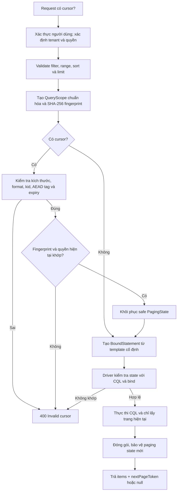

# Bảo vệ paging token và ràng buộc với truy vấn gốc

Khi xây dựng API phân trang bằng **Spring Data Cassandra**, ứng dụng thường trả một `nextPageToken` cho client sau khi đọc trang đầu tiên từ **Apache Cassandra**. Client gửi lại token để tiếp tục ở trang kế tiếp mà không cần dùng `OFFSET`. Đây là cách phù hợp với cơ chế **paging state** của Cassandra, nhưng token phải được bảo vệ: một giá trị do client gửi luôn là đầu vào không đáng tin, kể cả khi nó từng do chính server tạo ra.

Bài học thuộc chương **Bảo mật** và giải thích cách đóng gói paging state thành token an toàn, gắn token với **truy vấn CQL gốc**, **các giá trị bind**, **tenant và quyền người dùng**, **page size** và **thời hạn sử dụng**. Kiến thức áp dụng cho các API sử dụng `CassandraRepository`, `CassandraTemplate` hoặc `CqlSession` của Java Driver. Tính đúng và an toàn của phân trang còn phụ thuộc thiết kế bảng theo truy vấn, partition key, consistency, thứ tự clustering và giới hạn hiệu năng trong hệ thống dữ liệu phân tán.

## 1. Paging state là gì, và vì sao không được đưa thẳng ra API?

Một truy vấn CQL có thể trả nhiều dữ liệu hơn một response mạng nên Cassandra chia kết quả thành các trang. **Paging state** biểu diễn vị trí tiếp tục để lấy trang sau. Nó là một giá trị **opaque**: ứng dụng chỉ nên lưu, vận chuyển và truyền lại cho driver; không tự sửa byte bên trong hoặc suy luận nội dung.

```mermaid
sequenceDiagram
    participant U as Client
    participant A as Spring API
    participant C as Cassandra
    U->>A: GET /events?day=...&limit=50
    A->>C: SELECT ... + page size 50
    C-->>A: Trang 1 + paging state
    A->>A: Gắn quyền, query fingerprint, expiry; bảo vệ bằng AEAD
    A-->>U: items + nextPageToken
    U->>A: GET /events?...&cursor=token
    A->>A: Xác thực người gọi, giải mã, đối chiếu query scope
    A->>C: Cùng CQL/cùng bind + paging state
    C-->>A: Trang 2 + paging state tiếp theo
    A-->>U: items + nextPageToken mới
```

Các đặc điểm cần nhớ:

- Paging state phải được dùng lại với **đúng statement**, bao gồm câu CQL và các giá trị tham số. Tái sử dụng với truy vấn khác có thể tạo kết quả sai, lỗi driver hoặc hành vi không dự đoán được.
- Paging state **không phải** bằng chứng người gọi có quyền truy cập bảng, tenant hay dữ liệu. Server phải xác thực và phân quyền **trên mỗi request**, kể cả request lấy trang tiếp theo.
- Giá trị từ `ExecutionInfo.getPagingState()` là dạng raw; `getSafePagingState()` cung cấp `PagingState` có kiểm tra truy vấn/giá trị bind nhưng **không phải cơ chế bảo mật mật mã**. Wrapper của driver sử dụng checksum phục vụ phát hiện nhầm câu lệnh, không nhằm chống sửa token có chủ đích.
- Paging state không tạo **snapshot nhất quán qua nhiều trang** và không phải bookmark bền vững qua mọi thay đổi phiên bản/schema. Dữ liệu thêm/xóa/sửa giữa các request có thể khiến trang kế tiếp khác kết quả mong đợi.
- Page size là **gợi ý giới hạn số hàng mỗi response của driver**, không phải cam kết Cassandra chỉ đọc đúng từng ấy hàng vật lý hoặc API không thể trả nhiều dữ liệu nếu lặp qua mọi trang.

**Sai lầm điển hình:** mã hóa Base64 từ raw paging state rồi trả về client và nhận ngược lại mà không kiểm tra tenant, người dùng hoặc tham số lọc. Base64 chỉ là cách biểu diễn byte, **không mã hóa bảo mật và không chống sửa đổi**.

## 2. Mối đe dọa và yêu cầu bảo vệ

Giả sử API đọc lịch sử giao dịch theo `tenant_id` và ngày. Một client có thể cố tình dùng token của tenant A ở URL tenant B, đổi bộ lọc thời gian khi chuyển trang, sử dụng token quá cũ hoặc chỉnh trực tiếp chuỗi token.

| Rủi ro | Ví dụ | Cơ chế bảo vệ |
| --- | --- | --- |
| Token bị sửa byte | Thay một phần Base64 hoặc vị trí con trỏ | Xác thực toàn vẹn token bằng HMAC hoặc **AEAD** |
| Thay phạm vi tenant | Token của tenant A gửi tới endpoint tenant B | Token gắn với tenant được xác thực và **kiểm tra phân quyền lại** |
| Dùng token của người khác | Chia sẻ URL có token giữa hai tài khoản | Ràng buộc subject hoặc phạm vi ủy quyền theo chính sách |
| Đổi bộ lọc/sort | Trang đầu lọc ngày 10, trang sau đổi ngày 11 | Fingerprint của CQL template + **tất cả bind values và sort** |
| Đổi cỡ trang | Trang đầu 50 dòng, trang sau yêu cầu 5.000 | Bắt buộc page size bằng giá trị trong scope và giới hạn tối đa |
| Replay kéo dài | Token cũ được dùng lại sau nhiều tháng | `issuedAt`/`expiresAt`, phiên bản token, chính sách hết hạn |
| Lộ thông tin nội bộ | Paging state có thể chứa thành phần của khóa hoặc truy vấn | Mã hóa **AES-GCM** nếu token cần bảo mật nội dung |
| Cạn tài nguyên | Token khổng lồ, request vô hạn hoặc scan nhiều trang | Giới hạn độ dài token, số trang, truy vấn, concurrency và rate limit |
| Đổi schema/phiên bản truy vấn | Token cũ dùng sau khi deploy thay đổi câu CQL | `queryVersion`/`schemaEpoch`; từ chối token cũ theo kế hoạch |

**Không đặt niềm tin vào token chỉ vì chữ ký hợp lệ.** Chữ ký chứng minh token do hệ thống có khóa phát hành và chưa bị sửa; quyền truy cập có thể đã bị thu hồi từ lúc token được tạo. Kiểm tra xác thực, tenant, chính sách phân quyền và quyền trên tài nguyên phải luôn chạy lại.

## 3. Thiết kế truy vấn gốc có phạm vi rõ ràng

Trong Cassandra, API nên xuất phát từ truy vấn dùng **đầy đủ partition key** và thứ tự clustering được định nghĩa trước. Ví dụ bảng sự kiện theo tenant và ngày:

```sql
CREATE TABLE events_by_tenant_day (
    tenant_id uuid,
    day_bucket date,
    occurred_at timestamp,
    event_id timeuuid,
    kind text,
    summary text,
    PRIMARY KEY ((tenant_id, day_bucket), occurred_at, event_id)
) WITH CLUSTERING ORDER BY (occurred_at DESC, event_id DESC);
```

Truy vấn phục vụ màn hình xem sự kiện trong một ngày:

```sql
SELECT occurred_at, event_id, kind, summary
FROM events_by_tenant_day
WHERE tenant_id = ?
  AND day_bucket = ?
  AND occurred_at >= ?
  AND occurred_at < ?;
```

Khi lấy trang sau, **không** được thay những giá trị `tenant_id`, `day_bucket`, `from`, `to` hoặc thứ tự truy vấn. Ngay cả khi tên CQL không đổi, bind values khác đã là một truy vấn logic khác. Không cho client tự cung cấp tên bảng, `ORDER BY` hay đoạn `WHERE` tùy ý; backend chọn một template CQL đã được duyệt, với các giá trị được bind an toàn.

Đề xuất hợp đồng API:

```http
GET /api/v1/tenants/{tenantId}/events
    ?day=2026-11-25
    &from=2026-11-25T00:00:00Z
    &to=2026-11-26T00:00:00Z
    &limit=50
    &cursor=<opaque-token>
Authorization: Bearer <access-token>
```

Ở request đầu, `cursor` chưa có. Ở những request tiếp theo, server **xây lại đúng statement** từ thông số đã xác thực, rồi chỉ áp dụng paging state sau khi token được giải mã và ràng buộc phạm vi thành công.

`tenantId` trong URL là đầu vào client; ứng dụng phải đối chiếu với tenant được phép từ authentication/authorization context. Không lấy tenant chỉ từ URL hoặc từ token đã ký mà bỏ qua quyền hiện tại.

## 4. Token nên mang những thông tin gì?

Một **cursor envelope** được bảo vệ có thể chứa:

| Trường | Mục đích |
| --- | --- |
| `formatVersion` | Định dạng token, phục vụ nâng cấp và chặn phiên bản không hỗ trợ |
| `keyId` (`kid`) | Chọn khóa mã hóa/xác thực trong thời gian xoay vòng khóa; `kid` có thể nằm trong header đã được xác thực |
| `queryFingerprint` | Hash của ngữ cảnh truy vấn và quyền, dùng để đối chiếu với request hiện tại |
| `issuedAt`, `expiresAt` | Giới hạn thời gian sử dụng |
| `pagingState` | Dữ liệu opaque trả về từ driver; nên dùng safe paging state làm lớp kiểm tra bổ sung |
| `nonce`/IV | Tham số một lần dùng để mã hóa AEAD; IV không cần bí mật nhưng **không được dùng lại sai cách với cùng khóa** |

Về kiến trúc, có hai phương án:

1. **Token tự chứa (stateless):** đóng gói paging state, fingerprint và expiry, sau đó bảo vệ bằng mã hóa có xác thực `AES-GCM`. Không cần lưu trạng thái server theo từng client nhưng độ dài token tăng và cần quản lý khóa.
2. **Cursor ID ở server (stateful):** client nhận một ID ngẫu nhiên khó đoán; server lưu paging state, scope, quyền, expiry trong cache/store có TTL. Dễ thu hồi token riêng lẻ và giới hạn số lần dùng, nhưng cần quản lý dung lượng, phân tán cache và dọn record đúng hạn.

Lựa chọn phụ thuộc yêu cầu bảo mật và vận hành. Với hệ thống muốn tránh lộ thông tin từ paging state và không giữ session trên server, **AEAD** là một lựa chọn phù hợp. Nếu chỉ cần chống sửa và nội dung token không nhạy cảm, **HMAC-SHA-256** có thể bảo vệ tính toàn vẹn; HMAC **không che giấu** nội dung.

### Tránh nhầm vai trò của `getSafePagingState()`

Java Driver 4.x cung cấp:

```java
PagingState state = resultSet.getExecutionInfo().getSafePagingState();
String serialized = state == null ? null : state.toString();

// Khi nhận lại paging state đã được giải mã và xác thực:
PagingState restored = PagingState.fromString(serialized);
BoundStatement next = originalBoundStatement.setPagingState(restored);
```

Việc `setPagingState(restored)` với **BoundStatement** không khớp CQL hoặc bind values sẽ thất bại sớm theo cơ chế kiểm tra của driver. Nhưng checksum của safe paging state **không phải chữ ký bảo mật**; không được trả trực tiếp `serialized` cho client nếu cần ngăn giả mạo hoặc bảo vệ tính bí mật. Hãy đặt nó **bên trong cursor envelope do ứng dụng bảo vệ**.

## 5. Ràng buộc token với đầy đủ ngữ cảnh truy vấn

Không đủ nếu chỉ hash chuỗi CQL. Một câu lệnh `WHERE tenant_id = ? AND day_bucket = ?` được dùng cho nhiều tenant và ngày khác nhau. Fingerprint cần bao phủ **ngữ nghĩa truy vấn**:

```text
QueryScope
  queryTemplateId    = events.by_tenant_day.range
  queryVersion       = 3
  authenticatedTenant= UUID của tenant đã được cấp quyền
  principalScope     = ID người gọi hoặc scope chia sẻ đã xác thực
  dayBucket          = 2026-11-25
  fromInclusive      = 2026-11-25T00:00:00Z
  toExclusive        = 2026-11-26T00:00:00Z
  projection         = occurred_at,event_id,kind,summary
  sort               = occurred_at DESC,event_id DESC
  pageSize           = 50
  consistency        = LOCAL_QUORUM
  schemaEpoch        = 2026-11-events-v3
```

Tạo `queryFingerprint = SHA-256(canonicalSerialize(QueryScope))`. Dùng một cách serialize **có cấu trúc, thứ tự trường ổn định và quy tắc chuẩn hóa rõ ràng**: thời gian về UTC, enum viết thống nhất, UUID chuẩn, danh sách filter/sort có thứ tự định nghĩa. Nếu dùng JSON, cấu hình serializer nhất quán và không cho người dùng thay đổi cách sắp xếp field giữa các request. Không nối tùy ý các chuỗi chứa dấu phân cách mà không escape.

Các thành phần cần cân nhắc riêng:

- **Danh tính và quyền:** Với API cá nhân, gắn cả principal ổn định (hoặc security scope) vào fingerprint. Với API cần chia sẻ cursor giữa các thành viên cùng tenant, có thể gắn security scope đã định nghĩa, nhưng **kiểm tra quyền hiện tại của từng người dùng** vẫn bắt buộc.
- **Phân quyền thay đổi:** Nếu user bị thu hồi quyền trong thời gian token còn sống, chỉ so fingerprint của tenant là không đủ. Kiểm tra quyền hiện tại và có thể gắn một `authorizationEpoch`/policy version khi nghiệp vụ cần vô hiệu hóa hàng loạt token cũ.
- **Filter và thứ tự:** Gắn đủ filter và sort; bao gồm cả filter mặc định mà server tự thêm vào CQL và các ràng buộc thời gian.
- **Page size:** Khóa cỡ trang qua các request để giữ hành vi dễ dự đoán; nếu muốn cho đổi limit, phải thiết kế cụ thể cách token được tiếp tục, thay vì vô tình cho phép thay.
- **Phiên bản query:** Tăng khi thay CQL template, projection, keyspace, sort, migration quan trọng hoặc chuẩn hóa filter; token cũ có thể phải trả lỗi hết hiệu lực và cho client bắt đầu lại.

Hash ngữ cảnh là một **cách so sánh**. Bảo đảm token không bị thay hash phải đến từ **HMAC/AEAD**, không phải từ SHA-256 đơn lẻ.

## 6. Luồng xác thực token ở Spring API

Một luồng xử lý khuyến nghị:



Thứ tự quan trọng: xác thực và phân quyền chạy **trước khi chạm Cassandra**. Ngay cả khi token có thể giải mã, nếu người dùng không còn quyền, trả lỗi quyền truy cập theo hợp đồng API thay vì dùng token để mở lại dữ liệu.

Đối với token sai định dạng, chữ ký/tag sai, hết hạn hoặc không khớp query, có thể trả **`400 Invalid cursor`** với thông báo chung. Không phản hồi chi tiết cho client rằng token thuộc tenant nào, khóa nào đang còn hiệu lực hay paging state chứa dữ liệu gì. Với người dùng không có quyền vào tài nguyên, xử lý `403`/`404` theo chính sách phân quyền hiện hành; không để khác biệt thông báo biến thành kênh suy đoán dữ liệu.

## 7. Ví dụ Java: bảo vệ cursor bằng AES-GCM

Ví dụ dưới đây dùng Java 17+, Jackson và JDK Cryptography API. Phần mã hóa độc lập với Cassandra; nó nhận **safe paging state được serialize** và một `scopeHash` do service tạo từ ngữ cảnh đã xác thực. Khóa AES được ứng dụng nạp từ secret manager/KMS, không ghi trong source code hoặc file cấu hình commit lên Git.

```java
import com.fasterxml.jackson.databind.ObjectMapper;
import java.nio.ByteBuffer;
import java.nio.charset.StandardCharsets;
import java.security.GeneralSecurityException;
import java.security.MessageDigest;
import java.security.SecureRandom;
import java.time.Instant;
import java.util.Arrays;
import java.util.Base64;
import java.util.Map;
import javax.crypto.Cipher;
import javax.crypto.SecretKey;
import javax.crypto.spec.GCMParameterSpec;

record CursorPayload(
    int formatVersion,
    String queryFingerprint,
    long issuedAtEpochSeconds,
    long expiresAtEpochSeconds,
    String safePagingState
) {}

public final class PagingCursorCodec {
    private static final int IV_BYTES = 12;
    private static final int TAG_BITS = 128;
    private static final int MAX_TOKEN_CHARS = 8192;
    private static final SecureRandom RNG = new SecureRandom();

    private final ObjectMapper mapper;
    private final Map<String, SecretKey> keysById;
    private final String currentKeyId;

    public PagingCursorCodec(
            ObjectMapper mapper,
            Map<String, SecretKey> keysById,
            String currentKeyId) {
        this.mapper = mapper;
        this.keysById = Map.copyOf(keysById);
        this.currentKeyId = currentKeyId;
        if (!this.keysById.containsKey(currentKeyId)) {
            throw new IllegalArgumentException("Thiếu khóa mã hóa hiện tại");
        }
    }

    public String seal(CursorPayload payload) {
        try {
            String header = "v1." + currentKeyId;
            byte[] iv = new byte[IV_BYTES];
            RNG.nextBytes(iv);

            Cipher cipher = Cipher.getInstance("AES/GCM/NoPadding");
            cipher.init(Cipher.ENCRYPT_MODE, keysById.get(currentKeyId),
                new GCMParameterSpec(TAG_BITS, iv));
            cipher.updateAAD(header.getBytes(StandardCharsets.UTF_8));

            byte[] ciphertext = cipher.doFinal(
                mapper.writeValueAsBytes(payload));
            byte[] bytes = ByteBuffer
                .allocate(iv.length + ciphertext.length)
                .put(iv).put(ciphertext).array();

            String token = header + "." + Base64.getUrlEncoder()
                .withoutPadding().encodeToString(bytes);
            if (token.length() > MAX_TOKEN_CHARS) {
                throw new IllegalArgumentException("Token quá dài");
            }
            return token;
        } catch (GeneralSecurityException | java.io.IOException ex) {
            throw new IllegalStateException("Không thể tạo paging token", ex);
        }
    }

    public CursorPayload open(String token, String expectedFingerprint) {
        try {
            if (token == null || token.length() > MAX_TOKEN_CHARS) {
                throw new IllegalArgumentException("Token không hợp lệ");
            }
            String[] parts = token.split("\\.", -1);
            if (parts.length != 3 || !"v1".equals(parts[0])) {
                throw new IllegalArgumentException("Token không hợp lệ");
            }
            SecretKey key = keysById.get(parts[1]);
            if (key == null) {
                throw new IllegalArgumentException("Key ID không hợp lệ");
            }
            byte[] bytes = Base64.getUrlDecoder().decode(parts[2]);
            if (bytes.length < IV_BYTES + TAG_BITS / 8) {
                throw new IllegalArgumentException("Token không hợp lệ");
            }
            byte[] iv = Arrays.copyOfRange(bytes, 0, IV_BYTES);
            byte[] ciphertext = Arrays.copyOfRange(
                bytes, IV_BYTES, bytes.length);

            Cipher cipher = Cipher.getInstance("AES/GCM/NoPadding");
            cipher.init(Cipher.DECRYPT_MODE, key,
                new GCMParameterSpec(TAG_BITS, iv));
            cipher.updateAAD((parts[0] + "." + parts[1])
                .getBytes(StandardCharsets.UTF_8));
            byte[] plaintext = cipher.doFinal(ciphertext);
            CursorPayload payload =
                mapper.readValue(plaintext, CursorPayload.class);

            long now = Instant.now().getEpochSecond();
            if (payload.formatVersion() != 1
                    || payload.issuedAtEpochSeconds() > now
                    || payload.expiresAtEpochSeconds() <= now
                    || payload.safePagingState() == null
                    || !MessageDigest.isEqual(
                        expectedFingerprint.getBytes(StandardCharsets.UTF_8),
                        payload.queryFingerprint()
                            .getBytes(StandardCharsets.UTF_8))) {
                throw new IllegalArgumentException("Token không hợp lệ");
            }
            return payload;
        } catch (Exception ex) {
            // Không đưa chi tiết nguyên nhân giải mã/khóa/tenant ra HTTP.
            throw new IllegalArgumentException(
                "Paging token không hợp lệ hoặc đã hết hạn");
        }
    }
}
```

**Giải thích bảo mật:**

- `AES/GCM/NoPadding` cung cấp **mã hóa và xác thực toàn vẹn**. Việc sửa payload, IV hoặc phần header đã được gắn AAD sẽ làm giải mã/xác thực thất bại với xác suất áp đảo.
- `kid` công khai giúp chọn khóa; dùng **allowlist khóa được quản lý**. Không lấy URL, đường dẫn file hoặc câu lệnh từ `kid` do client gửi.
- IV dài 96 bit được sinh ngẫu nhiên cho mỗi token. Không tái sử dụng nonce với cùng khóa AES-GCM; với hệ thống phát hành số lượng token rất lớn, quản lý vòng đời khóa và giới hạn số lần mã hóa theo chuẩn nội bộ.
- `expiresAt` được **kiểm tra sau khi giải mã thành công**. Đừng lấy expiry chưa được xác thực từ chuỗi client gửi rồi tin tưởng.
- `queryFingerprint` được so với ngữ cảnh request đã chuẩn hóa; mã hóa thôi không buộc token vào tenant/filter nếu bỏ bước so khớp này.
- `MAX_TOKEN_CHARS` bảo vệ tầng parse khỏi đầu vào quá lớn. Có thể thêm giới hạn kích thước paging state sau giải mã, giới hạn tốc độ gửi token sai và giám sát số lượng lỗi.
- `CursorPayload` cần một serializer hoạt động ổn định với Java record. Nếu dùng Jackson theo cấu hình riêng, hãy kiểm thử encode/decode và phiên bản schema.

Đây là **mẫu minh họa kiến trúc**, chưa phải thư viện bảo mật production hoàn chỉnh: hệ thống thực cần quản lý secret qua KMS/vault, bổ sung chính sách thời hạn tối đa, chống đồng hồ lệch quá lớn, giới hạn chi phí xử lý JSON, ghi metric lỗi và kiểm thử tương thích/rotation. Nếu muốn thu hồi **từng** token tức thời, cần thêm state server (denylist hoặc cursor registry), vì AEAD stateless không tự hỗ trợ revocation.

## 8. Ví dụ Java Driver: chỉ đọc đúng trang và tái sử dụng statement

Với Java Driver 4.x, truy vấn có thể chuẩn bị một lần bằng `PreparedStatement` để hạn chế CQL động. Dùng `BoundStatement` chứa các giá trị bind đã được kiểm tra và chỉ đưa paging state vào sau khi `PagingCursorCodec.open` thành công.

```java
// Giả định đã có:
// CqlSession session;
// PreparedStatement prepared = session.prepare(
//   "SELECT occurred_at, event_id, kind, summary "
// + "FROM events_by_tenant_day "
// + "WHERE tenant_id = ? AND day_bucket = ? "
// + "AND occurred_at >= ? AND occurred_at < ?");
// QueryScope scope đã chuẩn hóa, có fingerprint và phân quyền hợp lệ.

BoundStatement statement = prepared
    .bind(tenantId, dayBucket, fromInclusive, toExclusive)
    .setPageSize(pageSize)
    .setConsistencyLevel(DefaultConsistencyLevel.LOCAL_QUORUM)
    .setIdempotent(true);

if (incomingToken != null) {
    CursorPayload payload =
        cursorCodec.open(incomingToken, queryFingerprint);
    PagingState restored =
        PagingState.fromString(payload.safePagingState());

    // Safe wrapper còn kiểm tra statement và các bind values.
    statement = statement.setPagingState(restored);
}

ResultSet resultSet = session.execute(statement);

// Phải lấy paging state của trang HIỆN TẠI trước khi duyệt hết.
PagingState nextState =
    resultSet.getExecutionInfo().getSafePagingState();
int available = resultSet.getAvailableWithoutFetching();

List<EventDto> items = new ArrayList<>(available);
for (int i = 0; i < available; i++) {
    Row row = resultSet.one();
    items.add(toDto(row));
}

String nextToken = null;
if (nextState != null) {
    long now = Instant.now().getEpochSecond();
    nextToken = cursorCodec.seal(new CursorPayload(
        1, queryFingerprint, now, now + 15 * 60,
        nextState.toString()));
}
return new EventPage(items, nextToken);
```

Đây là đoạn logic service minh họa; `EventDto`, `EventPage`, `QueryScope`, `toDto` và dependency đã được giả định có trong ứng dụng. Các import/kiểu Java Driver tương ứng gồm `com.datastax.oss.driver.api.core.cql.BoundStatement`, `PreparedStatement`, `PagingState`, `ResultSet`, `Row` và `com.datastax.oss.driver.api.core.DefaultConsistencyLevel`.

**Điểm dễ bỏ sót:** Trong API đồng bộ, nếu viết `resultSet.all()` hoặc vòng `for (Row row : resultSet)` đi qua **toàn bộ** kết quả, driver có thể tự tải các trang tiếp theo. Khi xây REST API trả **một trang mỗi request**, lấy `getSafePagingState()` của trang đang có rồi chỉ tiêu thụ `getAvailableWithoutFetching()` hàng. Dữ liệu token chỉ được phát hành sau khi đã xử lý đầy đủ trang hiện tại; không lấy token của trang 2 rồi bỏ sót phần còn lại của trang 1.

Với API bất đồng bộ, `AsyncResultSet.currentPage()` chỉ cung cấp hàng trong trang hiện tại; việc sang trang sau là thao tác rõ ràng qua `fetchNextPage()`. Nếu dùng reactive repository/template, cần hiểu chính xác abstraction có tự fetch nhiều trang hay không. Chỉ thay cách lấy page, **không thay** quy tắc bảo vệ token và xác thực scope ở tầng HTTP.

## 9. Xử lý việc thay đổi dữ liệu giữa các trang

Một token hợp lệ **không đóng băng bảng Cassandra**. Ví dụ client lấy trang 1, sau đó có event mới với timestamp lớn hơn hoặc một số event cũ hết TTL trước khi client lấy trang 2. Kết quả có thể lệch kỳ vọng của người dùng, dù paging token không bị tấn công.

| Tình huống | Ảnh hưởng có thể gặp | Thiết kế giảm thiểu |
| --- | --- | --- |
| Insert mới vào vùng đang đọc | Các trang kế tiếp phản ánh dữ liệu khác thời điểm trang đầu | Chấp nhận danh sách biến động hoặc khóa khoảng thời gian bằng `asOf` |
| Delete hoặc TTL hết hạn | Một số hàng biến mất trước khi được đọc | API định nghĩa rõ tính chất không snapshot và xử lý trang ngắn |
| Update giá trị dùng để lọc/sắp xếp | Hàng thay vị trí hoặc không còn thỏa filter | Hạn chế cập nhật trường sort; cân nhắc mô hình immutable event |
| Đổi schema/query version | State cũ có thể không còn dùng được | Tăng query version, trả mã cursor hết hiệu lực; cho bắt đầu lại |
| Cluster/datacenter chuyển topology | Một số state có thể không tiếp tục được tùy thay đổi | TTL ngắn, giám sát lỗi và đường xử lý khởi động lại |

Nếu nghiệp vụ yêu cầu xem một tập kết quả ổn định tuyệt đối, **paging state của Cassandra không đủ**. Cần thiết kế ảnh chụp/snapshot ở tầng ứng dụng, lưu danh sách ID, hoặc sử dụng **seek/keyset pagination** trên clustering key với mốc thời gian cố định và quy tắc nhất quán rõ ràng. Keyset pagination cũng cần bảo vệ con trỏ và ràng buộc filter/tenant; nó không tự bảo đảm snapshot khi dữ liệu thay đổi.

Với danh sách sự kiện bất biến theo `occurred_at` và `event_id`, một cursor keyset có thể giữ “khóa cuối đã thấy” và `upperBound` cố định. Tuy vậy, đây là **cơ chế khác** so với native paging state; không tự sửa byte paging state để giả lập keyset.

## 10. Page size, hiệu năng và chống lạm dụng API

Mã hóa token chỉ giải quyết tính toàn vẹn/bí mật; endpoint vẫn có thể bị lạm dụng nếu cho phép truy vấn quá rộng.

| Kiểm soát | Ví dụ chính sách | Lý do |
| --- | --- | --- |
| Cỡ trang | Chỉ nhận `1 <= limit <= 100` và gắn limit vào fingerprint | Tránh yêu cầu đột biến với 10.000 hàng |
| Phạm vi partition | Bắt buộc `tenant_id + day_bucket`, giới hạn số bucket mỗi request | Chặn quét nhiều partition/tất cả tenant |
| Giới hạn thời gian | `to > from`, không cho một request bao phủ khoảng quá dài | Bảo vệ CQL và tài nguyên cluster |
| Thời hạn cursor | Ví dụ 15 phút, cùng một mục tiêu truy vấn | Hạn chế token bị rò rỉ sử dụng lâu dài |
| Độ dài cursor | Ví dụ tối đa 8 KB trước giải mã | Hạn chế DoS ở tầng parse/giải mã |
| Rate/concurrency | Giới hạn theo người dùng/tenant/endpoint | Token hợp lệ vẫn có thể bị phát lại hàng nghìn lần |
| Timeout và retry | Deadline tổng và retry budget phù hợp | Truy vấn chậm không tạo bão retry |
| Caching/proxy | `Cache-Control: private, no-store` cho dữ liệu nhạy cảm; lọc query token ở log | Giảm lộ token qua hệ thống trung gian |

Các ngưỡng trên là **ví dụ minh họa**, phải hiệu chỉnh theo SLO, kích thước hàng, số partition và độ trễ thực. `LIMIT` trong CQL hoặc `pageSize` trong driver không bảo đảm truy vấn ít tốn chi phí nếu partition lớn hoặc chứa nhiều tombstone.

Tránh đặt paging token vào log request đầy đủ, metric label, URL được chia sẻ công khai hoặc công cụ phân tích bên thứ ba. Nếu API nhận token qua query parameter, giá trị có thể xuất hiện trong access log, browser history hoặc `Referer` tùy ngữ cảnh; với dữ liệu nhạy cảm, cân nhắc truyền qua body/header theo hợp đồng API và cấu hình log redaction. HTTPS là bắt buộc để bảo vệ token trên đường truyền nhưng không thay thế AEAD/HMAC.

## 11. Xoay vòng khóa và vô hiệu hóa token

Để không phá vỡ mọi trang đang duyệt khi đổi khóa:

1. Mỗi token có `kid` thuộc danh sách đã duyệt; **header và payload phải được xác thực cùng nhau**.
2. Server phát hành token mới bằng khóa hiện tại, đồng thời vẫn có thể giải mã token chưa hết hạn bằng một số khóa cũ.
3. Khi đã qua cửa sổ TTL tối đa và thời gian chênh đồng hồ cho phép, loại bỏ khóa cũ khỏi keyring.
4. Nếu khóa bị lộ, có thể phải ngừng chấp nhận khóa đó ngay và chấp nhận việc client phải bắt đầu phân trang lại.
5. Ghi metric số token theo `kid`, phiên bản và lý do lỗi ở mức **nhóm tổng hợp**; không log plaintext state hoặc token.

Với **stateless cursor**, không có cách thu hồi tức thời **một** token cụ thể chỉ bằng việc kiểm tra chữ ký/tag. Nếu cần “logout vô hiệu hóa ngay tất cả cursor”, cân nhắc so fingerprint với `sessionVersion`/`authorizationEpoch` hiện tại hoặc dùng registry ở server. Các phiên bản/session này cũng phải được lấy từ nguồn đáng tin, không chấp nhận nguyên trạng do client khai báo.

## 12. Ma trận kiểm thử bảo mật paging token

| Kịch bản | Kết quả cần kiểm tra |
| --- | --- |
| Dùng token nguyên vẹn, cùng user/tenant/filter/sort/limit | Đọc đúng trang tiếp theo, không lặp trang đầu |
| Sửa một ký tự của token hoặc dữ liệu mã hóa | Từ chối trước khi thực thi CQL |
| Token bị cắt cụt, base64 sai, version lạ hoặc quá dài | Trả lỗi có kiểm soát, không lộ exception/secret |
| Token của tenant A gửi tới tenant B | Không trả bất kỳ dữ liệu tenant B/A do tái sử dụng sai state |
| Token người dùng A gửi bằng tài khoản B | Từ chối nếu chính sách ràng buộc theo principal; luôn phân quyền lại |
| Quyền đọc bị thu hồi sau khi phát hành token | Không cho dùng token dù giải mã thành công |
| Đổi `from`, `to`, `day_bucket` hoặc filter mặc định | Fingerprint khác; từ chối trước khi gọi Cassandra |
| Đổi `limit`, thứ tự sort hoặc version câu truy vấn | Fingerprint khác; từ chối |
| Token vừa hết hạn hoặc khóa `kid` đã bị vô hiệu | Trả thông báo cursor không hợp lệ/hết hạn |
| Key rotation khi token cũ chưa hết hạn | Chấp nhận token cũ đúng chính sách; token mới dùng khóa mới |
| Đọc một trang nhỏ hơn page size do giới hạn byte/TTL | Không tự động kết luận “hết dữ liệu”; kiểm tra paging state thực |
| CQL/driver thay đổi sau triển khai | Chủ động vô hiệu token không tương thích và cho client bắt đầu lại |
| Dữ liệu được thêm/xóa giữa hai lần lấy trang | Hành vi hợp đồng API rõ ràng; không giả định snapshot |
| Token hợp lệ được gửi lặp đồng thời | Rate limit/concurrency ngăn tăng tải quá mức |

Nên có **integration test trên Cassandra thực** để kiểm tra đoạn code lưu/khôi phục safe paging state, đúng thứ tự hàng và không bỏ sót khi mỗi trang có số phần tử khác nhau. Unit test cho codec phải thử đổi từng byte của IV, ciphertext, tag, `kid` và payload; kiểm tra giải mã bị từ chối, không kiểm tra bằng cách “giải mã Base64 vẫn được” vì đó không phải bảo vệ mật mã.

## 13. Checklist trước khi đưa vào production

- [ ] Đường truy cập dữ liệu dùng CQL template cố định với partition key rõ ràng, query scope được chuẩn hóa.
- [ ] Token ràng buộc với tenant được xác thực, principal/security scope, filter, bind values, sort, page size và phiên bản query.
- [ ] Mỗi request phân trang đều xác thực và phân quyền lại; token không được coi là access token.
- [ ] Paging state được coi là opaque; `getSafePagingState()` là kiểm tra bổ sung, không là chữ ký bảo mật.
- [ ] Token được bảo vệ bằng AEAD hoặc HMAC thích hợp; không phát raw paging state hay Base64 trần.
- [ ] Có issued/expiry, giới hạn kích thước, chính sách xoay vòng khóa và xử lý token cũ sau deploy.
- [ ] Service chỉ đọc **trang hiện tại**, không vô tình `all()` hoặc duyệt hết ResultSet và tải nhiều trang.
- [ ] Có hạn mức page size, thời gian, partition fan-out, rate limit, concurrency và retry budget.
- [ ] Không log token/plaintext; kiểm soát cache, query string, tracing và truy cập log.
- [ ] Client có cách bắt đầu lại khi cursor hết hạn hoặc không còn tương thích.
- [ ] Test thay đổi query, user, tenant, quyền, page size, token, version và dữ liệu giữa hai trang.

**Kết luận:** Trong Spring Data Cassandra, paging state chỉ là vị trí tiếp tục của một **truy vấn CQL cụ thể**. Để biến nó thành token dùng được qua HTTP, ứng dụng phải **bảo vệ bằng mật mã**, **gắn với toàn bộ truy vấn gốc và phạm vi phân quyền**, **giới hạn thời hạn/chi phí** và **xác minh lại quyền trên từng request**. Cơ chế safe paging state của Java Driver giúp phát hiện nhầm statement, còn lớp API chịu trách nhiệm ngăn giả mạo, lạm dụng và truy cập chéo tenant.

### Tài liệu tham khảo

- [Apache Cassandra Java Driver 4.x — Paging](https://apache.github.io/cassandra-java-driver/4.18.0/core/paging/): cách lấy paging state, giới hạn page và yêu cầu dùng cùng statement.
- [Java Driver — PagingState API](https://javadoc.io/static/com.datastax.oss/java-driver-core/4.17.0/com/datastax/oss/driver/api/core/cql/PagingState.html): safe wrapper, kiểm tra query/bind values và lưu ý đây không phải bảo mật mật mã.
