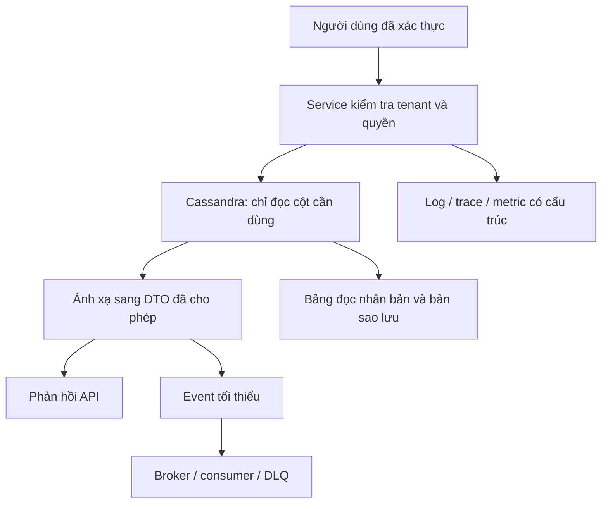

# Giới hạn dữ liệu cá nhân trong kết quả, sự kiện và log với Spring Data Cassandra

Một ứng dụng sử dụng **Spring Data Cassandra** có thể lưu họ tên, email, số điện thoại hoặc thông tin đặt chỗ để phục vụ nghiệp vụ. Vấn đề bảo mật phát sinh khi ứng dụng đọc đúng hàng trong Apache Cassandra nhưng sau đó đưa **quá nhiều thông tin** vào phản hồi API, message sự kiện, log, trace hoặc chỉ số vận hành. Việc kết nối TLS, xác thực Cassandra và dùng repository đúng cú pháp không tự ngăn được dạng lộ lọt này.

Trong chương **Bảo mật**, bài học tập trung vào nguyên tắc **chỉ đưa dữ liệu cá nhân đến nơi thật sự cần**, từ lúc thiết kế bảng theo truy vấn và partition key đến lúc xuất dữ liệu qua REST, sự kiện và công cụ quan sát. Các ví dụ dùng entity mapping, repository, `CassandraTemplate` và CQL trong module `SPRING_DATA_CASSANDRA`; đồng thời xem xét paging, các bảng được nhân bản theo mục đích đọc, TTL và tính nhất quán của mô hình dữ liệu phân tán.

## 1. Mục tiêu và ranh giới cần bảo vệ

Sau bài này, người học cần biết cách:

1. Xác định thông tin nào là dữ liệu cá nhân, kể cả **định danh gián tiếp** và dữ liệu có thể liên kết với cá nhân qua hệ thống khác.
2. Chọn đúng cột, đúng partition và đúng đối tượng được phép truy cập trước khi tạo DTO phản hồi.
3. Thiết kế event có **hợp đồng dữ liệu tối thiểu**, tránh lan truyền payload chứa dữ liệu nhạy cảm sang nhiều consumer, topic và dead-letter queue (DLQ).
4. Ghi log, metric và trace đủ để chẩn đoán lỗi Cassandra nhưng hạn chế giá trị nhạy cảm, cardinality quá cao và dữ liệu được giữ lâu.
5. Kiểm thử dữ liệu **thật sự rời khỏi ứng dụng**, không chỉ kiểm tra annotation trên entity.

### 1.1. Dữ liệu cá nhân không chỉ là tên hoặc email

| Loại dữ liệu | Ví dụ trong ứng dụng đặt chỗ | Rủi ro khi phát tán |
| --- | --- | --- |
| Định danh trực tiếp | Họ tên, email, số điện thoại, địa chỉ | Xác định hoặc liên hệ được cá nhân |
| Định danh liên kết | `customer_id`, `user_id`, mã đặt chỗ, `tenant_id` | Kết hợp với dữ liệu khác có thể suy ra người dùng hoặc hành vi |
| Nội dung nhạy cảm theo ngữ cảnh | Ghi chú đặc biệt, lịch đến/đi, vị trí, thông tin yêu cầu hỗ trợ | Tiết lộ lịch trình, nhu cầu cá nhân hoặc thông tin riêng tư |
| Thông tin xác thực và bí mật | Access token, session token, API key, mật khẩu | Có thể bị dùng để truy cập trái phép; không bao giờ đưa nguyên văn vào log/event thông thường |
| Dữ liệu vận hành có thể liên kết | IP, user-agent, request ID, trace ID khi gắn với tài khoản | Cho phép liên hệ nhiều hành động và có thể tái nhận diện |

Một `UUID` được tạo ngẫu nhiên thường ít nhạy cảm hơn email, nhưng **không tự trở thành dữ liệu vô danh**: nếu hệ thống có thể tra UUID về khách hàng, nó vẫn là định danh liên kết. Việc thay email bằng hash thông thường cũng không bảo đảm ẩn danh, nhất là khi không gian giá trị nhỏ và có thể thử đoán.

### 1.2. Nhìn theo luồng dữ liệu



Điểm kiểm soát không chỉ ở JSON cuối cùng. Dữ liệu có thể thoát qua exception message, câu CQL kèm bind values, debug log từ framework/driver, metadata sự kiện, bản ghi outbox, trace attribute hoặc metric label.

## 2. Thiết kế quyền truy cập từ partition key và truy vấn

Cassandra được tối ưu cho **truy vấn biết trước**. Một bảng thường phục vụ một nhóm đường đọc xác định, nên dữ liệu cá nhân dễ được nhân bản sang nhiều bảng để đáp ứng nhu cầu tìm kiếm. Nếu không thiết kế ranh giới từ đầu, cùng một thông tin có thể xuất hiện ở nhiều nơi với chính sách quyền và thời hạn lưu khác nhau.

Giả sử bảng nguồn của dịch vụ đặt chỗ là:

```sql
CREATE TABLE bookings_by_id (
    tenant_id uuid,
    booking_id uuid,
    owner_id uuid,
    status text,
    starts_at timestamp,
    customer_name text,
    customer_email text,
    customer_phone text,
    private_note text,
    PRIMARY KEY ((tenant_id, booking_id))
);
```

`(tenant_id, booking_id)` là **composite partition key**. Để đọc một booking, service cần đủ hai thành phần khóa. Cột `owner_id` dùng kiểm tra quyền truy cập; các cột `customer_*` và `private_note` không có lý do xuất hiện trong phản hồi trạng thái đơn giản.

Các quy tắc an toàn cần được định nghĩa rõ:

- **Xác định tenant từ danh tính đã được xác thực** (token/session đã kiểm tra chữ ký và quyền), không mù quáng tin `tenantId` người gọi truyền trong URL/body.
- Dùng **đầy đủ partition key** và kiểm tra quyền trên booking nếu nhiều người trong cùng tenant có quyền khác nhau.
- Phân biệt “được xem booking” và “được xem chi tiết liên hệ khách hàng”; hai quyền có thể khác nhau.
- Không dùng `ALLOW FILTERING` để tìm dữ liệu một tenant rồi lọc quyền sau khi đã quét phạm vi quá rộng.
- Nếu bổ sung bảng `bookings_by_owner`, `bookings_by_day` hoặc `customers_by_email`, hãy xem mỗi bảng là **một bản sao dữ liệu cần kiểm soát** về quyền, TTL, xóa và sao lưu.

**Lưu ý:** phân quyền Cassandra theo role/keyspace/table không tự cung cấp quyền theo từng tenant hoặc từng hàng. Logic tenant isolation và object authorization thường phải đặt ở tầng ứng dụng hoặc một kiến trúc cách ly dữ liệu được thiết kế rõ ràng. Quyền database tối thiểu là lớp bảo vệ bổ sung, không thay thế kiểm tra quyền ở service.

## 3. Giới hạn dữ liệu trong kết quả API

### 3.1. Không trả thẳng entity Cassandra

Giả sử entity có đủ trường `customerEmail`, `customerPhone`, `privateNote`. Cách trả trực tiếp này tiềm ẩn lộ lọt khi người khác bổ sung một thuộc tính vào entity:

```java
// Mẫu cần tránh trong endpoint trả dữ liệu cho người dùng:
@GetMapping("/bookings/{id}")
public BookingEntity getBooking(@PathVariable UUID id) {
    return repository.findById(...).orElseThrow();
}
```

Entity là mô hình **lưu trữ**, không phải hợp đồng dữ liệu được phép công bố. `@JsonIgnore` hoặc `@JsonView` có thể là lớp bảo vệ phụ, nhưng dễ bị bỏ sót ở serializer, DTO mới hoặc luồng sự kiện khác. Ưu tiên DTO có các trường **được cho phép rõ ràng**:

```java
public record BookingSummary(
    UUID bookingId,
    String status,
    Instant startsAt
) {}
```

Phản hồi hợp lệ cho màn hình xem trạng thái:

```json
{
  "bookingId": "927d92b8-43d9-448d-bab5-dc9bba6dd1b9",
  "status": "CONFIRMED",
  "startsAt": "2026-11-25T07:00:00Z"
}
```

Ví dụ này không chứa email, số điện thoại hay ghi chú. Tuy vậy, `bookingId` vẫn có thể là định danh liên kết và cần giới hạn đối tượng được phép xem. Nếu nghiệp vụ yêu cầu hiển thị tên khách hàng, tạo **DTO khác cho đúng vai trò/endpoint**, không thêm đại trà vào mọi phản hồi.

### 3.2. Đọc đúng cột bằng CQL

Không bắt buộc phải `SELECT *` rồi mới lọc ở bộ chuyển JSON. CQL hỗ trợ chọn các cột phục vụ quyền và phản hồi:

```sql
SELECT booking_id, owner_id, status, starts_at
FROM bookings_by_id
WHERE tenant_id = ? AND booking_id = ?;
```

Ở đây service cần `owner_id` để **kiểm tra quyền**, nhưng không trả nó trong DTO. Với Java Driver 4 được sử dụng cùng Spring Data Cassandra:

```java
public BookingSummary getSummary(UUID bookingId, AuthenticatedActor actor) {
    SimpleStatement query = SimpleStatement.newInstance(
        "SELECT booking_id, owner_id, status, starts_at " +
        "FROM bookings_by_id WHERE tenant_id = ? AND booking_id = ?",
        actor.tenantId(), bookingId
    );

    Row row = cqlSession.execute(query).one();
    if (row == null) {
        throw new BookingNotFoundException(bookingId);
    }

    UUID ownerId = row.getUuid("owner_id");
    if (!actor.canViewAllBookings()
            && !actor.userId().equals(ownerId)) {
        throw new AccessDeniedException("Booking access denied");
    }

    return new BookingSummary(
        row.getUuid("booking_id"),
        row.getString("status"),
        row.getInstant("starts_at")
    );
}
```

`AuthenticatedActor`, `BookingNotFoundException` và quyền `canViewAllBookings()` là lớp domain minh họa, cần được định nghĩa trong ứng dụng. Để tránh lộ sự tồn tại của đối tượng, một số sản phẩm cố tình trả `404` thay vì `403` khi người dùng không có quyền; lựa chọn này phải nhất quán với chính sách API. Không đưa `ownerId`, nội dung truy vấn hoặc thông tin khách hàng vào message lỗi gửi cho client.

Nếu dùng **Spring Data Cassandra repository** hoặc `CassandraTemplate`, vẫn nên ánh xạ sang DTO và thực hiện kiểm tra quyền trong service. Khi muốn giảm lượng dữ liệu đọc thực tế, chọn cách truy vấn projection/column selection tương thích phiên bản Spring Data đang dùng; không mặc định cho rằng đổi return type của repository sẽ khiến driver chỉ đọc các cột xuất hiện trong DTO.

### 3.3. Đầu vào an toàn và dữ liệu ngoài ý muốn

Gắn giá trị vào placeholder như `?` hoặc `PreparedStatement` thay vì nối chuỗi từ người dùng vào CQL. Việc bind parameter giúp giảm nguy cơ injection và tạo hợp đồng kiểu dữ liệu rõ ràng. Nhưng **bind parameter không tự làm dữ liệu an toàn để log**: email hoặc token vẫn có thể lộ nếu ghi `statement.get...`, `row.toString()` hoặc bật logging nhạy cảm ở driver.

Ví dụ cần tránh:

```java
log.debug("Request: {}", request);           // Có thể chứa thông tin cá nhân
log.debug("Cassandra row: {}", row);        // Có thể chứa cột nhạy cảm
return ResponseEntity.ok(bookingEntity);    // Có thể serialize mọi trường
```

Ví dụ tốt hơn: ghi loại hành động, trạng thái, mã lỗi và correlation ID đã kiểm soát; DTO chỉ chứa trường có trong hợp đồng.

## 4. Phân trang và tìm kiếm cũng phải giữ ranh giới

Khi truy vấn danh sách, điều kiện truy cập phải đúng **trước khi lấy trang dữ liệu**. Với Cassandra, thiết kế một bảng `bookings_by_owner` theo khóa owner (và bucket nếu cần hạn chế partition) có thể phù hợp hơn việc đọc danh sách cả tenant rồi lọc trong bộ nhớ. Bảng này nên chỉ chứa các cột cần hiển thị cho danh sách.

| Thiết kế | Rủi ro | Hướng xử lý |
| --- | --- | --- |
| Truy vấn tất cả booking của tenant rồi lọc theo người dùng | Có thể đọc quá nhiều dữ liệu, tạo nguy cơ lộ qua cache/log và làm sai paging | Thiết kế bảng theo chủ sở hữu hoặc quyền truy cập; kiểm tra quyền tại điểm truy vấn |
| Trang danh sách chứa email/địa chỉ để “tiện dùng” | Mọi người xem danh sách có thể thấy trường không cần thiết | Chỉ trả trạng thái, thời điểm và mã hiển thị cần dùng |
| Continuation token được coi là quyền truy cập | Token bị chia sẻ có thể bị dùng trong ngữ cảnh khác | Kiểm tra xác thực/tenant/quyền **mỗi lần** gọi trang; gắn token với truy vấn/người dùng nếu cần |
| Trả tổng số hoặc kết quả tìm kiếm quá chi tiết | Có thể suy ra sự tồn tại hoặc hành vi của người khác | Giới hạn phạm vi tìm kiếm và chi tiết hiển thị theo vai trò |

Paging state của Cassandra không phải cơ chế xác thực, cũng không tự tạo snapshot dữ liệu xuyên các lần đọc. Khi dữ liệu thay đổi trong lúc phân trang, API phải định nghĩa kỳ vọng về kết quả và tiếp tục kiểm tra quyền ở từng trang. Nếu phát hành continuation token công khai, cần bảo vệ tính toàn vẹn và tránh để token bộc lộ thông tin triển khai/khóa truy vấn hoặc bị sử dụng ở tenant khác.

## 5. Thiết kế sự kiện theo hợp đồng dữ liệu tối thiểu

### 5.1. Sự kiện nói điều gì đã xảy ra?

Một sự kiện `BookingConfirmed` nên đại diện cho **thực tế nghiệp vụ**: booking đã xác nhận. Nhiều consumer chỉ cần biết ID để xử lý tiếp, không cần họ tên, email, số điện thoại hoặc ghi chú riêng tư.

```json
{
  "eventId": "4cd55dfb-2b08-4931-a94a-9b982ad491ca",
  "eventType": "BOOKING_CONFIRMED",
  "schemaVersion": 1,
  "tenantId": "dd12abed-12ab-4dae-8fb1-b53f95728943",
  "bookingId": "927d92b8-43d9-448d-bab5-dc9bba6dd1b9",
  "occurredAt": "2026-11-25T07:05:00Z"
}
```

Đây là ví dụ sự kiện tối thiểu. `tenantId` và `bookingId` là định danh liên kết, không phải giá trị vô danh; vẫn cần quyền đọc topic, retention và kiểm soát consumer. Nếu một consumer thật sự cần email để gửi thông báo, có thể gọi một dịch vụ dữ liệu có phân quyền và lấy đúng giá trị cần cho nhiệm vụ đó; consumer phải có cơ chế xác thực service-to-service và chính sách xử lý riêng. Việc **mọi consumer cùng nhận email từ đầu** thường làm phạm vi lộ lọt lớn hơn mức cần thiết.

Ví dụ record Java dùng làm event contract:

```java
public record BookingConfirmedEvent(
    UUID eventId,
    String eventType,
    int schemaVersion,
    UUID tenantId,
    UUID bookingId,
    Instant occurredAt
) {}
```

Hạn chế dùng một đối tượng `BookingEntity` làm payload publish. Một lần bổ sung `customerPhone` vào entity để phục vụ truy vấn có thể vô tình làm tăng dữ liệu trong mọi message. DTO/event schema **được chọn trường chủ đích** giúp review thay đổi trước khi công bố.

### 5.2. Ranh giới event producer, broker và consumer

Mỗi sự kiện có thể được ghi lại nhiều nơi:

```text
Service phát sự kiện
  -> outbox / CDC / queue producer
  -> broker topic và replica
  -> consumer chính
  -> retry topic / dead-letter queue
  -> dashboard, log và archive
```

Nếu payload có email, nó có thể được giữ trong topic, DLQ, archive và log của nhiều đội, kể cả khi producer đã xóa dữ liệu gốc. Cần kiểm soát:

1. **Schema:** danh sách trường được duyệt; thay đổi schema có review quyền riêng tư và khả năng tương thích.
2. **Quyền đọc:** role/service account chỉ được subscribe những topic thực sự cần.
3. **Retention:** hạn giữ dữ liệu, bản sao và DLQ; dữ liệu lỗi không được giữ vô hạn vì quên cleanup.
4. **Retry:** consumer không log nguyên văn message khi parse lỗi hoặc deserialize thất bại.
5. **Khả năng truy vết:** dùng event ID/correlation ID; không dùng email làm khóa tra log hoặc metric label.
6. **Xóa dữ liệu:** xác định trách nhiệm của từng downstream consumer với dữ liệu đã nhân bản.

### 5.3. Outbox và CDC trong mô hình Cassandra

Ở hệ thống có khả năng mất mạng, xuất bản message trực tiếp sau `repository.save()` có thể thất bại dù mutation Cassandra đã thành công. Dùng outbox, CDC hoặc workflow đối soát có thể giảm rủi ro bỏ sót sự kiện, nhưng phải hiểu tính chất phân tán:

- Cassandra không cung cấp **giao dịch nguyên tử tổng quát** giữa bảng nguồn, bảng outbox ở partition khác và message broker.
- LWT với `IF` chỉ giải quyết điều kiện cập nhật trong phạm vi được hỗ trợ; nó không bao gồm việc publish ra broker.
- CDC và consumer thường cần xử lý **at-least-once**; có thể gặp sự kiện lặp, lệch thứ tự hoặc phải replay.
- Không đưa cả entity chứa PII vào outbox “cho tiện phục hồi”. Outbox nên giữ event contract tối thiểu và hạn lưu trữ riêng.
- `eventId` giúp deduplicate, nhưng không thay thế kiểm tra nghiệp vụ nếu sự kiện đến sau khi booking bị hủy hoặc hết hiệu lực.

Một sự kiện nhỏ không tự đảm bảo nhất quán: consumer vẫn phải kiểm tra trạng thái nguồn hoặc áp dụng quy tắc idempotency khi kết quả ảnh hưởng quyền, thanh toán hoặc đặt chỗ.

## 6. Bảo vệ log, exception và dữ liệu quan sát

### 6.1. Logging theo danh sách trường cho phép

Thay vì dùng `toString()` trên request/entity/result set, chọn thuộc tính vận hành có ích. Ví dụ:

```java
log.info("booking_confirm outcome={} requestId={} durationMs={}",
         outcomeCode, validatedRequestId, elapsedMillis);
```

`outcomeCode` là enum/mã lỗi giới hạn tập giá trị; `validatedRequestId` là định danh được tạo hoặc được kiểm tra định dạng, không chèn nguyên văn header không tin cậy; `elapsedMillis` là số đo. Khi cần tra cứu một booking cụ thể, sử dụng log có kiểm soát truy cập hoặc một cơ chế tra theo ID trong hệ thống vận hành đã được cấp quyền, thay vì đưa toàn bộ thông tin khách hàng lên tất cả log.

Mẫu nên tránh:

```java
log.info("Booking created: {}", bookingEntity);
log.warn("Request rejected: {}", requestBody);
log.error("Cassandra failed for email={}", customerEmail, ex);
log.debug("CQL={} params={}", cql, bindValues);
```

Các log này có thể đưa PII lên nhiều hệ thống: stdout container, agent thu thập log, search index, dashboard và backup. Một thông tin đã vào log thường khó xóa hơn dữ liệu trong bảng Cassandra ban đầu.

**Structured logging** không đồng nghĩa tự động bảo mật. JSON log có thể chứa chính những trường nhạy cảm nếu chọn sai schema. Chính sách nên dựa trên **allowlist** các trường log, thay vì chỉ cố xóa chuỗi khớp regex sau khi log đã được tạo.

### 6.2. Cẩn trọng với log từ driver và framework

Java Driver, Spring Web, validation, serialization, SQL/CQL tracing và middleware có thể log dữ liệu mà code nghiệp vụ không ghi trực tiếp. Cần xem lại cấu hình theo phiên bản thư viện:

- Không bật log DEBUG/TRACE của repository, driver hoặc HTTP request/response ở production mà chưa kiểm tra nội dung thực tế.
- Không log **bound CQL values**, full row hoặc execution context chứa token/email khi xử lý lỗi.
- Kiểm tra công cụ APM có tự thu request body, query string, headers, user attributes hoặc stack locals không.
- Loại bỏ `Authorization`, cookie, session token, credentials và trường form nhạy cảm khỏi log/access log/trace.
- Nếu cần truy vết truy vấn chậm, ưu tiên operation name, table, CL, latency và **truy vấn chuẩn hóa** không chứa giá trị đầu vào.

Một tham số bind qua `?` an toàn hơn nối chuỗi CQL từ người dùng, nhưng vẫn là dữ liệu nhạy cảm trong bộ nhớ và các công cụ instrumentation. Khi điều tra sự cố, không mở logging toàn bộ payload trừ khi đã có biện pháp giới hạn truy cập, thời hạn, phạm vi và phương án dọn dữ liệu.

### 6.3. Exception mapping và thông báo lỗi cho client

Exception có thể chứa tên bảng, query, giá trị đầu vào, lỗi mapping hoặc chuỗi từ SDK. API nên trả mã lỗi ổn định và thông điệp an toàn:

```json
{
  "code": "BOOKING_UNAVAILABLE",
  "message": "Không thể tải thông tin đặt chỗ lúc này",
  "requestId": "req-7f91c2"
}
```

Tầng xử lý lỗi giữ chi tiết kỹ thuật trong hệ thống quan sát **được phân quyền**, nhưng ngay cả log kỹ thuật cũng cần giới hạn các thông tin được ghi. Không gộp `404` với Cassandra timeout: “không tìm thấy bản ghi” khác với “không thể xác nhận có bản ghi hay không”. Cũng không trả nguyên văn `ex.getMessage()` hoặc stack trace cho client.

Với Spring Boot, có thể cấu hình để phản hồi lỗi mặc định không đưa chi tiết nội bộ ra ngoài (kiểm tra khóa theo phiên bản đang sử dụng):

```yaml
server:
  error:
    include-message: never
    include-binding-errors: never
    include-stacktrace: never
```

Cấu hình này **không thay thế** thiết kế `@ControllerAdvice`, exception response DTO hay test; một handler tùy biến vẫn có thể tự trả dữ liệu nhạy cảm nếu dùng message hoặc object sai.

## 7. Metric, trace và audit: cần thông tin gì để vận hành?

### 7.1. Metric nên dùng nhãn hữu hạn

Ví dụ những nhãn phù hợp với Micrometer/Prometheus:

| Chỉ số | Nhãn hữu hạn phù hợp | Nhãn nên tránh |
| --- | --- | --- |
| `booking_read_total` | `result=success/forbidden/not_found/error`, `route` | `customerEmail`, `bookingId`, `userId` |
| `cassandra_request_seconds` | `operation`, `consistency`, `errorClass` | CQL kèm bind values, partition key đầy đủ |
| `booking_event_publish_total` | `eventType`, `status` | Toàn bộ payload, tên khách hàng |
| `booking_authz_denied_total` | `action`, `reasonCode` | Tên/địa chỉ/email người bị từ chối |

Nhãn chứa ID riêng của mỗi request hoặc người dùng gây **high cardinality**, làm tăng chi phí và có thể tạo dữ liệu liên kết nhạy cảm trong hệ thống metric. Khi cần truy vết một yêu cầu cụ thể, dùng tracing/log với quyền và thời hạn lưu phù hợp thay vì metric label.

### 7.2. Trace và correlation ID cũng có chính sách dữ liệu

Trace nên mô tả span như `booking.load`, `cassandra.select`, `booking.authorize` cùng thời gian, trạng thái và loại lỗi. Không tạo span attribute kiểu `customer.email`, `private_note`, token hoặc body nguyên văn. Trace ID ngẫu nhiên có thể giúp đối chiếu luồng xử lý nhưng vẫn phải hạn chế nơi phổ biến, truy cập và retention.

Ở đường phân trang, metric về kích thước trang, số lần fetch, timeout và consistency level hữu ích hơn việc log từng row. Khi Cassandra có tombstone, hot partition hoặc LWT conflict, quan sát số lượng và thời gian xử lý là đủ để tìm hướng điều tra ban đầu; chi tiết một partition riêng lẻ nên nằm trong quy trình chẩn đoán có giới hạn truy cập.

### 7.3. Audit log khác application debug log

Audit phục vụ trả lời **ai đã thực hiện loại hành động gì, khi nào, trên phạm vi nào, kết quả ra sao**. Một sự kiện audit có thể chứa `actorId` dạng định danh liên kết và `resourceId`, nên bản thân audit cũng là dữ liệu cần bảo vệ. Audit không cần lưu toàn bộ giá trị cũ/mới của email hoặc bản sao request body.

```json
{
  "auditType": "BOOKING_CONTACT_VIEWED",
  "actorRef": "pseudonymous-actor-reference",
  "resourceRef": "pseudonymous-booking-reference",
  "outcome": "ALLOWED",
  "occurredAt": "2026-11-25T08:00:00Z"
}
```

Nếu dùng pseudonym ổn định để đối chiếu audit, vẫn cần quản lý khóa ánh xạ, giới hạn người có quyền giải mã/tra ngược, TTL/retention và quy trình xử lý yêu cầu quyền riêng tư. **Pseudonymization không bằng anonymization**; dữ liệu còn có thể liên kết lại với chủ thể.

## 8. Giảm dữ liệu trên bản sao và trong vòng đời lưu trữ

### 8.1. Cassandra nhân bản dữ liệu theo truy vấn và replica

Cùng một email có thể tồn tại trong `customers_by_id`, `customers_by_email`, `bookings_by_owner` và event/outbox. Mỗi bảng lại được Cassandra sao chép theo RF, có thể hiện diện ở nhiều datacenter. Bảo vệ dữ liệu cá nhân vì vậy cần bản kê:

| Vị trí | Câu hỏi phải trả lời |
| --- | --- |
| Bảng nguồn | Những cột nào thực sự cần lưu và phục vụ nghiệp vụ? |
| Bảng đọc denormalized | Có đang nhân bản email/phone chỉ để tiết kiệm một lần tra cứu? |
| Replica/đa DC | Dữ liệu nằm ở DC nào, ai có quyền vận hành và đọc? |
| Snapshot/backup | Bản sao giữ bao lâu, khôi phục có đưa dữ liệu đã xóa trở lại không? |
| Outbox, broker, DLQ | Payload và metadata có trường nhạy cảm nào, retention bao lâu? |
| Log/metric/trace | Có log request/row/bind values hay ID liên kết không? |
| Cache, index, export | Ai có thể truy cập và có đường xóa/thu hồi không? |

Thiết kế theo query không phải lý do tự động sao chép mọi trường. Nếu một màn hình chỉ cần `status` và `starts_at`, bảng phục vụ màn hình đó có thể chỉ chứa đúng những cột ấy và khóa truy vấn cần thiết.

### 8.2. TTL không phải biện pháp xóa bí mật ngay lập tức

Cassandra hỗ trợ TTL cho những ô dữ liệu được ghi. Khi TTL hết hạn, dữ liệu không còn được trả về theo cơ chế đọc thông thường, nhưng quá trình tombstone/compaction và lưu trữ vật lý có các bước riêng. `DELETE` cũng không đồng nghĩa ngay lập tức xóa tất cả replica, snapshot, backup hoặc event đã xuất bản.

Vì thế, khi có yêu cầu xóa hoặc giới hạn thời gian lưu PII:

1. Xác định chính xác các bảng và cột, bao gồm bảng đọc và bản sao liên quan.
2. Lập kế hoạch xóa/thu hồi đồng bộ với mọi bên tiêu thụ dữ liệu; chấp nhận và kiểm soát khoảng trễ theo yêu cầu nghiệp vụ.
3. Đặt retention cho log, trace, audit, broker, DLQ, snapshot và backup; không hứa có thể thu hồi tức thì ở nơi mà hệ thống không hỗ trợ.
4. Đối soát các mutation đã lỗi/timeout, vì dữ liệu ở một bảng có thể còn trong khi bảng khác đã được xóa.
5. Kiểm tra khả năng phục hồi của dữ liệu đã xóa khi node cũ trở lại sau thời gian dài; vận hành repair và `gc_grace_seconds` phải tuân theo hướng dẫn Cassandra phù hợp.

Đừng mô tả `status=DELETED` là “đã xóa dữ liệu cá nhân”; xóa mềm chỉ thay đổi trạng thái nghiệp vụ. Một chính sách retention hợp lệ cần định nghĩa việc ẩn khỏi API, dọn dữ liệu sống và xử lý bản sao/backup theo yêu cầu áp dụng.

### 8.3. Hash, mask và mã hóa phục vụ các mục đích khác nhau

- **Masking:** chỉ hiển thị một phần email/số điện thoại khi vai trò cho phép; dữ liệu bị che vẫn có thể mang thông tin liên kết. Mask theo ngữ cảnh, không hiển thị toàn bộ cho mọi endpoint.
- **Hash thông thường:** phù hợp một số kiểm tra toàn vẹn, nhưng hash email không có khóa dễ bị dò qua từ điển; không mặc định là ẩn danh.
- **HMAC với khóa bí mật:** có thể tạo định danh tra cứu hạn chế đoán giá trị hơn so với hash thuần; cần bảo vệ khóa, chiến lược xoay khóa và cách xử lý trùng lặp/collision theo thiết kế.
- **Mã hóa at rest và TLS:** bảo vệ dữ liệu trên đĩa hoặc đường truyền; **không ngăn** service được cấp quyền trả nguyên văn PII vào JSON/log/event.

Không dùng tên cột `encrypted_email` hoặc `masked_phone` làm bằng chứng an toàn nếu không có chính sách quản lý khóa, quyền giải mã, cách truy vấn và kiểm thử đầu ra.

## 9. Tính nhất quán và bảo mật trong hệ phân tán

### 9.1. Quyền truy cập thay đổi trong lúc dữ liệu còn ở nhiều nơi

Một khách hàng vừa thu hồi quyền chia sẻ booking. Một bảng đọc hoặc cache tại service khác chưa nhận cập nhật có thể vẫn chứa bản ghi cũ. Dù request dùng `LOCAL_QUORUM`, Cassandra cũng không tự tạo giao dịch nguyên tử giữa các partition/bảng đọc phục vụ những truy vấn khác nhau.

Đối với hành động nhạy cảm như xem thông tin liên hệ, tải giấy tờ hoặc xuất dữ liệu, service nên kiểm tra **nguồn quyền truy cập đang có hiệu lực** tại điểm sử dụng. Khi yêu cầu bảo đảm chặt hơn, cần thiết kế mức consistency và protocol cập nhật quyền tương ứng; không coi việc bảng danh sách đã lọc dữ liệu là đủ để ủy quyền.

### 9.2. LWT và optimistic locking bảo vệ trạng thái, không quyết định ai được xem

LWT `IF status = ...` hoặc entity `@Version` có thể phát hiện chuyển trạng thái cạnh tranh. Chúng **không tự động** xác thực actor, tenant hay trường nào được đưa vào event. Kiểm tra quyền phải đứng trước hành động và được đánh giá lại nếu có khả năng thay đổi trong khoảng thời gian giữa đọc và ghi.

Nếu một lệnh ghi quan trọng timeout, tránh log toàn bộ entity để “đối soát”. Dùng `commandId`, mã trạng thái, version và một quy trình đọc nguồn có phân quyền. Chỉ ghi những trường cần để phân biệt **đã áp dụng**, **xung đột xác định** và **chưa biết kết quả**.

### 9.3. Không dựa vào consistency level để thay thế tenant isolation

CL `ONE`, `LOCAL_QUORUM` hay `ALL` nói về số replica cần phản hồi, không nói người dùng được phép thấy cột nào. Một truy vấn `SELECT *` dùng CL mạnh hơn vẫn có thể trả dữ liệu không đúng quyền nếu service serialize entity sai. Bảo mật kết quả cần **quyền truy cập + chọn cột + DTO + hợp đồng đầu ra**; CL là một yếu tố hỗ trợ độ mới dữ liệu trong thiết kế đó.

## 10. Quy trình triển khai từng bước

Giả sử yêu cầu: “API danh sách booking chỉ hiển thị trạng thái và thời gian; sự kiện xác nhận chỉ thông báo mã booking; log đủ điều tra lỗi Cassandra”. Một quy trình thực hiện:

| Bước | Việc làm | Bằng chứng hoàn thành |
| --- | --- | --- |
| 1. Lập bản đồ dữ liệu | Liệt kê mọi cột PII và điểm xuất ra ngoài Cassandra | Có sơ đồ dòng dữ liệu, owner của từng đầu ra |
| 2. Chốt quyền | Định nghĩa tenant/owner/role và mục đích xem từng nhóm trường | Test cho authorized/unauthorized/cross-tenant |
| 3. Thiết kế truy vấn | Chọn partition key và chỉ cột cần đọc, tránh bảng chứa thừa PII | CQL/projection theo use case |
| 4. Định nghĩa DTO API | Dùng allowlist trường được công bố | Schema review và snapshot JSON an toàn |
| 5. Định nghĩa event | Chỉ giữ event type, event ID, resource ID, timestamp cần thiết | Schema kiểm tra không chứa email/phone/private note |
| 6. Giới hạn quan sát | Cấu trúc log/metric/trace, redaction ở tầng thu thập và cấu hình driver | Test log/trace canary, kiểm tra runtime config |
| 7. Kiểm soát retention | Xác định TTL/lifecycle cho bảng nguồn, bảng đọc, broker, log và backup | Bảng retention và quy trình xóa/đối soát |
| 8. Kiểm thử hồi quy | Chạy các ca quyền, schema, lỗi và sự kiện từ đầu đến cuối | CI chặn field mới không được duyệt |

Một chiến lược **allowlist theo hợp đồng** giúp review thay đổi rõ hơn blacklist. Khi thêm trường mới vào `BookingEntity`, API summary và event không thay đổi trừ khi có một thay đổi có chủ đích ở DTO/event schema.

## 11. Kiểm thử dữ liệu thực sự đi ra ngoài

### 11.1. Test serialization bằng dữ liệu canary

Tạo dữ liệu test có chuỗi dễ nhận diện ở các trường nhạy cảm, ví dụ `private-test-value-UNIQUE`. Sau đó kiểm tra cả **tên trường** và **giá trị** có xuất hiện trong API/event/log hay không. Ví dụ JUnit với Jackson cho DTO đã định nghĩa:

```java
@Test
void bookingSummaryDoesNotExposeContactFields() throws Exception {
    BookingSummary dto = new BookingSummary(
        UUID.randomUUID(), "CONFIRMED", Instant.parse("2026-11-25T07:00:00Z")
    );

    String json = new ObjectMapper()
        .registerModule(new JavaTimeModule())
        .writeValueAsString(dto);

    JsonNode root = new ObjectMapper().readTree(json);
    assertTrue(root.has("bookingId"));
    assertTrue(root.has("status"));
    assertFalse(root.has("customerEmail"));
    assertFalse(root.has("customerPhone"));
    assertFalse(root.has("privateNote"));
}
```

Đây là **unit test của DTO**: nó không chứng minh endpoint đã xác thực hay không có middleware nào bổ sung dữ liệu. Trong integration test phải gọi controller thật, dùng identity có và không có quyền, đọc JSON trả ra, đồng thời kiểm tra schema log/event được phát sinh trong thao tác đó. `ObjectMapper` phải được cấu hình giống ứng dụng để tránh lệch định dạng hoặc module.

### 11.2. Test phân quyền theo tenant và owner

Các tình huống tối thiểu:

1. Tenant A, owner đúng, quyền xem summary: endpoint trả đúng các trường công khai.
2. Tenant A, actor khác owner và không có quyền mở rộng: không trả dữ liệu booking.
3. Tenant B thử cùng `bookingId`: không thể đọc bằng khóa tenant khác hoặc qua bảng danh sách của tenant A.
4. Actor có quyền xem summary nhưng không có quyền xem contact: endpoint detail/contact từ chối hoặc giới hạn trường.
5. Dữ liệu vừa bị thu hồi quyền: đường đọc nhạy cảm kiểm tra trạng thái quyền có hiệu lực, không dựa duy nhất vào cache/danh sách trễ.
6. Thử phân trang và dùng continuation token của actor khác: không vượt qua kiểm tra tenant/role.

Với Cassandra nhiều node, có thể bổ sung bài test consistency khi thay đổi quyền và dữ liệu đồng thời; test một node chỉ chứng minh hành vi ở môi trường đó. Dùng định danh mới cho mỗi ca và tránh các test phụ thuộc thứ tự chạy.

### 11.3. Test sự kiện, retry topic và DLQ

Kiểm tra serialize `BookingConfirmedEvent`, sau đó mô phỏng consumer parse lỗi và retry. Dữ liệu cần quan sát không chỉ là message ban đầu mà cả:

- Nội dung bản ghi trên broker và DLQ.
- Log của producer, middleware, consumer khi deserialize thất bại.
- Event được replay khi xử lý lại `commandId` hoặc timeout.
- Những trường một schema mới vô tình thêm vào khi entity được mở rộng.
- Thời hạn lưu event và bản sao lỗi; tiêu chí dọn dữ liệu sau khi hết hạn.

Một test event chỉ kiểm tra “không có `customerEmail` trong JSON” có thể chưa đủ nếu payload đưa dữ liệu vào trường khác như `metadata`, `raw`, `description` hoặc một nested object. Nên dùng schema allowlist kết hợp chuỗi canary và so sánh với hợp đồng đã duyệt.

### 11.4. Test log, trace và lỗi hạ tầng

Chạy các tình huống **xác thực thất bại**, **CQL lỗi**, **read timeout**, **LWT conflict** và **serialization thất bại**. Thu log/trace bằng appender/test exporter trong môi trường kiểm thử rồi dò canary ở nội dung đã thu. Đảm bảo:

- Không xuất hiện email, số điện thoại, token, `private_note` hoặc body gốc.
- Error response không chứa CQL, bảng nội bộ, credential hay stack trace.
- Metric label không có `userId`, `bookingId`, email hoặc request ID duy nhất.
- Vẫn có đủ `operation`, `errorClass`, `requestId` và thời gian xử lý để chẩn đoán.
- Khi driver logging đổi phiên bản hoặc mức DEBUG/TRACE, bộ kiểm tra bảo mật được chạy lại trước khi bật trên production.

Lọc chuỗi canary chỉ là một lớp kiểm tra: nếu dữ liệu nhạy cảm được mã hóa hoặc biến đổi thì chuỗi gốc có thể không còn xuất hiện nhưng vẫn có khả năng bị nhận diện. Kết hợp test dữ liệu với **review schema và các điểm xuất dữ liệu**.

## 12. Những lỗi thiết kế thường gặp

| Sai lầm | Vì sao nguy hiểm | Cách sửa |
| --- | --- | --- |
| Trả `@Table` entity trực tiếp từ controller | Thêm cột vào entity có thể tự xuất hiện trong JSON | DTO chỉ chứa trường được phép; test serializer/API |
| Truy vấn `SELECT *` trong mọi endpoint | Đọc nhiều PII không cần dùng, tăng cơ hội xuất qua log/cache | Chọn cột phù hợp use case và quyền |
| Chỉ kiểm tra `tenantId` do client gửi | Có thể vượt ranh giới tenant | Lấy tenant từ identity đã xác thực; kiểm tra object authorization |
| Dựa vào role Cassandra để bảo vệ từng hàng | Cassandra role không tự thực hiện phân quyền tenant ở application level | Dùng service authorization và schema cách ly thích hợp |
| Publish nguyên entity làm event | Dữ liệu bị nhân bản tới broker, DLQ và consumer | Event schema tối thiểu, review thay đổi |
| Log request/entity/`Row` bằng `toString()` | Dễ đưa PII vào log tập trung và backup | Structured log với trường allowlist |
| Gắn email/user ID vào nhãn Prometheus | Vừa lộ định danh vừa tăng cardinality rất lớn | Nhãn hữu hạn, trace/log có kiểm soát |
| Cho rằng hash email là vô danh | Có thể tra từ điển và nối với bảng khác | Chọn HMAC/kiến trúc hạn chế truy cập theo mục tiêu, vẫn coi là dữ liệu liên kết |
| Coi TLS/encryption at rest là đủ | Service hợp lệ vẫn có thể trả PII sai chỗ | Quyền, chọn cột, DTO và kiểm thử đầu ra |
| Coi TTL/xóa mềm là xóa ngay mọi bản sao | Replica, snapshot, broker và log có vòng đời riêng | Inventory retention và quy trình xóa/đối soát |
| Dùng LWT/`@Version` thay kiểm tra quyền | CAS giải quyết cạnh tranh phiên bản, không xác thực actor | Tách authorization, domain rule và concurrency control |

## 13. Bài tập thực hành

**Bối cảnh:** một nền tảng cho thuê dùng Spring Data Cassandra để quản lý booking. Bảng nguồn lưu `customer_name`, `customer_email`, `customer_phone`, `private_note`, `status` và thời gian đặt. Có ba đường xuất dữ liệu:

1. API `GET /bookings/{id}` dành cho người thuê: chỉ được thấy ID, trạng thái và thời gian.
2. Sự kiện `BOOKING_CONFIRMED` cho dịch vụ gửi thông báo: producer không nên phát tán toàn bộ entity.
3. Dashboard vận hành: cần biết tỷ lệ timeout Cassandra, tỉ lệ truy cập bị từ chối và độ trễ xuất sự kiện, nhưng không được chứa PII trong metric labels.

Hãy xây dựng một thiết kế gồm: bảng/truy vấn theo partition key, service kiểm tra quyền từ identity đã xác thực, `BookingSummary` DTO, `BookingConfirmedEvent` schema, các trường log/metric được phép và retention cho bảng đọc, broker, DLQ. Viết ít nhất năm ca test thể hiện **không có PII trong đầu ra**, kể cả khi CQL hoặc event consumer phát sinh lỗi.

Sau khi hoàn thành, tự trả lời: nếu ngày mai thêm `customer_date_of_birth` vào entity, API summary, event và log có tự xuất trường đó không? Nếu có, ranh giới dữ liệu của thiết kế chưa đủ chặt.

## 14. Checklist trước khi đưa vào sản xuất

- Xác định mọi trường PII trực tiếp/gián tiếp và nơi dữ liệu được nhân bản.
- Mỗi endpoint có hợp đồng DTO riêng và chỉ trả đúng cột/trường cần theo vai trò.
- Tenant và object authorization được thực thi ở service, không dựa vào tham số do client tùy ý truyền.
- Bảng Cassandra được thiết kế theo truy vấn và quyền; paging không trở thành đường vượt qua authorization.
- Event schema được duyệt theo allowlist; không serialize trực tiếp entity hoặc request body.
- Broker, consumer, retry, DLQ và outbox có quyền đọc/retention rõ ràng.
- Log, trace, metric không chứa token, bind values, body, `Row` hoặc định danh nhạy cảm vượt nhu cầu.
- Error response có mã lỗi ổn định, không lộ stack trace, tên bảng/CQL hoặc dữ liệu người dùng.
- TTL/xóa mềm, snapshot, backup và denormalized tables được đưa vào vòng đời dữ liệu có kiểm chứng.
- Kiểm thử API, event, log và lỗi hạ tầng với canary; review lại khi thay đổi dependency, schema hoặc log level.

**Kết luận:** bảo vệ dữ liệu cá nhân trong Spring Data Cassandra không dừng ở việc mã hóa đường truyền hay giới hạn quyền truy cập database. Cần **thiết kế đúng bảng theo truy vấn, xác thực quyền trên từng đối tượng, chỉ chọn cột và DTO cần thiết, giữ event nhỏ, giới hạn log/trace/metric và quản lý bản sao theo vòng đời dữ liệu**. Khi các ranh giới này được kiểm thử trực tiếp, ứng dụng vừa phục vụ nghiệp vụ vừa giảm phạm vi lộ lọt trong môi trường Cassandra phân tán.
