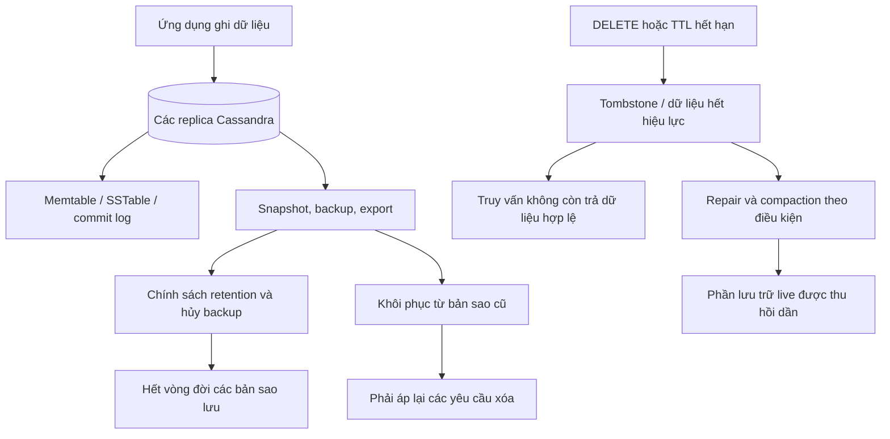
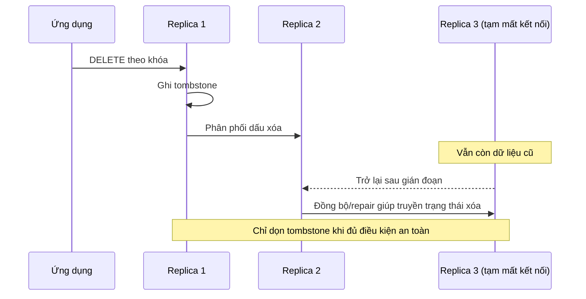
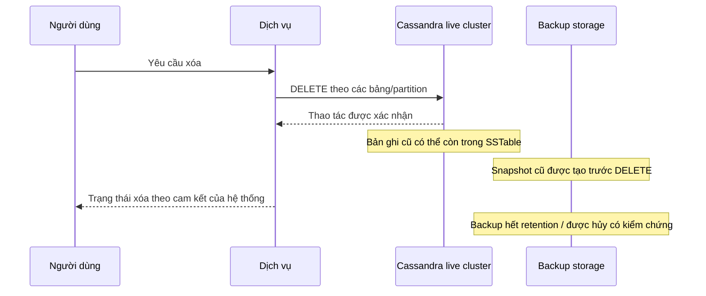
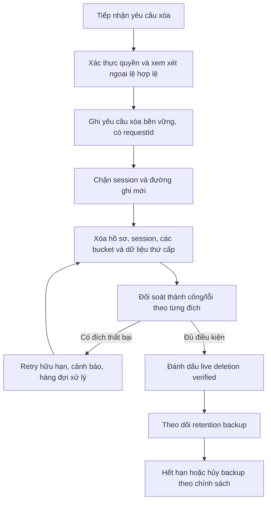

# Chính sách xóa, TTL và dữ liệu còn trong bản sao lưu

Khi một người dùng yêu cầu xóa tài khoản, ứng dụng có thể gọi `CassandraRepository.deleteById(...)` và sau đó không còn đọc thấy hồ sơ. Điều này **không đồng nghĩa** mọi bản sao dữ liệu cá nhân đã biến mất khỏi đĩa, replica, snapshot, backup, bản xuất phân tích hoặc hệ thống tìm kiếm. Apache Cassandra là cơ sở dữ liệu phân tán theo mô hình LSM-tree: xóa thường được ghi nhận bằng *tombstone*, còn việc thu hồi dữ liệu vật lý và vòng đời bản sao lưu diễn ra theo các cơ chế khác nhau.

Trong chương **Bảo mật** của **Spring Data Cassandra**, cần phân biệt ba mục tiêu:

1. **Ngừng cung cấp dữ liệu qua ứng dụng và các truy vấn đang hoạt động.**
2. **Loại bỏ dữ liệu khỏi các bản sao lưu trữ đang phục vụ**, xét đến replica, tombstone, repair và compaction.
3. **Hết thời hạn giữ lại dữ liệu trong backup và các hệ thống thứ cấp**, hoặc có phương án phục hồi không đưa dữ liệu đã yêu cầu xóa trở lại.

Spring Data Cassandra hỗ trợ entity mapping, repository, `CassandraTemplate` và CQL để thực hiện đọc/ghi/xóa. Tuy nhiên chính sách bảo mật và thời hạn lưu trữ phải được thiết kế ở cấp hệ thống, không thể trông chờ riêng vào một phương thức `delete` hay cấu hình TTL.

## 1. Mô hình vòng đời dữ liệu sau khi ghi và xóa

Giả sử ứng dụng có ba nơi chứa thông tin của một tài khoản: bảng hồ sơ, bảng phiên đăng nhập và bảng hoạt động được denormalize cho việc tra cứu theo tháng. Cassandra phân phối mỗi partition qua nhiều replica theo replication strategy của keyspace.



| Khái niệm | Điều thực sự xảy ra | Hệ quả bảo mật |
| --- | --- | --- |
| `DELETE` theo khóa | Cassandra ghi dấu xóa theo timestamp để hòa giải với các phiên bản dữ liệu | Kết quả đọc có thể không còn hàng, nhưng bản cũ có thể vẫn tồn tại trên đĩa |
| `USING TTL` / `default_time_to_live` | Giá trị được ghi kèm thời điểm hết hạn; khi hết hạn, nó không còn là dữ liệu sống | TTL là chính sách hết hiệu lực, không phải lệnh xóa an toàn tức thời |
| Tombstone | Thông tin xóa/hết hạn được duy trì để tránh replica cũ khôi phục dữ liệu | Compaction và repair quyết định thời điểm có thể dọn phần dữ liệu cũ |
| Compaction | Hợp nhất SSTable và có thể thu hồi dữ liệu/tombstone đủ điều kiện | Không tự dọn những bản chụp hoặc file backup độc lập |
| Snapshot/backup | Lưu các file SSTable hoặc bản sao được xuất tại một thời điểm | Có thể còn dữ liệu trước khi `DELETE` hoặc TTL hết hạn |
| Restore | Nạp lại dữ liệu từ một thời điểm quá khứ | Có thể đưa dữ liệu đã xóa trở lại nếu không đối soát yêu cầu xóa mới hơn |

**Câu cần nhớ:** “Không còn đọc thấy” là một trạng thái có thể kiểm chứng của đường truy cập; “đã xóa khỏi mọi nơi” đòi hỏi kiểm soát cả vòng đời lưu trữ, replica, bản sao và khôi phục.

## 2. Hiểu đúng TTL: giới hạn thời gian sống của dữ liệu

TTL (*Time To Live*) thích hợp cho thông tin có hạn sử dụng rõ ràng, ví dụ phiên đăng nhập, mã xác thực một lần, bản ghi tạm hoặc sự kiện được phép lưu trong một thời gian nhất định.

### 2.1. TTL trong CQL áp dụng lên dữ liệu được ghi

Giả sử bảng lưu phiên truy cập bằng khóa định danh:

```sql
CREATE TABLE session_by_id (
    tenant_id text,
    session_id uuid,
    user_id uuid,
    token_digest text,
    created_at timestamp,
    PRIMARY KEY ((tenant_id, session_id))
);
```

Đặt thời hạn bảy ngày cho dữ liệu được thêm ở lệnh ghi:

```sql
INSERT INTO session_by_id (
    tenant_id, session_id, user_id, token_digest, created_at
) VALUES (?, ?, ?, ?, ?)
USING TTL 604800;
```

TTL trong Cassandra gắn với **giá trị/ô dữ liệu được ghi**, không phải một bộ hẹn giờ tùy ý chạy độc lập cho toàn bộ entity Java. Khi giá trị hết TTL, việc đọc coi nó đã hết hiệu lực; dữ liệu vật lý và tombstone vẫn phụ thuộc vào compaction và chính sách lưu trữ.

Có thể xem số giây TTL còn lại của một cột đang tồn tại:

```sql
SELECT TTL(token_digest)
FROM session_by_id
WHERE tenant_id = ? AND session_id = ?;
```

`TTL(column)` trả về số giây còn lại khi cột có TTL và vẫn còn sống. `null` không nên được diễn giải là “dữ liệu đã được xóa vật lý”: nó cũng có thể thể hiện giá trị không có TTL hoặc không còn tồn tại theo trạng thái đọc.

### 2.2. TTL mặc định ở cấp bảng

Với một bảng chỉ dùng cho dữ liệu tạm, có thể chọn:

```sql
ALTER TABLE session_by_id
WITH default_time_to_live = 604800;
```

Điều này đặt TTL mặc định cho **các lần ghi áp dụng sau đó** theo quy tắc của Cassandra; không nên giả định nó tự viết lại TTL của mọi bản ghi cũ. TTL được chỉ rõ trong lệnh ghi có thể thay đổi cách áp dụng TTL mặc định theo phiên bản và cấu hình. Cần test các trường hợp viết lại dữ liệu, cập nhật một vài cột và migration dữ liệu tồn tại trước đó.

| Lựa chọn | Phù hợp khi | Cần tránh |
| --- | --- | --- |
| `USING TTL n` cho từng câu ghi | Các loại dữ liệu có hạn lưu khác nhau trong cùng bảng | Quên áp dụng TTL ở một đường ghi khác |
| `default_time_to_live` | Tất cả dữ liệu của bảng cùng chính sách giữ lại | Sử dụng bảng lẫn dữ liệu ngắn hạn và dài hạn |
| `DELETE` theo yêu cầu | Cần thu hồi quyền truy cập/xóa trước thời điểm TTL | Chờ đến khi TTL tự hết hạn dù đã nhận yêu cầu xóa |
| Job dọn dữ liệu theo chính sách | Cần xóa nhiều bảng/partition hoặc thực hiện đối soát | Quét toàn cluster và xóa hàng loạt không giới hạn tải |

TTL không thay thế việc phân loại dữ liệu. Nếu hồ sơ khách hàng được lưu 5 năm, trong khi mã xác thực chỉ được phép giữ vài phút, nên thiết kế đường lưu trữ và retention riêng; không áp một TTL cho mọi bảng để đơn giản hóa cấu hình.

### 2.3. Những chi tiết dễ bị bỏ qua

- **Ghi lại có thể làm mới TTL của những cột được ghi.** Nếu ứng dụng cập nhật phiên mỗi lần sử dụng, thời hạn tồn tại của các giá trị được ghi lại có thể kéo dài; điều này phải khớp chính sách phiên “hết hạn tuyệt đối” hay “hết hạn theo thời gian không hoạt động”.
- **TTL hết hạn tạo áp lực tombstone.** Khối lượng bản ghi có TTL lớn, TTL khác nhau trong cùng partition và truy vấn quét qua nhiều hàng đã hết hạn có thể làm tăng độ trễ.
- **TTL không đảm bảo xóa khỏi backup.** Bản snapshot được tạo trước khi TTL hết hạn vẫn có thể lưu các byte chứa dữ liệu; phần mềm đọc/restore có thể xử lý thời điểm hết hạn theo metadata, nhưng điều đó không làm file backup tự biến mất.
- **Đồng hồ và phiên bản Cassandra quan trọng.** TTL được tính theo thời gian; cần đồng bộ clock của node, đặt thời hạn trong phạm vi hỗ trợ của phiên bản Cassandra và kiểm thử hành vi khi khôi phục.
- **Cột không có TTL không tự mất theo cột khác.** Với yêu cầu xóa toàn bộ dữ liệu thuộc người dùng, phải xét từng cột, bảng và đường ghi, không suy ra toàn bộ hàng đã được thu hồi chỉ vì `token_digest` hết hạn.

## 3. DELETE, tombstone, repair và nguy cơ dữ liệu xuất hiện lại

Để vô hiệu hóa một phiên trước khi hết TTL, CQL dùng đủ partition key:

```sql
DELETE FROM session_by_id
WHERE tenant_id = ? AND session_id = ?;
```

Lệnh này tạo dấu xóa. Nó **không** ghi đè tất cả byte đã có trên SSTable ngay lúc thực thi, và không truyền hành động xóa tới một bản sao lưu nằm ngoài cơ chế replication sống của Cassandra.

### 3.1. Tại sao Cassandra cần giữ tombstone?

Khi một replica tạm không có mặt trong lúc xóa, replica đó có thể vẫn giữ bản ghi cũ. Sau khi nó trở lại, các cơ chế đồng bộ cần biết dữ liệu cũ đã bị xóa, để không xem phiên bản cũ là dữ liệu hợp lệ.



Sơ đồ mô tả ý tưởng; coordinator, replica được liên hệ và cách truyền thông tin cụ thể phụ thuộc topology, consistency level, hints và cơ chế repair của Cassandra.

Nếu tombstone bị dọn quá sớm trong khi một replica còn giữ dữ liệu cũ, bản dữ liệu cũ có thể **xuất hiện lại** (*zombie data*). Do đó, thời hạn `gc_grace_seconds` và lịch repair phải được thiết kế cùng nhau, dựa trên thời gian replica có thể mất kết nối và cơ chế chống phục hồi dữ liệu cũ của phiên bản Cassandra đang dùng.

### 3.2. gc_grace_seconds không phải “thời hạn xóa”

`gc_grace_seconds` là tham số liên quan tới việc bảo vệ tombstone trước khi có thể được dọn; nó **không** có nghĩa:

- Dữ liệu chắc chắn bị xóa vật lý đúng lúc bộ đếm kết thúc.
- Dữ liệu lập tức biến mất khỏi tất cả replica hoặc snapshot.
- Có thể giảm về `0` để đáp ứng yêu cầu xóa nhanh mà không cần xét repair.

Việc thu hồi file còn phụ thuộc compaction, các SSTable chồng lấn, trạng thái sửa chữa/repair và cơ chế tối ưu của phiên bản Cassandra. Quản trị viên không nên đặt `gc_grace_seconds = 0` đại trà chỉ để giảm tombstone hoặc giải phóng đĩa; điều đó có thể làm yếu cơ chế chống dữ liệu cũ quay lại.

### 3.3. Tính nhất quán của việc đọc sau khi xóa

Nếu thao tác xóa được xác nhận theo một consistency level như `LOCAL_QUORUM`, điều đó cho biết số replica ở datacenter liên quan đã xác nhận theo quy tắc mức nhất quán đã chọn. Nó **không đồng nghĩa** mọi replica ở tất cả datacenter đã nhận dấu xóa hoặc mọi file vật lý đã bị dọn.

Để xác nhận API đã thôi trả dữ liệu, cần kiểm tra bằng consistency và đường truy cập tương ứng, đồng thời ngăn người dùng đã bị xóa ghi dữ liệu trở lại qua request đang chạy hoặc worker chậm. Một bản ghi mới có timestamp mới hơn dấu xóa có thể trở thành dữ liệu sống; vì vậy luồng xóa tài khoản phải phối hợp với xác thực, event consumer và các nguồn tái tạo dữ liệu.

## 4. Spring Data Cassandra: nơi thực thi xóa và áp TTL

`CassandraRepository` và `CassandraTemplate` giúp tổ chức truy cập theo entity mapping. Tuy nhiên, repository không tự biết một tài khoản đang có bao nhiêu bản sao trong các bảng khác nhau hay có nằm trong backup nào. Ranh giới nghiệp vụ cần một dịch vụ điều phối xóa qua các storage adapter.

Ví dụ adapter dùng DataStax/Apache Cassandra Java Driver 4.x qua `CqlSession`, với khóa partition đúng schema mục 2:

```java
import com.datastax.oss.driver.api.core.CqlSession;
import com.datastax.oss.driver.api.core.DefaultConsistencyLevel;
import com.datastax.oss.driver.api.core.cql.PreparedStatement;
import java.time.Instant;
import java.util.UUID;

final class CassandraSessionStore {
    private static final int TTL_SECONDS = 7 * 24 * 60 * 60;
    private final CqlSession session;
    private final PreparedStatement insert;
    private final PreparedStatement delete;

    CassandraSessionStore(CqlSession session) {
        this.session = session;
        this.insert = session.prepare("""
                INSERT INTO session_by_id
                    (tenant_id, session_id, user_id, token_digest, created_at)
                VALUES (?, ?, ?, ?, ?) USING TTL ?
                """);
        this.delete = session.prepare("""
                DELETE FROM session_by_id
                WHERE tenant_id = ? AND session_id = ?
                """);
    }

    void save(String tenantId, UUID sessionId, UUID userId,
              String tokenDigest, Instant createdAt) {
        session.execute(insert.bind(
                        tenantId, sessionId, userId, tokenDigest,
                        createdAt, TTL_SECONDS)
                .setConsistencyLevel(DefaultConsistencyLevel.LOCAL_QUORUM));
    }

    void revoke(String tenantId, UUID sessionId) {
        session.execute(delete.bind(tenantId, sessionId)
                .setConsistencyLevel(DefaultConsistencyLevel.LOCAL_QUORUM));
    }
}
```

Ví dụ dùng `LOCAL_QUORUM` cho một datacenter theo chính sách minh họa; trong triển khai thực tế mức nhất quán phải phù hợp replication factor, topology và ngân sách độ trễ. Không phải mọi hệ thống đều nên đặt cùng một level. Dữ liệu nhạy cảm như token truy cập nên tránh lưu dưới dạng bản rõ; `token_digest` ở đây là dấu nhận diện dẫn xuất, không phải token thô.

Với entity đã ánh xạ đúng `@PrimaryKey`, gọi `repository.deleteById(key)` cũng yêu cầu database xóa bản ghi theo khóa. Nhưng:

- `deleteById` **không phải** secure erase và không xác nhận mọi SSTable/backup đã mất dữ liệu.
- Xóa một bảng **không tự cascade** tới các bảng denormalized, search index bên ngoài hay cache.
- Truy vấn `DELETE WHERE ...` cần dùng điều kiện khóa đúng thiết kế; không dựa vào lọc client-side hoặc scan để tìm dữ liệu cá nhân.
- Người gọi phải được xác thực và kiểm tra quyền trên `tenantId`/`userId`; quyền CQL ở mức keyspace/bảng **không thay thế** kiểm soát truy cập từng tenant của ứng dụng.

Nếu dùng `CassandraTemplate` để áp TTL theo lệnh ghi hoặc xóa theo điều kiện, chọn các API options/query tương thích phiên bản Spring Data của dự án. Không nên giả định annotation Java trên entity tự động xử lý toàn bộ yêu cầu retention, repair và snapshot.

## 5. Thiết kế bảng để tìm và xóa hết các bản sao nghiệp vụ

Cassandra khuyến khích **bảng theo truy vấn**: cùng một thực thể có thể được ghi nhiều lần để phục vụ các cách tra cứu khác nhau. Điều này làm thao tác “xóa người dùng” trở thành một **quy trình nhiều bước**, không phải một `DELETE` đơn lẻ.

Ví dụ dữ liệu người dùng được lưu ở:

| Nơi lưu | Khóa/truy vấn thường dùng | Hành động khi xóa người dùng |
| --- | --- | --- |
| `profile_by_user` | `(tenant_id, user_id)` | Xóa hồ sơ theo khóa chính |
| `session_by_id` | `(tenant_id, session_id)` | Thu hồi các phiên đang còn hoạt động; cần biết danh sách session ID |
| `activity_by_user_month` | `(tenant_id, user_id, month_bucket)` | Xóa từng partition/bucket nằm trong phạm vi chính sách |
| Cache/API gateway | Session, profile hoặc dữ liệu đã materialize | Vô hiệu hóa cache và token/phiên |
| Search/analytics/CDC consumer | ID người dùng, bản xuất hoặc bản sao chuyên biệt | Gửi yêu cầu xóa và kiểm tra trạng thái hoàn tất |
| Snapshot, backup, archive | Thời điểm tạo, bản sao SSTable, tập dữ liệu được xuất | Áp retention và chính sách restore an toàn |

Một bảng hoạt động theo truy vấn:

```sql
CREATE TABLE activity_by_user_month (
    tenant_id text,
    user_id uuid,
    month_bucket text,
    occurred_at timestamp,
    event_id uuid,
    action_type text,
    metadata text,
    PRIMARY KEY (
        (tenant_id, user_id, month_bucket), occurred_at, event_id
    )
) WITH CLUSTERING ORDER BY (occurred_at DESC, event_id ASC);
```

Khi cần xóa **toàn bộ sự kiện trong một tháng của một người dùng**, có thể xóa theo đầy đủ partition key:

```sql
DELETE FROM activity_by_user_month
WHERE tenant_id = ?
  AND user_id = ?
  AND month_bucket = ?;
```

Để xóa các tháng trước đó, use case phải xác định những bucket tồn tại hoặc đã lưu trong danh mục. Cassandra không hỗ trợ dùng mẫu SQL như `DELETE WHERE user_id = ?` trên mọi partition một cách tùy ý mà không có access pattern phù hợp.

**Thiết kế từ đầu cho khả năng xóa:** lưu danh mục dữ liệu theo chủ thể, key/bucket và nơi phát sinh; định nghĩa đường cập nhật/xóa cho từng bảng denormalized. Danh mục phải có quyền truy cập tối thiểu và vòng đời riêng, tránh trở thành một bảng chứa thông tin cá nhân mới không được quản lý.

Nếu chính sách chỉ yêu cầu giữ sự kiện trong 30 ngày, TTL ở từng bản ghi và bucket thời gian có thể giúp giảm số việc xóa theo lịch. Nhưng một yêu cầu xóa trước hạn vẫn phải được xử lý độc lập; không thể trả lời “chờ 30 ngày” nếu hệ thống cam kết một mốc xóa sớm hơn.

## 6. Snapshot và backup: tại sao DELETE không đi theo bản lưu cũ?

Cassandra lưu dữ liệu bền vững vào SSTable. Snapshot Cassandra thường giữ các SSTable tại thời điểm chụp bằng các hard link tới file trên node; compaction hoặc xóa hàng sau đó **không làm bản snapshot cũ tự mất đi**. Các giải pháp backup cũng có thể sao chép SSTable ra object storage hoặc kho lưu trữ khác.



Cần phân biệt các nguồn bản sao:

- **Snapshot thủ công hoặc theo lịch:** có thể nằm trong thư mục snapshot trên từng node và được sao chép ra kho tập trung.
- **Incremental backup:** bản sao các SSTable tạo mới theo cơ chế backup được bật; vòng đời file độc lập với các truy vấn đọc bình thường.
- **Backup/ảnh đĩa của hạ tầng:** máy ảo, volume, object storage hoặc bản archive; thời hạn lưu có thể khác Cassandra snapshot.
- **Commit log, hints và CDC:** là các thành phần/tệp trung gian theo cấu hình và vòng đời riêng; không nên mặc định đã mất khi hàng không còn đọc được.
- **Bản xuất, báo cáo, search và dữ liệu phân tích:** có thể chứa giá trị cá nhân đã rời khỏi Cassandra; cần đưa vào cùng bản đồ dữ liệu.

Lệnh vận hành chỉ đọc thường dùng để xem snapshot đã biết trên node (cú pháp có thể thay đổi theo phiên bản):

```text
nodetool listsnapshots
```

Lệnh này **không liệt kê toàn bộ backup trong object storage, snapshot của volume hoặc bản xuất do ứng dụng tạo**. Cần inventory ở cấp tổ chức: nguồn backup, tên bucket, bản sao, chủ sở hữu, encryption key, ngày tạo, thời điểm hết retention và quy trình tiêu hủy.

### Nguy cơ từ bản sao tạo trước yêu cầu xóa

Giả sử snapshot `B0` chụp ngày 01/11, yêu cầu xóa xảy ra ngày 10/11, và ngày 20/11 đội vận hành restore `B0` để phục hồi sự cố. Nếu restore đưa các dữ liệu cũ vào môi trường phục vụ mà **không áp lại yêu cầu xóa** phát sinh sau ngày 01/11, thông tin của người dùng đã xóa có thể xuất hiện trở lại.

Ngay cả khi giá trị có TTL và đã hết hạn tại thời điểm restore, byte dữ liệu có thể vẫn tồn tại trong backup. Không nên coi việc “đọc sau restore không thấy hàng” là bằng chứng file backup đã được hủy an toàn.

## 7. Chính sách retention riêng cho live data và backup

Chính sách cần trả lời **dữ liệu nào, giữ bao lâu, ai được truy cập, xóa bằng cách nào, chứng minh điều gì**. Một ví dụ về ma trận ra quyết định:

| Nhóm dữ liệu | Live Cassandra | Backup và bản sao | Quy tắc ngoại lệ |
| --- | --- | --- | --- |
| Phiên đăng nhập ngắn hạn | TTL, thu hồi sớm khi logout/khóa tài khoản | Retention ngắn, kiểm soát token hoặc digest trong backup | Phục hồi không được tái kích hoạt phiên đã thu hồi |
| Hồ sơ người dùng | Xóa theo yêu cầu hợp lệ và tất cả bảng liên quan | Backup hết hạn theo chính sách, hạn chế truy cập, áp lại xóa khi restore | Có thể cần giữ một phần chứng từ theo nghĩa vụ hợp lệ |
| Nhật ký vận hành | Giới hạn thời hạn, giảm hoặc loại bỏ PII | Retention theo mục đích quan sát/an ninh | Giữ trường tối thiểu cần cho kiểm toán |
| Bản sao báo cáo/analytics | Xóa hoặc ẩn danh ở downstream | Vòng đời theo hệ thống nhận dữ liệu | Dữ liệu thực sự đã ẩn danh cần đánh giá độc lập |

Đây chỉ là **ví dụ phân loại**, không phải mốc thời hạn pháp lý áp dụng cho mọi ngành hoặc quốc gia. Thời hạn phải được quyết định theo mục đích sử dụng, hợp đồng, quy định áp dụng và chính sách nội bộ.

Tách ít nhất ba mốc trong tài liệu vận hành:

1. **Mốc chặn truy cập:** khi nào người dùng và API thông thường không còn truy xuất dữ liệu.
2. **Mốc hoàn tất xóa dữ liệu sống:** các bảng/replica/consumer liên quan đã được xử lý và có bằng chứng phù hợp với mức đảm bảo công bố.
3. **Mốc cuối cùng của backup:** khi tất cả bản sao thuộc chính sách đã hết retention/được tiêu hủy hoặc không còn có thể giải mã theo thiết kế được kiểm chứng.

Không dùng một trạng thái `DELETED` duy nhất nếu nó có thể bị hiểu nhầm là đã hủy mọi bản backup. Trạng thái nên diễn tả chính xác phạm vi, chẳng hạn `ACCESS_REVOKED`, `LIVE_DELETE_VERIFIED`, `BACKUP_RETENTION_PENDING`, `BACKUP_CLEARED`, kèm thời điểm và bằng chứng.

## 8. Thiết kế luồng xóa có khả năng đối soát và thử lại

Vì Cassandra không cung cấp transaction tổng quát trải qua nhiều bảng/partition, quá trình xóa có thể thành công ở bảng A nhưng timeout ở bảng B. Một workflow xóa có kiểm soát phải **idempotent**, có trạng thái trung gian và có khả năng tiếp tục sau lỗi.



### Điều phối an toàn

- **Yêu cầu có ID ổn định:** cùng yêu cầu gửi lại phải tiếp tục workflow cũ, không tạo nhiều lệnh thao tác cạnh tranh không cần thiết.
- **Ghi bền vững ý định xóa:** lưu yêu cầu trước các thao tác bên ngoài để có thể tiếp tục khi tiến trình crash; sau đó chặn truy cập ngay và theo dõi thời gian giữa tiếp nhận, ghi nhận và thu hồi quyền.
- **Chặn tái tạo dữ liệu:** thu hồi phiên/quyền, dừng consumer đồng bộ hoặc áp một dấu “subject deleted” để chặn dữ liệu cũ từ queue, cache hay backfill ghi trở lại.
- **Xóa theo manifest:** danh sách bảng, keyspace, bucket và downstream được định nghĩa, quản lý phiên bản và có người phụ trách.
- **Ghi nhận kết quả từng đích:** thành công, tạm thời lỗi, chưa kiểm tra được hoặc ngoại lệ được phê duyệt; không ghi nguyên văn PII nhạy cảm vào log.
- **Xử lý timeout như trạng thái chưa chắc chắn:** nếu mất phản hồi sau `DELETE`, kiểm tra lại trạng thái đọc và retry có giới hạn; không kết luận lệnh chắc chắn chưa được áp dụng.
- **Kiểm tra độc lập:** truy vấn lại các đường đọc chính, kiểm tra consumer và số liệu repair/backup phù hợp; không coi HTTP 200 của một DELETE là bằng chứng toàn hệ thống đã xong.

Với yêu cầu phải giữ bằng chứng xóa, ledger nên lưu **mã định danh không trực tiếp tiết lộ nội dung**, request ID, thời gian, phạm vi, trạng thái và mã kiểm tra. Ledger cũng có thời hạn và chính sách bảo mật của riêng nó; không thu thập lại dữ liệu cần xóa chỉ để phục vụ việc ghi nhận.

### Không có transaction xuyên các bản sao

Giả sử hồ sơ trong `profile_by_user` đã xóa nhưng sự kiện trong `activity_by_user_month` chưa dọn xong. Hệ thống cần ghi rõ đây là trạng thái **partial**, chặn truy cập bình thường và tiếp tục xử lý. `@Transactional` trong code Spring không làm cho nhiều thao tác Cassandra ở các partition khác nhau tự rollback cùng nhau như một transaction RDBMS.

## 9. Khôi phục từ backup mà không phục hồi dữ liệu đã xóa

Backup giúp phục hồi sự cố, còn chính sách xóa giúp đáp ứng giới hạn lưu giữ. Hai mục tiêu có thể xung đột nếu quy trình restore thiếu bước đối soát các yêu cầu xóa xảy ra **sau thời điểm backup**.

Một quy trình restore có bảo vệ:

1. **Chọn bản backup và thời điểm phục hồi**; biết backup đó có thể chứa dữ liệu nào, kể cả dữ liệu đã xóa sau mốc chụp.
2. **Phục hồi vào môi trường cách ly**, không lập tức mở ứng dụng/đường truy cập người dùng.
3. **Tải sổ yêu cầu xóa độc lập và đáng tin cậy** với các bản ghi xóa phát sinh sau recovery point; bảo đảm ledger không bị mất theo cùng bản backup cũ.
4. **Áp lại xóa và cập nhật trạng thái downstream** cho dữ liệu được restore, bằng khóa/bucket tương ứng.
5. **Đối soát schema, policy TTL, các bảng denormalized và yêu cầu xóa còn hiệu lực** trước khi cho môi trường nhận lưu lượng.
6. **Theo dõi sau mở lại** để phát hiện queue, CDC, backfill hoặc cache còn có thể đưa dữ liệu cũ vào.

Có thể nghĩ về luồng khôi phục như sau:

```text
backup(B0) -> isolated_restore
erasure_ledger_after(B0.timestamp) -> replay_deletions
verify_queries + verify_downstream + verify_access_policy
only_then -> enable_application_traffic
```

Điều kiện tiên quyết là ledger xóa có **độ bền, kiểm soát truy cập và chính sách sao lưu độc lập** để có thể phục hồi các yêu cầu mới hơn B0. Nếu ledger cũng bị restore về B0 mà không có bản đối soát ngoài hệ thống, thông tin xóa sau B0 sẽ bị bỏ sót.

Đối với dữ liệu nhạy cảm, nên kiểm thử toàn bộ restore định kỳ bằng bộ dữ liệu kiểm soát, trong đó có một người dùng đã bị xóa sau khi tạo backup. Xác nhận hệ thống vẫn chặn người dùng đó sau restore trước khi coi quy trình phục hồi đạt yêu cầu.

## 10. Mã hóa, khóa và khả năng hủy truy cập backup

TTL và tombstone giải quyết trạng thái của dữ liệu trong Cassandra; **mã hóa** bảo vệ dữ liệu khi lưu và truyền. Hai lớp kiểm soát khác nhau và bổ sung cho nhau.

| Kiểm soát | Mục đích | Giới hạn |
| --- | --- | --- |
| TLS giữa ứng dụng và Cassandra, giữa các thành phần theo cấu hình | Bảo vệ dữ liệu trên đường truyền | Không xóa các bản sao đã lưu |
| Mã hóa đĩa/volume hoặc backup ở trạng thái lưu | Giảm tác hại khi lộ thiết bị/file | Ai giữ khóa vẫn có thể giải mã dữ liệu cũ |
| RBAC/least privilege cho backup và tài khoản vận hành | Giới hạn ai được đọc, restore, xuất và hủy bản sao | Không thay thế retention hoặc kiểm tra khôi phục |
| Hết retention và tiêu hủy backup có ghi nhận | Giảm thời gian tồn tại dữ liệu lịch sử | Phải bao phủ cả replica của backup/object storage và bản sao ngoại tuyến |
| Mã hóa với khóa riêng theo phạm vi dữ liệu và hủy khóa có kiểm chứng | Có thể khiến ciphertext cũ không thể giải mã | Chỉ có hiệu lực nếu mọi bản sao/khóa dự phòng/cache được kiểm soát đúng phạm vi |

**Crypto-shredding** (làm dữ liệu không thể giải mã bằng cách hủy khóa) đôi khi hữu ích cho backup bất biến. Tuy nhiên, xóa **một khóa chung cho nhiều người dùng** có thể làm mất khả năng phục hồi toàn bộ dữ liệu cùng chia sẻ khóa. Nếu khóa còn trong cache, bản sao KMS, export, máy quản trị hoặc backup khóa, việc tuyên bố đã hủy triệt để có thể không chính xác. Cần thiết kế ranh giới khóa phù hợp từ đầu và kiểm chứng quy trình bằng bài test phục hồi/giải mã có kiểm soát.

Không đặt bí mật Cassandra, password của backup storage hay token KMS trong `application.yml` được commit vào mã nguồn. Ứng dụng và migration/backup job nên nhận thông tin xác thực từ secret manager, được xoay vòng và tách quyền theo vai trò.

## 11. Vận hành và quan sát chính sách xóa

Một dashboard chỉ theo dõi độ trễ CQL sẽ không cho biết người dùng có còn tồn tại trong backup hay không. Cần kết hợp số liệu của workflow xóa và quản trị bản sao:

| Chỉ số/trạng thái đề xuất | Câu hỏi vận hành |
| --- | --- |
| Số yêu cầu xóa mới và tồn đọng theo tuổi | Có yêu cầu nào vượt mốc xử lý không? |
| Số bước xóa thành công/thất bại theo bảng và downstream | Tầng nào đang chặn hoàn tất? |
| Thời gian từ nhận yêu cầu đến chặn truy cập | Người dùng còn được phục vụ dữ liệu bao lâu? |
| Thời gian đến khi xác nhận live deletion | Có đường ghi/đọc/replica nào chưa xử lý? |
| Trạng thái repair, node down, cảnh báo tombstone | Có nguy cơ dữ liệu cũ tái xuất hiện hoặc đọc quá chậm? |
| Inventory snapshot/backup và ngày hết retention | Có bản sao nào đã quá hạn nhưng chưa tiêu hủy? |
| Lần test restore/replay erasure ledger gần nhất | Quy trình phục hồi có tái xuất hiện dữ liệu đã xóa không? |
| Số lần retry, timeout và hàng đợi xóa | Workflow có đang gây quá tải Cassandra? |

Các tên metric nếu tự định nghĩa nên được ghi rõ là **metric ứng dụng**, không giả định Cassandra hoặc Spring Boot tự xuất sẵn những biểu đồ này.

### Cảnh báo vận hành quan trọng

- Replica down lâu hơn khoảng an toàn của lịch repair/tombstone là dấu hiệu cần xử lý; không đợi tới khi data zombie đã xuất hiện.
- Snapshot hoặc object backup tồn tại sau mốc retention phải có cảnh báo và người chịu trách nhiệm; việc xóa đối tượng backup phải tính cả phiên bản object, replication và chính sách lưu giữ bất biến.
- Một migration thay đổi `default_time_to_live` có thể làm khác vòng đời của những lần ghi sau; cần theo dõi drift giữa schema, code ghi dữ liệu và chính sách retention.
- Tốc độ sinh tombstone tăng mạnh có thể làm chậm truy vấn. Không giải quyết bằng việc xóa tombstone sớm một cách thiếu kiểm soát; xem lại schema, TTL, compaction và lịch repair.
- Job xóa hàng loạt cần giới hạn concurrency, batch/bucket theo partition key, deadline và backpressure để không làm gián đoạn lưu lượng chính.

## 12. Kiểm thử từ API đến backup và phục hồi

### 12.1. Unit test cho quy tắc chính sách

Không cần Cassandra để kiểm tra: loại dữ liệu nào có TTL bao lâu, trường hợp yêu cầu xóa hợp lệ, ngoại lệ giữ lại dữ liệu theo quy định, lệnh nào cần thực hiện ở từng bảng, trạng thái workflow hoặc cách xử lý retry.

Ví dụ test nghiệp vụ: nhận hai yêu cầu có cùng `deletionRequestId` thì chỉ có một workflow; khi quyền tài khoản đã bị thu hồi, yêu cầu ghi sự kiện mới bị từ chối. Những điều này phải được thực thi ở service/port, không dựa vào database tự đoán.

### 12.2. Integration test với Cassandra thật

Dùng Testcontainers hoặc cụm thử nghiệm có schema tương thích production để kiểm chứng:

1. Ghi session với `USING TTL`, đọc được trước khi hết hạn; theo dõi bằng cơ chế chờ có thời hạn trong test, không giả định độ chính xác mili giây.
2. Gọi `DELETE` theo đầy đủ khóa; các truy vấn chính không còn trả dữ liệu theo consistency đã cấu hình.
3. Đặt dữ liệu ở nhiều bảng denormalized; thực hiện workflow xóa và xác nhận từng đường truy vấn cần được bảo vệ.
4. Khi một bước bị timeout, workflow không đánh dấu hoàn tất sai; retry có kiểm soát vẫn giữ ID yêu cầu.
5. Xác minh các trường có TTL khác nhau và cập nhật sau ghi hành xử đúng chính sách dự kiến.

Cassandra một node **không chứng minh** an toàn tombstone khi replica mất kết nối hoặc quy tắc repair trên cụm nhiều replica; những điều này cần kịch bản tích hợp nhiều node/topology phù hợp.

### 12.3. Test backup và restore

Bài test then chốt:

```text
T0: tạo user A với hồ sơ và sự kiện
T1: tạo backup B1
T2: nhận và hoàn tất yêu cầu xóa user A trên live cluster
T3: restore B1 vào môi trường cách ly
T4: replay yêu cầu xóa sau T1 từ ledger đáng tin cậy
T5: kiểm tra mọi đường đọc quan trọng không còn user A
T6: chỉ khi PASS mới kết thúc bài test restore
```

Tách bài test chức năng xóa dữ liệu đang phục vụ khỏi việc **xác nhận backup đã hết vòng đời**. Kiểm tra tiêu hủy backup cần bằng chứng từ kho backup, object versioning, bản sao xuyên vùng và khóa mã hóa; test đọc Cassandra sau `DELETE` không thể chứng minh điều này.

## 13. Các hiểu lầm nguy hiểm và cách sửa

| Hiểu lầm | Cách hiểu đúng |
| --- | --- |
| “`repository.deleteById` đã xóa sạch mọi byte.” | Nó yêu cầu xóa logic ở Cassandra; SSTable, replica và backup có vòng đời riêng. |
| “TTL hết hạn là đáp ứng mọi yêu cầu xóa cá nhân.” | TTL hết hiệu lực trên dữ liệu được ghi; yêu cầu xóa sớm, bảng khác và backup phải xử lý riêng. |
| “Đặt `gc_grace_seconds = 0` sẽ xóa nhanh và an toàn.” | Có thể tạo nguy cơ dữ liệu cũ xuất hiện lại nếu replica/repair không bảo đảm. |
| “`LOCAL_QUORUM` nghĩa là dữ liệu đã biến mất khỏi mọi replica.” | Nó là mức xác nhận/đọc-ghi trong datacenter, không phải chứng nhận xóa vật lý hoặc backup. |
| “Không query thấy dữ liệu thì snapshot cũng sạch.” | Snapshot có thể giữ SSTable chụp trước lúc xóa. |
| “Backup được mã hóa nên không cần thời hạn lưu.” | Người giữ khóa vẫn có thể giải mã; mã hóa và retention là hai yêu cầu riêng. |
| “Restore backup cũ là trở lại trạng thái đúng.” | Có thể khôi phục cả dữ liệu đã được yêu cầu xóa sau mốc backup; phải replay erasure ledger. |
| “Xóa một entity là xóa hết dữ liệu người dùng.” | Cassandra không cascade tự động sang các bảng denormalized, cache hoặc hệ thống ngoài. |

## 14. Checklist triển khai chính sách xóa trong Spring Data Cassandra

1. Có inventory dữ liệu theo chủ thể, mục đích, bảng/partition, hệ thống thứ cấp và bản sao backup.
2. Có chính sách riêng cho live data, TTL, backup retention, ngoại lệ hợp lệ và quyền truy cập bản sao.
3. CQL `DELETE` hoặc `repository.deleteById` dùng đúng khóa; API kiểm soát quyền tenant/user trước khi xóa.
4. TTL được áp nhất quán ở mọi đường ghi phù hợp và kiểm thử việc cập nhật có làm thay đổi thời hạn lưu hay không.
5. Có kế hoạch repair, giám sát replica và xử lý tombstone; không rút `gc_grace_seconds` chỉ để đẩy nhanh việc dọn dữ liệu.
6. Khi xóa nhiều bảng/partition, workflow có request ID, trạng thái từng đích, retry hữu hạn và chặn tái tạo dữ liệu từ consumer.
7. Có inventory snapshot, incremental backup, export, CDC, object versioning và thời điểm hết retention.
8. Backup được bảo vệ bằng phân quyền, mã hóa và quản trị khóa phù hợp, có quy trình tiêu hủy được kiểm chứng.
9. Restore bắt đầu trong môi trường cách ly và áp lại yêu cầu xóa xảy ra sau thời điểm backup trước khi mở lưu lượng.
10. Có test unit cho policy, integration test trên Cassandra thật, test cụm nhiều replica khi cần và diễn tập restore có replay yêu cầu xóa.
11. Theo dõi số yêu cầu tồn đọng, mốc xác nhận xóa logic, tình trạng backup và sự cố dữ liệu xuất hiện lại; báo cáo trung thực mức độ hoàn tất.

**Nguyên tắc ghi nhớ:** `TTL` quản lý thời gian sống của dữ liệu được ghi; `DELETE` ghi nhận việc xóa trên Cassandra; `repair/compaction` quyết định khả năng hội tụ và thu hồi dữ liệu trong các replica đang hoạt động; còn `snapshot/backup/restore` có vòng đời độc lập. Một chính sách xóa đáng tin cậy phải bao trùm cả bốn lớp và nêu rõ trạng thái đã đạt tới, thay vì xem một phản hồi thành công từ repository là bằng chứng đã xóa dữ liệu khỏi mọi bản sao.
