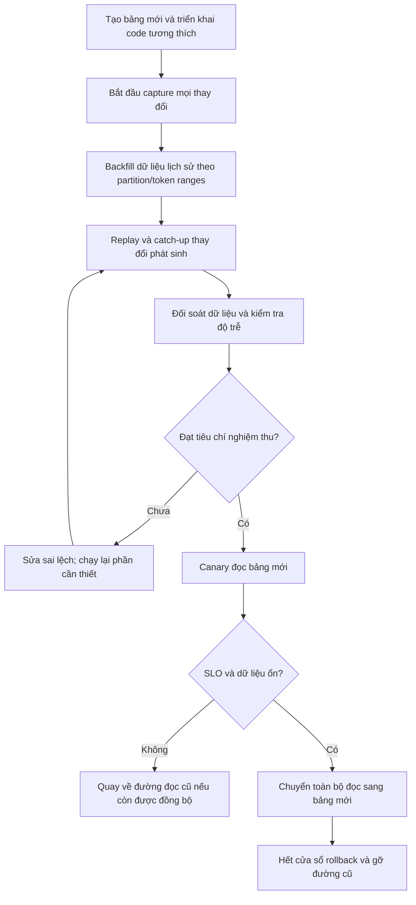
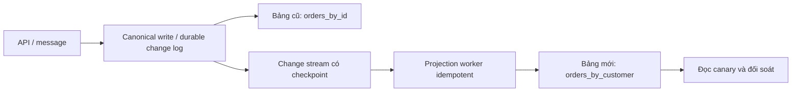

# Đổi primary key bằng bảng mới và quy trình di chuyển dữ liệu trong Spring Data Cassandra

Trong **Apache Cassandra**, primary key quyết định dữ liệu được phân vùng và sắp xếp trên cluster. Vì thế, khi ứng dụng **Spring Data Cassandra** đổi cách truy vấn, việc “sửa primary key của bảng đang chạy” không giống thao tác đổi khóa trong một cơ sở dữ liệu quan hệ. Cassandra không hỗ trợ sửa trực tiếp cấu trúc primary key hiện có bằng `ALTER TABLE`. Phương án thông dụng là **tạo bảng mới theo truy vấn mới, chuyển dữ liệu, chuyển đường đọc/ghi và chỉ gỡ bảng cũ khi đã kiểm chứng**.

Bài thuộc chương **Tiến hóa và di trú**, minh họa một lần đổi từ khóa `order_id` sang khóa phân vùng `customer_id`. Nội dung bao gồm thiết kế bảng theo truy vấn, ánh xạ entity của Spring Data Cassandra, repository / `CassandraTemplate` / CQL, partition key, paging, mức nhất quán, giới hạn hiệu năng và kế hoạch di chuyển dữ liệu có thể khôi phục khi gặp sự cố.

## 1. Vì sao phải tạo bảng mới?

### 1.1. Primary key là một phần của cấu trúc lưu trữ

CQL phân biệt:

- **Partition key**: xác định partition và các replica chịu trách nhiệm lưu dữ liệu. Một partition key có thể gồm một hay nhiều cột.
- **Clustering columns**: xác định vị trí và thứ tự của hàng **bên trong partition**.
- **Regular columns**: dữ liệu có thể được thay đổi theo quy tắc của Cassandra, nhưng không định vị partition/hàng.

Ví dụ:

```sql
CREATE TABLE orders_by_id (
    order_id uuid PRIMARY KEY,
    customer_id uuid,
    created_at timestamp,
    status text,
    version bigint
);
```

Bảng này được tối ưu cho:

```sql
SELECT order_id, customer_id, created_at, status, version
FROM orders_by_id
WHERE order_id = ?;
```

Khi UI cần “liệt kê các đơn mới nhất của một khách hàng”, câu truy vấn theo `customer_id` không phù hợp với partition key cũ. Không nên khắc phục bằng một truy vấn quét bảng kèm `ALLOW FILTERING` hoặc kỳ vọng thêm index sẽ luôn giải quyết tốt mọi mẫu truy vấn. Hãy thiết kế bảng theo nhu cầu đọc:

```sql
CREATE TABLE orders_by_customer (
    customer_id uuid,
    created_at timestamp,
    order_id uuid,
    status text,
    version bigint,
    PRIMARY KEY ((customer_id), created_at, order_id)
) WITH CLUSTERING ORDER BY (created_at DESC, order_id ASC);
```

Truy vấn mới:

```sql
SELECT created_at, order_id, status, version
FROM orders_by_customer
WHERE customer_id = ?;
```

`customer_id` là partition key; `created_at` và `order_id` là clustering columns. Có thể paging theo trình tự clustering mà không đọc toàn bộ cluster. Thêm `order_id` làm clustering column giúp phân biệt hai đơn cùng thời điểm.

**Điểm cần lưu ý:** trong ví dụ, bảng mới là **bảng phục vụ truy vấn thứ hai**; không nhất thiết phải bỏ bảng tra cứu đơn theo `order_id`. Nếu sản phẩm vẫn cần cả hai kiểu truy vấn, việc giữ hai bảng được cập nhật nhất quán về nghiệp vụ là một thiết kế denormalization thường gặp của Cassandra.

### 1.2. Kiểm tra partition mới trước khi migration

Chọn `customer_id` làm partition key chỉ hợp lý nếu kích thước partition nằm trong giới hạn vận hành. Với khách hàng có hàng triệu đơn, partition có thể quá lớn, gây chậm đọc, compaction và repair. Cân nhắc **time bucket**:

```sql
CREATE TABLE orders_by_customer_month (
    customer_id uuid,
    year_month text,
    created_at timestamp,
    order_id uuid,
    status text,
    version bigint,
    PRIMARY KEY ((customer_id, year_month), created_at, order_id)
) WITH CLUSTERING ORDER BY (created_at DESC, order_id ASC);
```

Đổi lại, ứng dụng phải biết các bucket cần đọc; không thể kỳ vọng một truy vấn `WHERE customer_id = ?` tự duyệt hết các tháng. Với nhu cầu “đơn 90 ngày gần nhất”, chọn ba hoặc bốn bucket liên quan và hợp nhất kết quả trong service có thể phù hợp hơn một partition vô hạn.

Khi lập kế hoạch, hãy viết rõ:

| Yếu tố | Cần xác định |
|---|---|
| Truy vấn mới | Tìm theo trường nào, khoảng thời gian nào, thứ tự nào, page size bao nhiêu? |
| Partition key | Phân phối tải có đều không? Có khách hàng / tenant nóng không? |
| Clustering key | Có duy nhất và ổn định không? Có hỗ trợ thứ tự đọc mong muốn không? |
| Dữ liệu cần lưu | Có cần toàn bộ cột cũ hay chỉ projection phục vụ truy vấn? |
| Quy tắc xóa, TTL | Hàng biến mất/đổi vị trí có được phản ánh ở bảng mới không? |
| Tải migration | Bao nhiêu row, bao nhiêu partition, ngân sách I/O và deadline? |

## 2. Thiết kế migration theo Expand → Migrate → Contract

Một lần đổi primary key an toàn thường gồm các pha sau:

| Pha | Dữ liệu và ứng dụng | Điều kiện chuyển pha |
|---|---|---|
| **Expand** | Tạo bảng mới, triển khai code hiểu cả schema cũ/mới; đường đọc vẫn ở bảng cũ. | Schema thống nhất trong cluster; đường cũ vẫn bình thường. |
| **Capture changes** | Bắt đầu ghi nhận thay đổi phát sinh sau mốc di chuyển (CDC, event log hoặc dual-write có cơ chế phục hồi). | Có offset/checkpoint tin cậy và không bỏ sót update/delete. |
| **Backfill** | Đọc dữ liệu lịch sử theo luồng, chuyển thành khóa mới và ghi idempotent. | Hoàn tất các phân đoạn và có thể chạy lại. |
| **Catch-up / Verify** | Phát lại các thay đổi trong thời gian backfill, so sánh source và target theo khóa nghiệp vụ. | Độ trễ replication theo ứng dụng đạt ngưỡng; sai lệch đã xử lý. |
| **Cutover** | Chuyển đọc dần sang bảng mới; theo dõi sai lệch, latency và lỗi. | Canary và kiểm chứng thực tế đạt yêu cầu. |
| **Contract** | Ngừng dùng schema cũ sau thời gian rollback và retention cần thiết. | Không còn caller/worker phụ thuộc bảng cũ; đã có backup và phương án khôi phục. |



Việc **bắt thay đổi trước khi backfill** là điểm then chốt: quá trình đọc dữ liệu lịch sử có thể kéo dài hàng giờ hoặc nhiều ngày. Nếu chỉ copy snapshot rồi chuyển đọc, những ghi/sửa/xóa xảy ra trong lúc copy sẽ không tự xuất hiện đầy đủ ở bảng mới.

## 3. Ánh xạ hai cấu trúc trong Spring Data Cassandra

Đừng đổi `@PrimaryKey` của entity đang dùng tại production rồi phát hành ngay khi bảng mới còn trống. Trong giai đoạn migration, ánh xạ **hai bảng bằng hai entity khác nhau** và giữ hai đường truy cập riêng để rollout có kiểm soát.

Ví dụ mô hình cho bảng mới sử dụng Spring Data Cassandra:

```java
import java.io.Serializable;
import java.time.Instant;
import java.util.UUID;

import org.springframework.data.cassandra.core.cql.Ordering;
import org.springframework.data.cassandra.core.cql.PrimaryKeyType;
import org.springframework.data.cassandra.core.mapping.Column;
import org.springframework.data.cassandra.core.mapping.PrimaryKey;
import org.springframework.data.cassandra.core.mapping.PrimaryKeyClass;
import org.springframework.data.cassandra.core.mapping.PrimaryKeyColumn;
import org.springframework.data.cassandra.core.mapping.Table;

@PrimaryKeyClass
public class OrderByCustomerKey implements Serializable {
    @PrimaryKeyColumn(
        name = "customer_id", ordinal = 0,
        type = PrimaryKeyType.PARTITIONED)
    private UUID customerId;

    @PrimaryKeyColumn(
        name = "created_at", ordinal = 1,
        type = PrimaryKeyType.CLUSTERED,
        ordering = Ordering.DESCENDING)
    private Instant createdAt;

    @PrimaryKeyColumn(
        name = "order_id", ordinal = 2,
        type = PrimaryKeyType.CLUSTERED,
        ordering = Ordering.ASCENDING)
    private UUID orderId;

    // Constructors, getters, equals và hashCode theo cả ba cột khóa.
}

@Table("orders_by_customer")
public class OrderByCustomer {
    @PrimaryKey
    private OrderByCustomerKey key;

    @Column("status")
    private String status;

    @Column("version")
    private Long version;

    // Constructors, getters và setters cho mapping framework.
}
```

Đoạn mã nêu cấu trúc chính; khi dùng thực tế, hoàn thiện constructor, accessor, `equals`/`hashCode` cho composite key và kiểm thử mapping. Tên annotation/import cần tương ứng phiên bản Spring Data đang dùng.

Repository mới có thể khai báo:

```java
import java.util.UUID;
import org.springframework.data.cassandra.repository.CassandraRepository;
import org.springframework.data.domain.Slice;
import org.springframework.data.domain.Pageable;

public interface OrderByCustomerRepository
        extends CassandraRepository<OrderByCustomer, OrderByCustomerKey> {
    Slice<OrderByCustomer> findByKeyCustomerId(UUID customerId, Pageable page);
}
```

Để đọc trang tiếp, dùng cơ chế Cassandra paging state thông qua `CassandraPageRequest` / `Slice.nextPageable()` đúng phiên bản Spring Data Cassandra; không mô phỏng offset tùy ý. Cần test truy vấn được suy diễn từ tên property `key.customerId` trên phiên bản repository cụ thể. Nếu cần kiểm soát CQL/CL/paging state tường minh, khai báo `@Query` đúng primary key hoặc dùng `CassandraTemplate` / `CqlSession`.

**Quản lý schema:** đặt migration CQL trong quy trình triển khai schema có phiên bản; chờ schema agreement trước khi phát traffic. Ở production, không bật chế độ tự động `DROP/RECREATE` bảng để sửa khóa, vì thao tác này có thể phá dữ liệu. `CREATE TABLE IF NOT EXISTS` chỉ tránh lỗi bảng đã tồn tại, **không xác minh schema thực tế khớp định nghĩa mong muốn**.

## 4. Đường ghi đồng thời: cần cơ chế chống mất thay đổi

### 4.1. Hai mô hình phổ biến

**Mô hình A — Event/CDC rồi tạo bảng mới bất đồng bộ.**

Ứng dụng ghi vào nguồn dữ liệu hiện tại và phát thay đổi qua một kênh **bền vững**: event log nghiệp vụ, transactional outbox có cơ chế phù hợp, hoặc CDC của Cassandra với pipeline được kiểm chứng cho phiên bản và hạ tầng đang dùng. Consumer ánh xạ event sang bảng mới, có checkpoint, retry và cơ chế phát lại.

**Mô hình B — Dual-write có đối soát.**

Trong một khoảng chuyển tiếp, service ghi cả bảng cũ và bảng mới. Đây là lựa chọn dễ hình dung nhưng hai lời gọi ghi **không tự có transaction giữa hai partition**. Request có thể ghi bảng cũ thành công rồi lỗi ở bảng mới, hoặc ngược lại. Vì vậy cần ghi nhận trạng thái/ý định đủ bền vững để khắc phục, không chỉ `try/catch` rồi bỏ qua.



Không có cơ chế nào tự cung cấp *exactly-once end-to-end* nếu nguồn và đích độc lập. Cách thiết kế thực tế là **at-least-once delivery + biến đổi idempotent + phát hiện sai khác**. Nếu dùng CDC, cần kiểm tra riêng khả năng giữ lại log, retention, bảo đảm thứ tự và xử lý mất kết nối của pipeline; không tự giả định mọi bản Cassandra đều có một CDC stream hoàn chỉnh sẵn dùng.

### 4.2. Ví dụ ghi projection từ một event ổn định

Giả sử `customer_id` và `created_at` bất biến đối với một đơn, event có `order_id`, `status` và `version`:

```java
import java.time.Instant;
import java.util.UUID;

import com.datastax.oss.driver.api.core.CqlSession;
import com.datastax.oss.driver.api.core.DefaultConsistencyLevel;
import com.datastax.oss.driver.api.core.cql.PreparedStatement;
import org.springframework.stereotype.Service;

@Service
public class OrderProjectionWriter {
    private final CqlSession session;
    private final PreparedStatement upsert;

    public OrderProjectionWriter(CqlSession session) {
        this.session = session;
        this.upsert = session.prepare(
            "INSERT INTO orders_by_customer " +
            "(customer_id, created_at, order_id, status, version) " +
            "VALUES (?, ?, ?, ?, ?)");
    }

    public void apply(
            UUID customerId, Instant createdAt, UUID orderId,
            String status, long version) {

        session.execute(
            upsert.bind(customerId, createdAt, orderId, status, version)
                .setConsistencyLevel(DefaultConsistencyLevel.LOCAL_QUORUM)
                .setIdempotent(true));
    }
}
```

Ví dụ này **chỉ an toàn khi các lần lặp cùng event giữ nguyên khóa và payload**, và không có event cũ bị phát lại sau event mới theo cách ghi đè trạng thái. `version` ở đây chỉ là một cột dữ liệu; Cassandra **không tự kiểm tra** `version` tăng dần trước khi upsert. Khi consumer có thể nhận sự kiện đảo thứ tự, cần một trong các cơ chế sau:

- Bảo đảm thứ tự theo `order_id` trong pipeline, kiểm soát replay và trạng thái đã áp dụng.
- Dùng **write timestamp do hệ thống quản lý** với quy tắc monotonic ổn định theo một khóa, kiểm thử kỹ tương tác tombstone, TTL, clock và tie-breaker; không tái tạo timestamp khác nhau cho cùng event.
- Dùng conditional update/LWT hoặc một phép kiểm tra phiên bản đủ rõ nếu chi phí và mô hình dữ liệu chấp nhận; không đặt `IF` tràn lan mà không tính toán contention.
- Duy trì nguồn chân lý với bản trạng thái cuối và cho worker **reconcile lại projection** từ nguồn đó khi phát hiện lệch, với giao thức tránh bản cũ ghi đè bản mới.

Không thể coi `.setIdempotent(true)` là cách giải quyết sắp xếp event. Thuộc tính này chỉ báo cho driver biết việc thực hiện lại **cùng statement** được ứng dụng đánh giá là an toàn; nó không tạo CAS, transaction hay kiểm tra phiên bản.

### 4.3. Đổi khóa, cập nhật và xóa

Với bảng mới, khóa gồm `customer_id`, `created_at`, `order_id`. Nếu một đơn chuyển sang customer khác hoặc thời điểm tạo được hiệu chỉnh, đó là **thay đổi vị trí hàng**, không phải update giá trị regular column.

Quy trình cần xác định:

1. Tìm/ghi nhớ **khóa cũ đầy đủ** của projection.
2. Xóa hàng ở khóa cũ và tạo hàng ở khóa mới.
3. Cho phép retry idempotent và đối soát khi một trong hai thao tác thất bại.
4. Chặn event cũ tái tạo hàng đã xóa ở khóa cũ bằng quy tắc version/tombstone phù hợp.

```sql
DELETE FROM orders_by_customer
WHERE customer_id = ?
  AND created_at = ?
  AND order_id = ?;

INSERT INTO orders_by_customer
    (customer_id, created_at, order_id, status, version)
VALUES (?, ?, ?, ?, ?);
```

Hai câu lệnh có thể chạm **hai partition** khác nhau; ghi riêng hoặc logged batch nhỏ có những đánh đổi riêng và không tạo isolation như transaction quan hệ. Đối với delete nghiệp vụ, pipeline phải phát một **sự kiện xóa** hoặc trạng thái terminal rõ ràng. Nếu chỉ backfill các row còn sống và bỏ qua delete, bản ghi đã xóa ở source có thể vẫn còn tại target.

## 5. Backfill lịch sử mà không gây quá tải Cassandra

### 5.1. Chia việc theo partition/token ranges

Backfill là công việc đọc một khối dữ liệu lớn, biến đổi mỗi row thành primary key mới và ghi sang bảng mới. **Không** tạo một lệnh `SELECT *` rồi gom toàn bộ bảng vào bộ nhớ ứng dụng. Có thể dùng công cụ chuyên dụng (như Spark Cassandra Connector, pipeline dữ liệu có khả năng checkpoint) hoặc các worker chia **token ranges**, có giới hạn concurrency và paging.

Với bảng source `orders_by_id` sử dụng partitioner Murmur3 thông dụng, một đoạn quét minh họa:

```sql
SELECT order_id, customer_id, created_at, status, version
FROM orders_by_id
WHERE token(order_id) > ?
  AND token(order_id) <= ?;
```

Đây là truy vấn **quét theo token** có chủ ý cho công việc offline migration. Nó khác truy vấn API thông thường theo partition key và không nên dùng để phục vụ giao diện người dùng. Giới hạn khoảng token và phân bổ worker cẩn thận; riêng khoảng qua điểm wrap-around của vòng token phải được chia thành các khoảng hợp lệ thay vì giả định một phép so sánh tuyến tính luôn bao trùm mọi token.

**Checkpoint:** lưu rõ trạng thái xử lý của từng token range và marker bền vững do hệ thống backfill sở hữu. Paging state của Java Driver là opaque, có ngữ cảnh truy vấn và có thể không tương thích lâu dài qua phiên bản/thay đổi topology; không xem nó là checkpoint có thể lưu vô hạn qua nhiều lần triển khai. Nếu job bị ngắt giữa khoảng, cách dễ chứng minh nhất là chạy lại **toàn bộ khoảng** với mutation idempotent và giới hạn kích thước khoảng hợp lý.

### 5.2. Luồng xử lý một khoảng token qua Java Driver

Ví dụ sau minh họa **một worker tuần tự**, không giữ tất cả row trong RAM. Trong production, nên dùng worker pool có backpressure, retry có giới hạn, checkpoint ở phạm vi token range và giám sát tải:

```java
import java.time.Instant;
import java.util.UUID;

import com.datastax.oss.driver.api.core.CqlSession;
import com.datastax.oss.driver.api.core.cql.AsyncResultSet;
import com.datastax.oss.driver.api.core.cql.PreparedStatement;
import com.datastax.oss.driver.api.core.cql.Row;

public final class OrdersBackfillRange {
    private final CqlSession session;
    private final OrderProjectionWriter projectionWriter;
    private final PreparedStatement scanRange;

    public OrdersBackfillRange(
            CqlSession session, OrderProjectionWriter projectionWriter) {
        this.session = session;
        this.projectionWriter = projectionWriter;
        this.scanRange = session.prepare(
            "SELECT order_id, customer_id, created_at, status, version " +
            "FROM orders_by_id " +
            "WHERE token(order_id) > ? AND token(order_id) <= ?");
    }

    public long migrateRange(long startExclusive, long endInclusive) {
        var statement = scanRange.bind(startExclusive, endInclusive)
            .setPageSize(500);

        AsyncResultSet page = session.executeAsync(statement)
            .toCompletableFuture()
            .join();

        long processed = 0;
        while (true) {
            for (Row row : page.currentPage()) {
                UUID orderId = row.getUuid("order_id");
                UUID customerId = row.getUuid("customer_id");
                Instant createdAt = row.getInstant("created_at");
                String status = row.getString("status");
                Long version = row.isNull("version")
                    ? null : row.getLong("version");

                // Cần quy tắc riêng cho dữ liệu thiếu trường khóa mới.
                if (customerId == null || createdAt == null ||
                    version == null) {
                    throw new IllegalStateException(
                        "Invalid source row: " + orderId);
                }

                projectionWriter.apply(
                    customerId, createdAt, orderId, status, version);
                processed++;
            }

            if (!page.hasMorePages()) {
                break;
            }
            page = page.fetchNextPage().toCompletableFuture().join();
        }
        return processed;
    }
}
```

**Giới hạn chủ ý của ví dụ:** xử lý đồng bộ từng row nên không phải mô hình throughput tối ưu; nó chỉ làm rõ cách duyệt nhiều trang và chuyển khóa. Đừng chạy các khoảng token tùy ý vô hạn song song. Nếu một row lỗi, cần ghi nhận vào **quarantine/dead-letter** hoặc dừng và sửa dữ liệu theo policy, không bỏ qua âm thầm. Trong môi trường thật, các lỗi tạm thời phải được retry có backoff, giữ nguyên dữ liệu nguồn và không phát sinh lỗi nguồn do quá tải.

### 5.3. Khối lượng và các chỉ số cần theo dõi

| Chỉ số | Công dụng |
|---|---|
| Token ranges hoàn tất / tổng | Tiến độ có thể tiếp tục sau restart. |
| Rows scanned, rows transformed, rows written | Phát hiện mất hàng do mapping/filter. |
| Rows invalid / quarantined | Theo dõi dữ liệu thiếu khóa mới, sai kiểu hoặc vi phạm quy tắc. |
| Read/write p95–p99, timeout, retry | Xem backfill có làm ảnh hưởng traffic chính không. |
| Pending compactions, disk I/O, CPU, GC, network | Xác định cluster đang bị quá tải. |
| Change stream lag / offset | Biết bảng mới đã gần bắt kịp ghi mới hay chưa. |
| Mismatch count và tuổi sai lệch | Đánh giá độ tin cậy của dữ liệu trước cutover. |

Giới hạn tốc độ backfill theo tải của cluster; có thể giảm concurrency vào giờ cao điểm. Tránh **batch lớn qua nhiều partition**: `BATCH` không phải công cụ bulk import, và logged batch tạo thêm chi phí batchlog. Khi ghi sang rất nhiều partition độc lập, dùng prepared statements, bounded concurrency và backpressure, trừ khi có yêu cầu atomicity cụ thể.

## 6. Các bẫy dữ liệu: TTL, tombstone, timestamp và thứ tự thay đổi

### 6.1. TTL và dữ liệu sắp hết hạn

Nếu bảng cũ dùng TTL, việc copy giá trị rồi ghi mới **không tự giữ thời điểm hết hạn cũ**. Ví dụ row chỉ còn 5 phút sống, trong khi worker ghi sang bảng mới với `USING TTL 86400` thì bản sao tồn tại thêm một ngày.

Đối với cột regular, Cassandra cho phép truy vấn metadata dạng:

```sql
SELECT order_id, status, TTL(status), WRITETIME(status)
FROM orders_by_id
WHERE order_id = ?;
```

`TTL(status)` thể hiện thời gian sống còn lại của giá trị có TTL và có thể trả `null` nếu cột không có TTL; `WRITETIME(status)` trả timestamp ghi của cột theo đơn vị microsecond khi có giá trị phù hợp. Không suy từ TTL của **một cột** rằng mọi cột/row có cùng chính sách hết hạn; không áp dụng trực tiếp các hàm này lên thành phần primary key. Đọc và ghi cách nhau thời gian đáng kể, do đó TTL còn lại cần được hiệu chỉnh hoặc giải quyết bằng **expireAt bất biến ở nghiệp vụ**.

Nếu yêu cầu bảo toàn lịch sử sống/chết nghiêm ngặt, cần thiết kế chính sách TTL/tombstone riêng và test trên dữ liệu sát thời điểm hết hạn; việc copy từ một snapshot đơn giản thường không đủ.

### 6.2. Delete có thể biến mất khỏi snapshot

Một lần quét bảng chỉ thấy các row đang đọc được. Nó **không cho biết đầy đủ tất cả các lần xóa** đã xảy ra trước đó. Nếu snapshot được copy rồi một delete diễn ra trong giai đoạn backfill, target phải nhận được sự kiện xóa sau mốc capture. Nếu delete bị bỏ sót, lần reconciliation dựa vào nguồn chân lý phải có khả năng phát hiện và xóa row dư ở bảng mới.

Trong Cassandra, delete sử dụng **tombstone** và timestamp để hòa giải ghi/xóa. Replay một upsert cũ với timestamp “mới hơn” có thể làm dữ liệu được tạo lại trái ý muốn. Không tự ý ép `USING TIMESTAMP` hoặc sắp xếp lại lịch sử event nếu chưa hiểu last-write-wins, clock skew, tombstone và đồng hồ của các writer.

### 6.3. Update đến không đúng thứ tự

Giả sử lịch sử đơn:

```text
v1: CREATED
v2: PAID
v3: SHIPPED
```

Nếu consumer xử lý `v3` rồi replay `v1` và cả hai đều dùng upsert mặc định, projection có nguy cơ kết thúc ở `CREATED`. Việc có cột `version=1` hoặc `version=3` không ngăn được lỗi này nếu không có **quy tắc ghi dựa trên version**.

Một quy trình đúng phải chỉ rõ:

- Nguồn chân lý lưu trạng thái nào và version nào.
- Cơ chế bảo toàn hoặc phục hồi thứ tự event trên **mỗi order_id**.
- Hành vi khi gặp event trùng, event cũ, event bị thiếu hoặc conflict.
- Cách xử lý timestamp, TTL và delete khi phát lại.
- Bảng mới được rebuild/đối soát thế nào nếu nhận nhầm một event.

LWT có thể được cân nhắc khi cần điều kiện cập nhật tuần tự trên **cùng partition**, nhưng có chi phí Paxos và không tự giải quyết giao dịch giữa bảng cũ, bảng mới và broker. Với các bảng projection độc lập, một nguồn event có thứ tự, idempotency và cơ chế rebuild thường dễ vận hành hơn việc cho mọi consumer tranh chấp bằng LWT.

## 7. Đối soát trước khi chuyển đường đọc

Không chỉ kiểm tra `COUNT(*)` trên hai bảng rồi kết luận migration thành công. Hai bảng có primary key khác nhau; tổng số row bằng nhau vẫn có thể **thiếu một đơn và thừa một đơn khác**. Với Cassandra, `COUNT(*)` toàn bảng lớn còn tạo tải không cần thiết.

Nên chia đối soát thành ba lớp:

### 7.1. Đối soát cấu trúc

- Bảng mới đã tồn tại và schema agreement đạt yêu cầu ở các node.
- Kiểu dữ liệu, partition/clustering key, thứ tự clustering và mapping Spring Data khớp truy vấn.
- Query plan không quét toàn cluster ở đường online; không dựa vào `ALLOW FILTERING` để phục vụ trang đơn hàng.
- Các customer lớn / partition nóng có giải pháp bucketing hoặc giới hạn truy cập.

### 7.2. Đối soát dữ liệu

Với tập source đã đóng băng tại watermark hoặc sau khi change stream bắt kịp:

1. Đọc từng `order_id` từ source theo các khoảng đã có checkpoint.
2. Tính **khóa đích**: `(customer_id, created_at, order_id)`.
3. Đọc đúng khóa đó từ target, đối chiếu `status`, `version` và các trường nghiệp vụ cần bảo toàn.
4. Tập hợp lỗi: source có mà target thiếu, target có nhưng source không có, payload khác, sai khóa do cập nhật customer/timestamp.
5. Kiểm tra xóa và TTL theo chính sách, tránh so sánh hai ảnh chụp ở thời điểm khác nhau như thể chúng là snapshot giao dịch.

Ví dụ câu truy vấn đối soát một hàng ở target:

```sql
SELECT status, version
FROM orders_by_customer
WHERE customer_id = ?
  AND created_at = ?
  AND order_id = ?;
```

Đối với target có thể còn **row dư** vì delete/di chuyển khóa, chỉ quét source không đủ. Cần thêm quy trình quét hoặc sample theo target, sau đó truy ngược `order_id` tại nguồn chân lý để phát hiện bản ghi mồ côi; với lượng dữ liệu lớn, dùng phân đoạn có checkpoint và giới hạn tải.

### 7.3. Đối soát hành vi ứng dụng

Đọc canary một tỷ lệ nhỏ người dùng và so sánh trả lời từ hai đường truy vấn (hoặc xác nhận tính đúng theo luật nghiệp vụ khi cách trả về khác nhau). So sánh:

- Danh sách `order_id` trong phạm vi thời gian đã xác định.
- Thứ tự `created_at DESC, order_id ASC` và ranh giới paging.
- Khách hàng không có đơn: kết quả rỗng, không rò rỉ partition khác.
- Đơn đổi trạng thái và đơn bị xóa trong lúc migration.
- p95/p99 latency, timeout, kích thước row/partition và áp lực trên cluster.

Chỉ khi dữ liệu và chỉ số vận hành đạt ngưỡng đã định mới chuyển thêm traffic. Nếu mục tiêu đọc khác với truy vấn cũ, cần thiết kế **oracle** đối soát độc lập chứ không so sánh hai API trả cấu trúc khác nhau một cách máy móc.

## 8. Cutover, quan sát và rollback

### 8.1. Feature flag cho đường đọc

Ứng dụng có thể giữ hai đường truy vấn:

```java
public interface OrderQueryService {
    // Đường đọc cũ theo orderId hoặc projection cũ tương ứng.
    OrderView findById(java.util.UUID orderId);
    // Đường đọc mới theo customerId với Cassandra paging.
    OrderSlice findRecentByCustomer(java.util.UUID customerId, String cursor);
}
```

Đây là **interface minh họa**; `OrderView` và `OrderSlice` là DTO do dự án định nghĩa. Điểm chính: luồng mới phải được cấu hình/feature-flag độc lập, có metrics và có cách quay về luồng cũ khi dữ liệu chưa đạt.

Kế hoạch canary:

1. Đọc bảng mới trong shadow mode, so với dữ liệu nguồn nhưng vẫn trả kết quả từ đường đang ổn định.
2. Bật cho một nhóm nhỏ người dùng/tenant, kiểm tra sai lệch và p95/p99.
3. Tăng tỷ lệ theo các mốc định trước, giữ đường cũ còn hoạt động trong cửa sổ rollback.
4. Chỉ chuyển tất cả traffic sau khi change stream lag thấp và không còn sai lệch nghiêm trọng.
5. Theo dõi liên tục trong thời gian quan sát sau cutover.

**Rollback không chỉ là đổi feature flag:** nếu ngừng cập nhật bảng cũ ngay khi cutover, quay về bảng cũ có thể làm mất các cập nhật mới. Chỉ coi rollback đường đọc là an toàn khi **bảng cũ vẫn còn được đồng bộ** hoặc đã có kế hoạch phát lại dữ liệu từ nguồn chân lý.

### 8.2. Khi nào được gỡ bảng cũ?

Chỉ thực hiện **Contract** khi:

- Tất cả version ứng dụng, job nền và consumer không còn dùng schema cũ.
- Quá trình đối soát đạt yêu cầu trong thời gian quan sát đủ dài.
- Cơ chế rollback hoặc phục hồi khác đã được kiểm chứng, hoặc thời hạn rollback đã kết thúc theo quyết định vận hành.
- Backup, retention, TTL, audit và khôi phục dữ liệu đáp ứng chính sách hệ thống.
- Có kế hoạch gỡ code cũ, schema cũ và dữ liệu cũ theo các lần triển khai tách biệt.

`DROP TABLE` là hành động phá dữ liệu, vì vậy không nằm trong một bước tự động “chuyển đọc thành công”. Quyết định hủy bảng phải được lên lịch và kiểm soát riêng.

## 9. Các tình huống kiểm thử migration bắt buộc

| Kịch bản | Kết quả mong đợi |
|---|---|
| Backfill 0 row | Worker kết thúc, không lỗi null/token, checkpoint hợp lệ. |
| Backfill nhiều trang, có nhiều partition | Không bỏ hàng hoặc nhân đôi; có thể chạy lại token range. |
| Hai đơn cùng `created_at` của một customer | Clustering key `order_id` phân biệt được hai hàng. |
| Một customer có partition rất lớn | Đo paging, latency, memory và quyết định bucket thích hợp. |
| Ghi mới giữa lúc backfill | Event/dual-write đưa hàng đến bảng mới; không phụ thuộc snapshot đã cũ. |
| Cập nhật trạng thái trong lúc backfill | Version/trật tự sự kiện giữ trạng thái cuối đúng, không ghi đè bởi snapshot cũ. |
| Xóa trong lúc backfill | Target không giữ row bị xóa sau khi catch-up và reconciliation. |
| Thay đổi `customer_id` hoặc `created_at` | Xóa khóa projection cũ, ghi khóa mới, không tạo row mồ côi. |
| Event nhận hai lần | Không tạo hai kết quả khác nhau, cursor và khóa giữ ổn định. |
| Event đến đảo thứ tự | Không bị rollback trạng thái mới bởi version cũ. |
| TTL sắp hết hạn | Không kéo dài sự tồn tại quá chính sách dữ liệu. |
| Cassandra mất node/timeout giữa backfill | Job retry có giới hạn, không bỏ checkpoint sai; trạng thái chưa xác định được đối soát. |
| Canary và rollback đường đọc | Dữ liệu vẫn đúng, bảng cũ còn cập nhật nếu dự định rollback. |

Kiểm thử tích hợp với Cassandra thật (ví dụ Testcontainers) phù hợp để xác minh CQL, mapping, paging, TTL và thao tác lặp; các kết luận về load/cụm nhiều node cần môi trường topology phù hợp. Đừng dùng một mock repository để khẳng định migration đã bảo toàn tính nhất quán phân tán.

### Kiểm tra điều kiện nhất quán

Nếu môi trường có RF=3 trong một datacenter, đọc và ghi `LOCAL_QUORUM` có thể là lựa chọn khi muốn tăng khả năng đọc thấy ghi vừa được xác nhận. Tuy vậy, **không có transaction bao trùm hai bảng** chỉ vì cả hai request đều dùng quorum. Cần xác minh đồng bộ theo nghiệp vụ, khả năng replay, idempotency và quy tắc timestamp/đồng thời.

## 10. Những sai lầm dễ gặp

**“Sửa `@PrimaryKey` trên entity là Cassandra tự đổi khóa.”** Mapping chỉ cho Spring biết cách biểu diễn schema. Nó không thay đổi phân bố dữ liệu cũ và không tạo lại hàng sang partition mới.

**“`ALTER TABLE` sẽ đổi partition key.”** Cassandra không cho sửa thành phần primary key kiểu này. Cần bảng mới và luồng dữ liệu.

**“Chạy `SELECT *` rồi `INSERT` là đủ.”** Truy vấn có thể rất lớn, chiếm bộ nhớ, không có checkpoint an toàn và bỏ sót update/delete trong lúc chạy.

**“Dual-write hai bảng sẽ thành công hoặc thất bại cùng lúc.”** Các ghi độc lập có thể hoàn tất một phần. Một logged batch nhỏ có bảo đảm áp dụng cuối cùng nhất định nhưng **không tạo isolation xuyên partition**, không giải quyết broker và hệ thống ngoài.

**“Có cột `version` là tự chống event cũ.”** Cassandra không kiểm tra thứ tự phiên bản nếu lệnh ghi không áp dụng quy tắc đó.

**“TTL mới đặt bằng TTL gốc là giữ nguyên ngày hết hạn.”** TTL chạy từ lần ghi mới; muốn giữ ngày hết hạn phải tính thời gian sống còn lại hoặc lưu expiry nghiệp vụ.

**“Đối chiếu số hàng bằng nhau là xong.”** Hai tập có thể thiếu và thừa khác nhau nhưng cùng tổng. Cần kiểm tra theo khóa và nội dung.

**“Cutover xong có thể xóa bảng cũ ngay.”** Điều này phá cửa sổ rollback và có thể làm mất nguồn đối soát/khôi phục.

## 11. Checklist trước khi chuyển production

- [ ] Đã xác định đầy đủ truy vấn mới, partition/clustering key, thứ tự và paging.
- [ ] Đã đánh giá kích thước partition/hot key, bucket và mức nhất quán thích hợp.
- [ ] Có bảng mới và entity/repository/template mapping riêng; không phá schema cũ.
- [ ] Schema migration có version, kiểm tra schema agreement và rollback triển khai code.
- [ ] Bắt thay đổi trước backfill với offset/checkpoint bền vững; xử lý được update và delete.
- [ ] Backfill dùng token ranges, paging, bounded concurrency và retry idempotent; có tiến độ và dead-letter/quarantine.
- [ ] Quy tắc event ordering, version và timestamp ngăn ghi cũ đè lên ghi mới.
- [ ] Đã làm rõ chính sách TTL/tombstone, delete và cập nhật các cột cấu thành khóa mới.
- [ ] Có đối soát theo khóa nghiệp vụ (cả row thiếu, row dư, payload khác), không chỉ `COUNT(*)`.
- [ ] Canary/read shadow có dashboard sai lệch, latency, error rate, migration lag và ngưỡng dừng.
- [ ] Rollback thực sự an toàn nhờ đường cũ còn đồng bộ hoặc có kế hoạch replay dữ liệu.
- [ ] Có bài test cho dữ liệu rỗng, đa trang, replay, ghi cạnh tranh, timeout, xóa và TTL.
- [ ] Chỉ lên lịch gỡ bảng cũ khi mọi caller đã rời đi và hết cửa sổ phục hồi.

**Kết luận:** Đổi primary key trong **Spring Data Cassandra** là một lần **chuyển mô hình dữ liệu và luồng truy cập**, không phải thao tác sửa annotation hay schema tại chỗ. Phương án bền vững là **thiết kế bảng mới theo truy vấn → bắt thay đổi → backfill có checkpoint → đồng bộ và đối soát → cutover từng bước → giữ khả năng rollback → gỡ bảng cũ có kiểm soát**. Toàn bộ quá trình phải tính đến partition key, consistency level, paging, idempotency và chi phí vận hành của Cassandra như một hệ dữ liệu phân tán.
