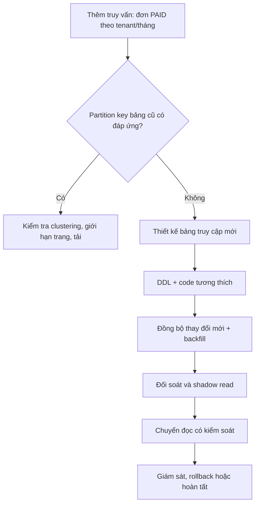
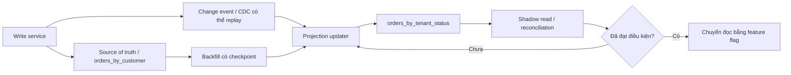

# Thay đổi mẫu truy vấn và tạo bảng truy cập mới

Trong **Spring Data Cassandra**, bảng thường được thiết kế để phục vụ **một nhóm truy vấn cụ thể**. Giả sử hệ thống ban đầu chỉ hiển thị đơn hàng theo khách hàng, nhưng sau một thời gian bộ phận vận hành cần xem tất cả đơn ở trạng thái `PAID` theo thời gian trong từng tenant. Truy vấn mới không phù hợp partition key của bảng cũ. Cố thêm một phương thức `Repository` hoặc dùng `ALLOW FILTERING` không làm thay đổi cách Cassandra phân phối dữ liệu; đây là tình huống cần **tiến hóa mô hình đọc** bằng một bảng truy cập mới.

Bài thuộc chương **Tiến hóa và di trú** của module `SPRING_DATA_CASSANDRA`. Nội dung hướng dẫn nhận diện thay đổi mẫu truy vấn, thiết kế bảng denormalized theo partition key và clustering key, kết nối entity/repository/CassandraTemplate với bảng mới, đưa dữ liệu quá khứ sang bảng mới, đồng bộ dữ liệu phát sinh, chuyển lưu lượng đọc có kiểm soát và xử lý rollback. Các ví dụ sử dụng CQL cùng Apache Cassandra Java Driver 4.x và Spring Data Cassandra; chi tiết API và khả năng triển khai cần được đối chiếu với phiên bản dự án.

## 1. Vì sao thay đổi truy vấn thường dẫn đến bảng mới?

Cassandra tối ưu khi yêu cầu đọc được định tuyến tới **partition** cần thiết. Partition key quyết định dữ liệu được phân phối tới nhóm replica nào; clustering key quyết định thứ tự trong partition. Một bảng được tổ chức theo `customer_id` không tự nhiên phục vụ truy vấn cần tìm mọi đơn theo `status` trên hàng nghìn khách hàng.

| Truy vấn nghiệp vụ | Bảng phù hợp | Khóa dẫn hướng truy vấn |
| --- | --- | --- |
| Liệt kê đơn của một khách hàng theo thời gian | `orders_by_customer` | `(tenant_id, customer_id)` |
| Liệt kê đơn trạng thái `PAID` trong tháng của một tenant | `orders_by_tenant_status` | `(tenant_id, status, month_bucket)` |
| Tra cứu một đơn bằng `order_id` không biết khách hàng | Có thể cần `orders_by_id` | `order_id` hoặc `(tenant_id, order_id)` |

Các bảng này có thể **lặp dữ liệu có chủ đích**. Đó là mô hình *query-based denormalization*: lưu một bản ghi theo nhiều cách truy cập để mỗi truy vấn quan trọng có đường đọc dự đoán được. Điểm đánh đổi là một thay đổi nghiệp vụ có thể phải cập nhật nhiều bảng; Cassandra **không tự bảo đảm** mọi bản sao truy cập luôn đồng bộ ngay lập tức.



## 2. Bảng cũ và yêu cầu truy vấn mới

Giả sử ứng dụng dùng keyspace `commerce_app`, có bảng:

```sql
CREATE TABLE commerce_app.orders_by_customer (
    tenant_id uuid,
    customer_id uuid,
    created_at timestamp,
    order_id uuid,
    status text,
    total decimal,
    PRIMARY KEY ((tenant_id, customer_id), created_at, order_id)
)
WITH CLUSTERING ORDER BY (created_at DESC, order_id ASC);
```

Truy vấn hiện tại rất phù hợp với khóa chính:

```sql
SELECT order_id, created_at, status, total
FROM commerce_app.orders_by_customer
WHERE tenant_id = ? AND customer_id = ?
LIMIT 50;
```

Yêu cầu mới là: **“Trong tenant T, hiển thị 50 đơn `PAID` mới nhất của tháng 11/2026, không phụ thuộc khách hàng.”** Một truy vấn dạng sau không có điều kiện đầy đủ cho partition key của bảng cũ:

```sql
-- Không phải đường truy cập phù hợp cho bảng orders_by_customer:
SELECT order_id, created_at, total
FROM commerce_app.orders_by_customer
WHERE tenant_id = ? AND status = 'PAID';
```

Với bảng cũ, `tenant_id` chỉ là **một phần của partition key ghép** `(tenant_id, customer_id)`. Cassandra không có một partition chung chứa tất cả khách của tenant. Thêm `ALLOW FILTERING` có thể dẫn đến quét một lượng lớn dữ liệu, khó dự đoán độ trễ, tăng tải và có thể bị từ chối nếu không chỉ rõ phương án truy vấn hợp lệ. Không nên dùng nó làm chiến lược di trú cho endpoint quan trọng.

### Đặc tả truy vấn trước khi thiết kế schema

| Câu hỏi cần chốt | Ví dụ trả lời |
| --- | --- |
| Ai gọi và theo chiều dữ liệu nào? | Trang quản trị theo `tenant_id`, `status`, tháng. |
| Có giới hạn thời gian không? | Một tháng hoặc khoảng tháng được chỉ định. |
| Trả bao nhiêu hàng/trang? | 50 hàng/trang, thường xem trang đầu tiên. |
| Thứ tự yêu cầu? | `created_at DESC`; `order_id` làm khóa phân biệt khi trùng thời gian. |
| Trạng thái có thay đổi không? | Có: `CREATED → PAID → SHIPPED → CANCELLED` theo quy tắc nghiệp vụ. |
| Quy mô? | Tenant lớn có thể tạo hàng triệu đơn/tháng. |
| Mức nhất quán? | Ví dụ danh sách quản trị chấp nhận trễ cập nhật ngắn; cần ghi rõ SLO đồng bộ. |

Không có câu trả lời chung rằng một partition theo tháng là đủ nhỏ: **ước lượng phân bố tenant/status/tháng bằng dữ liệu thực**, theo dõi partition lớn và hot key trước khi chọn kích thước bucket.

## 3. Thiết kế bảng truy cập mới theo truy vấn

Một thiết kế ban đầu có thể là:

```sql
CREATE TABLE IF NOT EXISTS commerce_app.orders_by_tenant_status (
    tenant_id uuid,
    status text,
    month_bucket text,
    created_at timestamp,
    order_id uuid,
    customer_id uuid,
    total decimal,
    PRIMARY KEY ((tenant_id, status, month_bucket), created_at, order_id)
)
WITH CLUSTERING ORDER BY (created_at DESC, order_id ASC);
```

Truy vấn mới sử dụng **đầy đủ partition key**:

```sql
SELECT order_id, customer_id, created_at, total
FROM commerce_app.orders_by_tenant_status
WHERE tenant_id = ?
  AND status = ?
  AND month_bucket = ?
LIMIT 50;
```

Trong ví dụ, `month_bucket` là chuỗi dạng `YYYY-MM` được tính từ `created_at` theo **UTC**, chẳng hạn `2026-11`. Ứng dụng phải dùng cùng một cách tính khi **ghi**, **đọc** và **xóa** hàng. Nếu mỗi service dùng múi giờ khác nhau, cùng một đơn sát ranh giới tháng có thể bị ghi và truy vấn ở hai bucket khác nhau.

| Thành phần khóa | Công dụng | Lưu ý |
| --- | --- | --- |
| `(tenant_id, status, month_bucket)` | Định tuyến truy vấn đúng partition | Phải truyền đủ ba thành phần. Một trạng thái phổ biến của tenant lớn có thể vẫn tạo partition nóng. |
| `created_at DESC` | Đọc đơn mới trước trong partition | Không cần sắp xếp toàn cluster. |
| `order_id ASC` | Phân biệt đơn có cùng timestamp | Giúp thứ tự ổn định trong partition; phải đưa vào logic phân trang nếu dùng cursor tự thiết kế. |
| `customer_id`, `total` | Dữ liệu hiển thị sao chép từ nguồn | Mỗi thay đổi liên quan cần cơ chế đồng bộ. |

`created_at` là thuộc tính bất biến của đơn trong ví dụ; nếu ứng dụng cho phép sửa, cập nhật khóa chính Cassandra tương đương **xóa hàng theo khóa cũ và chèn hàng theo khóa mới**. Điều này cũng đúng khi `status` thay đổi vì `status` nằm trong **partition key** của bảng truy cập mới.

### Bucket và nguy cơ hot partition

Bucket tháng giúp giới hạn khoảng thời gian mỗi partition, nhưng không bảo đảm kích thước an toàn. Nếu `PAID` chiếm phần lớn đơn của một tenant lớn, một partition `(tenant_id, PAID, 2026-11)` vẫn có thể rất rộng và có tải tập trung. Khi đó có thể cân nhắc bucket theo **ngày**, bucket bổ sung theo **shard** có quy tắc deterministic, hoặc thiết kế bảng khác. Đổi lại, đọc toàn bộ khoảng thời gian cần fan-out sang nhiều partition rồi hợp nhất kết quả ở ứng dụng. Quyết định phải dựa trên SLO đọc, tốc độ ghi, phân bố dữ liệu và chi phí vận hành, không chỉ số hàng trung bình.

## 4. So sánh tạo bảng mới với những lựa chọn khác

| Phương án | Điểm mạnh | Giới hạn cần đánh giá |
| --- | --- | --- |
| **Bảng truy cập mới** | Đường đọc theo partition key rõ ràng, kiểm soát thứ tự/paging và dữ liệu phục vụ UI | Tốn lưu trữ, cần duy trì đồng bộ/backfill và xử lý xóa/chuyển trạng thái. |
| **Secondary index / SAI** (nếu phiên bản hỗ trợ) | Hỗ trợ một số kiểu predicate mà không phải tự duy trì mọi bảng | Phạm vi tính năng, độ chọn lọc, fan-out, chi phí index và SLA tùy phiên bản/workload; không mặc nhiên giải quyết mọi truy vấn. |
| **Materialized view** | Cassandra quản lý một phần cập nhật view theo định nghĩa | Có ràng buộc về khóa, thuộc tính, trạng thái tính năng và chi phí vận hành; phải đánh giá với phiên bản/cluster cụ thể. |
| **`ALLOW FILTERING`** | Có thể hữu ích cho thăm dò có kiểm soát trên dữ liệu nhỏ | Dễ tạo truy vấn scan khó dự đoán, không phù hợp làm giải pháp mặc định cho tải production. |

Khi access pattern mới là tính năng nghiệp vụ trọng yếu, yêu cầu phân trang theo thời gian ổn định và có đường đọc rõ ràng, **bảng truy cập riêng** thường là lựa chọn đáng cân nhắc. Tuy vậy, không có nghĩa phải tạo bảng mới cho mọi filter. Trước tiên cần xác định tỷ lệ sử dụng, độ chọn lọc, kích thước dữ liệu và khả năng tối ưu bằng cơ chế được Cassandra hỗ trợ trong hệ đang vận hành.

## 5. Tích hợp bảng mới với Spring Data Cassandra

Trong Spring Data Cassandra, có thể ánh xạ bảng mới sang một entity riêng. Ví dụ dưới đây mô tả chính xác **partition key ghép** và **clustering key** để tránh nhầm lẫn giữa bảng cũ và bảng mới:

```java
import java.io.Serializable;
import java.math.BigDecimal;
import java.time.Instant;
import java.util.UUID;

import org.springframework.data.cassandra.core.cql.Ordering;
import org.springframework.data.cassandra.core.mapping.Column;
import org.springframework.data.cassandra.core.mapping.PrimaryKey;
import org.springframework.data.cassandra.core.mapping.PrimaryKeyClass;
import org.springframework.data.cassandra.core.mapping.PrimaryKeyColumn;
import org.springframework.data.cassandra.core.mapping.PrimaryKeyType;
import org.springframework.data.cassandra.core.mapping.Table;

@PrimaryKeyClass
public class OrderStatusKey implements Serializable {
    @PrimaryKeyColumn(name = "tenant_id", ordinal = 0,
                      type = PrimaryKeyType.PARTITIONED)
    private UUID tenantId;

    @PrimaryKeyColumn(name = "status", ordinal = 1,
                      type = PrimaryKeyType.PARTITIONED)
    private String status;

    @PrimaryKeyColumn(name = "month_bucket", ordinal = 2,
                      type = PrimaryKeyType.PARTITIONED)
    private String monthBucket;

    @PrimaryKeyColumn(name = "created_at", ordinal = 3,
                      type = PrimaryKeyType.CLUSTERED,
                      ordering = Ordering.DESCENDING)
    private Instant createdAt;

    @PrimaryKeyColumn(name = "order_id", ordinal = 4,
                      type = PrimaryKeyType.CLUSTERED,
                      ordering = Ordering.ASCENDING)
    private UUID orderId;

    // Constructor, getter/setter, equals/hashCode cho value object khóa chính.
}

@Table("orders_by_tenant_status")
public class OrderByTenantStatus {
    @PrimaryKey
    private OrderStatusKey key;

    @Column("customer_id")
    private UUID customerId;

    @Column("total")
    private BigDecimal total;

    // Constructor, getter/setter theo cơ chế mapping dự án sử dụng.
}
```

Đây là **khung entity minh họa**; cần bổ sung constructors/getters/setters và triển khai value-object `equals/hashCode` đúng quy ước dự án. Với Spring Data Cassandra, `@PrimaryKeyColumn` cung cấp thông tin partition/clustering cho mapping nhưng **không tạo ra khả năng truy vấn mới nếu Cassandra chưa có bảng tương ứng**. CQL DDL nên do migration được kiểm soát tạo trước khi code mới đọc bảng.

Nếu không muốn dùng derived query name dài và khó kiểm chứng, có thể tạo repository với câu CQL tường minh:

```java
import java.util.List;
import java.util.UUID;
import org.springframework.data.cassandra.repository.CassandraRepository;
import org.springframework.data.cassandra.repository.Query;
import org.springframework.data.repository.query.Param;

public interface OrderStatusRepository
        extends CassandraRepository<OrderByTenantStatus, OrderStatusKey> {

    @Query("""
        SELECT * FROM orders_by_tenant_status
        WHERE tenant_id = :tenantId
          AND status = :status
          AND month_bucket = :monthBucket
        LIMIT 50
        """)
    List<OrderByTenantStatus> findFirstPage(
        @Param("tenantId") UUID tenantId,
        @Param("status") String status,
        @Param("monthBucket") String monthBucket);
}
```

**Lưu ý quan trọng về paging:** phương thức trả `List` với `LIMIT 50` mô tả phần kết quả đầu theo truy vấn. Tùy API/framework, nhiều trang và paging state cần được hỗ trợ bằng `Slice`/paging abstraction hoặc gọi trực tiếp `CqlSession` để kiểm soát rõ `pageSize`, `pagingState` và thời điểm fetch. Không nên coi `List` trên là giải pháp truy cập mọi trang hay tính tổng số đơn. Ngoài ra, named parameter trong `@Query` phụ thuộc phiên bản/cấu hình Spring Data Cassandra; nếu mapping tham số không được hỗ trợ như ví dụ, dùng positional bind markers `?0`, `?1`, `?2` theo phiên bản đang dùng.

Một lựa chọn dễ kiểm soát khi thay đổi schema là đặt lớp gateway `CqlSession` hoặc `CassandraTemplate` có interface rõ ràng, để feature flag có thể chọn bảng cũ hay mới mà không làm endpoint phụ thuộc trực tiếp vào tên bảng.

## 6. Một truy vấn Java Driver có phân trang

Khi dùng trực tiếp Java Driver để nhận paging state, các tham số cần được bind (không ghép chuỗi chứa giá trị do client cung cấp):

```java
import com.datastax.oss.driver.api.core.CqlSession;
import com.datastax.oss.driver.api.core.cql.ResultSet;
import com.datastax.oss.driver.api.core.cql.SimpleStatement;
import java.util.UUID;

public final class StatusQueryGateway {
    private final CqlSession session;

    public StatusQueryGateway(CqlSession session) {
        this.session = session;
    }

    public ResultSet queryBucket(UUID tenantId, String status, String monthBucket) {
        SimpleStatement statement = SimpleStatement.builder("""
                SELECT order_id, customer_id, created_at, total
                FROM orders_by_tenant_status
                WHERE tenant_id = ? AND status = ? AND month_bucket = ?
                """)
            .addPositionalValues(tenantId, status, monthBucket)
            .setPageSize(50)
            .setIdempotent(true)
            .build();

        return session.execute(statement);
    }
}
```

`setPageSize(50)` yêu cầu driver lấy khoảng 50 hàng mỗi trang, **không tự giới hạn toàn bộ kết quả còn đúng 50 hàng**; `ResultSet` đồng bộ có thể tự fetch trang tiếp theo khi iteration đi hết trang hiện tại. Nếu chỉ cần trang đầu, giới hạn vòng lặp tiêu thụ ở 50 hàng và xem paging state theo `ExecutionInfo`/API phiên bản tương ứng. Với nhiều request phân trang, paging state chỉ dùng trong **ngữ cảnh cùng câu truy vấn và cùng tập tham số**, không được dùng như token tùy ý sửa được hoặc áp vào truy vấn khác.

Nếu giao diện yêu cầu lấy những đơn `PAID` mới nhất **qua nhiều tháng**, ứng dụng phải truy vấn nhiều `month_bucket` và hợp nhất kết quả theo thứ tự. Cassandra không thực hiện một phép `ORDER BY` xuyên các partition khác nhau cho bạn. Cần thiết kế cursor chứa bucket hiện tại, vị trí và chiến lược xử lý bản ghi mới phát sinh; không suy ra một paging state Cassandra duy nhất có thể đi xuyên nhiều bucket.

## 7. Quy trình di trú: mở rộng, đồng bộ, backfill, chuyển đọc

Di trú access pattern thường là **thay đổi dữ liệu và luồng xử lý**, không đơn thuần là chạy `CREATE TABLE`. Một kế hoạch triển khai an toàn thường có các pha:

| Pha | Thực hiện | Điều kiện chuyển pha |
| --- | --- | --- |
| 1. **Expand** | Tạo bảng mới bằng migration, xác minh schema agreement và quyền truy cập | Bảng/khóa/cột khớp DDL, runtime có quyền cần thiết. |
| 2. **Capture changes** | Triển khai đường đồng bộ mọi ghi mới/sửa/xóa có thể ảnh hưởng bảng mới | Thay đổi được ghi nhận bền vững và xử lý lại được; đo độ trễ đồng bộ. |
| 3. **Backfill** | Chuyển dữ liệu quá khứ từ nguồn thẩm quyền qua pipeline có checkpoint | Tiến độ quan sát được; có cơ chế chạy lại và sửa sai. |
| 4. **Reconcile** | Đối soát hàng, trạng thái, giá trị, TTL và dữ liệu stale | Sai lệch đạt ngưỡng chấp nhận công bố. |
| 5. **Shadow read** | Đọc bảng mới ở chế độ kiểm tra, chưa dùng làm câu trả lời chính | Độ chính xác/paging/latency đáp ứng tiêu chí. |
| 6. **Cutover** | Chuyển dần endpoint sang bảng mới qua feature flag | Giám sát lỗi, `p95/p99`, kết quả và replication lag. |
| 7. **Contract** | Dọn code và bảng truy cập không còn cần thiết, sau thời gian quan sát | Đã chắc chắn không còn reader/writer phụ thuộc bảng đó. |



Trong pha transition, vẫn giữ bảng cũ phục vụ đường đọc cũ. Không dừng cập nhật bảng cũ ngay khi bảng mới bắt đầu nhận dữ liệu; nó có thể vẫn là nguồn thẩm quyền cho những truy vấn hiện hữu hoặc quá trình phục hồi.

## 8. Đồng bộ thay đổi mới: trường hợp khó là đổi `status`

Vì `status` nằm trong partition key của bảng mới, cập nhật `CREATED` thành `PAID` không phải chỉ `UPDATE status` của hàng index. Cần **xóa hàng ở partition trạng thái cũ** và **thêm hàng ở partition trạng thái mới**.

Ví dụ với một đơn có `created_at` ở tháng `2026-11`:

```sql
-- Hàng nguồn dùng khóa chính cũ; chỉ status là thuộc tính có thể cập nhật:
UPDATE commerce_app.orders_by_customer
SET status = 'PAID'
WHERE tenant_id = 2b06b38a-3d2c-4aad-93c2-95bd8bac960b
  AND customer_id = 1eb1930a-8524-4bb0-afd4-8a8b567c9cea
  AND created_at = '2026-11-20T08:30:00Z'
  AND order_id = 0b9f0fb9-195f-47d3-9485-480b3cf9d395;

-- Xóa bản truy cập ở trạng thái cũ:
DELETE FROM commerce_app.orders_by_tenant_status
WHERE tenant_id = 2b06b38a-3d2c-4aad-93c2-95bd8bac960b
  AND status = 'CREATED'
  AND month_bucket = '2026-11'
  AND created_at = '2026-11-20T08:30:00Z'
  AND order_id = 0b9f0fb9-195f-47d3-9485-480b3cf9d395;

-- Chèn bản truy cập theo trạng thái mới:
INSERT INTO commerce_app.orders_by_tenant_status
    (tenant_id, status, month_bucket, created_at,
     order_id, customer_id, total)
VALUES (
    2b06b38a-3d2c-4aad-93c2-95bd8bac960b,
    'PAID', '2026-11', '2026-11-20T08:30:00Z',
    0b9f0fb9-195f-47d3-9485-480b3cf9d395,
    1eb1930a-8524-4bb0-afd4-8a8b567c9cea,
    125.50
);
```

Các câu CQL trên minh họa **hiệu ứng cần đạt**, không phải một giao dịch nguyên tử xuyên hai bảng. Nếu service lỗi sau khi cập nhật nguồn nhưng trước khi cập nhật bảng mới, người dùng có thể thấy trạng thái cũ hoặc thiếu đơn trong danh sách mới. Nếu event `PAID` được xử lý trước event `CREATED` do consumer chạy lại/trễ, một hàng index cũ có thể xuất hiện lại.

### Vì sao không chỉ dùng dual-write đồng bộ trong request?

Gửi liên tiếp hai lệnh từ một phương thức service dễ triển khai, nhưng vẫn có **cửa sổ lỗi** khi lệnh đầu thành công và lệnh sau timeout/thất bại. Client retry không thể suy ra lệnh trước chắc chắn chưa được áp dụng. Batch giữa nhiều partition cũng không biến toàn bộ luồng nghiệp vụ thành một giao dịch cách ly theo kiểu database quan hệ; không giả định reader sẽ thấy mọi bảng cập nhật đồng thời.

Cần thiết kế **mô hình phục hồi** phù hợp: một luồng thay đổi bền vững có thể replay (CDC, hệ thống sự kiện có outbox bảo đảm bởi nguồn thẩm quyền, hoặc cơ chế tương đương), consumer cập nhật projection idempotent, retry có kiểm soát và công việc đối soát. Nếu tự dùng một bảng outbox Cassandra riêng, phải giải quyết vấn đề ghi nguồn và ghi outbox có thể thất bại lệch nhau; **tạo thêm bảng outbox không tự mang lại atomicity**.

### Dùng sự kiện có version và handler idempotent

Một event chuẩn hóa có thể chứa:

```json
{
  "event_id": "fa99a884-e47e-4761-a8cf-349064d09536",
  "order_id": "0b9f0fb9-195f-47d3-9485-480b3cf9d395",
  "tenant_id": "2b06b38a-3d2c-4aad-93c2-95bd8bac960b",
  "customer_id": "1eb1930a-8524-4bb0-afd4-8a8b567c9cea",
  "created_at": "2026-11-20T08:30:00Z",
  "old_status": "CREATED",
  "new_status": "PAID",
  "version": 12
}
```

`version` phải được cấp theo **một nguồn thứ tự có thể tin cậy trên từng order**, không đơn thuần là thời điểm nhận event của consumer. Handler cần xử lý trường hợp event lặp, event đảo thứ tự, trạng thái cũ không còn tồn tại và dữ liệu thiếu. Một cơ chế là ghi/kiểm tra version theo order tại projection worker và chỉ chấp nhận thay đổi mới hơn; nếu nhiều consumer có thể cập nhật cùng order, cơ chế kiểm tra này phải an toàn trước cập nhật đồng thời (qua thiết kế thứ tự xử lý theo key, CAS/LWT thích hợp hoặc một nguồn phối hợp đáng tin cậy).

Cassandra sử dụng timestamp và quy tắc phân giải xung đột ở mức cell/tombstone; **đừng coi last-write-wins theo clock của coordinator là cơ chế kiểm tra version nghiệp vụ**. Replay event cũ với timestamp mới có thể làm sống lại trạng thái cũ. Nếu thay đổi đã được xử lý nhiều lần, các lệnh `DELETE` theo **đúng khóa**, `INSERT` với cùng nội dung và quy tắc version/TTL ổn định phải tạo trạng thái cuối tương đương một lần xử lý.

## 9. Backfill dữ liệu quá khứ mà không chặn traffic

Sau khi tạo bảng mới, dữ liệu có từ trước **không tự xuất hiện** ở bảng mới. Backfill phải lấy dữ liệu từ nguồn thẩm quyền, chuyển sang partition key mới và ghi vào projection.

Phương pháp tùy khối lượng dữ liệu:

| Quy mô và khả năng truy cập nguồn | Cách triển khai |
| --- | --- |
| Biết tập `tenant_id/customer_id` cần chuyển, tập dữ liệu nhỏ | Đọc từng partition cũ, phân trang có giới hạn, map và ghi bảng mới. |
| Khối lượng lớn ở nhiều partition, có hạ tầng dữ liệu | Dùng job phân tán/connector/ingestion phù hợp Cassandra và token range, giới hạn throughput. |
| Hệ thống đã có nguồn sự kiện hoặc snapshot chuẩn | Khôi phục/snapshot cộng replay các thay đổi sau mốc nhất quán. |

Không viết job production chỉ chạy `SELECT * FROM orders_by_customer` rồi đọc toàn bộ vào RAM. Cassandra cần có kế hoạch scan/partition rõ ràng, phân trang, phân luồng và tác động lên replica. Nếu đọc theo `customer_id`, phải có cách **liệt kê đầy đủ** các partition cần backfill; không thể giả định có sẵn danh sách khách hàng chỉ từ bảng `orders_by_customer` nếu hệ thống không quản lý danh sách đó.

Một backfill đủ tin cậy cần:

1. **Checkpoint** theo tenant/partition, token range hoặc lô xử lý, có khả năng resume và chạy lại.
2. **Bounded concurrency/rate limit** để tránh tranh I/O, CPU và compaction với traffic thật.
3. **Deterministic transform**: bucket theo UTC, giữ nguyên `order_id`, `created_at` và các thuộc tính được duyệt.
4. **Idempotence**: chạy lại một lô không tạo nhiều hàng với khóa khác nhau hay ghi sai state.
5. **Watermark/catch-up**: ghi nhận mốc snapshot và xử lý mọi thay đổi phát sinh trong lúc scan.
6. **Reconciliation**: so sánh dữ liệu sau backfill thay vì chỉ nhìn số dòng đã ghi.

### Tránh backfill ghi đè thay đổi mới

Ví dụ job đọc trạng thái `CREATED` lúc 08:00, trong khi đơn chuyển sang `PAID` lúc 08:01. Nếu lúc 08:05 job mới chèn hàng `CREATED` vào bảng mới, kết quả có thể xuất hiện **cả đơn `CREATED` lẫn `PAID`**. Không thể sửa bằng cách tăng consistency level khi đọc snapshot.

Cách giải quyết phải thuộc thiết kế pipeline: sử dụng snapshot + change stream có watermark được xác minh, áp dụng event theo version, kiểm tra lại bản ghi nguồn ở bước reconcile và xóa projection stale. Có thể backfill trước rồi replay mọi event phát sinh từ trước mốc snapshot/cutover; phần quan trọng là có **quy tắc tổng thứ tự/phiên bản theo từng order** để late backfill không đảo ngược kết quả cuối.

### TTL và dữ liệu đã xóa

Nếu bảng cũ có TTL, sao chép giá trị sang bảng mới với TTL mới tính từ lúc backfill sẽ **kéo dài tuổi thọ dữ liệu** không chủ ý. Nếu bảng mới được phép có retention khác, điều này cần là quyết định nghiệp vụ được ghi rõ. Nếu phải giữ cùng hạn hết hiệu lực, cần lấy thông tin expiry/TTL còn lại theo cột và tính lại một cách nhất quán trong pipeline, tránh giả định một TTL chung cho tất cả cell.

`DELETE` và tombstone cũng quan trọng: nếu đơn bị xóa khỏi nguồn nhưng backfill dùng snapshot cũ, job có thể ghi lại một hàng đã hết hiệu lực. Quá trình catch-up phải bao gồm xóa và đối soát; chỉ đếm `INSERT` thành công không chứng minh bảng mới đúng.

## 10. Đối soát dữ liệu: không chỉ so sánh `COUNT(*)`

Một bảng truy cập mới có thể sai theo nhiều cách dù tổng số hàng giống nhau: đơn ở nhầm `month_bucket`, trạng thái stale, thiếu `total`, hàng bị lặp theo status khác hoặc ordering không như yêu cầu. `COUNT(*)` trên bảng lớn cũng có thể rất tốn chi phí và không phù hợp để chạy liên tục trên production.

Các phép đối soát nên thực hiện theo lô có giới hạn, trên những partition thuộc phạm vi kiểm soát:

| Phép kiểm tra | Điều cần phát hiện |
| --- | --- |
| So cặp `(tenant_id, order_id)` với nguồn thẩm quyền | Thiếu đơn hoặc thừa đơn trong projection. |
| So `status`, `created_at`, `customer_id`, `total` | Giá trị cũ, dữ liệu mapping sai hoặc thiếu field. |
| So bucket UTC sinh từ `created_at` | Đơn bị ghi nhầm tháng/múi giờ. |
| Kiểm tra cùng đơn xuất hiện ở nhiều trạng thái | Hàng trạng thái cũ chưa được xóa. |
| Kiểm tra delete/TTL/retention | Hàng đã xóa hoặc hết hạn còn xuất hiện. |
| So kết quả trang đầu, thứ tự và paging | Query mới trả đúng subset/sort và không mất hàng ở ranh giới trang. |

Ví dụ CQL kiểm chứng một partition cụ thể:

```sql
SELECT order_id, created_at, customer_id, total
FROM commerce_app.orders_by_tenant_status
WHERE tenant_id = 2b06b38a-3d2c-4aad-93c2-95bd8bac960b
  AND status = 'PAID'
  AND month_bucket = '2026-11'
LIMIT 50;
```

Chạy so sánh với danh sách kỳ vọng lấy từ nguồn thẩm quyền theo **cùng phạm vi**, lưu số lỗi và phân loại lỗi. Với dữ liệu lớn, dùng lấy mẫu có chủ đích, reconciliation nền theo partition/bucket hoặc checksum trên snapshot được định nghĩa; không dùng một truy vấn tổng hợp tùy tiện làm bằng chứng duy nhất.

## 11. Shadow read và chuyển traffic từng bước

Trước khi trả dữ liệu từ bảng mới cho tất cả người dùng, có thể thực hiện **shadow read**: đối với một phần request đọc hiện tại hoặc tập truy vấn quản trị đã biết, chạy câu truy vấn tương đương lên bảng mới nhưng vẫn trả kết quả từ đường hiện hữu/nguồn thẩm quyền. Sau đó so sánh kết quả và ghi metrics sai lệch.

Lưu ý: truy vấn mới theo tenant+status không có đường tương đương rẻ trong bảng cũ. Để kiểm chứng shadow read, có thể dùng một tập đơn tham chiếu từ nguồn nghiệp vụ, truy vấn có kiểm soát, hoặc dữ liệu đối soát tiền xử lý; **đừng tạo một câu `ALLOW FILTERING` toàn cluster cho mỗi request** chỉ nhằm shadow compare.

Một lộ trình cutover có feature flag:

1. Đọc từ bảng mới chỉ trong integration test, đo truy vấn theo khóa và paging.
2. Bật shadow read hoặc nhóm canary nhỏ, chỉ cho những tenant/bucket đã được backfill và bắt kịp change stream.
3. Chuyển một phần lưu lượng đọc thực sang bảng mới, theo dõi read errors, `p95/p99`, timeout, độ trễ đồng bộ và sai lệch dữ liệu.
4. Tăng dần tỷ lệ và phạm vi tenant theo tiêu chí định lượng, có khả năng chuyển lại đường cũ.
5. Chỉ gỡ cơ chế đọc cũ khi không còn use case phụ thuộc và rollback đã được giải quyết theo thời gian lưu trữ/khả năng tái tạo dữ liệu.

**Feature flag chỉ thay đổi đường đọc**, không khôi phục dữ liệu tự động. Nếu projection bị sai, rollback sang đường cũ phải được bảo đảm rằng đường cũ vẫn được duy trì đầy đủ và còn đáp ứng yêu cầu sản phẩm. Với endpoint *mới hoàn toàn* không có đường truy vấn tương ứng ở bảng cũ, rollback thực tế có thể là **tắt endpoint mới**, trả lỗi có kiểm soát hoặc đưa dữ liệu sang cơ chế dự phòng được thiết kế trước.

## 12. Hiệu năng và paging sau migration

Một bảng truy cập mới có thể cho phép truy vấn đúng khóa nhưng vẫn không đạt mục tiêu vận hành do một số partition quá rộng, hot tenant hoặc nhiều lần fetch trang. Các chỉ số cần quan sát trong và sau cutover:

| Nhóm | Metric và câu hỏi |
| --- | --- |
| Độ trễ | `p50/p95/p99` theo operation, tenant cohort hoặc nhóm workload có cardinality thấp; request thành công/lỗi. |
| Throughput | Lưu lượng đọc bảng cũ/mới và write amplification do nhiều projection. |
| Consistency | Độ trễ áp dụng change event, backlog consumer, sự kiện thất bại và số sai lệch reconcile. |
| Data shape | Kích thước partition theo bucket, hot partition, hàng và byte mỗi trang. |
| Cluster | Per-node CPU, disk I/O, GC, compaction backlog, timeout và tombstone scan. |
| Paging | Số page một yêu cầu tiêu thụ, thời gian trang đầu, thời gian load thêm, tính ổn định của cursor. |

Với bảng truy cập theo `(tenant_id, status, month_bucket)`, `SELECT ... LIMIT 50` cho một partition có thể nhanh, nhưng dashboard yêu cầu **tất cả tháng trong năm** sẽ phải duyệt nhiều partition. Nếu cần sort toàn cục giữa các tháng, ứng dụng phải merge các luồng kết quả có ràng buộc; cursor phải lưu ngữ cảnh đủ để tiếp tục. Không dùng `COUNT(*)` trên partition lớn hoặc offset giả lập bằng cách đọc và bỏ qua hàng làm thiết kế phân trang mặc định.

Với dữ liệu được cập nhật liên tục, phân trang không tự động tạo snapshot bất biến giữa các request. Một hàng đổi `status` khi đang phân trang có thể biến mất khỏi bucket đang xem hoặc xuất hiện ở bucket khác. Hãy công bố rõ ngữ nghĩa UI (gần thời gian thực, eventual, snapshot tại mốc cố định nếu có hạ tầng hỗ trợ) và kiểm thử các chuyển động dữ liệu giữa các trang.

## 13. Thử nghiệm migration và rollback

Unit test chỉ mock repository không thể xác nhận primary key, clustering order, behavior của TTL hay tính đúng của CQL. Nên có integration test trên Cassandra thật (ví dụ Testcontainers với phiên bản phù hợp), tách bài thử chức năng khỏi benchmark nhiều node.

| Bài thử | Kết quả cần xác minh |
| --- | --- |
| DDL tạo bảng mới | Schema đúng partition/clustering key và tên cột; `IF NOT EXISTS` không che schema sai. |
| Tạo đơn | Nguồn và projection xuất hiện đúng theo khóa và bucket UTC. |
| Chuyển `CREATED → PAID` | Hàng `CREATED` bị xóa, hàng `PAID` xuất hiện sau khi pipeline bắt kịp. |
| Event lặp / đảo thứ tự | Projection cuối không quay về trạng thái cũ. |
| Consumer tạm dừng rồi phục hồi | Backlog được replay, không mất thay đổi. |
| Backfill chạy lại | Không tạo bản sao không mong muốn hoặc làm sống lại stale status. |
| Xóa và TTL | Projection không giữ dữ liệu đã hết hạn ngoài chính sách. |
| Paging | Trang đầu, trang kế tiếp, ranh giới bucket và khóa có cùng timestamp xử lý đúng. |
| Canary/rollback | Feature flag đổi đường đọc an toàn; nguồn cũ vẫn đúng trong thời gian cần thiết. |

Trong test sự cố, hãy cố ý gây lỗi **giữa lúc ghi nguồn và ghi projection**, hoặc để event handler nhận lại cùng event sau timeout. Đây là những trường hợp chỉ kiểm thử đường thành công sẽ bỏ qua. Nếu dùng nhiều node/consistency level, phải kiểm tra trên cluster tương ứng; một container Cassandra không mô phỏng được toàn bộ hành vi phân tán và failure mode production.

## 14. Những lỗi thường gặp

| Lỗi | Hậu quả | Cách xử lý |
| --- | --- | --- |
| Tạo method repository `findByStatus(...)` trên bảng cũ rồi hy vọng Cassandra tự tìm | Thiếu partition key, lỗi CQL hoặc full scan tốn kém | Thiết kế bảng mới theo access pattern, kiểm tra CQL thật. |
| Dùng `ALLOW FILTERING` cho endpoint chính | Tail latency khó dự đoán, tải cluster cao | Chọn đúng partition key hoặc phương án indexing đã được đánh giá. |
| Tạo bảng rồi lập tức chuyển đọc | Bảng mới thiếu toàn bộ lịch sử | Capture writes, backfill, reconcile, shadow read trước. |
| Backfill xong nhưng quên event phát sinh trong lúc backfill | Mất cập nhật xảy ra trong cửa sổ migration | Snapshot/watermark + replay change stream. |
| Chỉ `INSERT` hàng theo status mới | Một order có thể xuất hiện ở nhiều status | Xóa hàng theo status cũ bằng đầy đủ primary key, đối soát stale rows. |
| Dùng timestamp nhận event làm business version | Event cũ đến muộn ghi đè state mới | Áp dụng thứ tự/version đáng tin cậy theo order. |
| Dùng batch giữa nhiều bảng như transaction ACID | Reader thấy dữ liệu không đồng bộ, không có rollback như mong đợi | Thiết kế pipeline eventual, retry và reconciliation. |
| Backfill với TTL mới mặc định | Kéo dài thời gian lưu của dữ liệu đã gần hết hạn | Xác định retention và chuyển TTL/expiry theo chính sách. |
| Partition bucket quá lớn hoặc hot | Một nhóm replica bị quá tải | Đo phân bố và chia bucket/shard phù hợp. |
| Dùng paging state của partition này cho partition khác | Kết quả không hợp lệ hoặc thiếu/lặp hàng | Gắn paging state với câu query và tham số; thiết kế cursor đa bucket. |
| Xóa bảng cũ ngay sau chuyển đọc | Không thể rollback, hỏng use case khác | Duy trì đến khi hoàn tất thời gian giám sát và xác nhận không còn phụ thuộc. |

## 15. Checklist thiết kế và triển khai

- [ ] Mô tả truy vấn mới: `WHERE`, sort, paging, lượng dữ liệu, mức tải, độ mới của dữ liệu và consistency.
- [ ] Kiểm tra rõ vì sao partition/clustering key của bảng cũ không đáp ứng; không dùng `ALLOW FILTERING` làm mặc định.
- [ ] Thiết kế bảng mới với partition key đủ chọn lọc, bucket/shard phù hợp và các cột thực sự cần để hiển thị.
- [ ] Tạo schema bằng migration có kiểm soát; xác minh metadata/schema agreement và quyền runtime trước khi deploy code.
- [ ] Ánh xạ entity/repository/CassandraTemplate hoặc `CqlSession` đúng bảng/khóa mới; test CQL thực tế, không chỉ tên method.
- [ ] Có nguồn thẩm quyền và pipeline thay đổi **replayable**; dự phòng lỗi giữa ghi nguồn và cập nhật projection.
- [ ] Có logic đổi khóa khi status/bucket thay đổi, xử lý event lặp/đảo thứ tự và điều kiện idempotence.
- [ ] Backfill có checkpoint, rate limit, watermark/catch-up, xử lý xóa và chính sách TTL rõ ràng.
- [ ] Có đối soát theo khóa và trạng thái, không chỉ nhìn `COUNT(*)` hoặc số hàng job ghi thành công.
- [ ] Có shadow read/canary/feature flag, ngưỡng chuyển pha và kế hoạch rollback đúng khả năng của đường đọc cũ.
- [ ] Quan sát `p95/p99`, timeout, lag cập nhật, partition hot/size, write amplification và compaction khi tăng traffic.
- [ ] Chỉ loại bỏ code/bảng cũ sau khi hoàn tất giám sát và xác nhận không còn phụ thuộc.

**Ghi nhớ:** trong Cassandra, **thay đổi mẫu truy vấn thường là thay đổi mô hình lưu trữ theo đường truy cập mới**. Tạo bảng mới chỉ là bước đầu; chất lượng migration phụ thuộc vào **đồng bộ cập nhật trong thời gian chuyển tiếp, backfill có thể chạy lại, xử lý xóa/TTL, đối soát và chuyển đọc theo từng giai đoạn**. Khi thiết kế cùng lúc schema, nghiệp vụ và vận hành, Spring Data Cassandra có thể mở rộng nhu cầu truy vấn mà vẫn kiểm soát tính đúng và hiệu năng của hệ thống phân tán.
