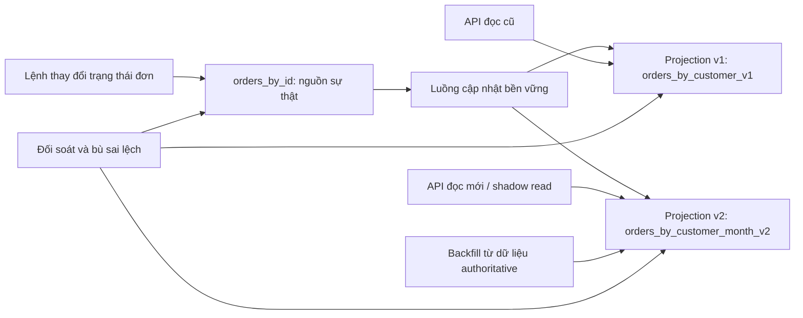
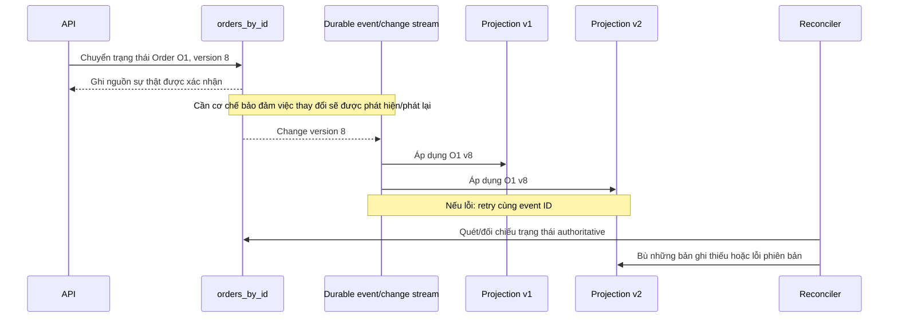
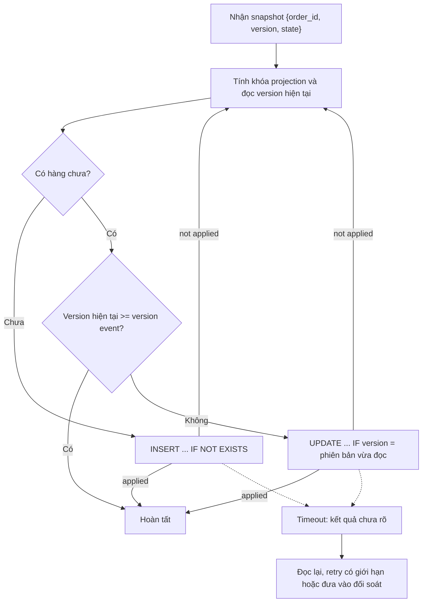
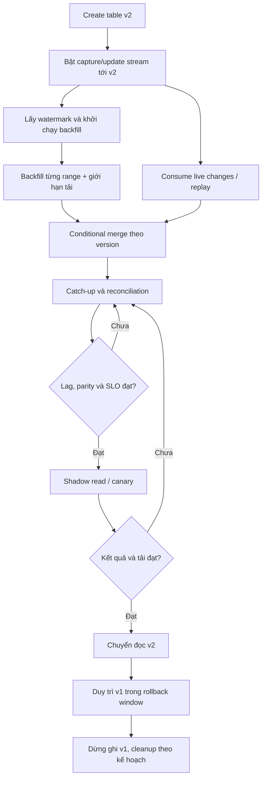

# Ghi nhiều biểu diễn và xử lý cập nhật trong giai đoạn chuyển đổi

Trong **SPRING_DATA_CASSANDRA**, ứng dụng truy cập Apache Cassandra qua entity mapping, repository, `CassandraTemplate` và CQL. Vì Cassandra được thiết kế để phục vụ truy vấn theo **partition key** và **clustering key**, cùng một thực thể nghiệp vụ thường được lưu thành nhiều bảng có khóa khác nhau: bảng tra cứu theo ID, bảng liệt kê theo người dùng, bảng tổng hợp theo ngày. Khi yêu cầu thay đổi, việc thêm bảng mới và chuyển đọc/ghi sang biểu diễn mới là việc thường gặp.

Bài này thuộc chương **Tiến hóa và di trú**, trả lời bài toán: **làm sao duy trì nhiều biểu diễn dữ liệu trong thời gian chuyển đổi, xử lý các cập nhật đến đồng thời hoặc sai thứ tự, chuyển lưu lượng sang bảng mới và vẫn phục hồi được nếu một bước thất bại?** Câu trả lời không chỉ là “ghi thêm một bảng”, mà là thiết kế một giao thức chuyển đổi có nguồn sự thật, định danh cập nhật, quy tắc xử lý phiên bản, backfill, đối soát và điểm cắt chuyển rõ ràng.

Các ví dụ sử dụng Spring Data Cassandra và Java Driver 4.x để minh họa. Cú pháp, thư viện và bảo đảm cụ thể phải được đối chiếu với phiên bản Spring Boot, Spring Data và Cassandra đang triển khai.

## 1. Vì sao một thực thể có nhiều biểu diễn?

Giả sử hệ thống quản lý đơn hàng ban đầu có một bảng để liệt kê tất cả đơn hàng của một khách:

```sql
CREATE TABLE orders_by_customer_v1 (
    customer_id uuid,
    created_at  timestamp,
    order_id    uuid,
    status      text,
    version     bigint,
    PRIMARY KEY ((customer_id), created_at, order_id)
) WITH CLUSTERING ORDER BY (created_at DESC, order_id ASC);
```

Bảng này phục vụ truy vấn theo `customer_id`, nhưng khi một khách có hàng triệu đơn hàng, **partition theo khách có thể tăng quá lớn**, gây khó khăn cho paging, streaming, compaction và kiểm soát hotspot. Sau khi phân tích query pattern và kích thước partition thực tế, nhóm quyết định chuyển sang bucket theo tháng:

```sql
CREATE TABLE orders_by_customer_month_v2 (
    customer_id  uuid,
    month_bucket text,
    created_at   timestamp,
    order_id     uuid,
    status       text,
    version      bigint,
    PRIMARY KEY ((customer_id, month_bucket), created_at, order_id)
) WITH CLUSTERING ORDER BY (created_at DESC, order_id ASC);
```

Đây là **thay đổi partition key**, nên không thể xem như `ALTER TABLE ADD` để thêm một cột: dữ liệu phải được ghi sang cấu trúc khóa mới. Lịch sử của khách được chia thành những partition `(customer_id, month_bucket)`. Nếu khách phát sinh khối lượng rất lớn ngay trong một tháng, vẫn cần đánh giá bucket ngắn hơn hoặc cơ chế phân chia có kiểm soát; “theo tháng” chỉ là ví dụ.

Ngoài hai bảng phục vụ truy vấn lịch sử, giả sử hệ thống đã có bảng giữ **trạng thái có thẩm quyền** của từng đơn:

```sql
CREATE TABLE orders_by_id (
    order_id    uuid PRIMARY KEY,
    customer_id uuid,
    created_at  timestamp,
    status      text,
    version     bigint,
    updated_at  timestamp
);
```

Trong bài này, `orders_by_id` được chọn làm **nguồn sự thật** (*authoritative source*) cho trạng thái đơn hàng. Hai bảng `orders_by_customer_v1` và `orders_by_customer_month_v2` là **biểu diễn đọc** (*projections*) từ cùng dữ liệu nghiệp vụ. Việc chọn bảng authoritative là một **quyết định kiến trúc phải được chứng minh**, không phải tính năng Spring tự nhận diện.

### 1.1. Ba biểu diễn, ba nhu cầu khác nhau

| Bảng | Khóa chính | Nhiệm vụ | Rủi ro khi chuyển đổi |
| --- | --- | --- | --- |
| `orders_by_id` | `(order_id)` | Nguồn sự thật; tra cứu và đổi trạng thái đơn. | Mất/ghi đè phiên bản trạng thái; cập nhật cạnh tranh. |
| `orders_by_customer_v1` | `((customer_id), created_at, order_id)` | API liệt kê đơn cũ theo khách. | Partition lớn; cần tiếp tục nhận cập nhật khi còn API đọc v1. |
| `orders_by_customer_month_v2` | `((customer_id, month_bucket), created_at, order_id)` | API mới đọc theo bucket tháng. | Backfill có thể đến sau sự kiện mới; projection có thể thiếu/sai thứ tự. |

Cùng một `order_id` xuất hiện ở nhiều bảng nhưng **không** đồng nghĩa Cassandra tự duy trì khóa ngoại hoặc đồng bộ các bản sao nghiệp vụ. Mọi mutation qua repository/template/CQL phải được thiết kế để các biểu diễn có thể hội tụ về cùng trạng thái.

### 1.2. Vì sao không thay bảng một lần?

Nếu chỉ dừng ứng dụng, copy toàn bộ dữ liệu rồi đổi code, một hệ thống lớn có thể mất nhiều giờ bảo trì, trong khi đơn hàng vẫn tiếp tục tạo mới và cập nhật. Một số phiên bản ứng dụng hoặc consumer cũ có thể chưa được nâng cấp cùng lúc. Vì vậy thường cần giai đoạn **hai biểu diễn cùng tồn tại**:



Luồng cập nhật bền vững có thể là một event log có semantics đã kiểm chứng, CDC theo pipeline phù hợp hoặc một cơ chế outbox có phạm vi commit được bảo đảm. Chi tiết này không được bỏ qua, vì **ghi trạng thái và phát event là hai thao tác có thể thất bại độc lập**.

## 2. Trước khi ghi hai nơi: xác định hợp đồng dữ liệu

Một migration chỉ có thể chứng minh đúng nếu mỗi loại dữ liệu có luật rõ ràng. Ít nhất cần ghi thành tài liệu:

1. **Nguồn sự thật:** nếu hai biểu diễn bất đồng, bảng hoặc log nào quyết định trạng thái đúng?
2. **Khóa định danh nghiệp vụ:** `order_id` có ổn định qua mọi bảng, mọi retry và mọi giai đoạn deploy không?
3. **Số phiên bản:** mỗi lần đổi trạng thái có `version` tăng đơn điệu theo `order_id` hay không?
4. **Nội dung cập nhật:** event chứa **toàn bộ trạng thái cần dựng projection** hay chỉ chứa một phép cộng/trừ không thể áp dụng ngoài thứ tự?
5. **Dữ liệu định tuyến:** `customer_id`, `created_at` và quy tắc tính `month_bucket` có ổn định hay có thể sửa?
6. **Xóa và TTL:** xóa vật lý, hủy logic, retention và khả năng tái phát dữ liệu được quy định thế nào?
7. **Độ trễ cho phép:** API đọc bảng v2 được phép chậm hơn nguồn sự thật bao lâu? Người dùng cần hành vi nào khi đang chờ đồng bộ?
8. **Tiêu chí cutover/rollback:** khi nào được chuyển đọc sang v2, và trong bao lâu phải tiếp tục cập nhật v1?

Một hợp đồng mẫu:

```text
Entity: Order
Stable ID: order_id
Authoritative state: orders_by_id
Update version: số nguyên tăng nghiêm ngặt theo order_id
Projection event: snapshot {order_id, customer_id, created_at, status, version}
Stable projection identity: (customer_id, month_bucket, created_at, order_id)
Bucket rule: YearMonth(created_at at UTC), định dạng yyyy-MM
Replay: at-least-once, có thể sai thứ tự
Projection policy: chấp nhận event có version mới hơn; bỏ qua event cũ hơn
Deletion policy: trạng thái CANCELLED/DELETED với version, xóa vật lý theo lịch riêng
Read cutover: chỉ khi backfill + catch-up + parity + SLO đạt
```

**Quan trọng:** Quy tắc “giữ version lớn nhất” chỉ đúng khi `version` đại diện cho thứ tự thay đổi của **cùng một thực thể**, và event chứa ảnh chụp trạng thái đủ để áp dụng trực tiếp. Nếu event là “trừ tồn kho 1” hay “tăng counter 1”, bỏ qua bản cũ hoặc áp dụng sai thứ tự có thể làm sai kết quả; khi đó phải dùng thiết kế khác như event log có thứ tự/offset, idempotent delta hoặc một phép hợp nhất có tính giao hoán được chứng minh.

## 3. Những mô hình ghi nhiều biểu diễn thường gặp

### 3.1. Dual write trực tiếp trong request

Cách đầu tiên dễ triển khai là ghi bảng cũ rồi ghi bảng mới trong cùng service:

```java
@Service
class OrderProjectionService {
    private final OrderV1Repository oldRepository;
    private final OrderV2Repository newRepository;

    OrderProjectionService(
            OrderV1Repository oldRepository,
            OrderV2Repository newRepository) {
        this.oldRepository = oldRepository;
        this.newRepository = newRepository;
    }

    public void writeBoth(
            OrderByCustomerV1 oldView,
            OrderByCustomerV2 newView) {
        oldRepository.save(oldView);
        newRepository.save(newView);
    }
}
```

Đoạn này minh họa hình dạng mã; `OrderV1Repository`/`OrderV2Repository` và entity tương ứng phải được định nghĩa trong dự án. Nó **không tự bảo đảm toàn vẹn dữ liệu**.

Nếu lệnh đầu đã được Cassandra xác nhận nhưng lệnh thứ hai timeout, ta có thể gặp:

- v1 mới hơn v2;
- v2 thực ra đã ghi nhưng response về muộn, trạng thái chưa xác định;
- request HTTP bị retry và phát sinh mutation lặp;
- ứng dụng chết giữa hai lệnh;
- người dùng đã nhận kết quả thành công ở hệ khác nhưng một projection thiếu dữ liệu.

Thêm `@Transactional` lên phương thức không làm các CQL mutation ở **nhiều partition** trở thành một ACID transaction có rollback giống JDBC/JPA. Một transaction manager đang quản lý cơ sở dữ liệu khác cũng không tự quản lý những lần ghi Cassandra.

**Khi nào vẫn dùng dual write trực tiếp?** Khi nghiệp vụ chấp nhận trạng thái cuối cùng nhất quán, có idempotency và **cơ chế ghi bù/đối soát bền vững**. Nếu request chỉ ghi cả hai rồi bỏ qua lỗi một phần, migration có nguy cơ mất dữ liệu âm thầm.

### 3.2. Ghi nguồn sự thật rồi dựng projection bằng event

Mô hình thường dễ vận hành lâu dài hơn là:

1. Thực hiện thay đổi trạng thái tại nguồn sự thật.
2. Đảm bảo một **tín hiệu cập nhật bền vững** tương ứng có thể được phát lại hoặc tái tạo.
3. Consumer xử lý tín hiệu cho từng projection v1/v2.
4. Lưu tiến độ, retry và đưa lỗi lâu dài vào hàng chờ đối soát.
5. Rebuild projection từ dữ liệu authoritative nếu từng consumer bị bỏ lỡ.



**Khoảng trống nguy hiểm:** Nếu làm tuần tự `ordersByIdRepository.save(order)` rồi `kafkaTemplate.send(event)`, ứng dụng có thể chết sau save nhưng trước send. Việc phát ra hai nơi mà không có commit chung không tự bảo đảm “không mất event”.

Các lựa chọn cần đánh giá theo hệ đang có:

- **Transactional outbox tại nguồn có phạm vi atomic thực sự:** ghi business mutation và bản ghi event trong cùng đơn vị commit được hỗ trợ. Cassandra không mặc định cho phép hai partition tùy ý được ghi như một transaction JDBC có rollback; cách thiết kế outbox phải chứng minh chính xác phạm vi bảo đảm của nó.
- **CDC / change stream:** thu thập thay đổi từ một nguồn có khả năng phát lại và retention phù hợp. Với Cassandra, phải xác minh connector, phiên bản, cách nắm offset, node failures, lọc thay đổi và tình huống pipeline tạm ngừng; CDC không tự giải quyết mọi lỗi mất/sai thứ tự.
- **Event log làm nguồn sự thật:** ghi một event bền vững trước, sau đó dựng cả `orders_by_id` và các projection; yêu cầu thiết kế lại chuỗi ghi và tính nhất quán.
- **Quét đối soát từ authoritative table:** cung cấp lưới an toàn kể cả khi một số tín hiệu không phát thành công. Việc quét phải được phân tải, checkpoint và không gây quá tải Cassandra.

Không nên hứa “exactly once end-to-end” chỉ nhờ một message broker. Thực tế thường chọn **at-least-once delivery + idempotent projection + repair/reconciliation**, với các giới hạn được ghi rõ.

### 3.3. CQL BATCH giúp được đến đâu?

Cassandra có `BEGIN BATCH` để nhóm mutation. **Logged batch** có batch log phục vụ việc hoàn tất các mutation khi một số replica/đường ghi gặp lỗi; **unlogged batch** không có bảo đảm khôi phục nhờ batch log ở nhiều partition. Phạm vi atomicity, isolation và hiệu năng còn phụ thuộc việc mutation nằm trong cùng hay khác partition cùng phiên bản Cassandra.

Với các bảng v1 và v2 có partition key khác nhau:

- Batch **không** cung cấp isolation/rollback đa partition tương đương transaction quan hệ.
- Một client đọc hai bảng ngay trong thời gian ghi có thể nhìn thấy trạng thái trung gian.
- Batch không làm side effect như Kafka/HTTP/payment thành một phần của cùng commit.
- Batch trải nhiều partition làm coordinator và batchlog chịu tải; không dùng batch lớn để thay thế thiết kế pipeline.
- Nếu cần kiểm soát tranh chấp bằng `IF ...`, không được giả định có thể biến các điều kiện phân tán thành một transaction CAS đa partition tùy ý.

Vì thế, batch có thể phù hợp một số mutation có quan hệ chặt và cần bảo đảm batch đã được tài liệu phiên bản xác nhận, nhưng **không thay thế** phiên bản hóa, retry và đối soát khi chuyển dữ liệu lâu dài.

## 4. Khi backfill gặp cập nhật trực tiếp: vấn đề sai thứ tự

Giả sử dữ liệu nguồn đang ở version 7 khi job backfill đọc. Trong lúc đó, API cập nhật đơn lên version 8 và event v8 được ghi v2 trước. Sau đó job backfill mới ghi bản v7 sang v2.

```text
Thời điểm  Nguồn sự thật             Projection v2
T0         Order O1, version 7       chưa có
T1         Backfill đọc O1 v7        chưa có
T2         API cập nhật O1 v8        chưa có
T3         Consumer ghi O1 v8        O1 version 8
T4         Backfill ghi O1 v7        O1 version 7  <-- SAI nếu ghi đè mù
```

Nếu dùng `INSERT`/`UPDATE` thường mà không có điều kiện, bản cũ **có thể ghi đè bản mới** tùy mutation timestamp và quy tắc giải quyết xung đột của Cassandra. Không thể dùng “event đến trước” hoặc “request hoàn tất sau” làm thứ tự nghiệp vụ một cách an toàn. Cassandra áp dụng semantics timestamp ở mức cell, nên đọc `version` lớn hơn không tự ngăn một write khác ghi nội dung cũ.

### 4.1. Bản cập nhật phải có version đơn điệu

Với cùng `order_id`, giả sử nguồn sự thật chỉ chấp nhận chuyển:

```text
CREATED (v1) -> PAID (v2) -> SHIPPED (v3) -> DELIVERED (v4)
```

Một projection nên chỉ nhận một snapshot có `version` **cao hơn** trạng thái nó đang giữ. Nếu event v3 đến trước v2, projection có thể nhận v3 và sau đó bỏ v2; việc này chỉ an toàn nếu v3 mang **trạng thái đầy đủ** cần cho projection. Nếu event chỉ chứa “set một field X”, còn v2 thay field Y, bỏ v2 sẽ làm mất Y.

Để quyết định hai cập nhật cạnh tranh cùng một order, nguồn `orders_by_id` cũng phải có cơ chế cấp version đáng tin cậy. Một cách là **CQL conditional update/LWT** theo `order_id`, chẳng hạn:

```sql
UPDATE orders_by_id
SET status = 'SHIPPED',
    version = 3,
    updated_at = ?
WHERE order_id = ?
IF version = 2;
```

Truy vấn này minh họa optimistic concurrency: chỉ đổi trạng thái nếu phiên bản hiện tại đúng như dự kiến. Ứng dụng phải kiểm tra kết quả `[applied]`, xử lý xung đột và timeout. Tạo `version = old + 1` ở hai service thread độc lập mà không có CAS/điều phối phù hợp **không đủ** để bảo đảm version đơn điệu trên nguồn sự thật.

### 4.2. Dùng conditional write để chặn cập nhật cũ ở projection

Với Cassandra, một projection có thể dùng **LWT** (`INSERT ... IF NOT EXISTS`, `UPDATE ... IF version = ?`) để kiểm tra/ghi trong phạm vi khóa tranh chấp. Cần thiết kế sao cho tất cả cập nhật cho cùng hàng projection đi đến cùng primary key.

Luồng tổng quát:



Nếu không muốn trả chi phí Paxos/LWT trên từng projection, có thể cân nhắc partitioning của stream để giữ thứ tự cho một key, consumer xử lý tuần tự, dùng deterministic write timestamps **với điều kiện và giới hạn đã được chứng minh**, hoặc rebuild định kỳ từ nguồn. Mỗi hướng có chi phí và rủi ro riêng, đặc biệt khi khôi phục consumer hoặc thay đổi số partition của broker. **Không coi một sequence number lưu trong một cột thường là khóa CAS**: phải thực sự dùng cơ chế đồng thời đúng.

## 5. Ví dụ Java Driver: projector v2 chấp nhận phiên bản mới hơn

Để thấy rõ bản chất thao tác conditional write, ví dụ sau dùng `CqlSession` của Java Driver được Spring quản lý. Trong dự án, có thể đặt nó bên cạnh `CassandraRepository` và `CassandraTemplate`; việc dùng driver trực tiếp phù hợp khi cần đọc `[applied]` và kiểm soát consistency/serial consistency.

Đây là **ví dụ tập trung vào một hàng projection có khóa không thay đổi**, với event chứa *full-state snapshot* của `status`, `version` và các trường định danh. Phần thay đổi khóa, xóa và phát event bền vững sẽ được xử lý riêng ở các mục sau.

```java
import java.time.Instant;
import java.time.YearMonth;
import java.time.ZoneOffset;
import java.util.Objects;
import java.util.UUID;

public record OrderSnapshot(
        UUID orderId,
        UUID customerId,
        Instant createdAt,
        String status,
        long version) {

    public String monthBucket() {
        return YearMonth.from(createdAt.atZone(ZoneOffset.UTC)).toString();
    }
}
```

Writer cho bảng v2:

```java
import com.datastax.oss.driver.api.core.CqlSession;
import com.datastax.oss.driver.api.core.DefaultConsistencyLevel;
import com.datastax.oss.driver.api.core.cql.BoundStatement;
import com.datastax.oss.driver.api.core.cql.PreparedStatement;
import com.datastax.oss.driver.api.core.cql.Row;
import org.springframework.stereotype.Repository;

import java.util.Objects;

@Repository
public class OrderV2ProjectionWriter {

    private static final int MAX_ATTEMPTS = 6;

    private final CqlSession session;
    private final PreparedStatement select;
    private final PreparedStatement insert;
    private final PreparedStatement advance;

    public OrderV2ProjectionWriter(CqlSession session) {
        this.session = session;

        this.select = session.prepare("""
            SELECT status, version
            FROM orders_by_customer_month_v2
            WHERE customer_id = ? AND month_bucket = ?
              AND created_at = ? AND order_id = ?
            """);

        this.insert = session.prepare("""
            INSERT INTO orders_by_customer_month_v2
              (customer_id, month_bucket, created_at, order_id, status, version)
            VALUES (?, ?, ?, ?, ?, ?) IF NOT EXISTS
            """);

        this.advance = session.prepare("""
            UPDATE orders_by_customer_month_v2
            SET status = ?, version = ?
            WHERE customer_id = ? AND month_bucket = ?
              AND created_at = ? AND order_id = ?
            IF version = ?
            """);
    }

    public void project(OrderSnapshot event) {
        String bucket = event.monthBucket();

        for (int attempt = 0; attempt < MAX_ATTEMPTS; attempt++) {
            Row current = session.execute(
                    select.bind(
                            event.customerId(), bucket,
                            event.createdAt(), event.orderId())
                          .setConsistencyLevel(
                                  DefaultConsistencyLevel.LOCAL_QUORUM))
                    .one();

            if (current == null) {
                BoundStatement create = insert.bind(
                        event.customerId(), bucket,
                        event.createdAt(), event.orderId(),
                        event.status(), event.version())
                    .setConsistencyLevel(DefaultConsistencyLevel.LOCAL_QUORUM)
                    .setSerialConsistencyLevel(
                            DefaultConsistencyLevel.LOCAL_SERIAL);

                if (session.execute(create).wasApplied()) {
                    return;
                }
                // Một worker khác đã tạo hàng trước: đọc lại.
                continue;
            }

            long observedVersion = current.getLong("version");

            if (observedVersion > event.version()) {
                return; // Snapshot đến muộn, không được ghi đè.
            }

            if (observedVersion == event.version()) {
                if (!Objects.equals(
                        current.getString("status"), event.status())) {
                    throw new IllegalStateException(
                            "Cùng version nhưng payload khác: "
                                    + event.orderId());
                }
                return; // Event được giao lặp; kết quả đã có.
            }

            BoundStatement change = advance.bind(
                    event.status(), event.version(),
                    event.customerId(), bucket,
                    event.createdAt(), event.orderId(),
                    observedVersion)
                .setConsistencyLevel(DefaultConsistencyLevel.LOCAL_QUORUM)
                .setSerialConsistencyLevel(
                        DefaultConsistencyLevel.LOCAL_SERIAL);

            if (session.execute(change).wasApplied()) {
                return;
            }
            // CAS thua cuộc đua: đọc version mới và thử lại.
        }

        throw new IllegalStateException(
                "Projection cạnh tranh quá mức; cần retry/đối soát: "
                        + event.orderId());
    }
}
```

#### Phân tích ví dụ

- `PreparedStatement` được tạo khi writer khởi tạo, tái sử dụng qua các event; mỗi event tạo `BoundStatement` riêng và bind đầy đủ partition key.
- `INSERT ... IF NOT EXISTS` chỉ tạo hàng nếu chưa có; `UPDATE ... IF version = ?` chỉ tiến lên từ version vừa đọc. LWT cho phép phân xử cạnh tranh **trong phạm vi hàng/partition được điều kiện hóa**.
- Nếu event v8 vào trước backfill v7 thì hàng v2 đang có version 8; backfill v7 bị bỏ qua.
- Nếu event v8 đến hai lần, lần sau nhìn thấy version 8 và không tạo lại thay đổi.
- Nếu hai worker cùng đọc version 7, chỉ một conditional update dựa trên version 7 thắng; worker còn lại đọc lại và xét version mới.
- `LOCAL_QUORUM` và `LOCAL_SERIAL` là **giả định cho một data center** có topology/RF thích hợp, cần điều chỉnh theo deployment. Chúng không bảo đảm commit nguyên tử sang v1 hoặc source.
- `MAX_ATTEMPTS` tránh vòng lặp vô hạn khi contention cao. Ngoài code mẫu cần backoff, retry có giới hạn, logging/metric và hàng chờ retry bền vững.
- Nếu `session.execute(...)` ném timeout, **không** thể kết luận LWT chưa áp dụng; caller phải giữ event và retry/reconcile. Code mẫu chủ động để exception đi lên để pipeline bên ngoài xử lý.
- Nếu dùng Spring WebFlux/reactive, không chạy `session.execute` đồng bộ trên event-loop; dùng API bất đồng bộ/reactive tương ứng.
- `createdAt` và `customerId` ở đây là **thuộc tính định danh không đổi**. Nếu chúng có thể thay đổi, việc thêm hàng mới chưa loại bỏ hàng cũ; cần một workflow di chuyển khóa riêng.

Điểm cuối cùng rất quan trọng: **LWT ở bảng v2 chỉ bảo vệ thứ tự cập nhật cho bảng v2**. Nó không làm `orders_by_id` và v1/v2 cập nhật nguyên tử; hệ thống vẫn cần cơ chế duy trì event và đối soát.

### 5.1. Những trường hợp cần xử lý bổ sung

| Tình huống | Điều xảy ra | Biện pháp cần thiết |
| --- | --- | --- |
| Event v9 đến trước v8 | v9 tạo/cập nhật bảng v2; v8 đến sau. | Full-state snapshot với version đơn điệu cho phép bỏ v8. |
| Hai event khác nhau cùng version | Có lỗi cấp version hoặc duplicate chứa payload mâu thuẫn. | Phát hiện conflict, cảnh báo và đối soát từ authoritative; không âm thầm nhận một bên. |
| Timeout lúc `IF NOT EXISTS` | Hàng có thể đã được tạo nhưng client không nhận response. | Đọc lại cùng khóa, phân loại theo `version`/nội dung, retry cùng event ID. |
| Worker chết sau khi ghi v1 nhưng trước v2 | Hai projection tạm lệch. | Event vẫn có thể phát lại, hoặc reconciler kiểm tra v2 và ghi bù. |
| Version đã tăng ở source nhưng event mất vĩnh viễn | v2 có thể dừng ở trạng thái cũ. | Có cơ chế phát event bền vững được kiểm chứng và định kỳ so sánh source. |
| `customerId` hoặc `createdAt` sửa | Khóa v2 thay đổi, bản cũ còn nằm ở partition khác. | Event mang old key/new key, dọn bản cũ an toàn và đối soát membership. |
| Event là delta chứ không phải snapshot | Bỏ một event cũ có thể làm mất một phần trạng thái. | Dùng log có thứ tự/offset, dedup delta hoặc chuyển thành full snapshot. |

## 6. Phải xử lý riêng việc đổi khóa và xóa dữ liệu

### 6.1. Một bản ghi chuyển sang partition khác

Nếu đơn hàng được chuyển từ khách A sang khách B, hàng v2 có khóa:

```text
Old key: (customer_A, "2026-11", created_at, order_id)
New key: (customer_B, "2026-11", created_at, order_id)
```

Upsert ở new key **không xóa** old key. Kết quả có thể là đơn hàng xuất hiện trong cả lịch sử A và B. Bản cập nhật cần mang đủ **old key và new key**, hoặc hệ thống có thể tra key cũ từ nguồn authoritative/event lịch sử để dọn đúng.

Một chiến lược chuyển đổi:

1. Ghi trạng thái authoritative với version và khóa mới bằng cơ chế đồng thời phù hợp.
2. Phát event mô tả sự thay đổi thuộc tính khóa và định danh version.
3. Dựng hoặc cập nhật hàng dưới new key.
4. Đánh dấu/delete hàng dưới old key với cơ chế chống thao tác cũ làm “hồi sinh” dữ liệu.
5. Đối soát rằng chỉ đúng biểu diễn hợp lệ còn được hiển thị.

Hai bước 3–4 ở hai partition có thể tạm thời lệch, nên API hoặc reconciler phải có chính sách cho giai đoạn chuyển tiếp. LWT ở new key **không bảo vệ** old key khỏi một worker đến muộn rồi ghi lại dữ liệu cũ.

### 6.2. Deletion marker, TTL và tombstone

Giả sử một đơn đã hủy ở version 10. Nếu xóa vật lý hàng v2 ngay lập tức, một event v9 đến muộn có thể `INSERT ... IF NOT EXISTS` và **tạo lại hàng đã xóa**. Để giữ thông tin thứ tự, có thể lưu một **terminal state** như `CANCELLED` hoặc `DELETED` cùng `version = 10` và chỉ xóa vật lý theo chính sách retention.

Cassandra sử dụng **tombstone** cho thao tác xóa và TTL hết hạn; không phải mọi tombstone đều tồn tại vĩnh viễn. Nếu ứng dụng cần chống tái xuất hiện bản ghi từ event chậm, việc giữ marker phải kéo dài hơn **toàn bộ cửa sổ retry, event retention, backfill, reprocessing và recovery**. Chỉ tăng `gc_grace_seconds` không thay thế được chính sách lifecycle/anti-entropy repair.

Nếu buộc phải xóa dữ liệu vì yêu cầu riêng tư, không thể vô thời hạn lưu payload cũ ở marker. Khi đó cần thiết kế một **sổ theo dõi xóa có giới hạn dữ liệu**, watermark hoặc cơ chế kiểm tra authoritative phù hợp để không replay dữ liệu bị xóa. Backup, CDC, cache và mọi projection cũng phải tuân theo chính sách xóa.

### 6.3. Cẩn trọng với timestamp và cập nhật từng cột

Cassandra giải quyết xung đột ghi thông thường dựa trên **write timestamp** và quy tắc reconciliation ở mức cell. Nếu một consumer cập nhật `status` nhưng consumer khác cập nhật `version` bằng mutation riêng, đọc projection có thể thấy một tổ hợp cột không mong muốn.

Đừng viết logic:

```java
if (event.version() > repository.findById(key).get().getVersion()) {
    repository.save(convert(event)); // Không có điều kiện nguyên tử.
}
```

Đây là mẫu **read-then-write race**; giữa hai dòng có thể có worker khác thay version. Cần CAS, serialized stream được bảo đảm hoặc một chiến lược ghi có tính giao hoán đã chứng minh. Nếu dùng `USING TIMESTAMP` để cưỡng bức thứ tự, phải hiểu đầy đủ timestamp của mọi cột, tombstone, TTL và xung đột phiên bản; cách đó không tự tạo transaction giữa các partition.

## 7. Backfill dữ liệu cũ mà không chặn luồng ghi

Backfill là việc đọc dữ liệu đã tồn tại ở nguồn và tạo các hàng projection mới. Nó có thể kéo dài hàng giờ hoặc ngày; trong lúc đó ứng dụng vẫn tạo và cập nhật đơn hàng.

### 7.1. Một trình tự chuyển đổi an toàn hơn

1. **Tạo schema v2:** kiểm tra keyspace, partition key, clustering order, data type, TTL và compaction.
2. **Bật luồng cập nhật mới:** từ thời điểm đã xác định, mọi thay đổi ở authoritative phải có thể được tiêu thụ/replay vào v2; luồng v1 vẫn phục vụ.
3. **Ghi nhận checkpoint/watermark:** dùng offset hoặc mốc nguồn có semantics rõ, không lấy wall-clock tại API làm bằng chứng đủ về thứ tự.
4. **Chạy backfill:** đọc nguồn theo những phần có giới hạn; biến đổi sang full-state snapshot có version rồi dùng conditional apply.
5. **Tiếp tục catch-up:** consumer xử lý mọi thay đổi phát sinh trong lúc quét, kể cả retry/lặp/sai thứ tự.
6. **Đối soát độc lập:** so sánh authoritative và v2, sửa thiếu/sai, đo projection lag.
7. **Chuyển shadow read / một phần traffic:** so kết quả của v1 và v2 theo cùng điều kiện truy vấn.
8. **Mở đọc v2 theo cờ cấu hình:** tiếp tục duy trì v1 đủ lâu để rollback.
9. **Kết thúc migration:** chỉ dừng ghi v1 và dọn tài nguyên khi không còn consumer/ứng dụng cũ phụ thuộc.



Nếu luồng event dùng CDC, cần chắc rằng retention/cursor của CDC tồn tại **đủ lâu** cho toàn bộ backfill và những gián đoạn có thể xảy ra. Nếu cửa sổ retention không đủ, có thể không còn event để bắt kịp; khi đó phải dùng đối soát đầy đủ hoặc khởi động lại một đợt backfill với hợp đồng rõ.

### 7.2. Không quét toàn bộ bảng bằng một request không giới hạn

Một bảng lớn phân tán theo token không nên được quét bằng `SELECT * FROM orders_by_id` không có chiến lược phân vùng, paging và rate limit. Thay vào đó, dùng cơ chế được hỗ trợ như **Spark Cassandra Connector**, công cụ quét theo token range hoặc pipeline chuyên dụng, có checkpoint và giới hạn đồng thời.

Ở mức ý tưởng:

```text
for each token range được phân công:
    while còn dữ liệu:
        đọc một page giới hạn từ nguồn
        for mỗi order:
            tạo full-state snapshot + version + stable ID
            ghi v2 theo chính sách idempotent/conditional
        lưu checkpoint khi page đã được xử lý bền vững
    đánh dấu range hoàn tất
```

Cần chú ý:

- **Phân tán tải:** nhiều worker nhưng giới hạn concurrency để không gây hot partition, timeout hoặc ảnh hưởng p99 ứng dụng.
- **Checkpoint:** checkpoint chỉ được tiến khi dữ liệu hoặc tác vụ có thể phát lại đã được xác nhận; worker crash sau write trước checkpoint thì replay là bình thường.
- **Paging state:** thuộc query/driver và có giới hạn vòng đời; không lưu một token paging state rồi giả định có thể tiếp tục vô thời hạn qua mọi thay đổi schema/topology/phiên bản.
- **Thay đổi đồng thời:** quét nhiều token range không mặc nhiên tạo snapshot toàn cụm. Cần live stream + merge theo version hoặc một nguồn snapshot có semantics rõ.
- **Cột TTL:** nếu backfill tạo mutation mới mà bỏ qua remaining TTL/expiration, bản ghi có thể sống lâu hơn nguồn; cần chính sách phù hợp.
- **Schema thay đổi:** không đổi định dạng event/nguồn đang đọc giữa job mà không version hóa và kiểm soát compatibility.

### 7.3. Watermark và version giải quyết các vấn đề khác nhau

**Watermark/offset** cho biết pipeline đã xử lý tới đâu trên một nguồn event hoặc một phân đoạn. **Entity version** cho biết một event có mới hơn trạng thái projection **của cùng order** hay không.

Không thể lấy một timestamp wall-clock toàn hệ thống rồi mặc định mọi node đã publish đủ event trước thời điểm đó. Một event có thể được tạo trước nhưng publish sau, hoặc một partition của broker có offset thấp trong khi partition khác đã rất cao.

Để tuyên bố “đã catch up”, cần mô tả rõ:

- Nguồn event có bao nhiêu partition/stream và checkpoint của từng partition.
- Có in-flight event hoặc dead-letter/retry backlog không.
- Projection `version` có khớp authoritative tại các mẫu và toàn bộ tập cần bảo đảm không.
- Có event nào bị mất do retention, lỗi kết nối hoặc failover không.
- Dữ liệu phát sinh trong khoảng backfill có thể được replay bao lâu.

## 8. Đối soát giữa các biểu diễn

Đối soát (*reconciliation*) là cơ chế chủ động phát hiện và sửa dữ liệu không hội tụ. Nếu chỉ ghi cả hai bảng rồi đo “đa số request thành công”, ứng dụng có thể bỏ sót đơn hàng mà không biết.

### 8.1. Những chỉ số nên so sánh

| Trường hợp | Kiểm tra | Ý nghĩa |
| --- | --- | --- |
| Missing row | `order_id` có ở authoritative nhưng thiếu ở v2. | Ghi bù hoặc xem lại quy tắc retention/visibility. |
| Extra row | v2 còn hàng mà authoritative không còn coi hợp lệ. | Có thể là di chuyển khóa, xóa chưa phát hoặc replay event cũ. |
| Stale version | `version_v2 < version_source`. | Pipeline lag, event bị thiếu hoặc backfill/consumer lỗi. |
| Future/conflicting version | `version_v2 > version_source` hoặc cùng version nhưng payload khác. | Bất biến cấp version/hợp đồng event bị phá vỡ; cần điều tra. |
| Key mismatch | Bucket v2 không khớp `created_at`/UTC rule, sai customer. | Logic biến đổi hoặc dữ liệu cũ bị sửa khóa. |
| Value mismatch | Cùng key/version nhưng `status` hoặc trường quan trọng khác lệch. | Converter, schema, write timestamp hoặc bug projector. |
| Duplicate logical entity | Một `order_id` xuất hiện ở nhiều bucket hoặc nhiều owner khi không được phép. | Di chuyển khóa chưa cleanup hoặc event out-of-order. |

Không chỉ so sánh **số lượng hàng**. Hai bảng có cùng count nhưng thiếu một bản ghi và thừa một bản ghi khác vẫn sai. Với dữ liệu lớn, có thể so sánh theo bucket và tập ID/hash có tính xác minh, sau đó truy chiếu chi tiết trường hợp lệch; phải có khả năng chạy lại job và cập nhật chính sách sửa lỗi.

### 8.2. Đối soát nên sửa theo chiều nào?

Vì đã xác định `orders_by_id` là authoritative, khi phát hiện v2 chậm hơn hoặc thiếu, reconciler nên tái tạo snapshot từ source rồi gọi cùng projector idempotent. Không “sửa nguồn theo bảng v2” chỉ vì v2 tình cờ có timestamp ghi mới hơn; điều đó có thể lật ngược logic nghiệp vụ.

Đối với event có version **vượt nguồn** hoặc payload cùng version khác nhau, nên đưa vào hàng chờ điều tra, không âm thầm overwrite. Đây có thể là lỗi nghiêm trọng trong cơ chế cấp version hoặc nguồn sự thật bị restore về snapshot cũ.

### 8.3. Kiểm soát tác động của reconciler

Reconciliation toàn bảng có thể tốn disk, network và CPU tương tự một đợt quét lớn. Nên:

1. Chạy theo bucket/token range, có checkpoint và rate limit.
2. Ưu tiên vùng dữ liệu mới hoặc quan trọng cho nghiệp vụ, nhưng vẫn bao phủ dữ liệu cũ theo chính sách.
3. Dùng metric lag và mismatch để xác định phạm vi cần quét sâu.
4. Tách đường kiểm tra và đường sửa để có thể quan sát trước khi thay đổi nhiều hàng.
5. Lưu các lỗi lặp khó sửa cùng mẫu dữ liệu đã ẩn thông tin nhạy cảm để chẩn đoán.
6. Có cơ chế tạm dừng khi ứng dụng vượt SLO, nhất là lúc Cassandra repair/backup/compaction nặng.

## 9. Chuyển đọc sang v2 mà không phá hợp đồng API

Sơ đồ dữ liệu v2 tốt hơn về kích thước partition, nhưng nó **thay đổi cách đọc**. Với v1, danh sách toàn bộ đơn của một khách nằm trong một partition; với v2, đơn nằm ở nhiều bucket tháng.

### 9.1. Ví dụ cách đọc v1 và v2

Query v1:

```sql
SELECT created_at, order_id, status
FROM orders_by_customer_v1
WHERE customer_id = ?
LIMIT 50;
```

Query v2 cho một tháng:

```sql
SELECT created_at, order_id, status, version
FROM orders_by_customer_month_v2
WHERE customer_id = ?
  AND month_bucket = ?
LIMIT 50;
```

Để liệt kê **50 đơn gần nhất trên nhiều tháng**, code v2 phải quyết định bucket bắt đầu, đi tiếp sang tháng trước nếu chưa đủ hàng, đảm bảo thứ tự toàn cục và cung cấp cursor gồm vị trí bucket cùng paging state/khóa tiếp theo thích hợp. Không thể copy nguyên query v1 rồi thay tên bảng.

### 9.2. Paging trong giai đoạn chuyển đổi

Cần kiểm tra những trường hợp sau:

- Khách có đúng 50 đơn ở tháng hiện tại, và còn nhiều đơn tháng trước.
- Hai đơn có cùng `created_at` nhưng khác `order_id`.
- Một bucket đang được backfill dở dang trong khi API shadow read.
- Đơn mới được tạo giữa page 1 và page 2.
- Dữ liệu được chuyển owner hoặc xóa trong lúc người dùng đang phân trang.
- Paging state cũ từ bảng v1 được gửi lại sau khi API chuyển sang v2.

Không nên gửi raw paging state của v1 trực tiếp sang câu truy vấn v2. Cursor API cần có **version của kiểu đọc**, bucket, khóa phân trang và/hoặc paging state được quản lý theo query shape. Nếu một client đang giữ cursor v1 khi cutover, hợp đồng API cần quy định tiếp tục v1 trong rollback window, buộc bắt đầu lại hoặc chuyển cursor theo chiến lược đã kiểm thử.

### 9.3. Shadow read và canary

Khi luồng ghi v2 đã bắt kịp, có thể chạy **shadow read**: với một phần nhỏ request đọc v1, thực thi thêm query v2 ngoài đường phản hồi chính để so sánh. Việc này không nên tự nhân đôi mọi request lúc tải cao.

Cần chuẩn hóa kết quả trước khi so:

- Cùng điều kiện lọc, khoảng thời gian và thứ tự.
- Cùng chính sách ẩn đơn hủy/đã xóa.
- Cùng semantics cursor/page size.
- Cùng độ trễ cho phép giữa nguồn authoritative và projection.
- So sánh ID, version, trạng thái và số lượng; xem sai lệch thuộc dữ liệu hay pagination.

Sau shadow read, bật v2 cho **canary** theo tỷ lệ traffic nhỏ hoặc một nhóm tenant ổn định. Theo dõi p50/p95/p99, timeout/unavailable, số bucket bị truy cập, partition size, paging errors, mismatch rate và số request đọc fallback.

## 10. Cutover, rollback và dọn đường cũ

Một kế hoạch cutover nên có các giai đoạn độc lập:

| Giai đoạn | Ghi source | Ghi v1 | Ghi v2 | Đọc production |
| --- | --- | --- | --- | --- |
| A. Chuẩn bị schema | Có | Có | Chưa hoặc thử nghiệm | v1 |
| B. Bật đồng bộ | Có | Có | Có, từ event/bridge | v1 |
| C. Backfill + catch-up | Có | Có | Có + backfill | v1; shadow v2 |
| D. Canary | Có | Có | Có | Một phần v2, phần còn lại v1 |
| E. Cutover | Có | Có | Có | v2 |
| F. Hết cửa sổ rollback | Có | Dừng có điều kiện | Có | v2 |
| G. Cleanup | Có | Chỉ lưu theo retention hoặc xóa sau khi chứng minh an toàn | Có | v2 |

### 10.1. Điều kiện được phép cutover

Không dùng “backfill đã chạy 100%” làm điều kiện duy nhất. Cần đồng thời xác minh:

1. Mọi token range/bucket yêu cầu đã được quét và có checkpoint bền vững.
2. Live event đã catch up đến watermark được định nghĩa và không có khoảng mất dữ liệu.
3. Reconciliation đạt ngưỡng parity theo ID/version/payload; các sai lệch quan trọng đã được xử lý.
4. Shadow read/canary trả kết quả đúng với paging và điều kiện lọc.
5. Độ trễ, throughput và partition size của v2 đạt SLO dưới tải đại diện.
6. Có feature flag/route để quay lại v1, và **v1 vẫn tiếp tục được cập nhật** trong cửa sổ rollback.
7. On-call, dashboard, cảnh báo và runbook đã bao phủ cả pipeline mới.

### 10.2. Rollback là chuyển hướng đọc, không phải xóa bảng v2

Nếu canary v2 gặp lỗi, cách quay lại nhanh thường là **đổi read routing về v1**. Không cần xóa v2 ngay: giữ event pipeline, tiếp tục sửa dữ liệu v2 và tìm nguyên nhân. Nếu đã dừng ghi v1 hoặc xóa v1, rollback sẽ khó hơn nhiều; vì vậy thời điểm ngừng duy trì bảng cũ phải đi sau giai đoạn quan sát ổn định được chấp thuận.

Nếu API đã phát sinh hành vi mới phụ thuộc dữ liệu chỉ có ở v2, rollback có thể cần chuyển đổi thêm hoặc không khả thi bằng một feature flag. Hợp đồng backward compatibility phải được thiết kế trước, đặc biệt với những thay đổi data type hoặc ý nghĩa trường.

### 10.3. Khi nào xóa v1?

Chỉ xem xét dọn sau khi biết:

- Không còn phiên bản ứng dụng hoặc batch job tiêu thụ v1.
- Không còn cursor/page token v1 trong cửa sổ hỗ trợ.
- V2 đã chạy ổn định đủ lâu và có khả năng rebuild/restore.
- Các sự kiện đến muộn và backfill/repair jobs liên quan v1 đã được xử lý.
- Cơ chế backup/retention đáp ứng yêu cầu audit và khôi phục.
- Lệnh drop table hoặc xóa dữ liệu được lên kế hoạch, duyệt và chạy riêng theo chính sách vận hành.

Với migration, **cleanup là một thay đổi triển khai riêng có rủi ro**, không nên gộp vào lần bật read v2.

## 11. Hiệu năng và consistency khi ghi nhiều biểu diễn

Ghi thêm v2 không miễn phí. Mỗi đơn mới hoặc cập nhật trạng thái có thể phát sinh write tới source, v1, v2, event pipeline và reconciler. Nếu dùng LWT ở projection, thêm độ trễ/CPU/network từ giao thức đồng thuận. Nếu backfill chạy đồng thời, lượng ghi có thể tăng đáng kể.

| Chi phí | Nguyên nhân | Cách kiểm soát |
| --- | --- | --- |
| Write amplification | Một thay đổi nghiệp vụ tạo nhiều mutation/bản sao. | Giới hạn số projection, loại bỏ biểu diễn không cần thiết sau rollback window. |
| Paxos/LWT contention | Nhiều worker cạnh tranh cập nhật cùng khóa/version. | Chọn key routing và concurrency phù hợp; đánh giá serialized stream. |
| Hot partition | Mọi ghi của một khách lớn tập trung vào partition v1 hoặc bucket v2. | Phân tích kích thước partition, thiết kế bucket/shard phù hợp query. |
| Disk/compaction/tombstone | Upsert, TTL, xóa và backfill làm tăng SSTable/tombstone. | Giám sát compaction, TTL và retention; hạn chế rewrite vô ích. |
| Read amplification | API v2 phải đọc nhiều bucket thay vì một partition. | Xây dựng cursor/bucket index thích hợp, giới hạn số bucket/request. |
| Catch-up lag | Event ingress vượt khả năng projector. | Batch xử lý hợp lý, tăng worker có kiểm soát, theo dõi queue và retry. |
| Cluster overload | Backfill cạnh tranh với API, repair hoặc backup. | Token-range throttle, quota, tách lịch và ngưỡng dừng. |

Consistency level như `LOCAL_QUORUM` giúp xác định mức replica phản hồi theo topology, nhưng **không** tạo transaction giữa source, v1 và v2. Quorum cũng không tự ngăn một event version cũ ghi đè một event mới nếu mutation không có điều kiện.

Trong thời gian migration, phải đo **độ trễ của source write** riêng với **projection lag**. Nếu thiết kế API trả thành công sau khi source write bền vững nhưng projection cập nhật bất đồng bộ, người dùng có thể nhìn thấy trạng thái cũ trong một khoảng ngắn. Nếu sản phẩm cần “read-your-writes” ngay sau một hành động, cần thiết kế đường đọc authoritative, waiting-on-version hoặc cơ chế consistency có hợp đồng rõ; không che khác biệt bằng một sleep cố định.

## 12. Quan sát và xử lý sự cố trong giai đoạn chuyển đổi

Nên gắn cho mỗi mutation ít nhất `operation_id`, `order_id`, `version` và loại biểu diễn dự kiến cần cập nhật. Không nhất thiết log giá trị khóa thô nếu chứa dữ liệu cá nhân; có thể dùng hashed ID hoặc sampling có kiểm soát.

### 12.1. Metric tối thiểu

| Metric | Câu hỏi cần trả lời |
| --- | --- |
| `source_change_rate` | Có bao nhiêu mutation hợp lệ tại nguồn mỗi phút? |
| `event_capture_lag` | Bao lâu sau source write thì tín hiệu cập nhật đi vào pipeline? |
| `projection_apply_success_total` theo version/schema | v1/v2 đang chấp nhận bao nhiêu mutation? |
| `projection_stale_event_total` | Có bao nhiêu event đến muộn và bị bỏ theo version? |
| `projection_cas_conflict_total` | Có contention/worker overlap làm tăng LWT retries không? |
| `projection_apply_error_total` và retry queue | Event lỗi còn được giữ và tái phát không? |
| `projection_lag_seconds` | Bản ghi mới nhất/quan trọng ở v2 chậm bao xa so với source? |
| `backfill_ranges_completed`, `backfill_failed_ranges` | Quét đủ toàn bộ phạm vi cần chuyển chưa? |
| `reconciliation_mismatch_total` theo loại | Missing, stale, extra, value mismatch đang tăng hay giảm? |
| `shadow_read_mismatch_rate` | Kết quả API v1/v2 đã tương đương theo hợp đồng chưa? |
| `read_p95/p99` và `write_p95/p99` | Backfill, LWT và nhiều bucket có làm vượt SLO không? |

Tên metric là **gợi ý thiết kế**, không phải tên mặc định do Spring Boot hoặc Java Driver xuất sẵn. Hệ thống cần tích hợp Micrometer/Actuator, worker metrics, broker metrics và Cassandra metrics thực tế theo phiên bản.

### 12.2. Ma trận lỗi và hướng phục hồi

| Lỗi | Trạng thái có thể xảy ra | Cách phục hồi |
| --- | --- | --- |
| Source write timeout | Chưa biết mutation source đã áp dụng hay chưa. | Đọc/hòa giải bằng operation ID, cùng version và consistency phù hợp. |
| Source đã ghi nhưng event chưa phát | Projection không có thay đổi mới. | Outbox/CDC có phạm vi bảo đảm, hoặc reconciler quét source bù. |
| Event phát lặp | Consumer nhìn cùng version nhiều lần. | Idempotent apply; không tạo side effect lặp. |
| Event v9 đến trước v8 | Projection có thể nhận event cũ sau mới. | Version-aware conditional write; full-state snapshot. |
| Worker chết sau khi ghi v1 | v2 có thể thiếu dữ liệu. | Retry/replay từng projection, checkpoint bền vững. |
| Backfill đè event live | Hàng v2 bị lùi version. | Chặn bằng version CAS/ordering đã chứng minh và chạy đối soát. |
| Lỗi đổi khóa | Một đơn hiện ở hai partition. | Old-key cleanup, membership reconciliation, sự kiện old/new key. |
| CDC retention hết | Không còn đoạn event để catch up. | Quét đối soát lại, thiết lập watermark mới theo runbook. |
| Cutover gây lỗi paging | Cursor cũ không phù hợp query v2. | Đưa đọc về v1, sửa cursor versioning; tiếp tục dual projection. |
| Cluster đang repair/backup | p99/timeout/backfill lag tăng. | Throttle backfill/concurrency, bảo vệ SLO và lịch vận hành. |

## 13. Kiểm thử cần chứng minh điều gì?

Một test unit kiểm tra hàm `monthBucket()` đúng định dạng chỉ là bước đầu. Khi migration có nhiều worker và CQL thật, cần integration test với Cassandra test để chứng minh tính chất đồng thời.

### 13.1. Các trường hợp tối thiểu

1. **Dữ liệu ban đầu:** backfill v1/v2 từ `orders_by_id` tạo đúng khóa mới và số lượng hàng.
2. **Cập nhật bình thường:** source v1 -> v2; cả hai projection có trạng thái/version mới.
3. **Giao lặp:** gửi cùng snapshot v8 hai lần, kết quả v2 vẫn v8, không có bản ghi trùng.
4. **Sai thứ tự:** gửi v9 rồi v7/v8; projection cuối cùng là v9.
5. **Backfill race:** backfill đọc v7, live v8 áp dụng trước, backfill v7 đến sau; v2 không lùi.
6. **CAS race:** hai worker cùng đọc v7 và ghi v8/v9; logic retry cuối cùng giữ version lớn hơn.
7. **Timeout không xác định:** giả lập mất response sau LWT, replay event với cùng ID; không nhân đôi tác dụng phụ.
8. **Migration một phần:** v1 ghi thành công, v2 lỗi; worker hoặc reconciler sửa v2.
9. **Chuyển khóa:** customer_id đổi; chỉ hàng ở khóa mới được coi hợp lệ sau cleanup và đối soát.
10. **Hủy/xóa:** event cũ không làm đơn đã hủy xuất hiện lại sau khi xử lý terminal state.
11. **Phân trang đa bucket:** đúng thứ tự, không bỏ sót/nhân đôi giữa các trang ở boundary.
12. **Cutover/rollback:** chuyển read flag v2 -> v1 -> v2 khi cả hai projection vẫn được duy trì.
13. **Schema và compatibility:** app bản cũ và mới cùng tồn tại mà không parse sai trường/enum.
14. **Tải và vận hành:** có backfill + API traffic + repair/compaction, p95/p99 và lag vẫn trong giới hạn.

### 13.2. Phân biệt môi trường test

| Loại test | Chứng minh được | Chưa chứng minh được |
| --- | --- | --- |
| Unit test pure Java | Logic bucket, validate version, chọn luồng đọc/ghi, xử lý trạng thái. | Cassandra LWT, mapping, CQL và mạng. |
| `@DataCassandraTest` + Cassandra test | Mapping/repository/template, CQL conditional write, hành vi một node. | Quorum đa replica, failover vùng mạng, tải production. |
| Integration test có broker/CDC | Replay, duplicate, catch-up, retry queue, checkpoint. | Mọi trường hợp mất node nếu topology chưa đại diện. |
| Concurrency/fault-injection trên cluster test | CAS contention, timeout, coordinator failover, ảnh hưởng consistency level. | RPO/RTO production nếu dữ liệu nhỏ hơn nhiều. |
| Load test và shadow-read canary | Throughput, p99, hotspot, phân trang theo query thật. | Đúng tuyệt đối nếu thiếu đối soát dữ liệu. |

Trong môi trường kiểm thử, chạy các thao tác destructive/backfill trên keyspace và cluster **cách ly**. Không dựa vào `@Transactional` để rollback Cassandra sau mỗi test.

### 13.3. Tính chất bất biến (invariants) nên assert

Có thể biểu diễn các bất biến để test/monitor:

```text
I1: Mỗi order_id có một trạng thái authoritative hợp lệ.
I2: Version authoritative tăng đơn điệu với mỗi cập nhật hợp lệ.
I3: Với một khóa projection không đổi,
    version_projection không giảm khi xử lý event cũ/lặp.
I4: Khi pipeline đã bắt kịp và đối soát hoàn tất,
    mọi order hợp lệ đều có đúng một biểu diễn mong muốn ở v2.
I5: Cùng operation_id được xử lý lặp không tạo side effect lặp.
I6: Trong rollback window, v1 vẫn phục vụ query với độ mới được cam kết.
I7: Sau cutover, cursor/query v2 phục vụ đúng tập dữ liệu và thứ tự.
```

Lưu ý I4 là mục tiêu sau catch-up, không phải luôn đúng tức thì khi projection bất đồng bộ đang cập nhật. Bài test phải phân biệt **safety** (không làm version lùi hoặc sai chủ) và **liveness** (dữ liệu thiếu cuối cùng được bù).

## 14. Sai lầm phổ biến trong migration Cassandra

### 14.1. “Ghi thêm bảng là đã xong migration”

Ghi hai projection chỉ là cơ chế tạo bản sao. Nếu thiếu event/replay, failover và đối soát, sự cố nhỏ giữa hai lần ghi có thể làm một bản sao thiếu dữ liệu lâu dài.

### 14.2. “Dùng `@Transactional` để rollback cả hai bảng”

Spring Data Cassandra không tự biến repository write qua nhiều partition thành transaction JDBC/JPA có rollback. Cần thiết kế nhất quán cuối cùng, cơ chế ghi điều kiện hoặc một nguồn transaction khác có bảo đảm thực sự.

### 14.3. “Bản ghi nào có timestamp mới hơn thì đúng hơn”

Wall-clock của các producer/consumer có thể lệch. Cassandra last-write-wins theo timestamp của mutation không tương đương **version nghiệp vụ**. Đặt event version đơn điệu và kiểm tra cạnh tranh đúng cách.

### 14.4. “Backfill xong là v2 đã có mọi cập nhật”

Backfill đọc tại nhiều thời điểm, không có snapshot toàn cluster tự động. Cập nhật xảy ra sau khi quét hoặc event bị trễ phải được catch up và đối soát.

### 14.5. “Số hàng v1 bằng v2 chứng minh dữ liệu giống nhau”

Count không phát hiện cùng version nhưng khác status, extra row và missing row bù nhau, hay order nằm sai bucket. Phải so key, version và payload theo mẫu và phạm vi đầy đủ phù hợp.

### 14.6. “LWT ở v2 là ACID transaction cho cả hệ thống”

LWT chỉ giải quyết điều kiện của mutation trong phạm vi nó hỗ trợ. Nó không bao phủ hai projection khác partition, event broker hay payment API.

### 14.7. “Xóa hàng cũ ngay khi cutover”

Người dùng có thể còn cursor v1, ứng dụng cũ còn đọc v1, và rollback window chưa kết thúc. Cleanup phải là bước riêng sau khi đã chứng minh không còn dependency.

### 14.8. “Cứ thêm worker là sẽ hết lag”

Tăng số consumer có thể khiến contention trên cùng order/partition, LWT retries, disk I/O và p99 tăng. Phải đo số key nóng, số message trùng, concurrency thực và khả năng cluster trước khi scale.

## 15. Quy trình ra quyết định khi thêm biểu diễn mới

Khi một nhóm yêu cầu đổi schema hoặc tạo bảng query mới trong Cassandra, có thể làm theo thứ tự:

1. **Xác định lý do thay đổi.** Query mới là gì? Partition key cũ sai ở đâu? Kích thước/hotspot thực tế, paging và SLO bị ảnh hưởng thế nào?
2. **Vẽ tất cả biểu diễn.** Nêu nguồn authoritative, các bảng đọc, khóa định danh và luồng cập nhật.
3. **Chốt hợp đồng thay đổi.** Chọn version, full-state snapshot hay delta, old/new key, deletion semantics và thời gian lưu event.
4. **Chọn cơ chế duy trì cập nhật.** Direct dual write có retry/đối soát; hoặc event/CDC/outbox với khả năng phát lại đã kiểm chứng.
5. **Định nghĩa thứ tự và idempotency.** Đảm bảo không lùi version khi event đến muộn, không mất tác dụng phụ khi retry.
6. **Tạo schema và backfill có kiểm soát.** Thực thi theo token range/bucket, checkpoint, rate limit và quy trình xử lý lỗi.
7. **Catch-up và đối soát.** Xác minh không có gaps, parity theo key/version/payload và lag trong SLO.
8. **Shadow read, canary, cutover.** So sánh kết quả, test paging và hiệu năng; chuyển traffic có thể đảo ngược.
9. **Duy trì rollback window.** Tiếp tục cập nhật v1, theo dõi lỗi và bảo đảm cursor/consumer cũ được hỗ trợ.
10. **Cleanup riêng.** Chỉ dừng projection cũ sau khi các ràng buộc dữ liệu, vận hành và backup/retention đều được đáp ứng.

### Câu hỏi tự kiểm tra

1. Tại sao thêm `month_bucket` vào primary key bắt buộc phải tạo một biểu diễn bảng mới thay vì chỉ `ALTER TABLE`?
2. Lỗi nào xảy ra khi backfill version 7 ghi sau consumer version 8? Vì sao timestamp CQL không tự bảo đảm đúng thứ tự nghiệp vụ?
3. Điều kiện nào khiến việc “giữ version lớn nhất” hợp lệ? Vì sao với delta event lại có thể sai?
4. Nếu `orders_by_id` đã lưu nhưng event tới broker bị mất, cơ chế nào giúp v2 cuối cùng hội tụ?
5. Vì sao `@Transactional` hoặc logged batch không tự giải quyết chuỗi ghi qua source + v1 + v2 + Kafka?
6. Khi chuyển `customer_id` từ A sang B, chỉ upsert vào partition B có đủ không?
7. Một operation timeout sau LWT thì retry phải làm gì trước khi kết luận không có mutation?
8. Tại sao backfill 100% và số lượng hàng bằng nhau vẫn chưa đủ để mở read v2?
9. API dùng paging state v1 cần xử lý thế nào sau khi đọc dữ liệu chuyển sang bucket v2?
10. Khi nào được tắt ghi v1 và xóa bảng cũ để không đánh mất khả năng rollback?

**Điểm cần nắm:** Giai đoạn chuyển đổi giữa các biểu diễn dữ liệu Cassandra phải được thiết kế như **một quá trình đồng bộ có thể lặp, có thể đối soát và có thể đảo hướng đọc**. Spring Data Cassandra giúp truy cập repository, template và CQL, nhưng không tự cung cấp transaction ACID giữa nhiều partition hay tự phát lại thay đổi. Nguồn sự thật rõ ràng, event/version ổn định, xử lý cập nhật sai thứ tự, backfill có checkpoint, reconciliation và cutover theo SLO là nền tảng để tiến hóa schema mà vẫn giữ tính đúng đắn của hệ thống phân tán.
