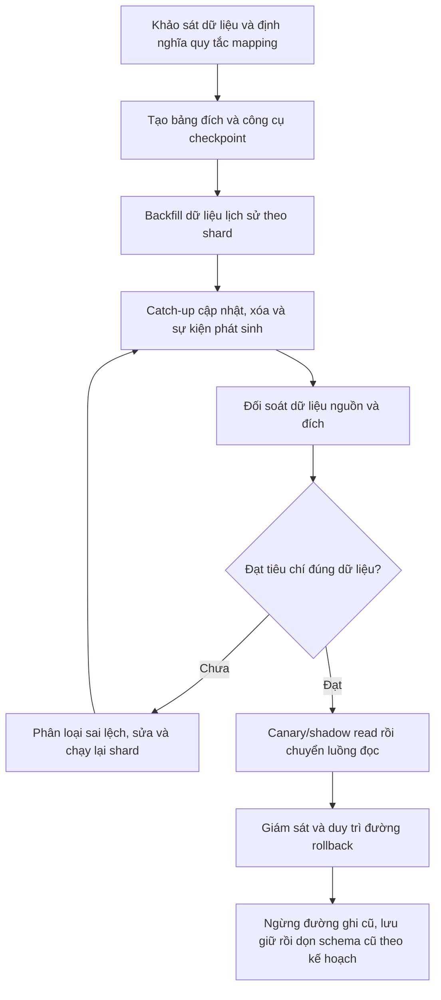
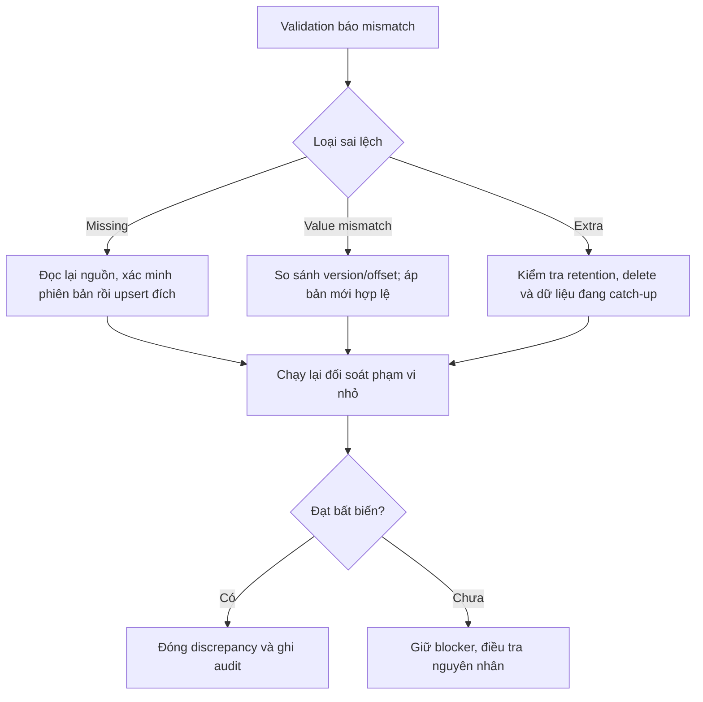

# Tiến độ, khả năng chạy lại và kiểm tra dữ liệu đã chuyển

## 1. Tại sao di trú dữ liệu Cassandra cần hơn một lệnh sao chép?

Trong **Spring Data Cassandra**, ứng dụng truy cập Apache Cassandra qua entity mapping, repository, `CassandraTemplate` và truy vấn CQL. Khi yêu cầu sản phẩm thay đổi, bảng Cassandra thường phải được thiết kế lại **theo truy vấn**: đổi partition key, thêm clustering key, phân bucket theo thời gian hoặc tách một bảng thành nhiều bảng phục vụ các cách đọc khác nhau.

Ví dụ hệ thống đang dùng bảng `event_by_account` với tất cả sự kiện của một tài khoản trong một partition. Để giảm partition quá rộng và đọc lịch sử theo ngày hiệu quả hơn, nhóm xây dựng bảng mới `event_by_account_day`, với partition key `(account_id, event_day)`. Chương trình cần đọc dữ liệu từ bảng cũ, biến đổi khóa, ghi vào bảng mới rồi chuyển truy vấn đọc sang bảng mới.

Nếu tiến trình ngắt ở 63% và chạy lại từ đầu mà không có kế hoạch, hệ thống có thể phát sinh những vấn đề:

- Không biết đã chuyển xong những tài khoản hoặc token range nào.
- Một số ghi đã thành công nhưng phản hồi timeout, dẫn đến ghi lặp.
- Các sự kiện mới/đã sửa/đã xóa trong lúc backfill không được chuyển.
- Tổng số bản ghi giữa hai bảng khác nhau nhưng không biết đó là lỗi, TTL hay thay đổi hợp lệ.
- Chuyển luồng đọc quá sớm, dẫn đến màn hình thiếu dữ liệu hoặc nhận phiên bản cũ.

Mục tiêu của bài thuộc chương **Tiến hóa và di trú** là tổ chức migration theo ba trụ cột: **tiến độ có thể quan sát**, **chạy lại an toàn**, và **kiểm tra được dữ liệu nguồn–đích**. Không giả định Cassandra hỗ trợ giao dịch nguyên tử bao trùm hai bảng, nhiều partition và hệ thống bên ngoài.

Sau bài, bạn có thể thiết kế checkpoint, chia nhỏ công việc theo partition/token range, ghi dữ liệu theo khóa ổn định, xử lý ghi đồng thời, đối soát sai lệch và lập điều kiện chuyển đổi/rollback.

## 2. Xác định thế nào là “đã chuyển xong”

“Chạy hết các dòng nguồn” chỉ là một cột mốc kỹ thuật. Một migration có thể đọc được 100% bảng cũ mà vẫn thiếu dữ liệu mới phát sinh trong lúc sao chép hoặc chuyển sai khóa.

Nên định nghĩa bốn mức hoàn tất:

| Mức | Câu hỏi cần trả lời | Bằng chứng |
|---|---|---|
| **Backfill completed** | Mọi phạm vi dữ liệu nguồn trong kế hoạch đã được xử lý? | Manifest công việc, checkpoint `DONE`, số bản ghi đọc/ghi và lỗi. |
| **Catch-up completed** | Các ghi/sửa/xóa phát sinh trong lúc backfill đã đến bảng mới? | Offset/điểm theo dõi thay đổi, backlog, cơ chế dual-write/CDC và đối soát. |
| **Validated** | Bảng mới trả cùng kết quả nghiệp vụ dự kiến sau biến đổi mô hình? | Kiểm tra khóa, số lượng, giá trị, TTL, sự kiện thiếu/thừa, mẫu và full scan cần thiết. |
| **Cutover accepted** | API đọc từ bảng mới đạt độ đúng và SLO? | Canary/shadow read, độ trễ, lỗi, tính đầy đủ, kế hoạch rollback. |

Các mức này liên quan nhưng **không thay thế nhau**. Tiến độ sao chép đạt 100% không đồng nghĩa dữ liệu đích nhất quán với các cập nhật đang diễn ra.

### 2.1. Phát biểu bất biến nghiệp vụ trước khi viết code

Ví dụ chuyển lịch sử sự kiện cần có một định nghĩa rõ ràng:

> Với mỗi sự kiện nguồn còn hiệu lực tại mốc đối soát, bảng đích phải tồn tại đúng một hàng có cùng `account_id`, `event_id`, `occurred_at` và `payload`, trong bucket ngày UTC của `occurred_at`. Các sự kiện đã xóa hoặc hết hạn phải được xử lý theo chính sách retention đã công bố.

Nếu một sự kiện có thể bị sửa, định nghĩa cần thêm **phiên bản logic** hoặc thời điểm cập nhật để biết trạng thái nào mới hơn. Nếu `event_id` có thể không duy nhất trong tài khoản, phải chỉ rõ toàn bộ khóa nhận diện. Không thể đối soát nếu không thống nhất thế nào là “hai bản ghi tương đương”.

## 3. Ví dụ mô hình nguồn và đích

Giả sử phiên bản cũ lưu sự kiện theo tài khoản:

```sql
CREATE TABLE app.event_by_account (
    account_id uuid,
    event_id uuid,
    occurred_at timestamp,
    payload text,
    PRIMARY KEY ((account_id), event_id)
);
```

Bảng mới phục vụ truy vấn “đọc các sự kiện của một tài khoản theo ngày, mới nhất trước”:

```sql
CREATE TABLE app.event_by_account_day (
    account_id uuid,
    event_day date,
    occurred_at timestamp,
    event_id uuid,
    payload text,
    PRIMARY KEY ((account_id, event_day), occurred_at, event_id)
) WITH CLUSTERING ORDER BY (occurred_at DESC, event_id ASC);
```

Cùng một sự kiện `event_id` được chuyển sang `event_day` tính từ `occurred_at` theo **UTC**. Khi ghi lại cùng sự kiện với cùng `account_id`, ngày, timestamp và ID, Cassandra upsert đúng một hàng theo primary key đích; điều này là nền tảng để xây dựng thao tác có thể chạy lại.

Tuy nhiên, nếu mã migration sinh lại `event_id` hoặc lấy ngày theo múi giờ máy chạy, thao tác ghi lại có thể tạo khóa khác. Nếu cùng `event_id` được phép thay đổi `occurred_at`, việc chuyển bucket có thể để lại hàng ở bucket cũ. Những trường hợp đó phải có quy tắc xóa/đối soát riêng; không thể giải quyết chỉ bằng upsert.

### 3.1. Phạm vi nào phải được chuyển?

Trước khi triển khai, ghi rõ:

- **Nguồn dữ liệu:** keyspace, bảng, version schema, partitioner, consistency khi đọc và account nào thuộc phạm vi.
- **Đích:** primary key mới, kiểu cột, quy tắc mapping, retention/TTL, cách tính ngày và thao tác xóa.
- **Phạm vi thời gian:** toàn bộ lịch sử, 90 ngày gần nhất hay chỉ dữ liệu chưa hết hạn.
- **Dữ liệu biến đổi:** trường đổi tên, đổi kiểu, chuẩn hóa, giá trị mặc định, loại bỏ trường.
- **Thao tác đang chạy đồng thời:** insert, update, delete, TTL expiration và các nguồn ghi ngoài ứng dụng chính.

Không chuyển sang bước backfill khi các quy tắc này chưa đủ cụ thể để viết kiểm tra kết quả.

## 4. Kiến trúc migration theo giai đoạn

Một chiến lược phổ biến là **expand → backfill → catch up → validate → cut over → contract**:



**Expand:** tạo schema mới mà chưa xóa bảng cũ. **Backfill:** đọc dữ liệu cũ và ghi vào bảng mới, có checkpoint. **Catch-up:** chuyển các thay đổi xảy ra trong lúc backfill. **Validate:** đối soát nội dung, không chỉ đếm hàng. **Cutover:** chuyển luồng đọc hoặc ghi theo cờ cấu hình có thể hoàn nguyên. **Contract:** ngừng và dọn đường cũ khi đã chứng minh hệ thống không còn phụ thuộc.

Không có một cơ chế catch-up phù hợp cho mọi ứng dụng. Những lựa chọn có thể là dual-write có đối soát, CDC/event log, hoặc tạm dừng ghi trong cửa sổ rất ngắn để lấy mốc nhất quán. Mỗi lựa chọn có chi phí và các khoảng thất bại cần kiểm soát.

## 5. Đo tiến độ theo đơn vị công việc có thể tiếp tục

Không nên chỉ log “đã xử lý 18 triệu dòng”. Nếu tiến trình bị gián đoạn, số này không cho biết **phần nào** cần chạy lại.

Hãy chia dữ liệu thành các **shard** độc lập; mỗi shard phải có điều kiện chọn nguồn xác định và trạng thái riêng. Có hai cách phổ biến:

1. **Manifest khóa/bucket đã biết:** phân công theo `account_id`, `event_day` hoặc nhóm khóa nghiệp vụ khi có danh sách đầu vào đáng tin cậy.
2. **Token range:** chia không gian token của partition key nguồn thành các khoảng không chồng lấn khi cần backfill cả bảng mà không có danh sách khóa đầy đủ.

Với Cassandra dùng Murmur3Partitioner, token thường là số nguyên có dấu 64 bit. Ví dụ truy vấn một khoảng token nguồn:

```sql
SELECT account_id, event_id, occurred_at, payload
FROM app.event_by_account
WHERE token(account_id) > ?
  AND token(account_id) <= ?;
```

Cách dùng `token()` và kiểu giá trị biên phải phù hợp partitioner và phiên bản Cassandra. Các khoảng cần được chia để phủ hết vòng token, kể cả **điểm vòng lại**; một khoảng vượt ranh giới số token thường phải được tách thành các truy vấn không vòng. Hai khoảng liên tiếp phải dùng cùng quy ước `(start, end]` để tránh bỏ sót hoặc trùng ranh giới.

**Không giả định token range đều nhau thì số hàng cũng đều nhau.** Một partition khổng lồ có thể chiếm nhiều công việc dù chỉ thuộc một token. Nếu một shard quá lớn, hãy chia nhỏ hơn hoặc xử lý riêng theo clustering key trong partition.

### 5.1. Định nghĩa đơn vị hoàn tất

Một shard ở trạng thái `DONE` khi và chỉ khi:

- Phạm vi nguồn của shard đã được đọc đầy đủ theo chính sách migration.
- Mọi ghi đích tương ứng đã nhận **xác nhận thành công** hoặc đã được xử lý/đối soát theo chính sách lỗi.
- Thống kê và lỗi thuộc shard đã được ghi lại.
- Checkpoint `DONE` được cập nhật bền vững.

Nếu shard ghi xong 90% đích rồi bị ngắt, chạy lại cả shard là chấp nhận được **khi phép ghi đích an toàn để lặp**. Nhờ đó không cần xây một bộ checkpoint đến từng dòng quá phức tạp ngay từ đầu.

### 5.2. Trạng thái đề xuất

| Trạng thái | Ý nghĩa | Hướng xử lý |
|---|---|---|
| `PENDING` | Chưa có worker nhận | Có thể nhận công việc. |
| `RUNNING` | Worker đang thực thi với lease/attempt ID | Theo dõi heartbeat và thời gian lease. |
| `DONE` | Đã xử lý và xác nhận hoàn tất shard | Không cần backfill lại, trừ khi chạy kiểm tra/sửa chữa có chủ đích. |
| `FAILED` | Lỗi đã được ghi nhận, cần retry hoặc xử lý thủ công | Phân loại lỗi và đặt lại `PENDING` sau khi đủ điều kiện. |

Nên bổ sung `attempt_id`, `lease_until`, thời gian bắt đầu/kết thúc, tổng dòng đọc/ghi, số retry và thông điệp lỗi đã làm sạch. Với nhiều worker, cần **cơ chế nhận shard có điều kiện** và cơ chế ngăn worker cũ hoàn tất checkpoint sau khi lease đã chuyển sang worker khác.

## 6. Lưu checkpoint bên ngoài luồng xử lý dữ liệu

Bảng checkpoint độc lập giúp khởi động lại worker mà không phụ thuộc RAM hoặc log console. Ví dụ schema minh họa:

```sql
CREATE TABLE migration_control.shard_checkpoint (
    run_id text,
    shard_id int,
    start_token bigint,
    end_token bigint,
    state text,
    attempt_id uuid,
    lease_until timestamp,
    read_rows bigint,
    written_rows bigint,
    failed_rows bigint,
    updated_at timestamp,
    last_error text,
    PRIMARY KEY ((run_id, shard_id))
);
```

`run_id` nhận diện lần chạy/một version migration; `shard_id` nhận diện phạm vi xử lý đã khai báo trong manifest. Composite partition key khiến mỗi shard có một hàng checkpoint riêng; việc liệt kê toàn bộ shard nên dựa trên **manifest đầu vào** thay vì quét cả bảng checkpoint bằng truy vấn không khóa.

Nếu nhiều worker tranh cùng shard, có thể dùng LWT để nhận một hàng đang `PENDING`:

```sql
UPDATE migration_control.shard_checkpoint
SET state = 'RUNNING',
    attempt_id = ?,
    lease_until = ?,
    updated_at = ?
WHERE run_id = ?
  AND shard_id = ?
IF state = 'PENDING';
```

Khi hoàn thành, ràng buộc attempt hiện tại để worker đã mất quyền không thể đánh dấu `DONE`:

```sql
UPDATE migration_control.shard_checkpoint
SET state = 'DONE',
    read_rows = ?,
    written_rows = ?,
    failed_rows = 0,
    updated_at = ?
WHERE run_id = ?
  AND shard_id = ?
IF state = 'RUNNING'
   AND attempt_id = ?;
```

Luôn kiểm tra `[applied]` của các lệnh LWT. Đoạn trên minh họa **fencing ở hàng checkpoint**; để khôi phục từ lease hết hạn, cần một quy trình claim/reclaim dùng điều kiện có thể kiểm chứng và bảo đảm attempt mới thay thế attempt cũ. Giá trị `lease_until` chỉ có ý nghĩa khi hệ thống dùng nó trong quy tắc reclaim nhất quán; chỉ thêm cột thời gian không ngăn hai worker làm cùng shard.

### 6.1. Checkpoint và ghi đích không chung giao dịch

Cassandra không cung cấp giao dịch nguyên tử tổng quát giữa một update checkpoint và toàn bộ các ghi ở nhiều partition đích. Vì vậy, thứ tự an toàn là:

```text
claim shard
  -> đọc dữ liệu nguồn
  -> ghi và xác nhận từng đơn vị dữ liệu đích
  -> ghi metric/kết quả
  -> đánh dấu checkpoint DONE (nếu attempt còn hợp lệ)
```

Nếu tiến trình chết **sau khi ghi đích nhưng trước khi đánh dấu DONE**, shard vẫn chưa hoàn tất và sẽ được chạy lại. Đây là mô hình **at-least-once execution**. Tính đúng đắn phụ thuộc phép ghi đích có thể lặp lại hoặc có cơ chế chống trùng.

Nếu đánh dấu `DONE` trước khi xác nhận dữ liệu đích, một lỗi sau đó có thể khiến shard bị coi đã xong dù còn thiếu dữ liệu. Không dùng cách này.

### 6.2. Paging state không phải checkpoint bền vững mặc định

Java Driver dùng **paging state** để đọc tiếp một truy vấn nhiều trang, nhưng paging state phụ thuộc statement và điều kiện driver/server. Nó không nên được coi là con trỏ vĩnh viễn có thể phục hồi tùy ý sau thay đổi schema, truy vấn hoặc phiên bản hạ tầng.

Với một migration lớn:

- Giữ paging state trong **một lượt xử lý** để giới hạn bộ nhớ và network.
- Checkpoint bền vững theo **shard nhỏ có thể replay** hoặc một khóa cursor logic được chứng minh ổn định.
- Nếu cần resume trong một partition khổng lồ, thiết kế ranh giới theo clustering key cụ thể và xác minh quy tắc thứ tự, thay vì lưu một chuỗi paging state rồi hy vọng dùng lại sau mọi lần khởi động.
- Thử nghiệm mất tiến trình ở giữa trang để chắc chắn không bỏ sót phần chưa ghi.

## 7. Ước lượng phần trăm tiến độ mà không gây hiểu lầm

Không có một con số phần trăm tự động chính xác cho mọi migration Cassandra.

Giả sử manifest có 200 shard:

```text
shards_total = 200
shards_done = 120
shards_running = 4
rows_read = 18,400,000
rows_written = 18,399,900
rows_failed = 100
```

Có thể báo `shards_done / shards_total = 60%` dưới nhãn **“phạm vi đã hoàn tất”**, nhưng **không** kết luận đã xử lý đúng 60% số hàng hay 60% thời gian. Các shard có kích thước chênh lệch lớn. `rows_written` cũng có thể gồm lần ghi lặp nếu đo số yêu cầu ghi thay vì số primary key duy nhất.

### 7.1. Các chỉ số nên tách

| Chỉ số | Ý nghĩa | Lưu ý |
|---|---|---|
| `shards_done / shards_total` | Tỷ lệ phạm vi hoàn tất | Cần biết cách chia shard có cân bằng không. |
| `rows_read` | Tổng bản ghi nguồn đã đọc trong các attempt | Có thể tăng khi chạy lại shard. |
| `writes_acknowledged` | Số lần ghi đích có phản hồi thành công | Không đồng nghĩa số hàng đích duy nhất. |
| `unique_keys_validated` | Số khóa đã được đối soát theo định nghĩa | Cần quy trình validation và khử trùng. |
| `retry_count` / `failed_shards` | Mức độ ổn định của migration | Theo dõi nguyên nhân, không chỉ tổng số. |
| `backfill_lag` / `cdc_lag` | Mức độ bắt kịp thay đổi phát sinh | Không suy ra từ % shard đã xong. |
| `rows_per_second` / `bytes_per_second` | Throughput theo cửa sổ thời gian | Đặt cùng CPU, network, read/write P95/P99. |
| `estimated_remaining_time` | Dự báo thời gian còn lại | Là ước lượng thay đổi theo phân bố dữ liệu và tải. |

Nên thể hiện riêng **“backfill 100%”**, **“catch-up còn N sự kiện”** và **“validation đạt/chưa đạt”**. Một dashboard chỉ có thanh phần trăm duy nhất rất dễ khiến người vận hành cắt chuyển khi dữ liệu chưa bắt kịp.

## 8. Nguyên tắc chạy lại an toàn

**Idempotency** nghĩa là phát lại cùng một yêu cầu logic không làm thay đổi kết quả mong muốn so với thực hiện một lần. Với Cassandra, `INSERT` theo cùng primary key thường là upsert; nhưng không phải mọi lệnh ghi đều lũy đẳng.

| Kiểu ghi đích | Đánh giá khi retry | Ví dụ rủi ro |
|---|---|---|
| Gán cùng giá trị vào cùng primary key | Thường phù hợp nếu dữ liệu và thứ tự phiên bản ổn định | Concurrent writer có thể bị backfill ghi đè nếu timestamp backfill mới hơn. |
| `INSERT` với `event_id` sinh lại mỗi lần | Không an toàn | Tạo thêm hàng mới. |
| Counter `SET views = views + 1` | Không lũy đẳng | Phát lại làm tăng hai lần. |
| Nối `list` | Không lũy đẳng | Tạo phần tử trùng; list trở nên ngày càng lớn. |
| `USING TTL 3600` | Không lũy đẳng nghiêm ngặt theo thời gian | Retry có thể gia hạn hạn sống dữ liệu. |
| `INSERT ... IF NOT EXISTS` | Có thể chống tạo khóa trùng, nhưng phải xử lý phản hồi điều kiện | Lần đầu đã thành công nhưng mất phản hồi; lần sau `applied = false`. |
| Gọi API phát email/thanh toán trong mỗi lần copy | Không bảo đảm | Tác dụng phụ ngoài Cassandra bị lặp. |

### 8.1. Giữ nguyên khóa và payload

Nếu `event_id` được tạo ở lần ghi nguồn, migration phải **dùng lại ID nguồn**. `event_day` phải được tính theo quy tắc UTC cố định; `occurred_at` và payload phải giữ đúng giá trị đã chọn cho phiên bản nguồn.

Không viết:

```java
// Không an toàn: mỗi lần retry có thể tạo một primary key mới.
UUID targetEventId = UUID.randomUUID();
```

Thay vào đó:

```java
// eventId được đọc từ bản ghi nguồn, ổn định giữa các lần thử.
UUID targetEventId = row.getUuid("event_id");
```

Nếu dữ liệu đang bị thay đổi đồng thời, “cùng khóa” **chưa đủ** để tránh ghi đè phiên bản mới hơn; cần chính sách ordering/version riêng.

### 8.2. Timestamp và last-write-wins

Cassandra giải quyết xung đột nhiều mutation bằng timestamp ở cấp cell. Nếu backfill đọc giá trị cũ rồi ghi đích với **timestamp mới**, nó có thể ghi đè một thay đổi mới hơn đã được đồng bộ sang bảng đích.

Có thể xem xét các lựa chọn tùy bài toán:

1. **Cửa sổ ngừng ghi có kiểm soát:** tạo ảnh nguồn ổn định, backfill xong rồi cắt chuyển trước khi mở lại ghi.
2. **Version/sequence logic và cơ chế ghi có điều kiện phù hợp:** chỉ chấp nhận cập nhật đúng phiên bản được phép; phải thiết kế rõ phạm vi LWT và đường ghi khác.
3. **Thứ tự sự kiện từ nguồn thay đổi đáng tin cậy:** xử lý CDC/event log theo khóa và dùng phiên bản/offset để tránh áp dụng bản cũ sau bản mới.
4. **Timestamp gốc được quản lý nghiêm ngặt:** khi phù hợp, dùng timestamp ghi gốc và bảo đảm chính sách timestamp không làm xáo trộn thứ tự; cần xét xóa/tombstone, clock skew và dữ liệu đổi partition.

Không mặc định có thể lấy `writetime()` của một cột làm phiên bản nghiệp vụ hoàn hảo cho mọi hàng. Timestamp ở cấp cell, TTL và tombstone có ngữ nghĩa riêng; cùng một hàng có thể có các cột mang timestamp khác nhau.

### 8.3. TTL và dữ liệu hết hạn

Dữ liệu được ghi với TTL cần có chính sách chuyển **thời hạn hết hiệu lực**. Ví dụ nguồn còn 5 phút TTL, ghi đích với `USING TTL 3600` sẽ kéo dài thời gian sống lên một giờ.

Nếu ứng dụng cần deadline tuyệt đối, nên bảo tồn thời điểm hết hạn nghiệp vụ `expires_at`, tính TTL còn lại từ deadline khi ghi và bỏ qua bản ghi đã hết hiệu lực. Trong mô hình cần giữ chính xác TTL cell gốc, phải hiểu cách Cassandra lưu TTL/timestamp và khả năng đọc `TTL(column)`; một lần đọc TTL không tương đương snapshot nguyên tử của mọi cell. Đặc biệt thận trọng khi có ghi đồng thời, các cột khác TTL, hoặc dữ liệu đã xóa.

Nếu retention của bảng mới **cố ý khác**, hãy mô tả đó là một phép biến đổi nghiệp vụ và đối soát theo **trạng thái kỳ vọng mới**, thay vì so sánh TTL thô bằng nhau.

## 9. Ví dụ backfill bằng Java Driver, dùng được cùng Spring Data Cassandra

Spring Data Cassandra thường tạo và sử dụng `CqlSession` bên dưới repository và `CassandraTemplate`. Với migration khối lượng lớn, có thể dùng trực tiếp `CqlSession` để kiểm soát statement, paging và tốc độ ghi. Không tạo session mới cho mỗi hàng; hãy dùng session được quản lý trong ứng dụng và đóng theo lifecycle.

Đoạn code sau minh họa **xử lý một token range** khi nguồn không bị ghi đồng thời hoặc đã có cơ chế bảo vệ thứ tự phiên bản. Nó **không** bao gồm checkpoint, retry và throttling; những bước đó phải bao quanh hàm như ở Mục 6 và 10.

```java
import java.time.Instant;
import java.time.LocalDate;
import java.time.ZoneOffset;
import java.util.UUID;

import com.datastax.oss.driver.api.core.CqlSession;
import com.datastax.oss.driver.api.core.cql.PreparedStatement;
import com.datastax.oss.driver.api.core.cql.Row;
import com.datastax.oss.driver.api.core.cql.SimpleStatement;

public final class EventBackfill {

    private final CqlSession source;
    private final CqlSession target;
    private final PreparedStatement writeEvent;

    public EventBackfill(CqlSession source, CqlSession target) {
        this.source = source;
        this.target = target;
        this.writeEvent = target.prepare("""
            INSERT INTO app.event_by_account_day
                (account_id, event_day, occurred_at, event_id, payload)
            VALUES (?, ?, ?, ?, ?)
            """);
    }

    public long copyRange(long startToken, long endToken) {
        SimpleStatement read = SimpleStatement.builder("""
                SELECT account_id, event_id, occurred_at, payload
                FROM app.event_by_account
                WHERE token(account_id) > ?
                  AND token(account_id) <= ?
                """)
            .addPositionalValues(startToken, endToken)
            .setPageSize(500)
            .setIdempotent(true)
            .build();

        long copied = 0L;

        // ResultSet đồng bộ tự lấy trang tiếp khi lặp. Không gom tất
        // cả bản ghi vào một List trong bộ nhớ.
        for (Row row : source.execute(read)) {
            UUID accountId = row.getUuid("account_id");
            UUID eventId = row.getUuid("event_id");
            Instant occurredAt = row.getInstant("occurred_at");
            String payload = row.getString("payload");

            LocalDate eventDay =
                LocalDate.ofInstant(occurredAt, ZoneOffset.UTC);

            target.execute(writeEvent.bind(
                    accountId, eventDay, occurredAt, eventId, payload)
                .setIdempotent(true));

            // Chỉ tăng sau khi driver nhận phản hồi ghi thành công.
            copied++;
        }

        return copied;
    }
}
```

**Các điều kiện của ví dụ:**

- Hai bảng `app.event_by_account` và `app.event_by_account_day` đã tồn tại; `occurred_at` và `event_id` phải hợp lệ, không null theo quy tắc nghiệp vụ.
- Mỗi shard token range có `startToken < endToken` trong một đoạn không vòng; chia ranh giới vòng token thành các đoạn riêng.
- Không có TTL/phép tăng/ghi cạnh tranh ngoài kiểm soát trong ví dụ. Nếu có, phải bổ sung logic tương ứng trước khi gọi ghi đích.
- `setIdempotent(true)` **khai báo** tính lũy đẳng cho driver; driver không chứng minh dữ liệu thật sự lũy đẳng. Nếu thêm TTL, tạo ID mới hoặc tác dụng phụ, phải xem xét lại.
- `setPageSize(500)` chỉ là kích thước trang fetch, **không phải** `LIMIT 500` cho toàn shard.
- Một luồng thực thi đồng bộ dễ hiểu nhưng có thể quá chậm cho dữ liệu lớn; tối ưu bằng async/backpressure/bounded concurrency sau khi đã đo và kiểm soát lỗi.

Quy trình gọi hàm nên có dạng:

```text
if claim(shard, attemptId) was applied:
    try:
        count = copyRange(shard.start, shard.end)
        if every target write was acknowledged:
            markDone(shard, attemptId, count)  // LWT điều kiện
    catch recoverableError:
        recordFailure(shard, attemptId, error)
        retry later with bounded policy
    catch invalidRecord:
        quarantine record + mark shard blocked by policy
```

Đừng đánh dấu shard `DONE` trong `finally`; làm vậy sẽ ghi nhận thành công cả khi mã ném ngoại lệ trước khi hoàn tất.

## 10. Retry, backpressure và xử lý bản ghi lỗi

Một chương trình migration chạy lâu có thể gặp timeout, `Unavailable`, lỗi mạng, quá tải, dữ liệu không hợp lệ hoặc lỗi mapping. Cần phân loại trước khi quyết định gửi lại:

| Lỗi | Phản ứng đề xuất |
|---|---|
| Lỗi mạng tạm thời khi đọc shard | Thử lại có giới hạn theo retry policy và deadline; nếu không chắc đã đọc trọn, chạy lại shard. |
| Write timeout sau khi có thể đã ghi thành công | Đối với upsert lũy đẳng, có thể phát lại có giới hạn; đối với ghi không lũy đẳng, phải đối soát. |
| `Overloaded`, `Unavailable`, timeout do tải | Giảm concurrency, backoff có jitter, theo dõi cluster; không tăng tải bằng retry hàng loạt. |
| Thiếu field bắt buộc, timestamp không hợp lệ, mapping không xác định | Đưa bản ghi vào luồng lỗi có danh tính ổn định, không retry vô hạn cùng dữ liệu. |
| Schema nguồn hoặc đích thay đổi ngoài kế hoạch | Dừng hoặc tạm ngừng run, xác minh version schema và quy tắc mapping trước khi tiếp tục. |
| Cassandra trả `[applied] = false` cho checkpoint LWT | Worker không sở hữu trạng thái mong đợi; không tự đánh dấu thành công. |

**Không cố gắng “exactly-once” bằng cách giả định hai ghi Cassandra ở hai partition là một transaction**. Cách thực tế hơn là phát lại *at least once* cùng một khóa ổn định, xử lý ghi trùng và đối soát kết quả.

### 10.1. Bounded concurrency

Tăng số thread không đồng nghĩa tăng throughput mãi mãi. Nếu migration tạo quá nhiều query, nó có thể gây hot partition, chiếm CPU/IO của node, làm latency production tăng và khiến bản thân migration timeout.

Một cơ chế điều khiển nên giới hạn:

- Số shard hoạt động đồng thời.
- Số request đọc/ghi đang chờ (`in-flight`).
- Lưu lượng bản ghi hoặc byte mỗi giây.
- Bộ nhớ buffer cho các page và batch dữ liệu.
- Số retry tối đa và thời gian backoff.

Điều chỉnh theo số liệu **P95/P99 read/write latency, timeout rate, CPU/IO, pending compaction và tải người dùng**, không theo tốc độ migration đơn lẻ. Không dùng `LOGGED BATCH` xuyên nhiều partition như công cụ tối ưu throughput; batch nhiều partition có thể gây thêm chi phí.

### 10.2. Error quarantine

Một bản ghi có payload sai định dạng không nên làm vô hiệu toàn bộ quá trình trong thời gian dài. Có thể lưu **định danh bản ghi, shard, loại lỗi, số attempt, phiên bản mapper** vào nơi xử lý lỗi có kiểm soát. Tránh ghi dữ liệu nhạy cảm hoặc toàn bộ payload vào log. Sau khi sửa mapper hoặc dữ liệu, chạy lại shard hoặc bản ghi theo cùng khóa.

Nếu chính sách yêu cầu **không có dòng nào bị bỏ qua**, shard phải giữ trạng thái `FAILED` hoặc `BLOCKED` cho tới khi lỗi được giải quyết. Không được ghi `DONE` chỉ vì đã phát hiện và bỏ qua dòng lỗi.

## 11. Các thay đổi phát sinh trong lúc backfill: dual-write và CDC

Nếu ứng dụng vẫn ghi vào bảng cũ trong lúc migration, backfill chỉ chụp được dữ liệu tại thời điểm từng hàng được đọc. Các thay đổi về sau có thể chưa nằm trong bảng mới.

Có ba chiến lược chính:

### 11.1. Ngừng ghi tạm thời

Phù hợp khi tập dữ liệu nhỏ hoặc nghiệp vụ cho phép thời gian bảo trì. Ứng dụng ngừng nhận ghi, bảo đảm mọi lệnh đang chạy đã hoàn tất, thực hiện snapshot/backfill, validate rồi cutover. Cách này đơn giản về mô hình nhất quán nhưng có chi phí gián đoạn; **đọc tuần tự một bảng Cassandra đang có ghi** không phải snapshot toàn cục chỉ vì migration bắt đầu tại một thời điểm.

### 11.2. Dual-write có đối soát

Trong giai đoạn chuyển tiếp, ứng dụng ghi cả bảng cũ lẫn bảng mới. Vì Cassandra không đảm bảo transaction nguyên tử qua hai bảng/partition bất kỳ, có thể xảy ra:

- Ghi cũ thành công, ghi mới thất bại.
- Ghi mới thành công, phản hồi mất rồi ứng dụng ghi lại.
- Backfill cũ đến sau bản ghi mới và ghi đè dữ liệu mới hơn.
- Một code path/batch job khác chỉ ghi một trong hai bảng.

Vì thế dual-write cần **record ID ổn định, cơ chế retry/outbox hoặc hàng đợi có kiểm soát, giám sát chênh lệch và reconciliation**. Không chỉ thêm hai lời gọi `save()` rồi coi migration an toàn.

### 11.3. CDC hoặc event log làm nguồn bắt kịp

Nếu có CDC/event log đủ đầy về `insert`, `update`, `delete` và quy tắc thứ tự, migration có thể backfill lịch sử rồi áp các thay đổi từ một mốc xác định. Điều quan trọng là **không có khoảng trống** giữa mốc bắt đầu theo dõi thay đổi và dữ liệu mà backfill đã lấy.

Cần xét rõ:

1. Offset/sequence đến từ nguồn có thứ tự đáng tin cậy ở phạm vi nào: toàn cục hay theo partition/key?
2. Các event có thể giao lại nhiều lần, đến trễ hoặc bị đảo thứ tự không?
3. Xóa/tombstone và TTL có được biểu diễn đủ để đích không giữ dữ liệu đã hết hiệu lực không?
4. Khi một event đã ghi đích nhưng offset chưa commit, việc phát lại có an toàn không?
5. Nếu đích đổi partition do thay đổi khóa phân vùng/ngày, có dọn đúng hàng ở partition cũ không?

**Thứ tự xử lý offset:** ghi và xác nhận dữ liệu đích trước, sau đó commit offset theo chính sách. Nếu crash giữa hai bước, event được phát lại, vì vậy cần tính lũy đẳng. Nếu commit offset trước rồi chưa ghi đích, một event có thể bị mất khỏi luồng catch-up.

## 12. Kiểm tra dữ liệu đã chuyển: nhiều lớp đối soát

Validation phải kiểm tra **nội dung và quan hệ nghiệp vụ**, không chỉ đếm tổng số hàng. Do mô hình đích có partition key khác, hai bảng có thể không so sánh trực tiếp bằng một truy vấn CQL duy nhất. Thường cần chương trình so khớp ngoại tuyến hoặc dịch vụ đối soát đọc theo khóa trong các phạm vi kiểm soát.

### 12.1. Tầng 1 — Kiểm tra schema và khóa

Kiểm tra:

- Primary key đích được tính đúng: `(account_id, event_day, occurred_at, event_id)`.
- Mọi bản ghi hợp lệ nguồn ánh xạ đến **một định danh nghiệp vụ** đích duy nhất.
- Kiểu dữ liệu, độ chính xác timestamp, timezone UTC, decimal, null/empty và giá trị mặc định có cùng ý nghĩa.
- Không mất cột cần thiết; cột cố ý bỏ đi có ghi rõ trong quy tắc mapping.
- Nếu có TTL, xóa và retention, định nghĩa đúng “bản ghi còn hợp lệ” tại mốc đối soát.

Một sai khác nhỏ trong cách làm tròn timestamp hoặc timezone có thể làm sự kiện đi vào bucket sai mà tổng số hàng vẫn bằng nhau.

### 12.2. Tầng 2 — Kiểm tra số lượng theo nhóm

Thay vì chỉ so tổng toàn bảng, đếm số hàng theo **account + bucket ngày** từ kết quả đọc nguồn sau khi mapping và từ bảng đích tương ứng.

| Account | Ngày UTC | Số nguồn kỳ vọng | Số đích quan sát | Kết quả |
|---|---|---:|---:|---|
| A | 2026-11-23 | 120 | 120 | Khớp số lượng |
| A | 2026-11-24 | 85 | 83 | Thiếu 2, cần điều tra |
| B | 2026-11-24 | 41 | 42 | Thừa 1, có thể ghi trùng hoặc sai mapping |

Các con số trên chỉ minh họa. **Không chạy `SELECT COUNT(*)` toàn keyspace/bảng lớn trong mỗi lần kiểm tra**: Cassandra không tối ưu phép đếm toàn bộ như cơ sở dữ liệu quan hệ; nó có thể gây full scan tốn tài nguyên. Dùng job đọc theo shard/partition có giới hạn, thống kê từ pipeline và kiểm tra có kiểm soát ở thời điểm thích hợp.

Số lượng bằng nhau **chưa chứng minh đúng nội dung**: một bản ghi thiếu có thể bị “bù” bởi một bản ghi thừa.

### 12.3. Tầng 3 — Đối soát từng định danh và giá trị

Chuẩn hóa mỗi bản ghi về biểu diễn logic đã định nghĩa, ví dụ:

```text
logical_key = account_id + event_id
canonical_value = account_id | event_id | occurred_at_utc | normalized_payload
```

Sau đó ghép theo `logical_key`:

- **Missing:** nguồn kỳ vọng có khóa nhưng đích không có.
- **Extra:** đích có khóa không còn hợp lệ theo nguồn/chính sách.
- **Mismatch:** cùng khóa nhưng trường dữ liệu khác.
- **Duplicate logical key:** nhiều hàng đích tương ứng một event logic, thường do ngày/timestamp/ID bị thay đổi.

Nếu cần hiệu quả trên dữ liệu lớn, tính hash ổn định cho `canonical_value`, rồi gộp theo shard/bucket có **quy tắc sắp xếp ổn định**. Hash tổng hợp hỗ trợ phát hiện nhanh vùng khác nhau, nhưng khi một hash không khớp phải drill down tới từng khóa. Không dùng hash thay cho toàn bộ kiểm tra logic khi yêu cầu độ tin cậy cao; collision tuy hiếm vẫn có khả năng về lý thuyết.

Ví dụ biểu diễn báo cáo:

```text
run_id: migrate-events-v2
scope: account A, 2026-11-24
expected_rows: 85
target_rows: 83
missing_keys: 2
extra_keys: 0
value_mismatches: 1
ttl_policy_violations: 0
status: FAIL
```

### 12.4. Tầng 4 — So sánh kết quả truy vấn nghiệp vụ

Đối soát trực tiếp qua API “50 sự kiện mới nhất ngày X của account A” bằng cả hai mô hình:

- Cùng danh sách `event_id` theo thứ tự đã định nghĩa.
- Cùng timestamp, payload và quy tắc bỏ sự kiện hết hạn.
- Cùng kết quả khi phân trang hoặc chuyển bucket ngày.
- Không thiếu dữ liệu sau khi các thay đổi mới nhất đã được catch-up.
- Latency và mức sử dụng tài nguyên của truy vấn đích đạt SLO.

Một phép đối soát bằng truy vấn nghiệp vụ rất quan trọng vì bảng mới có thể chứa đầy đủ dữ liệu nhưng **không đáp ứng đúng thứ tự hoặc bộ lọc API**.

### 12.5. Chọn consistency và mốc kiểm tra

Khi nguồn còn ghi đồng thời, hai truy vấn chạy cách nhau vài mili giây có thể thấy hai trạng thái hợp lệ khác nhau. `LOCAL_QUORUM` hay consistency khác ảnh hưởng độ nhất quán quan sát và availability, **không tự tạo snapshot nguyên tử xuyên nhiều partition**.

Muốn đối soát có thể kết luận, phải có một trong các điều kiện:

- Cửa sổ **quiescence**: ngừng ghi liên quan và chờ các thao tác đang chạy hoàn tất.
- Mốc version/sequence và khả năng tái dựng trạng thái nguồn/đích tại cùng mốc.
- Chiến lược so sánh sau catch-up có điều chỉnh những event đang in-flight, cộng với chạy kiểm tra lặp lại tới khi hội tụ theo tiêu chí đã thống nhất.

Không kết luận mất dữ liệu chỉ vì so một nguồn tại thời điểm T1 với đích tại T2 khi hai phía vẫn đang nhận ghi.

## 13. Sửa sai lệch có kiểm soát

Khi validation phát hiện thiếu/thừa/sai giá trị, cần sửa theo **một quy tắc thống nhất** và ghi nhận kết quả:



Các thao tác sửa chữa cần có `discrepancy_id`/khóa ổn định để không sửa lặp mất kiểm soát. Đặc biệt, **không xóa ngay mọi hàng “extra”** khi chưa xác định đó là ghi mới hợp lệ mà nguồn đọc đối soát chưa kịp nhìn thấy.

Với dữ liệu chứa counter, TTL hoặc phép ghi list tích lũy, sửa chữa phải theo semantics tương ứng; không thể đơn giản chạy lại một câu `UPDATE ... + 1` nhiều lần. Nếu mapping sai toàn bộ trong một version, tốt hơn tạo `run_id` mới, sửa quy tắc và chạy lại phạm vi cần thiết theo kế hoạch, thay vì sửa thủ công từng dòng không có dấu vết.

## 14. Điều kiện cutover và kế hoạch rollback

Không nên cắt chuyển chỉ khi dashboard hiển thị 100% backfill. Trước cutover, cần có một **bộ tiêu chí chấp nhận** xác định được:

| Điều kiện | Cách chứng minh |
|---|---|
| Tất cả shard thuộc phạm vi đã `DONE` | Manifest và checkpoint được tổng hợp, không còn shard `PENDING/RUNNING/FAILED` ngoài ngoại lệ được phê duyệt. |
| Backlog thay đổi đã bắt kịp mốc cutover | Offset/lag và bằng chứng mọi event cần thiết đã áp vào đích. |
| Validation theo phạm vi bắt buộc đạt | Báo cáo missing/extra/mismatch, kiểm tra giá trị và TTL, danh sách ngoại lệ được giải quyết. |
| Query API đích đúng và đạt SLO | Shadow read/canary, so sánh kết quả và P95/P99, tỷ lệ timeout/error. |
| Có cách đảo chuyển | Feature flag/config chuyển về đường đọc cũ, giữ dữ liệu và đường ghi phù hợp trong giai đoạn rollback. |
| Có người chịu trách nhiệm phê duyệt | Ghi version schema, mapper, run ID, mốc cutover, báo cáo và kế hoạch phản ứng. |

### 14.1. Canary và shadow read

Trước tiên có thể gửi một nhóm nhỏ traffic sang bảng mới và so sánh với kết quả từ bảng cũ. **Shadow read** không được gây side effect ngoài ý muốn; cần giới hạn lưu lượng để không nhân đôi tải Cassandra quá mức.

So sánh cần chuẩn hóa thứ tự, format, timestamp và retention. Không coi mọi khác biệt do eventual consistency là lỗi vĩnh viễn, nhưng cũng không bỏ qua mismatch lặp lại liên tục.

### 14.2. Rollback không đơn thuần là đổi feature flag

Nếu sau cutover **chỉ ghi vào bảng mới**, quay về đọc bảng cũ sẽ mất các sự kiện mới nhất. Muốn rollback hữu ích, phải xác định **trong cửa sổ rollback** có tiếp tục dual-write/catch-up vào bảng cũ hay không, và cách chứng minh bảng cũ vẫn có dữ liệu đủ mới.

Có thể duy trì đường đồng bộ hai chiều hoặc một chiều phù hợp trong giai đoạn bảo vệ rollback; cần tránh vòng lặp event và ghi đè bản mới hơn. Chỉ dọn bảng cũ khi không còn phụ thuộc và đã kết thúc thời gian rollback theo chính sách lưu giữ.

## 15. Kịch bản kiểm thử chịu lỗi

Test migration cần mô phỏng lỗi ở **đúng ranh giới ghi/checkpoint**, không chỉ chạy qua bộ dữ liệu sạch.

| ID | Tình huống | Điều phải kiểm chứng |
|---|---|---|
| M01 | Một shard đọc và ghi trọn vẹn | `DONE`, count hợp lệ, dữ liệu đích đúng khóa/giá trị. |
| M02 | Crash trước khi ghi hàng đầu | Shard còn chạy lại được; không đánh dấu `DONE`. |
| M03 | Crash sau khi ghi 70% nhưng trước checkpoint | Chạy lại shard không tạo duplicate logic, hoàn tất đủ dữ liệu. |
| M04 | Ghi đích thành công nhưng phản hồi timeout | Retry/đối soát không nhân đôi dữ liệu hoặc tác dụng phụ. |
| M05 | Hai worker cùng cố nhận một shard | Chỉ một attempt được nhận qua LWT; worker cũ không ghi checkpoint `DONE` sau khi mất quyền. |
| M06 | Token range tiếp giáp hoặc vòng token | Phủ đủ partition, không bỏ sót ranh giới; xử lý token âm và wrap. |
| M07 | Một partition rất lớn, nhiều trang | Không out-of-memory; restart giữa trang không bỏ sót. |
| M08 | `event_id` và timestamp ổn định khi retry | Không có thêm hàng do sinh ID/ngày mới. |
| M09 | Có concurrent update trong lúc backfill | Trạng thái đích không bị bản nguồn cũ ghi đè sau event mới. |
| M10 | Delete/TTL trong thời gian chạy | Đích không giữ lâu hơn hoặc hiện lại dữ liệu trái retention. |
| M11 | Payload sai/mapping lỗi | Có record lỗi, shard không bị báo `DONE` sai. |
| M12 | Source và target lệch 1 giá trị nhưng tổng count bằng nhau | Validation phát hiện `value_mismatch`. |
| M13 | Thực hiện cutover rồi rollback | Dữ liệu ghi mới trong cửa sổ rollback vẫn có đường truy cập hợp lệ. |
| M14 | Throttle tăng/giảm theo tải | Migration giảm tốc khi cluster production tăng P99/timeout. |

Với Cassandra, một container một node có thể đủ để kiểm tra mapping, idempotent upsert và checkpoint cơ bản. Các trường hợp liên quan replica offline, repair, read/write consistency và sự cố mạng cần cụm nhiều node với fault injection phù hợp. Chạy test bằng dữ liệu có lệch phân bố giữa các partition, thay vì chỉ các shard đều và nhỏ.

## 16. Những sai lầm thường gặp

**“Chạy lại từ đầu là an toàn vì Cassandra không tạo hai hàng cùng primary key.”** Chỉ đúng khi khóa **và payload/phiên bản** được giữ ổn định, không có TTL mới, counter, append list hoặc ghi cạnh tranh sai timestamp.

**“Lưu paging state là đủ để resume sau bất kỳ lần deploy nào.”** Không. Paging state phụ thuộc câu lệnh và điều kiện thực thi; checkpoint bền vững nên có phạm vi logic rõ ràng, có thể replay hoặc resume có kiểm chứng.

**“Shard 100% nghĩa là migration đã xong.”** Không. Các cập nhật xảy ra trong lúc quét phải được catch-up; validation và cutover là các bước riêng.

**“Cứ dùng `COUNT(*)` ở hai bảng để chứng minh đúng.”** Không. Đếm toàn bảng lớn rất tốn tài nguyên và count bằng nhau vẫn có thể sai khóa/giá trị.

**“Dual-write hai lần `save()` bảo đảm hai bảng luôn giống nhau.”** Không. Hai ghi không tự trở thành transaction xuyên bảng và có thể chỉ một phía thành công.

**“Tăng concurrency sẽ hoàn thành nhanh hơn.”** Chỉ tới giới hạn thực tế. Quá nhiều request có thể gây timeout, compaction backlog và ảnh hưởng API người dùng.

**“Lỗi một hàng có thể bỏ qua để đạt 100%.”** Chỉ khi yêu cầu nghiệp vụ cho phép và có ngoại lệ được phê duyệt. Không được che giấu missing data dưới nhãn `DONE`.

**“Rollback bằng cách đổi đường đọc về bảng cũ là đủ.”** Không, nếu bảng cũ đã ngừng nhận các ghi mới sau cutover.

**“Consistency level mạnh là snapshot toàn bảng.”** Không. Consistency giúp chọn mức phản hồi đọc/ghi, không tạo giao dịch snapshot xuyên nhiều partition tại một mốc duy nhất.

## 17. Bảng kiểm vận hành theo từng giai đoạn

### Trước khi backfill

- [ ] Khai báo `run_id`, version schema/mapping, dữ liệu nguồn–đích và quy tắc biến đổi.
- [ ] Xác định phạm vi lịch sử, TTL, delete, giá trị null, timestamp/timezone và expected logical key.
- [ ] Chọn shard manifest hoặc token range không chồng lấn; xử lý token wrap và partition quá lớn.
- [ ] Tạo checkpoint có claim/lease/attempt, retry policy và metric.
- [ ] Quyết định cách bắt kịp concurrent writes: pause writes, dual-write hoặc CDC/event log.
- [ ] Định nghĩa ngưỡng dừng migration khi hệ thống production quá tải.

### Trong khi backfill/catch-up

- [ ] Theo dõi `DONE/RUNNING/FAILED`, tiến độ theo shard và throughput thực.
- [ ] Đảm bảo checkpoint chỉ `DONE` sau khi ghi đích được xác nhận.
- [ ] Giữ khóa/payload/phiên bản ổn định giữa retry.
- [ ] Giới hạn concurrency, retry, memory và tải cho từng node.
- [ ] Phân loại bản ghi lỗi; không bỏ sót âm thầm.
- [ ] Theo dõi CDC/dual-write lag và rủi ro ghi đè dữ liệu mới.

### Trước và sau cutover

- [ ] Đối soát số lượng theo phạm vi, logical key, giá trị, TTL và query nghiệp vụ.
- [ ] Chạy shadow read/canary và xác minh P95/P99, timeout, consistency.
- [ ] Chốt mốc cutover, người phụ trách, runbook và khả năng rollback.
- [ ] Quan sát sai lệch sau cutover; duy trì đồng bộ nguồn cũ nếu rollback còn được phép.
- [ ] Chỉ ngừng hoặc xóa schema cũ sau khi hết thời gian bảo vệ, đáp ứng retention và được phê duyệt.

## 18. Bài tập áp dụng

### Bài tập A — Tính tiến độ đúng cách

Manifest có 100 shard; 90 shard `DONE`, nhưng 10 shard còn lại chứa 70% hàng của bảng. Hãy thiết kế dashboard trình bày **phần trăm phạm vi đã hoàn tất**, `rows_read`, `writes_acknowledged`, backlog catch-up và dự báo tiến độ. Giải thích vì sao “90% hoàn tất” không có nghĩa còn 10% thời gian.

### Bài tập B — Crash giữa ghi và checkpoint

Một shard chứa 10.000 sự kiện. Worker đã ghi thành công 9.000 sự kiện rồi bị dừng trước khi cập nhật checkpoint. Sau đó worker khác nhận lại shard. Hãy chỉ ra điều kiện để chạy lại cả 10.000 sự kiện không tạo duplicate logic; viết ba test liên quan khóa, timestamp và TTL.

### Bài tập C — Chênh lệch count bằng không

Nguồn có các event ID `{A, B, C}`, đích có `{A, B, D}`. Tổng count hai bảng đều bằng ba. Hãy thiết kế đối soát phát hiện thiếu `C` và thừa `D`, rồi nêu cách xử lý nếu `D` là sự kiện vừa sinh trong lúc đối soát.

### Bài tập D — Cutover có concurrent writes

Một ứng dụng đang ghi booking vào bảng cũ; backfill chép sang bảng mới trong 4 giờ. Đề xuất cơ chế bắt kịp insert, update và delete, cách bảo vệ trước event đến sai thứ tự và quy trình rollback nếu 10 phút sau cutover phát hiện lỗi mapping.

### Bài tập E — Token range và paging

Chia vòng token thành 16 shard, có một partition rất rộng và một worker bị dừng giữa page. Hãy mô tả cách ngăn phạm vi overlap, cách tiếp tục an toàn mà không dựa vào paging state vĩnh viễn, và cách đo tiến độ khi shard có số hàng lệch nhiều.

## 19. Ghi nhớ

- **Tiến độ** phải gắn với đơn vị công việc và trạng thái bền vững. Phân biệt hoàn tất backfill, catch-up, validation và cutover.
- **Checkpoint** ghi sau khi dữ liệu đích được xác nhận; crash trước checkpoint dẫn đến replay, vì vậy cần phép ghi lũy đẳng hoặc chống trùng.
- **Token range, partition/bucket và paging** phải được thiết kế để quét đủ dữ liệu, giới hạn bộ nhớ và khởi động lại được. Paging state không phải một checkpoint dài hạn mặc định.
- **Concurrent writes** là vấn đề thực sự: timestamp, version, delete, TTL và thứ tự CDC có thể khiến bảng đích khác nguồn nếu chỉ chạy backfill.
- **Đối soát** cần kiểm tra theo khóa và giá trị, có thể thêm count/hash theo phạm vi và shadow read; count tổng bằng nhau chưa chứng minh dữ liệu đúng.
- **Cutover** cần tiêu chí chấp nhận, quan sát SLO và kế hoạch rollback có dữ liệu mới đầy đủ.

Một migration Spring Data Cassandra chỉ đáng tin cậy khi nhóm vận hành có thể trả lời rõ: **đã chuyển phạm vi nào, có thể chạy lại an toàn sau lỗi nào, và bằng chứng nào cho thấy dữ liệu đích phục vụ đúng truy vấn nghiệp vụ?**

