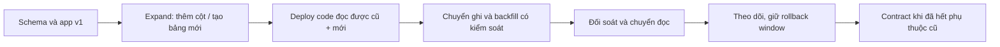
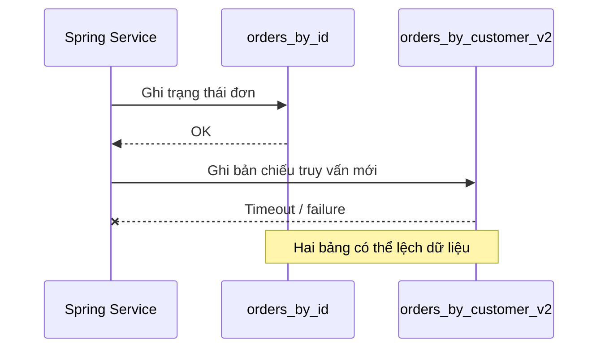
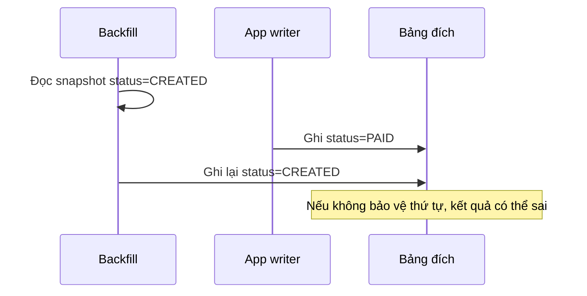
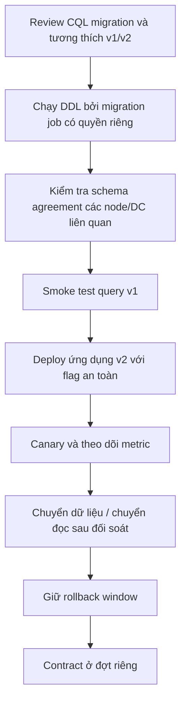

# Triển khai lược đồ tương thích với nhiều phiên bản ứng dụng

Trong hệ thống sử dụng **Spring Data Cassandra**, một lần triển khai hiếm khi thay thế toàn bộ instance ứng dụng cùng lúc. Khi rolling deployment, blue–green deployment hoặc canary release diễn ra, **phiên bản cũ và phiên bản mới cùng kết nối vào Apache Cassandra**. Nếu phiên bản mới xóa/đổi tên một cột ngay lập tức, bản cũ có thể gặp lỗi CQL. Nếu bản mới đọc bảng vừa tạo nhưng bản cũ chưa ghi vào bảng ấy, dữ liệu có thể thiếu dù các request đều trả thành công.

Bài thuộc chương **Tiến hóa và di trú** của module `SPRING_DATA_CASSANDRA`. Mục tiêu là triển khai thay đổi schema an toàn khi ứng dụng dùng **entity mapping**, `CassandraRepository`, `CassandraTemplate` và CQL; đồng thời giữ đúng mô hình dữ liệu phân tán với **bảng thiết kế theo truy vấn, partition key, consistency level, paging và hiệu năng**.

Sau bài này, bạn có thể:

- Xác định thay đổi schema nào có thể triển khai theo hướng tương thích ngược và thay đổi nào cần bảng mới.
- Thực hiện quy trình **expand → migrate → switch → contract** khi nhiều phiên bản ứng dụng cùng hoạt động.
- Điều phối schema migration, code rollout, dữ liệu lịch sử, dual-write và backfill mà không giả định Cassandra hỗ trợ giao dịch xuyên bảng.
- Kiểm thử tương thích giữa nhiều phiên bản, quan sát tiến độ và thiết kế cách rollback phù hợp.

## 1. Tương thích phải xét cả đọc, ghi và dữ liệu lịch sử

“Schema tương thích” không chỉ có nghĩa là **CQL còn parse được**. Với một bản phát hành, cần kiểm tra ba chiều:

1. **Tương thích cấu trúc:** query, prepared statement và entity mapping của hai phiên bản vẫn chạy trên schema đang triển khai.
2. **Tương thích dữ liệu:** bản mới hiểu dữ liệu cũ (`null` ở cột vừa thêm, enum cũ, giá trị thiếu); bản cũ không hỏng khi dữ liệu được ghi bằng bản mới.
3. **Tương thích đường ghi:** dữ liệu mới do từng phiên bản tạo/cập nhật vẫn được các đường đọc tương ứng quan sát, kể cả trong giai đoạn chỉ một phần traffic đã chuyển phiên bản.

Ví dụ dịch vụ đang dùng bảng:

```sql
CREATE TABLE orders_by_id (
    order_id uuid PRIMARY KEY,
    customer_id uuid,
    status text,
    created_at timestamp
);
```

Phiên bản `v1` đọc `order_id`, `customer_id`, `status`, `created_at`. Phiên bản `v2` muốn bổ sung `customer_segment` cho giao diện. Thêm cột là thay đổi cấu trúc tương đối đơn giản, nhưng giá trị của cột mới **không tự xuất hiện** ở các hàng cũ, và bản `v1` có thể tiếp tục ghi những hàng chưa có `customer_segment`.

### 1.1. Ma trận tương thích cần kiểm tra

| Trạng thái triển khai | Ứng dụng v1 | Ứng dụng v2 | Cần bảo đảm |
| --- | --- | --- | --- |
| Schema cũ, chỉ v1 | Hoạt động | Chưa chạy | Đường cơ sở ổn định |
| Schema đã **expand**, vẫn chỉ v1 | Hoạt động | Chưa chạy | Thay đổi schema không phá query v1 |
| Schema expand, v1 và v2 cùng chạy | Hoạt động | Hoạt động | v2 chịu được hàng cũ thiếu dữ liệu; hai bản ghi/đọc đúng phạm vi |
| Schema expand, toàn bộ traffic dùng v2 | Sẵn sàng rollback nếu cần | Hoạt động | Dữ liệu và metric đã đạt điều kiện chuyển đổi |
| Schema đã **contract** | Có thể không còn tương thích | Hoạt động | Không còn v1, job cũ, consumer cũ hoặc rollback phụ thuộc thành phần đã xóa |

**Nguyên tắc:** trong rolling deployment, schema phải phục vụ được cả **N** và **N+1** trong khoảng thời gian chung sống. Nếu đội phát hành cần rollback về N, giai đoạn giữ tương thích phải dài hơn riêng thời gian rollout.

## 2. Đặc thù Cassandra quyết định chiến lược migration

Khác với nhiều cơ sở dữ liệu quan hệ, Cassandra ưu tiên **thiết kế bảng theo truy vấn**; một use case mới đôi khi cần **bảng mới** thay vì thêm index hoặc JOIN. Các ràng buộc này ảnh hưởng đến cách tiến hóa:

| Nhu cầu thay đổi | Khả năng thực hiện | Phương án an toàn thường dùng |
| --- | --- | --- |
| Thêm cột thường `text`, `int`, `timestamp`... | Có thể `ALTER TABLE ... ADD` | Expand trước, deploy code chịu được `null` |
| Thêm/đổi truy vấn từ partition khác | Không đổi primary key hiện hữu để có truy vấn mới | Tạo bảng mới thiết kế theo truy vấn, backfill và chuyển dần |
| Đổi partition key hoặc clustering key | Không thể coi là đổi cột thông thường | Tạo bảng khác với primary key mới |
| Đổi tên/xóa cột đang được app cũ dùng | Thay đổi phá hợp đồng cũ | Giai đoạn chuyển tiếp rồi mới contract |
| Thay kiểu dữ liệu không tương thích | Khả năng `ALTER TYPE` rất hạn chế và khác nhau theo kiểu/phiên bản | Cột mới/bảng mới, chuyển đổi dữ liệu qua application |
| Thay cách biểu diễn enum/status | Có thể không đổi schema | Phát hành reader hiểu cả hai định dạng trước khi writer gửi định dạng mới |
| Thay TTL hoặc retention | Ảnh hưởng vòng đời dữ liệu và tombstone | Kiểm tra dữ liệu lịch sử, expiry và kế hoạch backfill |

**Không cập nhật primary key của bảng hiện tại như một thuộc tính entity thông thường.** Nếu muốn truy vấn theo `customer_id` thay cho `order_id`, thiết kế bảng `orders_by_customer` có partition key phù hợp và kế hoạch đồng bộ riêng.

Cassandra lưu dữ liệu phân tán theo replica, sử dụng write timestamp để giải quyết xung đột và có cơ chế tombstone/TTL. Khi migration tạo các mutation mới, phải xét **dữ liệu đã xóa, dữ liệu hết hạn và ghi đồng thời**; số hàng khớp nhau không tự chứng minh nội dung đúng.

## 3. Quy trình expand → migrate → switch → contract



Đây là **các giai đoạn logic**, không nhất thiết tương ứng với bốn bản phát hành. Với thay đổi nhỏ chỉ thêm cột tùy chọn, có thể không cần backfill; với thay đổi khóa hoặc bảng theo truy vấn, thường cần nhiều phiên bản code và một công việc chuyển dữ liệu độc lập.

### Giai đoạn A — Expand trước khi chạy code mới

- Triển khai migration DDL có chủ đích.
- Đợi schema được các node liên quan nhận và **schema agreement** được xác nhận theo cơ chế của Driver/hệ thống vận hành.
- Đảm bảo query và mapping bản cũ vẫn chạy như trước.
- Chỉ sau đó mới bật tính năng yêu cầu cột/bảng mới.

### Giai đoạn B — Làm reader và writer tương thích

- Reader mới chấp nhận hàng cũ thiếu cột mới hoặc dữ liệu đang ở định dạng cũ.
- Writer mới chỉ phát sinh giá trị/định dạng mới khi reader của các phiên bản còn phục vụ có thể hiểu chúng.
- Nếu đổi bảng, có cơ chế đồng bộ các update phát sinh trong giai đoạn chuyển đổi; backfill một lượt không giải quyết được ghi đồng thời.

### Giai đoạn C — Switch và đối soát

- Bật đường đọc mới theo feature flag/canary; có thể so sánh dữ liệu với đường cũ trên mẫu phù hợp.
- Theo dõi lỗi, tỷ lệ thiếu dữ liệu, độ trễ, retry, tải cluster và mức đồng bộ.
- Xác định **điều kiện chuyển tiếp** và điểm có thể rollback trước khi đổi toàn bộ traffic.

### Giai đoạn D — Contract sau rollback window

Chỉ dọn cột/bảng/truy vấn cũ sau khi xác nhận mọi API, service, job định kỳ, consumer, batch tool và phiên bản có khả năng rollback đã ngừng phụ thuộc. Contract là **một thay đổi phát hành riêng** khi có thể; không gộp xóa cột với lần đầu đưa code mới lên production.

## 4. Ví dụ thêm cột tương thích cho hai phiên bản

Giả sử `v2` cần hiển thị phân khúc khách hàng trong từng đơn hàng.

### 4.1. Bước 1: Expand schema

```sql
ALTER TABLE orders_by_id ADD customer_segment text;
```

Hàng cũ đọc `customer_segment` là `null` vì chưa có cell tương ứng. Query của `v1` chỉ chọn các cột cũ nên tiếp tục hoạt động. Nếu `v1` dùng `SELECT *`, việc có cột mới trong kết quả cũng cần được kiểm thử với converter/mapping thực tế; tránh dựa vào giả định mọi tầng serialization đều bỏ qua cột lạ.

### 4.2. Bước 2: Reader mới chấp nhận dữ liệu cũ

Entity của `v2`:

```java
import java.time.Instant;
import java.util.UUID;

import org.springframework.data.annotation.Id;
import org.springframework.data.cassandra.core.mapping.Column;
import org.springframework.data.cassandra.core.mapping.Table;

@Table("orders_by_id")
public class OrderRecord {
    @Id
    private UUID orderId;

    @Column("customer_id")
    private UUID customerId;

    private String status;

    @Column("created_at")
    private Instant createdAt;

    @Column("customer_segment")
    private String customerSegment; // Có thể null cho hàng cũ.

    // Constructors, getters và setters tương ứng.
}
```

`OrderRecord` là ví dụ mapping; cấu hình naming strategy, converter và constructor của dự án phải tương thích với phiên bản Spring Data đang chạy. Ở service, không nên giả định trường mới luôn tồn tại:

```java
public String segmentForDisplay(OrderRecord order) {
    return order.getCustomerSegment() == null
        ? "UNCLASSIFIED"
        : order.getCustomerSegment();
}
```

`"UNCLASSIFIED"` là giá trị **hiển thị** minh họa. Nếu nghiệp vụ yêu cầu phân khúc thật, không được coi fallback là dữ liệu chuẩn rồi ghi ngược vào Cassandra một cách âm thầm.

### 4.3. Bước 3: Chỉ writer mới ghi cột mới khi cần

Ví dụ truy vấn mục tiêu bằng Driver:

```java
import com.datastax.oss.driver.api.core.cql.PreparedStatement;

PreparedStatement updateSegment = session.prepare(
    "UPDATE orders_by_id " +
    "SET customer_segment = ? " +
    "WHERE order_id = ?");

session.execute(updateSegment.bind(segment, orderId));
```

Update mục tiêu giảm nguy cơ ghi đè các cột khác. Với `CassandraRepository.save(...)`, cần kiểm tra **chính xác** CQL được Spring Data tạo theo API, entity và phiên bản đang dùng: nếu object từ phiên bản cũ chứa property `null`, thao tác lưu toàn entity có thể mang ý nghĩa khác với update riêng cột. Không tự cho rằng `null` đồng nghĩa với `UNSET` hay tự động bảo vệ tất cả cột mới.

### 4.4. Bước 4: Hoàn tất hợp đồng dữ liệu

Nếu màn hình chỉ cần hiện phân khúc khi có, `customer_segment` có thể tiếp tục là optional. Nếu yêu cầu mọi đơn đều có phân khúc, cần **backfill** hàng cũ, kiểm soát writer mới và xác minh không còn hàng thiếu trước khi rút bỏ fallback ở code. Cassandra không cung cấp cùng kiểu kiểm soát ràng buộc `NOT NULL` trên cột thường như nhiều RDBMS; hợp đồng phải được kiểm chứng qua dữ liệu và ứng dụng.

## 5. Khi truy vấn mới đòi hỏi bảng mới

Yêu cầu mới: lấy các đơn gần đây theo `tenant_id` và `customer_id`, sắp xếp theo thời gian. Không nên cố truy vấn bảng `orders_by_id` qua `customer_id` rồi bật `ALLOW FILTERING` để vượt ràng buộc partition key.

Một bảng phù hợp hơn:

```sql
CREATE TABLE orders_by_customer_v2 (
    tenant_id uuid,
    customer_id uuid,
    created_at timestamp,
    order_id uuid,
    status text,
    PRIMARY KEY ((tenant_id, customer_id), created_at, order_id)
) WITH CLUSTERING ORDER BY (created_at DESC, order_id ASC);
```

Ví dụ query:

```sql
SELECT order_id, status, created_at
FROM orders_by_customer_v2
WHERE tenant_id = ? AND customer_id = ?
LIMIT ?;
```

Schema mẫu thể hiện một phân vùng cho từng cặp tenant/khách hàng, với thứ tự clustering. Nếu lượng đơn trên mỗi customer có thể rất lớn, cần đánh giá thêm **bucket theo tháng/quý** và các query đi kèm để tránh partition quá lớn. Khi đó primary key và CQL phải được điều chỉnh; không đưa mẫu trên vào production khi chưa kiểm tra phân bố thực tế.

### 5.1. Bài toán hai bảng không có giao dịch xuyên bảng mặc định

Giả sử hệ thống trước đây chỉ ghi `orders_by_id`. Trong một giai đoạn, bản mới cần cập nhật cả bảng cũ và bảng mới:



Hai lần gọi `CassandraTemplate`/`CqlSession` không tự tạo giao dịch nguyên tử xuyên hai bảng. Một logged batch trong Cassandra **không tương đương giao dịch SQL** có rollback và isolation toàn cục; không nên dùng nó làm bằng chứng mọi đọc qua hai bảng luôn đồng bộ tức thì. LWT cũng không phải cơ chế transaction tổng quát cho mọi bảng/partition.

Vì vậy, khi chuyển sang bảng mới, cần xác định cách **đảm bảo eventual convergence và xử lý ghi thiếu**:

- Ghi sự kiện thay đổi vào một luồng bền vững (nếu kiến trúc có), consumer tạo projection `orders_by_customer_v2` với cơ chế deduplicate/replay phù hợp.
- Hoặc dual-write có cơ chế ghi nhận lỗi và **reconciliation** để phát hiện/sửa những hàng lệch.
- Backfill dữ liệu lịch sử rồi tiếp tục bắt các thay đổi xảy ra trong thời gian backfill, theo watermark hoặc log thay đổi có thể phát lại.

**Chỉ bật dual-write trong phiên bản mới chưa đủ** nếu instance `v1` vẫn ghi vào bảng cũ. Trong khoảng overlap, các write do `v1` phát sinh phải được xử lý bởi một cơ chế đồng bộ độc lập, hoặc việc chuyển đường đọc mới phải chờ mọi writer cũ được nâng cấp và một vòng backfill/đối soát cuối hoàn tất.

### 5.2. Quy trình chuyển bảng không làm mất ghi trong thời gian chuyển đổi

Một phương án có thể triển khai khi có change stream/replay đáng tin cậy:

1. **Tạo bảng mới** và triển khai producer/consumer hoặc cơ chế ghi nhận thay đổi từ bảng nguồn, có checkpoint.
2. **Mở khả năng ghi projection mới** cho mọi thay đổi, kể cả từ các writer cũ qua kênh sự kiện độc lập.
3. **Backfill dữ liệu cũ** theo cursor/token range/bộ khóa được quản lý, không quét toàn bảng tùy tiện trên cluster đang chịu tải.
4. **Replay phần thay đổi phát sinh trong backfill**, đối chiếu để projection bắt kịp nguồn.
5. **Canary đường đọc mới**, so sánh với nguồn và theo dõi lag, lỗi, dữ liệu sai khác.
6. **Chuyển đọc** sau khi đạt ngưỡng dữ liệu đủ tin cậy; tiếp tục giữ đường cũ trong rollback window.
7. **Ngừng ghi đường cũ và dọn bảng cũ** chỉ khi toàn bộ consumer, batch/job và rollback không còn sử dụng.

Nếu không có stream thay đổi, phải thiết kế rõ giai đoạn **freeze writers**, dual-read/fallback hoặc các vòng backfill lặp có checkpoint; không thể mặc định một snapshot “copy xong là mới nhất” khi traffic vẫn ghi liên tục.

## 6. Backfill an toàn: idempotency, timestamp, TTL và xóa dữ liệu

Backfill là một **tác vụ vận hành riêng**, không nên tự động chạy hàng triệu bản ghi trong lúc ứng dụng Spring Boot khởi động. Thông thường job cần hỗ trợ resume từ checkpoint, ghi log tiến độ, điều tiết số request đồng thời và dừng an toàn.

### 6.1. Tính idempotent là yêu cầu đầu tiên

Mỗi hàng đích cần khóa **ổn định**. Nếu job chạy lại cùng bản ghi, không được tạo thêm hàng khác hoặc nhân đôi tác dụng ngoài Cassandra. Ví dụ CQL:

```sql
INSERT INTO orders_by_customer_v2 (
    tenant_id, customer_id, created_at, order_id, status
) VALUES (?, ?, ?, ?, ?);
```

Với cùng primary key và nội dung, đây là một **upsert**. Tuy nhiên “không tạo thêm hàng” chưa đủ để bảo đảm đúng: nếu trạng thái nguồn đã đổi từ `CREATED` sang `CANCELLED` trong khi backfill đang chạy, upsert dữ liệu cũ có thể ghi đè projection mới tùy **write timestamp**. Cần chính sách thứ tự cập nhật và so khớp phiên bản dữ liệu rõ ràng.

### 6.2. Ghi đồng thời có thể khiến dữ liệu bị cũ đi



Giải pháp phụ thuộc domain: có thể dùng **version/event sequence ổn định** từ nguồn, bảo đảm consumer áp dụng sự kiện theo thứ tự trên cùng khóa; hoặc ghi projection với logic có điều kiện phù hợp và đối soát kết quả. Khi lựa chọn timestamp tùy chỉnh, phải hiểu luật **last-write-wins** của Cassandra và không đánh đồng timestamp nghiệp vụ với `WRITETIME(column)`. Những timestamp bằng nhau, update từng cell và xóa dữ liệu cần được xem xét riêng.

Không nên đặt `USING TIMESTAMP` tùy tiện theo thời điểm job chạy: điều đó có thể làm backfill thắng các cập nhật mới hơn. Ngược lại, cố sử dụng timestamp quá cũ cũng có thể khiến dữ liệu đích không phản ánh đúng yêu cầu.

### 6.3. TTL và tombstone có thể làm hồi sinh dữ liệu

Nếu bảng nguồn có `USING TTL` hoặc `default_time_to_live`, việc đọc hàng còn sống rồi ghi sang bảng mới với TTL đầy đủ **làm mới thời gian sống**. Nếu bỏ TTL, dữ liệu lẽ ra hết hạn có thể được giữ vô hạn. Mặc khác, backfill bỏ qua các hàng đã bị xóa/hết hạn có thể vô tình làm dữ liệu ở bảng mới tồn tại nếu đã được ghi ở một lượt trước.

Ví dụ:

```sql
SELECT status, TTL(status) AS remaining_ttl,
       WRITETIME(status) AS written_at
FROM orders_by_id
WHERE order_id = ?;
```

Hai hàm `TTL()` và `WRITETIME()` hữu ích khi kiểm tra **cell thường** còn hiện hữu, nhưng không tự giải quyết đầy đủ dữ liệu đã xóa, nhiều cột có TTL khác nhau hay conflict giữa các mutation. Kế hoạch migration cần nói rõ:

- Giữ nguyên **thời điểm hết hạn** hay áp **chính sách retention mới**?
- Cột nào cần mang TTL, cột nào phải tồn tại lâu hơn?
- Làm thế nào chuyển tiếp **deletion** và chặn dữ liệu bị hồi sinh trong giai đoạn hai bảng cùng hoạt động?
- Có cần một luồng **delete event/tombstone** riêng để projection đích biết phải xóa?
- Đã xét `gc_grace_seconds`, thời gian replica không liên lạc và quy trình repair theo chính sách cluster chưa?

Không giả định `SELECT` chỉ đọc các hàng đang sống là một snapshot đủ cho migration: dữ liệu đã xóa có thể không được thể hiện trong tập kết quả, nhưng vẫn quan trọng để bảng đích không lưu thông tin lỗi thời.

### 6.4. Không biến backfill thành full-scan gây sự cố

Cassandra tối ưu cho truy vấn theo **partition key**. Đọc tuần tự toàn bộ bảng nguồn bằng CQL không có khóa phân vùng là không phải đường đi an toàn mặc định. Nếu cần quét dữ liệu lớn, hãy dùng cơ chế phù hợp với cluster/phiên bản và hạ tầng của đội vận hành: lấy danh sách khóa từ nguồn sự kiện/index sẵn có, công cụ scan theo token range có kiểm soát, hoặc pipeline chuyên dụng có checkpoint.

Job cần quan sát **rows scanned, rows written, errors, retries, lag, checkpoint age, p95/p99 latency**, áp giới hạn concurrency/rate và tạm dừng khi cluster quá tải. Page size chỉ kiểm soát phân trang của một truy vấn; **không tự giảm tổng số hàng** job sẽ đọc.

## 7. Spring Data Cassandra khi nhiều model cùng tồn tại

Khi schema có hai phiên bản, **không bắt buộc mọi entity phải được thay đổi đồng thời**. Có thể tồn tại hai model phục vụ hai bảng theo truy vấn trong cùng một service:

```java
import java.util.UUID;
import org.springframework.data.annotation.Id;
import org.springframework.data.cassandra.core.mapping.Table;

@Table("orders_by_id")
public class OrderById {
    @Id
    private UUID orderId;
    private String status;
    // Các field, constructor/getter/setter theo mapping dự án.
}
```

```java
import org.springframework.data.cassandra.core.mapping.Table;
import org.springframework.data.cassandra.core.mapping.PrimaryKey;

@Table("orders_by_customer_v2")
public class OrderByCustomer {
    @PrimaryKey
    private OrderByCustomerKey key;
    private String status;
    // OrderByCustomerKey ánh xạ tenant_id, customer_id,
    // created_at, order_id theo đúng thứ tự primary key CQL.
}
```

Với khóa ghép, `OrderByCustomerKey` phải được khai báo và mapping đúng bằng `@PrimaryKeyClass`/`@PrimaryKeyColumn` cùng các kiểu Java/CQL tương thích. Đoạn code cố ý tập trung vào **phạm vi model và bảng**; phần composite-key mapping là một phần cần kiểm thử riêng khi triển khai thực tế.

Khi chuyển đường đọc:

```java
public OrderView getOrder(OrderLookupContext context) {
    if (featureFlags.readFromNewProjection()) {
        return newProjectionReader.getOrder(
            context.tenantId(), context.customerId(),
            context.createdAt(), context.orderId());
    }
    return legacyOrderReader.getOrder(context.orderId());
}
```

Ví dụ trên minh họa **switch theo feature flag**, không phải implementation hoàn chỉnh: `OrderLookupContext` là ngữ cảnh do ứng dụng tạo và đã được kiểm tra quyền, chứa các thành phần khóa để đọc projection mới. Bảng `orders_by_customer_v2` được thiết kế để truy vấn theo `tenantId`/`customerId` và các clustering key phù hợp. Nếu API chỉ có `orderId`, vẫn cần bảng `orders_by_id` hoặc một đường tra cứu khóa được thiết kế trước. Feature flag **không làm mất ràng buộc truy vấn của Cassandra**.

Với `CassandraTemplate` và repository:

- Dùng đúng `@Table` cho bảng cũ/mới; tránh đổi tên bảng trong một entity rồi deploy khi code cũ vẫn đang chạy.
- Không giả định `save()` tương đương patch: kiểm tra SQL/CQL phát sinh và hành vi `null`/`UNSET`.
- Giữ query cũ hợp lệ trong overlap; kiểm tra `@Query` cố định, cột được chọn và prepared statement cache.
- Không để migration script DDL được gọi độc lập bởi hàng trăm instance khi startup.
- Tách converter/DTO API khỏi entity lưu trữ để hỗ trợ nhiều định dạng dữ liệu khi cần.

## 8. DDL, schema agreement và điều phối phát hành

### 8.1. Migration DDL phải có người điều phối

Một pipeline phát hành điển hình:



Ở Cassandra, schema changes được lan truyền trong cluster và có thể cần thời gian để các node đồng thuận về phiên bản schema. Không suy từ một lần thực thi `ALTER TABLE` thành công rằng **mọi node ở mọi DC đã lập tức sẵn sàng**. Migration pipeline nên theo dõi schema agreement và kiểm tra cả các node đang không sẵn sàng, tùy cơ chế quản trị cluster. Đọc lại metadata hoặc smoke test schema từ một node đơn lẻ chưa bảo đảm tuyệt đối toàn cluster đồng nhất.

### 8.2. Không tự động xóa rồi tạo lại bảng

Không chạy `DROP TABLE`/`CREATE TABLE` để “đồng bộ entity model” trên production. Đường thay đổi schema cần:

1. CQL migration được review và lưu version trong pipeline quản lý migration.
2. Quy tắc **apply một lần, có kiểm tra trạng thái** và phát hiện drift thay vì ghi đè schema tùy tiện.
3. Tài khoản chạy migration có quyền DDL được quản lý riêng; runtime app chỉ cần quyền đọc/ghi phù hợp.
4. Kiểm tra DDL trên môi trường dùng **cùng dòng Cassandra/Driver** được hỗ trợ.
5. Kế hoạch rollback **ứng dụng** và kế hoạch khôi phục **dữ liệu** được tách rõ.

Một câu `CREATE TABLE IF NOT EXISTS` có thể tránh lỗi “bảng đã tồn tại” nhưng không kiểm tra bảng đã có **đúng primary key, columns và options** mong đợi. Cần đối chiếu định nghĩa thật; “chạy thành công” chưa đồng nghĩa schema đúng.

### 8.3. Những rủi ro khi drop/rename

`ALTER TABLE ... DROP column` có thể làm cả app cũ lẫn prepared statement cũ lỗi nếu chúng vẫn tham chiếu cột đó. Cassandra còn có lịch sử schema và đặc điểm timestamp/tombstone khi xóa, thêm lại cột hoặc sử dụng cùng tên với kiểu dữ liệu khác; không xem thao tác drop/re-add là đường rollback dễ dàng. Nếu cần đổi ý nghĩa dữ liệu, **cột/bảng mới với tên rõ ràng** thường dễ kiểm soát hơn tái sử dụng tên cũ.

Nếu data migration liên quan nhiều datacenter, xác nhận các DC đã nhận schema và các đường đọc/ghi ở consistency level dự kiến hoạt động; việc tăng consistency level không tự sửa chênh lệch giữa hai **bảng logic**.

## 9. Rollback và feature flags: giữ đường trở về rõ ràng

Rollback ứng dụng đơn giản nhất khi thay đổi schema chỉ **mở rộng**, không xóa dữ liệu cũ:

| Giai đoạn | Nếu phát hiện lỗi thì làm gì? | Giới hạn |
| --- | --- | --- |
| Chỉ mới `ADD COLUMN`/`CREATE TABLE` | Tắt flag, giữ app v1, kiểm tra schema | Cột/bảng chưa dùng có thể để nguyên cho đợt sau |
| v2 bắt đầu ghi thêm cột | Tắt tính năng mới, đảm bảo v1 không bị phá mapping | Dữ liệu mới trong cột có thể không được v1 hiểu, nhưng không nên hỏng đường cũ |
| Dual-write/backfill sang bảng mới | Dừng job/consumer hoặc tắt đường đọc mới, giữ bảng nguồn | Phải xử lý event pending, replay, tính đúng dữ liệu |
| Đã chuyển toàn bộ đọc sang bảng mới | Quay lại đường đọc cũ **chỉ khi** nó còn cập nhật và có đủ dữ liệu | Nếu đã ngừng ghi cũ, rollback có thể trả dữ liệu thiếu |
| Đã drop bảng/cột cũ | Rollback v1 có thể không thực hiện được | Cần migration tiến lên hoặc khôi phục dữ liệu, không chỉ redeploy binary cũ |

Feature flag cần được thiết kế theo **đơn vị tenant/workload/query**, không chia cắt tùy tiện những thao tác cần cùng một nguồn sự thật. Có thể sử dụng các flag riêng cho `dualWriteEnabled`, `readFromV2` và `backfillEnabled`, nhưng phải định nghĩa trạng thái hợp lệ và quyền bật/tắt rõ ràng; trạng thái “chỉ ghi v2 nhưng đọc v1” có thể làm mất tính nhất quán nghiệp vụ nếu chưa có cơ chế đồng bộ ngược.

Điều quan trọng nhất: **đừng gọi “có thể rollback” chỉ vì có thể deploy lại JAR cũ**. Cần chứng minh schema, dữ liệu, query và các worker còn tương thích với code cũ sau mọi bước chuyển.

## 10. Kiểm thử khả năng chung sống giữa nhiều phiên bản

Test unit cho converter hoặc service hữu ích, nhưng kiểm chứng Cassandra schema cần **integration test với Cassandra thật**, chẳng hạn Testcontainers hoặc cluster test tương ứng phiên bản production.

### 10.1. Kiểm thử lược đồ mở rộng

Một test kế hoạch triển khai có thể chạy qua các bước:

1. Tạo bảng schema v1; chạy query và CRUD với DAO/repository v1.
2. Chạy `ALTER TABLE ... ADD customer_segment text` bằng migration.
3. Đọc lại cùng hàng với app v1: query v1 vẫn thành công, dữ liệu cũ giữ nguyên.
4. Chạy reader v2: hàng cũ có `customer_segment == null`, DTO có fallback hợp lệ.
5. Viết hàng có cột mới bằng v2; xác nhận v1 vẫn đọc các field cũ.
6. Mô phỏng v1 tiếp tục ghi trong overlap; kiểm tra update v1 có làm mất field mới hay không.

Test bước 6 rất quan trọng: nếu v1 dùng một cơ chế lưu toàn entity khiến giá trị `null` được ghi vào cột mà v1 không hiểu hoặc khiến các cell khác bị thay đổi, phải phát hiện trước khi triển khai. Chi tiết phụ thuộc query thực tế của version v1; không đoán hành vi từ annotation đơn thuần.

### 10.2. Kiểm thử di trú sang bảng mới

| Test case | Kỳ vọng |
| --- | --- |
| Backfill chạy lại cùng batch | Không tạo bản ghi trùng ngoài khóa, không làm giảm trạng thái phiên bản mới |
| Writer cũ ghi trong lúc backfill | Projection đích cuối cùng phản ánh thay đổi, không bỏ sót |
| Source update sau snapshot job | Trạng thái mới thắng trạng thái cũ theo quy tắc ordering đã chọn |
| Xóa bản ghi hoặc TTL hết hạn | Bảng đích không tiếp tục hiển thị dữ liệu đã bị xóa quá chính sách cho phép |
| Mất kết nối giữa hai lần ghi | Reconciliation/replay phát hiện và hoàn tất bản ghi thiếu |
| Cắt traffic qua bảng mới | p95/p99, tỷ lệ lỗi và dữ liệu khớp trong ngưỡng chấp nhận |
| Tắt feature flag và quay lại v1 | Đường dữ liệu cũ còn đủ và query cũ hoạt động |
| Prepared statement cache sau DDL | Query được chuẩn bị lại/tiếp tục hoạt động theo phiên bản Driver và schema |
| Nhiều instance v1/v2 song song | Không phát sinh query tham chiếu cột/bảng chưa tồn tại hoặc đã bị xóa |
| Paging state cũ qua deploy mới | Ứng dụng xử lý token phiên bản cũ rõ ràng, không tùy tiện áp vào query shape mới |

Với **paging state**, cần nhớ token phân trang liên quan đến query và trạng thái truy vấn; khi đổi bảng, điều kiện, thứ tự hoặc page size, không mặc nhiên tái sử dụng token từ đường cũ. Một API có cursor nên version hóa và xác thực token theo query shape/tenant để tránh sai dữ liệu và rủi ro truy cập.

### 10.3. Ví dụ xác minh hàng cũ không biến mất

```java
// Giả định test có CqlSession, schema orders_by_id đã tồn tại.
UUID id = UUID.randomUUID();
session.execute(SimpleStatement.newInstance(
    "INSERT INTO orders_by_id (order_id, customer_id, status) " +
    "VALUES (?, ?, ?)", id, customerId, "CREATED"));

// Chạy migration ADD COLUMN trước phần xác minh v2.
Row afterExpand = session.execute(SimpleStatement.newInstance(
    "SELECT status, customer_segment FROM orders_by_id " +
    "WHERE order_id = ?", id)).one();

assertNotNull(afterExpand);
assertEquals("CREATED", afterExpand.getString("status"));
assertTrue(afterExpand.isNull("customer_segment"));
```

Đây là đoạn test **rút gọn**, thiếu phần tạo keyspace/schema, setup của JUnit/Testcontainers và imports. Trong test thực tế phải thực thi migration, kiểm tra schema agreement và dùng API của cả hai phiên bản đang được xác minh.

## 11. Quan sát migration và điều kiện được phép chuyển bước

Một migration không nên đánh dấu hoàn tất chỉ vì job đã chạy qua hết batch. Dashboard nên có cả **tiến độ**, **đúng dữ liệu** và **tác động vận hành**:

| Tín hiệu | Ý nghĩa | Khi bất thường |
| --- | --- | --- |
| `rows_scanned`, `rows_written`, `checkpoint_age` | Tiến độ backfill | Job đứng, scan quá chậm, checkpoint lỗi |
| `projection_lag_seconds` hoặc độ trễ replay | Khoảng cách giữa thay đổi nguồn và bảng mới | Không chuyển đọc nếu lag vượt hợp đồng |
| `mismatch_rate` theo mẫu/partition đã đối soát | Độ lệch dữ liệu giữa nguồn và đích | Dừng switch, kiểm tra mapping/timestamp/delete |
| `write_failures`, `retries`, `dead_letter_count` | Lỗi chuyển dữ liệu | Sửa nguyên nhân và chạy lại an toàn |
| p95/p99 CQL và API, client timeout, overloaded | Tác động đến traffic người dùng | Giảm rate/concurrency job |
| Pool in-flight, available streams, Cassandra CPU/GC/disk | Áp lực hệ thống | Điều tiết tác vụ, kiểm tra partition nóng |
| Số instance v1/v2, số consumer/job cũ | Mức độ chung sống phiên bản | Chưa contract khi còn dependency |

Các metric cần có tag **giới hạn số lượng** như `migration_name`, `phase`, `version`, `outcome`; không đưa partition key, order ID hoặc dữ liệu cá nhân làm label. Khi đối soát, ngoài số lượng hàng, so những trường hợp quan trọng như **status**, khóa, thứ tự, TTL, xóa và sự kiện ghi đồng thời. Với bảng denormalized, dữ liệu có thể có **lag theo thiết kế**; đặt ngưỡng theo SLO nghiệp vụ thay vì đòi mọi bảng luôn hoàn toàn đồng bộ tại cùng một thời điểm.

### 11.1. Gate trước khi chuyển đọc

Trước khi bật `readFromV2` cho 100% traffic, nên xác nhận:

1. Schema mới được triển khai và quan sát ổn định trên các node/DC có liên quan.
2. Tất cả writer cũ còn hoạt động đều được kênh đồng bộ theo dõi, hoặc đã ngừng và có lần bắt kịp cuối.
3. Backfill đạt checkpoint dự kiến; replay lag, mismatch và lỗi ở ngưỡng đã thống nhất.
4. Reader mới đạt SLO về latency, error rate, paging và giới hạn tải.
5. Có cách tắt flag/rollback an toàn với dữ liệu thực tế, cùng người chịu trách nhiệm.
6. Các client API và batch/consumer phụ thuộc đã được kiểm tra tương thích.

Gate nên được ghi thành kết quả có thể xác minh trong runbook/phát hành, thay vì đánh dấu “OK” chỉ nhờ cảm giác traffic bình thường.

## 12. Runbook triển khai mẫu

Giả sử cần chuyển từ bảng `orders_by_id` sang thêm một projection `orders_by_customer_v2`. Một lịch triển khai điển hình:

| Đợt | Thay đổi | Điều kiện để đi tiếp |
| --- | --- | --- |
| **R0 – Baseline** | Ghi lại schema, app version, query path, traffic, consistency level và SLO | Biết rõ các reader/writer hiện tại |
| **R1 – Expand** | Tạo bảng mới và cơ chế ghi nhận thay đổi, xác nhận schema agreement | App cũ vẫn hoạt động |
| **R2 – Write compatibility** | Deploy code/kênh chuyển đổi có thể cập nhật projection mới và retry an toàn | Ghi từ tất cả nguồn đều có thể được replay |
| **R3 – Backfill** | Chạy job theo batch/checkpoint, đối soát dữ liệu, theo dõi tải | Lag/mismatch đạt ngưỡng |
| **R4 – Read canary** | Chuyển một phần tenant/traffic sang query mới | Lỗi, độ trễ và kết quả nằm trong SLO |
| **R5 – Read switch** | Chuyển phần còn lại, giữ đường cũ làm fallback | Rollback được chứng minh bằng dữ liệu |
| **R6 – Contract** | Sau rollback window, loại bỏ code/DDL cũ theo migration riêng | Không còn service, job hoặc phiên bản phụ thuộc |

Với thay đổi chỉ **thêm cột optional** và không đổi truy vấn, có thể rút gọn nhiều bước: expand trước, deploy reader chấp nhận `null`, bật writer cột mới, sau đó backfill khi nghiệp vụ cần. Không cần tạo bảng mới hay dual-write nếu đường truy vấn và primary key không đổi.

## 13. Những lỗi điển hình cần tránh

| Cách làm sai | Hậu quả | Hướng thay thế |
| --- | --- | --- |
| Đổi tên/drop cột trong cùng đợt deploy code mới | Instance v1 đang chạy bị lỗi CQL/mapping | Expand/contract qua nhiều đợt |
| Cho v2 đọc bảng mới khi v1 vẫn ghi duy nhất bảng cũ | Thiếu dữ liệu phát sinh từ v1 | Theo dõi thay đổi của mọi writer và replay/backfill |
| Backfill một lượt rồi coi dữ liệu đã đồng bộ | Bỏ sót ghi đồng thời | Watermark, change log và lần catch-up/đối soát |
| Upsert snapshot cũ sau khi đã có cập nhật mới | Trạng thái bị lùi về quá khứ | Quy tắc version/ordering nhất quán |
| Sao chép hàng TTL mà bỏ expiry/delete | Lưu dữ liệu quá lâu hoặc hồi sinh dữ liệu đã xóa | Chính sách TTL/delete và reconciliation |
| Quét toàn bảng không giới hạn từ nhiều instance | Cluster quá tải, timeout của traffic thật | Job độc lập, checkpoint, rate limit và scan plan |
| Coi logged batch là giao dịch SQL toàn cục | Đọc qua hai bảng có thể lệch, không rollback xuyên bảng | Thiết kế eventual consistency và sửa lệch |
| Chạy DDL từ mọi Spring Boot instance | Race condition, khó kiểm soát quyền và trạng thái | Migration pipeline một đầu mối |
| Dùng `ALLOW FILTERING` thay cho bảng mới | Query có thể phải đọc nhiều dữ liệu, p99 tăng | Thiết kế bảng theo query/partition key |
| Rollback binary sau khi đã ngừng cập nhật bảng cũ | Code cũ đọc dữ liệu thiếu | Giữ dữ liệu nguồn hoặc kênh đồng bộ trong rollback window |
| Chỉ đếm số hàng khi xác minh backfill | Không phát hiện status sai, TTL/deletion hoặc khóa sai | Kiểm tra nội dung và ngữ nghĩa |
| Áp paging state của query cũ vào query mới | Trả kết quả lỗi/sai trang | Cursor version và validation theo query shape |

## 14. Câu hỏi tự kiểm tra

1. Vì sao chạy `ALTER TABLE ... ADD customer_segment` trước khi deploy `v2` thường dễ tương thích hơn việc `DROP` cột cũ?
2. Khi `v1` và `v2` cùng xử lý request, cần kiểm tra những chiều tương thích nào ngoài việc query còn parse được?
3. Khi muốn đổi partition key từ `order_id` sang `(tenant_id, customer_id)`, vì sao thường cần bảng mới?
4. Vì sao một lần backfill hoàn tất có thể vẫn bỏ sót dữ liệu nếu writer cũ còn đang chạy?
5. Tại sao hai lần `save()`/`execute()` vào hai bảng không đảm bảo đọc dữ liệu luôn đồng bộ tức thì?
6. Nếu job backfill mang status cũ lên bảng đích sau một sự kiện update mới, cần kiểm soát điều gì để status không bị lùi?
7. Cần xử lý TTL và deletion như thế nào để không kéo dài hạn lưu trữ hoặc hồi sinh hàng đã bị xóa?
8. Việc kiểm tra schema agreement khác gì với kiểm tra một lệnh `ALTER TABLE` trả thành công?
9. Vì sao việc rollback một JAR cũ có thể nguy hiểm sau khi hệ thống đã ngừng ghi bảng cũ?
10. Trước khi contract, bạn cần xác minh những người dùng schema nào ngoài các instance HTTP đang phục vụ?
11. Khi đổi query shape hoặc bảng, vì sao paging token cũ không nên được áp dụng nguyên vẹn?
12. Với trường hợp chỉ thêm cột optional, những bước nào của runbook chuyển bảng có thể được bỏ qua?

**Ghi nhớ:** Triển khai schema Cassandra an toàn là quá trình **thay đổi hợp đồng đọc/ghi theo nhiều giai đoạn**, không phải một câu `ALTER TABLE`. Expand để hai phiên bản cùng sống, di trú dữ liệu có kiểm soát, chuyển đọc sau đối soát, giữ rollback window và chỉ contract khi đã hết phụ thuộc. Với Spring Data Cassandra, phải kiểm tra cả mapping/CQL của từng phiên bản lẫn ngữ nghĩa phân tán: partition key, timestamp, TTL, consistency level, paging và trạng thái cập nhật đồng thời.
