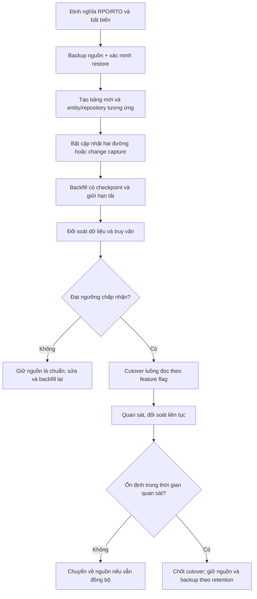

# Sao lưu, xác minh kết quả và phương án khôi phục khi chuyển đổi lỗi

## 1. Vấn đề: chuyển đổi schema thành công chưa có nghĩa dữ liệu đã an toàn

Trong **Spring Data Cassandra**, thay đổi entity, repository, `CassandraTemplate` hay câu truy vấn CQL thường kéo theo thay đổi cấu trúc bảng Apache Cassandra. Cassandra được thiết kế theo **mẫu truy vấn**: partition key quyết định nơi dữ liệu được phân bố, clustering key quyết định cách sắp thứ tự trong một partition. Vì vậy, thay đổi yêu cầu đọc dữ liệu có thể buộc ứng dụng tạo bảng mới và chuyển các bản ghi sang khóa mới.

Một migration có thể “chạy xong” nhưng vẫn sai:

- Bảng đích có đủ hàng nhưng một số hàng ở sai partition do tính sai ngày hoặc tenant.
- Dữ liệu mới được backfill trước các cập nhật gần nhất, khiến giá trị ở bảng đích cũ hơn bảng nguồn.
- Backfill làm mất TTL, biến dữ liệu sắp hết hạn thành dữ liệu tồn tại lâu hơn dự kiến.
- Hai phiên bản ứng dụng đang cùng đọc/ghi theo những quy tắc khác nhau.
- Đọc thành công với một partition nhỏ nhưng lỗi hoặc chậm khi dùng paging, consistency level và tải thực tế.
- Đã xóa bảng cũ trước khi thử khả năng khôi phục từ backup.

Để chuyển đổi an toàn cần có **ba cơ chế phối hợp**:

1. **Sao lưu có thể khôi phục:** lưu được dữ liệu, schema và các thành phần cần thiết để tái tạo trạng thái phù hợp.
2. **Xác minh kết quả:** chứng minh dữ liệu và truy vấn trong bảng mới đáp ứng các bất biến nghiệp vụ; không chỉ đếm tổng số bản ghi.
3. **Phương án khôi phục khi lỗi:** biết lúc nào chỉ cần chuyển luồng đọc về bảng cũ, lúc nào phải đồng bộ dữ liệu ngược, và khi nào buộc phải restore từ backup.

Bài này thuộc chương **Tiến hóa và di trú**, áp dụng cho dịch vụ sử dụng Spring Data Cassandra với repository, `CassandraTemplate` và truy vấn CQL. Các thao tác minh họa có tính vận hành; trước khi áp dụng phải kiểm chứng với **phiên bản Cassandra, driver và cấu hình cluster thực tế**.

## 2. Một ví dụ xuyên suốt: đổi partition key theo ngày

### 2.1. Bảng cũ

Dịch vụ đơn hàng hiện truy vấn tất cả đơn của một khách hàng trong một partition:

```sql
CREATE TABLE commerce.orders_by_customer (
    customer_id text,
    created_at  timestamp,
    order_id    uuid,
    status      text,
    total       decimal,
    PRIMARY KEY ((customer_id), created_at, order_id)
) WITH CLUSTERING ORDER BY (created_at DESC, order_id ASC);
```

`customer_id` là partition key; `created_at`, `order_id` là clustering columns. Khi một khách hàng có số lượng đơn hàng rất lớn, partition có thể tăng kích thước và ảnh hưởng latency, compaction hoặc paging. Một hướng tiến hóa là chia partition theo ngày.

### 2.2. Bảng mới

```sql
CREATE TABLE commerce.orders_by_customer_day (
    customer_id text,
    order_day   date,
    created_at  timestamp,
    order_id    uuid,
    status      text,
    total       decimal,
    PRIMARY KEY ((customer_id, order_day), created_at, order_id)
) WITH CLUSTERING ORDER BY (created_at DESC, order_id ASC);
```

Partition key mới là **(customer_id, order_day)**. Để suy ra `order_day` nhất quán, quy định lấy ngày theo UTC từ `created_at`:

```java
LocalDate orderDay =
    createdAt.atZone(ZoneOffset.UTC).toLocalDate();
```

Nếu một phần ứng dụng lấy ngày theo timezone của máy chủ, hàng có thời gian gần 00:00 có thể rơi vào partition khác. Cần kiểm thử với ngày cuối tháng, cuối năm và thời điểm chuyển múi giờ của những vùng có DST.

Repository của bảng mới phải truy vấn đủ hai thành phần partition key, ví dụ:

```sql
SELECT created_at, order_id, status, total
FROM commerce.orders_by_customer_day
WHERE customer_id = ?
  AND order_day = ?;
```

Một API cần đọc **nhiều ngày** phải truy vấn các partition ngày phù hợp và tổng hợp kết quả theo contract của ứng dụng; không mặc định có thể giữ nguyên truy vấn chỉ theo `customer_id` từ bảng cũ.

### 2.3. Bất biến cần giữ

Đối với mỗi đơn hàng thuộc phạm vi migration, sau chuyển đổi phải thỏa:

- Định danh logic `(customer_id, created_at, order_id)` duy nhất theo dữ liệu nguồn.
- `order_day = UTC_DATE(created_at)`.
- `status`, `total` và các giá trị nghiệp vụ được chuyển đúng, kể cả `null` theo quy ước.
- Những cập nhật và xóa xảy ra trong lúc migration không bị mất hoặc bị ghi đè bởi bản sao cũ.
- Quy tắc TTL/hạn lưu trữ được giữ theo **thời điểm hết hạn**; không tự kéo dài tuổi thọ dữ liệu.
- API truy vấn theo ngày trả đủ bản ghi, sắp xếp và paging đúng như contract mới.
- Việc xác minh có thể lặp lại, truy vết được về release và tập dữ liệu đang so sánh.

Đây là **tiêu chí chấp nhận** cần được viết trước khi tạo bảng mới. “Lệnh CQL không lỗi” chưa phải tiêu chí hoàn tất.

## 3. Phân biệt backup, bản sao trong migration và replica

Ba khái niệm dễ bị nhầm:

| Khái niệm | Mục đích | Tại sao chưa đủ để phục hồi? |
| --- | --- | --- |
| **Replica Cassandra** | Tăng độ sẵn sàng và đáp ứng consistency của dữ liệu đang hoạt động | Ghi sai, xóa sai và tombstone có thể lan tới replica |
| **Bảng mới/dual-write** | Chuyển đổi mô hình truy vấn, duy trì dữ liệu ở hai schema trong giai đoạn quá độ | Logic backfill hoặc dual-write có thể gây sai lệch trên cả hai bảng |
| **Backup độc lập** | Giữ một điểm dữ liệu có thể khôi phục, được bảo vệ khỏi xóa/sửa ngoài ý muốn | Cần schema, metadata, quy trình restore và kiểm chứng thực tế |

**Replication factor không phải chính sách backup.** Một bảng có RF=3 vẫn có thể mất dữ liệu về mặt logic nếu ứng dụng ghi sai vào cả ba replica. Ngược lại, backup chỉ tồn tại trên ổ đĩa của chính node đang chạy không bảo vệ được trước sự cố hủy node, mất volume hoặc mất cả datacenter.

### 3.1. RPO và RTO

Trước migration phải thống nhất:

- **RPO (Recovery Point Objective):** mức mất dữ liệu tối đa có thể chấp nhận, ví dụ “không mất đơn hàng đã xác nhận” hoặc “chấp nhận mất tối đa một khoảng thời gian được phê duyệt”.
- **RTO (Recovery Time Objective):** thời gian phục vụ lại nghiệp vụ sau sự cố, có tính tới tải backup, dựng schema, replay thay đổi, kiểm tra và chuyển routing.

RPO bằng 0 không thể đạt chỉ bằng một snapshot chụp trước migration nếu trong lúc đó vẫn có ghi mới. Muốn không mất các ghi đã xác nhận, cần một cơ chế lưu vết/thay đổi có thể replay, hoặc một khoảng **dừng ghi có kiểm soát** ở thời điểm chốt dữ liệu, kèm kiểm chứng.

## 4. Sao lưu Cassandra trước khi chuyển đổi

### 4.1. Snapshot SSTable bằng `nodetool`

Cassandra hỗ trợ snapshot SSTable ở mức node. Có thể tạo snapshot cho bảng nguồn trước cutover:

```text
# Minh họa lệnh trên node Cassandra; kiểm tra nodetool help của phiên bản.
nodetool snapshot -t before_orders_day -cf orders_by_customer commerce

# Kiểm tra danh sách snapshot được nhìn thấy tại node đó.
nodetool listsnapshots
```

Trong nhiều phiên bản Cassandra, `nodetool snapshot` tạo hard link tới các SSTable và thường flush dữ liệu trong memtable trước khi chụp, trừ khi dùng tùy chọn bỏ flush. Snapshot gắn với **node và thư mục dữ liệu của node đó**; bản thân thao tác không chuyển dữ liệu sang nơi lưu trữ an toàn ở ngoài node.

Đối với cluster nhiều node, cần thực hiện kế hoạch snapshot trên **những node cần thiết của cluster**, thu thập tất cả phần dữ liệu và metadata theo topology/replication. Không xem snapshot từ một node là bản sao đầy đủ của cả cluster. Một vòng snapshot trên nhiều node cũng **không phải transaction chụp toàn cluster tại cùng một thời điểm** khi vẫn có ghi liên tục.

Trong quy trình production:

1. Kiểm tra đủ dung lượng và tình trạng disk/compaction trước snapshot; hard link có thể giữ các SSTable cũ và tăng lượng dữ liệu phải giữ khi compaction chạy.
2. Ghi lại tag, keyspace/table, thời gian bắt đầu/kết thúc, node, datacenter, phiên bản Cassandra, topology và replication của keyspace.
3. Tạo snapshot theo runbook phù hợp với phân bố replica.
4. Sao chép nội dung snapshot và các metadata cần thiết ra kho backup **ngoài cluster**, có quyền và chính sách lưu trữ riêng.
5. Tính checksum cho tệp và xác minh sau khi tải lên; áp dụng mã hóa, quyền truy cập, phiên bản hóa/khóa xóa phù hợp.
6. Thử restore vào môi trường độc lập trước khi cho phép xóa bảng cũ.

Không chạy lệnh xóa snapshot ngay sau khi thấy upload thành công. Chỉ dọn bản lưu cục bộ theo chính sách sau khi kiểm chứng backup ở kho ngoài, nhu cầu giữ bản sao và dung lượng.

### 4.2. Bảo vệ schema và thông tin phụ thuộc

Snapshot SSTable **không thay thế** bản sao cấu hình schema và khả năng tái tạo cluster. Cần giữ:

- CQL định nghĩa keyspace, replication, bảng, primary key, clustering order, TTL mặc định, indexes, materialized views hoặc user-defined types liên quan.
- Phiên bản migration/schema, ứng dụng, Cassandra, driver và công cụ restore tương thích.
- Topology/datacenter, RF, thông tin node/token khi cần cho chiến lược phục hồi cụ thể.
- Quyền, role và cách cấp credential được bảo vệ; **không đưa mật khẩu bí mật vào backup manifest**.
- Thông tin snapshot, checksums, đường dẫn object storage, encryption key reference, thời hạn giữ và người chịu trách nhiệm.
- Checkpoint của quá trình backfill/dual-write và nhật ký biến đổi dữ liệu.

Với `cqlsh`, có thể xuất mô tả schema để lưu cạnh backup:

```text
DESCRIBE KEYSPACE commerce;
DESCRIBE TABLE commerce.orders_by_customer;
```

`DESCRIBE` là lệnh của `cqlsh`, không phải CQL do driver thực thi. Có thể đối chiếu metadata trực tiếp qua `system_schema`:

```sql
SELECT column_name, kind, position, type, clustering_order
FROM system_schema.columns
WHERE keyspace_name = 'commerce'
  AND table_name = 'orders_by_customer';
```

CQL schema xuất ra phải được kiểm tra cùng các file migration gốc. Nếu backup dữ liệu còn nhưng schema cũ, UUID bảng, kiểu UDT hoặc version không phù hợp, phục hồi có thể thất bại hoặc diễn giải sai dữ liệu.

### 4.3. Incremental backup và commit log: giới hạn cần hiểu

Ngoài snapshot, Cassandra có cơ chế incremental backups cho SSTable mới khi được bật. **Incremental backup không tự động đồng nghĩa point-in-time recovery**: nó không cung cấp một chuỗi giao dịch ứng dụng có thứ tự toàn cục và không tự chứa mọi thay đổi mới nhất đang nằm trong memtable/commit log tại một thời điểm bất kỳ.

Nếu yêu cầu RPO thấp, có thể cần phối hợp snapshot, incremental SSTable backups, cơ chế lưu trữ và replay commit log được cấu hình đúng, cùng nhật ký nghiệp vụ/CDC hoặc cơ chế thay đổi riêng. Quy trình phục hồi tới một thời điểm cụ thể phải được xác nhận cho **phiên bản Cassandra đang dùng**; không giả định cứ có file commit log là có thể phát lại an toàn trên bất kỳ schema và topology nào.

Một số thay đổi trong migration (ví dụ đổi partition key, ghép/tách cột hoặc tính `order_day`) là **biến đổi logic**, không thể phục hồi chỉ bằng cách nạp lại byte SSTable vào bảng có schema khác. Khi đó cần khôi phục dữ liệu nguồn ở schema tương thích rồi chạy lại phép biến đổi đã kiểm chứng.

### 4.4. Mẫu backup manifest

Có thể lưu một manifest không chứa secret cùng backup:

```yaml
release: orders-day-v2
cluster: example-cluster
keyspace: commerce
source_table: orders_by_customer
snapshot_tag: before_orders_day
snapshot_scope: all-required-nodes
schema_revision: v1
backup_storage: restricted-off-cluster-location
checksums: verified
cutover_checkpoint: not-yet-established
restore_test: pending
```

Các giá trị trên chỉ minh họa cấu trúc. Manifest thực tế cần danh sách node/SSTable/checksum và thông tin khôi phục cụ thể; không nên chỉ ghi `checksums: verified` mà không lưu bằng chứng kiểm tra.

## 5. Kế hoạch migration có điểm dừng và tiêu chí quay lui

Một lộ trình có thể kiểm soát được:



Trình tự này nhấn mạnh **khả năng quay về**. Bảng nguồn vẫn là nguồn dữ liệu chuẩn trong giai đoạn đầu; không xóa bảng cũ ngay khi vài câu truy vấn trên bảng mới chạy được.

### 5.1. Preflight

Trước khi chạy backfill:

- Đóng băng phiên bản schema nguồn/đích cho release, ghi lại checksum của migration.
- Xác định người sở hữu và quyền của tài khoản runtime, backfill và schema migration; runtime không nên có quyền DDL.
- Kiểm tra topology, RF, consistency level, trạng thái node/replica, dung lượng disk, compaction và baseline p95/p99 latency.
- Ước tính số partition, kích thước dữ liệu, bandwidth, tốc độ backfill, chi phí ghi hai bảng, TTL và tombstone.
- Chọn nguồn sự thật cho dữ liệu đang cập nhật, cách lưu dấu xóa, cách phát hiện ghi một nhánh thành công một nhánh thất bại.
- Xác định checkpoint an toàn, điều kiện tạm dừng và cách tiếp tục khi process backfill bị kill.
- Kiểm tra backup độc lập và chạy ít nhất một thử nghiệm restore đáng tin cậy trước cutover.

### 5.2. Dual-write không phải transaction đa bảng

Một cách chuyển đổi là ghi đồng thời bảng cũ và bảng mới. Tuy nhiên, hai lệnh ghi do ứng dụng phát đi **không tạo một transaction nghiệp vụ nguyên tử trải qua mọi partition/bảng** chỉ vì cùng nằm trong Spring service hoặc được gọi liên tiếp.

Ví dụ có ba kết quả cần xử lý:

| Ghi bảng cũ | Ghi bảng mới | Ý nghĩa |
| --- | --- | --- |
| Thành công | Thành công | Hai đường ghi đã báo thành công cho request này; vẫn cần xem consistency/semantics |
| Thành công | Thất bại | Bảng mới thiếu thay đổi; cần retry hoặc reconciliation idempotent |
| Thất bại | Thành công | Bảng mới có thay đổi chưa được ghi vào nguồn chuẩn; cần đối soát theo quyết định nguồn sự thật |

Timeout càng khó: client không nhận được phản hồi **không chứng minh** ghi chưa được áp dụng. Cassandra thực thi ghi theo timestamp và consistency; các lần retry hoặc backfill có thể thắng/thua nhau theo last-write-wins. Một bản ghi backfill được ghi sau với timestamp mới có thể **ghi đè** thay đổi đang diễn ra ở bảng đích dù nó chứa giá trị cũ hơn về nghiệp vụ.

Vì vậy, cần một chiến lược cụ thể: idempotent key, ghi nhận thay đổi theo version/event, xử lý cập nhật/xóa có thứ tự nghiệp vụ, cơ chế đối soát và checkpoint. Nếu không có change capture đáng tin cậy, một phương án dễ kiểm chứng hơn là **dừng hoặc hạn chế ghi trong cửa sổ chốt cuối**, xử lý các delta còn lại, đối soát rồi mới cutover.

Không coi `LOGGED BATCH` là transaction tổng quát cho nhiều bảng hay thay thế cho việc kiểm soát ordering, consistency và rollback nghiệp vụ. Nếu ứng dụng dùng CDC của Cassandra, phải xác minh tính năng được bật, cách tiêu thụ, retention, tính đầy đủ và khả năng replay theo thiết kế thực tế; CDC không mặc nhiên tồn tại cho mọi bảng.

### 5.3. Backfill phù hợp mô hình phân tán

Backfill phải đọc dữ liệu nguồn bằng cơ chế có thể bao phủ mọi partition mà không tạo truy vấn `ALLOW FILTERING` hoặc scan tự phát trong một request online. Tùy quy mô, có thể lập kế hoạch các token range, dùng công cụ bulk/data pipeline được phê duyệt hoặc danh sách partition key đáng tin cậy từ hệ thống nghiệp vụ.

Khi ghi bảng đích:

- Tính `order_day` trong UTC một cách xác định.
- Dùng khóa idempotent `(customer_id, order_day, created_at, order_id)`.
- Giới hạn concurrency, kích thước page, tốc độ đọc/ghi và retry.
- Theo dõi tiến độ theo đơn vị xử lý có thể tiếp tục (token range/partition + checkpoint đủ chính xác).
- Cân nhắc TTL còn lại, tombstone, dữ liệu đã bị xóa và quy tắc cập nhật.
- Tránh `COUNT(*)` trên toàn bảng để đo tiến độ trong đường nóng; dùng metrics của job, sổ theo dõi partition và phép đối soát có kiểm soát.

**Điểm tinh tế:** nếu bản ghi nguồn có TTL còn 30 phút mà backfill đặt lại TTL 30 ngày hoặc bỏ TTL, dữ liệu đích sẽ tồn tại sai quy định. Cần bảo toàn thời điểm hết hạn theo semantics yêu cầu. Với dữ liệu đã xóa, một bản ghi cũ từ snapshot có thể được phục hồi ngoài ý muốn nếu không xử lý tombstone/version và các cập nhật mới hơn.

## 6. Xác minh dữ liệu: nhiều lớp, không chỉ tổng số hàng

Không có một phép đếm nào thay thế được việc kiểm tra tính đúng đắn của toàn migration. Nên dùng các lớp xác minh từ rẻ tới sâu, với **phạm vi thời gian/checkpoint giống nhau**.

### 6.1. Lớp 1 — Schema và quyền

Sau khi tạo bảng mới:

- Đối chiếu tên cột, kiểu CQL, partition/clustering key và thứ tự với entity Java.
- Xác nhận keyspace, replication, TTL mặc định, compaction và các lựa chọn schema liên quan.
- Dùng role runtime thật để thử repository hoặc `CassandraTemplate` đọc/ghi dữ liệu cho phép; không cho role đó thao tác DDL.
- Đối chiếu schema agreement theo cơ chế công cụ/driver phù hợp trước khi mở lưu lượng mới.
- Chạy integration test cho query sử dụng đầy đủ partition key `(customer_id, order_day)`.

Sai schema là **blocker** đối với cutover, dù dữ liệu đã được copy.

### 6.2. Lớp 2 — Đếm theo nhóm có nghĩa nghiệp vụ

Một nguồn xác minh hữu ích là đếm số đơn hàng theo customer và ngày UTC. Tuy nhiên, Cassandra không phải công cụ SQL analytics tự do: không nên chạy `GROUP BY` hoặc `COUNT(*)` toàn cluster qua một repository chỉ để kiểm migration.

Thay vào đó, job đối soát đọc dữ liệu nguồn qua một cơ chế quét có kiểm soát, phát ra:

```text
(customer_id, UTC_DATE(created_at)) -> source_count
```

và đọc từng partition ngày ở bảng đích để có:

```text
(customer_id, order_day) -> target_count
```

Hai bộ kết quả chỉ so sánh được nếu dùng **cùng phạm vi dữ liệu tại checkpoint**. Nếu nguồn liên tục nhận ghi mới, một phép đếm trước và một phép đếm sau có thể lệch hợp lệ. Cần đóng băng phạm vi hoặc sử dụng version/watermark cùng nhật ký delta.

### 6.3. Lớp 3 — Đối chiếu từng khóa và giá trị

Định nghĩa bản ghi logic sau chuẩn hóa:

```text
Identity = (customer_id, created_at, order_id)

CanonicalValue = (
    identity,
    status,
    decimal_value(total),
    expiry_policy
)
```

Với mỗi khách hàng/ngày (hoặc từng batch trong token range):

1. Đọc bản ghi nguồn trong phạm vi checkpoint, chuyển sang `CanonicalValue`.
2. Đọc partition đích tương ứng, chuyển sang cùng dạng.
3. So sánh **tập khóa**, phát hiện thiếu, thừa và trùng.
4. Với khóa trùng, đối chiếu `status`, `total`, quy tắc `null`, TTL/hết hạn và version.
5. Ghi một kết quả đối soát có checkpoint, thời gian, số lỗi và checksum; giữ danh sách khóa bất thường trong nơi được bảo vệ để sửa có chọn lọc.

Đối với giá trị tiền, `BigDecimal("20.0")` và `BigDecimal("20.00")` có thể bằng nhau về số học nhưng khác biểu diễn/scale. Phải định nghĩa canonicalization theo **nghĩa nghiệp vụ**, không hash trực tiếp chuỗi `toString()` của giá trị khi format khác nhau vẫn được chấp nhận.

Với `timestamp`, tránh làm tròn không nhất quán giữa Java `Instant` và độ chính xác lưu của kiểu CQL. Cân nhắc chuẩn hóa về độ chính xác của Cassandra trước khi so sánh.

### 6.4. Lớp 4 — Kiểm thử query, thứ tự và paging

CQL minh họa hai đường đọc:

```sql
-- V1: toàn bộ đơn hàng trong một partition của khách hàng.
SELECT created_at, order_id, status, total
FROM commerce.orders_by_customer
WHERE customer_id = ?;

-- V2: partition của đúng khách hàng và đúng ngày.
SELECT created_at, order_id, status, total
FROM commerce.orders_by_customer_day
WHERE customer_id = ?
  AND order_day = ?;
```

Kiểm thử phải kiểm tra:

- Đơn hàng nằm trước/sau 00:00 UTC rơi vào đúng partition ngày.
- Hai khách hàng khác nhau không lẫn dữ liệu.
- Thứ tự `created_at DESC` phù hợp với contract của từng partition; API nhiều ngày phải tổng hợp đúng.
- Các trang có page size nhỏ không bỏ sót hoặc nhân đôi bản ghi khi dữ liệu ổn định.
- Quy tắc `WHERE` đúng partition key; không dùng `ALLOW FILTERING` để bù đắp schema không phù hợp.
- Consistency level đang dùng trong sản phẩm có đủ replica và độ trễ mong muốn ở môi trường kiểm chứng.

Paging state của Cassandra gắn với truy vấn và tham số cụ thể. Không chuyển paging state từ truy vấn bảng cũ sang bảng mới hoặc coi cursor giữa hai schema là tương đương; API cần chính sách reset/chuyển cursor khi cutover.

### 6.5. Lớp 5 — Kiểm tra vận hành

Để bảo đảm migration không gây suy giảm hiệu năng:

| Nhóm | Thước đo | Khi nào dừng/giảm tốc? |
| --- | --- | --- |
| Backfill | Partition/giây, hàng/giây, backlog, checkpoint age | Hàng đợi tăng liên tục hoặc không có tiến độ |
| Cassandra client | Request latency, timeout, retry, pool in-flight | Tăng rõ rệt so với baseline/SLO |
| Cluster | CPU, disk, compaction, dropped messages, pending tasks | Cluster thiếu dung lượng hoặc compaction chậm kéo dài |
| Độ đúng dữ liệu | Missing/extra/mismatch, độ trễ đồng bộ | Sai lệch vượt ngưỡng đã định |
| API | Error rate, p95/p99, paging failures | Ảnh hưởng người dùng hoặc vi phạm SLO |

Không dựa duy nhất vào `nodetool status` cho kết luận “cluster khỏe”. Node UP không chứng minh query theo phân vùng mới hoạt động đúng dưới tải.

## 7. Ví dụ kiểm thử đối soát trong ứng dụng

Một phép đối chiếu tích hợp có thể chạy với dữ liệu mẫu cố định. Dùng Spring Data repository cho từng entity/schema hoặc `CassandraTemplate`, tránh yêu cầu một entity Java ánh xạ đồng thời hai bảng có cấu trúc primary key khác nhau.

Giả sử fixture:

| customer_id | created_at UTC | order_id | Trạng thái |
| --- | --- | --- | --- |
| KH-01 | 2026-02-28 23:59:59 | UUID-A | PAID |
| KH-01 | 2026-03-01 00:00:01 | UUID-B | NEW |
| KH-02 | 2026-03-01 00:00:01 | UUID-C | PAID |

Khi backfill xong, ít nhất phải có:

- `(KH-01, 2026-02-28)` chứa `UUID-A`.
- `(KH-01, 2026-03-01)` chứa `UUID-B`.
- `(KH-02, 2026-03-01)` chứa `UUID-C`.

Một mẫu test không phụ thuộc vào thứ tự đọc:

```java
@Test
void migrationDistributesOrdersIntoCorrectUtcDayPartitions() {
    // Fixture đã được chuẩn bị bằng repository V1 trong Cassandra test.
    migrationBackfill.runForTestFixture();

    List<OrderByCustomerDay> feb28 =
        dayRepository.findByKeyCustomerIdAndKeyOrderDay(
            "KH-01", LocalDate.parse("2026-02-28")
        );

    List<OrderByCustomerDay> mar01 =
        dayRepository.findByKeyCustomerIdAndKeyOrderDay(
            "KH-01", LocalDate.parse("2026-03-01")
        );

    assertThat(feb28)
        .extracting(row -> row.getKey().getOrderId())
        .containsExactly(uuidA);

    assertThat(mar01)
        .extracting(row -> row.getKey().getOrderId())
        .containsExactly(uuidB);
}
```

`OrderByCustomerDay`, `dayRepository` và `migrationBackfill` là các thành phần dự kiến của ví dụ, cần triển khai tương ứng với schema v2. Test này chỉ kiểm tra một lát cắt của dữ liệu; bộ test thực tế cần thêm hàng cập nhật sau backfill, xóa, TTL, retry và paging.

### 7.1. Thử sự cố chủ đích

Một bộ thử nghiệm đáng tin cậy cần mô phỏng:

1. **Dừng job sau một batch:** chạy lại không tạo kết quả sai hoặc ghi đè cập nhật mới.
2. **Lỗi ghi v2 trong khi v1 thành công:** có tín hiệu lỗi và cơ chế reconciliation đưa hai bảng về trạng thái đã định.
3. **Retry sau timeout không rõ kết quả:** không nhân đôi tác dụng phụ nghiệp vụ.
4. **Sửa/xóa đơn trong khi backfill:** bảng đích nhận trạng thái mới nhất theo quy tắc đã công bố.
5. **Khác timezone:** đơn gần nửa đêm UTC vẫn vào đúng partition.
6. **Đổi schema một nửa:** ứng dụng mới không được cutover khi bảng đích chưa sẵn sàng.
7. **Mất node hoặc giảm replica khả dụng:** hệ thống tạm dừng/giảm tốc theo threshold; không che lỗi consistency.
8. **Phục hồi từ backup vào môi trường độc lập:** dữ liệu và CQL thực sự dùng lại được.

Testcontainers một node phù hợp để kiểm tra mapping, CQL và backfill cơ bản. Các kiểm thử về quorum, replica lỗi và hiệu năng phân tán cần môi trường nhiều node với topology/RF phù hợp.

## 8. Phương án xử lý khi migration lỗi

Không phải lỗi nào cũng cần restore SSTable. Khả năng quay lui phụ thuộc vào **thời điểm cutover** và bảng nào còn chứa dữ liệu đầy đủ nhất.

| Thời điểm/sự cố | Nguồn dữ liệu còn tin cậy? | Hành động an toàn ưu tiên |
| --- | --- | --- |
| Backfill chưa xong, chưa đổi luồng đọc | V1 vẫn là nguồn chuẩn | Dừng/giảm backfill, sửa lỗi, chạy lại từ checkpoint |
| V2 có sai lệch, ứng dụng vẫn dual-write và V1 đầy đủ | V1 còn hiện hành | Tắt đọc V2, đối soát delta, sửa/bổ sung V2 |
| Đã đọc V2 nhưng vẫn ghi đủ vào V1 | V1 có thể còn cập nhật | Quay flag đọc về V1 sau khi xác minh đồng bộ và API contract |
| Đã ngừng ghi V1, chỉ V2 nhận ghi mới | V1 đã **cũ** | Không chuyển về V1 trực tiếp; cần reverse sync/replay có kiểm soát |
| Migration làm sai hoặc xóa dữ liệu nguồn | Cần backup + change log phù hợp | Cô lập tác động, chọn mốc restore, khôi phục và đối soát |
| Sai role/permission hoặc schema chưa hoàn tất | Dữ liệu có thể còn nguyên | Sửa quyền/schema/triển khai; kiểm tra trước khi quyết định restore |
| Độ trễ tăng do partition nóng | Dữ liệu có thể vẫn đúng | Giảm tải/backfill, điều tra query/partition và health |

**Quay lui code** và **phục hồi dữ liệu** không phải một thao tác. Feature flag đổi chiều đọc chỉ an toàn khi bảng được quay về có mọi thay đổi cần thiết của khoảng thời gian đã chạy bảng mới.

### 8.1. Fail trước cutover

Nếu V1 vẫn nhận tất cả ghi chuẩn và chỉ có V2 đang backfill:

1. Dừng backfill hoặc chuyển sang chế độ không ghi thêm.
2. Ghi checkpoint cuối, lỗi và batch nào chưa xác minh.
3. Xác nhận V1 không bị ảnh hưởng; kiểm tra một số truy vấn đại diện và metric.
4. Sửa phép chuyển đổi hoặc làm sạch dữ liệu lỗi ở V2 theo phạm vi đã xác định.
5. Chạy lại phần có thể idempotent và đối soát từ checkpoint.

Trong kịch bản này, không cần nạp lại snapshot chỉ vì V2 sai. V1 vẫn là nguồn chính xác hơn.

### 8.2. Fail sau khi đọc V2

Nếu V1 và V2 vẫn nhận đầy đủ thay đổi:

1. Ngừng chuyển thêm lưu lượng sang V2.
2. Kiểm tra độ trễ đồng bộ, các sự kiện chưa xử lý và độ đầy đủ của V1.
3. Chuyển luồng đọc về V1 qua feature flag/rollout có kiểm soát.
4. Đối soát lỗi đã gây ra ở V2 trước lần cutover tiếp theo.

Nếu trước đó đã tắt ghi V1, bước 2 **bắt buộc** phải có reverse sync, replay log hoặc cơ chế khác đưa các thay đổi mới về V1. Chỉ đổi biến cấu hình về bảng cũ lúc này có thể làm “mất” các đơn hàng được ghi sau cutover, dù chúng vẫn tồn tại ở V2.

### 8.3. Fail sau khi đã xóa hoặc làm hỏng nguồn

Đây là tình huống phải cân nhắc restore:

1. **Cô lập nguồn gây lỗi:** dừng migration job hoặc writer đang ghi sai; cân nhắc đóng băng một phần ghi để không tiếp tục phá dữ liệu.
2. **Bảo toàn bằng chứng:** giữ log, checkpoint, metadata schema, tập SSTable và thông tin thời điểm phát hiện.
3. **Xác định điểm phục hồi:** snapshot hoặc tập backup gần nhất được xác minh, cộng delta/commit log/event nếu có khả năng replay đáng tin cậy.
4. **Khôi phục vào môi trường độc lập** hoặc đích được thiết kế để tránh ghi đè dữ liệu mới hơn.
5. **Kiểm tra schema và dữ liệu:** đối chiếu partition, TTL, tombstone, trạng thái cập nhật/xóa, tính đúng nghiệp vụ và tính nhất quán đọc.
6. **Khôi phục các thay đổi sau mốc snapshot** theo thứ tự và ngữ nghĩa phù hợp để đạt RPO đã cam kết.
7. **Chuyển traffic sau khi đạt gate:** chỉ đưa API trở lại khi kết quả và latency đạt yêu cầu, có khả năng quay lui nếu phát hiện vấn đề.

Không nạp trực tiếp SSTable cũ vào bảng đang tiếp tục nhận ghi mới khi chưa phân tích timestamp, tombstone, TTL và schema. Dữ liệu cũ có thể không thắng/không thua ghi mới theo cách ứng dụng mong đợi, và việc khôi phục có thể vô tình tái xuất hiện dữ liệu đã bị xóa.

## 9. Thực hành restore snapshot vào môi trường cô lập

Snapshot trên node là các file SSTable và cần được phục hồi theo cách phù hợp phiên bản. Một lộ trình an toàn về mặt nguyên tắc:

### Bước 1 — Dựng môi trường tương thích

Dùng cluster restore được cô lập, với phiên bản Cassandra/công cụ phù hợp, schema/keyspace đúng và cấu hình replication được đánh giá. Không cho job/backfill production tự động kết nối vào cluster này.

### Bước 2 — Kiểm tra backup

Đọc manifest, danh sách node, thời điểm chụp, cấu trúc schema và checksums. Tải các SSTable từ kho ngoài và xác minh toàn vẹn. Nếu thiếu tệp hoặc schema không tương thích, đánh dấu restore chưa đủ dữ liệu; không cho phép dùng kết quả để quyết định cutover.

### Bước 3 — Tái tạo schema nguồn

Khôi phục schema của bảng **theo phiên bản backup**. Nếu muốn chuyển sang schema V2, nên khôi phục bảng V1 ở nơi tương thích trước rồi thực hiện migration logic từ V1 → V2; chỉ đổi tên bảng không đảm bảo dữ liệu SSTable chứa đúng partition/clustering keys mới.

### Bước 4 — Nạp SSTable bằng công cụ phù hợp

Tùy kịch bản và phiên bản Cassandra, có thể dùng quy trình dựa trên `sstableloader` để bulk load SSTable vào cluster đích, hoặc một quy trình phục hồi SSTable/node-local phù hợp với topology được kiểm soát (có thể liên quan `nodetool refresh`). Hai phương án có điều kiện sử dụng khác nhau; **không** sao chép file vào thư mục dữ liệu node bất kỳ rồi giả định driver nhận được dữ liệu đúng.

Cần tuân thủ tài liệu restore của bản Cassandra đang chạy, bao gồm cấu trúc đường dẫn keyspace/table, loại SSTable, quyền file, schema và tương thích phiên bản. Việc phục hồi node thay thế, cluster mới và phục hồi một bảng đơn lẻ thường có các bước khác nhau.

### Bước 5 — Xác minh restore từ phía ứng dụng

Kết nối bằng một tài khoản chỉ đọc phù hợp và dùng repository/`CassandraTemplate`/CQL để:

- Truy vấn theo partition key nguồn.
- Kiểm tra tập khóa và giá trị logic theo checkpoint đã chọn.
- Thử những hàng đã cập nhật, xóa hoặc dùng TTL.
- Kiểm tra lược đồ, consistency level và paging.
- So sánh checksum/manifest với kết quả dự kiến, ghi chênh lệch để xử lý.

Một restore “tải SSTable thành công” nhưng ứng dụng không đọc đúng vẫn là restore chưa đạt.

### Bước 6 — Quyết định khả năng đưa vào sử dụng

Sau khi áp dụng các thay đổi hậu snapshot có thể replay, so sánh dữ liệu theo điểm phục hồi thực tế với RPO/SLO và phê duyệt cutover. Đo RTO **từ lúc sự cố được xác định tới khi dịch vụ hoạt động trở lại**, không chỉ thời gian chạy công cụ nạp dữ liệu.

Nếu không có log/delta để tái hiện các ghi mới, phải công bố rõ phạm vi dữ liệu còn thiếu theo thời điểm backup; không được tuyên bố khôi phục hoàn toàn từ snapshot cũ.

## 10. Tình huống đặc biệt: TTL, tombstone và timestamp

### 10.1. TTL

Ví dụ nguồn lưu một sự kiện với TTL 7 ngày. Sau 6 ngày, backfill ghi sang V2 với TTL 7 ngày từ đầu. Dữ liệu ở V2 sẽ tồn tại **thêm nhiều ngày** so với chính sách nguồn.

Phương án phù hợp tùy nghiệp vụ:

- Lưu `expiresAt` làm metadata nghiệp vụ để tính TTL còn lại khi ghi V2.
- Hoặc trích xuất TTL còn lại ở nguồn nếu CQL và kiểu dữ liệu cho phép, cân nhắc thời gian trôi giữa đọc và ghi.
- Nếu cột không có TTL hoặc hết hạn riêng theo cột, thiết kế canonicalization tương ứng.
- Đối chiếu các trường hợp sắp hết hạn và đã hết hạn; tránh “hồi sinh” dữ liệu.

Cassandra TTL có độ chính xác và ngữ nghĩa cụ thể theo cột/row; đọc `TTL(column)` có thể giúp kiểm tra tình huống phù hợp, nhưng không áp dụng tùy tiện cho primary-key columns và không tự đủ để xây một chương trình migration tổng quát.

### 10.2. Xóa và tombstone

Cassandra dùng tombstone để biểu diễn xóa. Một backup hoặc bản sao trước thời điểm xóa có thể còn chứa giá trị cũ; restore hay backfill không hiểu mốc xóa có thể đưa giá trị đó trở lại.

Cần xem xét:

- Thời điểm/timestamp của ghi và xóa.
- Các sự kiện xóa trong giai đoạn dual-write.
- Khả năng replay hay đối soát xóa từ nguồn sự thật.
- Cấu hình retention/gc grace, repair và quy trình backup/restore.

Không tự điều chỉnh `gc_grace_seconds` hay dùng `nodetool repair` như mẹo chung để giải quyết mọi sai lệch. Hai cơ chế có mục đích và hệ quả vận hành riêng; phải có runbook dựa trên phiên bản và topology thực tế.

### 10.3. Last-write-wins và backfill ghi đè dữ liệu mới

Cassandra phân giải nhiều thay đổi theo timestamp; nếu backfill lấy giá trị cũ từ V1 rồi ghi lên V2 với timestamp mới hơn update đang được ứng dụng ghi, V2 có thể bị **regression**. Việc xử lý cần một chính sách đồng bộ có thứ tự và idempotent theo version dữ liệu, hoặc freeze/delta catch-up được xác minh; không chỉ tăng số lần retry.

Một câu lệnh `INSERT` báo thành công không chứng minh giá trị đọc lại là mới nhất về nghiệp vụ. Vì vậy, đối soát các trường có thể cập nhật thường xuyên quan trọng như đối soát số hàng.

## 11. Ma trận kiểm thử kế hoạch phục hồi

| Kịch bản | Bằng chứng cần thu | Kết quả chấp nhận |
| --- | --- | --- |
| Backup ngay trước migration | Manifest, schema, SSTable checksums | Có thể truy xuất các bản sao cần thiết ở kho độc lập |
| Restore thử nghiệm | Thời gian hoàn tất, dữ liệu, query check | Ứng dụng đọc được dữ liệu theo RPO/RTO |
| Job backfill bị dừng | Checkpoint, dữ liệu hai bảng | Chạy lại không ghi đè giá trị mới |
| Dual-write V1 thành công, V2 thất bại | Log sự kiện/reconciliation | V2 được bù dữ liệu hoặc dừng cutover |
| Sai timezone ở mốc 00:00 | So sánh khóa ở hai ngày | Phát hiện và sửa partition sai |
| Có UPDATE/DELETE giữa backfill | Version/tombstone và key diff | Không “hồi sinh” hay ghi đè dữ liệu đã cập nhật |
| Đọc V2 thất bại sau cutover | Feature flag và đồng bộ V1 | Quay về V1 **chỉ khi** V1 đủ dữ liệu |
| Snapshot cũ hơn ghi gần nhất | Cutover watermark và delta log | Replay đầy đủ trong giới hạn RPO |
| Cluster mất replica với CL QUORUM | Node/driver/server metrics | Quy trình tạm dừng đúng, không coi node UP là đủ |
| Tải cao khi đối soát | p95/p99, compaction, disk | Throttle/stop theo threshold, không ảnh hưởng SLO |

Với bài học tích hợp, có thể bắt đầu từ một keyspace Testcontainers cô lập, sau đó chuyển sang staging nhiều node khi muốn kiểm tra replication, consistency và restore topology. Chỉ test trên vài bản ghi không đủ đánh giá thời gian khôi phục dữ liệu lớn.

## 12. Quyết định Go/No-Go trước khi xóa bảng cũ

Không nên xóa bảng nguồn cho tới khi **mọi điều kiện** sau được đáp ứng:

- [ ] Backup nguồn đã nằm ngoài cluster, có checksums/manifest và kiểm thử restore thành công.
- [ ] Schema V2 được lưu trong migration versioned; keyspace, RF, partition/clustering key đúng.
- [ ] Backfill có checkpoint và hoàn tất theo phạm vi được xác định.
- [ ] Các ghi, cập nhật và xóa xảy ra trong migration đã được đối soát, không còn khoảng delta chưa xử lý.
- [ ] Đối chiếu tập khóa và giá trị theo từng partition/ngày đạt ngưỡng chấp nhận; trường hợp sai lệch đã được xử lý.
- [ ] TTL, null, decimal, timestamp, tombstone và dữ liệu legacy đã được kiểm tra.
- [ ] Truy vấn repository, `CassandraTemplate` và `@Query` mới chạy đúng, không lọc phân tán tùy tiện.
- [ ] Paging, thứ tự, consistency và latency được kiểm chứng với dữ liệu/tải đại diện.
- [ ] Luồng đọc V2 ổn định trong khoảng quan sát đã định, không có lỗi tăng bất thường.
- [ ] Biết rõ sau khi dừng ghi V1 có thể quay về bằng cách nào và mất bao lâu.
- [ ] RPO/RTO được đo hoặc ước lượng từ một **diễn tập có bằng chứng**, không chỉ là mục tiêu trên giấy.
- [ ] Có phê duyệt release, lịch giữ backup và kế hoạch dọn schema/credential tạm thời.

Nếu một điều kiện chưa đạt, tiếp tục giữ V1 trong trạng thái được bảo vệ hoặc trì hoãn bước phá hủy. Với hệ thống lớn, chi phí giữ bảng cũ thêm một khoảng thời gian thường dễ kiểm soát hơn nguy cơ mất dữ liệu không thể tái tạo.

## 13. Checklist vận hành ngắn gọn khi có sự cố

1. **Dừng tác nhân gây lỗi:** tạm dừng migration/backfill hoặc writer liên quan; ghi lại checkpoint và phiên bản.
2. **Xác định nguồn chuẩn:** V1 còn được cập nhật? V2 đã nhận ghi mới một mình? Có CDC/event log để replay không?
3. **Phân loại:** lỗi query/schema, sai dữ liệu logic, mất dữ liệu vật lý, thiếu replica/consistency hay lỗi quyền.
4. **Chọn nhánh xử lý:** sửa và chạy lại backfill; quay read flag nếu V1 còn đầy đủ; reverse sync; hoặc restore từ backup độc lập.
5. **Xác minh điểm phục hồi:** dữ liệu, schema, TTL/tombstone, quyền, latency, paging và ngưỡng RPO/RTO.
6. **Mở lưu lượng có kiểm soát:** quan sát error rate, độ trễ, sai lệch và khả năng tiếp tục phục hồi.
7. **Lưu báo cáo:** nguyên nhân, dữ liệu bị ảnh hưởng, thời gian, thay đổi thực hiện và hành động phòng ngừa.

**Ghi nhớ:** trong Cassandra, có replica và có snapshot chưa đủ để bảo đảm phục hồi. Một migration an toàn phải xác minh dữ liệu **theo khóa truy vấn và mốc thay đổi**, giữ nguồn chuẩn cho tới khi cutover ổn định, và có thử nghiệm restore từ backup độc lập. Spring Data Cassandra giúp xây entity/repository/CQL nhưng không thay thế chính sách backup, kiểm chứng consistency và quy trình khôi phục dữ liệu của hệ phân tán.
