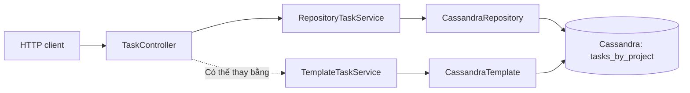

# Xây dựng CRUD bằng Repository và CassandraTemplate

Trong bài thực hành này, bạn sẽ xây dựng một API quản lý **công việc (Task)** bằng **Spring Data Cassandra** và **Apache Cassandra**. Cùng một bảng dữ liệu sẽ được truy cập qua hai cách: **`CassandraRepository`** cho CRUD phổ biến và **`CassandraTemplate`** khi cần kiểm soát rõ hơn các thao tác truy cập dữ liệu. Cuối bài, bạn sẽ có endpoint tạo, đọc, cập nhật, xóa công việc, có thể kiểm tra dữ liệu thật bằng CQL và viết được integration test không phụ thuộc bản ghi còn sót.

Bài thuộc chương **Bài thực hành** của module `SPRING_DATA_CASSANDRA`. Vì Cassandra là hệ quản trị dữ liệu phân tán, ta cũng cần thực hành cách thiết kế bảng theo truy vấn, chọn **partition key**, hiểu ngữ nghĩa **upsert**, kiểm soát **consistency**, và biết vì sao phân trang phải sử dụng **paging state** thay vì tư duy `OFFSET` của cơ sở dữ liệu quan hệ.

## 1. Yêu cầu bài toán và tiêu chí hoàn thành

Ứng dụng quản lý các công việc trong một dự án. Mỗi công việc có:

| Thuộc tính | Kiểu dữ liệu | Ý nghĩa |
| --- | --- | --- |
| `projectId` | `UUID` | Dự án chứa công việc; dùng làm partition key |
| `taskId` | `UUID` | Định danh công việc trong dự án |
| `title` | `String` | Tên công việc |
| `status` | `String` | Một trong `TODO`, `DOING`, `DONE` |
| `createdAt` | `Instant` | Thời điểm tạo |
| `updatedAt` | `Instant` | Thời điểm cập nhật |

API cần xử lý những yêu cầu:

- Tạo công việc trong một dự án.
- Đọc chi tiết công việc theo `projectId` và `taskId`.
- Thay đổi trạng thái của công việc.
- Xóa một công việc, không ảnh hưởng đến công việc khác.
- Truy vấn một tập nhỏ công việc trong một dự án để kiểm tra cách Cassandra sử dụng partition key.

**Tiêu chí hoàn thành:** các thao tác chạy trên Cassandra thật; cùng một khóa chính đọc được cùng một bản ghi bằng Repository hoặc Template; update thay đổi dữ liệu; delete làm bản ghi không còn được tìm thấy; test chạy lại được mà không cần `TRUNCATE` toàn bảng.

## 2. Sơ đồ tổng quan



Hai service minh họa **hai cách triển khai cùng nghiệp vụ**. Controller trong ví dụ sẽ sử dụng `RepositoryTaskService`; sau khi kiểm tra xong, bạn có thể thay service ở controller bằng bản Template hoặc thử trực tiếp qua integration test. Không cần tạo hai bảng chỉ để so sánh hai API.

### Công cụ

- JDK 17 trở lên, Maven và một dự án Spring Boot phù hợp với Spring Data Cassandra đang sử dụng.
- Cassandra chạy cục bộ hoặc một cluster **dành riêng cho môi trường phát triển/test**; có thể sử dụng Docker hoặc Testcontainers.
- `cqlsh` hoặc công cụ chạy CQL tương đương.
- Một HTTP client như `curl`/Postman.

Dependency Maven cơ bản (phiên bản được quản lý bởi Spring Boot BOM của dự án):

```xml
<dependencies>
    <dependency>
        <groupId>org.springframework.boot</groupId>
        <artifactId>spring-boot-starter-data-cassandra</artifactId>
    </dependency>
    <dependency>
        <groupId>org.springframework.boot</groupId>
        <artifactId>spring-boot-starter-web</artifactId>
    </dependency>
    <dependency>
        <groupId>org.springframework.boot</groupId>
        <artifactId>spring-boot-starter-validation</artifactId>
    </dependency>
    <dependency>
        <groupId>org.springframework.boot</groupId>
        <artifactId>spring-boot-starter-test</artifactId>
        <scope>test</scope>
    </dependency>
</dependencies>
```

Đây là phần `dependencies` để chèn vào `pom.xml` **đã dùng Spring Boot parent/BOM**, không phải toàn bộ file Maven. Nhóm ví dụ Java ở các bước sau giả định các lớp nằm trong cùng package `com.example.cassandralab` hoặc được import đúng khi tách package.

## 3. Thiết kế bảng theo cách ứng dụng đọc dữ liệu

Đường truy cập quan trọng nhất là **đọc một công việc bằng `(projectId, taskId)`**. Ngoài ra, màn hình dự án có thể cần xem danh sách nhỏ các công việc của cùng dự án. Một bảng phù hợp cho bài thực hành:

```sql
CREATE KEYSPACE IF NOT EXISTS spring_data_lab
WITH replication = {
    'class': 'SimpleStrategy',
    'replication_factor': 1
};

USE spring_data_lab;

CREATE TABLE IF NOT EXISTS tasks_by_project (
    project_id uuid,
    task_id uuid,
    title text,
    status text,
    created_at timestamp,
    updated_at timestamp,
    PRIMARY KEY ((project_id), task_id)
);
```

**Giải thích thiết kế:**

- `project_id` là **partition key**, dùng để tìm partition và phân phối dữ liệu trên cluster.
- `task_id` là **clustering column**. Cặp `(project_id, task_id)` xác định duy nhất một hàng.
- Cassandra sắp xếp hàng trong mỗi partition theo `task_id` (mặc định tăng dần), **không theo `created_at`**. Do đó không thể tự nhận danh sách trả về là “công việc mới nhất”.
- Không có foreign key hay join với bảng `projects`. Nếu sau này cần liệt kê công việc theo người được giao hoặc theo thời điểm tạo, hãy thiết kế bảng truy vấn/projection tương ứng thay vì dùng `ALLOW FILTERING`.

`SimpleStrategy` với replication factor 1 ở đây **chỉ để chạy Cassandra một node trong phòng thực hành**. Với môi trường nhiều datacenter, chọn `NetworkTopologyStrategy` và replication factor theo topology thực tế; không sao chép cấu hình lab sang production.

**Giới hạn thiết kế:** bảng theo `project_id` phù hợp khi số công việc/dự án còn được kiểm soát. Nếu một dự án chứa hàng triệu công việc, partition có thể quá lớn; cần đo kích thước partition và xem xét bucket/shard theo đường truy cập. Việc chọn partition key phải bắt đầu từ **truy vấn thật**, không chỉ từ mối quan hệ đối tượng trong Java.

## 4. Kết nối Spring Boot với Cassandra

Ví dụ `application.yml` cho Cassandra local:

```yaml
spring:
  cassandra:
    contact-points: localhost:9042
    local-datacenter: datacenter1
    keyspace-name: spring_data_lab
    schema-action: NONE
```

Tên datacenter `datacenter1` là **ví dụ** thường gặp ở một số môi trường Cassandra local; phải thay bằng datacenter thực của cluster. `schema-action: NONE` thể hiện lựa chọn khởi tạo bảng bằng script CQL ở bước 3. Nếu vừa bật Spring tự quản lý schema vừa dùng migration độc lập, có thể phát sinh thay đổi schema không mong đợi.

Kiểm tra trước khi chạy API:

```sql
DESCRIBE KEYSPACE spring_data_lab;

SELECT project_id, task_id, title, status
FROM spring_data_lab.tasks_by_project
WHERE project_id = 11111111-1111-1111-1111-111111111111;
```

Truy vấn trên chỉ để xác nhận schema và đường truy cập, có thể trả về không hàng nào. Không cần tạo dữ liệu mẫu cố định vì API ở bước sau sẽ tự tạo ID riêng cho mỗi công việc.

Nếu ứng dụng không kết nối được, kiểm tra lần lượt: địa chỉ và cổng CQL `9042`, firewall, local datacenter, keyspace tồn tại và credential/TLS nếu cluster có bật xác thực. Tên thuộc tính có thể thay đổi giữa các phiên bản Spring Boot; ví dụ này dùng cấu trúc phổ biến của Spring Boot 3.x.

## 5. Ánh xạ composite primary key thành Java entity

Do bảng có **partition key + clustering key**, ta tạo `TaskKey` dùng `@PrimaryKeyClass` và `@PrimaryKeyColumn`. Không dùng `@Id` của JPA vì đây là ứng dụng **Spring Data Cassandra**, không phải Hibernate/JPA.

### `TaskKey.java`

```java
package com.example.cassandralab;

import java.io.Serializable;
import java.util.Objects;
import java.util.UUID;

import org.springframework.data.cassandra.core.cql.PrimaryKeyType;
import org.springframework.data.cassandra.core.mapping.PrimaryKeyClass;
import org.springframework.data.cassandra.core.mapping.PrimaryKeyColumn;

@PrimaryKeyClass
public class TaskKey implements Serializable {

    @PrimaryKeyColumn(
        name = "project_id",
        ordinal = 0,
        type = PrimaryKeyType.PARTITIONED
    )
    private UUID projectId;

    @PrimaryKeyColumn(
        name = "task_id",
        ordinal = 1,
        type = PrimaryKeyType.CLUSTERED
    )
    private UUID taskId;

    public TaskKey() { }

    public TaskKey(UUID projectId, UUID taskId) {
        this.projectId = projectId;
        this.taskId = taskId;
    }

    public UUID getProjectId() {
        return projectId;
    }

    public void setProjectId(UUID projectId) {
        this.projectId = projectId;
    }

    public UUID getTaskId() {
        return taskId;
    }

    public void setTaskId(UUID taskId) {
        this.taskId = taskId;
    }

    @Override
    public boolean equals(Object other) {
        if (this == other) return true;
        if (!(other instanceof TaskKey that)) return false;
        return Objects.equals(projectId, that.projectId)
            && Objects.equals(taskId, that.taskId);
    }

    @Override
    public int hashCode() {
        return Objects.hash(projectId, taskId);
    }
}
```

`equals`/`hashCode` giúp Java so sánh khóa theo giá trị và giúp các thao tác Repository nhận diện ID nhất quán. Khóa phải đầy đủ trước khi ghi; Cassandra không cho đặt giá trị `null` cho thành phần primary key.

### `ProjectTask.java`

```java
package com.example.cassandralab;

import java.time.Instant;
import org.springframework.data.cassandra.core.mapping.Column;
import org.springframework.data.cassandra.core.mapping.PrimaryKey;
import org.springframework.data.cassandra.core.mapping.Table;

@Table("tasks_by_project")
public class ProjectTask {

    @PrimaryKey
    private TaskKey key;

    @Column("title")
    private String title;

    @Column("status")
    private String status;

    @Column("created_at")
    private Instant createdAt;

    @Column("updated_at")
    private Instant updatedAt;

    public ProjectTask() { }

    public ProjectTask(
            TaskKey key, String title, String status,
            Instant createdAt, Instant updatedAt) {
        this.key = key;
        this.title = title;
        this.status = status;
        this.createdAt = createdAt;
        this.updatedAt = updatedAt;
    }

    public TaskKey getKey() {
        return key;
    }
    public void setKey(TaskKey key) {
        this.key = key;
    }
    public String getTitle() {
        return title;
    }
    public void setTitle(String title) {
        this.title = title;
    }
    public String getStatus() {
        return status;
    }
    public void setStatus(String status) {
        this.status = status;
    }
    public Instant getCreatedAt() {
        return createdAt;
    }
    public void setCreatedAt(Instant createdAt) {
        this.createdAt = createdAt;
    }
    public Instant getUpdatedAt() {
        return updatedAt;
    }
    public void setUpdatedAt(Instant updatedAt) {
        this.updatedAt = updatedAt;
    }
}
```

Các annotation mapping xác định tên bảng/cột theo CQL. `Instant` tương ứng với kiểu Cassandra `timestamp`; các giá trị thời gian cần nhất quán với UTC ở tầng API. Trong ví dụ, entity là lớp mutable để dễ minh họa cập nhật; nếu ứng dụng dùng immutable entity/record, cần tuân thủ cơ chế khởi tạo đối tượng của phiên bản Spring Data đang dùng.

## 6. CRUD cách 1: `CassandraRepository`

### `TaskRepository.java`

```java
package com.example.cassandralab;

import java.util.List;
import java.util.UUID;

import org.springframework.data.cassandra.repository.CassandraRepository;
import org.springframework.data.cassandra.repository.Query;

public interface TaskRepository
        extends CassandraRepository<ProjectTask, TaskKey> {

    // Phục vụ danh sách nhỏ trong một partition của bài lab.
    @Query("""
        SELECT project_id, task_id, title, status, created_at, updated_at
        FROM tasks_by_project
        WHERE project_id = ?0
        LIMIT 20
        """)
    List<ProjectTask> findFirst20ByProject(UUID projectId);
}
```

Kế thừa `CassandraRepository<ProjectTask, TaskKey>` cung cấp các thao tác thông dụng như `save`, `findById`, `existsById` và `deleteById`. Với `@Query`, truy vấn sử dụng `project_id` là partition key nên không cần `ALLOW FILTERING`. `LIMIT 20` chỉ phù hợp bài lab cần vài hàng; một API danh sách thực tế cần phân trang đúng cơ chế Cassandra và xác định thứ tự kết quả theo clustering key.

### `RepositoryTaskService.java`

```java
package com.example.cassandralab;

import java.time.Instant;
import java.util.UUID;

import org.springframework.http.HttpStatus;
import org.springframework.stereotype.Service;
import org.springframework.web.server.ResponseStatusException;

@Service
public class RepositoryTaskService {
    private final TaskRepository repository;

    public RepositoryTaskService(TaskRepository repository) {
        this.repository = repository;
    }

    public ProjectTask create(UUID projectId, String title) {
        Instant now = Instant.now();
        TaskKey key = new TaskKey(projectId, UUID.randomUUID());
        ProjectTask task = new ProjectTask(
            key, title, "TODO", now, now);
        return repository.save(task);
    }

    public ProjectTask get(UUID projectId, UUID taskId) {
        TaskKey key = new TaskKey(projectId, taskId);
        return repository.findById(key).orElseThrow(() ->
            new ResponseStatusException(
                HttpStatus.NOT_FOUND, "Không tìm thấy công việc"));
    }

    public ProjectTask changeStatus(
            UUID projectId, UUID taskId, String nextStatus) {
        ProjectTask existing = get(projectId, taskId);
        existing.setStatus(nextStatus);
        existing.setUpdatedAt(Instant.now());
        return repository.save(existing);
    }

    public void delete(UUID projectId, UUID taskId) {
        repository.deleteById(new TaskKey(projectId, taskId));
    }
}
```

Trong mã này, `create` sinh một khóa mới rồi `save`, `get` dùng composite key, `changeStatus` đọc và thay giá trị, `delete` gửi lệnh xóa đúng khóa. Với khóa đã tồn tại, `save` thường thực hiện **upsert**: lệnh ghi không tự đảm bảo thao tác “create” chỉ thành công một lần hay “update” chỉ tác động lên hàng đã có.

**Giới hạn đồng thời:** quy trình `get → setStatus → save` không phải giao dịch read-modify-write nguyên tử. Nếu hai client cập nhật cùng một hàng, có thể xảy ra lost update. Đối với thay đổi trạng thái đòi hỏi điều kiện chặt chẽ, xem xét CQL `UPDATE ... IF status = ?` với lightweight transaction (LWT), hoặc cơ chế versioning phù hợp; không suy ra khóa hàng từ việc dùng `@Service` hay Repository.

## 7. CRUD cách 2: `CassandraTemplate`

`CassandraTemplate` cho phép service thao tác trực tiếp với entity mapping, đồng thời thuận tiện khi muốn xây truy vấn bằng `Query`/`Criteria` hoặc dùng các phương thức CQL chuyên biệt. Các thao tác cơ bản sau viết lên **cùng bảng và cùng `TaskKey`** như Repository.

### `TemplateTaskService.java`

```java
package com.example.cassandralab;

import java.time.Instant;
import java.util.Optional;
import java.util.UUID;

import org.springframework.data.cassandra.core.CassandraTemplate;
import org.springframework.http.HttpStatus;
import org.springframework.stereotype.Service;
import org.springframework.web.server.ResponseStatusException;

@Service
public class TemplateTaskService {

    private final CassandraTemplate template;

    public TemplateTaskService(CassandraTemplate template) {
        this.template = template;
    }

    public ProjectTask create(UUID projectId, String title) {
        Instant now = Instant.now();
        ProjectTask task = new ProjectTask(
            new TaskKey(projectId, UUID.randomUUID()),
            title, "TODO", now, now);
        template.insert(task);
        return task;
    }

    public Optional<ProjectTask> find(UUID projectId, UUID taskId) {
        TaskKey key = new TaskKey(projectId, taskId);
        return Optional.ofNullable(
            template.selectOneById(key, ProjectTask.class));
    }

    public ProjectTask changeStatus(
            UUID projectId, UUID taskId, String nextStatus) {
        ProjectTask current = find(projectId, taskId)
            .orElseThrow(() -> new ResponseStatusException(
                HttpStatus.NOT_FOUND, "Không tìm thấy công việc"));
        current.setStatus(nextStatus);
        current.setUpdatedAt(Instant.now());
        template.update(current);
        return current;
    }

    public void delete(UUID projectId, UUID taskId) {
        find(projectId, taskId).ifPresent(current -> {
            template.delete(current);
        });
    }
}
```

Đoạn `delete` đọc entity trước khi xóa để minh họa rõ ID được dùng, nên nó tốn thêm một lần đọc. Trong ứng dụng có tải lớn, cân nhắc API xóa bằng khóa/`Query` phù hợp của phiên bản Spring Data để tránh read không cần thiết; vẫn phải giới hạn đúng primary key.

Đối chiếu hai cách:

| Công việc | Repository | CassandraTemplate |
| --- | --- | --- |
| Create | `repository.save(task)` | `template.insert(task)` |
| Read by key | `repository.findById(key)` | `template.selectOneById(key, ProjectTask.class)` |
| Update | `repository.save(task)` | `template.update(task)` |
| Delete | `repository.deleteById(key)` | `template.delete(task)` |
| Truy vấn đặc thù | Method query/`@Query` trên interface | `Query`, `Criteria`, phương thức template/CQL |

**Lưu ý quan trọng:** cả cách gọi `insert`/`update` qua template lẫn `save` qua repository **không thay thế một ràng buộc duy nhất bằng LWT**. Cassandra không có giao dịch SQL với constraint unique trên các cột nghiệp vụ. Khi tạo đơn hoặc hành động không được phép trùng, cần thiết kế ID/khóa chống trùng ổn định và các điều kiện ghi thích hợp.

## 8. Đưa CRUD qua HTTP REST

Ta sẽ sử dụng `RepositoryTaskService` để triển khai một controller. Các DTO tách biệt với entity để không cho client tự ghi `projectId`, `taskId` hoặc `createdAt` trong body.

### `TaskController.java`

```java
package com.example.cassandralab;

import java.net.URI;
import java.time.Instant;
import java.util.UUID;

import jakarta.validation.Valid;
import jakarta.validation.constraints.NotBlank;
import jakarta.validation.constraints.Pattern;
import jakarta.validation.constraints.Size;

import org.springframework.http.HttpStatus;
import org.springframework.http.ResponseEntity;
import org.springframework.web.bind.annotation.*;

record CreateTaskRequest(
    @NotBlank @Size(max = 200) String title
) {}

record ChangeStatusRequest(
    @NotBlank
    @Pattern(regexp = "TODO|DOING|DONE") String status
) {}

record TaskResponse(
    UUID projectId,
    UUID taskId,
    String title,
    String status,
    Instant createdAt,
    Instant updatedAt
) {
    static TaskResponse from(ProjectTask task) {
        return new TaskResponse(
            task.getKey().getProjectId(),
            task.getKey().getTaskId(),
            task.getTitle(),
            task.getStatus(),
            task.getCreatedAt(),
            task.getUpdatedAt());
    }
}

@RestController
@RequestMapping("/api/projects/{projectId}/tasks")
public class TaskController {
    private final RepositoryTaskService tasks;

    public TaskController(RepositoryTaskService tasks) {
        this.tasks = tasks;
    }

    @PostMapping
    public ResponseEntity<TaskResponse> create(
            @PathVariable UUID projectId,
            @Valid @RequestBody CreateTaskRequest request) {
        ProjectTask created = tasks.create(projectId, request.title());
        UUID taskId = created.getKey().getTaskId();
        URI location = URI.create(
            "/api/projects/" + projectId + "/tasks/" + taskId);
        return ResponseEntity.created(location)
            .body(TaskResponse.from(created));
    }

    @GetMapping("/{taskId}")
    public TaskResponse get(
            @PathVariable UUID projectId,
            @PathVariable UUID taskId) {
        return TaskResponse.from(tasks.get(projectId, taskId));
    }

    @PutMapping("/{taskId}/status")
    public TaskResponse changeStatus(
            @PathVariable UUID projectId,
            @PathVariable UUID taskId,
            @Valid @RequestBody ChangeStatusRequest request) {
        return TaskResponse.from(
            tasks.changeStatus(projectId, taskId, request.status()));
    }

    @DeleteMapping("/{taskId}")
    @ResponseStatus(HttpStatus.NO_CONTENT)
    public void delete(
            @PathVariable UUID projectId,
            @PathVariable UUID taskId) {
        tasks.delete(projectId, taskId);
    }
}
```

Trong ví dụ này, `POST` trả `201 Created` với `Location` và dữ liệu mới; `GET` trả `200` hoặc `404`; `PUT` cập nhật trạng thái; `DELETE` trả `204 No Content`. Thao tác xóa thiết kế lũy đẳng về trạng thái cuối cùng: xóa lại cùng khóa không làm xuất hiện bản ghi mới.

Để thử `TemplateTaskService`, tạo một controller thử nghiệm riêng hoặc thay phần gọi `tasks` trong controller bằng các phương thức tương ứng của template service. Không cần song song duy trì hai cách CRUD trong production trừ khi có lý do rõ ràng.

**Bảo mật cho ứng dụng thực:** `projectId` trên URL không có nghĩa caller được phép đọc/sửa dự án đó. Thêm xác thực và kiểm tra quyền trên từng operation, kể cả DELETE và đọc danh sách. Ví dụ lab tạm lược bỏ phần authentication/authorization để tập trung vào Cassandra.

## 9. Chạy thủ công và đối chiếu với CQL

Giả sử ứng dụng Spring Boot đang chạy trên `http://localhost:8080`. Dùng một `projectId` mẫu:

```bash
# 1. Tạo công việc. Giữ lại taskId trong response.
curl -i -X POST \
  "http://localhost:8080/api/projects/11111111-1111-1111-1111-111111111111/tasks" \
  -H "Content-Type: application/json" \
  -d '{"title":"Hoàn thành CRUD Cassandra"}'

# 2. Đọc. Thay <TASK_ID> bằng taskId vừa nhận.
curl -i \
  "http://localhost:8080/api/projects/11111111-1111-1111-1111-111111111111/tasks/<TASK_ID>"

# 3. Cập nhật trạng thái.
curl -i -X PUT \
  "http://localhost:8080/api/projects/11111111-1111-1111-1111-111111111111/tasks/<TASK_ID>/status" \
  -H "Content-Type: application/json" \
  -d '{"status":"DOING"}'

# 4. Xóa.
curl -i -X DELETE \
  "http://localhost:8080/api/projects/11111111-1111-1111-1111-111111111111/tasks/<TASK_ID>"

# 5. Đọc lại sau khi xóa: kỳ vọng 404.
curl -i \
  "http://localhost:8080/api/projects/11111111-1111-1111-1111-111111111111/tasks/<TASK_ID>"
```

Nếu chạy PowerShell trên Windows, `curl` có thể là alias của `Invoke-WebRequest` trong một số môi trường; sử dụng `curl.exe` hoặc một HTTP client tương đương khi cần cú pháp trên.

Để kiểm tra trực tiếp trước khi xóa:

```sql
SELECT project_id, task_id, title, status, created_at, updated_at
FROM spring_data_lab.tasks_by_project
WHERE project_id = 11111111-1111-1111-1111-111111111111
  AND task_id = <TASK_UUID>;
```

`<TASK_UUID>` là placeholder của bài học; trong `cqlsh` cần thay bằng giá trị UUID thực tế, không giữ dấu ngoặc nhọn. Sau DELETE, cùng truy vấn trên phải không trả về hàng. Để xem một nhóm nhỏ hàng trong partition:

```sql
SELECT project_id, task_id, title, status
FROM spring_data_lab.tasks_by_project
WHERE project_id = 11111111-1111-1111-1111-111111111111
LIMIT 20;
```

Không thử `SELECT * FROM tasks_by_project` trên dữ liệu lớn hoặc dùng `ALLOW FILTERING` chỉ để phục vụ thao tác quản trị. Hãy bắt đầu từ các query mà schema cho phép thực hiện hiệu quả.

### Kết quả dự kiến

| Bước | HTTP | Dữ liệu Cassandra |
| --- | --- | --- |
| POST | `201 Created`, có `taskId` | Xuất hiện một hàng `TODO` theo khóa mới |
| GET | `200 OK` | Đọc đúng bản ghi |
| PUT status | `200 OK`, `DOING` | Cột `status` và `updated_at` thay đổi |
| DELETE | `204 No Content` | Hàng theo khóa không còn xuất hiện ở truy vấn thường |
| GET sau DELETE | `404 Not Found` | Không đọc thấy hàng |

**Đừng nhầm xóa logic với xóa vật lý ngay lập tức.** Cassandra dùng tombstone cho thao tác DELETE; dữ liệu xóa có thể còn dấu vết trong SSTable cho đến khi compaction và các điều kiện an toàn cho phép dọn.

## 10. Viết integration test chạy lại được

Unit test có thể mock Repository hoặc Template, nhưng để kiểm tra đúng annotation `@Table`, `@PrimaryKeyClass`, mapping CQL và sự tồn tại của schema, cần một **integration test trên Cassandra thật**. Ví dụ dưới đây giả định cấu hình Spring Boot test đã kết nối tới một keyspace **dành riêng cho test**; có thể sử dụng Testcontainers để tạo Cassandra tạm.

### `CrudIntegrationTest.java`

```java
package com.example.cassandralab;

import static org.junit.jupiter.api.Assertions.*;

import java.util.UUID;
import org.junit.jupiter.api.Test;
import org.springframework.beans.factory.annotation.Autowired;
import org.springframework.boot.test.context.SpringBootTest;

@SpringBootTest
class CrudIntegrationTest {

    @Autowired
    RepositoryTaskService repositoryTasks;

    @Autowired
    TemplateTaskService templateTasks;

    @Autowired
    TaskRepository repository;

    @Test
    void repositoryAndTemplateSeeTheSameData() {
        UUID projectId = UUID.randomUUID(); // Cô lập partition.
        UUID taskId = null;

        try {
            ProjectTask created = repositoryTasks.create(
                projectId, "Test Repository và Template");
            taskId = created.getKey().getTaskId();

            var fromTemplate = templateTasks.find(projectId, taskId);
            assertTrue(fromTemplate.isPresent());
            assertEquals("TODO", fromTemplate.get().getStatus());

            ProjectTask updated = templateTasks.changeStatus(
                projectId, taskId, "DONE");
            assertEquals("DONE", updated.getStatus());

            ProjectTask fromRepository =
                repositoryTasks.get(projectId, taskId);
            assertEquals("DONE", fromRepository.getStatus());

            repositoryTasks.delete(projectId, taskId);
            assertTrue(templateTasks.find(projectId, taskId).isEmpty());
        } finally {
            if (taskId != null) {
                // Xóa đúng fixture thuộc test, không TRUNCATE bảng.
                repository.deleteById(new TaskKey(projectId, taskId));
            }
        }
    }
}
```

Vì `projectId` được tạo riêng, test không đụng partition của test khác. `finally` cleanup theo khóa cụ thể ngay cả khi assertion thất bại (nếu JVM vẫn chạy). Với test nâng cao cần chịu được timeout sau write, hãy **tạo và đăng ký ID trước khi gửi thao tác ghi** để dọn được trường hợp ghi thành công nhưng client không nhận phản hồi.

Khi chạy nhiều test song song hoặc nhiều CI worker, không dùng `repository.deleteAll()`, `TRUNCATE` hay `DROP KEYSPACE` trên tài nguyên chia sẻ. Nếu toàn bộ keyspace chỉ thuộc về một suite test, có thể hủy keyspace/container ở cấp suite sau khi các test dừng; không giao quyền hủy tài nguyên chung cho từng test.

Các assertion bổ sung nên thử:

1. `findById` với `taskId` khác trả `Optional.empty()`.
2. `GET` sai `projectId` trả `404`, dù `taskId` tồn tại ở project khác.
3. `PUT` status ngoài `TODO|DOING|DONE` bị từ chối ở validation của API.
4. Hai lần đọc cùng khóa trả cùng dữ liệu khi không có ghi cạnh tranh.
5. Xóa lại đúng khóa không tạo lỗi ghi trùng hoặc làm mất bản ghi thuộc project khác.

## 11. Những khác biệt với RDBMS cần hiểu khi thực hành

### 11.1. `save` và `update` không mặc định là cập nhật có điều kiện

Cassandra thường thực hiện **upsert** khi ghi theo primary key. Nếu application tạo hai UUID khác nhau cho cùng một yêu cầu logic được retry, cả hai hàng có thể tồn tại. Để tạo **chỉ khi chưa tồn tại**, xem xét:

```sql
INSERT INTO tasks_by_project (
    project_id, task_id, title, status, created_at, updated_at
) VALUES (?, ?, ?, ?, ?, ?)
IF NOT EXISTS;
```

Đây là **lightweight transaction (LWT)**, cần kiểm tra kết quả `[applied]`. LWT có chi phí phối hợp cao hơn ghi thường và chỉ bảo đảm điều kiện trong phạm vi dữ liệu liên quan; không biến nhiều thao tác ứng dụng thành một giao dịch ACID tùy ý. Ví dụ CRUD chính sử dụng upsert để người học thấy hành vi mặc định.

### 11.2. Không có join/fan-out tự động giữa các bảng

Nếu API cần “tất cả công việc của một người dùng trên mọi dự án”, bảng `tasks_by_project` không tự hỗ trợ đường truy vấn đó hiệu quả. Một projection như `tasks_by_assignee` có thể phù hợp hơn, nhưng khi ghi vào nhiều bảng cần thiết kế đồng bộ/đối soát. Không thiết kế thêm bảng trước khi biết truy vấn cần phục vụ.

### 11.3. Consistency phải được chọn theo nghiệp vụ

Ví dụ workshop một node với replication factor 1 giúp kiểm tra CRUD nhưng không chứng minh hành vi của nhiều replica. Trong cluster, mức `LOCAL_ONE`, `LOCAL_QUORUM` và các mức nhất quán khác ảnh hưởng độ trễ và mức xác nhận dữ liệu. Một số thao tác đọc ngay sau ghi cần lựa chọn read/write consistency phù hợp với replication topology và khả năng lỗi. Không tự hạ consistency khi gặp timeout chỉ để bài test báo xanh.

Với yêu cầu xác định consistency trên từng câu lệnh, có thể cấu hình thông qua DataStax Java Driver và `CqlSession`, hoặc các cấu hình request của driver được ứng dụng sử dụng. Tránh giả định toàn bộ operation của Repository và Template luôn dùng cùng consistency nếu dự án có cấu hình khác nhau.

### 11.4. Phân trang bằng paging state

`LIMIT 20` trong `@Query` chỉ phù hợp demo. Một API đọc danh sách dài nên dùng **Cassandra paging state** (trực tiếp qua driver hoặc abstraction hỗ trợ của Spring Data), giới hạn số hàng mỗi trang và bảo vệ token trả cho client. Không dựng `OFFSET n` và bỏ qua `n` hàng như SQL quan hệ: điều đó không phù hợp cách Cassandra truy xuất phân tán.

Paging state phải gắn với **truy vấn, bind values và quyền truy cập** tạo ra nó. Nếu lấy trực tiếp từ driver rồi đưa qua HTTP, bảo vệ token bằng HMAC/AEAD và kiểm tra tenant/filter khi lấy trang sau. Paging state không cung cấp snapshot bất biến nếu dữ liệu thay đổi giữa các trang.

### 11.5. Không để một partition tăng vô hạn

Khi `project_id` có quá nhiều task, partition có thể lớn và nóng. Trước khi mở rộng hệ thống, theo dõi số hàng/partition, kích thước ước lượng, read latency và tombstone. Nếu cần list theo ngày hoặc trạng thái ở quy mô lớn, cân nhắc thiết kế bảng/bucket theo truy vấn; việc thêm điều kiện `WHERE status = ? ALLOW FILTERING` không sửa được mô hình dữ liệu.

## 12. Bảng khắc phục lỗi thường gặp

| Hiện tượng | Nguyên nhân hay gặp | Cách kiểm tra |
| --- | --- | --- |
| `AllNodesFailedException` khi khởi động | Contact point, port, DC, auth/TLS hoặc mạng sai | Kiểm tra `9042`, `local-datacenter`, Cassandra log và quyền kết nối |
| `InvalidQueryException: unconfigured table` | Chưa tạo bảng, schema sai keyspace | Chạy `DESCRIBE KEYSPACE` và kiểm tra `keyspace-name` |
| `NoHostAvailable` hoặc timeout | Cluster chưa sẵn sàng hoặc không đáp ứng | Kiểm tra node, retry hữu hạn và timeout theo ngân sách yêu cầu |
| Repository không map được khóa | Thiếu `@PrimaryKeyClass` hoặc kiểu của repository không đúng | Xem `TaskKey`, `@PrimaryKey` và tên cột |
| `findById` không trả hàng vừa ghi | Dùng sai `projectId` hoặc `taskId`, ghi chưa thành công hoặc consistency không phù hợp | In/đối chiếu cả hai thành phần khóa và trạng thái response |
| `save` không báo “đã có ID” | Cassandra dùng upsert theo key | Dùng LWT `IF NOT EXISTS` nếu cần create có điều kiện |
| `deleteAll()` làm test khác lỗi | Test xóa vượt phạm vi mình sở hữu | Dùng `deleteById` theo khóa fixture hoặc keyspace riêng |
| `ALLOW FILTERING` bị từ chối/chậm | Truy vấn không phù hợp primary key và clustering | Thiết kế lại bảng theo truy vấn thay vì ép scan |
| Danh sách “20 mới nhất” sai thứ tự | `task_id` là clustering key, `created_at` không được dùng để sắp xếp | Chọn clustering key/bảng tương ứng đường truy vấn “mới nhất” |
| Đọc/xóa quá chậm sau nhiều lần test | Nhiều tombstone, partition lớn hoặc cluster quá tải | Theo dõi metric, dọn môi trường test theo phạm vi, tránh quét toàn bảng |

## 13. Bài tập mở rộng

Sau khi hoàn thành CRUD cơ bản, thực hiện lần lượt:

1. **So sánh Repository và Template:** viết test tạo qua Template, đọc/sửa/xóa qua Repository; làm ngược lại; so sánh kết quả. Mục đích là chứng minh cả hai sử dụng cùng mapping và khóa.
2. **Thêm truy vấn theo đường truy cập mới:** xây danh sách công việc theo người được giao. Thiết kế bảng mới dựa trên `assignee_id` và kiểu truy vấn cần dùng, không dùng `ALLOW FILTERING`. Nêu chi phí cập nhật projection khi đổi người phụ trách.
3. **Thêm create có điều kiện:** thực thi `INSERT ... IF NOT EXISTS` bằng CQL/driver, giải thích `[applied] = true/false` và xử lý timeout không rõ kết quả.
4. **Thêm phân trang an toàn:** dùng query theo `project_id` với page size nhỏ; lưu/khôi phục paging state và kiểm tra token không thể bị chuyển sang project khác.
5. **Thử tải và quan sát:** tạo nhiều task trên các project khác nhau, đo p95 latency, số request, kích thước partition và các cảnh báo tombstone. So sánh khi gom tất cả vào một project.
6. **Bảo vệ API:** xác thực người dùng và kiểm tra quyền trên `projectId` ở tất cả endpoint; chứng minh token/user của project A không đọc được dữ liệu project B.

## 14. Checklist tự đánh giá

- [ ] Cassandra local/test và keyspace/bảng đã tồn tại; ứng dụng Spring Boot kết nối thành công.
- [ ] `TaskKey` ánh xạ đúng `project_id` là partition key và `task_id` là clustering key.
- [ ] `ProjectTask` dùng annotation Spring Data Cassandra, không trộn annotation JPA.
- [ ] Repository CRUD hoạt động cho đúng cặp `(projectId, taskId)`.
- [ ] Template CRUD thao tác trên cùng entity và cùng dữ liệu.
- [ ] Controller có POST, GET, PUT status, DELETE với validation và mã HTTP thích hợp.
- [ ] Sau POST → GET → PUT → GET → DELETE → GET, dữ liệu thay đổi như dự kiến.
- [ ] Test tích hợp tạo ID riêng, cleanup theo khóa chính xác và chạy lại được.
- [ ] Hiểu `save`/`update` không phải khóa duy nhất hay giao dịch read-modify-write nguyên tử.
- [ ] Có thể giải thích khi nào cần LWT, consistency phù hợp, paging state hoặc thiết kế bảng mới theo truy vấn.
- [ ] Nhận biết dấu hiệu partition lớn, tombstone và truy vấn rộng trước khi mở rộng quy mô.

**Kết luận:** Với Spring Data Cassandra, `CassandraRepository` giúp triển khai CRUD nhanh bằng entity và primary key, còn `CassandraTemplate` cung cấp API truy cập dữ liệu linh hoạt hơn khi cần điều khiển truy vấn. Cả hai dựa vào cùng một mô hình Cassandra: **thiết kế bảng theo truy vấn, hiểu chính xác partition/clustering key, xử lý upsert và consistency**, đồng thời kiểm soát paging và hiệu năng. Khi đã thực hành CRUD chạy trên Cassandra thật và kiểm chứng được qua test, bạn có nền tảng để mở rộng sang truy vấn đặc thù, LWT, retry lũy đẳng và vận hành ở quy mô lớn.
