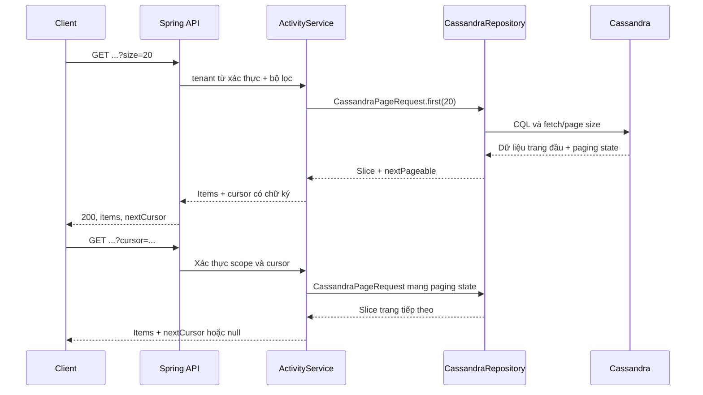

# Thiết kế API cursor bằng Slice và paging state

## 1. Bài toán và kết quả cần đạt

Trong ứng dụng sử dụng **Spring Data Cassandra**, API liệt kê dữ liệu thường phải phục vụ tập bản ghi rất lớn. Nếu client yêu cầu “trang 1000” bằng `OFFSET`, hệ thống phải duyệt các kết quả trước đó; đây không phải cách phân trang hiệu quả của Apache Cassandra. Cassandra cung cấp *paging state* để tiếp tục truy vấn từ vị trí đã đọc. Spring Data Cassandra biểu diễn việc đọc tiến bằng `CassandraPageRequest` và `Slice<T>`; `CassandraRepository` hoặc `CassandraTemplate` có thể dùng để thực thi truy vấn phù hợp với partition key.

**Đề bài thực hành:** xây dựng API xem lịch sử sự kiện của một tài khoản trong một tháng:

```http
GET /api/accounts/{accountId}/activities?month=2026-11&size=20
GET /api/accounts/{accountId}/activities?month=2026-11&size=20&cursor=...
```

API phải lấy `tenantId` từ danh tính đã xác thực, trả các sự kiện mới nhất trước, hỗ trợ nút “Xem thêm” và không đọc tất cả bản ghi rồi cắt trong Java.

Sau khi hoàn thành, bạn cần giải thích và tự kiểm tra được:

1. Vì sao thiết kế bảng phải theo `(tenant_id, account_id, month_bucket)` và thứ tự clustering.
2. Cách gọi `repository.find...(..., CassandraPageRequest.first(size))`, nhận `Slice` và sử dụng `slice.nextPageable()`.
3. Cách chuyển paging state thành **cursor opaque** cho HTTP, bảo vệ tính toàn vẹn và giới hạn thời hạn sử dụng.
4. Vì sao cursor chỉ dùng với **cùng CQL, cùng tham số và cùng kích thước trang**, đồng thời không phải “số trang” kiểu SQL.
5. Cách kiểm tra trường hợp trang cuối, cursor lỗi/hết hạn, nhiều tenant và kết quả thay đổi khi có ghi đồng thời.

**Giả định kỹ thuật:** ví dụ sử dụng Java 17+, Spring Boot 3.x, Spring Data Cassandra tương thích với Boot và Cassandra Java Driver 4.x. Các tên thuộc tính và API cần đối chiếu với phiên bản thực tế của dự án. Dùng Cassandra thật hoặc Testcontainers cho phần kiểm thử tích hợp; mock không thể xác thực paging state của driver.

Với Gradle, bộ thư viện tối thiểu cho ví dụ có thể gồm:

```groovy
dependencies {
    implementation 'org.springframework.boot:spring-boot-starter-data-cassandra'
    implementation 'org.springframework.boot:spring-boot-starter-web'
    implementation 'org.springframework.boot:spring-boot-starter-security'
    testImplementation 'org.springframework.boot:spring-boot-starter-test'
    // Thêm Testcontainers Cassandra + JUnit Jupiter theo BOM của dự án.
}
```

Trong môi trường local có sẵn keyspace, cấu hình Spring Boot 3.x minh họa:

```yaml
spring:
  cassandra:
    contact-points: 127.0.0.1
    port: 9042
    local-datacenter: datacenter1
    keyspace-name: learning_api
    schema-action: none
```

Giá trị `local-datacenter` phải khớp với datacenter thực tế của cụm; `schema-action: none` giữ việc tạo bảng theo script CQL đã chuẩn bị.

## 2. Phân biệt phân trang bằng offset, Slice và cursor

| Khái niệm | Cách dùng | Đặc điểm |
| --- | --- | --- |
| `Page<T>` và số trang | Thường hiển thị tổng số trang, cho nhảy trực tiếp | Có thể cần đếm toàn bộ kết quả; không phù hợp với nhiều truy vấn Cassandra |
| `Slice<T>` | Trả danh sách hiện tại và biết có trang sau không | Không bắt buộc tính tổng số phần tử; hợp với giao diện “Xem thêm” |
| `CassandraPageRequest` | Yêu cầu trang đầu hoặc mang paging state của trang tiếp | Phân trang **tiến**; không nhảy tùy ý tới trang N |
| Paging state | Trạng thái đọc tiếp do Cassandra/driver tạo | Opaque, gắn với đúng câu truy vấn và giá trị tham số |
| Cursor API | Chuỗi do ứng dụng trả cho client để xin trang sau | Cần kiểm tra chữ ký, scope tenant, thời hạn và giới hạn tải |

Trong bài này, `Slice` cung cấp dữ liệu và dấu hiệu `hasNext()`, còn cursor là **hợp đồng mạng** mà client lưu giữa hai lần gọi HTTP. Không gửi thẳng một đối tượng `Pageable` đã serialize hoặc một paging state chưa bảo vệ cho client.



## 3. Thiết kế schema theo truy vấn trước khi viết repository

Giả sử một tenant có nhiều tài khoản, mỗi tài khoản có nhiều sự kiện trong tháng. Yêu cầu đọc phổ biến là **20 sự kiện mới nhất của một tài khoản trong một tháng**. Ta không dùng bảng gom tất cả tenant rồi lọc bằng `ALLOW FILTERING`.

Ví dụ keyspace một node cho môi trường học tập:

```sql
CREATE KEYSPACE IF NOT EXISTS learning_api
WITH replication = {
  'class': 'SimpleStrategy',
  'replication_factor': 1
};

USE learning_api;

CREATE TABLE IF NOT EXISTS activity_by_account_month (
    tenant_id text,
    account_id uuid,
    month_bucket text,
    occurred_at timestamp,
    event_id uuid,
    event_type text,
    summary text,
    PRIMARY KEY (
        (tenant_id, account_id, month_bucket),
        occurred_at, event_id
    )
) WITH CLUSTERING ORDER BY (occurred_at DESC, event_id ASC);
```

Trong production nhiều datacenter, phải chọn replication strategy như `NetworkTopologyStrategy` và replication factor theo topology thực tế. `SimpleStrategy` với RF=1 ở đây chỉ để thử nghiệm.

Đọc một partition:

```sql
SELECT tenant_id, account_id, month_bucket,
       occurred_at, event_id, event_type, summary
FROM activity_by_account_month
WHERE tenant_id = ?
  AND account_id = ?
  AND month_bucket = ?;
```

Cassandra đã lưu các hàng trong partition theo thứ tự clustering được khai báo. `event_id` giữ thứ tự ổn định giữa các hàng có cùng `occurred_at`. Không đưa `tenantId` từ query parameter của client vào CQL nếu ứng dụng chưa xác minh quyền; trong API thực tế nó phải lấy từ principal/tenant context đáng tin cậy.

Để có dữ liệu thử, chèn nhiều hàng khác `event_id` thuộc một partition. Ba dòng ví dụ:

```sql
INSERT INTO activity_by_account_month
(tenant_id, account_id, month_bucket, occurred_at, event_id, event_type, summary)
VALUES (
  't-01', 11111111-1111-4111-8111-111111111111,
  '2026-11', '2026-11-21T08:00:00Z',
  aaaaaaaa-aaaa-4aaa-8aaa-aaaaaaaaaaa1, 'LOGIN', 'Đăng nhập'
);

INSERT INTO activity_by_account_month
(tenant_id, account_id, month_bucket, occurred_at, event_id, event_type, summary)
VALUES (
  't-01', 11111111-1111-4111-8111-111111111111,
  '2026-11', '2026-11-22T08:00:00Z',
  aaaaaaaa-aaaa-4aaa-8aaa-aaaaaaaaaaa2, 'VIEW', 'Xem hồ sơ'
);

INSERT INTO activity_by_account_month
(tenant_id, account_id, month_bucket, occurred_at, event_id, event_type, summary)
VALUES (
  't-01', 11111111-1111-4111-8111-111111111111,
  '2026-11', '2026-11-23T08:00:00Z',
  aaaaaaaa-aaaa-4aaa-8aaa-aaaaaaaaaaa3, 'UPDATE', 'Cập nhật hồ sơ'
);
```

Khi đọc với `size=2`, trang đầu dự kiến có `UPDATE`, `VIEW`; trang kế tiếp có `LOGIN`. Để kiểm thử trang 3/4 hoặc tải nhiều hơn, chèn thêm các hàng và giữ dữ liệu **không đổi** trong lúc kiểm tra phân trang.

## 4. Ánh xạ entity và khóa Cassandra

Ánh xạ phải thể hiện đúng **ba partition columns** và **hai clustering columns**. Dưới đây là phần cốt lõi của hai lớp Java, đặt trong các file riêng hoặc cùng package thích hợp:

```java
import java.io.Serializable;
import java.time.Instant;
import java.util.Objects;
import java.util.UUID;
import org.springframework.data.cassandra.core.cql.Ordering;
import org.springframework.data.cassandra.core.mapping.PrimaryKeyClass;
import org.springframework.data.cassandra.core.mapping.PrimaryKeyColumn;
import org.springframework.data.cassandra.core.mapping.PrimaryKeyType;

@PrimaryKeyClass
public class ActivityKey implements Serializable {
    @PrimaryKeyColumn(name = "tenant_id", ordinal = 0,
            type = PrimaryKeyType.PARTITIONED)
    private String tenantId;

    @PrimaryKeyColumn(name = "account_id", ordinal = 1,
            type = PrimaryKeyType.PARTITIONED)
    private UUID accountId;

    @PrimaryKeyColumn(name = "month_bucket", ordinal = 2,
            type = PrimaryKeyType.PARTITIONED)
    private String monthBucket;

    @PrimaryKeyColumn(name = "occurred_at", ordinal = 3,
            type = PrimaryKeyType.CLUSTERED, ordering = Ordering.DESCENDING)
    private Instant occurredAt;

    @PrimaryKeyColumn(name = "event_id", ordinal = 4,
            type = PrimaryKeyType.CLUSTERED, ordering = Ordering.ASCENDING)
    private UUID eventId;

    protected ActivityKey() {}

    public ActivityKey(String tenantId, UUID accountId, String monthBucket,
                       Instant occurredAt, UUID eventId) {
        this.tenantId = tenantId;
        this.accountId = accountId;
        this.monthBucket = monthBucket;
        this.occurredAt = occurredAt;
        this.eventId = eventId;
    }

    public String getTenantId() { return tenantId; }
    public UUID getAccountId() { return accountId; }
    public String getMonthBucket() { return monthBucket; }
    public Instant getOccurredAt() { return occurredAt; }
    public UUID getEventId() { return eventId; }

    @Override
    public boolean equals(Object other) {
        if (this == other) return true;
        if (!(other instanceof ActivityKey k)) return false;
        return Objects.equals(tenantId, k.tenantId)
            && Objects.equals(accountId, k.accountId)
            && Objects.equals(monthBucket, k.monthBucket)
            && Objects.equals(occurredAt, k.occurredAt)
            && Objects.equals(eventId, k.eventId);
    }

    @Override
    public int hashCode() {
        return Objects.hash(tenantId, accountId, monthBucket, occurredAt, eventId);
    }
}
```

Entity:

```java
import org.springframework.data.cassandra.core.mapping.Column;
import org.springframework.data.cassandra.core.mapping.PrimaryKey;
import org.springframework.data.cassandra.core.mapping.Table;

@Table("activity_by_account_month")
public class ActivityRow {
    @PrimaryKey
    private ActivityKey key;

    @Column("event_type")
    private String eventType;

    @Column("summary")
    private String summary;

    protected ActivityRow() {}

    public ActivityRow(ActivityKey key, String eventType, String summary) {
        this.key = key;
        this.eventType = eventType;
        this.summary = summary;
    }

    public ActivityKey getKey() { return key; }
    public String getEventType() { return eventType; }
    public String getSummary() { return summary; }
}
```

Trường `occurred_at` dùng `Instant` để giữ mốc thời gian tuyệt đối. Trong API nên xuất ISO-8601 UTC và định nghĩa cách tính `month_bucket` theo múi giờ nghiệp vụ, thay vì lấy tháng máy chủ một cách tùy ý.

## 5. Repository trả Slice và cách đi tới trang kế

Đây là query nhận đủ partition key; Spring Data Cassandra nhận `Pageable` để thực hiện paging theo cơ chế Cassandra:

```java
import java.util.UUID;
import org.springframework.data.cassandra.repository.CassandraRepository;
import org.springframework.data.cassandra.repository.Query;
import org.springframework.data.domain.Pageable;
import org.springframework.data.domain.Slice;
import org.springframework.data.repository.query.Param;

public interface ActivityRepository
        extends CassandraRepository<ActivityRow, ActivityKey> {

    @Query("""
        SELECT tenant_id, account_id, month_bucket,
               occurred_at, event_id, event_type, summary
        FROM activity_by_account_month
        WHERE tenant_id = :tenantId
          AND account_id = :accountId
          AND month_bucket = :monthBucket
        """)
    Slice<ActivityRow> findInMonth(
            @Param("tenantId") String tenantId,
            @Param("accountId") UUID accountId,
            @Param("monthBucket") String monthBucket,
            Pageable pageable);
}
```

Thử trong một service hoặc integration test:

```java
import org.springframework.data.cassandra.core.query.CassandraPageRequest;
import org.springframework.data.domain.Pageable;
import org.springframework.data.domain.Slice;

CassandraPageRequest firstRequest = CassandraPageRequest.first(2);
Slice<ActivityRow> first = repository.findInMonth(
        "t-01", accountId, "2026-11", firstRequest);

System.out.println(first.getContent().size());
System.out.println(first.hasNext());

if (first.hasNext()) {
    Pageable nextRequest = first.nextPageable();
    Slice<ActivityRow> second = repository.findInMonth(
            "t-01", accountId, "2026-11", nextRequest);
    System.out.println(second.getContent().size());
}
```

Ở lần thứ hai, `nextPageable` mang **paging state** do Cassandra cung cấp qua Spring Data. Điều kiện lọc, độ lớn trang và câu query cần giữ nguyên. Không tự dùng `PageRequest.of(1, 2)` rồi mong Cassandra bỏ qua hai bản ghi đầu: `CassandraPageRequest` dành cho việc đọc tiến bằng paging state, không phải offset pagination.

Nhận xét quan trọng:

- `Slice.hasNext()` báo có thể lấy tiếp, **không cho biết tổng số trang**; không tự chạy `COUNT(*)` trên bảng lớn để tạo metadata `totalPages`.
- `slice.nextPageable()` phù hợp khi hai lượt đọc nằm trong **cùng một tiến trình**. Qua hai HTTP request khác nhau, client phải mang một **cursor** để dựng lại yêu cầu trang sau.
- `Pageable` có page number trong giao diện Java, nhưng vị trí thực tế của Cassandra được điều khiển bởi paging state. Không dùng số trang nội bộ như offset.

## 6. Thiết kế hợp đồng HTTP bằng cursor opaque

Response đề xuất:

```json
{
  "items": [
    {
      "eventId": "aaaaaaaa-aaaa-4aaa-8aaa-aaaaaaaaaaa3",
      "occurredAt": "2026-11-23T08:00:00Z",
      "eventType": "UPDATE",
      "summary": "Cập nhật hồ sơ"
    },
    {
      "eventId": "aaaaaaaa-aaaa-4aaa-8aaa-aaaaaaaaaaa2",
      "occurredAt": "2026-11-22T08:00:00Z",
      "eventType": "VIEW",
      "summary": "Xem hồ sơ"
    }
  ],
  "hasNext": true,
  "nextCursor": "<opaque-cursor>",
  "limitReached": false
}
```

Ở trang cuối, `hasNext=false` và `nextCursor=null`. Không trả raw CQL, keyspace, access token hoặc đối tượng `CassandraPageRequest` của server.

**Bất biến của API:**

| Đầu vào | Kiểm tra |
| --- | --- |
| `accountId` | Định dạng UUID; caller có quyền xem tài khoản đó |
| `month` | Định dạng cố định `YYYY-MM` và thuộc phạm vi ứng dụng cho phép |
| `size` | Số nguyên dương; mặc định 20, ví dụ tối đa 50 |
| `tenantId` | Lấy từ danh tính xác thực, không tin query parameter của người gọi |
| `cursor` | Chữ ký hợp lệ, chưa hết hạn, đúng tenant, account, month, size và phiên bản truy vấn |
| Query | Luôn cùng CQL và tham số với lần tạo paging state |

Không nên cho client đổi `size=20` thành `size=5000` trong khi dùng lại cursor, hoặc sử dụng cursor của tháng 11 để đọc tháng 12. Các thông tin quan trọng cần được ràng buộc bằng chữ ký và đối chiếu lại với request.

### Vì sao cần ký cursor?

Paging state **không phải token cấp quyền**. Nếu ứng dụng nhận một chuỗi do client điều khiển rồi chuyển trực tiếp vào driver, nó có thể gây lỗi truy vấn, đọc sai phạm vi hoặc bị lạm dụng tài nguyên. Có thể dùng envelope:

```text
base64url(payload-json) + "." + base64url(HMAC-SHA256(payload-json, server-secret))

payload:
  version: 1
  queryVersion: "account-events-v1"
  tenantId: "t-01"
  accountId: "11111111-1111-4111-8111-111111111111"
  monthBucket: "2026-11"
  pageSize: 20
  pagesConsumed: 1
  expiresAtEpochSeconds: 1796000000
  pagingStateBase64url: "..."
```

Đây là **định dạng minh họa**, không phải cursor thật của driver. HMAC đảm bảo tính toàn vẹn, **không mã hóa nội dung**. Nếu metadata trong token nhạy cảm, hãy mã hóa payload hoặc lưu trạng thái cursor ở server và chỉ phát hành ID tra cứu. Bí mật ký phải lấy từ secret manager, có chính sách xoay khóa và không commit vào mã nguồn.

## 7. Đóng gói và kiểm tra cursor có chữ ký

Ví dụ sau sử dụng Jackson (có sẵn với Spring Boot Web trong cấu hình phổ biến) và HMAC-SHA256. Đoạn mã chỉ mô tả việc ký, xác minh và giải mã **envelope**; quyền đọc dữ liệu được kiểm tra riêng ở service/controller.

```java
import com.fasterxml.jackson.core.JsonProcessingException;
import com.fasterxml.jackson.databind.ObjectMapper;
import java.security.GeneralSecurityException;
import java.security.MessageDigest;
import java.util.Base64;
import javax.crypto.Mac;
import javax.crypto.spec.SecretKeySpec;

record CursorPayload(
        int version,
        String queryVersion,
        String tenantId,
        String accountId,
        String monthBucket,
        int pageSize,
        int pagesConsumed,
        long expiresAtEpochSeconds,
        String pagingStateBase64url
) {}

final class SignedCursorCodec {
    private static final Base64.Encoder ENCODER =
            Base64.getUrlEncoder().withoutPadding();
    private static final Base64.Decoder DECODER = Base64.getUrlDecoder();
    private final ObjectMapper mapper;
    private final byte[] hmacKey;

    SignedCursorCodec(ObjectMapper mapper, byte[] secretFromSecretManager) {
        if (secretFromSecretManager.length < 32) {
            throw new IllegalArgumentException("HMAC key quá ngắn");
        }
        this.mapper = mapper;
        this.hmacKey = secretFromSecretManager.clone();
    }

    String encode(CursorPayload payload) {
        try {
            byte[] body = mapper.writeValueAsBytes(payload);
            return ENCODER.encodeToString(body) + "."
                    + ENCODER.encodeToString(sign(body));
        } catch (JsonProcessingException ex) {
            throw new IllegalStateException("Không mã hóa được cursor", ex);
        }
    }

    CursorPayload decode(String cursor) {
        if (cursor == null || cursor.length() > 16384) {
            throw new IllegalArgumentException("Cursor không hợp lệ");
        }
        String[] parts = cursor.split("\\.", -1);
        if (parts.length != 2) {
            throw new IllegalArgumentException("Cursor không hợp lệ");
        }
        try {
            byte[] body = DECODER.decode(parts[0]);
            byte[] signature = DECODER.decode(parts[1]);
            if (!MessageDigest.isEqual(sign(body), signature)) {
                throw new IllegalArgumentException("Chữ ký cursor không hợp lệ");
            }
            return mapper.readValue(body, CursorPayload.class);
        } catch (IllegalArgumentException ex) {
            throw new IllegalArgumentException("Cursor không hợp lệ", ex);
        } catch (JsonProcessingException ex) {
            throw new IllegalArgumentException("Cursor không hợp lệ", ex);
        }
    }

    private byte[] sign(byte[] body) {
        try {
            Mac mac = Mac.getInstance("HmacSHA256");
            mac.init(new SecretKeySpec(hmacKey, "HmacSHA256"));
            return mac.doFinal(body);
        } catch (GeneralSecurityException ex) {
            throw new IllegalStateException("Không khởi tạo được HMAC", ex);
        }
    }
}
```

Để xoay khóa mà vẫn chấp nhận cursor còn hạn, có thể thêm `keyId` vào envelope và kiểm tra với tập khóa được phép trong thời gian chuyển đổi. Không truyền trực tiếp nội dung lỗi chữ ký, khóa hoặc payload vào HTTP response/log.

## 8. Service đọc một Slice và tạo nextCursor

Service dưới đây nối ba phần: xác minh cursor, dựng `CassandraPageRequest`, rồi dùng `Slice.nextPageable()` lấy paging state cho response tiếp theo. Nó giới hạn tối đa **10 lượt trang mỗi chuỗi cursor** và mặc định cho phép tối đa **50 phần tử mỗi trang**. Các giá trị chỉ mang tính minh họa; phải xác định từ đo hiệu năng thực tế.

```java
import java.nio.ByteBuffer;
import java.time.Clock;
import java.time.Instant;
import java.time.YearMonth;
import java.util.ArrayList;
import java.util.Base64;
import java.util.List;
import java.util.UUID;
import org.springframework.data.cassandra.core.query.CassandraPageRequest;
import org.springframework.data.domain.Pageable;
import org.springframework.data.domain.Slice;
import org.springframework.stereotype.Service;

record ActivityDto(
        UUID eventId, Instant occurredAt, String eventType, String summary
) {}

record ActivityPageResponse(
        List<ActivityDto> items,
        boolean hasNext,
        String nextCursor,
        boolean limitReached
) {}

@Service
public class ActivityCursorService {
    private static final String QUERY_VERSION = "account-events-v1";
    private static final int MAX_SIZE = 50;
    private static final int MAX_PAGES = 10;
    private static final long CURSOR_TTL_SECONDS = 15 * 60;

    private final ActivityRepository repository;
    private final SignedCursorCodec codec;
    private final Clock clock;

    public ActivityCursorService(
            ActivityRepository repository, SignedCursorCodec codec, Clock clock) {
        this.repository = repository;
        this.codec = codec;
        this.clock = clock;
    }

    public ActivityPageResponse list(
            String authenticatedTenantId,
            UUID accountId,
            String month,
            int requestedSize,
            String cursor
    ) {
        int size = checkedSize(requestedSize);
        YearMonth.parse(month); // Thất bại nếu không phải định dạng tháng hợp lệ.

        int alreadyConsumed = 0;
        CassandraPageRequest request = CassandraPageRequest.first(size);

        if (cursor != null) {
            if (cursor.isBlank()) {
                throw new IllegalArgumentException("Cursor không hợp lệ");
            }
            CursorPayload claim = codec.decode(cursor);
            if (claim.version() != 1
                    || !QUERY_VERSION.equals(claim.queryVersion())
                    || !authenticatedTenantId.equals(claim.tenantId())
                    || !accountId.toString().equals(claim.accountId())
                    || !month.equals(claim.monthBucket())
                    || size != claim.pageSize()
                    || claim.pagesConsumed() < 1
                    || claim.pagesConsumed() >= MAX_PAGES
                    || claim.pagingStateBase64url() == null) {
                throw new IllegalArgumentException("Cursor không khớp truy vấn");
            }
            if (clock.instant().getEpochSecond() >= claim.expiresAtEpochSeconds()) {
                throw new IllegalArgumentException("Cursor đã hết hạn");
            }

            // Paging state của Spring Data là ByteBuffer.
            byte[] rawState = Base64.getUrlDecoder()
                    .decode(claim.pagingStateBase64url());
            if (rawState.length == 0 || rawState.length > 8192) {
                throw new IllegalArgumentException("Paging state không hợp lệ");
            }
            request = CassandraPageRequest.of(
                    CassandraPageRequest.first(size), ByteBuffer.wrap(rawState));
            alreadyConsumed = claim.pagesConsumed();
        }

        Slice<ActivityRow> slice = repository.findInMonth(
                authenticatedTenantId, accountId, month, request);
        List<ActivityDto> items = new ArrayList<>();
        for (ActivityRow row : slice.getContent()) {
            items.add(new ActivityDto(
                    row.getKey().getEventId(),
                    row.getKey().getOccurredAt(),
                    row.getEventType(), row.getSummary()));
        }

        int pagesNow = alreadyConsumed + 1;
        boolean limitReached = slice.hasNext() && pagesNow >= MAX_PAGES;
        boolean hasNext = slice.hasNext() && !limitReached;
        String nextCursor = null;
        if (hasNext) {
            Pageable next = slice.nextPageable();
            if (!(next instanceof CassandraPageRequest cassandraNext)) {
                throw new IllegalStateException("Thiếu Cassandra paging state");
            }
            ByteBuffer state = cassandraNext.getPagingState();
            if (state == null || !state.hasRemaining()) {
                throw new IllegalStateException("Thiếu paging state trang tiếp");
            }
            ByteBuffer copy = state.asReadOnlyBuffer();
            byte[] bytes = new byte[copy.remaining()];
            copy.get(bytes);

            CursorPayload payload = new CursorPayload(
                    1, QUERY_VERSION, authenticatedTenantId,
                    accountId.toString(), month, size, pagesNow,
                    clock.instant().plusSeconds(CURSOR_TTL_SECONDS).getEpochSecond(),
                    Base64.getUrlEncoder().withoutPadding().encodeToString(bytes));
            nextCursor = codec.encode(payload);
        }
        return new ActivityPageResponse(
                List.copyOf(items), hasNext, nextCursor, limitReached);
    }

    private static int checkedSize(int requested) {
        if (requested < 1 || requested > MAX_SIZE) {
            throw new IllegalArgumentException("size phải từ 1 đến 50");
        }
        return requested;
    }
}
```

**Lưu ý về cách khôi phục paging state:** factory `CassandraPageRequest.of(Pageable, ByteBuffer)` sử dụng trạng thái đọc tiếp mà framework hỗ trợ. Trong ví dụ, `CassandraPageRequest.first(size)` được dùng làm tham số cơ sở để dựng lại lời gọi từ HTTP; số trang Java không phải offset của Cassandra. Cần xác minh hành vi khôi phục bằng integration test **đúng phiên bản Spring Data Cassandra đang chạy**. Nếu ứng dụng không thể khôi phục trạng thái qua API repository theo phiên bản của mình, hãy dùng adapter có quyền truy cập driver `CqlSession` hoặc lưu nextPageable trong cursor store tập trung thay vì đoán page number.

**Hai ranh giới bảo mật còn cần triển khai trong ứng dụng:** `SignedCursorCodec` phải được cấu hình thành bean với khóa từ secret manager, và trước khi gọi `list(...)` phải kiểm tra principal có quyền xem `accountId`. Kiểm tra tenant ID ở service không tự chứng minh người dùng có quyền xem mọi tài khoản cùng tenant.

Ở sản phẩm thực tế, cần đưa ra quyết định rõ khi đạt giới hạn `MAX_PAGES`: response ở ví dụ dừng cung cấp cursor và đặt `limitReached=true` nếu Cassandra còn dữ liệu, để client phân biệt với việc đã duyệt hết. Nếu nghiệp vụ cần duyệt sâu hơn, hãy dùng endpoint xuất dữ liệu có ngân sách và quyền riêng.

## 9. Tầng HTTP: nhận tham số, kiểm tra quyền và trả response

Ví dụ controller nhận `tenantId` từ một thành phần xác thực đã triển khai trong hệ thống (chỉ minh họa hợp đồng của `TenantAccess`):

```java
import java.util.UUID;
import org.springframework.http.ResponseEntity;
import org.springframework.security.core.Authentication;
import org.springframework.web.bind.annotation.*;

interface TenantAccess {
    String currentTenant(Authentication authentication);
    void requireCanReadAccount(Authentication authentication, UUID accountId);
}

@RestController
@RequestMapping("/api/accounts")
final class ActivityController {
    private final ActivityCursorService service;
    private final TenantAccess tenantAccess;

    ActivityController(ActivityCursorService service, TenantAccess tenantAccess) {
        this.service = service;
        this.tenantAccess = tenantAccess;
    }

    @GetMapping("/{accountId}/activities")
    ResponseEntity<ActivityPageResponse> list(
            @PathVariable UUID accountId,
            @RequestParam String month,
            @RequestParam(defaultValue = "20") int size,
            @RequestParam(required = false) String cursor,
            Authentication authentication
    ) {
        tenantAccess.requireCanReadAccount(authentication, accountId);
        String tenantId = tenantAccess.currentTenant(authentication);
        return ResponseEntity.ok(
                service.list(tenantId, accountId, month, size, cursor));
    }
}
```

Đây là mã minh họa cho Spring Web + Spring Security; bản thân interface `TenantAccess` cần được triển khai bằng mô hình xác thực và phân quyền thực tế. Cũng cần đăng ký bean `Clock`, `SignedCursorCodec` và cấu hình kết nối Cassandra.

Ví dụ response khi lấy trang cuối:

```json
{
  "items": [
    {
      "eventId": "aaaaaaaa-aaaa-4aaa-8aaa-aaaaaaaaaaa1",
      "occurredAt": "2026-11-21T08:00:00Z",
      "eventType": "LOGIN",
      "summary": "Đăng nhập"
    }
  ],
  "hasNext": false,
  "nextCursor": null,
  "limitReached": false
}
```

### HTTP status và lỗi đầu vào

| Tình huống | Response gợi ý |
| --- | --- |
| `size` âm, quá lớn, `month` sai định dạng | 400 Bad Request |
| Cursor sai chữ ký hoặc khác bộ lọc hiện tại | 400 Bad Request |
| Cursor hết hạn | 410 Gone hoặc 400 theo hợp đồng đã công bố |
| Không có quyền xem tài khoản | 403 Forbidden, hoặc 404 để không tiết lộ sự tồn tại nếu chính sách yêu cầu |
| Cassandra không sẵn sàng, timeout | 503 Service Unavailable hoặc lỗi hạ tầng phù hợp; giới hạn retry |
| Không còn trang tiếp | 200 với `nextCursor=null` và `limitReached=false` |
| Đạt giới hạn số lượt | 200 với `nextCursor=null` và `limitReached=true` |

Vì code ví dụ sử dụng `IllegalArgumentException`, ứng dụng cần thêm `@RestControllerAdvice` để phân loại và chuyển lỗi thành HTTP status ổn định. Không trả stack trace, nội dung token hoặc chi tiết CQL ra phía client.

## 10. Bài kiểm thử: từ 3 hàng đến nhiều trang

Đừng chỉ mock repository rồi kết luận cursor chạy đúng. Logic ký/xác thực có thể unit test, còn **tạo và phục hồi paging state phải kiểm tra trên Cassandra thật**.

### Bài A — Thứ tự và trang cuối

Với ba hàng mẫu, gọi `size=2`:

1. Trang đầu trả `UPDATE` và `VIEW` đúng thứ tự `occurred_at DESC`.
2. `hasNext=true` và `nextCursor` là chuỗi không rỗng.
3. Dùng lại cursor cho cùng tenant/account/month/size.
4. Trang hai trả `LOGIN`, `hasNext=false` và `nextCursor=null`.
5. Không có hàng trùng giữa hai trang; tập ID hợp nhất có đúng ba phần tử.

Tránh khẳng định mọi trang phải nhận **đúng** `size` hàng trong mọi trường hợp sản xuất: driver/server có thể trả trang ít hàng hơn khi chạm giới hạn byte, hoặc vì cách tổ chức kết quả. Điều kiện dừng đúng là không còn paging state/`Slice.hasNext()` chứ không phải `items.size() < size`.

### Bài B — Kiểm thử chữ ký và scope

| Thao tác | Kết quả kỳ vọng |
| --- | --- |
| Đổi một ký tự trong cursor | Từ chối trước khi query Cassandra |
| Dùng cursor của account A cho account B | Từ chối trước khi query |
| Dùng cursor của tenant A trong phiên tenant B | Từ chối trước khi query |
| Giữ cursor nhưng đổi tháng 11 sang tháng 12 | Từ chối trước khi query |
| Giữ cursor nhưng đổi `size=20` sang `size=50` | Từ chối trước khi query |
| Dùng cursor sau thời điểm hết hạn | Từ chối, trả lỗi hết hạn theo API contract |
| Cursor có Base64 không hợp lệ hoặc quá dài | Từ chối an toàn, không trả thông tin nội bộ |

Test cho `SignedCursorCodec` nên dùng khóa kiểm thử cố định do test tạo, xác minh round trip và phát hiện thay đổi chữ ký. Test service dùng fake/mock repository để chắc rằng cursor sai **không gọi** Cassandra.

### Bài C — Tích hợp nhiều trang với dữ liệu cố định

Seed 53 hàng vào **một partition** bằng Testcontainers. Đặt `size=10`, đọc lần lượt qua các cursor đến khi không còn `nextCursor`. Kiểm tra:

```text
seen = tập rỗng
cursor = null
countRequests = 0

repeat:
  response = GET cùng account/month/size và cursor hiện tại
  assert response.items.size <= 10
  for item in response.items:
    assert item.eventId chưa có trong seen
    seen.add(item.eventId)
  countRequests += 1
  assert countRequests <= 10      // giới hạn an toàn của bài thử
  cursor = response.nextCursor
until cursor == null

assert seen.size == 53
assert dữ liệu có thứ tự occurredAt DESC, eventId ASC
```

Điều kiện “không trùng, không thiếu” ở đây chỉ được kiểm tra khi **không có thêm/sửa/xóa đồng thời**. Paging state không tạo snapshot transaction xuyên tất cả trang; nếu có ghi mới vào đầu danh sách giữa hai request, giao diện phải có chính sách rõ (chấp nhận danh sách biến động, chốt mốc thời gian hoặc tạo snapshot nghiệp vụ riêng).

### Bài D — Bảng/partition và chi phí đọc

Tạo thêm hàng ở tenant khác và tháng khác; xác minh cursor chỉ trả partition được phép. Dùng số liệu driver hoặc tracing phù hợp để kiểm tra request chỉ thực hiện truy vấn theo **đủ partition key**, không có `ALLOW FILTERING`, `SELECT *` không cần thiết hoặc tự gọi `findAll()` rồi lọc ở Java.

Đo thời gian **trang đầu**, p95/p99 khi nhiều request đồng thời, số trang Cassandra đã fetch và bộ nhớ. Testcontainers một node giúp xác thực tính năng nhưng không cho kết luận chính xác về độ trễ của cụm đa replica trong production.

## 11. Các lỗi thường gặp khi tự làm bài thực hành

**Lỗi 1 — Dùng `PageRequest.of(1, 20)` để đọc trang thứ hai.** Cassandra không cung cấp offset paging tùy ý. Dùng `CassandraPageRequest.first(20)` rồi lấy `slice.nextPageable()`; để đi qua HTTP cần giữ paging state ở cursor.

**Lỗi 2 — Trả `Slice` trực tiếp ra HTTP rồi cho client gửi lại toàn bộ đối tượng.** Đối tượng Spring Data là chi tiết nội bộ, không phải định dạng cursor bền vững hay an toàn. Chỉ xuất `items` và `nextCursor`.

**Lỗi 3 — Client đổi tenant/bộ lọc nhưng giữ cursor.** Paging state phải khớp cùng statement và tham số. Ký và ràng buộc cursor với truy vấn, đồng thời xác minh lại quyền ở request kế tiếp.

**Lỗi 4 — `findAll()` hoặc `ResultSet.all()` rồi `subList(0, 20)`.** Việc cắt danh sách ở cuối không giảm số hàng đã đọc từ Cassandra. Giới hạn phải được áp tại truy vấn và tại cách xử lý trang.

**Lỗi 5 — Dừng khi trang trả ít hơn 20 hàng.** Có thể còn paging state dù số hàng hiện tại nhỏ hơn yêu cầu do giới hạn kết quả/page bytes hoặc điều kiện dữ liệu. Dùng `hasNext` và token trả về để quyết định.

**Lỗi 6 — Hiểu `hasNext=false` là dữ liệu đã được đọc hết khi có budget.** Khi hệ thống chủ động chặn sau N lượt, cần phân biệt “hết dữ liệu” với “đã tới giới hạn được phép đọc”; ví dụ trả thêm `limitReached=true` để thể hiện trường hợp thứ hai.

**Lỗi 7 — Nghĩ cursor là snapshot ổn định.** Cursor trỏ vị trí trong kết quả phân trang, không khóa dữ liệu. Với yêu cầu xuất báo cáo nhất quán phải thiết kế mốc chốt dữ liệu hoặc phiên bản snapshot riêng.

**Lỗi 8 — Không phiên bản hóa định dạng cursor.** Thay câu CQL, thứ tự, schema hoặc driver có thể khiến token cũ không còn hợp lệ. Lưu `queryVersion`, đặt TTL ngắn và trả lỗi có thể thử lại từ trang đầu.

## 12. Checklist nghiệm thu và bài nâng cao

| Tiêu chí | Cách chứng minh |
| --- | --- |
| Bảng thiết kế theo truy vấn | CQL dùng đầy đủ partition key, thứ tự clustering đã khai báo |
| Repository có paging thực | `Slice<T>`, `CassandraPageRequest.first(size)` và `slice.nextPageable()` hoạt động trong integration test |
| API không lộ chi tiết nội bộ | Chỉ trả DTO và cursor opaque, không trả raw `Pageable` |
| Cursor không bị sửa hoặc dùng sai phạm vi | Chữ ký, hạn dùng, tenant/account/month/size/query version được kiểm tra |
| Không đọc vô hạn | Giới hạn page size, số lượt, độ dài token, timeout và concurrency |
| Dữ liệu tĩnh được duyệt đúng | Không trùng/thiếu qua nhiều trang, có trang cuối với cursor null |
| An toàn đa tenant | Kiểm tra quyền truy cập ở controller và ràng buộc token ở service |
| Có quan sát hiệu năng | Đo thời gian trang đầu, số lần fetch, timeout, số page/row và bộ nhớ |

**Bài nâng cao 1:** thay giới hạn cố định 10 lượt thành ngân sách hàng/byte/thời gian theo loại tài khoản. Giữ lại trường `limitReached` và viết unit test phân biệt hết dữ liệu với đạt ngân sách ở mỗi chiều.

**Bài nâng cao 2:** giả lập cursor hết hạn sau 15 phút bằng `Clock.fixed(...)` và `Clock.offset(...)`; không dùng `Thread.sleep(...)` để chờ hết hạn.

**Bài nâng cao 3:** nếu yêu cầu chuyển từ từng tháng sang lịch sử nhiều tháng, thiết kế bảng/endpoint tương ứng. Không dùng cùng paging state để nhảy giữa nhiều partition và không fan-out hàng trăm truy vấn không giới hạn. Hãy chọn chiến lược ghép thứ tự với ngân sách đọc chung, hoặc điều chỉnh bảng đọc theo access pattern mới.

**Bài nâng cao 4:** thay phần lưu cursor ở client bằng một cursor store tập trung có TTL, nơi token chỉ là ID được ký. So sánh chi phí lưu trạng thái, khả năng scale nhiều instance, bảo mật và khôi phục sau deploy.

## 13. Tài liệu đối chiếu và điều cần nhớ

Khi điều chỉnh ví dụ cho phiên bản framework cụ thể, tham khảo:

- [Spring Data Cassandra — Repositories](https://docs.spring.io/spring-data/cassandra/reference/cassandra/repositories/repositories.html): `Slice` và `CassandraPageRequest`.
- [Spring Data Cassandra — CassandraPageRequest API](https://docs.spring.io/spring-data/cassandra/docs/current/api/org/springframework/data/cassandra/core/query/CassandraPageRequest.html): các phương thức `first`, `of` và `getPagingState`.
- [DataStax Java Driver 4 — Paging](https://docs.datastax.com/en/developer/java-driver/4.17/manual/core/paging/index.html): cách xử lý paging state an toàn và các giới hạn của offset.

**Nguyên tắc ghi nhớ:** `Slice` biểu diễn **kết quả một lần đọc** và khả năng đi tiếp; `CassandraPageRequest` mang **trạng thái vị trí đọc của Cassandra**; cursor có chữ ký là **hợp đồng giữa hai request HTTP**. Thiết kế đúng partition key, giữ nguyên truy vấn khi đọc tiếp, kiểm soát quyền và ngân sách tải sẽ tạo ra API phân trang phù hợp với mô hình dữ liệu phân tán của Spring Data Cassandra.
