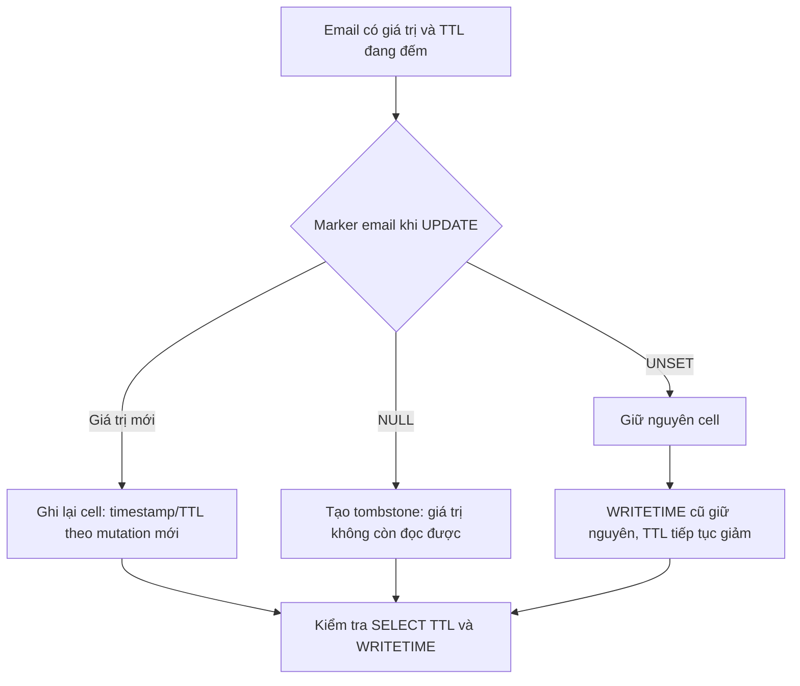

# Thực hành quan sát TTL, WRITETIME và cập nhật null hoặc UNSET trong Spring Data Cassandra

Trong **Apache Cassandra**, một lệnh cập nhật tưởng như chỉ sửa số điện thoại có thể vô tình xóa email nếu ứng dụng gửi giá trị `null` thay vì **UNSET**. Tương tự, một lần ghi lại cùng giá trị có thể thay đổi timestamp và thời gian hết hạn dù nội dung nhìn thấy vẫn giống nhau. Đó là lý do khi dùng **Spring Data Cassandra**, cần quan sát dữ liệu ở mức cell bằng `TTL(column)` và `WRITETIME(column)`, chứ không chỉ kiểm tra kết quả của `repository.save(...)`.

Bài thuộc chương **Bài thực hành**. Người học sẽ tạo bảng Cassandra theo partition key, chạy CQL để thấy TTL và writetime thay đổi, dùng `CqlSession` qua Spring để phân biệt rõ `null` với `UNSET`, kiểm thử trên Cassandra thật và hiểu chi phí tombstone. Các kỹ thuật này áp dụng cho repository, `CassandraTemplate`, entity mapping, truy vấn CQL và các ứng dụng phân tán có yêu cầu nhất quán, paging và hiệu năng.

## 1. Mục tiêu cần đạt

Sau bài, bạn phải tự thực hiện và chứng minh được:

1. `TTL(email)` thể hiện **số giây còn sống** của giá trị email, không phải tuổi của hàng hay timestamp tạo bản ghi.
2. `WRITETIME(email)` thể hiện **write timestamp của cell** theo microsecond Unix epoch, không phải thời điểm chạy `SELECT`.
3. Cập nhật một cột có thể làm thay đổi writetime/TTL của **cột đó**, trong khi các cột khác giữ nguyên.
4. Ghi `null` tường minh vào regular column tạo một **tombstone**; truyền `UNSET` cho bind marker có nghĩa là **không sửa cột**.
5. Giá trị hết hạn theo TTL được đọc như không còn tồn tại; bản ghi tombstone có thể còn trong cấu trúc lưu trữ.
6. Khi viết API PATCH, phải phân biệt **field vắng mặt** với **field có mặt và mang null** trước khi chuyển sang CQL.

**Kết quả thực hành:** một bảng dữ liệu, chuỗi truy vấn quan sát trước/sau, một service Java điều khiển NULL/UNSET và hai bài kiểm thử tích hợp cho dữ liệu hết hạn và cập nhật một phần.

## 2. Chuẩn bị bảng và dữ liệu

Các câu lệnh dùng với `cqlsh` hoặc công cụ thực thi CQL. Cần một Cassandra chạy thật và quyền tạo bảng trong keyspace riêng. Ví dụ dưới dùng keyspace `lab_cassandra` cho môi trường **một node local**:

```sql
CREATE KEYSPACE IF NOT EXISTS lab_cassandra
WITH replication = {
  'class': 'SimpleStrategy',
  'replication_factor': 1
};

USE lab_cassandra;

CREATE TABLE IF NOT EXISTS learner_contact_by_id (
    user_id uuid PRIMARY KEY,
    display_name text,
    email text,
    phone text,
    otp_hint text
);
```

`SimpleStrategy` và RF=1 ở trên chỉ để thực hành local; môi trường production nhiều datacenter thường dùng `NetworkTopologyStrategy`, replication factor và consistency level phù hợp. Đừng chạy các lệnh phá dữ liệu trong keyspace đang phục vụ người dùng.

Thiết kế bảng này phục vụ câu truy vấn theo **partition key `user_id`**. Các cột `display_name`, `email`, `phone` và `otp_hint` là regular columns, có thể có TTL và timestamp ghi riêng. Các hàm `TTL` và `WRITETIME` ở bài này được gọi trên **scalar regular columns**, không gọi trên primary key.

Seed một user với UUID cố định:

```sql
INSERT INTO learner_contact_by_id (
    user_id, display_name, email, phone
) VALUES (
    11111111-1111-1111-1111-111111111111,
    'An',
    'an@example.test',
    '0900000000'
);
```

Truy vấn quan sát chuẩn:

```sql
SELECT user_id, display_name, email, phone, otp_hint,
       TTL(email) AS email_ttl,
       WRITETIME(email) AS email_written_at,
       TTL(phone) AS phone_ttl,
       WRITETIME(phone) AS phone_written_at,
       TTL(otp_hint) AS otp_ttl,
       WRITETIME(otp_hint) AS otp_written_at
FROM learner_contact_by_id
WHERE user_id = 11111111-1111-1111-1111-111111111111;
```

Sau khi seed bằng lệnh không có `USING TTL` (và bảng không có default TTL), `email` và `phone` có giá trị, `email_ttl` và `phone_ttl` là `null`, trong khi các cột `..._written_at` có giá trị timestamp. Vì `otp_hint` chưa được ghi, `otp_hint`, `otp_ttl` và `otp_written_at` đều được đọc là `null`.

## 3. Thí nghiệm A — TTL đếm ngược và hết hạn

Ghi một giá trị tạm thời, chỉ cho `otp_hint` có TTL:

```sql
UPDATE learner_contact_by_id
USING TTL 20
SET otp_hint = 'one-time'
WHERE user_id = 11111111-1111-1111-1111-111111111111;
```

Đọc ngay rồi đọc lại sau một khoảng ngắn:

```sql
SELECT display_name, email, otp_hint,
       TTL(otp_hint) AS otp_ttl,
       WRITETIME(otp_hint) AS otp_written_at,
       TTL(email) AS email_ttl
FROM learner_contact_by_id
WHERE user_id = 11111111-1111-1111-1111-111111111111;
```

| Lúc quan sát | `otp_hint` | `otp_ttl` | `otp_written_at` | `email` |
|---|---|---|---|---|
| Ngay sau ghi | `one-time` | Gần 20 giây | Timestamp mới | `an@example.test` |
| Khi chưa hết hạn | `one-time` | Giảm theo thời gian | Không đổi nếu không ghi lại | Không đổi |
| Sau khi hết hạn | `null` | `null` | `null` | Vẫn còn |

**Không assert chính xác TTL = 20:** thời gian đã trôi qua giữa ghi và đọc; `TTL(...)` được biểu diễn bằng giây. Khi cell hết hạn, Cassandra không trả về giá trị còn sống, dù tombstone có thể chưa được compaction dọn đi. `display_name` và `email` vẫn tồn tại vì chúng không cùng nhận TTL của `otp_hint`.

Tiếp tục ghi lại:

```sql
UPDATE learner_contact_by_id
USING TTL 45
SET otp_hint = 'second-code'
WHERE user_id = 11111111-1111-1111-1111-111111111111;
```

Lúc này TTL của phiên bản mới sẽ gần 45 giây; writetime của `otp_hint` cũng tương ứng lần ghi mới. Nếu ghi lại cùng một cột **không có `USING TTL`**, phiên bản dữ liệu mới tuân theo TTL của statement và cấu hình `default_time_to_live` của bảng; đừng mặc định TTL cũ được giữ nguyên.

Để kiểm tra mặc định bảng:

```sql
DESCRIBE TABLE learner_contact_by_id;
```

Nếu `default_time_to_live` lớn hơn 0, lệnh không có `USING TTL` vẫn có thể làm cell nhận TTL. Vì vậy, kết luận “cell không có TTL” phải dựa trên cấu hình schema và kết quả đọc thực tế.

## 4. Thí nghiệm B — WRITETIME là timestamp riêng cho cell

`WRITETIME(column)` trả về timestamp ghi đang có hiệu lực cho giá trị cell, tính bằng **microsecond kể từ Unix epoch**. Nó có thể do client chỉ định và không nhất thiết bằng thời gian hệ thống tại lần đọc. Thử nghiệm dưới dùng **một user ID mới**, tránh tranh chấp với timestamp của user đã seed bằng thời gian hiện tại.

```sql
INSERT INTO learner_contact_by_id
  (user_id, display_name, email, phone)
VALUES
  (22222222-2222-2222-2222-222222222222,
   'Binh', 'first@example.test', '0911111111')
USING TIMESTAMP 1735689600000000;

UPDATE learner_contact_by_id
USING TIMESTAMP 1735689600001000
SET email = 'second@example.test'
WHERE user_id = 22222222-2222-2222-2222-222222222222;

SELECT email, WRITETIME(email) AS email_written_at,
       phone, WRITETIME(phone) AS phone_written_at
FROM learner_contact_by_id
WHERE user_id = 22222222-2222-2222-2222-222222222222;
```

Kết quả dự kiến:

- `email` là `second@example.test`; writetime email là `1735689600001000`.
- `phone` vẫn là `0911111111`; writetime phone là `1735689600000000`.
- Vì chỉ thay email, cột phone không bị ghi lại.

**Vì sao dùng ID mới?** Cassandra phân xử các bản ghi vào cùng cell theo timestamp. Một write có timestamp **thấp hơn** giá trị hiện hành có thể không thắng, dù CQL được thực thi. Timestamp năm 2025 trong ví dụ có thể thấp hơn những write theo đồng hồ thực tế năm 2026. Không áp timestamp nhân tạo trong production chỉ để “ép bản ghi mới thắng”; cần quy tắc timestamp nhất quán giữa writer và hiểu last-write-wins, tombstone, clock skew.

Thử ghi lại cùng một giá trị phone ở timestamp mới hơn, rồi so sánh `WRITETIME(phone)`. Dù chuỗi phone không đổi, mutation mới vẫn có thể thay đổi timestamp của cell. Điều này giúp nhận biết công việc ghi dư thừa mà chỉ assert nội dung không phát hiện.

## 5. Thí nghiệm C — Khác biệt quan trọng giữa NULL và UNSET

Trong Cassandra, hai ý định sau khác nhau:

- **`NULL`:** ứng dụng chủ động loại bỏ giá trị đang có, Cassandra ghi **tombstone** tại timestamp tương ứng.
- **`UNSET`:** ứng dụng không áp dụng mutation cho marker/cột đó; giá trị đang có, writetime và TTL còn lại của cột được giữ nguyên.

### 5.1. Xóa bằng NULL trong CQL

```sql
UPDATE learner_contact_by_id
SET email = null
WHERE user_id = 11111111-1111-1111-1111-111111111111;

SELECT email, WRITETIME(email) AS email_written_at,
       phone, WRITETIME(phone) AS phone_written_at
FROM learner_contact_by_id
WHERE user_id = 11111111-1111-1111-1111-111111111111;
```

Ở kết quả đọc, `email` và `email_written_at` sẽ là `null`; `phone` vẫn còn. Tombstone không hiện ra như một cột giá trị `deleted` trong `SELECT`. Kết quả `null` không tự cho biết cột chưa từng có giá trị, đã bị xóa hay đã hết TTL. Nếu nghiệp vụ cần lịch sử thay đổi, hãy lưu audit/event riêng.

### 5.2. UNSET không phải literal CQL thông thường

Không gõ `UPDATE ... SET email = UNSET` trong `cqlsh` với mong đợi nó mang nghĩa driver marker. **UNSET là giá trị đặc biệt của bind marker** trong Cassandra native protocol; có thể truyền từ client/Java Driver khi dùng prepared statement.

| Thao tác | Ý định | Ảnh hưởng lên cell hiện có |
|---|---|---|
| `SET email = 'new@example.test'` | Thay giá trị | Cell có giá trị/timestamp theo write mới. |
| `SET email = null` / driver `setToNull` | Xóa giá trị | Tombstone; lần đọc tiếp có thể thấy `null`. |
| Driver `unset` trên marker email | Không sửa email | Giữ giá trị, writetime và TTL cũ đang đếm. |
| Bỏ hẳn email khỏi CQL `UPDATE` | Không sửa email | Cột không bị chạm tới. |

Để thực hành trực tiếp với NULL và UNSET, dùng Java Driver qua Spring ở bước kế tiếp.

### 5.3. Dùng Spring Data Cassandra và CqlSession

Ví dụ service sau dùng `CqlSession` do Spring Boot quản lý. Prepared statement có ba marker theo thứ tự email (0), phone (1), user ID (2):

```java
import java.util.UUID;

import com.datastax.oss.driver.api.core.CqlSession;
import com.datastax.oss.driver.api.core.cql.BoundStatement;
import com.datastax.oss.driver.api.core.cql.PreparedStatement;
import org.springframework.stereotype.Service;

@Service
public class ContactPatchService {
    private final CqlSession session;
    private final PreparedStatement patch;

    public ContactPatchService(CqlSession session) {
        this.session = session;
        this.patch = session.prepare(
            "UPDATE learner_contact_by_id " +
            "SET email = ?, phone = ? WHERE user_id = ?");
    }

    // Giữ email, đổi phone.
    public void changePhoneOnly(UUID userId, String phone) {
        BoundStatement statement = patch.boundStatementBuilder()
            .unset(0)                  // Không thay đổi email.
            .setString(1, phone)        // Ghi phone mới.
            .setUuid(2, userId)
            .build();
        session.execute(statement);
    }

    // Xóa email, giữ phone.
    public void clearEmailOnly(UUID userId) {
        BoundStatement statement = patch.boundStatementBuilder()
            .setToNull(0)              // Ghi tombstone cho email.
            .unset(1)                  // Không thay đổi phone.
            .setUuid(2, userId)
            .build();
        session.execute(statement);
    }

    // Chủ động xóa cả hai trường.
    public void clearBoth(UUID userId) {
        BoundStatement statement = patch.boundStatementBuilder()
            .setToNull(0)
            .setToNull(1)
            .setUuid(2, userId)
            .build();
        session.execute(statement);
    }
}
```

Đừng `unset` marker primary key; Cassandra cần key đầy đủ để định vị partition. Việc gọi `setToNull` và `unset` tường minh tránh nhầm lẫn về cách các overload `bind(...)` hoặc mapper đối xử với Java `null` ở phiên bản thư viện đang dùng.

**Các bước xác nhận:**

1. Seed lại user thứ nhất nếu vừa xóa email: `email = 'an@example.test'` và `phone = '0900000000'`.
2. Đọc và lưu `WRITETIME(email)` ban đầu.
3. Gọi `changePhoneOnly(id, "0988888888")` rồi đọc lại. Email và writetime email **không đổi**; phone có giá trị mới.
4. Gọi `clearEmailOnly(id)` rồi đọc lại. Email là `null`, phone vẫn là `0988888888`.
5. Ghi email tạm với TTL, thực hiện cập nhật **email UNSET**, xác nhận email không bị ghi lại và TTL vẫn tiếp tục giảm.

## 6. Thí nghiệm D — TTL kết hợp NULL và UNSET

Thí nghiệm này bắt lỗi mà phép so sánh nội dung không phát hiện. Ghi email có TTL 120 giây:

```sql
UPDATE learner_contact_by_id
USING TTL 120
SET email = 'temporary@example.test'
WHERE user_id = 11111111-1111-1111-1111-111111111111;

SELECT email, TTL(email) AS email_ttl,
       WRITETIME(email) AS email_written_at
FROM learner_contact_by_id
WHERE user_id = 11111111-1111-1111-1111-111111111111;
```

Ghi lại email, TTL và writetime. Sau đó qua Java service, cập nhật **chỉ phone** (`email` ở trạng thái UNSET). Truy vấn lại:

- Email và `WRITETIME(email)` phải giữ nguyên.
- `TTL(email)` tiếp tục giảm, **không reset** về 120 giây.
- Phone nhận giá trị mới.

Tiếp theo gọi `clearEmailOnly(...)`; email, TTL(email) và WRITETIME(email) đều trả `null` khi đọc. Đó là hậu quả của **NULL ghi tombstone**, khác với UNSET không chạm vào cột.



## 7. Cẩn thận với entity mapping, repository và CassandraTemplate

Một entity ánh xạ bảng:

```java
import java.util.UUID;

import org.springframework.data.annotation.Id;
import org.springframework.data.cassandra.core.mapping.Column;
import org.springframework.data.cassandra.core.mapping.Table;

@Table("learner_contact_by_id")
public class LearnerContact {
    @Id
    private UUID userId;
    @Column("display_name")
    private String displayName;
    @Column("email")
    private String email;
    @Column("phone")
    private String phone;
    @Column("otp_hint")
    private String otpHint;

    // Constructor, getter và setter phù hợp Spring Data của dự án.
}
```

`CassandraRepository.save(entity)`, `CassandraTemplate.insert(entity)`, `CassandraTemplate.update(entity)` và CQL `UPDATE` tường minh có thể có cách xử lý property Java `null` khác nhau tùy API, cấu hình mapping và phiên bản Spring Data. **Không** dùng một entity chỉ có ID và phone rồi mặc định tin rằng mọi field còn lại sẽ bị bỏ qua. Cần một test tích hợp chứng minh chính xác CQL được phát và trạng thái các cột sau write.

Với API HTTP PATCH, phân biệt hai payload:

```json
{"phone": "0988888888"}
```

Chỉ phone được cập nhật; email cần **UNSET** hoặc không xuất hiện trong câu CQL. Còn:

```json
{"email": null}
```

Nếu hợp đồng API định nghĩa rõ, đây có thể là yêu cầu **xóa email**. DTO phải giữ được thông tin field **có mặt** hay **không có mặt**; Java field đơn thuần có giá trị `null` thường không diễn tả đủ ý định. Khi cần bảo đảm mức cột, prepared statement như ở trên giúp kiểm soát mutation rõ ràng.

Đồng thời, không cần đóng/mở `CqlSession` cho từng request. Spring Data Cassandra và driver dùng session lâu sống, chia sẻ connection pool và định tuyến đến cluster.

## 8. Kiểm thử tích hợp bằng JUnit với Cassandra thật

Mock repository chỉ kiểm thử logic Java, **không chứng minh** TTL, WRITETIME, tombstone hoặc native-protocol UNSET. Dùng **Testcontainers Cassandra** hay keyspace test chuyên dụng. Ví dụ dưới giả định Spring Boot test context đã có `CqlSession` kết nối tới keyspace lab; mã dùng JUnit 5 và thư viện test `Awaitility` để chờ TTL hết hạn.

```java
import static org.junit.jupiter.api.Assertions.*;
import static org.awaitility.Awaitility.await;

import java.time.Duration;
import java.util.UUID;

import com.datastax.oss.driver.api.core.CqlSession;
import com.datastax.oss.driver.api.core.cql.PreparedStatement;
import com.datastax.oss.driver.api.core.cql.Row;
import org.junit.jupiter.api.BeforeEach;
import org.junit.jupiter.api.Test;
import org.springframework.beans.factory.annotation.Autowired;
import org.springframework.boot.test.context.SpringBootTest;

@SpringBootTest
class ContactPatchIntegrationTest {
    @Autowired CqlSession session;

    private PreparedStatement insert;
    private PreparedStatement inspect;
    private ContactPatchService service;

    @BeforeEach
    void setup() {
        session.execute(
            "CREATE TABLE IF NOT EXISTS learner_contact_by_id (" +
            "user_id uuid PRIMARY KEY, display_name text, email text," +
            "phone text, otp_hint text)");
        insert = session.prepare(
            "INSERT INTO learner_contact_by_id " +
            "(user_id, display_name, email, phone) VALUES (?, ?, ?, ?)");
        inspect = session.prepare(
            "SELECT email, phone, otp_hint," +
            " WRITETIME(email) AS email_ts," +
            " TTL(otp_hint) AS otp_ttl " +
            "FROM learner_contact_by_id WHERE user_id = ?");
        service = new ContactPatchService(session);
    }

    private Row read(UUID id) {
        return session.execute(inspect.bind(id)).one();
    }

    @Test
    void unsetPreservesEmailButNullDeletesIt() {
        UUID id = UUID.randomUUID();
        session.execute(insert.bind(
            id, "An", "an@example.test", "0900000000"));

        Row before = read(id);
        assertNotNull(before);
        assertFalse(before.isNull("email_ts"));
        long initialEmailTime = before.getLong("email_ts");

        service.changePhoneOnly(id, "0988888888");
        Row afterUnset = read(id);
        assertEquals("an@example.test", afterUnset.getString("email"));
        assertEquals(initialEmailTime, afterUnset.getLong("email_ts"));
        assertEquals("0988888888", afterUnset.getString("phone"));

        service.clearEmailOnly(id);
        Row afterNull = read(id);
        assertNull(afterNull.getString("email"));
        assertTrue(afterNull.isNull("email_ts"));
        assertEquals("0988888888", afterNull.getString("phone"));
    }

    @Test
    void ttlColumnExpiresButOtherColumnsRemain() {
        UUID id = UUID.randomUUID();
        session.execute(insert.bind(
            id, "Binh", "binh@example.test", "0911111111"));

        PreparedStatement ttlUpdate = session.prepare(
            "UPDATE learner_contact_by_id USING TTL 5 " +
            "SET otp_hint = ? WHERE user_id = ?");
        session.execute(ttlUpdate.bind("otp", id));

        Row initially = read(id);
        assertEquals("otp", initially.getString("otp_hint"));
        assertFalse(initially.isNull("otp_ttl"));

        await()
            .atMost(Duration.ofSeconds(20))
            .pollInterval(Duration.ofMillis(500))
            .untilAsserted(() -> {
                Row after = read(id);
                assertNotNull(after);
                assertNull(after.getString("otp_hint"));
                assertTrue(after.isNull("otp_ttl"));
                assertEquals("binh@example.test", after.getString("email"));
            });
    }
}
```

**Điều kiện chạy:** cần dependency Spring Boot Test, JUnit 5, Awaitility và Cassandra thật. Test không khởi tạo Cassandra container trong đoạn code này vì cách cấp địa chỉ/credential/local datacenter tùy dự án; hãy cấu hình test context kết nối instance dành riêng cho kiểm thử. Không chạy `DROP TABLE` đồng thời giữa các test. Dùng UUID khác nhau để tránh trùng partition.

**Vì sao dùng Awaitility?** Sleep đúng 5 giây rồi assert có thể không ổn định do mạng, scheduler và thời điểm Cassandra áp TTL. Chờ điều kiện trong cửa sổ có giới hạn giúp test xác minh kết quả thực tế thay vì phụ thuộc một thời điểm tuyệt đối. Có thể mở rộng thêm test `unsetKeepsTtlRunning` để chứng minh TTL không reset khi sửa phone.

### Ma trận test cần có

| Tình huống | Điều kiểm tra |
|---|---|
| Chưa có `otp_hint` | Giá trị, TTL, WRITETIME của otp đều `null`. |
| TTL chưa hết | Giá trị còn đọc được, TTL dương hoặc gần hết, writetime có dữ liệu. |
| TTL đã hết | Giá trị, TTL và writetime của cell hết hạn đọc là `null`. |
| Ghi lại cùng cột | Writetime/TTL theo mutation mới; cột khác không đổi. |
| `UNSET(email)`, cập nhật phone | Email và writetime email giữ nguyên. |
| `NULL(email)`, phone UNSET | Email bị xóa, phone giữ nguyên. |
| `UNSET(email)` khi email có TTL | TTL tiếp tục giảm, không đặt lại. |
| User ID không tồn tại | `SELECT` có thể trả `Row == null`; tránh dereference. |

## 9. TTL, tombstone và chi phí vận hành

TTL thường hữu ích cho OTP, dữ liệu tạm và một số projection. Nhưng khi giá trị hết hạn, Cassandra xem đó là dữ liệu đã xóa và sử dụng tombstone để bảo đảm quá trình hợp nhất giữa replica. Nếu ứng dụng ghi/xóa liên tục hoặc quét qua nhiều cell đã hết hạn, tombstone có thể ảnh hưởng latency, compaction, disk I/O và cảnh báo read.

- Thiết kế bảng **theo truy vấn**, ràng buộc partition key; tránh quét bảng có lượng tombstone lớn chỉ để tìm vài hàng còn sống.
- Không dùng TTL cực ngắn trên hot partition nếu không đo được chi phí thực tế.
- Theo dõi p95/p99 latency, tombstone warnings, pending compaction và tải replica.
- Không tùy tiện giảm `gc_grace_seconds` để dọn tombstone nhanh; phải xét quy trình repair và nguy cơ dữ liệu xóa xuất hiện trở lại.
- Nếu cần kiểm tra thời hạn kinh doanh hoặc audit, lưu thêm `expires_at` và event nghiệp vụ. `TTL(...)` chỉ cho số giây còn lại **tại thời điểm đọc**.

### WRITETIME không thay thế trường version/updatedAt nghiệp vụ

`WRITETIME` phục vụ quan sát timestamp dùng cho cơ chế phân xử của Cassandra trên từng cell, không phải lịch sử cập nhật hoàn chỉnh. Ghi có timestamp client tự gán, concurrent writers và clock skew có thể làm kết quả không theo đúng thời gian nhận HTTP request. Nếu cần chống lost update hoặc buộc phiên bản tăng dần, hãy thiết kế version, CAS/LWT hoặc event ordering phù hợp. Đừng suy từ một writetime rằng mọi cột khác cùng được cập nhật.

### Consistency level cũng không thay đổi ngữ nghĩa NULL/UNSET

`LOCAL_ONE` và `LOCAL_QUORUM` xác định mức xác nhận/phản hồi giữa replica theo RF/topology, không chuyển `NULL` thành `UNSET`. Khi gặp timeout, client có thể chưa biết tombstone hay mutation đã được áp dụng hay chưa; retry phải dựa trên ngữ nghĩa idempotent và khóa ổn định, không gửi lại thay đổi mù.

## 10. Câu hỏi tự kiểm tra

**1. Vì sao `TTL(email)` là `null` trong lần seed đầu tiên?** Vì lệnh ghi không đặt TTL và bảng lab không có default TTL. Điều này khác với trường hợp email bị xóa.

**2. Vì sao `WRITETIME(phone)` không đổi khi cập nhật email?** Vì timestamp áp dụng cho cell, không bắt buộc toàn bộ regular columns trong một partition cùng nhận một timestamp mới.

**3. Payload `{"email": null}` có tự động nghĩa là “giữ nguyên email” không?** Không. API cần định nghĩa field có mặt với null là xóa hay lỗi input; nếu chuyển thành `SET email = null` thì Cassandra ghi tombstone.

**4. Có thể nhập `SET phone = UNSET` trong cqlsh không?** Không theo cơ chế UNSET native protocol; hãy sử dụng bind marker của prepared statement và driver API tương ứng.

**5. Tại sao TTL vẫn giảm sau khi email UNSET?** Vì không có write mới vào email nên cell vẫn giữ deadline đã được tính từ lần ghi trước.

**6. Vì sao sau khi xóa email không đọc được timestamp tombstone bằng `WRITETIME(email)`?** Hàm quan sát timestamp của giá trị cell đang đọc được, không thay thế audit log hoặc công cụ kiểm tra tombstone nội bộ.

**7. Vì sao test với mock repository không đủ?** Vì nó không mô phỏng chính xác CQL, cơ chế TTL trên server, timestamp reconciliation và UNSET của native protocol.

## 11. Checklist hoàn thành bài thực hành

- [ ] Tạo keyspace/bảng lab và seed một user cố định.
- [ ] Quan sát TTL/WRITETIME của regular columns bằng CQL có `WHERE user_id = ?`.
- [ ] Ghi `otp_hint` với TTL ngắn, đo nhiều lần rồi xác nhận giá trị hết hạn.
- [ ] Chứng minh email/display name không tự hết hạn theo OTP.
- [ ] Ghi lại một cột và so sánh writetime của cột đó với cột không sửa.
- [ ] Chạy `SET email = null` để quan sát giá trị bị xóa.
- [ ] Dùng `BoundStatementBuilder.unset(...)` và `setToNull(...)` trong Java.
- [ ] Chứng minh UNSET giữ nguyên giá trị, writetime và thời hạn TTL cũ.
- [ ] Chứng minh NULL xóa đúng cột, không làm thay đổi cột đánh dấu UNSET.
- [ ] Chạy integration test trên Cassandra thật, tránh assert TTL theo thời điểm tuyệt đối.
- [ ] Kiểm tra thực tế Spring Data repository/template ánh xạ Java null ra mutation như thế nào.
- [ ] Nêu được ảnh hưởng tombstone đến truy vấn, compaction và vận hành.

**Ghi nhớ:** Trong **Spring Data Cassandra**, **giá trị mới** ghi cell, **NULL** xóa cell bằng tombstone, còn **UNSET** bỏ qua cột tại lần mutation đó. `TTL` cho biết thời gian sống còn lại và `WRITETIME` cho biết write timestamp của cell đang tồn tại. Khi hiểu đúng ba trạng thái cập nhật này, bạn có thể thiết kế API PATCH an toàn, kiểm thử hiệu quả và tránh tạo tombstone hoặc reset TTL ngoài ý muốn.
