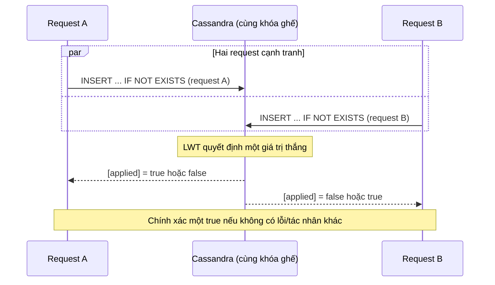

# Mô phỏng hai yêu cầu giữ chỗ cạnh tranh bằng LWT

Trong hệ thống đặt vé, hai người dùng có thể cùng bấm **Giữ ghế A12** gần như đồng thời. Nếu ứng dụng chỉ đọc trạng thái ghế rồi ghi bằng `Repository.save(...)`, cả hai request có thể cùng thấy ghế trống và đều báo thành công. Bài thực hành này dùng **Lightweight Transaction (LWT)** của Apache Cassandra để mô phỏng đúng tình huống cạnh tranh và kiểm tra rằng **chỉ một yêu cầu giành được cùng một ghế**.

Bài thuộc chương **Bài thực hành** của `SPRING_DATA_CASSANDRA`. Ta sẽ dùng CQL, `CqlSession` do Spring Boot/Spring Data Cassandra quản lý, một bài test JUnit 5 với hai luồng đồng thời, và truy vấn kiểm chứng. Qua đó, người học luyện tập thiết kế partition key theo truy vấn, phân biệt consistency thông thường với *serial consistency*, xử lý kết quả `[applied]`, kiểm soát retry và quan sát chi phí LWT trong hệ dữ liệu phân tán.

## 1. Mục tiêu và kết quả cần đạt

Sau khi làm bài, bạn cần chứng minh được các điều sau:

1. Hai request **khác `request_id`** cùng giữ **một** cặp `(show_id, seat_id)` sẽ chỉ có **một** request nhận `[applied] = true`.
2. Request còn lại nhận `[applied] = false`; không được trả kết quả "giữ chỗ thành công" cho cả hai.
3. Bảng Cassandra cuối cùng chỉ có **một chủ sở hữu** của ghế, khớp `request_id` và `user_id` của request thắng.
4. Lặp lại **cùng request** không tạo ra chủ sở hữu thứ hai; ứng dụng biết cách phân biệt *đã giữ chỗ trước đó bởi chính request này* với *ghế đã bị người khác giữ*.
5. Có thể giải thích vì sao `SELECT` rồi `INSERT` thường, `ALLOW FILTERING`, `LOCAL_QUORUM` hay `Repository.save(...)` đơn lẻ **không thay thế** được điều kiện LWT.

**Phạm vi bài:** mỗi ghế được giữ bởi một bản ghi duy nhất; chưa triển khai thanh toán, đặt nhiều ghế nguyên tử hay tự động hết hạn. Phần nâng cao trình bày cách thêm TTL/thời hạn và những rủi ro phải giải quyết trước khi dùng trong production.

## 2. Vì sao cần LWT khi hai request cạnh tranh?

Giả sử thực hiện bằng cách kiểm tra trước:

```text
Request A: SELECT ghế A12 -> chưa có bản ghi
Request B: SELECT ghế A12 -> chưa có bản ghi
Request A: INSERT chủ sở hữu A -> thành công
Request B: INSERT chủ sở hữu B -> thành công
```

Ở Cassandra, `INSERT` thường có tính chất *upsert*: nếu khóa chính trùng nhau, giá trị có thể bị ghi đè theo cơ chế timestamp; hai ứng dụng vẫn có thể cùng tưởng mình đã giữ chỗ thành công. Thêm consistency level cao hơn cho hai thao tác riêng lẻ **không** tạo ra một kiểm tra-và-ghi nguyên tử.

LWT cung cấp thao tác **compare-and-set** (CAS) với điều kiện:

```sql
INSERT INTO practice_lwt.seat_holds_by_show_and_seat
    (show_id, seat_id, request_id, user_id, held_at)
VALUES (?, ?, ?, ?, ?)
IF NOT EXISTS;
```

Với **cùng primary key**, Cassandra điều phối truy vấn có điều kiện bằng giao thức đồng thuận Paxos. Trong tình huống chỉ có hai request cạnh tranh trên cùng ghế, nếu các request hoàn thành bình thường thì **một request được áp dụng**, request còn lại nhận kết quả điều kiện không thỏa. LWT thường đắt hơn ghi không điều kiện vì cần thêm bước trao đổi giữa các replica; chỉ nên dùng khi ngữ nghĩa cạnh tranh thực sự cần đến nó.



**Không cố đoán A hay B sẽ thắng**. Lịch thực thi của thread, driver, mạng và coordinator không quyết định một thứ tự cố định mà test có thể dựa vào.

## 3. Chuẩn bị môi trường thực hành

Môi trường gợi ý:

| Thành phần | Dùng để làm gì? |
| --- | --- |
| Apache Cassandra 4.x/phiên bản tương thích | Thực thi CQL và LWT trên cơ sở dữ liệu thật. |
| Java 17+, Spring Boot 3.x, Spring Data Cassandra | Tạo ứng dụng và nhận `CqlSession` được cấu hình sẵn. |
| Cassandra Java Driver 4.x | Đặt consistency và đọc kết quả điều kiện. |
| JUnit 5 | Chạy test mô phỏng hai request cạnh tranh. |
| Docker/Testcontainers hoặc cluster test | Tạo môi trường Cassandra tách khỏi production. |

Ví dụ nhanh với một Cassandra container dùng cho thực hành:

```bash
docker run --name cassandra-lwt-practice -p 9042:9042 -d cassandra:4.1

# Sau khi node sẵn sàng nhận kết nối:
docker exec -it cassandra-lwt-practice cqlsh
```

Container có thể cần thời gian khởi động; nếu `cqlsh` chưa kết nối được, kiểm tra trạng thái/log thay vì lập tức quy lỗi cho câu CQL. Trên máy dùng Testcontainers, có thể để framework quản lý vòng đời container; quan trọng là **DDL phải chạy trước khi Spring tạo session gắn với keyspace chưa tồn tại**.

Trước khi tạo keyspace, kiểm tra datacenter thực tế:

```sql
SELECT data_center FROM system.local;
```

Các ví dụ tiếp theo giả định tên datacenter là `datacenter1`. Nếu node của bạn trả tên khác, thay `datacenter1` **đồng nhất** trong `CREATE KEYSPACE`, cấu hình driver và môi trường test. Không dùng keyspace hoặc tài khoản production cho bài thực hành.

## 4. Tạo keyspace và bảng theo đúng khóa tranh chấp

Chạy trong `cqlsh` bằng tài khoản có quyền tạo schema:

```sql
CREATE KEYSPACE IF NOT EXISTS practice_lwt
WITH replication = {
    'class': 'NetworkTopologyStrategy',
    'datacenter1': 1
};

CREATE TABLE IF NOT EXISTS practice_lwt.seat_holds_by_show_and_seat (
    show_id uuid,
    seat_id text,
    request_id uuid,
    user_id uuid,
    held_at timestamp,
    PRIMARY KEY ((show_id, seat_id))
);
```

Đây là **một partition cho mỗi ghế trong một suất chiếu**, với đúng một hàng được xác định bởi `(show_id, seat_id)`. Vì hai request cùng ghế có cùng khóa, chúng cạnh tranh trên cùng một điều kiện `IF NOT EXISTS`. Nếu chọn khóa sai, chẳng hạn thêm `request_id` vào primary key, mỗi request sẽ tạo **khóa khác nhau** và cả hai đều có thể thắng; LWT khi đó không bảo vệ tính duy nhất của ghế.

| Cột | Vai trò | Quy tắc |
| --- | --- | --- |
| `show_id` | Mã suất chiếu | Phần của partition key. |
| `seat_id` | Mã ghế trong suất chiếu | Phần của partition key; phải chuẩn hóa (`A12` khác `a12`). |
| `request_id` | Mã duy nhất và ổn định của yêu cầu giữ ghế | Dùng để đối soát khi timeout/retry. |
| `user_id` | Người đưa ra yêu cầu | Thuộc tính của lần giữ thành công. |
| `held_at` | Thời điểm ghi nhận giữ chỗ | Dùng hiển thị/kiểm tra; không tự tạo cơ chế hết hạn. |

Khóa này phục vụ đúng đường truy cập *kiểm tra một ghế trong một suất chiếu*. Nếu cần liệt kê **toàn bộ ghế** của suất chiếu, ứng dụng có thể cần bảng đọc riêng hoặc thiết kế khác; không chọn một partition khổng lồ chỉ để dùng chung cho mọi truy vấn.

`IF NOT EXISTS` trong DDL giúp tránh lỗi nếu bảng đã tồn tại, nhưng **không kiểm tra** bảng cũ có đúng primary key hay không. Khi thực hành lần đầu, nên dùng một keyspace mới; nếu tái sử dụng, kiểm tra schema thật trước khi chạy test.

## 5. Thử LWT thủ công trước khi viết Java

Sử dụng một ghế mẫu và hai request khác nhau:

```sql
-- Request A: giữ ghế A12 trong suất chiếu mẫu.
INSERT INTO practice_lwt.seat_holds_by_show_and_seat
    (show_id, seat_id, request_id, user_id, held_at)
VALUES (
    4ec9db10-1aa5-4b1d-aeba-9c9476eb54d5,
    'A12',
    1269719e-9c12-414a-8454-6381a51c16c4,
    a9352a53-b92f-40cd-bb52-b569fd41cc7d,
    '2026-11-25T08:00:00Z'
)
IF NOT EXISTS;

-- Request B: dùng cùng khóa ghế, nhưng chủ sở hữu khác.
INSERT INTO practice_lwt.seat_holds_by_show_and_seat
    (show_id, seat_id, request_id, user_id, held_at)
VALUES (
    4ec9db10-1aa5-4b1d-aeba-9c9476eb54d5,
    'A12',
    3865a602-d2e0-4df8-9915-e50e5a6c4e2f,
    cd6ea90c-aa93-4e65-aa94-af78aab30dc7,
    '2026-11-25T08:00:01Z'
)
IF NOT EXISTS;
```

Khi chạy **tuần tự** như ví dụ, A thường nhận:

```text
 [applied]
-----------
      True
```

B nhận `[applied] = False` và có thể kèm thông tin hàng đã tồn tại. Đây là bước kiểm chứng cú pháp và khóa. Nó **chưa phải** bài kiểm thử cạnh tranh đồng thời; phần JUnit bên dưới sẽ cho hai request cùng chờ một tín hiệu bắt đầu.

Đọc dữ liệu cuối:

```sql
SELECT show_id, seat_id, request_id, user_id, held_at
FROM practice_lwt.seat_holds_by_show_and_seat
WHERE show_id = 4ec9db10-1aa5-4b1d-aeba-9c9476eb54d5
  AND seat_id = 'A12';
```

Truy vấn phải trả một hàng có `request_id` của A. Để làm lại phần thủ công, xóa **đúng khóa này** hoặc chọn một `show_id` mới. Không `TRUNCATE` nếu bộ kiểm thử khác đang chia sẻ cùng bảng.

## 6. Cấu hình kết nối Spring Data Cassandra

Với Spring Boot 3.x, ví dụ `application.yml` cho môi trường local:

```yaml
spring:
  cassandra:
    contact-points: 127.0.0.1
    port: 9042
    local-datacenter: datacenter1
    keyspace-name: practice_lwt
```

Thêm dependency Spring Data Cassandra, JUnit 5 và driver tương thích theo cơ chế quản lý dependency của Spring Boot trong dự án. Nếu cluster bật authentication/TLS, cung cấp credentials và cấu hình TLS từ nguồn secret phù hợp; ví dụ local chỉ giả định cluster thực hành chấp nhận kết nối này.

`CqlSession` là lớp Java Driver bên dưới Spring Data Cassandra; có thể inject chính session Spring đang quản lý. Ta dùng `CqlSession` trực tiếp ở bước LWT vì muốn nhìn rõ `IF NOT EXISTS`, consistency, kết quả `[applied]` và không vô tình thực hiện **upsert thông thường** qua `Repository.save(...)`. Entity mapping và `CassandraTemplate` vẫn hữu ích cho các đường CRUD không có điều kiện, nhưng code giữ chỗ phải bảo tồn ngữ nghĩa CAS.

## 7. Viết service giữ chỗ có điều kiện

Ví dụ Java 17, Spring Boot 3.x và Cassandra Java Driver 4.x:

```java
import com.datastax.oss.driver.api.core.CqlSession;
import com.datastax.oss.driver.api.core.DefaultConsistencyLevel;
import com.datastax.oss.driver.api.core.cql.Row;
import com.datastax.oss.driver.api.core.cql.SimpleStatement;
import java.time.Instant;
import java.util.UUID;
import org.springframework.stereotype.Service;

@Service
public class SeatHoldService {
    private final CqlSession session;

    public SeatHoldService(CqlSession session) {
        this.session = session;
    }

    public HoldAttempt tryHold(UUID showId, String seatId,
                               UUID requestId, UUID userId) {
        SimpleStatement statement = SimpleStatement.builder("""
                INSERT INTO seat_holds_by_show_and_seat
                    (show_id, seat_id, request_id, user_id, held_at)
                VALUES (?, ?, ?, ?, ?) IF NOT EXISTS
                """)
            .addPositionalValues(showId, seatId, requestId,
                                 userId, Instant.now())
            .setConsistencyLevel(DefaultConsistencyLevel.LOCAL_QUORUM)
            .setSerialConsistencyLevel(DefaultConsistencyLevel.LOCAL_SERIAL)
            .setIdempotent(false)
            .build();

        Row result = session.execute(statement).one();
        if (result == null) {
            throw new IllegalStateException("LWT khong tra ve ket qua");
        }

        boolean applied = result.getBoolean("[applied]");
        return new HoldAttempt(applied, requestId, userId);
    }

    public record HoldAttempt(boolean applied, UUID requestId, UUID userId) {}
}
```

Những quyết định cần hiểu:

- **`IF NOT EXISTS`** là điều kiện tranh chấp; hai câu `INSERT` thường không có bảo đảm tương tự.
- **`[applied]`** là kết quả CAS: `true` nghĩa là thao tác có điều kiện được áp dụng; `false` nghĩa điều kiện không thỏa tại thời điểm xử lý. Nó **không đơn thuần là HTTP 200 hay 409**; tầng service cần diễn giải theo nghiệp vụ.
- **`LOCAL_QUORUM`** là consistency thông thường của lệnh ghi sau quá trình điều kiện; **`LOCAL_SERIAL`** điều khiển pha đồng thuận có điều kiện trong local datacenter. Hai mức này giải quyết phần khác nhau của LWT.
- **`setIdempotent(false)`** tránh để driver mặc nhiên thực thi dự phòng những lần gửi giống nhau như một thao tác ghi hoàn toàn an toàn. Lệnh có điều kiện có thể cho kết quả `[applied]` khác nhau ở lần lặp, nên cần chủ động xử lý timeout và retry ở tầng nghiệp vụ.
- **`request_id`** được tạo **một lần cho mỗi ý định giữ chỗ**, giữ ổn định khi cùng ý định được gửi lại; không sinh ID mới mỗi lần retry cùng request.
- **`Instant.now()`** dùng minh họa thời điểm ghi; nếu cần dữ liệu đầu vào bất biến khi retry, truyền `heldAt` đã cố định cùng request. Ở đây một hàng đã giữ sẽ không bị thay chỉ vì thử lại.

Đối với cluster một datacenter có RF = 1 ở local, `LOCAL_QUORUM` vẫn hoạt động nhưng không kiểm chứng đầy đủ chi phí và khả năng chịu lỗi của một cluster RF = 3. Khi phục vụ ghi LWT cạnh tranh từ **nhiều datacenter**, cần xem lại lựa chọn `LOCAL_SERIAL` so với `SERIAL` và kiến trúc route request; không giả định thiết lập của bài local bảo đảm đồng thuận toàn cầu theo cách production yêu cầu.

## 8. Test mô phỏng hai luồng tranh chấp thật

Tạo một integration test với `@SpringBootTest`. Bài test giả định keyspace/bảng ở phần 4 **đã tồn tại** và Spring có thể kết nối. Hai task sử dụng cùng `showId`/`seatId`, nhưng mỗi task có `requestId` và `userId` khác nhau. `CountDownLatch` giúp chúng **sẵn sàng trước khi cùng được phát tín hiệu**.

```java
import static org.junit.jupiter.api.Assertions.assertEquals;
import static org.junit.jupiter.api.Assertions.assertNotNull;
import static org.junit.jupiter.api.Assertions.assertTrue;

import com.datastax.oss.driver.api.core.CqlSession;
import com.datastax.oss.driver.api.core.DefaultConsistencyLevel;
import com.datastax.oss.driver.api.core.cql.Row;
import com.datastax.oss.driver.api.core.cql.SimpleStatement;
import java.util.UUID;
import java.util.concurrent.Callable;
import java.util.concurrent.CountDownLatch;
import java.util.concurrent.ExecutorService;
import java.util.concurrent.Executors;
import java.util.concurrent.Future;
import java.util.concurrent.TimeUnit;
import org.junit.jupiter.api.Test;
import org.springframework.beans.factory.annotation.Autowired;
import org.springframework.boot.test.context.SpringBootTest;

@SpringBootTest
class SeatHoldConcurrencyTest {
    @Autowired SeatHoldService holds;
    @Autowired CqlSession session;

    @Test
    void twoRequestsForSameSeatHaveExactlyOneWinner() throws Exception {
        // Key ngẫu nhiên để không phụ thuộc dữ liệu của lần test trước.
        UUID showId = UUID.randomUUID();
        String seatId = "A12";
        UUID requestA = UUID.randomUUID();
        UUID requestB = UUID.randomUUID();
        UUID userA = UUID.randomUUID();
        UUID userB = UUID.randomUUID();

        CountDownLatch ready = new CountDownLatch(2);
        CountDownLatch start = new CountDownLatch(1);
        ExecutorService pool = Executors.newFixedThreadPool(2);

        Callable<SeatHoldService.HoldAttempt> taskA = () -> {
            ready.countDown();
            if (!start.await(10, TimeUnit.SECONDS)) {
                throw new IllegalStateException("Task A khong nhan tin hieu");
            }
            return holds.tryHold(showId, seatId, requestA, userA);
        };

        Callable<SeatHoldService.HoldAttempt> taskB = () -> {
            ready.countDown();
            if (!start.await(10, TimeUnit.SECONDS)) {
                throw new IllegalStateException("Task B khong nhan tin hieu");
            }
            return holds.tryHold(showId, seatId, requestB, userB);
        };

        try {
            Future<SeatHoldService.HoldAttempt> futureA = pool.submit(taskA);
            Future<SeatHoldService.HoldAttempt> futureB = pool.submit(taskB);
            assertTrue(ready.await(10, TimeUnit.SECONDS));

            // Mở cổng bắt đầu cho cả hai task.
            start.countDown();
            var a = futureA.get(20, TimeUnit.SECONDS);
            var b = futureB.get(20, TimeUnit.SECONDS);

            long winners = (a.applied() ? 1 : 0) + (b.applied() ? 1 : 0);
            assertEquals(1L, winners, "Chi mot request duoc giu ghe");

            SimpleStatement check = SimpleStatement.builder("""
                    SELECT request_id, user_id
                    FROM seat_holds_by_show_and_seat
                    WHERE show_id = ? AND seat_id = ?
                    """)
                .addPositionalValues(showId, seatId)
                .setConsistencyLevel(DefaultConsistencyLevel.LOCAL_QUORUM)
                .build();

            Row saved = session.execute(check).one();
            assertNotNull(saved);
            assertEquals(a.applied() ? requestA : requestB,
                         saved.getUuid("request_id"));
            assertEquals(a.applied() ? userA : userB,
                         saved.getUuid("user_id"));
        } finally {
            start.countDown(); // Không để thread treo nếu assertion trước đó lỗi.
            pool.shutdownNow();
        }
    }
}
```

Test xác nhận **đúng một người thắng bất kể người đó là A hay B**. `CountDownLatch` tăng khả năng các lời gọi gần nhau về thời gian nhưng **không bảo đảm hai packet tới Cassandra cùng một nano-giây**; đây là mô phỏng cạnh tranh có kiểm soát, không phải phép đo benchmark LWT. Hai task có thể vẫn được scheduler chạy lệch nhau, và kết quả đúng vẫn phải là một lần áp dụng cho cùng khóa.

Nếu Cassandra không sẵn sàng, quyền không đủ, hoặc consistency không đáp ứng, test có thể nhận exception thay vì một cặp `true`/`false`. Đây là lỗi điều kiện môi trường hoặc hạ tầng cần được phân tích riêng; không đổi expected result thành "hai lần false" để cho test pass. Có thể dùng Testcontainers tạo schema **trước khi Spring context khởi tạo**, và dùng `UUID.randomUUID()` cho mỗi lượt để cô lập dữ liệu. Tránh `TRUNCATE` bảng dùng chung khi chạy test song song.

## 9. Diễn giải kết quả và tiêu chí pass/fail

Khi cả hai lời gọi **đều hoàn thành bình thường** và trước đó ghế chưa có người giữ, các trạng thái có thể gặp:

| Kết quả A | Kết quả B | Diễn giải |
| --- | --- | --- |
| `true` | `false` | **PASS**: A giữ ghế, B thất bại vì ghế đã tồn tại. |
| `false` | `true` | **PASS**: B giữ ghế, A thất bại vì ghế đã tồn tại. |
| `true` | `true` | **FAIL**: có thể hai request dùng khóa khác nhau, test sai hoặc thiết kế điều kiện sai. |
| `false` | `false` | **FAIL đối với tiền điều kiện ghế trống**: có thể đã có hàng sẵn, thử nhầm khóa hoặc có tác nhân thứ ba. |
| Một/both request lỗi timeout | Chưa kết luận winner chỉ từ exception | **INCONCLUSIVE**: cần kiểm tra dữ liệu theo khóa và đối soát `request_id`. |

Điều kiện test quan trọng là **cùng partition key và cùng logical seat**, không phải nhất thiết hai thread chạm đúng cùng coordinator. LWT giúp hai coordinator tuân thủ cơ chế đồng thuận cho cùng khóa theo cấu hình cluster thích hợp.

Nếu muốn tăng xác suất bắt gặp trường hợp cạnh tranh, có thể lặp bài test với **khóa mới ở mỗi vòng** trong một suite giới hạn quy mô. LWT tạo nhiều lượt giao tiếp với replica, vì vậy tránh stress hàng chục nghìn vòng trên cluster dùng chung chỉ để kiểm tra một invariant chức năng.

## 10. Timeout và retry: phân biệt "không biết" với "thất bại"

Một request LWT có thể **đã được áp dụng** nhưng response về client bị thất lạc. Ví dụ A `INSERT IF NOT EXISTS` thành công ở Cassandra, nhưng A nhận timeout; khi A thử lại, lần thứ hai có thể nhận `[applied] = false` vì hàng do **chính A** tạo đã tồn tại.

Do đó, tầng nghiệp vụ nên phân biệt ít nhất ba trạng thái:

| Trạng thái | Nguồn thông tin | Hành động |
| --- | --- | --- |
| `HELD_BY_THIS_REQUEST` | LWT trả `true`, hoặc đọc lại thấy `request_id` trùng request gốc. | Trả thành công cho chính ý định giữ chỗ đó. |
| `HELD_BY_OTHER_REQUEST` | LWT trả `false` và hàng hiện có thuộc `request_id` khác. | Trả xung đột (`409 Conflict` là một lựa chọn API phù hợp). |
| `UNKNOWN` | Timeout/lỗi không cho biết kết quả và chưa đọc xác minh được. | Không khẳng định đã giữ hay chưa; đối soát/retry có kiểm soát với cùng `request_id`. |

Một quy trình đơn giản khi nhận `[applied] = false`:

```text
Nếu hàng đang giữ có request_id == request_id của lời gọi hiện tại:
    coi là yêu cầu lặp của cùng ý định, báo đã giữ thành công
Ngược lại:
    coi ghế đã được yêu cầu khác giữ, báo xung đột
```

Khi quan sát hàng hiện tại, phải đọc đúng khóa với consistency phù hợp. Ở hệ đa node/đa datacenter hoặc có cơ chế hết hạn, xóa và tái giữ, cần chính sách đối soát chặt hơn (phiên bản/lifecycle của lease, trạng thái thanh toán, thời hạn). **Không sinh `request_id` mới cho cùng một retry** vì khi đó ứng dụng tự xóa mất khả năng nhận biết thao tác trước có phải của mình hay không.

Trong Spring MVC/WebFlux, nếu bắt exception từ Cassandra rồi luôn trả "không giữ được ghế" hoặc lập tức tạo request mới, hệ thống có thể báo sai sự thật khi LWT đã commit nhưng ACK chưa đến client. Cần lưu correlation/request ID, kiểm tra trạng thái và báo kết quả chưa xác định nếu không thể xác minh trong deadline.

## 11. Giải phóng ghế: cũng phải có điều kiện

Nếu ứng dụng cho phép hủy giữ chỗ, không nên gửi `DELETE` không điều kiện chỉ với khóa ghế khi có thể tồn tại thao tác tranh chấp hoặc lượt giữ mới. Ví dụ, chỉ cho yêu cầu có `request_id` đúng với chủ hiện tại giải phóng ghế:

```sql
DELETE FROM practice_lwt.seat_holds_by_show_and_seat
WHERE show_id = 4ec9db10-1aa5-4b1d-aeba-9c9476eb54d5
  AND seat_id = 'A12'
IF request_id = 1269719e-9c12-414a-8454-6381a51c16c4;
```

Đây cũng là LWT và cũng cần đọc `[applied]`. Nếu ghế đã chuyển sang chủ mới, một yêu cầu hủy cũ không nên xóa hàng của chủ mới. Không dựa vào một lệnh `SELECT` trước rồi `DELETE` thường vì quyền sở hữu có thể đổi giữa hai lời gọi.

Ở ứng dụng sản xuất, cần xác thực danh tính người yêu cầu hủy, kiểm tra quyền sở hữu và trạng thái nghiệp vụ, không cho client tự chỉ định tùy ý `request_id` của người khác. Việc hủy giữ chỗ và hoàn tiền là hai quy trình khác nhau; LWT trên một hàng Cassandra không tạo giao dịch nguyên tử với hệ thống thanh toán ngoài.

## 12. Bài nâng cao: giữ ghế có thời hạn

Trong thực tế, một lần giữ ghế thường chỉ có hiệu lực trong vài phút. Cassandra hỗ trợ TTL:

```sql
INSERT INTO practice_lwt.seat_holds_by_show_and_seat
    (show_id, seat_id, request_id, user_id, held_at)
VALUES (?, ?, ?, ?, ?)
USING TTL 300
IF NOT EXISTS;
```

Đoạn trên minh họa TTL 300 giây và dùng bind markers cho các giá trị. Khi hàng đã hết hiệu lực theo TTL, một yêu cầu mới có thể giữ cùng ghế. Nhưng TTL làm nảy sinh các tình huống cần xử lý:

- Thời hạn thực tế được áp dụng từ lúc ghi vào Cassandra; ứng dụng cần công bố deadline và tính đến sai lệch đồng hồ/lưu lượng mạng.
- Nếu khách thanh toán khi hold đã hết hạn, ghế có thể đã bị người khác giữ. Phải có bước xác nhận/cam kết phù hợp ở nghiệp vụ; **TTL không thay thế quy trình hoàn tất đặt vé**.
- Retry cùng `request_id` sau khi TTL hết có thể tạo **một lượt giữ mới**. Nếu muốn ngăn điều này, phải có trạng thái yêu cầu hoặc idempotency record bền vững ngoài hàng tự hết hạn.
- Việc chỉ nhìn `request_id` mà không phân biệt phiên bản/chu kỳ giữ có thể dẫn đến nhận diện nhầm một yêu cầu cũ sau khi ghế được mở bán lại.
- TTL và xóa tạo tombstone; cần theo dõi lượng dữ liệu hết hạn, compaction và tốc độ tái sử dụng ghế trên cluster thật.

Bài cốt lõi **không bật TTL** để việc kiểm chứng một winner rõ ràng. Chỉ thêm TTL sau khi phần tranh chấp đồng thời đã pass và đã thiết kế cách nhận biết một lượt giữ mới khác với lượt cũ.

## 13. Những hiểu lầm thường gặp về LWT

| Hiểu lầm | Thực tế |
| --- | --- |
| `SELECT` ở `LOCAL_QUORUM` rồi `INSERT` là đủ chống đua | Hai lời gọi riêng vẫn có cửa sổ race; cần thao tác điều kiện nguyên tử. |
| `Repository.save(...)` tự đảm bảo chỉ một người giữ được ghế | `save` thường là upsert; chỉ CQL có điều kiện/đường API triển khai CAS rõ ràng mới có ý nghĩa LWT. |
| Mỗi người dùng có `request_id` riêng là đủ | Nếu `request_id` nằm trong primary key của bảng ghế, hai request vẫn ghi hai hàng khác nhau. Khóa tranh chấp phải là **ghế**. |
| `[applied] = false` luôn là thất bại nghiệp vụ | Có thể là request trước của **chính** người đó đã thành công rồi phản hồi thất lạc. |
| Timeout nghĩa là LWT không chạy | Client có thể mất kết quả dù mutation đã áp dụng; cần đọc/đối soát theo `request_id`. |
| LWT trên một ghế đồng nghĩa nguyên tử cả giỏ 4 ghế | LWT không tự tạo transaction ACID xuyên nhiều partition và dịch vụ. |
| Cứ tăng consistency thì không còn ghi trùng | Consistency và điều kiện CAS là hai cơ chế khác nhau. |
| `LOCAL_SERIAL` cho bài test một DC phù hợp mọi kiến trúc đa DC | Cần đánh giá yêu cầu tranh chấp xuyên DC và dùng `SERIAL` khi ngữ nghĩa toàn cục đòi hỏi. |
| LWT càng nhiều thì throughput càng cao | LWT tốn nhiều lượt phối hợp; phải đo latency `p95/p99`, contention và tải replica. |

## 14. Quan sát và chẩn đoán khi test thất bại

Nếu test không trả một `true` và một `false`, hãy kiểm tra theo thứ tự:

1. **DDL và khóa chính:** `PRIMARY KEY ((show_id, seat_id))` có đúng không? Hai task có dùng cùng `showId` và `seatId`, khác `requestId`/`userId` không?
2. **Dữ liệu sạch:** có giữ chỗ tồn tại từ test trước không? Mỗi test có dùng `showId` mới không?
3. **Lệnh có điều kiện:** log *query shape* (ẩn bound values), xác nhận câu CQL chứa `IF NOT EXISTS` và kết quả được đọc từ `[applied]`.
4. **Kết nối và consistency:** Spring đã dùng đúng keyspace/datacenter không? `LOCAL_QUORUM` và `LOCAL_SERIAL` có phù hợp với topology/replication không?
5. **Ngoại lệ:** có timeout, `WriteTimeout`, `Unavailable` hoặc lỗi mạng không? Nếu có, không diễn giải là `false`; xác minh hàng thực tế và nguyên nhân theo driver/node log.
6. **Số request thực:** retry hay speculative execution có được bật cho statement này không? Nên giữ `setIdempotent(false)` và quan sát policy của driver trong môi trường test.
7. **Hiệu năng:** ghi latency `p95/p99` cho LWT khi contention cao; kiểm tra CPU/network, Paxos contention và số request chờ. Không dùng bài test một node để kết luận giới hạn tải production.

Một mẫu log tối thiểu phù hợp để điều tra:

```text
operation=seat.hold show_id=<redacted> seat_id=A12
request_id=<correlation-id> outcome=applied|not_applied|unknown
latency_ms=<number> error_type=<class-if-any>
```

Không ghi mật khẩu Cassandra, mã thanh toán hay dữ liệu cá nhân vào log. Khi dùng metric, chỉ gắn nhãn `operation`, `outcome`, loại lỗi với số lượng giá trị hữu hạn; **không** dùng UUID của suất chiếu, request hoặc user làm metric tag vì làm tăng cardinality rất lớn.

## 15. Bài tập mở rộng cho người học

Sau khi test cốt lõi pass, có thể tự mở rộng theo thứ tự sau:

1. **Khác ghế:** cho hai request cùng `showId` nhưng `seatId` là `A12` và `A13`. Xác minh cả hai có thể được áp dụng vì là **hai primary key khác nhau**.
2. **Retry cùng ý định:** gọi `tryHold` hai lần với cùng `(showId, seatId, requestId, userId)`; kiểm tra lần sau có thể nhận `false`, nhưng hàng lưu thuộc cùng `requestId` nên API có thể trả kết quả idempotent.
3. **Giải phóng đúng chủ:** thêm method dùng `DELETE ... IF request_id = ?`. Kiểm tra request khác không thể hủy ghế đang giữ.
4. **Timeout không xác định:** tạo tình huống client timeout ở môi trường test có kiểm soát; chứng minh handler không tự kết luận mất ghế mà đọc/đối soát lại.
5. **TTL 300 giây:** bổ sung thời hạn, kiểm tra quy tắc giữ lại sau khi hết hạn và idempotency record khi cần. Dùng điều khiển thời gian trong hạ tầng test phù hợp; không dùng bài stress với `Thread.sleep(300_000)` làm mặc định.
6. **Nhiều datacenter:** thảo luận mức serial consistency và topology cần có khi request giữ cùng ghế có thể đến các datacenter khác nhau; triển khai kiểm thử thực tế trên cluster phù hợp trước khi kết luận.

## 16. Checklist nghiệm thu bài thực hành

- [ ] Cassandra test đã kết nối được và keyspace `practice_lwt` có bảng với `PRIMARY KEY ((show_id, seat_id))`.
- [ ] CQL `INSERT ... IF NOT EXISTS` được gửi với các giá trị bind đúng, `LOCAL_QUORUM` và `LOCAL_SERIAL` phù hợp topology bài local.
- [ ] Service đọc `[applied]` và không dùng `Repository.save(...)` như phương pháp CAS thay thế.
- [ ] Hai task JUnit có cùng `(showId, seatId)` nhưng `requestId/userId` khác, có `CountDownLatch` và `Future` để chờ kết quả.
- [ ] Sau khi cả hai hoàn thành, có **chính xác một** `applied = true`, một `false`; không phụ thuộc A hay B thắng.
- [ ] `SELECT` theo khóa ghế trả về `request_id`/`user_id` của người thắng.
- [ ] Hiểu cách xử lý timeout và retry với **cùng `request_id`** mà không báo hai người thắng.
- [ ] Có quy tắc giải phóng có điều kiện và, nếu thêm TTL, có kế hoạch xử lý hết hạn, thanh toán và yêu cầu lặp.
- [ ] Không coi bài test một node là bằng chứng cho hiệu năng và đồng thuận của mọi cluster multi-node/multi-DC.

**Ghi nhớ:** với hai yêu cầu giữ cùng một ghế, điều quyết định là **một primary key đại diện cho chính ghế cần tranh chấp** và một câu CQL **`INSERT ... IF NOT EXISTS`**. Spring Data Cassandra có thể dùng `CqlSession` để thực hiện LWT và đọc `[applied]`; JUnit xác minh chỉ có một người thắng. Khi chuyển sang sản phẩm thật, phải giải quyết thêm timeout không xác định, idempotency, hết hạn giữ chỗ và các tác dụng phụ ngoài Cassandra.
