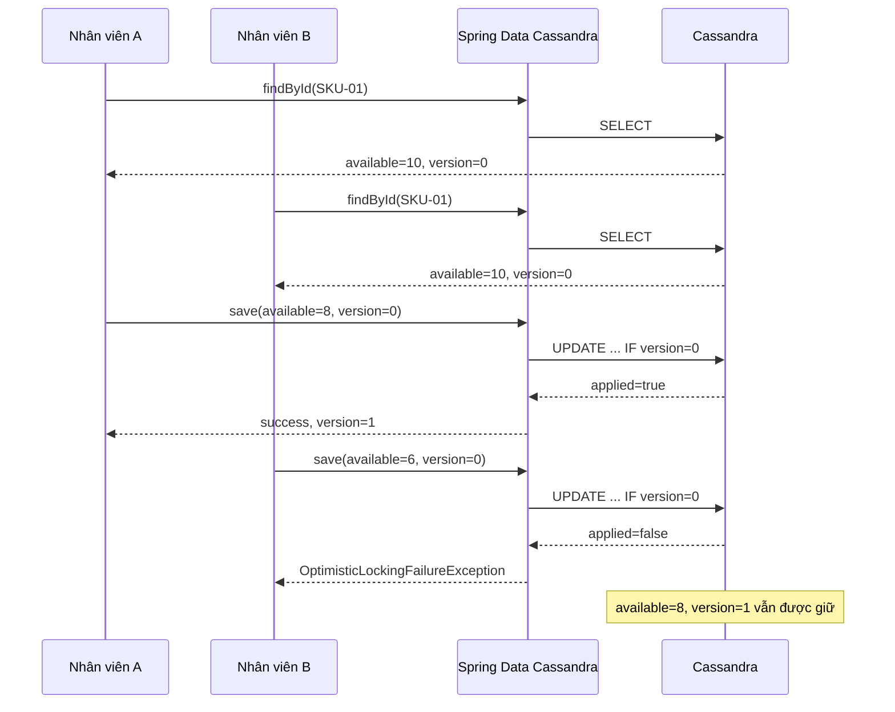

# Kiểm thử `@Version` với dữ liệu đã bị cập nhật

Trong **SPRING_DATA_CASSANDRA**, chúng ta truy cập Apache Cassandra bằng entity mapping, repository, `CassandraTemplate` và truy vấn CQL. Cassandra ưu tiên khả năng mở rộng theo partition key và tính nhất quán được cấu hình theo thao tác; vì thế, một đoạn mã theo kiểu **đọc → sửa object → ghi lại** có thể làm mất cập nhật nếu hai request cùng sửa một hàng.

Bài thực hành thuộc chương **Bài thực hành**, yêu cầu bạn tự tạo một entity có `@Version`, lưu nó bằng Spring Data Cassandra, lấy **hai bản đọc độc lập của cùng dữ liệu**, để một bản cập nhật thành công rồi chứng minh rằng bản còn lại bị từ chối vì đã cũ (*stale entity*). Sau đó, bạn sẽ kiểm tra trạng thái còn lưu trong Cassandra, thử cập nhật lại đúng cách và khám phá giới hạn của optimistic locking trong hệ dữ liệu phân tán.

> **Kết quả cần đạt:** Bài kiểm thử phải chứng minh được cả ba điều: có xung đột phiên bản thực sự, thao tác ghi cũ bị từ chối và dữ liệu mới đã ghi không bị ghi đè. Chỉ assert có exception mà không đọc lại dữ liệu là chưa đủ.

## 1. Mục tiêu học tập và sản phẩm đầu ra

Sau khi hoàn thành, bạn có thể:

1. Phân biệt **optimistic locking** với khóa độc quyền, transaction ACID và Cassandra consistency level.
2. Ánh xạ `@Version` vào một cột số trong bảng Cassandra; hiểu vòng đời `null → 0 → 1 → 2` của một phiên bản kiểu `Long`.
3. Viết integration test dùng `@DataCassandraTest`, Cassandra thật qua Testcontainers, repository và `CassandraTemplate`.
4. Chủ động tạo dữ liệu stale bằng **hai lần đọc trước khi có update**, tránh phụ thuộc vào race ngẫu nhiên giữa các thread.
5. Bắt đúng `OptimisticLockingFailureException` khi lần ghi có version cũ không được áp dụng.
6. Đọc lại bản ghi để xác minh tính đúng đắn; cập nhật lần tiếp theo bằng cách **đọc lại và áp dụng lại quy tắc nghiệp vụ**.
7. Nhận diện các đường ghi có thể vượt qua `@Version`, ảnh hưởng của retry và chi phí LWT trong môi trường phân tán.

### Sản phẩm cần bàn giao khi tự thực hành

| Thành phần | Vai trò | Điều kiện hoàn thành |
| --- | --- | --- |
| `stock_by_sku` | Bảng Cassandra có cột `version bigint`. | Schema tạo được, partition key rõ ràng. |
| `StockItem` | Entity có `@Table`, `@PrimaryKey` và `@Version`. | Mapping đúng; Spring đọc/ghi được version. |
| `StockRepository` | Repository thao tác một entity theo SKU. | `save`/`findById` hoạt động trên Cassandra test. |
| `StockOptimisticLockingTest` | Bộ integration test tái hiện stale write. | Có cả assertion exception và assertion dữ liệu persisted. |
| Ghi chú kết quả | Giải thích vì sao lần ghi cũ thất bại. | Phân biệt version conflict, timeout, stale read và retry. |

Không cần khởi động controller, Kafka hay toàn bộ hệ thống. Mục tiêu trực tiếp của bài là **ngữ nghĩa lưu một hàng Cassandra thông qua Spring Data**.

## 2. Bối cảnh: hai người cùng chỉnh số lượng hàng

Giả sử mỗi SKU có một hàng trong bảng `stock_by_sku`. Hai nhân viên A và B cùng mở màn hình chỉnh tồn kho lúc số lượng là 10:

```text
T0  Cassandra: SKU-01, available = 10, version = 0
T1  A đọc:    available = 10, version = 0
T2  B đọc:    available = 10, version = 0
T3  A lưu:    available = 8,  version = 1  -> thành công
T4  B lưu:    available = 6,  version = 0  -> PHẢI thất bại
T5  Cassandra vẫn giữ: available = 8, version = 1
```

Nếu B ghi mù bằng `UPDATE` thông thường, không kiểm tra version, giá trị 6 có thể ghi đè kết quả của A. Đây là vấn đề **lost update**.

Spring Data Cassandra hỗ trợ **optimistic locking** thông qua annotation `org.springframework.data.annotation.Version`. Theo cơ chế mà Spring Data Cassandra tài liệu hóa:

- Khi tạo entity mới, đường ghi được bảo vệ bằng thao tác điều kiện tương đương `INSERT ... IF NOT EXISTS`.
- Khi cập nhật, thao tác kiểm tra **version đang lưu phải bằng version mà entity mang theo**; nếu thắng, version được tăng.
- Khi xóa theo entity có version, phép xóa cũng kiểm tra điều kiện version.
- Nếu điều kiện không còn đúng, Spring Data ném `OptimisticLockingFailureException`.
- Cơ chế dùng **lightweight transaction (LWT)** của Cassandra, có thêm lượt phối hợp replica so với ghi không điều kiện.
- Bảo đảm được tài liệu hóa cho **thao tác trên từng entity**, không áp dụng như một cơ chế optimistic locking xuyên batch nhiều entity.



Điểm quan trọng: **không cần hai thread chạy thực sự song song** để chứng minh lost-update protection. Chỉ cần giữ hai object chứa version cũ được đọc trước lúc có update, rồi lưu tuần tự để tái hiện tình huống kiểm soát được.

## 3. Môi trường bài lab

Ví dụ chi tiết nhắm tới:

- Java 17 trở lên.
- Spring Boot **3.5.x** với Spring Data Cassandra thuộc BOM tương ứng.
- JUnit Jupiter, AssertJ, Testcontainers (nhánh **1.x** được quản lý bởi BOM của Boot 3.5).
- Apache Cassandra 4.1 trong container dùng riêng cho bài kiểm thử.
- Docker có thể chạy Testcontainers.

Đây là một bộ phiên bản minh họa để các import nhất quán. Nếu dùng Spring Boot **4.x**, package `@DataCassandraTest` và dependency cho test slice khác Boot 3.x; Testcontainers 2.x cũng thay đổi một số artifact/package. Cần chọn một bộ dependency tương thích thay vì copy lẫn các import của nhiều major version.

### 3.1. Dependency Gradle

Ví dụ `build.gradle` khi dự án đã có plugin Spring Boot và dependency management phù hợp:

```groovy
dependencies {
    implementation 'org.springframework.boot:spring-boot-starter-data-cassandra'

    testImplementation 'org.springframework.boot:spring-boot-starter-test'
    testImplementation 'org.springframework.boot:spring-boot-testcontainers'
    testImplementation 'org.testcontainers:junit-jupiter'
    testImplementation 'org.testcontainers:cassandra'
}

tasks.named('test') {
    useJUnitPlatform()
}
```

Không pin một phiên bản rời rạc cho Java Driver, Spring Data hoặc Testcontainers nếu BOM dự án đang quản lý chúng. Sử dụng dependency/version nhất quán giúp tránh các lỗi không liên quan đến mục tiêu `@Version`.

### 3.2. Sơ đồ thư mục minh họa

```text
src/
  main/
    java/com/example/stock/
      StockApplication.java
      StockItem.java
      StockRepository.java
  test/
    java/com/example/stock/
      StockOptimisticLockingTest.java
    resources/
      cql/
        stock-schema.cql
```

Đặt test cùng package hoặc dưới nhánh package của `@SpringBootApplication` để Spring Boot tìm được cấu hình khởi tạo. `@DataCassandraTest` chỉ nạp các thành phần phù hợp với lát cắt Cassandra; nó không tự nạp tất cả service/controller thông thường.

**Không dùng H2 để thay Cassandra:** Test slice `@DataCassandraTest` vẫn cần một Cassandra có thể kết nối. Các đặc tính LWT, partition key và kiểu dữ liệu CQL không thể được chứng minh bằng giả lập database quan hệ.

## 4. Bước 1 — Tạo keyspace và bảng có cột version

Tạo file `src/test/resources/cql/stock-schema.cql`:

```sql
CREATE KEYSPACE IF NOT EXISTS stock_lab
WITH replication = {
    'class': 'SimpleStrategy',
    'replication_factor': 1
};

CREATE TABLE IF NOT EXISTS stock_lab.stock_by_sku (
    sku       text PRIMARY KEY,
    available int,
    note      text,
    version   bigint
);
```

Trong bảng:

- `sku` vừa là primary key, vừa là **partition key**; mỗi SKU xác định một hàng duy nhất.
- `available` là số lượng tồn kho dùng trong bài toán.
- `note` giúp phân biệt người sửa và hỗ trợ assertion rằng bản ghi mới không bị ghi đè.
- `version bigint` chứa version mà Spring Data dùng cho optimistic locking. Đây là giá trị **nghiệp vụ của entity mapping**, không phải write timestamp do Cassandra tự sinh.

Cấu hình `SimpleStrategy` với RF=1 chỉ nhằm chạy Cassandra một node trong container. Production nhiều data center phải đánh giá `NetworkTopologyStrategy`, RF, mức nhất quán và khả năng chịu lỗi. Đừng dùng con số RF của bài lab làm cấu hình production.

### Vì sao bài test tạo schema tường minh?

Annotation `@Table` hoặc `@Version` trong Java **không phải lời hứa** Cassandra đã có keyspace và table. Để tránh test pass/fail vì dữ liệu còn sót trong máy phát triển, ta tạo schema trước khi Spring Data thực thi truy vấn. Testcontainers sẽ chạy script khởi tạo và cung cấp thông tin kết nối cho Spring Boot.

Có thể quản lý schema bằng migration tool khác, nhưng bài kiểm thử phải biết rõ schema thật đang được sử dụng.

## 5. Bước 2 — Tạo entity `StockItem`

Tạo `src/main/java/com/example/stock/StockItem.java`:

```java
package com.example.stock;

import org.springframework.data.annotation.Version;
import org.springframework.data.cassandra.core.mapping.PrimaryKey;
import org.springframework.data.cassandra.core.mapping.Table;

@Table("stock_by_sku")
public class StockItem {

    @PrimaryKey
    private String sku;

    private int available;

    private String note;

    @Version
    private Long version;

    public StockItem() {
        // Constructor phục vụ cơ chế materialize entity của Spring Data.
    }

    public StockItem(String sku, int available, String note) {
        this.sku = sku;
        this.available = available;
        this.note = note;
        // version = null để Spring Data nhận diện entity mới.
    }

    public String getSku() {
        return sku;
    }

    public int getAvailable() {
        return available;
    }

    public void setAvailable(int available) {
        this.available = available;
    }

    public String getNote() {
        return note;
    }

    public void setNote(String note) {
        this.note = note;
    }

    public Long getVersion() {
        return version;
    }
}
```

Một số chi tiết dễ bỏ sót:

1. **Import đúng:** `@Version` ở đây là `org.springframework.data.annotation.Version`; không nhầm với annotation version của một thư viện khác.
2. Dùng `Long` (wrapper) để phiên bản của entity **mới** là `null`. Spring Data dùng thông tin version trong chiến lược nhận diện entity mới.
3. Sau khi insert lần đầu, version được Spring Data gán **0**. Sau một lần update thành công, version tăng thành **1**.
4. Bài lab không cung cấp setter cho `version`. Business code không nên tự thay version; Spring Data quản lý nó khi persist bằng API có hỗ trợ.
5. Cột Cassandra phải là kiểu phù hợp, ví dụ `bigint` tương ứng với `Long`.
6. Toàn bộ demo dùng một partition key `sku`. Trong ứng dụng thực tế, composite partition key cần mapping `@PrimaryKeyClass`/`@PrimaryKeyColumn` đúng thiết kế.

**Lưu ý quan trọng về entity state:** Với kiểu `Long`, `null` là tín hiệu entity mới; một entity được load từ Cassandra với version 0 là entity đã tồn tại. Nếu dùng kiểu nguyên thủy `long`, logic nhận diện giá trị 0 có thể khác do không có `null`; bài thực hành dùng wrapper để tránh nhầm giai đoạn insert/update.

## 6. Bước 3 — Tạo repository

Tạo `src/main/java/com/example/stock/StockRepository.java`:

```java
package com.example.stock;

import org.springframework.data.cassandra.repository.CassandraRepository;

public interface StockRepository
        extends CassandraRepository<StockItem, String> {
}
```

`StockRepository` cho phép gọi:

- `save(entity)`: ghi qua cơ chế mapping/version của Spring Data.
- `findById(sku)`: đọc một entity từ partition được xác định bởi SKU.
- `delete(entity)`: khi đi qua API hỗ trợ kiểm tra version của entity, có thể có bảo vệ optimistic locking theo cơ chế Spring Data.

Bài lab dùng `save` và `findById` để minh họa rõ nhất. `deleteById` chỉ nhận khóa, không có version của object để so sánh; không được mặc định đánh đồng mọi đường xóa với xóa theo entity có version.

## 7. Bước 4 — Tạo integration test với Cassandra thật

Tạo `src/test/java/com/example/stock/StockOptimisticLockingTest.java`. Toàn bộ mã sau được viết cho dependency Spring Boot 3.5 và Testcontainers 1.x đã nêu.

```java
package com.example.stock;

import com.datastax.oss.driver.api.core.CqlSession;
import org.junit.jupiter.api.BeforeEach;
import org.junit.jupiter.api.Test;
import org.springframework.beans.factory.annotation.Autowired;
import org.springframework.boot.test.autoconfigure.data.cassandra.DataCassandraTest;
import org.springframework.boot.testcontainers.service.connection.ServiceConnection;
import org.springframework.dao.OptimisticLockingFailureException;
import org.springframework.data.cassandra.core.CassandraTemplate;
import org.testcontainers.containers.CassandraContainer;
import org.testcontainers.junit.jupiter.Container;
import org.testcontainers.junit.jupiter.Testcontainers;

import static org.assertj.core.api.Assertions.assertThat;
import static org.assertj.core.api.Assertions.assertThatThrownBy;

@Testcontainers
@DataCassandraTest(properties = "spring.cassandra.keyspace-name=stock_lab")
class StockOptimisticLockingTest {

    @Container
    @ServiceConnection
    static final CassandraContainer<?> cassandra =
            new CassandraContainer<>("cassandra:4.1")
                    .withInitScript("cql/stock-schema.cql");

    @Autowired
    StockRepository repository;

    @Autowired
    CassandraTemplate template;

    @Autowired
    CqlSession session;

    @BeforeEach
    void cleanTable() {
        // Chỉ dùng trên cluster/keyspace test được cấp riêng.
        // Không chạy song song với test khác dùng cùng bảng.
        session.execute("TRUNCATE stock_lab.stock_by_sku");
    }

    @Test
    void firstInsertStartsAtVersionZero() {
        StockItem created =
                repository.save(new StockItem("SKU-01", 10, "initial"));

        StockItem persisted =
                repository.findById("SKU-01").orElseThrow();

        assertThat(created.getVersion()).isEqualTo(0L);
        assertThat(persisted.getVersion()).isEqualTo(0L);
        assertThat(persisted.getAvailable()).isEqualTo(10);
    }

    @Test
    void rejectsStaleEntityAfterAnotherUpdate() {
        repository.save(new StockItem("SKU-02", 10, "initial"));

        // Hai object độc lập: cả hai cùng nhìn version 0.
        StockItem editorA = repository.findById("SKU-02").orElseThrow();
        StockItem editorB = repository.findById("SKU-02").orElseThrow();

        assertThat(editorA).isNotSameAs(editorB);
        assertThat(editorA.getVersion()).isEqualTo(0L);
        assertThat(editorB.getVersion()).isEqualTo(0L);

        // A ghi trước, Cassandra chuyển từ version 0 sang 1.
        editorA.setAvailable(8);
        editorA.setNote("editor A");
        StockItem savedA = repository.save(editorA);

        assertThat(savedA.getVersion()).isEqualTo(1L);

        // B vẫn giữ version 0 và cố ghi đè giá trị mới của A.
        editorB.setAvailable(6);
        editorB.setNote("editor B - stale");

        assertThatThrownBy(() -> repository.save(editorB))
                .isInstanceOf(OptimisticLockingFailureException.class);

        // Bị từ chối nghĩa là dữ liệu do A ghi vẫn còn nguyên.
        StockItem persisted =
                repository.findById("SKU-02").orElseThrow();

        assertThat(persisted.getAvailable()).isEqualTo(8);
        assertThat(persisted.getNote()).isEqualTo("editor A");
        assertThat(persisted.getVersion()).isEqualTo(1L);
    }

    @Test
    void reloadsThenReappliesTheBusinessChange() {
        repository.save(new StockItem("SKU-03", 10, "initial"));

        StockItem editorA = repository.findById("SKU-03").orElseThrow();
        StockItem editorB = repository.findById("SKU-03").orElseThrow();

        editorA.setAvailable(8);
        repository.save(editorA);  // Version 0 -> 1.

        editorB.setAvailable(7);
        assertThatThrownBy(() -> repository.save(editorB))
                .isInstanceOf(OptimisticLockingFailureException.class);

        // B đọc lại dữ liệu sau khi A đã ghi.
        StockItem latest = repository.findById("SKU-03").orElseThrow();

        // Ví dụ B muốn giảm thêm 1 đơn vị (thay vì đặt số tuyệt đối = 7).
        assertThat(latest.getAvailable()).isGreaterThanOrEqualTo(1);
        latest.setAvailable(latest.getAvailable() - 1);
        latest.setNote("editor B after reload");
        StockItem retried = repository.save(latest);

        assertThat(retried.getAvailable()).isEqualTo(7);
        assertThat(retried.getVersion()).isEqualTo(2L);

        StockItem persisted = repository.findById("SKU-03").orElseThrow();
        assertThat(persisted.getAvailable()).isEqualTo(7);
        assertThat(persisted.getVersion()).isEqualTo(2L);
    }

    @Test
    void templateAlsoRejectsStaleData() {
        template.insert(new StockItem("SKU-04", 10, "initial"));

        StockItem editorA =
                template.selectOneById("SKU-04", StockItem.class);
        StockItem editorB =
                template.selectOneById("SKU-04", StockItem.class);

        assertThat(editorA).isNotNull();
        assertThat(editorB).isNotNull();

        editorA.setAvailable(9);
        template.save(editorA);

        editorB.setAvailable(5);
        assertThatThrownBy(() -> template.save(editorB))
                .isInstanceOf(OptimisticLockingFailureException.class);

        StockItem persisted =
                template.selectOneById("SKU-04", StockItem.class);

        assertThat(persisted).isNotNull();
        assertThat(persisted.getAvailable()).isEqualTo(9);
        assertThat(persisted.getVersion()).isEqualTo(1L);
    }
}
```

### Vì sao dùng `@DataCassandraTest`?

Test slice này khởi tạo các thành phần dành cho Spring Data Cassandra như entity mapping, repository, `CassandraTemplate` và hạ tầng kết nối tương ứng. Các controller/service thông thường không được quét mặc định. Ta vẫn chạy **CQL trên Cassandra thật**, vì chỉ có môi trường như vậy mới kiểm chứng được thao tác LWT.

Trong ví dụ:

- `@Container` và `@Testcontainers` quản lý vòng đời Cassandra container trong phạm vi test class.
- `@ServiceConnection` cung cấp connection details từ container cho Spring Boot, không cần giả định port Cassandra luôn là `9042` trên máy host.
- `withInitScript` tạo keyspace/table trước khi test sử dụng chúng.
- `spring.cassandra.keyspace-name=stock_lab` chọn keyspace mặc định của session.
- `@BeforeEach` xóa dữ liệu test để mọi phép thử bắt đầu từ trạng thái có thể lặp lại.

**Cảnh báo về isolation:** `TRUNCATE` tác động thật lên keyspace đang kết nối. Chỉ sử dụng ở môi trường test riêng; không chạy các test dùng chung bảng song song rồi truncate lẫn nhau. `@DataCassandraTest` cũng không có transaction rollback kiểu `@DataJpaTest` để tự khôi phục dữ liệu giữa các test.

### Vì sao các phép thử có thể dự đoán được?

Thứ tự đã được kiểm soát:

1. Insert hàng mới với version 0.
2. Đọc **hai object riêng** trước khi ai cập nhật.
3. Ghi object A, làm version trong Cassandra đổi thành 1.
4. Ghi object B vẫn mang version 0.
5. Assert B nhận `OptimisticLockingFailureException`.
6. Đọc lại trạng thái để bảo đảm write stale không làm mất dữ liệu A.

Không cần đoán thứ tự scheduler. Nếu chỉ tạo một object A rồi gán `StockItem editorB = editorA` thì cả hai biến cùng trỏ vào một object; phép thử có thể không tái hiện được hai bản đọc stale.

## 8. Bước 5 — Chạy test và đọc kết quả

Trong dự án có Gradle wrapper, chạy đúng test class:

```bash
./gradlew test --tests "com.example.stock.StockOptimisticLockingTest"
```

Trên Windows PowerShell có thể dùng:

```powershell
.\gradlew.bat test --tests "com.example.stock.StockOptimisticLockingTest"
```

Ví dụ kết quả mong đợi sau khi container và schema khởi động thành công:

```text
StockOptimisticLockingTest
  firstInsertStartsAtVersionZero()           PASSED
  rejectsStaleEntityAfterAnotherUpdate()    PASSED
  reloadsThenReappliesTheBusinessChange()   PASSED
  templateAlsoRejectsStaleData()            PASSED

BUILD SUCCESSFUL
```

Đây là **kết quả kỳ vọng**, không phải kết quả của một lần chạy đã được thực hiện trong bài tài liệu này. Trong môi trường của bạn, cần có Docker/Testcontainers, dependency tương thích, quyền kéo image và đủ tài nguyên khởi động Cassandra.

### Cách đọc các giá trị version

| Thời điểm | `available` | Version trong Cassandra | Hành vi |
| --- | ---: | ---: | --- |
| Trước khi insert | Chưa có hàng | Chưa có | Entity có `Long version = null`. |
| Sau insert | 10 | 0 | `IF NOT EXISTS` được áp dụng. |
| Hai editor cùng đọc | 10 | 0 | A/B đều giữ version 0 trong bộ nhớ. |
| A save | 8 | 1 | So khớp version 0, cập nhật thành công. |
| B save từ bản cũ | Muốn ghi 6 | Vẫn 1 | Version B=0 không còn khớp; ném exception. |
| B đọc lại và giảm 1 | 7 | 2 | Áp dụng lại logic lên giá trị mới; cập nhật thành công. |

Khi kiểm thử optimistic locking, quan trọng hơn việc thuộc lòng con số 0 và 1 là **so sánh version của object tại thời điểm đọc với version của cùng hàng tại thời điểm ghi**.

## 9. Tìm hiểu CQL phía sau `@Version`

Spring Data Cassandra dựa vào LWT để áp dụng điều kiện phiên bản. Để dễ hình dung, với một hàng `SKU-02` đã có version 0, update logic tương đương:

```sql
UPDATE stock_by_sku
SET available = 8,
    note = 'editor A',
    version = 1
WHERE sku = 'SKU-02'
IF version = 0;
```

Cassandra phản hồi kết quả điều kiện qua cờ `[applied]`:

```text
[applied]
---------
true
```

Nếu editor B gửi cùng điều kiện `IF version = 0` khi version thực tế đã là 1:

```sql
UPDATE stock_by_sku
SET available = 6,
    note = 'editor B',
    version = 1
WHERE sku = 'SKU-02'
IF version = 0;
```

Kết quả điều kiện là `[applied] = false`. Spring Data chuyển tình huống không thể áp dụng update do version không khớp thành `OptimisticLockingFailureException`.

Các câu CQL minh họa **ngữ nghĩa**, không phải câu lệnh chính xác mà mọi phiên bản Spring Data luôn tạo ra. Thứ tự cột, bind markers, execution options và CQL cụ thể có thể thay đổi theo phiên bản. Để hiểu câu lệnh thực sự, xem log/tracing có kiểm soát của Java driver và Cassandra.

### `@Version` khác consistency level ở đâu?

| Thuộc tính | Trả lời câu hỏi nào? | Ví dụ |
| --- | --- | --- |
| `@Version` + LWT | “Giá trị version còn đúng để được phép cập nhật không?” | B ghi version 0 sau khi A đã ghi version 1 → B bị từ chối. |
| `LOCAL_QUORUM` | “Bao nhiêu replica trong local data center cần phản hồi thao tác?” | Với RF=3 tại một DC, quorum local yêu cầu 2 replica. |
| `LOCAL_SERIAL` / `SERIAL` | “Phạm vi serial consistency dùng cho thao tác LWT?” | Chọn theo topology và yêu cầu của thao tác có điều kiện. |
| Partition key | “Hàng và các replica phụ trách nó được xác định như thế nào?” | `sku` là partition key. |
| `@Transactional` | “Spring transaction manager quản lý những tài nguyên giao dịch nào?” | Không tự tạo rollback ACID cho mọi CQL qua nhiều partition. |

Cả khi đọc và ghi ở quorum, hai client vẫn có thể cùng đọc version 0. **Quorum không tự thực hiện compare-and-set**; LWT mới kiểm tra điều kiện cập nhật tại thời điểm ghi.

LWT cần thêm các lượt trao đổi và đồng thuận, vì vậy latency/throughput phải được đo. Đừng gắn `@Version` lên mọi entity chỉ vì “có version thì an toàn hơn”; hãy áp dụng khi **bất biến nghiệp vụ** cần tránh lost update và chi phí LWT chấp nhận được.

## 10. Bước 6 — Thử sai có chủ đích

Các bài tập phụ giúp thấy rõ điều gì khiến bài test không còn bảo vệ dữ liệu.

### 10.1. Thử bỏ `@Version`

Trong một bản sao bài lab, bỏ annotation `@Version` và chạy lại test stale update. Khi hai request ghi thông thường vào cùng một hàng, **không còn điều kiện kiểm tra version do Spring Data sinh từ annotation đó**. Bản ghi cuối có thể bị ghi đè theo ngữ nghĩa timestamp của Cassandra, và assertion exception trong test sẽ không đạt.

Không thay đổi bài code đã chạy chính nếu chưa lưu trạng thái ban đầu. Mục tiêu là quan sát sự khác biệt giữa **ghi có điều kiện** và **ghi không điều kiện**.

### 10.2. Thử chỉ giữ một object trong bộ nhớ

Thay hai lần `findById` bằng:

```java
StockItem editorA = repository.findById("SKU-02").orElseThrow();
StockItem editorB = editorA; // Cùng tham chiếu object.
```

Khi đó bạn không còn hai snapshot độc lập của cùng hàng. Việc sửa A có thể đồng thời sửa dữ liệu mà B nhìn thấy trong bộ nhớ, dẫn đến một bài test không phản ánh tranh chấp thực tế.

### 10.3. Thử lưu lại stale object mà không đọc mới

Sau `OptimisticLockingFailureException`, gọi `repository.save(editorB)` một lần nữa với version cũ vẫn có thể tiếp tục thất bại. **Retry một object stale không sửa được thông tin stale**. Phải đọc version mới và áp dụng lại quy tắc nghiệp vụ theo trạng thái mới.

### 10.4. Thử sửa dữ liệu bằng CQL không qua `@Version`

Ví dụ, sau khi đã đọc một entity, một thành phần khác chạy:

```sql
UPDATE stock_by_sku
SET available = 100
WHERE sku = 'SKU-02';
```

Câu lệnh này **không** tự kiểm tra hoặc tăng cột `version`. Nếu version trong Cassandra vẫn bằng version của entity đã đọc, một lần `repository.save(entity)` sau đó có thể **ghi đè thay đổi CQL trực tiếp** mà không báo xung đột phiên bản.

Bài học rút ra: tất cả các đường ghi **cùng một bất biến** cần thống nhất giao thức version/CAS. Entity có `@Version` không tự ngăn được những writer bỏ qua cột version như batch job, script CQL, DAO driver trực tiếp hay dịch vụ dùng mapper khác.

### 10.5. Thử gán version thủ công

Đừng dùng:

```java
// Sai về mặt hợp đồng optimistic locking:
StockItem latest = repository.findById("SKU-02").orElseThrow();
// ... tự đặt latest.version = 999 bằng reflection hoặc setter ...
repository.save(latest);
```

Version là thông tin kiểm tra cạnh tranh. Nếu ứng dụng tự sửa version để ép một thao tác qua, nó phá vỡ mục đích của `@Version`. Để giải quyết xung đột, **đọc lại entity và tính lại thay đổi**, hoặc trả thông báo cho người dùng để quyết định.

## 11. Bài mở rộng — Hai thread thật sự tranh chấp

Phép thử tuần tự ở mục 7 đủ để kiểm chứng stale update. Khi muốn thấy concurrency thực, có thể tạo hai worker và dùng `CountDownLatch` để bảo đảm **cả hai đã đọc version 0 trước khi bất kỳ ai ghi**.

Ví dụ thêm một test method trong cùng class (cần import `Callable`, `CountDownLatch`, `ExecutorService`, `Executors`, `Future`, `TimeUnit`, `List`):

```java
@Test
void twoThreadsAllowOnlyOneWriterFromTheSameVersion() throws Exception {
    repository.save(new StockItem("SKU-05", 10, "initial"));

    CountDownLatch bothLoaded = new CountDownLatch(2);
    CountDownLatch releaseWrites = new CountDownLatch(1);
    ExecutorService pool = Executors.newFixedThreadPool(2);

    try {
        java.util.concurrent.Callable<String> update = () -> {
            StockItem current =
                    repository.findById("SKU-05").orElseThrow();

            bothLoaded.countDown();
            if (!releaseWrites.await(10, TimeUnit.SECONDS)) {
                throw new IllegalStateException("Timed out at test barrier");
            }

            current.setAvailable(current.getAvailable() - 1);
            try {
                repository.save(current);
                return "SAVED";
            } catch (OptimisticLockingFailureException ex) {
                return "CONFLICT";
            }
        };

        Future<String> first = pool.submit(update);
        Future<String> second = pool.submit(update);

        assertThat(bothLoaded.await(10, TimeUnit.SECONDS)).isTrue();
        releaseWrites.countDown();

        assertThat(java.util.List.of(
                first.get(20, TimeUnit.SECONDS),
                second.get(20, TimeUnit.SECONDS)))
                .containsExactlyInAnyOrder("SAVED", "CONFLICT");

        StockItem persisted =
                repository.findById("SKU-05").orElseThrow();
        assertThat(persisted.getAvailable()).isEqualTo(9);
        assertThat(persisted.getVersion()).isEqualTo(1L);
    } finally {
        releaseWrites.countDown();
        pool.shutdownNow();
    }
}
```

Trong code, hai worker dùng repository/session do Spring quản lý; rào đồng bộ chỉ điều phối thứ tự **đọc trước, ghi sau**. Test này kiểm tra một điều: **hai update bắt đầu từ cùng version không thể cùng thắng** trong điều kiện cluster và LWT được cấu hình đúng.

Một race test mà không có barrier có thể tình cờ cho hai thread chạy tuần tự: worker B đọc sau khi A đã ghi, vì thế cả hai đều thành công và version tăng lần lượt. Đó không nhất thiết là bug optimistic locking, mà là bài test chưa buộc chúng tranh chấp cùng một snapshot.

Bài mở rộng có thể dài hơn thời gian test thường lệ nếu container bị thiếu tài nguyên. Chỉ chạy với timeout hợp lý và ghi log dữ liệu đầu vào đã ẩn danh khi cần điều tra.

## 12. Xử lý lỗi ở service và API

Một hệ thống thực thường cần hành vi rõ khi hai người dùng chỉnh sửa cùng bản ghi:

| Tình huống | Nhận diện | Phản ứng hợp lý |
| --- | --- | --- |
| Version cũ đã bị thay đổi | `OptimisticLockingFailureException` | Trả conflict (ví dụ HTTP 409) hoặc cho phép đọc lại/áp dụng lại thay đổi có kiểm soát. |
| Dữ liệu hiện tại vẫn thỏa quy tắc sau khi đọc lại | Lần đọc mới có version hợp lệ | Thử lại hữu hạn, dùng version mới; ghi nhận contention. |
| Dữ liệu mới không còn thỏa bất biến | Ví dụ số lượng còn 0 nhưng yêu cầu giảm 1 | Từ chối nghiệp vụ; không ép version để ghi. |
| Cassandra timeout khi ghi | Chưa biết mutation đã được áp dụng hay chưa | Tra trạng thái bằng operation ID, không mặc định “thất bại hoàn toàn”. |
| LWT thất bại do node/serial consistency không sẵn sàng | Driver có thể trả timeout/unavailable | Xử lý như lỗi hạ tầng; log/metric, retry có giới hạn theo chính sách. |
| Xung đột xuất hiện liên tục | Nhiều writer trên cùng partition/key | Giới hạn concurrency, cân nhắc mô hình dữ liệu và chiến lược điều phối. |

### 12.1. Không tự động retry mọi tình huống

Với ví dụ tồn kho, hành động “đặt `available = 7`” khác hành động “giảm `available` đi 1”. Nếu có xung đột, đọc lại và ghi giá trị 7 có thể phá ý định của người sửa khác. Nếu hành động là giảm 1, đọc lại và trừ 1 phải **kiểm tra lại giới hạn tồn kho**. Nếu hành động gây thanh toán/đặt hàng, retry phải kèm **idempotency key** để không thực hiện side effect hai lần.

Mẫu service mang tính ý tưởng:

```java
public StockItem decreaseOnce(String sku, int units) {
    if (units <= 0) {
        throw new IllegalArgumentException("units must be positive");
    }

    for (int attempt = 0; attempt < 3; attempt++) {
        StockItem latest = repository.findById(sku).orElseThrow();

        if (latest.getAvailable() < units) {
            throw new IllegalStateException("Not enough stock");
        }

        latest.setAvailable(latest.getAvailable() - units);

        try {
            return repository.save(latest);
        } catch (OptimisticLockingFailureException conflict) {
            if (attempt == 2) {
                throw conflict;
            }
            // Lần sau đọc lại version và kiểm tra lại tồn kho.
        }
    }

    throw new IllegalStateException("Unreachable");
}
```

Đây là **mẫu retry khi chắc chắn nhận version conflict**, không phải một hàm nghiệp vụ hoàn chỉnh để trừ kho trong quy trình thanh toán. Nếu client gửi lại cùng yêu cầu sau timeout, một lần giảm kho trước đó có thể đã thành công. Để bảo vệ hiệu ứng **chỉ một lần cho một operation**, hệ thống còn cần thiết kế idempotency ở cấp nghiệp vụ, ví dụ ledger/operation ID có lưu bền vững và giao thức điều phối phù hợp.

### 12.2. Phân biệt optimistic lock với transaction

`@Version` kiểm tra trạng thái một entity khi ghi. Nó không biến các hành động sau thành transaction nguyên tử:

```text
Cập nhật stock_by_sku(SKU-01)      -- LWT trên một hàng
Ghi order_by_id(Order-123)         -- partition khác
Gửi sự kiện Kafka                 -- hệ thống ngoài
Gọi cổng thanh toán               -- hệ thống ngoài
```

Nếu thao tác tồn kho thành công rồi thao tác đơn hàng thất bại, Spring Data Cassandra không tự rollback LWT đã thành công chỉ nhờ thêm `@Transactional`. Quy trình nhiều bước cần thiết kế state machine/saga, nguồn sự thật, điều kiện ghi rõ và cơ chế đối soát.

## 13. Giới hạn kỹ thuật của `@Version`

### 13.1. Chỉ bảo vệ đường ghi thực sự kiểm tra version

Annotation chỉ có ý nghĩa khi persistence API thực hiện thao tác có điều kiện từ version. CQL `UPDATE ...` tự viết, driver statement thuần và một số truy vấn tùy biến có thể **bỏ qua** version. Khi dùng `@Query` cập nhật dữ liệu hoặc batch job riêng, phải tự phân tích CQL đang thực thi; không suy ra rằng entity có annotation là mọi câu lệnh CQL đều an toàn.

### 13.2. Phạm vi một entity và batch

Tài liệu Spring Data Cassandra nêu optimistic locking được hỗ trợ cho **single-entity operations**, không phải batch operations. Nếu cần ghi đồng thời nhiều bảng theo query pattern, phải thiết kế bảo đảm dữ liệu tương ứng (chọn nguồn sự thật, event/outbox có phạm vi cam kết, idempotency và reconciliation).

Đừng gom một loạt entity có `@Version` vào một CQL batch rồi kỳ vọng framework kiểm tra/rollback atomically tất cả như transaction SQL.

### 13.3. Phân biệt conflict với lỗi tạm thời

- **Conflict:** Cassandra trả điều kiện không thỏa; Spring Data có thể ném `OptimisticLockingFailureException`. Ứng dụng nên đọc lại hoặc báo người dùng.
- **Timeout/unavailable:** không kết luận ngay rằng update chưa áp dụng. Có thể thao tác đã diễn ra nhưng phản hồi bị mất.
- **Stale read:** replica đọc chưa hội tụ theo consistency level đang dùng có thể khiến kết quả khác kỳ vọng; thiết kế CL và LWT đúng topology.
- **Hot partition:** nhiều request tranh chấp cùng SKU khiến LWT làm tăng latency và retry; tối ưu hiệu năng đòi hỏi đo tải thực, không chỉ cho test xanh.

### 13.4. Xóa và tái tạo hàng

Nếu một entity có version được xóa qua đường API hỗ trợ kiểm tra version, thao tác có điều kiện có thể ngăn xóa stale. Nhưng `deleteById` hoặc câu `DELETE` tự viết có thể chỉ chứa khóa, không mang version. Ngoài ra, nếu hàng bị xóa rồi tạo lại với cùng SKU, version có thể bắt đầu một vòng đời mới. Nếu nghiệp vụ cần chống một yêu cầu cũ tác động tới tài nguyên mới, chỉ cột version số tăng trong một vòng đời có thể chưa đủ: cần generation ID/operation ID hoặc một bất biến có thời gian sống rõ.

### 13.5. TTL và tombstone

Cassandra có TTL và tombstone; áp dụng TTL cho các cột dữ liệu/version mà không thiết kế lifecycle có thể làm việc so sánh phiên bản sai hoặc khiến hàng không còn trạng thái mong đợi. Không dùng TTL của version như “giải pháp dọn dẹp” khi vẫn có stale writer/retry. Nếu sử dụng xóa và tái tạo, phải xem xét cửa sổ retry, anti-entropy repair và vòng đời của cùng primary key.

## 14. Những lỗi test thường gặp và cách chẩn đoán

| Triệu chứng | Nguyên nhân có thể | Cách kiểm tra |
| --- | --- | --- |
| `NoSuchBeanDefinitionException` cho repository | Test không nằm trong package scan phù hợp hoặc dependency thiếu. | Xác minh vị trí test, `@DataCassandraTest` và repository interface. |
| `Keyspace ... does not exist` | Script chưa chạy, keyspace name khác. | Kiểm tra `withInitScript`, `spring.cassandra.keyspace-name` và CQL DDL. |
| `unconfigured table stock_by_sku` | Bảng chưa tạo hoặc entity đang dùng keyspace khác. | Dùng CQL xác minh schema, `@Table` và session. |
| Insert không có version 0 | Entity mapping/type/chiến lược nhận diện entity mới chưa đúng. | Kiểm tra `@Version Long`, cột `bigint` và phương thức insert/save. |
| Test stale không ném exception | Hai biến cùng tham chiếu; B đọc sau A; hoặc đường ghi bỏ qua version. | Đảm bảo hai lần đọc trước update A và dùng API Spring Data hỗ trợ version. |
| Exception xảy ra ngay lần insert đầu | Hàng đã tồn tại hoặc schema/logic new detection không phù hợp. | Dọn đúng bảng test, kiểm tra version khởi tạo là `null`. |
| Conflict đúng nhưng giá trị sau test sai | Có writer khác, test dùng chung bảng hoặc raw CQL ghi mù. | Cô lập keyspace/khóa, dừng test song song, kiểm tra đường ghi. |
| Test pass riêng lẻ, fail trong suite | `TRUNCATE` cùng bảng, container/context lifecycle hoặc fixture lẫn nhau. | Dùng SKU duy nhất và cleanup theo khóa, hoặc chạy tuần tự. |
| Testcontainers không khởi động | Docker thiếu tài nguyên/không sẵn hoặc image chưa tải. | Kiểm tra Docker, Testcontainers và log startup Cassandra. |
| Code import `@DataCassandraTest` lỗi sau nâng cấp | Thay package/module giữa Boot 3.x và 4.x. | Xác minh tài liệu dependency và import cho đúng Boot major version. |
| API production chậm hơn sau khi bật `@Version` | LWT có overhead hoặc hot partition. | Đo p95/p99, contention và serial consistency trên topology thật. |

**Lưu ý:** Nếu bỏ một assertion mà test vẫn pass, không có nghĩa hệ thống đang bảo vệ đúng dữ liệu. Phép thử tối thiểu phải xác nhận **giá trị persisted sau conflict**.

## 15. Thử nghiệm so sánh có và không có version

Để hiểu hiệu quả, tự thực hiện thêm một phép đo trong môi trường test:

| Tiêu chí | Bản không dùng `@Version` | Bản dùng `@Version` |
| --- | --- | --- |
| Đường ghi | Thường là mutation CQL không điều kiện. | LWT, kiểm tra version trước khi cập nhật. |
| Hai writer cùng giữ bản đọc cũ | Có nguy cơ lost update. | Một writer phải xử lý conflict nếu hai lần ghi dựa vào cùng version. |
| Exception khi ghi stale | Không có bảo đảm từ version check. | `OptimisticLockingFailureException` theo semantics của Spring Data. |
| Số lượt trao đổi giữa replica | Thấp hơn với ghi thường. | LWT thường cần thêm lượt phối hợp. |
| Phù hợp | Dữ liệu độc lập, ghi đè có chủ ý, hoặc xử lý xung đột bằng cơ chế khác. | Entity đơn cần bảo vệ bất biến trước cập nhật cạnh tranh. |
| Ranh giới | Không ngăn update mất dữ liệu. | Không bảo vệ nhiều partition hoặc side effect ngoài Cassandra. |

Không kết luận hệ dùng optimistic locking luôn “nhanh hơn” hoặc “tốt hơn”. Một hệ đo lường phải phân biệt **tính đúng đắn** với **chi phí**. Với SKU rất nóng, mỗi update đều tranh chấp một hàng, khiến tỉ lệ LWT thua cao; lúc đó có thể cần tổ chức lại mô hình ghi, queue/serialization hoặc một cách lưu trữ chuyên biệt hơn.

### Các chỉ số nên theo dõi

- `optimistic_lock_conflicts_total` (metric do ứng dụng tự định nghĩa): số lần xử lý conflict.
- Latency p50/p95/p99 của `save` có LWT so với ghi thường.
- Tỷ lệ timeout, unavailable, retry và số request đang chờ.
- Số lần retry trung bình của một operation và tỷ lệ retry hết giới hạn.
- Phân bố load theo SKU/partition key; phát hiện một SKU nóng.
- Số operation được reconciliation sau timeout hoặc lỗi nhiều bước.

Cần tránh log khóa SKU/ID chứa thông tin nhạy cảm với cardinality không giới hạn trong metric labels. Nên dùng tổng hợp theo query shape, class lỗi và nhóm workload.

## 16. Checklist tự đánh giá

Trước khi đánh dấu hoàn thành bài thực hành, hãy xác nhận:

- [ ] Đã tạo keyspace/table với primary key `sku` và cột `version bigint`.
- [ ] Entity dùng đúng `org.springframework.data.annotation.Version` và `Long version` khởi tạo `null`.
- [ ] Test dùng Cassandra thật, không mock toàn bộ repository.
- [ ] Hai editor là **hai object độc lập** và cùng đọc version 0.
- [ ] A cập nhật thành công và version tăng lên 1.
- [ ] B ghi bằng bản stale bị từ chối qua `OptimisticLockingFailureException`.
- [ ] Đọc lại Cassandra thấy giá trị A vẫn tồn tại, không bị B ghi đè.
- [ ] Khi retry, B **đọc lại** và áp dụng lại quy tắc nghiệp vụ lên dữ liệu mới.
- [ ] Đã hiểu retry sau timeout khác retry sau optimistic conflict.
- [ ] Đã hiểu `@Version` bảo vệ single-entity operation qua Spring Data, không bao phủ mọi CQL, batch hay hệ thống ngoài.
- [ ] Có thể giải thích chi phí LWT và ảnh hưởng của contention đến p99.
- [ ] Test được cô lập bằng keyspace/test data riêng, không dựa vào rollback của `@Transactional`.

### Câu hỏi tự kiểm tra

1. Tại sao cần **hai lần `findById` trước khi update**, thay vì lấy cùng một object rồi gán vào hai biến?
2. Version có giá trị nào khi entity còn mới, sau insert đầu tiên và sau update thành công đầu tiên?
3. Vì sao `OptimisticLockingFailureException` cho biết điều kiện version thất bại nhưng không đồng nghĩa với mọi loại timeout Cassandra?
4. LWT khác gì việc tăng read/write consistency level?
5. Nếu B muốn “giảm thêm 1 đơn vị” sau khi A đã giảm 2 đơn vị, B phải xử lý xung đột ra sao?
6. Vì sao một script CQL `UPDATE` không sửa version có thể làm mất hiệu lực bảo vệ `@Version`?
7. Có thể dùng `@Version` để transaction hóa cả `stock_by_sku` và `orders_by_id` không?
8. Vì sao `@DataCassandraTest` không tự rollback dữ liệu giữa các test?
9. Test nào phát hiện được việc hai writer thực sự cùng cố cập nhật dựa trên một version?
10. Những metric nào giúp quyết định có nên dùng optimistic locking cho một SKU có hàng nghìn cập nhật/giây?

### Tài liệu tham khảo

- [Spring Data Cassandra — Persisting Entities: Optimistic Locking](https://docs.spring.io/spring-data/cassandra/reference/cassandra/template.html)
- [Spring Data Cassandra — Core Concepts: Entity State Detection](https://docs.spring.io/spring-data/cassandra/reference/repositories/core-concepts.html)
- [Spring Boot 3.5 — Auto-configured Data Cassandra Tests](https://docs.spring.io/spring-boot/3.5/reference/testing/spring-boot-applications.html)
- [Spring Boot 3.5 — Testcontainers / Service Connections](https://docs.spring.io/spring-boot/3.5/reference/testing/testcontainers.html)

**Điểm cần nắm:** Bài kiểm thử `@Version` thành công khi ta chứng minh một bản đọc stale **không thể ghi đè** phiên bản mới trong Cassandra. Spring Data Cassandra dùng LWT cho optimistic locking trên từng entity; ứng dụng phải hiểu chi phí của cơ chế đó, đọc lại dữ liệu khi có conflict và xử lý retry/side effect theo hợp đồng nghiệp vụ. Kiểm thử trên Cassandra thật, với hai bản đọc độc lập và assertion trạng thái persisted, là cách ngắn gọn và đáng tin để kiểm chứng hành vi này.
