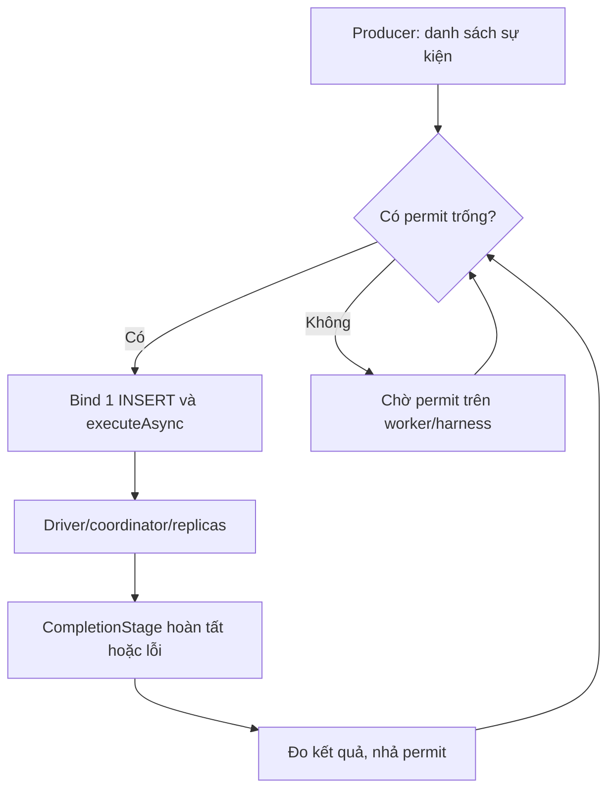

# So sánh batch một partition với ghi bất đồng bộ có giới hạn

Trong **SPRING_DATA_CASSANDRA**, “ghi nhiều bản ghi” không đồng nghĩa với “gom mọi `INSERT` thành một `BATCH`”. Apache Cassandra tổ chức dữ liệu theo **partition key** và phân phối bản sao qua các node; một batch vượt nhiều partition có thể khiến coordinator phải điều phối nhiều nơi, làm độ trễ và tải tăng. Ngược lại, ghi từng câu lệnh bất đồng bộ mà không giới hạn số request đang chờ có thể làm đầy hàng đợi driver hoặc khiến cluster quá tải.

Bài thực hành thuộc chương **Bài thực hành** và so sánh hai chiến lược cụ thể:

- **Batch một partition:** gom một số `INSERT` có **cùng partition key** thành một `UNLOGGED BATCH` nhỏ, gửi dưới dạng một CQL request.
- **Ghi bất đồng bộ có giới hạn:** gửi từng `INSERT` qua `CqlSession.executeAsync(...)`, giữ tối đa `maxInFlight` request chưa hoàn tất bằng `Semaphore`.

Chúng ta sẽ thiết kế dữ liệu, viết mã Java minh họa, đo throughput/latency, kiểm tra kết quả ghi và rút ra điều kiện lựa chọn. Ví dụ dùng **Java 17+**, API Java Driver 4.x tương thích với phiên bản Spring Data Cassandra trong dự án, và một keyspace thử nghiệm. `CassandraRepository` và `CassandraTemplate` vẫn phù hợp với nghiệp vụ CRUD thông thường; việc gọi driver trực tiếp ở đây nhằm quan sát rõ cấu trúc batch, số request đang thực thi và thời gian hoàn tất.

> **Mục tiêu:** tự đo để trả lời “khi ghi nhiều sự kiện vào một partition, batch nhỏ hay các request async có giới hạn phù hợp hơn với tải và yêu cầu nhất quán của ứng dụng?”. Không giả định trước phương án nào luôn nhanh hơn.

## 1. Kết quả cần đạt và điều kiện so sánh

Sau bài này, bạn có thể:

1. Phân biệt `BATCH` của Cassandra với transaction của cơ sở dữ liệu quan hệ và với lời gọi `saveAll()` của repository.
2. Viết truy vấn `INSERT` có prepared statement đúng partition key và kiểu CQL.
3. Gom đúng các mutation **cùng partition** vào `UNLOGGED BATCH` nhỏ.
4. Giới hạn số lệnh async đang chờ kết quả, xử lý cả lỗi khi submit lẫn khi hoàn tất, không gọi `join()` trong vòng lặp.
5. Đo công bằng số hàng ghi/giây, số CQL requests, p95/p99 latency, lỗi/timeout và tác động trên replica.
6. Kiểm tra dữ liệu sau ghi và lựa chọn chiến lược theo throughput, độ trễ, tính đúng, chi phí và giới hạn vận hành.

Thử nghiệm cần tối thiểu hai vòng có cùng tổng số mutation, kích thước row, consistency level, replication, driver configuration và mức tải từ bên ngoài. Một batch gồm 8 rows vẫn là **8 mutations**, nhưng thường là **1 request** gửi đến driver/coordinator. Vì vậy, đếm số lần gọi `execute(...)` không đủ để kết luận throughput ghi cao hơn.

## 2. Thiết kế bảng theo truy vấn và partition

Ứng dụng thu thập sự kiện của từng tenant theo ngày. API cần đọc sự kiện của một tenant trong khoảng thời gian, nên dùng bảng:

```sql
-- Keyspace lab đã tồn tại, replication được cấu hình phù hợp với DC thử nghiệm.
CREATE TABLE IF NOT EXISTS lab.events_by_tenant_day (
    tenant_id uuid,
    bucket_day date,
    occurred_at timestamp,
    event_id uuid,
    payload text,
    PRIMARY KEY ((tenant_id, bucket_day), occurred_at, event_id)
) WITH CLUSTERING ORDER BY (occurred_at ASC, event_id ASC);
```

Ở đây:

| Cột | Vai trò | Ý nghĩa đối với thử nghiệm |
| --- | --- | --- |
| `tenant_id` và `bucket_day` | **Composite partition key** | Các hàng có cùng **cả hai giá trị** thuộc cùng một partition logic. |
| `occurred_at`, `event_id` | Clustering columns | Sắp thứ tự và định danh hàng bên trong partition. |
| `payload` | Cột thường | Kích thước payload tác động băng thông, storage, compaction và latency. |

Trong Cassandra, “cùng tenant” **chưa đủ** để kết luận cùng partition nếu `bucket_day` khác nhau. Ví dụ tenant A ngày 01 và tenant A ngày 02 thuộc **hai partition**, vì partition key là `(tenant_id, bucket_day)`.

Truy vấn đọc để xác minh một partition:

```sql
SELECT tenant_id, bucket_day, occurred_at, event_id, payload
FROM lab.events_by_tenant_day
WHERE tenant_id = ?
  AND bucket_day = ?;
```

Dấu `?` là bind marker dùng với Java Driver; khi chạy bằng `cqlsh` phải thay bằng literal phù hợp. Đây là truy vấn đã cung cấp đủ partition key; với nhiều kết quả cần đọc từng **page**, không gọi `SELECT *` rồi giữ toàn bộ dữ liệu trong bộ nhớ. Bảng này không đòi hỏi secondary index hoặc `ALLOW FILTERING` cho kiểu truy cập đã thiết kế.

### 2.1. Dữ liệu thử nghiệm phải so sánh được

Giả sử mỗi phương án ghi **10.000 sự kiện**, payload khoảng 256 ký tự ASCII, vào **một tenant/ngày** thử nghiệm. Chọn `event_id` duy nhất và mốc thời gian phân biệt rõ. Để tránh những lần chạy sau chỉ cập nhật lại hàng của lần chạy trước (vì `INSERT` trong Cassandra có semantics upsert), dùng **partition thử nghiệm mới cho mỗi lượt**, cùng quy mô và phân bố dữ liệu. Không trộn dữ liệu thử nghiệm với tenant production.

Ngoài kịch bản một partition, nên thử biến thể **nhiều partition**, ví dụ 100 tenant/ngày. Lúc đó batch vẫn chỉ gom các rows cùng `(tenant_id, bucket_day)`; không dùng một `UNLOGGED BATCH` lớn để gộp tùy ý toàn bộ 100 partition.

## 3. Hiểu chính xác về CQL BATCH

Cassandra `BATCH` là một cơ chế gửi **nhóm mutations**, không phải công cụ mặc định để đẩy nhanh mọi `INSERT`.

```sql
BEGIN UNLOGGED BATCH
    INSERT INTO lab.events_by_tenant_day
        (tenant_id, bucket_day, occurred_at, event_id, payload)
    VALUES
        (11111111-1111-1111-1111-111111111111,
         '2026-11-25', '2026-11-25T09:00:00Z',
         22222222-2222-2222-2222-222222222222, 'event-A');

    INSERT INTO lab.events_by_tenant_day
        (tenant_id, bucket_day, occurred_at, event_id, payload)
    VALUES
        (11111111-1111-1111-1111-111111111111,
         '2026-11-25', '2026-11-25T09:00:01Z',
         33333333-3333-3333-3333-333333333333, 'event-B');
APPLY BATCH;
```

Hai mutation trên có cùng composite partition key, nên đây là **batch một partition**. Trong mã Java thực tế, phải bind giá trị qua prepared statements, không xây CQL bằng phép nối chuỗi từ dữ liệu đầu vào.

| Loại gửi | Mục đích/chú ý | Có phù hợp với thử nghiệm? |
| --- | --- | --- |
| `UNLOGGED BATCH` cùng partition | Giảm số lần submit/round trip cho nhóm nhỏ mutations; tránh batchlog dùng cho logged batch. | **Có**, đây là biến thể được đo. |
| `LOGGED BATCH` | Dùng batchlog để hỗ trợ bảo đảm các mutation của batch có thể được phát lại sau một số dạng lỗi; vẫn không có transaction isolation/rollback kiểu RDBMS. | Có thể thử riêng khi nhu cầu nghiệp vụ cần semantics của logged batch; không dùng làm mặc định để tối ưu throughput. |
| `UNLOGGED BATCH` nhiều partition | Có thể gây cảnh báo và làm coordinator phải làm việc trên nhiều partition/node; không phải công cụ nạp dữ liệu hàng loạt tối ưu. | **Không** gộp cross-partition trong bài đo chính. |
| `COUNTER BATCH` | Dành cho counter mutations và các quy tắc riêng của counter. | Không dùng cho bảng sự kiện thông thường. |
| Từng `INSERT` async | Nhiều request độc lập, có thể chạy song song và phân phối theo token. | **Có**, nhưng phải giới hạn số đang xử lý. |

**Các điểm quan trọng:**

- Batch **không tạo phép ghi nhanh hơn theo tỷ lệ số rows**. 8 mutations trong batch vẫn cần được Cassandra áp dụng trên replica. Có thể giảm overhead request/coordinator, nhưng cũng tăng kích thước/chi phí của một request.
- Logged batch có overhead liên quan đến batchlog; dùng batch cross-partition để tăng tốc thường là thiết kế sai. Không mặc định batch cho các hàng nằm ở nhiều partition.
- Batch **không phải** giao dịch SQL có rollback và cách ly toàn bộ đọc/ghi. Một lỗi/timeout khi gửi batch vẫn có thể để lại kết quả ghi **chưa xác định**; phải có chiến lược kiểm tra lại.
- Không dùng một batch rất lớn để thay thế backpressure. Giữ kích thước mutation tính cả **bytes**, không chỉ số hàng; một payload dài có thể làm batch nhỏ về số row nhưng lớn về network/heap.
- Batching không giải quyết vấn đề **hot partition**: mọi mutation của cùng key vẫn tác động đến tập replica giữ key ấy. Tăng lượng batch/đồng thời có thể làm partition đang nóng càng nóng.
- Chọn `LOGGED`, `UNLOGGED` và kích thước batch dựa trên semantics và benchmark phiên bản Cassandra thực tế; không suy ra atomicity/isolation đầy đủ chỉ từ chữ “batch”.

## 4. Ghi bất đồng bộ có giới hạn là gì?

Mô hình cơ bản:



Giả sử `maxInFlight = 32`. Khi đã gửi 32 request nhưng chưa có callback hoàn thành, producer **không gửi thêm**; nó chờ một permit. Cách này giữ giới hạn phía ứng dụng đối với số request đang chờ và tránh tăng hàng đợi vô hạn. Nó **không** đảm bảo cluster chỉ có tối đa 32 thao tác vật lý: replication, retry, speculative execution, request đồng thời từ các service khác và driver internals vẫn tác động.

Có ba mô hình dễ nhầm:

1. **Sequential:** gọi `execute(...)` rồi chờ kết quả từng lệnh; ít áp lực nhưng có thể lãng phí thời gian chờ mạng.
2. **Unbounded async:** tạo và submit hàng chục nghìn `CompletionStage` ngay lập tức; dễ áp lực lên pool/queue và gây timeout.
3. **Bounded async:** chỉ submit khi còn permit, hoàn tất thì nhả permit; đạt mức song song có giới hạn và khả năng điều chỉnh.

Ví dụ này dùng `Semaphore.acquire()` ở **worker hoặc chương trình benchmark**, nên việc chờ permit có thể **chặn chính thread chạy producer**. Không gọi trực tiếp phiên bản chặn này trên event loop của WebFlux/Reactor. Trong ứng dụng reactive, dùng `flatMap` với giới hạn concurrency hoặc cơ chế điều tiết tương đương mà không làm nghẽn event loop.

## 5. Chuẩn bị mã Java chung cho hai phương án

Các đoạn mã bên dưới tập trung vào Java Driver 4.x (nhánh `com.datastax.oss.driver.api.*`). Trong ứng dụng Spring Boot, hãy **tái sử dụng** `CqlSession` do cấu hình quản lý thay vì tạo/đóng session cho mỗi request. Bảo đảm tính tương thích giữa Spring Data Cassandra và Java Driver theo dependency thực tế.

Các import chính:

```java
import com.datastax.oss.driver.api.core.CqlSession;
import com.datastax.oss.driver.api.core.DefaultConsistencyLevel;
import com.datastax.oss.driver.api.core.cql.BatchStatement;
import com.datastax.oss.driver.api.core.cql.BatchStatementBuilder;
import com.datastax.oss.driver.api.core.cql.BoundStatement;
import com.datastax.oss.driver.api.core.cql.DefaultBatchType;
import com.datastax.oss.driver.api.core.cql.PreparedStatement;
import com.datastax.oss.driver.api.core.cql.Statement;

import java.time.Instant;
import java.time.LocalDate;
import java.util.ArrayList;
import java.util.List;
import java.util.UUID;
import java.util.concurrent.CountDownLatch;
import java.util.concurrent.Semaphore;
import java.util.concurrent.atomic.AtomicInteger;
```

Một sự kiện có cấu trúc:

```java
record DemoEvent(
    UUID tenantId,
    LocalDate bucketDay,
    Instant occurredAt,
    UUID eventId,
    String payload
) {}
```

Chuẩn bị statement **một lần**, tái sử dụng trên cả hai phương án:

```java
PreparedStatement insert = session.prepare(
    "INSERT INTO lab.events_by_tenant_day "
  + "(tenant_id, bucket_day, occurred_at, event_id, payload) "
  + "VALUES (?, ?, ?, ?, ?)");
```

Giả sử `session` là `CqlSession` đang hoạt động và keyspace `lab` đã được cấu hình với replication phù hợp. Không dựng `PreparedStatement` mới bên trong mỗi vòng lặp; preparing và metadata lookup có chi phí.

Hàm tạo một câu `INSERT` đã bind:

```java
static BoundStatement bindInsert(
        PreparedStatement insert,
        DemoEvent event
) {
    return insert.bind(
            event.tenantId(),
            event.bucketDay(),
            event.occurredAt(),
            event.eventId(),
            event.payload())
        .setConsistencyLevel(DefaultConsistencyLevel.LOCAL_QUORUM);
}
```

Các kiểu Java `UUID`, `LocalDate`, `Instant`, `String` tương ứng với `uuid`, `date`, `timestamp` và `text`. `LOCAL_QUORUM` chỉ hoạt động như dự kiến khi topology, RF và số replica đang sống phù hợp; thử nghiệm phải dùng **cùng consistency level** cho mọi biến thể. Có thể chọn mức khác theo môi trường, nhưng không đổi giữa các phương án rồi kết luận về throughput.

### 5.1. Vì sao cần ID và timestamp ổn định?

Trong Cassandra, `INSERT` thông thường là **upsert**, không phải câu lệnh từ chối khi khóa đã tồn tại. Nếu chạy lại test với cùng khóa, bạn đang đo cập nhật cell có sẵn thay vì thêm hàng mới, và kết quả dễ bị nhiễu. Dùng tập khóa mới cho mỗi lần chạy; nếu cần kiểm tra retry, giữ **cùng định danh sự kiện** và xác định semantics idempotency của phép ghi.

Nếu thao tác có TTL, server-generated timestamps, counter increments hoặc side effect ở service, retry có thể thay đổi kết quả. Không mặc định mọi `INSERT` là idempotent trong mọi ngữ cảnh; hãy phân tích loại mutation và cách xác định timestamp/TTL trước khi bật retry.

## 6. Phương án A: UNLOGGED batch nhỏ trong **một partition**

Trong ví dụ này, `batchSize = 8`. Hàm dưới đây nhận một danh sách có **cùng tenantId và bucketDay**; nếu dữ liệu lẫn partition, hàm từ chối để tránh vô tình tạo multi-partition batch.

```java
static List<BatchStatement> makeSinglePartitionBatches(
        PreparedStatement insert,
        List<DemoEvent> events,
        int batchSize
) {
    if (batchSize <= 0) {
        throw new IllegalArgumentException("batchSize phải > 0");
    }
    List<BatchStatement> batches = new ArrayList<>();
    if (events.isEmpty()) {
        return batches;
    }

    UUID tenantId = events.get(0).tenantId();
    LocalDate day = events.get(0).bucketDay();

    for (DemoEvent e : events) {
        if (!tenantId.equals(e.tenantId())
                || !day.equals(e.bucketDay())) {
            throw new IllegalArgumentException(
                "Chỉ gom các mutation cùng composite partition key");
        }
    }

    for (int offset = 0; offset < events.size(); offset += batchSize) {
        BatchStatementBuilder builder =
            BatchStatement.builder(DefaultBatchType.UNLOGGED);

        int end = Math.min(events.size(), offset + batchSize);
        for (int i = offset; i < end; i++) {
            builder.addStatement(bindInsert(insert, events.get(i)));
        }

        batches.add(builder.build()
            .setConsistencyLevel(DefaultConsistencyLevel.LOCAL_QUORUM));
    }
    return batches;
}
```

`bindInsert` đã thiết lập consistency cho từng bound statement để có thể dùng ở phương án ghi đơn; batch cũng được đặt consistency trên **BatchStatement**. Khi dùng batch, cấu hình ở cấp batch là điều quyết định đối với request; kiểm tra quy tắc consistency override của driver/phiên bản đang chạy.

Với `events.size() = 10_000` và `batchSize = 8`, tạo khoảng **1.250 CQL requests**, mỗi request chứa tối đa tám mutation. Nếu chia không hết, batch cuối có ít hơn tám. Một vòng chạy đồng bộ minh họa:

```java
List<BatchStatement> batches =
    makeSinglePartitionBatches(insert, events, 8);

long startNanos = System.nanoTime();
for (BatchStatement batch : batches) {
    session.execute(batch);
}
long elapsedNanos = System.nanoTime() - startNanos;
```

Đây là **batch đồng bộ**, được dùng như một biến thể tham chiếu. Không dùng nó để kết luận riêng hiệu quả của batch so với async, vì hai phương án còn khác **mức concurrency**. Ở phần thí nghiệm, ta sẽ đo thêm **async batch có giới hạn** để tách ảnh hưởng của grouping khỏi tác dụng của concurrency.

**Giới hạn thực tế:** không biến `batchSize = 8` thành quy tắc chung. Nếu `payload` lớn hoặc số row tăng, một batch có thể vượt ngân sách byte/giới hạn nội bộ, gây cảnh báo hoặc từ chối. Kiểm tra kích thước serialized của batch, cảnh báo từ server và các cấu hình `batch_size_warn_threshold`/`batch_size_fail_threshold` **theo phiên bản Cassandra triển khai**. Đối với ghi trải nhiều partition, nên gửi các mutation độc lập có giới hạn hoặc thiết kế lại mô hình, thay vì gom một batch to.

## 7. Phương án B: Ghi từng câu lệnh async với giới hạn in-flight

Java Driver 4.x trả về `CompletionStage<AsyncResultSet>` từ `CqlSession.executeAsync(...)`. `CompletionStage` là tín hiệu hoàn tất hoặc lỗi của thao tác, không có nghĩa mọi callback sẽ chạy trên cùng thread với caller. Với `INSERT`, không có các rows cần duyệt như ở `SELECT`; bài này dùng callback để thống kê thành công/thất bại.

Để không submit vô hạn, áp dụng `Semaphore` với `maxInFlight`:

```java
record RunStats(
    long cqlRequests,
    long failedRequests,
    long elapsedNanos
) {
    double requestsPerSecond() {
        return cqlRequests / (elapsedNanos / 1_000_000_000.0);
    }
}

static RunStats runAsyncBounded(
        CqlSession session,
        List<? extends Statement<?>> requests,
        int maxInFlight
) throws InterruptedException {
    if (maxInFlight <= 0) {
        throw new IllegalArgumentException("maxInFlight phải > 0");
    }

    Semaphore permits = new Semaphore(maxInFlight);
    CountDownLatch finished = new CountDownLatch(requests.size());
    AtomicInteger failures = new AtomicInteger();
    long started = System.nanoTime();

    for (Statement<?> request : requests) {
        // Chạy trên producer/benchmark worker, không ở Reactor event loop.
        permits.acquire();
        try {
            session.executeAsync(request).whenComplete((ignored, error) -> {
                try {
                    if (error != null) {
                        failures.incrementAndGet();
                    }
                } finally {
                    permits.release();
                    finished.countDown();
                }
            });
        } catch (RuntimeException submitError) {
            // Cả lỗi đồng bộ khi submit lẫn lỗi async đều phải nhả permit.
            failures.incrementAndGet();
            permits.release();
            finished.countDown();
        }
    }

    finished.await();
    return new RunStats(
        requests.size(),
        failures.get(),
        System.nanoTime() - started);
}
```

Đây là **hàm chạy workload thử nghiệm có kích thước hữu hạn**. Nó giả định:

- Java Driver đã được cấu hình request timeout ở mức phù hợp để thao tác bất thường không treo vô hạn; khi ứng dụng production cần thêm deadline/watchdog và kế hoạch xử lý producer bị ngắt.
- `finished.await()` được gọi từ **benchmark worker**, không phải thread xử lý request WebFlux.
- Danh sách `requests` đã nằm trong bộ nhớ, nên **tổng số statement chưa được giới hạn bộ nhớ theo đầu vào**. Semaphore chỉ giới hạn **số request đang chờ kết quả**, không giới hạn lượng dữ liệu đã chuẩn bị. Với ingestion lớn, dùng nguồn phát sinh có giới hạn/bounded queue hoặc luồng reactive có backpressure và giữ số record chưa xử lý ở mức nhỏ.
- Callback chỉ cập nhật counter và nhả permit; không parse payload lớn, gọi blocking I/O hoặc thực hiện tác vụ nặng trên thread hoàn tất của driver.
- `failures` đếm **request** thất bại. Với async batch, một request có thể chứa nhiều mutations; cần báo cáo thêm `mutationCount` và kiểm tra lại dữ liệu, không coi một lỗi request luôn tương đương một hàng chắc chắn ghi hỏng.

**Điểm cần đọc trong mã:** `permits.acquire()` nằm **trước** `executeAsync()`; `permits.release()` ở nhánh hoàn tất **và** nhánh lỗi khi submit. Nếu quên nhả permit, producer có thể bị kẹt. Nếu gọi `stage.toCompletableFuture().join()` trong từng lượt, biến thể async này thực chất đã quay về đợi từng request và không đo được concurrency mong muốn.

### 7.1. Chuẩn bị danh sách insert đơn lẻ

```java
List<BoundStatement> singleInserts = new ArrayList<>();
for (DemoEvent event : events) {
    singleInserts.add(bindInsert(insert, event));
}

RunStats asyncSingles = runAsyncBounded(
    session, singleInserts, 32);
```

Với `events.size() = 10_000`, phương án này gửi **10.000 request**, tối đa **32 request đang chờ** tại một thời điểm, mỗi request chứa một mutation.

Số `32` chỉ là giá trị khởi đầu để đo. Thử các mức nhỏ, vừa và lớn (ví dụ 4, 16, 32, 64) khi cluster có khả năng phục vụ; tìm điểm mà throughput không còn tăng hoặc p99/timeout/queue bắt đầu xấu đi. Không suy ra “nhiều in-flight hơn luôn nhanh hơn”.

### 7.2. Biến thể kiểm soát: async batch có giới hạn

Để tách ảnh hưởng **batching** khỏi ảnh hưởng **concurrency**, dùng lại chính hàm giới hạn để gửi từng batch:

```java
List<BatchStatement> batches =
    makeSinglePartitionBatches(insert, events, 8);

// Tối đa 4 batch đang chờ: tối đa 4 x 8 = 32 mutation đã gửi.
RunStats asyncBatches = runAsyncBounded(
    session, batches, 4);
```

Hai phương án có số mutation đang chờ **xấp xỉ cùng giới hạn 32** theo cách đếm tối đa: 32 insert đơn lẻ và 4 batch × 8 rows. Tuy nhiên chúng **không hoàn toàn tương đương** về resource: kích thước request, thời gian coordinator xử lý, overhead batch và độ phân tán có thể khác. Thử thêm cùng `maxInFlight` theo **số requests** nếu muốn kiểm tra một trục khác.

## 8. Thiết kế ma trận benchmark công bằng

Để trả lời đúng câu hỏi trong tiêu đề, đừng chỉ chạy một lần `batch sync` rồi một lần `async singles`. Sự khác biệt có thể đến từ batch, concurrency, cache hoặc việc upsert lại dữ liệu. Ma trận đề xuất:

| Mã | Phương án | Số mutations với 10.000 hàng | Số CQL requests | In-flight giới hạn |
| --- | --- | ---: | ---: | --- |
| **A0** | `INSERT` đồng bộ từng hàng (baseline) | 10.000 | 10.000 | 1 request |
| **A1** | `UNLOGGED BATCH` 8 hàng, gửi đồng bộ | 10.000 | 1.250 | 1 batch |
| **B1** | `INSERT` async đơn lẻ | 10.000 | 10.000 | 32 requests |
| **B2** | `UNLOGGED BATCH` 8 hàng, async | 10.000 | 1.250 | 4 batches (~32 mutations) |

Nếu muốn nghiên cứu sâu, lặp lại B1 tại `maxInFlight` 4/16/64 và B2 với batch size 2/4/8/16, nhưng **không thay quá nhiều tham số cùng lúc**. Dừng tăng tải khi bắt đầu tăng lỗi timeout/unavailable, áp lực node, kích thước batch hoặc latency vượt giới hạn đã chọn.

### 8.1. Chuẩn bị các vòng chạy

1. **Cụm thử nghiệm**: không benchmark trực tiếp trên dữ liệu nhạy cảm/production. Ghi lại Apache Cassandra version, Java Driver version, Spring Data/Boot version, RF, DC, node count, cấu hình server và driver.
2. **Thống nhất điều kiện**: cùng table schema, `LOCAL_QUORUM` (hoặc CL đã chọn), payload, số rows, partition size kỳ vọng, kiểu statement, thời gian thử và client resources.
3. **Chuẩn bị statement**: dùng một prepared `INSERT` tái sử dụng; không đưa thời gian `prepare()` vào một chiến lược mà không đưa vào chiến lược kia.
4. **Tách dữ liệu giữa các vòng**: tạo tenant/day mới có cấu trúc tương đương cho mỗi lần chạy hoặc reset dữ liệu trong môi trường lab bằng quy trình kiểm soát. Không chạy A1 lên cùng tập key vừa được B1 ghi rồi coi cả hai là insert mới.
5. **Warm-up**: chạy thử một lượng dữ liệu nhỏ riêng để ổn định driver/connection/VM, loại bỏ kết quả warm-up. Thực hiện nhiều vòng, đảo thứ tự các phương án để giảm lệch vì cache, GC và cluster temperature.
6. **Đo song song**: ghi thời gian từ lúc bắt đầu submit tới khi tất cả callbacks hoàn tất, request latency histogram và metric Cassandra/node trong đúng khoảng đo.
7. **Kiểm chứng dữ liệu**: chỉ coi là thành công nếu không có lỗi chưa xử lý và dữ liệu đúng. Với timeout, phải xem kết quả ghi có thể **chưa xác định** trước khi retry hoặc kết luận thất bại.

### 8.2. Công thức đo throughput

Đặt `N` là số mutations đã xác nhận hợp lệ sau kiểm tra; `T` là elapsed seconds của một vòng hoàn tất:

```text
throughput_mutations_per_second = N / T

throughput_requests_per_second  = số CQL requests / T

average_mutations_per_request  = số mutations / số CQL requests

error_request_rate            = số requests báo lỗi / số requests đã submit
```

Ví dụ **thuần phép tính**, chưa phải kết quả thực tế: nếu hoàn thành 10.000 mutation trong 5 giây, throughput là 2.000 mutations/s; nếu đây là batch 8 rows, số CQL requests vào khoảng 1.250, tức 250 requests/s. Đừng báo cáo 250 requests/s như 250 events/s.

**Latency phải xác định đơn vị đo:**

- Với insert đơn lẻ: latency request gần tương ứng latency một mutation khi không có queue ở ứng dụng.
- Với batch 8 rows: latency request là độ trễ để **một batch** được xác nhận, không phải latency độc lập của từng row.
- Với cả hai: latency nhìn từ nghiệp vụ có thể gồm thời gian chờ permit/queue, bind giá trị, request và việc đợi callback; nên đo thêm **end-to-end event latency** nếu SLO của API/ingestion là theo sự kiện.
- Đo **p50/p95/p99**, throughput, error/timeout rate và độ lệch giữa các node. Không chỉ so sánh trung bình.

Để tính p95/p99 request chính xác, thêm `long sentAtNanos = System.nanoTime()` ngay trước `executeAsync()` và ghi `System.nanoTime() - sentAtNanos` trong callback vào timer/histogram có thread-safety. Bộ đếm lỗi hoặc log nên giữ số sample có giới hạn; không tạo một metrics label riêng cho mỗi tenant/event ID.

## 9. Kiểm tra dữ liệu sau ghi

Request được Cassandra xác nhận ở consistency level đã chọn là một tín hiệu hữu ích, nhưng để đánh giá đúng bài thực hành cần kiểm tra **số hàng và giá trị** trên partition thử nghiệm. Với tập có giới hạn 10.000 events, có thể duyệt kết quả theo paging và đối chiếu `event_id` kỳ vọng:

```java
PreparedStatement select = session.prepare(
    "SELECT event_id FROM lab.events_by_tenant_day "
  + "WHERE tenant_id = ? AND bucket_day = ?");

BoundStatement bound = select.bind(tenantId, bucketDay)
    .setConsistencyLevel(DefaultConsistencyLevel.LOCAL_QUORUM)
    .setPageSize(500);

int observedRows = 0;
java.util.Set<UUID> observedIds = new java.util.HashSet<>();

for (com.datastax.oss.driver.api.core.cql.Row row
        : session.execute(bound)) {
    observedRows++;
    observedIds.add(row.getUuid("event_id"));
}

// So sánh observedRows, observedIds với tập eventId đã ghi ở vòng test.
```

Đoạn này dùng `ResultSet` đồng bộ của Java Driver 4.x; lúc duyệt, driver có thể fetch các trang tiếp theo và chặn benchmark worker. Thực hiện **sau khi** dừng đồng hồ đo ghi, trên partition thử nghiệm đã biết kích thước. Không quét toàn keyspace để xác minh và không chạy `COUNT(*)` trên partition không giới hạn ở production. Khi cần khẳng định payload đúng, so sánh thêm giá trị `payload` cho mẫu hoặc toàn bộ tập test theo yêu cầu.

Bài thử này có `PRIMARY KEY ((tenant_id, bucket_day), occurred_at, event_id)`; do đó cùng một `event_id` nhưng `occurred_at` khác vẫn có thể là **hai hàng khác nhau**. Đối chiếu tập khóa **đầy đủ** nếu dữ liệu test có nguy cơ trùng `event_id`.

### 9.1. Đọc sự kiện theo nhiều partition

Với workload thực gồm nhiều tenant/ngày, cần đọc từng partition phù hợp, có pagination theo truy vấn, tránh `ALLOW FILTERING`. Nếu ứng dụng cần paging nối tiếp qua nhiều bucket, phải duy trì cursor cho từng luồng dữ liệu và trộn thứ tự phía service. Bài thực hành này tập trung vào **đường ghi**, nên không nên vô tình dùng cách xác minh đắt hơn workload cần đo.

## 10. Lỗi, timeout và retry có thể làm sai kết luận

Hai đường ghi có semantics retry khác nhau về **đơn vị yêu cầu**. Một request async đơn lẻ lỗi chỉ báo trạng thái không chắc chắn của mutation tương ứng; một request batch lỗi có thể để lại trạng thái không chắc chắn đối với **nhiều mutations**. Với Cassandra, timeout **không chứng minh chắc chắn dữ liệu chưa được áp dụng**.

| Tình huống | Phải kiểm tra | Tránh làm |
| --- | --- | --- |
| `InvalidQueryException` hoặc mismatch kiểu CQL | Schema, partition key, kiểu `uuid/date/timestamp/text`, mapping | Tăng batch size/concurrency để “sửa” query. |
| `WriteTimeoutException` / request timeout | Loại statement, CL, replica, request outcome, idempotency | Retry vô hạn và kết luận mọi mutation chắc chắn thất bại. |
| `UnavailableException` | Replica khả dụng và consistency level; có đúng RF/DC không | Đổ lỗi cho batch khi cluster không đủ replica. |
| Driver queue/pool bão hòa | In-flight, pending requests, concurrency của toàn ứng dụng | Submit async không giới hạn để “tăng throughput”. |
| Batch size warning/failure | Kích thước bytes và số mutations trong batch; giới hạn server | Dùng batch lớn hơn để giảm số request bằng mọi giá. |
| Hot partition/write p99 cao | Tốc độ ghi vào cùng composite key, replica metrics | Cho rằng batch một partition sẽ tự phân tán dữ liệu qua cluster. |
| Kết quả có ít hàng hơn dự kiến | Callback errors, timeout, khóa trùng/upsert, partition đọc sai, TTL | Chỉ nhìn counter `requests completed`. |

**Idempotency cần được thiết kế:**

- Chọn `event_id` ổn định cho cùng sự kiện và quản lý timestamp/TTL theo quy tắc rõ ràng.
- Nếu lập lại `INSERT` cùng key, Cassandra thường upsert theo quy tắc timestamp và last-write-wins; không suy ra rằng điều đó an toàn với mọi side effect hoặc mọi kiểu update.
- Không đánh dấu `Statement.setIdempotent(true)` theo thói quen khi nghiệp vụ sử dụng counter, TTL phụ thuộc thời điểm thực thi hoặc thao tác không có tính lặp an toàn.
- Nếu là ghi nhiều bảng phục vụ các mẫu truy vấn khác nhau, cần cơ chế đối soát và xử lý thất bại từng phần; `UNLOGGED BATCH` một partition không bao phủ nhiều partition.
- Với batch chứa một số điều kiện đặc biệt (LWT, counter), phải theo các quy tắc CQL riêng; không trộn chúng tùy ý vào batch demo.

## 11. Quan sát ở cả ứng dụng và Cassandra

Trong Spring Data Cassandra, repository/`CassandraTemplate` là tầng API tiện lợi, nhưng benchmark nên nhìn xuống **CQL requests thực sự** và hoạt động replica. Tập metrics gợi ý:

| Vị trí | Chỉ số | Ý nghĩa |
| --- | --- | --- |
| Ứng dụng | Mutations/s, CQL requests/s, p50/p95/p99, errors/timeouts | Tách tốc độ ghi hàng khỏi số request. |
| Ứng dụng | Số in-flight, thời gian chờ permit, queue size, heap, CPU, GC | Đánh giá backpressure và áp lực của producer. |
| Driver | Request latency, throttling/connection metrics nếu có, retries | Phát hiện giới hạn phía client, không chỉ server. |
| Cassandra | Write latency, write timeouts, pending tasks, CPU, disk I/O, compaction | Xem replica/coordinator có quá tải hay không. |
| Cassandra | Partition size, top hot partitions, tombstones/SSTables | Kiểm tra partition đang bị dồn tải hoặc lớn bất thường. |

Tùy phiên bản Cassandra và quyền vận hành, có thể dùng `nodetool tablestats lab`, `nodetool tablehistograms lab events_by_tenant_day` và monitoring tương ứng; dữ liệu trong `nodetool` đôi khi là ước lượng hoặc giá trị tổng hợp. Không dùng một lệnh `nodetool` làm bằng chứng duy nhất rằng batch nhanh hơn. Với một partition test, chính việc ghi đều tập trung vào replica của partition ấy có thể trở thành nút thắt: **tối ưu ở client không thay được partition key**.

Để giảm nhiễu, so sánh cùng DC, node có phần cứng tương đương, cùng thời điểm workload gần tương đương và theo nhiều lượt. Không đưa UUID của mọi sự kiện vào nhãn metric vì cardinality quá cao.

## 12. Spring Data Repository và CassandraTemplate có vai trò gì?

Ví dụ một repository:

```java
public interface EventRepository
        extends CassandraRepository<EventEntity, EventKey> {
}
```

Trong đó `EventEntity` và `EventKey` ánh xạ đúng bảng `events_by_tenant_day`, với `tenantId` và `bucketDay` cùng thuộc partition key. `repository.save(entity)` là một thao tác ghi thuận tiện; `saveAll(entities)` **không nên mặc định được hiểu** thành một `UNLOGGED BATCH` duy nhất, cũng không có nghĩa thư viện tự giới hạn async concurrency. Cần kiểm tra đúng implementation/phiên bản và CQL được phát sinh.

`CassandraTemplate` hỗ trợ mapping, conversion và thao tác CQL theo Spring Data; thư viện có các khả năng batch/bulk tùy phiên bản nhưng không thay được việc xác định **cùng partition key**, semantics và giới hạn request. Để so sánh hai kỹ thuật ở mức driver, bài này chủ động dùng `CqlSession` và prepared statement.

Khi ứng dụng dùng `ReactiveCassandraTemplate` hoặc `ReactiveCassandraRepository`, vẫn cần giới hạn concurrency. Ví dụ ý tưởng với Project Reactor:

```java
// Ý tưởng cho đường ghi reactive, tùy API Spring Data/version cụ thể.
Flux.fromIterable(events)
    .flatMap(event -> reactiveCassandraTemplate.insert(toEntity(event)), 32)
    .then();
```

`toEntity(event)` là hàm ánh xạ do ứng dụng cung cấp. Pipeline trên cần được **subscribe/return** từ boundary reactive để thực thi; số `32` giới hạn các publisher đồng thời trong `flatMap`, nhưng điều này không tương đương với việc tạo `BATCH` CQL. Phải theo dõi backpressure, tài nguyên, side effects và không gọi `block()` trong event loop. Nếu không dùng Reactor hoặc reactive module, có thể dùng chương trình bounded async driver như phần trên.

## 13. Khi nào nên chọn cách nào?

| Tình huống | Cách tiếp cận ưu tiên để thử | Vì sao |
| --- | --- | --- |
| Ghi nhỏ, cần code đơn giản | Repository/`CassandraTemplate` thông thường | Ít moving parts, ưu tiên correctness và maintainability. |
| Nhiều rows **cùng partition**, nhóm mutation nhỏ, muốn giảm overhead request | `UNLOGGED BATCH` nhỏ; benchmark với async | Có cơ hội giảm network/coordinator overhead nhưng vẫn có giới hạn bytes và tải trên replica. |
| Nhiều rows ở **nhiều partition** với key được phân tán tốt | Individual async **có giới hạn** | Cho driver định tuyến theo token, tránh multi-partition batch lớn; cần backpressure. |
| Một hot key ghi rất nhiều, replica bão hòa | Giảm tải/bucket/shard theo mẫu truy vấn, kết hợp giới hạn concurrent writes | Batch/async không tự chuyển một partition sang node khác. |
| Cần nhóm mutation có yêu cầu nghiệp vụ về atomicity | Xem xét semantics `LOGGED BATCH`/LWT hoặc tái thiết kế nghiệp vụ | Bảo đảm cụ thể của Cassandra khác transaction isolation/rollback của SQL. |
| Ingestion liên tục với SLO nghiêm ngặt | Pipeline được điều tiết, batch size/concurrency theo benchmark, quan sát queue và retry | Đạt throughput trong khi bảo vệ p99 và tránh vượt tài nguyên. |

Không có kết luận “batch luôn thắng” hoặc “async luôn thắng”. Batch nhỏ cùng partition có thể giảm số request nhưng tăng latency mỗi batch; async từng mutation có thể đạt throughput tốt ở mức concurrency phù hợp nhưng làm nóng partition hoặc tạo retry/timeout khi vượt ngưỡng. Quyết định phải dựa trên **độ trễ, số mutations/s, correctness và chi phí cluster**, trong cùng điều kiện tải.

## 14. Bài mở rộng tự làm

Thực hiện lần lượt trên môi trường thử nghiệm; ghi bảng kết quả mỗi lượt:

1. Giữ cố định số mutation, payload và CL. Thử B1 với `maxInFlight` 4, 16, 32, 64. Khi nào throughput bắt đầu bão hòa, p99 hoặc error rate tăng?
2. Giữ số mutation, so sánh A1/B2 với batch size 2, 4, 8, 16. Kích thước batch theo bytes và write latency trên Cassandra thay đổi ra sao?
3. Giữ số mutation nhưng chia dữ liệu qua 100 partition. Chỉ batch **nội bộ từng partition**. Phương án nào tận dụng phân bố token tốt hơn?
4. Thử tải hot partition lớn hơn nhưng dừng nếu cluster báo saturation. Batch size/concurrency có cứu được hot partition không?
5. Lặp bài đo với payload lớn hơn, cùng CL và RF. Có batch size nào từng ổn với payload nhỏ giờ trở thành vấn đề?
6. Mô phỏng một số request timeout trong môi trường test; quan sát liệu tất cả mutations có chắc chắn vắng mặt không, và xác định cách kiểm tra trước khi retry.
7. Viết báo cáo nêu rõ giả thuyết, thông số cluster, phương pháp, biểu đồ throughput/p99, số lỗi, kiểm chứng dữ liệu, kết luận và giới hạn phép đo.

### Mẫu bảng để điền kết quả thật

| Run | Kích thước batch | maxInFlight | Mutations/s | CQL requests/s | p95/p99 mỗi request | Errors/timeouts | Dữ liệu hợp lệ |
| --- | ---: | ---: | ---: | ---: | --- | ---: | --- |
| A0 | 1 | 1 | _(đo)_ | _(đo)_ | _(đo)_ | _(đo)_ | _(kiểm)_ |
| A1 | 8 | 1 | _(đo)_ | _(đo)_ | _(đo)_ | _(đo)_ | _(kiểm)_ |
| B1 | 1 | 32 | _(đo)_ | _(đo)_ | _(đo)_ | _(đo)_ | _(kiểm)_ |
| B2 | 8 | 4 | _(đo)_ | _(đo)_ | _(đo)_ | _(đo)_ | _(kiểm)_ |

Khi báo cáo, ghi rõ p95/p99 là **latency của CQL request** hay **latency nhìn từ mỗi sự kiện**. Nếu không thống nhất định nghĩa, so sánh giữa B1 và B2 dễ sai dù các số liệu trông có vẻ thuyết phục.

## Ghi nhớ

- `UNLOGGED BATCH` nhỏ trong **một partition** có thể giảm số CQL requests, nhưng không tự bảo đảm tăng throughput hay phân tán hot key; batch lớn/multi-partition là rủi ro về hiệu năng.
- Ghi async cần **giới hạn in-flight** và xử lý đủ các nhánh success, failure, timeout. Chỉ submit bằng `executeAsync()` không có nghĩa hệ thống đã có backpressure.
- Dùng **cùng schema, dữ liệu tương đương, replication, consistency, môi trường và giới hạn tài nguyên**; chạy nhiều lượt rồi đo mutations/s, request latency, p99, errors và cluster load.
- Tách ảnh hưởng batch khỏi concurrency bằng cách thêm biến thể **async batch có giới hạn**; không lấy kết quả batch sync so trực tiếp với async singles để kết luận chỉ về batch.
- Kiểm tra dữ liệu sau ghi và semantics khi timeout/upsert/retry; một request báo lỗi **không luôn** đồng nghĩa mọi mutation chưa được ghi.
- Spring Data Cassandra cung cấp entity mapping, repository và `CassandraTemplate`; hiệu năng thực tế vẫn bị chi phối bởi **partition key, consistency, paging, kích thước dữ liệu và phân bố tải**.


