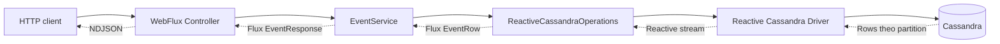
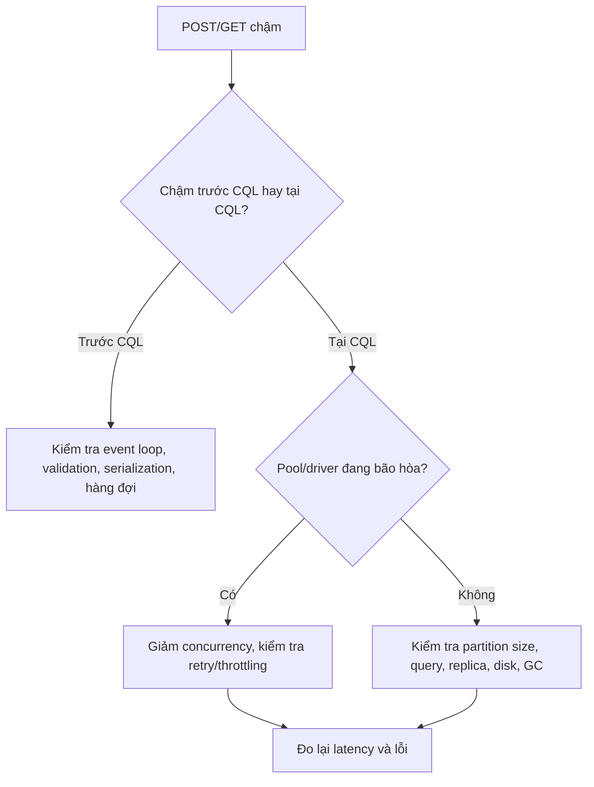

# Xây dựng luồng WebFlux đọc và ghi sự kiện Cassandra

Trong bài thực hành này, chúng ta xây dựng một dịch vụ **Spring WebFlux** tiếp nhận sự kiện từ HTTP, lưu vào **Apache Cassandra** bằng **Spring Data Cassandra Reactive**, sau đó đọc các sự kiện theo tenant/ngày và trả dần kết quả dưới dạng **NDJSON**. Mục tiêu không chỉ là gọi được `insert()` và `select()`: ứng dụng phải truy vấn theo **partition key**, giới hạn dữ liệu đọc, tránh blocking trong luồng Reactor và hiểu các tình huống lỗi của cơ sở dữ liệu phân tán.

Bài thuộc chương **Bài thực hành** của module `SPRING_DATA_CASSANDRA`. Chúng ta kết hợp entity mapping, `ReactiveCassandraOperations` (biến thể reactive của `CassandraTemplate`), truy vấn CQL, phân trang/streaming, consistency và kiểm soát hiệu năng. Cuối bài có hướng kiểm thử tích hợp với Cassandra thật.

## 1. Đề bài và tiêu chí hoàn thành

Ứng dụng mẫu là một kho sự kiện đơn giản: khi thiết bị hoặc dịch vụ phát ra sự kiện, HTTP client ghi một sự kiện; màn hình giám sát đọc các sự kiện của **một tenant trong một ngày UTC**.

| API | Vai trò | Hợp đồng |
| --- | --- | --- |
| `POST /api/tenants/{tenantId}/events` | Ghi một sự kiện | Nhận `eventId`, `occurredAt`, `type`, `payload`; trả `201 Created` và sự kiện đã ghi |
| `GET /api/tenants/{tenantId}/events?day=YYYY-MM-DD&limit=50` | Đọc sự kiện của một ngày | Trả tối đa 100 dòng theo thứ tự gần nhất trước, ở dạng `application/x-ndjson` |

Yêu cầu kỹ thuật:

1. Không dùng JDBC/JPA hoặc `Thread.sleep()`/`block()` trong controller và service.
2. Các request truy cập Cassandra phải dùng **partition key**; không thêm `ALLOW FILTERING`.
3. Mỗi sự kiện có ID và thời điểm ổn định do client cung cấp; gửi lại cùng bộ khóa không tạo thêm một hàng mới.
4. Truy vấn đọc có giới hạn `limit` và chỉ nhắm tới **một bucket ngày**.
5. Có test chứng minh ghi và đọc thông qua HTTP, đồng thời kiểm tra dữ liệu của tenant khác không bị trộn.

**Giới hạn của bài mẫu:** API chưa triển khai xác thực. `tenantId` trên URL chỉ được dùng trong môi trường học tập. Trong sản phẩm thật, phải kiểm tra quyền tenant dựa trên principal đã xác thực **trước** khi thực thi CQL.

### Kiến trúc tổng quan



Với lệnh ghi, service trả `Mono<EventResponse>` vì một request tạo một kết quả. Với lệnh đọc, service trả `Flux<EventResponse>` vì có thể có nhiều hàng; WebFlux serialize từng phần tử thành một dòng JSON. Reactive stream cho phép xử lý và gửi dữ liệu dần theo nhu cầu của downstream, nhưng **không tự giới hạn tổng số hàng** nếu không đặt `limit` hoặc ranh giới phân trang.

## 2. Thiết kế bảng theo truy vấn trước khi viết Java

Truy vấn chính là “lấy các sự kiện gần đây của tenant T trong ngày D”. Ta chọn:

- **Partition key:** `(tenant_id, bucket_day)`, giới hạn truy vấn trong một tenant và một ngày UTC.
- **Clustering key:** `(occurred_at, event_id)`, giúp sắp xếp theo thời gian và phân biệt những sự kiện có cùng timestamp.
- **Cột thường:** `event_type`, `payload`.

Trong môi trường học tập với Cassandra một node:

```sql
CREATE KEYSPACE IF NOT EXISTS event_lab
WITH replication = {
    'class': 'SimpleStrategy',
    'replication_factor': 1
};

CREATE TABLE IF NOT EXISTS event_lab.events_by_tenant_day (
    tenant_id uuid,
    bucket_day date,
    occurred_at timestamp,
    event_id uuid,
    event_type text,
    payload text,
    PRIMARY KEY ((tenant_id, bucket_day), occurred_at, event_id)
) WITH CLUSTERING ORDER BY (occurred_at DESC, event_id ASC);
```

Keyspace sử dụng `SimpleStrategy` và replication factor 1 **chỉ dành cho môi trường thực hành**. Khi triển khai Cassandra nhiều datacenter, cần quy hoạch topology và replication (thường `NetworkTopologyStrategy`), đồng thời chọn consistency level phù hợp yêu cầu.

Truy vấn đọc mục tiêu:

```sql
SELECT tenant_id, bucket_day, occurred_at, event_id,
       event_type, payload
FROM event_lab.events_by_tenant_day
WHERE tenant_id = ? AND bucket_day = ?
LIMIT ?;
```

Thứ tự mặc định tuân theo `CLUSTERING ORDER BY` đã khai báo; không cần sắp xếp lại toàn bộ tập kết quả trong bộ nhớ Java. Điều kiện `tenant_id` và `bucket_day` phải xuất hiện **cùng nhau**, vì chúng tạo thành partition key. `event_id` ở phần clustering key giúp phân biệt hàng khi `occurred_at` trùng nhau.

### 2.1. Vì sao bucket theo ngày?

Nếu chỉ dùng `tenant_id` làm partition key, một tenant hoạt động nhiều năm có thể tạo partition rất lớn. Bucket theo ngày giới hạn lượng dữ liệu trong một partition theo thời gian. Tuy nhiên, bucket ngày **không bảo đảm kích thước partition luôn nhỏ**: tenant có hàng triệu sự kiện/ngày vẫn có thể cần bucket theo giờ hoặc một số shard được kiểm soát.

Chúng ta chuyển `occurredAt` thành `bucketDay` theo **UTC** để tránh sự kiện ở ranh giới múi giờ bị ghi sai ngày:

```java
LocalDate bucketDay =
    event.occurredAt().atZone(ZoneOffset.UTC).toLocalDate();
```

Không lấy ngày theo múi giờ mặc định của máy chủ vì các instance ở các vùng khác nhau có thể ghi cùng sự kiện sang partition khác nhau.

### 2.2. Hai giới hạn nghiệp vụ cần nhớ

1. **Truy vấn nhiều ngày:** một request `GET?day=...` chỉ đọc một partition. Nếu muốn đọc khoảng 7 ngày, ứng dụng cần fan-out sang các partition tương ứng, giới hạn số ngày và xử lý hợp nhất thứ tự/độ trễ; không dùng truy vấn toàn bảng.
2. **Duy nhất của event ID:** khóa chính gồm `occurred_at` và `event_id`. Việc gửi lại **cùng tất cả thành phần khóa** tạo upsert trên một hàng; gửi cùng `eventId` nhưng `occurredAt` khác vẫn có thể tạo **hai hàng**. Nếu yêu cầu dedup theo `eventId` toàn hệ thống, cần thiết kế ràng buộc/registry riêng, không coi khóa này đã bảo đảm điều đó.

## 3. Khởi tạo Spring Boot WebFlux và Cassandra Reactive

Ví dụ dùng **Java 17+**, **Spring Boot 3.x**, **Spring Data Cassandra** tương thích với Boot, và Java Driver 4.x do dependency management của Spring Boot quản lý. Nếu dùng dòng phiên bản khác, hãy điều chỉnh imports/config theo API đang dùng.

Trong `build.gradle` (Gradle Groovy), khi plugin Spring Boot và dependency management đã cấu hình:

```groovy
dependencies {
    implementation 'org.springframework.boot:spring-boot-starter-webflux'
    implementation 'org.springframework.boot:spring-boot-starter-data-cassandra-reactive'
    implementation 'org.springframework.boot:spring-boot-starter-validation'
    implementation 'org.springframework.boot:spring-boot-starter-actuator'

    testImplementation 'org.springframework.boot:spring-boot-starter-test'
    testImplementation 'io.projectreactor:reactor-test'
    testImplementation 'org.testcontainers:junit-jupiter'
    testImplementation 'org.testcontainers:cassandra'
}
```

Cấu hình `application.yml` cho Cassandra chạy cục bộ:

```yaml
server:
  port: 8080

spring:
  cassandra:
    contact-points: 127.0.0.1
    port: 9042
    local-datacenter: datacenter1
    keyspace-name: event_lab
    schema-action: none
    request:
      timeout: 3s

management:
  endpoints:
    web:
      exposure:
        include: health,info,metrics
```

`local-datacenter` phải khớp tên datacenter của cluster đang kết nối; `datacenter1` chỉ là ví dụ thường gặp trong môi trường local. Cấu hình `schema-action: none` giúp ứng dụng **không tự động tạo/drop bảng**. Chạy CQL ở mục 2 bằng `cqlsh`/công cụ migration **trước** khi khởi động ứng dụng. Với cluster production, không chạy DDL từ mỗi instance ứng dụng.

## 4. Entity mapping với khóa chính ghép

Ta tách khóa chính `EventKey` khỏi phần dữ liệu `EventRow`. Spring Data Cassandra dùng `@PrimaryKeyClass`, `@PrimaryKeyColumn`, `@Table` và `@PrimaryKey` để ánh xạ sang bảng CQL.

### 4.1. Khóa chính

```java
package example.events;

import java.io.Serializable;
import java.time.Instant;
import java.time.LocalDate;
import java.util.Objects;
import java.util.UUID;

import org.springframework.data.cassandra.core.cql.PrimaryKeyType;
import org.springframework.data.cassandra.core.mapping.PrimaryKeyClass;
import org.springframework.data.cassandra.core.mapping.PrimaryKeyColumn;

@PrimaryKeyClass
public class EventKey implements Serializable {
    @PrimaryKeyColumn(name = "tenant_id", ordinal = 0,
                      type = PrimaryKeyType.PARTITIONED)
    private UUID tenantId;

    @PrimaryKeyColumn(name = "bucket_day", ordinal = 1,
                      type = PrimaryKeyType.PARTITIONED)
    private LocalDate bucketDay;

    @PrimaryKeyColumn(name = "occurred_at", ordinal = 2,
                      type = PrimaryKeyType.CLUSTERED)
    private Instant occurredAt;

    @PrimaryKeyColumn(name = "event_id", ordinal = 3,
                      type = PrimaryKeyType.CLUSTERED)
    private UUID eventId;

    public EventKey() { }

    public EventKey(UUID tenantId, LocalDate bucketDay,
                    Instant occurredAt, UUID eventId) {
        this.tenantId = tenantId;
        this.bucketDay = bucketDay;
        this.occurredAt = occurredAt;
        this.eventId = eventId;
    }

    public UUID getTenantId() { return tenantId; }
    public LocalDate getBucketDay() { return bucketDay; }
    public Instant getOccurredAt() { return occurredAt; }
    public UUID getEventId() { return eventId; }

    public void setTenantId(UUID tenantId) { this.tenantId = tenantId; }
    public void setBucketDay(LocalDate bucketDay) { this.bucketDay = bucketDay; }
    public void setOccurredAt(Instant occurredAt) {
        this.occurredAt = occurredAt;
    }
    public void setEventId(UUID eventId) { this.eventId = eventId; }

    @Override
    public boolean equals(Object value) {
        if (this == value) return true;
        if (!(value instanceof EventKey other)) return false;
        return Objects.equals(tenantId, other.tenantId)
            && Objects.equals(bucketDay, other.bucketDay)
            && Objects.equals(occurredAt, other.occurredAt)
            && Objects.equals(eventId, other.eventId);
    }

    @Override
    public int hashCode() {
        return Objects.hash(tenantId, bucketDay, occurredAt, eventId);
    }
}
```

Thứ tự `ordinal` phản ánh thứ tự thành phần trong primary key CQL. Thứ tự sắp xếp `DESC/ASC` ở ví dụ được thiết lập bằng DDL; `schema-action: none` đảm bảo DDL đó là nguồn cấu hình schema, thay vì để framework tự suy ra thứ tự. Khi triển khai ứng dụng thật, cần kiểm tra tên cột, loại Java/CQL và mapping cùng dòng phiên bản Spring Data đang dùng.

### 4.2. Entity lưu sự kiện

```java
package example.events;

import org.springframework.data.cassandra.core.mapping.Column;
import org.springframework.data.cassandra.core.mapping.PrimaryKey;
import org.springframework.data.cassandra.core.mapping.Table;

@Table("events_by_tenant_day")
public class EventRow {
    @PrimaryKey
    private EventKey key;

    @Column("event_type")
    private String eventType;

    @Column("payload")
    private String payload;

    public EventRow() { }

    public EventRow(EventKey key, String eventType, String payload) {
        this.key = key;
        this.eventType = eventType;
        this.payload = payload;
    }

    public EventKey getKey() { return key; }
    public String getEventType() { return eventType; }
    public String getPayload() { return payload; }

    public void setKey(EventKey key) { this.key = key; }
    public void setEventType(String eventType) {
        this.eventType = eventType;
    }
    public void setPayload(String payload) { this.payload = payload; }
}
```

`EventKey` đại diện cho khóa ghép, còn `EventRow` có cột thường. Nếu muốn dùng repository cho thao tác theo primary key chính xác:

```java
import org.springframework.data.cassandra.repository.ReactiveCassandraRepository;

public interface EventRepository
        extends ReactiveCassandraRepository<EventRow, EventKey> {
}
```

`EventRepository.findById(key)` phù hợp khi biết **toàn bộ khóa**. Với truy vấn “tất cả sự kiện của một tenant trong một ngày”, ta dùng `ReactiveCassandraOperations` ở phần tiếp theo để biểu diễn CQL theo partition, tránh đoán tên method dẫn xuất cho các trường nằm trong khóa ghép.

## 5. DTO đầu vào và đầu ra

Ta phân biệt dữ liệu nhận từ client với entity lưu Cassandra. Ví dụ dùng Java record và Jakarta Bean Validation của Spring Boot 3:

```java
package example.events;

import java.time.Instant;
import java.util.UUID;
import jakarta.validation.constraints.NotBlank;
import jakarta.validation.constraints.NotNull;
import jakarta.validation.constraints.Size;

public record CreateEventRequest(
    @NotNull UUID eventId,
    @NotNull Instant occurredAt,
    @NotBlank @Size(max = 64) String type,
    @NotBlank @Size(max = 4096) String payload
) { }
```

```java
package example.events;

import java.time.Instant;
import java.time.LocalDate;
import java.util.UUID;

public record EventResponse(
    UUID tenantId,
    LocalDate bucketDay,
    UUID eventId,
    Instant occurredAt,
    String type,
    String payload
) { }
```

Trong bài này, `payload` là chuỗi ngắn để đơn giản hóa mapping. Nếu payload là JSON tùy ý, hãy cân nhắc kiểu dữ liệu, giới hạn kích thước, schema version và kiểm soát thông tin nhạy cảm. **Không** nên lưu event body không giới hạn kích thước vào một partition Cassandra.

`eventId` và `occurredAt` được client gửi lên và **phải giữ nguyên khi retry cùng một sự kiện**. Ứng dụng thật cần xác minh độ tin cậy của thời gian sự kiện, giới hạn giá trị quá xa quá khứ/tương lai và xác thực tenant; validation annotation ở đây chỉ kiểm tra hình dạng dữ liệu.

## 6. Service reactive: ghi bằng Mono, đọc bằng Flux

`ReactiveCassandraOperations` cung cấp các thao tác query/insert không blocking theo giao diện Reactive Streams. Đây là phần cốt lõi của bài thực hành:

```java
package example.events;

import java.time.LocalDate;
import java.time.ZoneOffset;
import java.util.UUID;

import org.springframework.data.cassandra.core.ReactiveCassandraOperations;
import org.springframework.data.cassandra.core.query.Criteria;
import org.springframework.data.cassandra.core.query.Query;
import org.springframework.stereotype.Service;
import reactor.core.publisher.Flux;
import reactor.core.publisher.Mono;

@Service
public class EventService {
    private final ReactiveCassandraOperations cassandra;

    public EventService(ReactiveCassandraOperations cassandra) {
        this.cassandra = cassandra;
    }

    public Mono<EventResponse> append(UUID tenantId,
                                      CreateEventRequest request) {
        LocalDate day = request.occurredAt()
            .atZone(ZoneOffset.UTC).toLocalDate();

        EventKey key = new EventKey(
            tenantId, day, request.occurredAt(), request.eventId());
        EventRow row = new EventRow(
            key, request.type(), request.payload());

        return cassandra.insert(row)
            .map(EventService::toResponse);
    }

    public Flux<EventResponse> readDay(UUID tenantId,
                                       LocalDate day,
                                       int limit) {
        Query query = Query.query(
            Criteria.where("tenant_id").is(tenantId)
                .and("bucket_day").is(day)
        ).limit(limit);

        return cassandra.select(query, EventRow.class)
            .map(EventService::toResponse);
    }

    private static EventResponse toResponse(EventRow row) {
        EventKey key = row.getKey();
        return new EventResponse(
            key.getTenantId(),
            key.getBucketDay(),
            key.getEventId(),
            key.getOccurredAt(),
            row.getEventType(),
            row.getPayload()
        );
    }
}
```

Giải thích:

- `insert(row)` trả về `Mono<EventRow>`. Khi subscription diễn ra, Spring Data chuyển entity sang CQL và Driver thực hiện thao tác ghi. Nếu lỗi, `Mono` phát tín hiệu lỗi; **không trả `201` trước khi nhận kết quả ghi**.
- `readDay` dùng `tenant_id` và `bucket_day` là **tên cột cố định trong code**, còn `tenantId` và `day` là **giá trị được bind** thông qua query API của Spring Data. Mọi request đọc đều giới hạn một partition.
- `limit` được kiểm tra tại controller (phần 7) trước khi truyền vào query. `LIMIT` giới hạn số hàng nhưng không giới hạn kích thước của một payload; phải kết hợp giới hạn kích thước khi nhận dữ liệu.
- `map` chuyển từng `EventRow` sang DTO mà không thu gom toàn bộ Flux bằng `collectList()`.

**Khác biệt cần nhớ:** `ReactiveCassandraOperations` dùng API template reactive. Nếu dùng `CassandraTemplate` đồng bộ và gọi nó trực tiếp trên luồng event-loop của WebFlux, request vẫn **blocking** dù method bao bên ngoài trả `Mono`. Không sửa bằng `Mono.just(blockingCall())`; điều đó chạy blocking call ngay tại lúc tạo publisher. Trong bài này, ta dùng Spring Data Cassandra Reactive thực sự.

### 6.1. Tính idempotent và kết quả không chắc chắn

Cassandra `INSERT` là upsert theo primary key. Nếu HTTP client gửi lại **cùng tenantId, ngày UTC, occurredAt và eventId**, việc ghi sẽ nhắm vào cùng một hàng. Tuy nhiên:

- Nếu client đổi `occurredAt` giữa hai lần retry, thành phần khóa thay đổi và có thể tạo hai hàng.
- Nếu client dùng cùng khóa nhưng gửi `payload` khác, đây là một lần **ghi đè dữ liệu** chứ không phải đảm bảo bất biến của event log.
- Nếu cần kiểm tra “chỉ chấp nhận lần ghi đầu”, có thể thiết kế điều kiện `IF NOT EXISTS` (LWT) trên cùng khóa và cách xử lý `applied=false`, nhưng phải cân nhắc chi phí, tính nhất quán và yêu cầu nghiệp vụ.
- Một `WriteTimeoutException` không chứng minh Cassandra chưa ghi thành công. Không retry vô hạn hoặc kết luận có thể tạo lại ID mới để “sửa lỗi”.

Đối với hệ thống sự kiện nghiêm ngặt, cần hợp đồng **event ID ổn định**, cùng payload cho lần gửi lại, cơ chế dedup phù hợp và quyết định rõ quyền ghi đè. Bài mẫu giải quyết mức **upsert cùng khóa**, chưa cung cấp exactly-once semantics toàn hệ thống.

## 7. WebFlux Controller: POST JSON và GET NDJSON

Controller trả Publisher để WebFlux quản lý subscription và serialize kết quả. Dùng `application/x-ndjson` giúp client đọc từng JSON object trên một dòng, thay vì chờ server xây xong toàn bộ JSON array.

```java
package example.events;

import java.time.LocalDate;
import java.util.UUID;
import jakarta.validation.Valid;

import org.springframework.format.annotation.DateTimeFormat;
import org.springframework.http.HttpStatus;
import org.springframework.http.MediaType;
import org.springframework.web.bind.annotation.*;
import org.springframework.web.server.ResponseStatusException;
import reactor.core.publisher.Flux;
import reactor.core.publisher.Mono;

@RestController
@RequestMapping("/api/tenants/{tenantId}/events")
public class EventController {
    private final EventService service;

    public EventController(EventService service) {
        this.service = service;
    }

    @PostMapping(consumes = MediaType.APPLICATION_JSON_VALUE)
    @ResponseStatus(HttpStatus.CREATED)
    public Mono<EventResponse> append(
            @PathVariable UUID tenantId,
            @Valid @RequestBody Mono<CreateEventRequest> body) {
        return body.flatMap(request -> service.append(tenantId, request));
    }

    @GetMapping(produces = MediaType.APPLICATION_NDJSON_VALUE)
    public Flux<EventResponse> readDay(
            @PathVariable UUID tenantId,
            @RequestParam
            @DateTimeFormat(iso = DateTimeFormat.ISO.DATE)
            LocalDate day,
            @RequestParam(defaultValue = "50") int limit) {
        if (limit < 1 || limit > 100) {
            throw new ResponseStatusException(
                HttpStatus.BAD_REQUEST, "limit phải nằm trong khoảng 1..100");
        }
        return service.readDay(tenantId, day, limit);
    }
}
```

Với Spring Boot 3.x, `jakarta.validation.Valid` cùng starter validation có thể được dùng cho nội dung request reactive. Hãy kiểm chứng trường hợp body rỗng, thiếu field, JSON lỗi và giá trị ngày sai trong integration test; cách Spring WebFlux trả chi tiết lỗi validation phụ thuộc phiên bản và cơ chế handler.

**Lưu ý an toàn:** controller đang tin `tenantId` ở URL chỉ để dạy luồng reactive. Khi thêm Spring Security, phải xác định tenant từ principal hoặc kiểm tra quyền đối với tenant được chọn. `@PathVariable UUID tenantId` **không phải bằng chứng** caller có quyền đọc/ghi dữ liệu tenant đó.

## 8. Chạy thử API

Sau khi tạo keyspace/bảng và khởi động Spring Boot, chọn tenant ID ví dụ:

```text
tenantId = 11111111-1111-1111-1111-111111111111
eventId  = 22222222-2222-2222-2222-222222222222
```

Ghi một sự kiện:

```bash
curl -i -X POST \
  "http://localhost:8080/api/tenants/11111111-1111-1111-1111-111111111111/events" \
  -H "Content-Type: application/json" \
  -d '{
    "eventId": "22222222-2222-2222-2222-222222222222",
    "occurredAt": "2026-11-25T05:30:00Z",
    "type": "DEVICE_ONLINE",
    "payload": "{\"deviceId\":\"sensor-01\"}"
  }'
```

Kỳ vọng HTTP `201 Created` và body tương tự:

```json
{
  "tenantId": "11111111-1111-1111-1111-111111111111",
  "bucketDay": "2026-11-25",
  "eventId": "22222222-2222-2222-2222-222222222222",
  "occurredAt": "2026-11-25T05:30:00Z",
  "type": "DEVICE_ONLINE",
  "payload": "{\"deviceId\":\"sensor-01\"}"
}
```

Đọc sự kiện cùng ngày:

```bash
curl --no-buffer -i \
  -H "Accept: application/x-ndjson" \
  "http://localhost:8080/api/tenants/11111111-1111-1111-1111-111111111111/events?day=2026-11-25&limit=20"
```

Phần body NDJSON có mỗi dòng là một object:

```json
{"tenantId":"11111111-1111-1111-1111-111111111111","bucketDay":"2026-11-25","eventId":"22222222-2222-2222-2222-222222222222","occurredAt":"2026-11-25T05:30:00Z","type":"DEVICE_ONLINE","payload":"{\"deviceId\":\"sensor-01\"}"}
```

NDJSON **không phải một JSON array**; client cần parse từng dòng. Nếu không có sự kiện trong partition được chọn, body stream hoàn tất mà không có dòng dữ liệu. Một client HTTP có buffering hoặc proxy trung gian vẫn có thể gộp các chunk; `--no-buffer` giúp quan sát phản hồi trên `curl`, nhưng không bảo đảm từng dòng là một TCP packet riêng.

### 8.1. Kiểm tra trực tiếp bằng CQL

```sql
SELECT event_id, occurred_at, event_type, payload
FROM event_lab.events_by_tenant_day
WHERE tenant_id = 11111111-1111-1111-1111-111111111111
  AND bucket_day = '2026-11-25'
LIMIT 20;
```

Tùy Cassandra/CQL phiên bản, literal ngày có thể được parse thành kiểu `date` ở điều kiện trên; khi gọi từ Java, luôn bind `LocalDate` như ở service. Nếu muốn tra cứu một sự kiện bằng đầy đủ khóa, cần cung cấp cả `occurred_at` và `event_id` (hoặc thiết kế một bảng lookup riêng phục vụ nhu cầu `eventId`-only).

## 9. Backpressure, paging và giới hạn tải

`Flux` là luồng dữ liệu phản ứng; một subscriber có thể điều tiết nhu cầu qua `request(n)`. WebFlux truyền dữ liệu từng phần và Java Driver reactive có thể hỗ trợ lấy trang theo nhu cầu. Tuy nhiên, **không nên suy luận rằng mỗi request(1) tương ứng đúng một CQL request hoặc một packet mạng**; Driver có cơ chế prefetch/page size và Cassandra xử lý từng page.

### 9.1. Phân biệt ba giới hạn

| Giới hạn | Tác dụng | Không giải quyết |
| --- | --- | --- |
| `Query.limit(100)` / CQL `LIMIT 100` | Giới hạn số hàng logic truy vấn trả về | Payload mỗi hàng có thể rất lớn |
| Page size ở Driver | Số hàng mục tiêu lấy theo từng trang từ Cassandra | Không giới hạn tổng số hàng nếu client tiếp tục lấy hết các trang |
| Sức chứa của subscriber/WebFlux | Điều tiết tốc độ xử lý và ghi response | Không sửa partition key/query pattern bị thiết kế sai |

Một hàng có `payload` nhiều MB vẫn có thể gây ảnh hưởng dù `limit=1`. Vì thế ví dụ chỉ cho `payload` tối đa 4096 ký tự. Sản phẩm thật nên đặt giới hạn kích thước request body tại gateway/server và cân nhắc lưu payload lớn ở object storage, giữ metadata/URI phù hợp trong Cassandra.

### 9.2. Không thu gom Flux không giới hạn

Phần đọc của service thực hiện:

```java
return cassandra.select(query, EventRow.class)
    .map(EventService::toResponse);
```

Tránh cách sau nếu số hàng có thể lớn:

```java
// Không phù hợp cho luồng sự kiện lớn:
return cassandra.select(query, EventRow.class)
    .collectList();
```

`collectList()` phải đợi và giữ các phần tử trong bộ nhớ trước khi phát ra kết quả; cách này có thể hợp lý cho tập rất nhỏ và đã giới hạn chặt, nhưng mất lợi ích streaming của NDJSON. Tương tự, `sort()` trên một Flux yêu cầu thu gom đủ dữ liệu để sắp xếp; hãy dùng thứ tự clustering của Cassandra khi truy vấn cho phép.

### 9.3. Khi cần cursor phân trang qua nhiều request

API mẫu chỉ trả **tối đa N sự kiện của một ngày**, không cung cấp trang tiếp theo. Nếu yêu cầu “load more”:

1. Định nghĩa token phiên bản hóa chứa trạng thái cần thiết cho việc tiếp tục theo cùng **query shape**.
2. Tùy chọn dùng paging state của Java Driver, hoặc keyset/cursor bằng các thành phần clustering key phù hợp.
3. Cố định tenant, ngày, hướng sắp xếp và consistency policy của lần đọc tiếp theo.
4. Không cho người dùng sửa token để chuyển sang tenant khác; token nên được xác thực tính toàn vẹn, gắn với identity/tenant và hết hạn hợp lý.
5. Hiểu rằng các ghi/xóa xảy ra giữa hai lần đọc có thể làm tập kết quả thay đổi; Cassandra không tự cung cấp snapshot bất biến qua mọi trang.

Spring Data template `select(query)` có thể trả một `Flux` gồm các hàng được Driver lấy qua nhiều page bên trong một subscription. Điều đó **không tự tạo HTTP cursor** cho client. Không tái sử dụng paging state nếu query hoặc các bind parameters thay đổi.

## 10. Xử lý lỗi đúng với mô hình phân tán

### 10.1. Đọc và ghi có những lỗi khác nhau

| Lỗi | Hành vi cần xem xét |
| --- | --- |
| JSON đầu vào sai hoặc `limit` không hợp lệ | Trả `400 Bad Request`, không gửi CQL |
| Không có event trong ngày | Trả stream rỗng, không coi là lỗi Cassandra |
| Kết nối Cassandra đứt hoặc không đủ replica | Trả lỗi hạ tầng có kiểm soát, ghi log/metric |
| `ReadTimeoutException` hoặc client timeout khi đọc | Có thể retry có giới hạn với backoff nếu SLA cho phép |
| `WriteTimeoutException` hoặc timeout sau khi gửi ghi | Kết quả **có thể đã ghi**; retry phải dùng cùng khóa và payload |
| Overloaded/quá nhiều request | Hạn chế concurrency và giảm tải, không retry dồn dập |
| Mapping entity/primary key sai | Sửa code và schema; retry cùng request không giải quyết |

Không nên dùng:

```java
// Sai: biến mọi lỗi đọc/ghi thành kết quả rỗng giả.
return cassandra.select(query, EventRow.class)
    .onErrorResume(error -> Flux.empty());
```

Cách trên làm API trông như “không có sự kiện” ngay cả khi Cassandra đang lỗi. Cần phân biệt **không tìm thấy** với **không thể đọc dữ liệu**. Có thể dùng `@RestControllerAdvice` để biến exception thành mã HTTP ổn định và che chi tiết nội bộ, đồng thời log category/trace ID phù hợp.

### 10.2. Retry ở đâu?

- Retry của **Java Driver** xử lý một số tình huống ở tầng CQL theo policy và thuộc tính idempotent của statement.
- Retry ở **Reactor/service** sẽ subscribe lại publisher, có thể khiến câu CQL được phát lại.
- Nhiều tầng cùng retry có thể nhân số request thực tế, làm cluster quá tải nặng hơn.

Nếu thử lại phép đọc, có thể dùng `Retry.backoff(...)` với số lần nhỏ, jitter và bộ lọc exception tạm thời. Với phép ghi, phải chứng minh khóa/side effect an toàn khi lặp lại, không đổi `eventId` hoặc `occurredAt` trong retry. Không gọi `retry()` không giới hạn cho cả POST và GET.

### 10.3. Giữ tất cả công việc I/O theo hướng reactive

Trong Controller/Service **không gọi**:

```java
// Các ví dụ cần tránh trong pipeline WebFlux:
Mono.just(blockingCassandraTemplate.selectOne(...));
service.append(tenantId, request).block();
Thread.sleep(100);
```

Nếu phải giao tiếp với một thư viện blocking trong một luồng khác của hệ thống, cần bọc và điều phối bằng scheduler dành cho blocking I/O một cách có kiểm soát; đó là phương án khác, không phải lý do để thay thế driver reactive bằng driver đồng bộ trong bài này.

## 11. Kiểm thử từ HTTP tới Cassandra thật

Mock service có thể chứng minh controller gọi đúng method, nhưng không kiểm chứng được entity mapping, partition key, CQL và thứ tự hàng. Với bài thực hành này, kiểm thử tích hợp nên sử dụng Cassandra thật qua **Testcontainers**, kết hợp `WebTestClient` hoặc `StepVerifier`.

### 11.1. Các trường hợp cần kiểm thử

| Test case | Kỳ vọng |
| --- | --- |
| POST một event hợp lệ | HTTP `201`, entity được lưu đúng khóa và payload |
| GET đúng tenant/ngày | Trả event vừa ghi, đúng `bucketDay` UTC |
| GET tenant khác cùng ngày | Không nhìn thấy event của tenant ban đầu |
| Event xảy ra sát 00:00 UTC | Nằm đúng partition ngày UTC được tính |
| Hai event trùng timestamp, khác eventId | Cả hai còn tồn tại theo clustering key |
| POST lặp lại cùng đầy đủ khóa/payload | Không tăng số hàng |
| POST trùng eventId nhưng thời điểm khác | Có thể tạo hàng khác; ghi nhận là giới hạn của mô hình |
| GET `limit=0` hoặc `limit=101` | HTTP `400`, không truy vấn Cassandra |
| Thiếu `eventId` hoặc `type` rỗng | Validation lỗi |
| Cassandra dừng/không kết nối được | Trả lỗi hạ tầng, không giả kết quả rỗng |

### 11.2. Test với StepVerifier ở tầng Service

Đoạn sau minh họa test tích hợp có một `EventService` đã được nối với Cassandra test:

```java
import static org.junit.jupiter.api.Assertions.*;

import java.time.Instant;
import java.time.LocalDate;
import java.util.UUID;
import org.junit.jupiter.api.Test;
import reactor.test.StepVerifier;

class EventServiceIT {
    // Trong test thực tế: inject EventService từ Spring context
    // đã kết nối đến Cassandra Testcontainer.
    private EventService service;

    @Test
    void writeThenReadWithinTenantDay() {
        UUID tenantId = UUID.randomUUID();
        UUID eventId = UUID.randomUUID();
        Instant time = Instant.parse("2026-11-25T23:59:59Z");
        LocalDate day = LocalDate.parse("2026-11-25");

        CreateEventRequest request = new CreateEventRequest(
            eventId, time, "DEVICE_ONLINE", "payload");

        StepVerifier.create(
                service.append(tenantId, request)
                    .thenMany(service.readDay(tenantId, day, 10)))
            .expectNextMatches(event ->
                event.eventId().equals(eventId)
                    && event.bucketDay().equals(day)
                    && event.tenantId().equals(tenantId))
            .verifyComplete();
    }
}
```

Đây là **phần thân test minh họa**, không phải lớp JUnit tự chạy độc lập vì `service` chưa được khởi tạo. Cần dùng `@SpringBootTest` hoặc cấu hình context/test bean để inject `EventService` và kết nối với Testcontainer. Nếu có event khác cùng tenant/ngày trong fixture, `expectNextMatches` cần thay bằng lọc có kiểm soát hoặc dùng tenant ID ngẫu nhiên như đoạn mã.

### 11.3. Khởi động Cassandra Testcontainer trước khi tạo Spring context

Ví dụ sơ đồ thiết lập cho **Testcontainers 1.x**:

```java
import com.datastax.oss.driver.api.core.CqlSession;
import org.junit.jupiter.api.Test;
import org.springframework.beans.factory.annotation.Autowired;
import org.springframework.boot.test.context.SpringBootTest;
import org.springframework.boot.test.autoconfigure.web.reactive.AutoConfigureWebTestClient;
import org.springframework.test.context.DynamicPropertyRegistry;
import org.springframework.test.context.DynamicPropertySource;
import org.springframework.test.web.reactive.server.WebTestClient;
import org.testcontainers.containers.CassandraContainer;
import org.testcontainers.junit.jupiter.Container;
import org.testcontainers.junit.jupiter.Testcontainers;

@Testcontainers
@SpringBootTest(webEnvironment = SpringBootTest.WebEnvironment.RANDOM_PORT)
@AutoConfigureWebTestClient
class EventApiIT {
    @Container
    static final CassandraContainer<?> cassandra =
        new CassandraContainer<>("cassandra:4.1");

    static {
        cassandra.start();
        try (CqlSession admin = CqlSession.builder()
                .addContactPoint(cassandra.getContactPoint())
                .withLocalDatacenter(cassandra.getLocalDatacenter())
                .build()) {
            admin.execute("""
                CREATE KEYSPACE IF NOT EXISTS event_lab
                WITH replication = {
                    'class': 'SimpleStrategy',
                    'replication_factor': 1
                }
                """);
            admin.execute("""
                CREATE TABLE IF NOT EXISTS event_lab.events_by_tenant_day (
                    tenant_id uuid,
                    bucket_day date,
                    occurred_at timestamp,
                    event_id uuid,
                    event_type text,
                    payload text,
                    PRIMARY KEY ((tenant_id, bucket_day),
                                 occurred_at, event_id)
                ) WITH CLUSTERING ORDER BY (
                    occurred_at DESC, event_id ASC
                )
                """);
        }
    }

    @DynamicPropertySource
    static void configure(DynamicPropertyRegistry registry) {
        registry.add("spring.cassandra.contact-points", cassandra::getHost);
        registry.add("spring.cassandra.port",
                     cassandra::getFirstMappedPort);
        registry.add("spring.cassandra.local-datacenter",
                     cassandra::getLocalDatacenter);
        registry.add("spring.cassandra.keyspace-name",
                     () -> "event_lab");
        registry.add("spring.cassandra.schema-action",
                     () -> "none");
    }

    @Autowired
    WebTestClient client;

    // Thêm @Test POST/GET ở phần tiếp theo.
}
```

Tại đây, container được khởi động và schema được tạo **trước** khi Spring khởi tạo Cassandra session dùng keyspace `event_lab`. Nếu tạo keyspace ở `@BeforeAll` sau khi Spring context đã khởi tạo, kết nối của app có thể thất bại vì keyspace chưa tồn tại. Cách dựng context/Service Connection khác nhau theo Spring Boot và Testcontainers version; mẫu trên cố ý nêu rõ thứ tự tạo keyspace.

### 11.4. Kiểm thử HTTP POST và stream GET

Trong lớp `EventApiIT` đã cấu hình ở trên, thêm:

```java
import java.time.Instant;
import java.util.Map;
import java.util.UUID;
import org.junit.jupiter.api.Test;
import org.springframework.http.MediaType;
import reactor.test.StepVerifier;

@Test
void postThenStreamEvents() {
    UUID tenant = UUID.randomUUID();
    UUID event = UUID.randomUUID();
    String occurredAt = "2026-11-25T05:30:00Z";

    client.post()
        .uri("/api/tenants/{tenantId}/events", tenant)
        .contentType(MediaType.APPLICATION_JSON)
        .bodyValue(Map.of(
            "eventId", event.toString(),
            "occurredAt", occurredAt,
            "type", "DEVICE_ONLINE",
            "payload", "sensor-01"
        ))
        .exchange()
        .expectStatus().isCreated()
        .expectBody()
        .jsonPath("$.eventId").isEqualTo(event.toString());

    var response = client.get()
        .uri("/api/tenants/{tenantId}/events?day=2026-11-25&limit=10",
             tenant)
        .accept(MediaType.APPLICATION_NDJSON)
        .exchange()
        .expectStatus().isOk()
        .returnResult(EventResponse.class);

    StepVerifier.create(response.getResponseBody())
        .expectNextMatches(value ->
            value.eventId().equals(event)
                && value.tenantId().equals(tenant))
        .verifyComplete();
}
```

Test này chạy toàn bộ đường **WebFlux → service → Spring Data Reactive → Cassandra**. Vì `tenant` mới được sinh cho test, kết quả GET dự kiến có một hàng. Để bổ sung kiểm thử isolation, POST thêm event của tenant B với cùng ngày rồi yêu cầu GET tenant A; kỳ vọng stream tenant A không chứa event B. Trước khi đưa production, còn cần test **authorization** để caller A không được tự chọn URL tenant B.

## 12. Quan sát độ trễ và tránh tạo tải không cần thiết

Một API reactive vẫn có thể làm Cassandra quá tải nếu mỗi request tạo quá nhiều CQL hoặc đọc partition quá lớn. Dùng **Spring Boot Actuator/Micrometer** cùng metrics của Java Driver (nếu bật) để theo dõi:

- `p50/p95/p99` latency cho POST và GET, tách thành công và lỗi.
- Rate, client timeout, read/write timeout, unavailable/overloaded.
- Số request **in-flight** và stream còn trống trong pool theo node; không nhầm với số request đang xếp hàng trước Driver.
- Số request/giây, `limit` được sử dụng và kích thước payload; không đặt `tenantId`/`eventId` làm label metric có cardinality cao.
- Partition size, tombstone scan, GC/disk/network của Cassandra khi dữ liệu tăng.

Điểm cần đo:



Không tăng page size, connection count hoặc retry count trước khi biết nút thắt. Với dữ liệu sự kiện lớn, ngoài tối ưu phần reactive còn cần thiết kế partition/bucket phù hợp và chính sách retention/TTL có tính đến tombstone.

## 13. Bài tập mở rộng

Khi hai API cơ bản hoạt động, hãy thực hiện lần lượt:

1. **Thêm authorization theo tenant:** tích hợp Spring Security và xác minh người gọi được quyền đọc/ghi `tenantId` tương ứng; test truy cập chéo tenant bị từ chối.
2. **Giới hạn thời gian sự kiện:** từ chối `occurredAt` quá xa quá khứ/tương lai; tránh client cố ghi vào partition bất kỳ hoặc làm dữ liệu sai thứ tự.
3. **Tạo API GET một sự kiện:** dùng `ReactiveCassandraRepository.findById(new EventKey(...))` khi client biết đủ primary key; nếu chỉ có eventId, thiết kế thêm bảng lookup theo query.
4. **Pagination nhiều trang:** xây cursor có phiên bản gắn với tenant/ngày/query shape, ký và xác minh token trước khi sử dụng.
5. **Kiểm thử tính ổn định retry:** POST lặp lại cùng khóa/payload, xác minh một hàng; kiểm tra cùng event ID nhưng timestamp khác để hiểu giới hạn dedup.
6. **Thêm retention:** thử TTL ở những cột phù hợp và test hết hạn; đánh giá tombstone khi nhiều event cùng một partition.
7. **Reactive error mapping:** dùng handler trả HTTP status có kiểm soát cho lỗi hạ tầng, có metric timeout và không làm rỗng Flux khi Cassandra lỗi.
8. **Load test có giới hạn:** đo p95/p99 và in-flight khi tăng concurrent POST/GET; kiểm tra có hot tenant/partition hay không.

### Checklist nghiệm thu

| Hạng mục | Kết quả cần đạt |
| --- | --- |
| Schema | Khóa phân vùng `(tenant_id, bucket_day)`, clustering theo thời gian và ID |
| Ghi | POST trả `201` sau khi `Mono` hoàn tất; không dùng `block()` |
| Đọc | GET dùng đủ partition key và `limit` hợp lệ |
| Streaming | Response `application/x-ndjson`, mỗi hàng một JSON object |
| Mapping | `EventKey`/`EventRow` đọc/ghi đúng các kiểu `UUID`, `LocalDate`, `Instant` |
| Phân tách dữ liệu | Test tenant A không nhận hàng của tenant B |
| Test tích hợp | Có ít nhất một ca POST → Cassandra → GET qua WebTestClient |
| Ổn định vận hành | Giới hạn payload, có metric/nhận diện timeout, không retry vô hạn |
| Bảo mật khi triển khai | Caller được xác thực và kiểm tra quyền tenant trước khi truy vấn |

## 14. Câu hỏi tự kiểm tra

1. Tại sao không dùng `tenant_id` đơn lẻ làm partition key khi mỗi tenant có thể phát sự kiện nhiều năm?
2. Tại sao `bucket_day` phải được tính nhất quán theo UTC trên mọi instance?
3. Vai trò của `event_id` trong clustering key là gì nếu hai sự kiện có `occurred_at` trùng nhau?
4. `Mono<EventResponse>` và `Flux<EventResponse>` tương ứng với hai API nào? Tại sao?
5. Vì sao đặt `Flux` lên trên một `CassandraTemplate` đồng bộ không tự tạo truy vấn non-blocking?
6. Vì sao `application/x-ndjson` phù hợp với kết quả streaming, và nó khác JSON array ở đâu?
7. `limit=100` có bảo đảm trả không quá 100 KB dữ liệu không?
8. Vì sao page size của Driver không phải giới hạn tổng lượng dữ liệu mà API đọc?
9. Nếu POST bị write timeout, có thể kết luận hàng chưa được tạo không?
10. Nếu POST lần hai giữ `eventId` nhưng đổi `occurredAt`, vì sao có thể có hai hàng?
11. Khi client gửi tenant ID trên URL, bind value an toàn đã đủ để bảo đảm authorization chưa?
12. Test mock repository và test Cassandra Testcontainers chứng minh những khía cạnh nào khác nhau?
13. Nếu cần tra cứu event theo `eventId` mà không biết tenant/ngày, phải thay đổi thiết kế bảng hoặc đường query thế nào?
14. Nếu GET nhiều ngày và cần sắp xếp toàn cục, vì sao không thể chỉ mở rộng `WHERE bucket_day IN (...)` tùy ý rồi mong Cassandra tự hợp nhất đúng?

**Ghi nhớ:** WebFlux giải quyết cách **xử lý I/O và truyền kết quả theo luồng**; Cassandra quyết định cách **phân vùng, sắp xếp và đọc dữ liệu**. Một hệ thống thực tế chỉ chạy tốt khi cả hai phía được thiết kế cùng nhau: reactive API không blocking, query theo partition key, giới hạn dữ liệu và payload, khóa ghi ổn định khi retry, kiểm tra quyền tenant và quan sát độ trễ/lỗi trên Cassandra.
