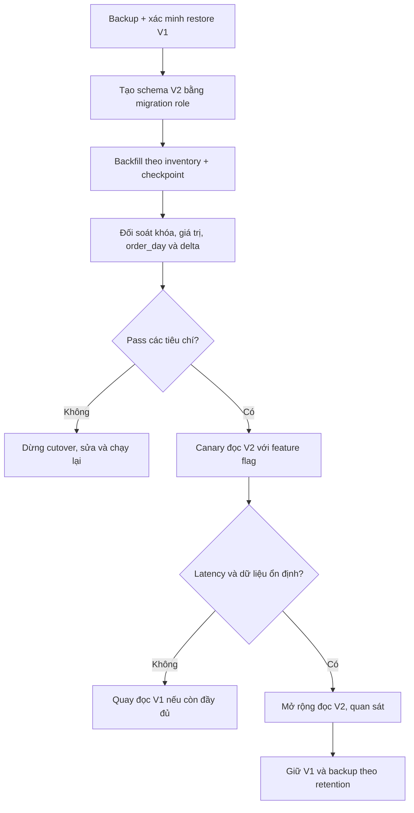

# Thực hành: Di trú dữ liệu sang bảng khóa mới và kiểm tra tính đầy đủ

## 1. Bối cảnh và kết quả cần đạt

Bạn đang phát triển dịch vụ đơn hàng bằng **Spring Data Cassandra**. Phiên bản đầu lưu toàn bộ đơn hàng của mỗi khách hàng trong một partition. Khi một khách hàng tạo nhiều đơn, partition có thể tăng quá lớn và việc phân trang theo thời gian trở nên tốn kém. Nhóm phát triển quyết định chuyển sang bảng mới, trong đó partition key gồm **mã khách hàng và ngày UTC**.

Nhiệm vụ của bài thực hành không dừng ở việc tạo bảng mới và chép một vài hàng. Bạn sẽ:

1. Tạo hai bảng Apache Cassandra có cấu trúc khóa khác nhau và nạp bộ dữ liệu thử nghiệm có chủ đích.
2. Ánh xạ bảng đích bằng entity/repository Spring Data Cassandra.
3. Viết job backfill dùng `CqlSession`, prepared statement và paging của Cassandra Java Driver.
4. Chứng minh hàng được chuyển đúng ngày, không mất/trùng khóa và không đổi giá trị nghiệp vụ.
5. Thử chạy lại sau lỗi, xác định giới hạn an toàn của việc chạy lại và lập phương án quay lui.
6. Đưa ra tiêu chí **Go/No-Go** trước khi đổi repository đọc dữ liệu ở production.

**Phạm vi bài lab:** một cluster Cassandra cô lập, một tập khách hàng nhỏ đã biết, không có ghi đồng thời trong giai đoạn sao chép. Đây là điều kiện có chủ đích để phép đối soát ban đầu có kết quả xác định. Phần sau sẽ mở rộng sang dữ liệu lớn, ghi liên tục, consistency và kiểm soát hiệu năng.

### 1.1. Công cụ cần chuẩn bị

- JDK 17+; Spring Boot 3.x với Spring Data Cassandra và Cassandra Java Driver 4.x tương thích.
- Một Cassandra chạy cục bộ bằng Docker/Testcontainers hoặc cluster thử nghiệm được cấp phép; không dùng keyspace production.
- `cqlsh` hoặc công cụ CQL tương đương để chạy script tạo schema và fixture.
- JUnit 5, AssertJ và, nếu viết integration test, Testcontainers Cassandra.
- Tài khoản có quyền tạo keyspace/bảng **trong môi trường lab**; tài khoản chạy ứng dụng chỉ cần quyền đọc/ghi bảng tương ứng.

Cấu trúc thư mục là gợi ý khi bạn đưa ví dụ vào một dự án thật:

```text
src/main/java/.../migration/OrdersDayBackfill.java
src/main/java/.../order/OrderByCustomerDay.java
src/main/java/.../order/OrderDayKey.java
src/main/java/.../order/OrdersDayRepository.java
src/test/resources/cassandra/schema-lab.cql
src/test/resources/cassandra/seed-lab.cql
src/test/java/.../migration/OrdersDayBackfillIT.java
```

Tên package trong các đoạn Java được lược bớt để tập trung vào cơ chế. Cần đặt đúng package, import, getter/constructor và bean wiring trong dự án cụ thể. Không tạo các file phụ bằng bước viết nội dung của bài học này.

## 2. Phân tích khóa cũ và khóa mới

### 2.1. Bảng nguồn V1

Bảng V1 phục vụ truy vấn “lấy đơn hàng của một khách hàng theo thời gian”:

```sql
CREATE KEYSPACE IF NOT EXISTS commerce_lab
WITH replication = {
    'class': 'SimpleStrategy',
    'replication_factor': 1
};

CREATE TABLE commerce_lab.orders_by_customer (
    customer_id text,
    created_at  timestamp,
    order_id    uuid,
    status      text,
    total       decimal,
    PRIMARY KEY ((customer_id), created_at, order_id)
) WITH CLUSTERING ORDER BY (created_at DESC, order_id ASC);
```

Ở V1, `customer_id` là partition key, còn `created_at` và `order_id` là clustering columns. Với mỗi khách hàng, tất cả đơn hàng cùng thuộc một partition. `order_id` là cột clustering thứ hai để phân biệt hai đơn có cùng thời điểm.

Truy vấn hợp lệ:

```sql
SELECT created_at, order_id, status, total
FROM commerce_lab.orders_by_customer
WHERE customer_id = 'KH-01';
```

### 2.2. Bảng đích V2

Yêu cầu mới: đọc đơn hàng **của khách hàng theo ngày**.

```sql
CREATE TABLE commerce_lab.orders_by_customer_day (
    customer_id text,
    order_day   date,
    created_at  timestamp,
    order_id    uuid,
    status      text,
    total       decimal,
    PRIMARY KEY ((customer_id, order_day), created_at, order_id)
) WITH CLUSTERING ORDER BY (created_at DESC, order_id ASC);
```

Khóa V2 gồm:

| Thành phần | V1 | V2 |
| --- | --- | --- |
| Partition key | `customer_id` | `(customer_id, order_day)` |
| Clustering key | `created_at, order_id` | `created_at, order_id` |
| Truy vấn chính | Đơn hàng theo khách hàng | Đơn hàng theo khách hàng và ngày |
| Số partition của một khách | Thường một partition | Có thể nhiều partition theo ngày |
| Chọn partition | `WHERE customer_id = ?` | `WHERE customer_id = ? AND order_day = ?` |

**Không thể đổi primary key của V1 chỉ bằng sửa annotation Java hay `ALTER TABLE`.** Cần bảng mới, backfill dữ liệu và chuyển luồng truy vấn. Bảng mới cũng không tự bảo đảm mọi partition đều nhỏ: nếu một khách hàng có hàng triệu đơn trong cùng một ngày, cần đánh giá một bucket chi tiết hơn. Thiết kế partition key phải xuất phát từ mẫu truy vấn và kích thước dữ liệu dự kiến.

### 2.3. Quy tắc tính ngày

Toàn bộ hệ thống dùng **ngày UTC** để định tuyến:

```java
LocalDate orderDay =
    createdAt.atZone(ZoneOffset.UTC).toLocalDate();
```

Không dùng timezone của máy chủ hoặc timezone người dùng khi ghi V2. Một đơn lúc `2026-03-01T00:00:00Z` thuộc ngày `2026-03-01`; đơn trước đó một giây thuộc `2026-02-28`.

CQL type `timestamp` tương ứng với `Instant`; `date` tương ứng với `LocalDate`. Trong ví dụ, các mốc thời gian được chọn ở độ chính xác giây để tránh nhập nhằng khi so sánh với độ chính xác timestamp của Cassandra.

## 3. Nạp fixture có thể kiểm chứng bằng tay

Đầu tiên, tạo keyspace và hai bảng từ mục 2 trên **cluster lab trống**. Sau đó thêm những đơn hàng sau:

| Khách hàng | Thời gian UTC | Order ID (đuôi) | Trạng thái | Tổng tiền | Partition V2 mong đợi |
| --- | --- | --- | --- | --- | --- |
| KH-01 | 2026-02-28 23:59:59 | 0001 | PAID | 100.00 | (KH-01, 2026-02-28) |
| KH-01 | 2026-03-01 00:00:00 | 0002 | NEW | 45.50 | (KH-01, 2026-03-01) |
| KH-01 | 2026-03-01 10:30:00 | 0003 | PAID | 220.10 | (KH-01, 2026-03-01) |
| KH-02 | 2026-03-01 01:15:00 | 0004 | CANCELLED | 0.00 | (KH-02, 2026-03-01) |
| KH-02 | 2026-03-02 00:10:00 | 0005 | PAID | 80.00 | (KH-02, 2026-03-02) |
| KH-02 | 2026-03-02 00:10:00 | 0006 | NEW | 12.00 | (KH-02, 2026-03-02) |
| KH-03 | 2026-03-02 14:00:00 | 0007 | PAID | 5.00 | (KH-03, 2026-03-02) |

Hai bản ghi của KH-02 lúc `00:10:00` cố ý có cùng timestamp nhưng khác `order_id`. Nếu job chỉ dùng `created_at` làm khóa định danh, phép kiểm tra sẽ phát hiện thiếu một đơn.

Chạy CQL trên bảng nguồn:

```sql
INSERT INTO commerce_lab.orders_by_customer
(customer_id, created_at, order_id, status, total)
VALUES ('KH-01', '2026-02-28T23:59:59Z',
        00000000-0000-4000-8000-000000000001, 'PAID', 100.00);

INSERT INTO commerce_lab.orders_by_customer
(customer_id, created_at, order_id, status, total)
VALUES ('KH-01', '2026-03-01T00:00:00Z',
        00000000-0000-4000-8000-000000000002, 'NEW', 45.50);

INSERT INTO commerce_lab.orders_by_customer
(customer_id, created_at, order_id, status, total)
VALUES ('KH-01', '2026-03-01T10:30:00Z',
        00000000-0000-4000-8000-000000000003, 'PAID', 220.10);

INSERT INTO commerce_lab.orders_by_customer
(customer_id, created_at, order_id, status, total)
VALUES ('KH-02', '2026-03-01T01:15:00Z',
        00000000-0000-4000-8000-000000000004, 'CANCELLED', 0.00);

INSERT INTO commerce_lab.orders_by_customer
(customer_id, created_at, order_id, status, total)
VALUES ('KH-02', '2026-03-02T00:10:00Z',
        00000000-0000-4000-8000-000000000005, 'PAID', 80.00);

INSERT INTO commerce_lab.orders_by_customer
(customer_id, created_at, order_id, status, total)
VALUES ('KH-02', '2026-03-02T00:10:00Z',
        00000000-0000-4000-8000-000000000006, 'NEW', 12.00);

INSERT INTO commerce_lab.orders_by_customer
(customer_id, created_at, order_id, status, total)
VALUES ('KH-03', '2026-03-02T14:00:00Z',
        00000000-0000-4000-8000-000000000007, 'PAID', 5.00);
```

Sau khi nạp, kiểm tra nguồn theo từng partition:

```sql
SELECT customer_id, created_at, order_id, status, total
FROM commerce_lab.orders_by_customer
WHERE customer_id = 'KH-01';

SELECT customer_id, created_at, order_id, status, total
FROM commerce_lab.orders_by_customer
WHERE customer_id = 'KH-02';

SELECT customer_id, created_at, order_id, status, total
FROM commerce_lab.orders_by_customer
WHERE customer_id = 'KH-03';
```

Kỳ vọng lần lượt là **3, 3, 1** bản ghi. Bảng đích phải trống trước lần chạy đầu tiên. Nếu dùng Testcontainers và tạo container/keyspace mới cho mỗi suite, điều kiện đó dễ duy trì. Nếu tái sử dụng cluster lab, hãy kiểm tra dữ liệu đã tồn tại, tránh chạy bài trên bảng không còn sạch. Chỉ dùng `TRUNCATE` để làm sạch **đúng bảng lab cô lập**, không áp dụng trên bảng đang dùng chung.

**Danh sách khách hàng nguồn của bài lab là đầy đủ:** `KH-01`, `KH-02`, `KH-03`. Đây là điều kiện quan trọng; nếu danh sách bỏ sót một khách hàng thì job dù chuyển thành công 100% số khách hàng trong danh sách vẫn **chưa** đầy đủ toàn bảng. Với production, danh sách partition phải lấy từ một inventory đáng tin cậy, công cụ quét token range hay luồng dữ liệu đã được thiết kế để bao phủ toàn bộ nguồn.

## 4. Ánh xạ khóa mới trong Spring Data Cassandra

Bảng V2 có **hai partition-key columns**. Entity phải thể hiện đúng thứ tự các cột khóa:

```java
// OrderDayKey.java
@PrimaryKeyClass
public class OrderDayKey implements Serializable {
    @PrimaryKeyColumn(
        name = "customer_id", ordinal = 0,
        type = PrimaryKeyType.PARTITIONED
    )
    private String customerId;

    @PrimaryKeyColumn(
        name = "order_day", ordinal = 1,
        type = PrimaryKeyType.PARTITIONED
    )
    private LocalDate orderDay;

    @PrimaryKeyColumn(
        name = "created_at", ordinal = 2,
        type = PrimaryKeyType.CLUSTERED
    )
    private Instant createdAt;

    @PrimaryKeyColumn(
        name = "order_id", ordinal = 3,
        type = PrimaryKeyType.CLUSTERED
    )
    private UUID orderId;

    // Constructor, getter/setter, equals/hashCode đầy đủ.
}

// OrderByCustomerDay.java
@Table("orders_by_customer_day")
public class OrderByCustomerDay {
    @PrimaryKey
    private OrderDayKey key;

    @Column("status")
    private String status;

    @Column("total")
    private BigDecimal total;

    // Constructor và getter/setter.
}

// OrdersDayRepository.java
public interface OrdersDayRepository
        extends CassandraRepository<OrderByCustomerDay, OrderDayKey> {

    List<OrderByCustomerDay> findByKeyCustomerIdAndKeyOrderDay(
        String customerId, LocalDate orderDay);
}
```

Các annotation thuộc `org.springframework.data.cassandra.core.mapping`; repository kế thừa `org.springframework.data.cassandra.repository.CassandraRepository`. Đây là đoạn minh họa cần bổ sung imports và thành phần Java thông thường khi đưa vào project.

Ví dụ Spring Boot dùng keyspace lab và **không tự sửa schema**:

```yaml
spring:
  cassandra:
    contact-points:
      - 127.0.0.1
    port: 9042
    local-datacenter: datacenter1
    keyspace-name: commerce_lab
    schema-action: NONE
```

Các giá trị host/datacenter là ví dụ, phải khớp cluster lab thực tế. Với Cassandra chạy bằng Testcontainers, lấy host/port từ container; không coi `127.0.0.1:9042` là mặc định bắt buộc. Trong production, schema được tạo bởi migration job/tài khoản riêng; runtime chỉ dùng các bảng được cấp phép.

**Kiểm tra trước khi tiếp tục:** repository phải tìm được dữ liệu khi query có đủ `customerId` và `orderDay`. Chỉ viết `findByKeyCustomerId(...)` cho V2 có thể dẫn tới truy vấn thiếu một thành phần partition key, không phù hợp với schema này.

## 5. Viết job backfill qua `CqlSession`

### 5.1. Nguyên tắc cài đặt

Để việc chuyển đổi dễ quan sát, job dùng `CqlSession` do Spring quản lý, với hai prepared statements:

- Đọc từng partition V1 bằng `WHERE customer_id = ?`.
- Ghi một hàng vào V2 bằng khóa `(customer_id, order_day, created_at, order_id)` đã được tính.

Dùng **paging** ở phía driver để không gom toàn bộ partition vào một `List` lớn. Ở bản lab không có ghi đồng thời, việc lặp lại các lệnh `INSERT` với **cùng khóa và cùng giá trị** cho kết quả logic ổn định. Không mặc nhiên coi cách ghi lại này an toàn khi V2 đã có các cập nhật mới hơn, TTL hoặc dữ liệu xóa: những tình huống đó được xử lý riêng ở mục 9.

### 5.2. Mã nguồn backfill cơ bản

Ví dụ dùng Java Driver 4.x:

```java
@Service
public class OrdersDayBackfill {
    private final CqlSession session;
    private final PreparedStatement readV1;
    private final PreparedStatement writeV2;

    public OrdersDayBackfill(CqlSession session) {
        this.session = session;

        this.readV1 = session.prepare("""
            SELECT created_at, order_id, status, total
            FROM commerce_lab.orders_by_customer
            WHERE customer_id = ?
            """);

        this.writeV2 = session.prepare("""
            INSERT INTO commerce_lab.orders_by_customer_day
            (customer_id, order_day, created_at, order_id, status, total)
            VALUES (?, ?, ?, ?, ?, ?)
            """);
    }

    public long migrateCustomer(String customerId) {
        BoundStatement read =
            readV1.bind(customerId).setPageSize(128);

        long copied = 0;

        // Driver tải các trang tiếp theo khi ResultSet được duyệt.
        for (Row row : session.execute(read)) {
            Instant createdAt = row.getInstant("created_at");
            LocalDate orderDay =
                createdAt.atZone(ZoneOffset.UTC).toLocalDate();

            UUID orderId = row.getUuid("order_id");
            String status = row.getString("status");
            BigDecimal total = row.getBigDecimal("total");

            BoundStatement write = writeV2.bind(
                customerId, orderDay, createdAt,
                orderId, status, total
            );

            session.execute(write);
            copied++;
        }

        return copied;
    }
}
```

Import cần thiết gồm `java.time.Instant`, `LocalDate`, `ZoneOffset`, `java.util.UUID`, `java.math.BigDecimal`; `CqlSession` và các lớp CQL của Cassandra Java Driver 4; `org.springframework.stereotype.Service`.

Giải thích những lựa chọn quan trọng:

- `PreparedStatement` được tạo một lần cho session, tránh prepare lại trong mỗi hàng.
- Bind marker `?` giữ kiểu giá trị rõ ràng và tránh nối chuỗi dữ liệu người dùng vào CQL.
- `setPageSize(128)` đặt **fetch size**, không phải `LIMIT 128`: duyệt tới cuối vẫn đọc mọi trang kết quả của partition.
- `getInstant(...)` và `getBigDecimal(...)` giữ kiểu dữ liệu tương ứng `timestamp` và `decimal`.
- `copied` đếm số lệnh ghi trả về thành công ở mức driver, **chưa** chứng minh toàn bộ dữ liệu nguồn đã được kiểm tra hay không có thay đổi đồng thời.
- Mỗi lệnh ghi dùng một partition có cấu trúc khóa của V2; không cần tạo `BATCH` khổng lồ cho cả tập dữ liệu.

Trong thực tế, cần thêm giới hạn request/timeout, phân loại lỗi, metric số hàng và checkpoint bền vững. Mã trên chỉ là **hạt nhân dễ kiểm chứng của bài lab**, không phải job production hoàn chỉnh.

### 5.3. Gọi job với inventory đầy đủ

Chạy lần lượt trên ba khách hàng trong fixture:

```java
List<String> sourceCustomers =
    List.of("KH-01", "KH-02", "KH-03");

for (String customerId : sourceCustomers) {
    long copied = backfill.migrateCustomer(customerId);
    System.out.printf(
        "customer=%s copied=%d%n", customerId, copied
    );
}
```

Kỳ vọng số hàng theo khách là `3 / 3 / 1`, tổng số lệnh ghi V2 thành công là **7**. Đoạn trên là ví dụ cách gọi trong runner/test đã được kiểm soát, không phải mã tự động chạy mỗi khi API khởi động. Trong môi trường thật, job backfill nên là tác vụ được điều phối độc lập, có quyền phù hợp và khả năng dừng/chạy lại.

Nếu có lỗi giữa chừng, job có thể đã ghi một số hàng trước khi ném exception. **Không đặt checkpoint “customer hoàn tất” trước khi đọc hết partition, ghi hết các hàng và đối soát thành công.** Bản lab chưa lưu checkpoint bền vững nên có thể chạy lại toàn bộ khách hàng đó khi nguồn đóng băng; với dữ liệu lớn cần lưu trạng thái tiến độ trong kho bền vững và kiểm tra tính idempotent.

## 6. Kiểm tra ngay trên Cassandra

### 6.1. Kiểm tra số hàng của từng partition V2

Chạy những truy vấn chỉ định **đủ hai partition-key columns**:

```sql
SELECT created_at, order_id, status, total
FROM commerce_lab.orders_by_customer_day
WHERE customer_id = 'KH-01'
  AND order_day = '2026-02-28';

SELECT created_at, order_id, status, total
FROM commerce_lab.orders_by_customer_day
WHERE customer_id = 'KH-01'
  AND order_day = '2026-03-01';

SELECT created_at, order_id, status, total
FROM commerce_lab.orders_by_customer_day
WHERE customer_id = 'KH-02'
  AND order_day = '2026-03-01';

SELECT created_at, order_id, status, total
FROM commerce_lab.orders_by_customer_day
WHERE customer_id = 'KH-02'
  AND order_day = '2026-03-02';

SELECT created_at, order_id, status, total
FROM commerce_lab.orders_by_customer_day
WHERE customer_id = 'KH-03'
  AND order_day = '2026-03-02';
```

Kết quả kỳ vọng theo thứ tự là **1, 2, 1, 2, 1** hàng. Tổng cộng 7 hàng ở 5 partition.

### 6.2. Tại sao chỉ đếm hàng là chưa đủ?

Giả sử job chép được 7 hàng nhưng tính ngày theo UTC+7 thay vì UTC. Những hàng gần nửa đêm có thể bị đưa vào partition khác. Tổng số hàng vẫn bằng 7, nhưng API tìm đơn theo ngày UTC sẽ thiếu dữ liệu.

Hoặc job vô tình chuyển `status = PAID` thành `status = NEW` cho một đơn. Số lượng và tập khóa vẫn đúng, nhưng dữ liệu nghiệp vụ sai.

Do đó cần so sánh **tập đầy đủ** của:

```text
(
  customer_id,
  order_day = UTC_DATE(created_at),
  created_at,
  order_id,
  status,
  total
)
```

Bài lab sẽ kiểm chứng cả partition, khóa logic và giá trị.

## 7. Xây dựng kiểm thử đối soát độc lập

### 7.1. Chuẩn hóa một bản ghi để so sánh

Ta mô tả một bản ghi bằng record Java, tính `orderDay` từ nguồn nhưng **đọc thật** `order_day` ở đích:

```java
record CheckedOrder(
    String customerId,
    LocalDate orderDay,
    Instant createdAt,
    UUID orderId,
    String status,
    BigDecimal total
) {
    static CheckedOrder fromV1(Row row) {
        Instant t = row.getInstant("created_at");
        return new CheckedOrder(
            row.getString("customer_id"),
            t.atZone(ZoneOffset.UTC).toLocalDate(),
            t,
            row.getUuid("order_id"),
            row.getString("status"),
            normalizedTotal(row.getBigDecimal("total"))
        );
    }

    static CheckedOrder fromV2(Row row) {
        return new CheckedOrder(
            row.getString("customer_id"),
            row.getLocalDate("order_day"),
            row.getInstant("created_at"),
            row.getUuid("order_id"),
            row.getString("status"),
            normalizedTotal(row.getBigDecimal("total"))
        );
    }

    private static BigDecimal normalizedTotal(BigDecimal value) {
        return value == null ? null : value.stripTrailingZeros();
    }
}
```

Cần giữ quy tắc so sánh nhất quán. Ở đây, `100.0` và `100.00` được xem là bằng nhau về giá trị số học. Nếu thang đo/scale là một phần contract nghiệp vụ, bỏ bước chuẩn hóa và kiểm tra cả scale. Với dữ liệu có TTL hoặc timestamp ghi, cần bổ sung trường/tiêu chí tương ứng; bài lab chưa dùng TTL.

### 7.2. Test đối chiếu toàn bộ fixture

Vì fixture chỉ có **7 hàng** trên cluster cô lập, ta có thể quét bảng V2 bằng CQL trong test để bắt cả **hàng thừa ở ngày không mong đợi**. Đây là một ngoại lệ chấp nhận được cho bài test rất nhỏ; **không** dùng kiểu quét toàn bảng này trong API hoặc job kiểm tra production.

Ví dụ đặt trong lớp integration test đã có `@Autowired CqlSession session` và `@Autowired OrdersDayBackfill backfill`:

```java
@Test
void migrationMatchesEveryKeyDayAndValue() {
    for (String customerId :
            List.of("KH-01", "KH-02", "KH-03")) {
        backfill.migrateCustomer(customerId);
    }

    List<CheckedOrder> expected = new ArrayList<>();

    for (String customerId :
            List.of("KH-01", "KH-02", "KH-03")) {

        ResultSet rows = session.execute(
            SimpleStatement.newInstance("""
                SELECT customer_id, created_at, order_id,
                       status, total
                FROM commerce_lab.orders_by_customer
                WHERE customer_id = ?
                """, customerId));

        rows.forEach(row ->
            expected.add(CheckedOrder.fromV1(row))
        );
    }

    // Chỉ trong fixture 7 hàng của bài lab:
    List<CheckedOrder> actual = session.execute("""
        SELECT customer_id, order_day, created_at,
               order_id, status, total
        FROM commerce_lab.orders_by_customer_day
        """).all().stream()
        .map(CheckedOrder::fromV2)
        .toList();

    assertThat(expected).hasSize(7);
    assertThat(actual)
        .containsExactlyInAnyOrderElementsOf(expected);
}
```

Import liên quan: `org.junit.jupiter.api.Test`, `org.assertj.core.api.Assertions.assertThat`, `java.util.ArrayList`/`List`, các lớp CQL Driver 4. Phải nạp fixture trước mỗi test (hoặc dùng container mới) và bảo đảm bảng đích trống. Khi test được chạy lại trên dữ liệu còn dư, assertion sẽ không còn ý nghĩa.

Assertion `containsExactlyInAnyOrderElementsOf` bảo vệ nhiều thuộc tính cùng lúc:

- Thiếu một hàng → không khớp.
- Có hàng thừa → không khớp.
- Sai `order_day` → không khớp, kể cả tổng số hàng đúng.
- Sai `status`/`total` → không khớp.
- Hai đơn cùng `created_at` nhưng khác `order_id` vẫn phân biệt được.

Việc dùng danh sách khách hàng xác định là hợp lệ **chỉ vì fixture đã biết toàn bộ inventory**. Trên dữ liệu thật, phải chứng minh inventory đầy đủ hoặc dùng công cụ bao phủ token range và đối soát nguồn/đích theo nhóm dữ liệu.

### 7.3. Test trực tiếp repository V2

Bên cạnh CQL thô, xác nhận tầng Spring Data mapping chạy đúng:

```java
@Test
void repositoryReadsExpectedDayPartition() {
    List<OrderByCustomerDay> rows =
        dayRepository.findByKeyCustomerIdAndKeyOrderDay(
            "KH-01", LocalDate.parse("2026-03-01")
        );

    assertThat(rows)
        .extracting(row -> row.getKey().getOrderId())
        .containsExactlyInAnyOrder(
            UUID.fromString(
                "00000000-0000-4000-8000-000000000002"),
            UUID.fromString(
                "00000000-0000-4000-8000-000000000003")
        );
}
```

Test này yêu cầu đã chạy backfill/seed của fixture trước khi assertion. Nó kiểm tra tên cột, metadata `@PrimaryKeyClass`, kiểu `LocalDate`/`Instant` và query theo đủ partition key. Một job CQL trực tiếp thành công chưa đảm bảo entity/repository mới đã cấu hình chính xác.

## 8. Bài tập tiêm lỗi: phát hiện sai lệch khi số hàng vẫn đủ

Để chứng minh đối soát hữu ích, hãy thử **một** lỗi trong môi trường lab rồi chạy lại test.

### 8.1. Sai ngày ở một hàng

Giả sử code thay UTC bằng timezone máy chủ hoặc cố tình chuyển đơn `0002` sang `order_day = '2026-02-28'`. Tổng số hàng V2 có thể vẫn là 7, nhưng `CheckedOrder.fromV2` đọc ngày thực tế khác ngày suy từ `created_at` ở V1. Test phải thất bại.

Sau khi tái hiện, sửa logic tính ngày, **xóa/di chuyển chính xác hàng lỗi** trong cluster lab rồi backfill lại. Chỉ `INSERT` một bản sao đúng ngày không tự dọn hàng ở ngày sai; vì khóa mới khác nhau, cả hai hàng có thể cùng tồn tại.

### 8.2. Sai giá trị nghiệp vụ

Giả sử status của đơn `0003` ở V2 bị đổi từ `PAID` thành `NEW`. Truy vấn vẫn hợp lệ, số hàng và khóa vẫn đúng nhưng assertion so sánh `CheckedOrder` sẽ thất bại.

Nếu cần xác định vị trí lỗi, so sánh theo key logic `(customer_id, created_at, order_id)` rồi báo `missingKeys`, `extraKeys` và `valueMismatches` riêng. Trong production, không đưa mã khách hàng hoặc nội dung nhạy cảm thành metric label có cardinality cao; chỉ giữ thông tin chi tiết trong log/báo cáo có kiểm soát quyền truy cập.

### 8.3. Bỏ sót một partition nguồn

Thử xóa `KH-03` khỏi danh sách `sourceCustomers`. Job chỉ copy 6 hàng và test vẫn kỳ vọng 7 → thất bại.

Tuy nhiên, nếu cả job và chương trình đối soát đều dùng **cùng danh sách thiếu KH-03**, phép so sánh có thể báo khớp sai. Đó là lý do phải có **inventory/checkpoint độc lập** hoặc phương án chứng minh bao phủ tất cả partition từ nguồn, không dùng duy nhất số hàng đã “đọc được” để kết luận đã chuyển hết dữ liệu.

### 8.4. Khóa không đủ thành phần

Nếu sửa bảng V2 chỉ dùng `(customer_id, order_day, created_at)` làm khóa và bỏ `order_id`, hai đơn `KH-02` cùng timestamp có thể ghi đè cùng một hàng. Kết quả chỉ còn 6 hàng. Đây là lỗi **thiết kế khóa**, không thể sửa bằng cách tăng retry hoặc thay paging.

## 9. Chạy lại sau lỗi và kiểm soát ghi đồng thời

### 9.1. Idempotency trong bài lab nguồn bất biến

Trong điều kiện lab:

- V1 không bị UPDATE/DELETE trong lúc migration.
- V2 chỉ được ghi bởi backfill, không có writer nghiệp vụ khác.
- Cùng một hàng luôn được tính ra cùng khóa V2 và cùng giá trị.

Vì vậy sau khi job ngừng giữa chừng, chạy lại `migrateCustomer("KH-02")` có thể bổ sung những hàng chưa ghi. Lần lặp lại trên một khóa sẽ cập nhật cùng nội dung. Vẫn cần chạy **đối soát toàn diện** sau khi tiếp tục; chỉ dựa vào counter của job thì không đủ.

Không suy rộng tính chất này cho mọi hệ thống: lệnh viết lại cùng giá trị có thể thay đổi write timestamp và TTL, ảnh hưởng thứ tự cạnh tranh với các cập nhật khác. Tính idempotent ở cấp **giá trị logic trong fixture đóng băng** không đồng nghĩa hoàn toàn tương đương về timestamp/TTL/tombstone.

### 9.2. Tình huống có ghi mới: phải giải quyết cuộc đua dữ liệu

Giả sử ứng dụng đổi `status` của một đơn từ `NEW` sang `PAID` trong khi backfill đã đọc giá trị cũ. Nếu job ghi `NEW` vào V2 sau khi writer đã ghi `PAID`, bản sao cũ có thể thắng theo write timestamp. Tăng số luồng backfill hoặc retry không giải quyết được vấn đề **stale write**.

Trong production cần chọn và kiểm chứng một chiến lược phù hợp:

1. **Maintenance window:** tạm dừng/giới hạn ghi, chốt watermark, chép dữ liệu, đối soát, cutover rồi mở ghi lại. Dễ chứng minh nhất nếu thời gian dừng chấp nhận được.
2. **Dual-write + reconciliation:** ghi cả V1/V2, ghi nhận thất bại từng nhánh, đồng bộ theo version nghiệp vụ, xử lý retry có giới hạn; không mặc định hai lệnh viết khác bảng tạo transaction nguyên tử.
3. **CDC/event log có thể replay:** ghi nhận thay đổi và xóa sau snapshot, backfill phần lịch sử rồi catch-up delta tới watermark; cần chứng minh thứ tự, retention và cơ chế khôi phục khi consumer lỗi.

Cassandra dùng timestamp và cơ chế giải quyết ghi cạnh tranh; `LOGGED BATCH` không phải transaction nghiệp vụ tổng quát cho migration nhiều partition. Khi bảng dùng TTL hoặc tombstone, backfill phải giữ đúng chính sách hết hạn và tránh làm hồi sinh bản ghi đã xóa.

### 9.3. Checkpoint bền vững

Cho dữ liệu lớn, không lưu tiến độ chỉ trong biến `long copied`. Một bản ghi checkpoint nên gắn với:

| Trường checkpoint | Mục đích |
| --- | --- |
| `migration_id` và schema version | Phân biệt lần chuyển đổi và quy tắc dữ liệu |
| Đơn vị công việc (partition/token range) | Biết phạm vi đã xử lý |
| Mốc bắt đầu/kết thúc và số hàng | Đối chiếu tiến độ |
| Trạng thái `COPYING / VERIFYING / VERIFIED / FAILED` | Không lẫn “đã gửi write” với “đã đối soát” |
| Watermark/delta position | Bắt kịp thay đổi đồng thời khi áp dụng |
| Checksum/manifest nguồn, đích | Phát hiện sai lệch theo phạm vi |
| Số lần retry và thông tin lỗi | Tiếp tục có kiểm soát |

Chỉ đánh dấu `VERIFIED` sau khi đọc lại dữ liệu đích và kiểm tra tính đầy đủ của đơn vị công việc. Với nhiều worker, cần cơ chế claim/lease để tránh hai worker chạy cùng đoạn không kiểm soát. Nếu Cassandra được dùng lưu checkpoint, thiết kế partition key, conditional write/LWT và consistency của checkpoint cần được đánh giá riêng; không mặc định tăng số worker luôn cải thiện throughput.

## 10. Quy mô lớn: không quét toàn bảng bằng một API request

Bài lab đọc ba partition bằng inventory nhỏ. Với bảng có hàng triệu partition, phương án cần thay đổi:

- Tạo inventory nguồn có khả năng bao phủ đầy đủ qua danh sách khóa nghiệp vụ đã kiểm chứng, token-range scan hoặc công cụ bulk/Spark phù hợp.
- Chia công việc thành các shard/range có thể checkpoint và giới hạn tốc độ.
- Dùng driver paging state/fetch size khi đọc, không giả định offset SQL hoặc đặt `ALLOW FILTERING` cho cả bảng.
- Hạn chế số yêu cầu concurrent theo khả năng cluster, theo dõi p95/p99 latency, timeout, số request in-flight và compaction.
- Đối soát theo từng partition/ngày, số hàng và hash chuẩn hóa, sau đó kiểm tra toàn bộ key/value ở các vùng có mismatch.
- Có cách xác định **hàng thừa ngoài các partition đích dự kiến**; kiểm tra mỗi partition xuất phát từ source mà không kiểm inventory V2 có thể bỏ sót các hàng sai ngày.
- Không dùng `SELECT COUNT(*)` trên toàn bảng production như một phép kiểm tra miễn phí.

Đối soát trên dữ liệu đang thay đổi cũng cần ảnh chụp logic tại một watermark. Cassandra không cung cấp một snapshot transaction nhất quán trên mọi partition chỉ vì hai truy vấn nguồn và đích chạy cùng lúc. Muốn kết luận chênh lệch thật, phải kiểm soát cửa sổ ghi hoặc replay delta theo mốc đã thống nhất.

## 11. Kiểm thử hiệu năng, consistency và paging

### 11.1. Paging khác với `LIMIT`

Trong mã backfill, `setPageSize(128)` giúp driver lấy các trang khi cần. Nó không làm job chỉ chép 128 hàng. Hãy tạo một fixture phụ có trên 128 đơn của một khách để xác nhận toàn bộ các trang được duyệt và tất cả hàng sang đúng ngày.

Với repository trả `Slice` hoặc cơ chế paging của Spring Data Cassandra, cần kiểm tra khả năng tiếp tục theo paging state/tokens. Không dùng offset kiểu SQL làm giả định mặc định. Sau khi đổi sang V2, cursor được tạo cho truy vấn V1 không thể coi là hợp lệ cho truy vấn V2; API phải có chính sách xử lý cursor cũ.

### 11.2. Consistency level không chứng minh tính đầy đủ

Testcontainers Cassandra một node giúp kiểm tra CQL, mapping và backfill nhưng chưa mô phỏng đầy đủ mô hình phân tán. Trong môi trường nhiều node, hãy xác định replication factor và consistency level của cả đọc nguồn, ghi đích và xác minh. Ví dụ một lệnh ghi ở `LOCAL_QUORUM` cần đủ replica theo quy tắc của datacenter tương ứng; không phải cứ có một node UP là ghi thành công.

Ngay cả khi mọi lệnh trả thành công ở consistency cấu hình, chương trình vẫn có thể bỏ sót hàng nếu inventory không đầy đủ hoặc biến đổi sai khóa. Vì vậy, **độ nhất quán của replica** và **tính đúng đắn của migration** là hai việc phải kiểm tra riêng.

### 11.3. Theo dõi trong quá trình chuyển đổi

| Tín hiệu | Ý nghĩa | Hành động khi bất thường |
| --- | --- | --- |
| Partition/giây, hàng/giây | Tiến độ công việc | Kiểm tra bottleneck và checkpoint |
| Missing/extra/value mismatch | Chất lượng dữ liệu | Dừng cutover, phân tích sai lệch |
| CQL timeout/retry | Mức ổn định của đọc/ghi | Giảm concurrency, kiểm tra coordinator/replica |
| Driver in-flight/pool và p95/p99 | Tải phía client và độ trễ | Điều chỉnh page size, số worker, throttle |
| Disk, compaction, tombstone | Tác động lên cluster | Dừng/giảm tốc nếu ảnh hưởng SLO |
| API error rate/paging errors | Ảnh hưởng người dùng | Giữ/đảo feature flag khi cần |

Không tăng timeout hay thêm `ALLOW FILTERING` như phản xạ đầu tiên khi job chậm. Hãy kiểm tra partition key, hot partition, kích thước trang, mức đồng thời và tài nguyên cluster.

## 12. Chuyển luồng đọc và phương án khôi phục

### 12.1. Trình tự an toàn trước cutover

Một lộ trình triển khai thực tế:



Đừng xóa V1 ngay sau khi test ban đầu đạt. Giữ một giai đoạn quan sát phù hợp với khả năng rollback, lịch sao lưu và các phiên bản ứng dụng còn truy cập bảng cũ.

### 12.2. Khi nào có thể quay về V1?

| Thời điểm lỗi | Có thể chuyển đọc về V1 ngay? | Lý do |
| --- | --- | --- |
| Trước cutover, V1 vẫn là nguồn ghi chuẩn | Thường có | V1 vẫn có dữ liệu mới nhất |
| Đọc V2 nhưng vẫn dual-write đầy đủ về V1 | Có điều kiện | Phải xác minh không thiếu delta trong V1 |
| Đã ngừng ghi V1, chỉ ghi V2 | **Không** | V1 đã thiếu các ghi mới, cần reverse sync/replay |
| V1 bị xóa/hỏng | Không | Cần restore từ backup và khôi phục delta phù hợp |

Việc quay lui code không đồng nghĩa khôi phục dữ liệu. Nếu V1 không còn nhận các bản ghi mới, chuyển feature flag về V1 có thể làm mất khả năng truy xuất đơn hàng vừa tạo, dù dữ liệu vẫn nằm trong V2. Cần giải quyết đồng bộ ngược trước khi đổi nguồn đọc.

### 12.3. Backup trước khi làm thay đổi phá hủy

Trước migration thật, cần snapshot/backup đã kiểm chứng và giữ schema, metadata, topology/RF cùng khả năng restore. `nodetool snapshot` tạo snapshot SSTable **theo node**, không tự tạo một bản sao toàn cluster ở kho độc lập hoặc đảm bảo snapshot nhất quán theo thời điểm khi đang ghi.

Với production, backup cần được đưa ra kho bên ngoài cluster, có checksum và diễn tập phục hồi. Recovery Point Objective (RPO) và Recovery Time Objective (RTO) quyết định có cần incremental backups, event/CDC replay hoặc freeze ghi khi chốt migration. Nếu restore, hãy khôi phục dữ liệu V1 ở schema tương thích trước, không tự nạp SSTable V1 vào bảng V2 có primary key khác.

## 13. Tiêu chí chấm bài và nghiệm thu

Hãy coi bài lab đạt khi có đủ bằng chứng sau:

| Tiêu chí | Mức đạt |
| --- | --- |
| Đúng schema | V1 có `customer_id` là partition key; V2 có `(customer_id, order_day)` |
| Dữ liệu fixture | V1 có đúng 7 hàng thuộc 3 khách hàng |
| Backfill | V2 có 7 hàng ở 5 partition theo ngày UTC |
| Đủ khóa | Hai đơn KH-02 cùng timestamp nhưng khác UUID đều tồn tại |
| Đúng giá trị | `status`/`total`/`created_at` khớp V1 sau chuẩn hóa |
| Kiểm thử Spring Data | Repository V2 đọc đúng partition theo customer và ngày |
| Test âm | Sai ngày, sai trạng thái hoặc bỏ sót khách hàng khiến đối soát thất bại |
| Chạy lại | Có thể tiếp tục sau dừng giữa chừng trong điều kiện fixture bất biến |
| Kiểm soát rủi ro | Giải thích được vì sao không thể dùng job nguyên trạng khi đang ghi đồng thời |
| Go/No-Go | Có checkpoint, kế hoạch đối soát delta, backup, rollback và ngưỡng hiệu năng |

Checklist tự kiểm tra:

- [ ] Mỗi hàng V1 được ánh xạ vào **một khóa V2 duy nhất**, có đủ tất cả thành phần khóa.
- [ ] Ngày V2 luôn tính từ `created_at` theo UTC.
- [ ] Inventory nguồn đã được xác nhận đầy đủ, không chỉ liệt kê một vài khách hàng.
- [ ] Có kiểm tra **hàng thiếu, hàng thừa, giá trị sai, partition sai**, không chỉ tổng count.
- [ ] Có test đối với hai hàng cùng timestamp, ranh giới ngày và multi-partition.
- [ ] Job dùng prepared statement, giới hạn page size và không tải toàn bộ dữ liệu lớn vào RAM.
- [ ] Không đánh dấu đơn vị backfill là hoàn tất trước khi đối soát thành công.
- [ ] Có phương án cho UPDATE/DELETE/TTL và dữ liệu mới đến trong lúc chuyển đổi.
- [ ] Đã kiểm thử query/repository V2, paging, consistency và latency phù hợp.
- [ ] Có backup/restore đã diễn tập và điều kiện quay về V1 rõ ràng trước bước phá hủy.

## 14. Bài tập mở rộng

**Bài A — Chạy lại sau lỗi:** sửa job để dừng có chủ đích sau hàng thứ hai của KH-02. Chạy lại phần chưa xác minh, kiểm tra kết quả cuối vẫn đúng 7 hàng và không sinh bản sao sai ngày. Lưu ý code phải đánh dấu phạm vi thực sự được xác minh, không chỉ cộng dồn số lần thực thi `INSERT`.

**Bài B — Chuyển đổi có TTL:** bổ sung trường dữ liệu được lưu có TTL và tạo một bản ghi gần hết hạn. Xác định rõ cách bảo toàn thời điểm hết hạn ở V2. Chứng minh backfill không đặt lại TTL đầy đủ cho dữ liệu chỉ còn thời gian ngắn.

**Bài C — Mô phỏng race:** trong lúc backfill, thay `status` của đơn `0003`. Quan sát khả năng V2 chứa dữ liệu cũ. Đề xuất version nghiệp vụ, stop-the-world cutover hoặc cơ chế delta catch-up trước khi chuyển đọc; ghi lại quy tắc giải quyết xung đột.

**Bài D — Nhiều trang:** tạo hơn 128 đơn trên cùng một partition V1, giữ `setPageSize(128)` rồi kiểm tra mọi hàng đều sang V2. Tiếp đó thực hiện truy vấn theo từng ngày bằng repository và thử paging state theo cách Spring Data Cassandra/driver hỗ trợ.

**Bài E — Data completeness quy mô lớn:** thay danh sách ba khách hàng cố định bằng một inventory có thể đối soát độc lập, chia việc theo checkpoint, tạo báo cáo `missing/extra/mismatch` cho từng nhóm partition. Giải thích vì sao `SELECT COUNT(*)` toàn bảng hoặc so sánh tổng hàng đơn thuần chưa đủ.

**Điểm cần ghi nhớ:** bài toán di trú Cassandra là bài toán **thiết kế lại dữ liệu theo truy vấn** và bảo toàn những bất biến nghiệp vụ khi khóa lưu trữ thay đổi. Spring Data Cassandra giúp ánh xạ entity, repository và thực thi CQL; còn độ đầy đủ của inventory, tính đúng của backfill, consistency, paging và khả năng khôi phục phải được chứng minh bằng dữ liệu và kiểm thử. Chỉ cutover khi cả kiểm chứng chức năng lẫn phương án phục hồi đều đạt yêu cầu.
