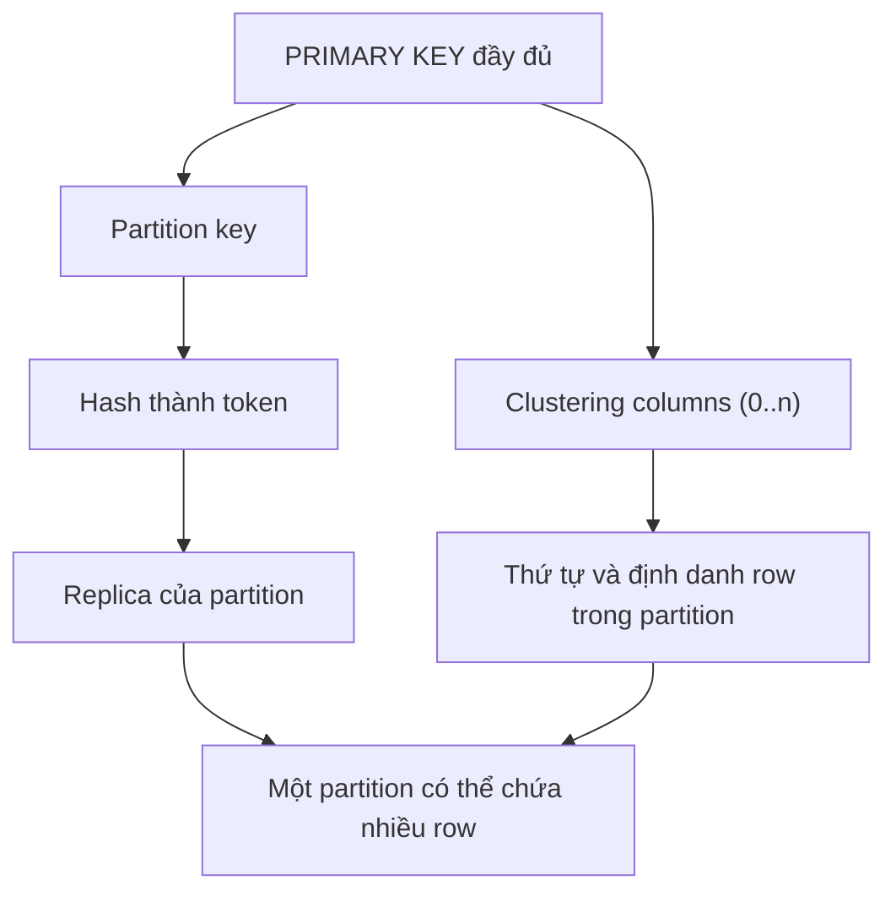

# Primary key gồm partition key và clustering columns

Trong Apache Cassandra, **primary key** xác định duy nhất một hàng (row) của bảng, nhưng còn có nhiệm vụ quan trọng hơn so với khóa chính thường gặp trong cơ sở dữ liệu quan hệ: nó quyết định **dữ liệu được phân vùng trên những replica nào** và **các hàng được sắp xếp ra sao bên trong mỗi partition**.

Đối với người dùng **Spring Data Cassandra**, việc hiểu chính xác cấu trúc này là nền tảng để thiết kế bảng theo truy vấn, ánh xạ entity, viết repository hoặc `CassandraTemplate`, phân trang và kiểm soát hiệu năng. Nếu mô hình khóa sai, việc viết thêm method trong repository hay tăng cache thường không giải quyết được truy vấn chậm hoặc không được Cassandra hỗ trợ.

## 1. Primary key có hai vai trò

Cú pháp khái quát của bảng Cassandra:

```sql
CREATE TABLE keyspace_name.table_name (
    partition_column_1 data_type,
    partition_column_2 data_type,
    clustering_column_1 data_type,
    clustering_column_2 data_type,
    ordinary_column data_type,
    PRIMARY KEY (
        (partition_column_1, partition_column_2),
        clustering_column_1,
        clustering_column_2
    )
);
```

Trong đó:

- **Partition key** gồm một hoặc nhiều cột; giá trị của **toàn bộ partition key** quyết định partition chứa dữ liệu. Cassandra tính token từ partition key để xác định vị trí trên vòng token và tập replica theo chiến lược replication.
- **Clustering columns** (có thể không có) xác định thứ tự các hàng **bên trong cùng một partition**. Chúng cũng tham gia định danh duy nhất hàng.
- **Primary key đầy đủ** = partition key + tất cả clustering columns; hai hàng không thể cùng tồn tại với bộ giá trị primary key hoàn toàn giống nhau.

Một partition có thể chứa nhiều hàng với cùng partition key, miễn là bộ clustering columns của chúng khác nhau. Khi bảng **không có clustering columns**, mỗi giá trị partition key tương ứng tối đa một hàng logic.

### 1.1. Phân biệt ba cú pháp dễ nhầm

```sql
-- (A) Một partition key, không có clustering column
PRIMARY KEY (customer_id)

-- (B) customer_id là partition key; created_at là clustering column
PRIMARY KEY (customer_id, created_at)

-- (C) customer_id và created_at CÙNG tạo partition key;
--     bảng này không có clustering column
PRIMARY KEY ((customer_id, created_at))
```

Dấu ngoặc **đôi** quanh các cột trong `PRIMARY KEY ((...))` có ý nghĩa quyết định. Với (B), tất cả sự kiện của một khách hàng có thể nằm cùng partition và được sắp theo thời gian. Với (C), mỗi cặp khách hàng–thời gian là **một partition key khác nhau**.

Có thể hình dung các lớp như sau:



**Không đánh đồng partition với replica.** Một partition là nhóm dữ liệu logic có cùng partition key; Cassandra thường lưu **nhiều bản sao** của partition trên các node, tùy replication factor, datacenter và cơ chế đặt replica. Clustering columns không tự chọn node lưu trữ.

## 2. Từng thành phần trong khóa chính làm gì?

| Thành phần | Câu hỏi nó trả lời | Tác động lên truy vấn |
|---|---|---|
| **Partition key** | Dữ liệu thuộc partition nào, nằm trên các replica nào? | Thường phải cung cấp đủ giá trị partition key để đọc có mục tiêu |
| **Clustering column thứ nhất** | Các hàng trong partition được nhóm/sắp theo chiều nào trước tiên? | Cho phép giới hạn và sắp thứ tự theo cấu trúc khóa |
| **Các clustering column tiếp theo** | Phân biệt, sắp thứ tự thêm các hàng trùng tiền tố clustering | Muốn lọc hiệu quả cột sau thường phải ràng buộc các cột trước |
| **Cột thường (regular column)** | Dữ liệu nghiệp vụ của row là gì? | Không tự tạo đường truy cập theo giá trị; lọc/sắp tùy ý có thể không được hỗ trợ |

### 2.1. Partition key: định tuyến và phân bố dữ liệu

Giả sử bảng quản lý nhật ký dùng:

```sql
PRIMARY KEY ((tenant_id, event_day), occurred_at, event_id)
```

Ở đây **`(tenant_id, event_day)` là một partition key kết hợp (composite partition key)**. Cassandra băm cả cặp giá trị để tạo token; chỉ `tenant_id` hoặc chỉ `event_day` không đủ xác định partition.

Ví dụ:

| tenant_id | event_day | Partition logic | Ý nghĩa |
|---|---|---|---|
| T1 | 2026-11-25 | P(T1, 25/11) | Các sự kiện của T1 trong ngày 25/11 |
| T1 | 2026-11-26 | P(T1, 26/11) | Partition khác với ngày 25/11 |
| T2 | 2026-11-25 | P(T2, 25/11) | Partition khác dù cùng ngày |

Token có thể nằm gần nhau hay xa nhau, không thể suy ra vị trí vật lý hoặc thứ tự partition từ tên tenant hay ngày. Cassandra phân tán partition theo token và replication strategy; hệ thống không tự cân bằng một **partition quá nóng** chỉ vì cluster có nhiều node.

### 2.2. Clustering columns: thứ tự trong partition

Trong ví dụ trên, `occurred_at` và `event_id` là clustering columns. Ta có thể cấu hình:

```sql
WITH CLUSTERING ORDER BY (occurred_at DESC, event_id ASC)
```

Với cùng `(tenant_id, event_day)`, hàng có `occurred_at` mới hơn được sắp trước; `event_id` giúp định danh và sắp thứ tự các hàng cùng timestamp. **Thứ tự này chỉ có ý nghĩa bên trong từng partition**, không phải thứ tự toàn cluster.

Nếu không cấu hình, clustering order mặc định là tăng dần (ASC). Chiều sắp xếp được khai báo theo các clustering columns, có thể hỗ trợ đọc theo chiều ngược phù hợp với quy tắc CQL; không thể tùy ý `ORDER BY` theo một regular column.

### 2.3. Primary key đầy đủ: danh tính row

Nếu có hai lần ghi cùng partition key và cùng **tất cả** clustering columns, Cassandra xem đó là cùng một row; ghi mới có thể cập nhật các cell theo timestamp và quy tắc hòa giải xung đột. Nó không tạo thêm một row trùng khóa như một bảng lịch sử append-only.

Vì thế:

- Nếu `occurred_at` có thể trùng giữa nhiều sự kiện, cần thêm `event_id` để tránh hai sự kiện bị ghi chung một khóa.
- Nếu cần thay đổi một giá trị thuộc primary key, cách thông thường là tạo row với khóa mới rồi xóa row cũ theo quy trình nhất quán của ứng dụng. Không `UPDATE` trực tiếp một thành phần primary key như regular column.
- Mọi thành phần của primary key đều phải có giá trị hợp lệ khi tạo row; không dùng `NULL` cho partition/clustering key.

## 3. Ví dụ thiết kế bảng theo truy vấn: đơn hàng gần nhất của khách

Yêu cầu: hệ thống thương mại điện tử cần **lấy 20 đơn hàng gần nhất của một khách hàng trong một tháng**, với ngày tạo mới nhất lên trước.

Một thiết kế phù hợp là bucket theo tháng:

```sql
-- Giả sử keyspace shop đã được tạo và cấu hình trước
CREATE TABLE shop.orders_by_customer (
    customer_id uuid,
    order_month text,
    created_at timestamp,
    order_id uuid,
    status text,
    total decimal,
    PRIMARY KEY (
        (customer_id, order_month),
        created_at,
        order_id
    )
)
WITH CLUSTERING ORDER BY (created_at DESC, order_id ASC);
```

Phân tích khóa:

| Cột | Vai trò | Lý do |
|---|---|---|
| `customer_id` | Thành phần partition key | Chỉ đọc dữ liệu của khách đang xem |
| `order_month` | Thành phần partition key | Chia dữ liệu của khách thành các partition theo tháng |
| `created_at` | Clustering column thứ nhất, DESC | Hiển thị đơn mới trước trong partition |
| `order_id` | Clustering column thứ hai, ASC | Phân biệt đơn hàng có cùng timestamp |
| `status`, `total` | Regular columns | Chứa thông tin nghiệp vụ, không quyết định nơi lưu hay thứ tự hàng |

Dữ liệu minh họa:

| customer_id | order_month | created_at | order_id | status |
|---|---|---|---|---|
| C1 | 2026-11 | 25/11 10:30 | O3 | PAID |
| C1 | 2026-11 | 24/11 09:10 | O2 | CREATED |
| C1 | 2026-11 | 10/11 18:00 | O1 | SHIPPED |
| C1 | 2026-12 | 01/12 08:00 | O4 | CREATED |
| C2 | 2026-11 | 25/11 11:45 | O5 | PAID |

Ba hàng đầu thuộc cùng partition logic `(C1, 2026-11)` và được sắp theo `created_at DESC`. Hàng của C1 trong tháng 12 thuộc partition khác. C1/C2/O1/O2 chỉ là nhãn minh họa; trong schema thật, các cột `uuid` dùng giá trị UUID hợp lệ.

### 3.1. Truy vấn hợp lệ nhờ đủ partition key

```sql
SELECT customer_id, order_month, created_at, order_id, status, total
FROM shop.orders_by_customer
WHERE customer_id = 11111111-1111-1111-1111-111111111111
  AND order_month = '2026-11'
LIMIT 20;
```

Vì đã xác định đủ `customer_id + order_month`, Cassandra biết partition đích. Các row trong partition đã có thứ tự clustering để phục vụ danh sách mới nhất. `LIMIT 20` giới hạn số row trả về, nhưng không bảo đảm mọi truy vấn có cùng chi phí vật lý nếu partition lớn, có nhiều tombstone hoặc dữ liệu nằm trong nhiều SSTable.

Một truy vấn theo khoảng thời gian trong cùng partition:

```sql
SELECT created_at, order_id, status, total
FROM shop.orders_by_customer
WHERE customer_id = 11111111-1111-1111-1111-111111111111
  AND order_month = '2026-11'
  AND created_at >= '2026-11-20T00:00:00Z'
  AND created_at <  '2026-11-26T00:00:00Z';
```

Ở đây `created_at` là clustering column **đầu tiên**, nên giới hạn theo khoảng trên nó phù hợp với khóa. Với truy vấn cần giới hạn clustering columns phía sau, thường phải ràng buộc các clustering columns phía trước bằng phép bằng hoặc điều kiện tương thích với quy tắc CQL.

### 3.2. Truy vấn không phù hợp với khóa này

```sql
-- Thiếu order_month: không đủ composite partition key
SELECT * FROM shop.orders_by_customer
WHERE customer_id = 11111111-1111-1111-1111-111111111111;

-- Chỉ biết order_id nhưng nó không phải partition key
SELECT * FROM shop.orders_by_customer
WHERE order_id = 22222222-2222-2222-2222-222222222222;

-- Không thể ORDER BY tùy ý theo cột thường total
SELECT * FROM shop.orders_by_customer
WHERE customer_id = 11111111-1111-1111-1111-111111111111
  AND order_month = '2026-11'
ORDER BY total DESC;
```

Những câu trên **không có đường truy cập thông thường phù hợp** và bị Cassandra từ chối trong schema này khi không có chỉ mục/cơ chế đặc biệt. Thêm `ALLOW FILTERING` chỉ để CQL chạy được có thể khiến Cassandra quét dữ liệu lớn, phát sinh tải khó dự đoán; đây không phải phương án mặc định cho endpoint có nhiều request.

Nếu nghiệp vụ cần tìm đơn bằng `order_id`, có thể tạo **bảng phục vụ truy vấn khác**, ví dụ:

```sql
CREATE TABLE shop.orders_by_id (
    order_id uuid PRIMARY KEY,
    customer_id uuid,
    order_month text,
    created_at timestamp,
    status text,
    total decimal
);
```

Dữ liệu đơn hàng có thể được **phi chuẩn hóa** vào cả hai bảng. Đổi lại, ứng dụng phải quản lý việc ghi đồng bộ, retry và tính nhất quán giữa các bản sao dữ liệu nghiệp vụ; Cassandra không tự tạo giao dịch đa bảng theo cách quen thuộc của RDBMS.

## 4. Composite partition key khác gì nhiều clustering columns?

Đây là quyết định thiết kế ảnh hưởng trực tiếp đến phạm vi dữ liệu và khả năng truy vấn.

| Định nghĩa | Partition key | Clustering columns | Đọc dữ liệu |
|---|---|---|---|
| `PRIMARY KEY (user_id)` | `user_id` | Không có | Mỗi user tối đa một row |
| `PRIMARY KEY (user_id, created_at)` | `user_id` | `created_at` | Nhiều row/user, sắp theo thời gian |
| `PRIMARY KEY ((user_id, month))` | `user_id + month` | Không có | Một row cho mỗi cặp user–month |
| `PRIMARY KEY ((user_id, month), created_at)` | `user_id + month` | `created_at` | Nhiều row trong mỗi bucket user–month |
| `PRIMARY KEY ((tenant_id, day), created_at, event_id)` | `tenant_id + day` | `created_at, event_id` | Nhiều event trong mỗi ngày của tenant |

Một sai lầm thường gặp là tưởng thêm `created_at` bên trong ngoặc đôi tương đương tạo clustering column; thực tế nó **thay đổi cách chia partition**. Nếu người dùng muốn lấy nhiều hàng theo thời gian trong một partition, `created_at` thường nên ở **ngoài** ngoặc đôi, trong phần clustering.

Cũng cần phân biệt hai cụm từ thường gặp trong tài liệu: **composite partition key** là partition key nhiều cột; còn **compound primary key** có thể nói chung đến primary key có cả partition key và clustering columns. Nên luôn nhìn cú pháp CQL thay vì chỉ dựa vào thuật ngữ.

## 5. Quy tắc truy vấn CQL bắt nguồn từ primary key

Cassandra được tối ưu cho truy cập có thể xác định partition và đọc một dải liên tiếp theo clustering. Một số quy tắc thực hành:

1. **Chỉ định đủ các thành phần partition key** cho truy vấn một partition. Với composite partition key, thiếu một thành phần thường không định tuyến truy vấn đọc đơn partition.
2. **Lọc clustering theo thứ tự khóa.** Sau các điều kiện bằng trên tiền tố clustering, có thể sử dụng giới hạn phạm vi cho cột tiếp theo theo quy tắc của CQL; không tùy ý bỏ qua cột clustering phía trước.
3. **Sắp xếp theo clustering columns**, không phải theo bất kỳ cột nào. `CLUSTERING ORDER BY` xác định thứ tự lưu trữ trong partition, hỗ trợ các mẫu đọc thuận/ngược được CQL cho phép.
4. **Regular columns không tự có index.** Nếu cần tìm theo `status`, `email` hoặc `total`, phải thiết kế bảng cho truy vấn đó hoặc đánh giá các kiểu index phù hợp với phiên bản/workload.
5. **`IN` không biến nhiều partition thành một danh sách có thứ tự toàn cục.** Truy vấn nhiều partition có thể tăng fan-out, công việc coordinator và độ trễ. Tránh dùng `IN` với danh sách partition lớn như cách giả lập scan.

Một bảng Cassandra thường phục vụ **một tập mẫu truy vấn cụ thể**. Khác với cơ sở dữ liệu quan hệ, hệ thống Cassandra chấp nhận nhân bản dữ liệu sang nhiều bảng để đọc nhanh theo các khóa truy cập khác nhau.

### 5.1. Partition key có quyết định uniqueness hay không?

Có, nhưng **chỉ một phần**. Partition key xác định partition; **toàn bộ primary key** mới định danh duy nhất row. Trong ví dụ đơn hàng:

- Hai row có cùng `customer_id + order_month` vẫn hợp lệ nếu `created_at` hoặc `order_id` khác nhau.
- Hai row có cùng `customer_id + order_month + created_at + order_id` thực chất cùng khóa; một lệnh `INSERT` lần sau là dạng **upsert**, không tạo bản ghi thứ hai với cùng khóa.
- Nếu schema chỉ có `PRIMARY KEY (order_id)`, khi đó `order_id` vừa là toàn bộ primary key, vừa là partition key.

Không có yêu cầu mọi partition key phải là một UUID; có thể dùng nhiều kiểu CQL được phép làm key. Quan trọng là **độ phân bố giá trị, kích thước partition và truy vấn**.

### 5.2. Primary key và thứ tự dữ liệu không phải index quan hệ

Trong RDBMS, có thể bắt đầu từ một bảng chuẩn hóa rồi thêm B-tree index cho nhiều bộ lọc. Trong Cassandra, **partition key và clustering** là cấu trúc vật lý của hàng và phân vùng, trực tiếp quyết định những truy vấn được thiết kế để chạy hiệu quả. Index thứ cấp, nếu có, có quy tắc và chi phí riêng; không nên coi là thay thế phổ quát cho mô hình bảng theo truy vấn.

## 6. Khi nào nên dùng partition key nhiều cột?

Giả sử dùng `PRIMARY KEY (customer_id, created_at, order_id)` cho toàn bộ lịch sử đơn hàng. Mỗi khách hàng là một partition duy nhất; với khách có hàng triệu đơn, partition có thể trở nên quá lớn. Một cách giới hạn phạm vi là **bucketing**:

```sql
PRIMARY KEY ((customer_id, order_month), created_at, order_id)
```

Bucketing đổi lấy sự cân bằng:

| Lựa chọn | Điểm thuận lợi | Đánh đổi |
|---|---|---|
| `customer_id` làm partition key | Đọc toàn bộ lịch sử khách từ một partition | Partition có thể phình to; khách rất hoạt động gây hotspot |
| `(customer_id, order_month)` làm partition key | Giới hạn dữ liệu theo tháng, truy cập một tháng có mục tiêu | Truy vấn xuyên tháng phải đọc nhiều partition |
| `(customer_id, order_month, shard)` làm partition key | Có thể phân tán tải của một bucket cực nóng | Cần logic ghi/chọn shard, truy vấn nhiều shard rồi gộp |

Không tồn tại kích thước partition tối ưu cho mọi hệ thống. Cần xét kích thước row, số row, TTL, số tombstone, chiến lược compaction, lưu lượng đọc/ghi và đặc điểm phần cứng. Chia bucket quá nhỏ có thể làm tăng fan-out của truy vấn; chia bucket quá lớn có thể gây I/O cao, hotspot và áp lực compaction.

**Ví dụ nghiệp vụ:** endpoint «20 đơn mới nhất của khách trong **mọi tháng**» không thể chỉ truy vấn bucket tháng hiện tại rồi mặc nhiên kết luận đủ 20 đơn. Ứng dụng cần truy vấn thêm các tháng trước cho tới khi đủ dữ liệu, xử lý trường hợp bucket rỗng và gộp kết quả theo `created_at`. Khi dùng bucket tháng, hãy quy ước múi giờ nhất quán để tính `order_month` từ `created_at`.

### 6.1. Partition key có cardinality cao chưa chắc đã tốt

Chọn key hoàn toàn duy nhất cho mọi row có thể tạo ra quá nhiều partition rất nhỏ và khiến truy vấn tập hợp kém hiệu quả. Ngược lại, key chỉ có vài giá trị (ví dụ `status = 'ACTIVE'`) dễ tạo partition lớn/hotspot. Composite partition key nên được thiết kế từ **access pattern + phân bố dữ liệu + mục tiêu kích thước/tải của partition**, không chỉ từ câu hỏi «cột này có unique không?».

Nếu nhu cầu truy vấn là «toàn bộ đơn mới nhất của mọi khách», bảng `orders_by_customer` không trực tiếp đáp ứng; cần một read model khác với partition/bucket phù hợp và đánh đổi riêng.

## 7. Ánh xạ khóa kết hợp trong Spring Data Cassandra

Spring Data Cassandra cung cấp `@Table`, `@PrimaryKey`, `@PrimaryKeyClass` và `@PrimaryKeyColumn` để biểu diễn primary key CQL. Ví dụ dưới đây dùng cấu trúc `orders_by_customer` đã tạo.

Lớp khóa kết hợp (tệp `OrderByCustomerKey.java`):

```java
import java.io.Serializable;
import java.time.Instant;
import java.util.Objects;
import java.util.UUID;

import org.springframework.data.cassandra.core.cql.Ordering;
import org.springframework.data.cassandra.core.cql.PrimaryKeyType;
import org.springframework.data.cassandra.core.mapping.PrimaryKeyClass;
import org.springframework.data.cassandra.core.mapping.PrimaryKeyColumn;

@PrimaryKeyClass
public class OrderByCustomerKey implements Serializable {

    @PrimaryKeyColumn(
        name = "customer_id", ordinal = 0, type = PrimaryKeyType.PARTITIONED)
    private UUID customerId;

    @PrimaryKeyColumn(
        name = "order_month", ordinal = 1, type = PrimaryKeyType.PARTITIONED)
    private String orderMonth;

    @PrimaryKeyColumn(
        name = "created_at", ordinal = 2,
        type = PrimaryKeyType.CLUSTERED, ordering = Ordering.DESCENDING)
    private Instant createdAt;

    @PrimaryKeyColumn(
        name = "order_id", ordinal = 3,
        type = PrimaryKeyType.CLUSTERED, ordering = Ordering.ASCENDING)
    private UUID orderId;

    public OrderByCustomerKey() {
    }

    public OrderByCustomerKey(
        UUID customerId, String orderMonth, Instant createdAt, UUID orderId
    ) {
        this.customerId = customerId;
        this.orderMonth = orderMonth;
        this.createdAt = createdAt;
        this.orderId = orderId;
    }

    public UUID getCustomerId() { return customerId; }
    public void setCustomerId(UUID customerId) { this.customerId = customerId; }

    public String getOrderMonth() { return orderMonth; }
    public void setOrderMonth(String orderMonth) { this.orderMonth = orderMonth; }

    public Instant getCreatedAt() { return createdAt; }
    public void setCreatedAt(Instant createdAt) { this.createdAt = createdAt; }

    public UUID getOrderId() { return orderId; }
    public void setOrderId(UUID orderId) { this.orderId = orderId; }

    @Override
    public boolean equals(Object other) {
        if (this == other) return true;
        if (!(other instanceof OrderByCustomerKey that)) return false;
        return Objects.equals(customerId, that.customerId)
            && Objects.equals(orderMonth, that.orderMonth)
            && Objects.equals(createdAt, that.createdAt)
            && Objects.equals(orderId, that.orderId);
    }

    @Override
    public int hashCode() {
        return Objects.hash(customerId, orderMonth, createdAt, orderId);
    }
}
```

Lớp entity (tệp `OrderByCustomer.java`):

```java
import java.math.BigDecimal;
import org.springframework.data.cassandra.core.mapping.Column;
import org.springframework.data.cassandra.core.mapping.PrimaryKey;
import org.springframework.data.cassandra.core.mapping.Table;

@Table("orders_by_customer")
public class OrderByCustomer {

    @PrimaryKey
    private OrderByCustomerKey key;

    @Column("status")
    private String status;

    @Column("total")
    private BigDecimal total;

    public OrderByCustomer() {
    }

    public OrderByCustomer(
        OrderByCustomerKey key, String status, BigDecimal total
    ) {
        this.key = key;
        this.status = status;
        this.total = total;
    }

    public OrderByCustomerKey getKey() { return key; }
    public void setKey(OrderByCustomerKey key) { this.key = key; }

    public String getStatus() { return status; }
    public void setStatus(String status) { this.status = status; }

    public BigDecimal getTotal() { return total; }
    public void setTotal(BigDecimal total) { this.total = total; }
}
```

Repository (tệp `OrderByCustomerRepository.java`):

```java
import java.util.List;
import java.util.UUID;

import org.springframework.data.cassandra.repository.CassandraRepository;
import org.springframework.data.cassandra.repository.Query;

public interface OrderByCustomerRepository
        extends CassandraRepository<OrderByCustomer, OrderByCustomerKey> {

    @Query("""
        SELECT * FROM orders_by_customer
        WHERE customer_id = ?0 AND order_month = ?1
        LIMIT 20
        """)
    List<OrderByCustomer> findLatestInMonth(
        UUID customerId, String orderMonth
    );
}
```

Giải thích:

- `@PrimaryKeyClass` khai báo kiểu khóa kết hợp; `@PrimaryKeyColumn(type = PARTITIONED)` đánh dấu **hai cột partition key**, còn `type = CLUSTERED` đánh dấu hai cột clustering.
- `ordinal` thể hiện thứ tự các cột trong từng cấu trúc khóa; không nên tùy tiện hoán đổi thứ tự mà không xem lại schema CQL.
- `@PrimaryKey` đặt kiểu khóa lên entity; kiểu ID của `CassandraRepository` là **`OrderByCustomerKey`**, không phải chỉ `UUID` của `customer_id`.
- `@Query` chỉ định cả hai thành phần partition key. Cassandra vẫn thực hiện đọc qua driver/coordinator; Spring Data không âm thầm sửa câu truy vấn thiếu khóa.
- `@Table("orders_by_customer")` giả sử session Cassandra được cấu hình với keyspace `shop`. Nếu dùng keyspace khác, phải điều chỉnh cấu hình hoặc mapping tương ứng.

> **Lưu ý về schema:** Các annotation Spring Data mô tả cách ánh xạ Java ↔ Cassandra; trong một hệ thống đang vận hành, hãy quản lý schema thực bằng CQL/migration phù hợp. Không nên giả định sửa thứ tự annotation sẽ tự di chuyển dữ liệu hoặc thay đổi primary key của bảng đã tồn tại.

Nếu truy vấn cần lọc động theo cột clustering, có thể dùng `CassandraTemplate` và xây `Query` với `Criteria`, nhưng ràng buộc partition/clustering của CQL **vẫn giữ nguyên**. Repository method có tên hấp dẫn cũng không biến một regular column thành index.

### 7.1. Đọc theo nhiều partition với Spring Data

Nếu muốn hiển thị 20 đơn mới nhất **trên nhiều tháng**, một hướng là dịch vụ đọc lần lượt vài bucket tháng gần nhất và dừng khi đủ 20 row. Cần giải quyết:

1. Quy tắc sinh `order_month` tương ứng với thời gian lưu dữ liệu.
2. Trường hợp tháng hiện tại trống hoặc chỉ có ít bản ghi.
3. Gộp kết quả có thể đến từ nhiều partition, giữ thứ tự ổn định bằng `created_at` và `order_id`.
4. Chi phí truy vấn nhiều partition và paging state của từng truy vấn.

Không tự tạo câu `OFFSET 10000` để phân trang như SQL quan hệ; Cassandra/driver dùng **paging state** (nếu cần phân trang kết quả). Paging chỉ giới hạn kích thước từng lần lấy kết quả, **không** đổi cách định tuyến partition hay biến truy vấn lọc toàn bảng thành truy vấn có mục tiêu.

## 8. Primary key và consistency level: hai khái niệm khác nhau

**Partition key** xác định vị trí logic và các replica có dữ liệu; **consistency level** xác định điều kiện phản hồi của một thao tác đọc/ghi trong bối cảnh replication. Chẳng hạn, với replication factor phù hợp, đọc `LOCAL_QUORUM` cần nhận đủ phản hồi theo quy tắc quorum tại datacenter cục bộ. Nó có thể ảnh hưởng độ trễ và khả dụng, nhưng **không thay đổi primary key hoặc clustering order**.

Những tình huống thường gặp:

- Cùng một key, coordinator có thể liên hệ nhiều replica để đáp ứng consistency level.
- Một truy vấn thiếu partition key vẫn không trở thành truy vấn tốt chỉ vì tăng consistency level.
- Clustering columns giúp tìm một dải hàng trong partition; chúng không bảo đảm kết quả đọc trên các replica luôn cập nhật như nhau trong mọi thời điểm.

Vì vậy, khi chọn khóa, hãy ưu tiên **kiểu truy vấn và phân bố dữ liệu**; khi chọn consistency level, đánh giá yêu cầu về độ mới, độ trễ, tính sẵn sàng và replication.

## 9. Chẩn đoán thiết kế primary key trong thực tế

Một số dấu hiệu thiết kế khóa cần xem lại:

| Triệu chứng | Khả năng nguyên nhân | Hướng điều tra |
|---|---|---|
| CQL yêu cầu `ALLOW FILTERING` hoặc báo thiếu ràng buộc key | Query không khớp partition/clustering key | Xác định access pattern, thiết kế bảng đọc khác |
| Một nhóm khách hàng làm node/replica quá tải | Partition nóng, skew theo giá trị key | Đo key distribution; cân nhắc bucket/shard và fan-out tương ứng |
| Truy vấn một partition mất nhiều thời gian | Partition quá lớn, nhiều SSTable/tombstone | Kiểm tra kích thước partition, TTL, compaction, tracing |
| Muốn `ORDER BY status` nhưng bị từ chối | `status` không phải clustering column | Thiết kế bảng theo thứ tự đọc mong muốn |
| Có `LIMIT 20` nhưng API vẫn chậm | Đọc nhiều SSTable/partition, consistency, mạng, tombstone | Đo latency ở driver và node; rà soát query plan thực tế |
| Trang tiếp theo đọc trùng/thiếu khi ghi liên tục | Dữ liệu thay đổi giữa các request hoặc paging không ổn định | Xem paging state, chiến lược hiển thị và trật tự khóa |

Lệnh quan sát hữu ích khi có quyền truy cập môi trường Cassandra:

```bash
nodetool tablestats shop.orders_by_customer
```

Kết hợp số lượng SSTable, độ trễ đọc, thống kê partition/tombstone và tracing của câu CQL đại diện. Không nên suy luận nguyên nhân chỉ từ một request chậm. Thêm log thời gian ứng dụng/driver giúp tách thời gian kết nối, gửi đến coordinator và xử lý trên replica.

Một checklist thiết kế khóa trước khi tạo bảng:

1. Ghi rõ **truy vấn cần chạy**: nhận những tham số nào? lấy một row, một dải thời gian hay nhiều partition?
2. Chọn partition key để có thể **định tuyến trực tiếp** từ các tham số của truy vấn.
3. Ước tính **số row và kích thước mỗi partition**, phân bố lưu lượng, các khóa nóng, TTL và tăng trưởng theo thời gian.
4. Chọn clustering columns theo **lọc và thứ tự trả về**, thêm cột bảo đảm uniqueness khi cần.
5. Nếu có truy vấn khác dùng bộ lọc khác, cân nhắc **bảng phi chuẩn hóa riêng** hoặc index phù hợp và chi phí cập nhật.
6. Kiểm thử với dữ liệu, page size và tải gần thực tế; quan sát số partition được đọc, SSTable/tombstone và độ trễ.

## 10. Tự kiểm tra

**Câu 1.** Với `PRIMARY KEY ((tenant_id, day), event_time, event_id)`, cột nào quyết định partition?

**Đáp án:** Toàn bộ cặp `tenant_id + day`. `event_time` và `event_id` là clustering columns.

**Câu 2.** Hai sự kiện cùng `tenant_id + day`, cùng `event_time` nhưng khác `event_id` có phải cùng hàng không?

**Đáp án:** Không. Chúng có primary key đầy đủ khác nhau, nên là hai hàng trong cùng partition.

**Câu 3.** `PRIMARY KEY (customer_id, created_at)` có tương đương `PRIMARY KEY ((customer_id, created_at))`?

**Đáp án:** Không. Cú pháp đầu dùng `customer_id` làm partition key và `created_at` làm clustering; cú pháp sau dùng cả hai làm composite partition key và không có clustering.

**Câu 4.** Vì sao `SELECT ... WHERE order_id = ?` không phù hợp với bảng `orders_by_customer` nêu trên?

**Đáp án:** `order_id` chỉ là clustering column thứ hai, không đủ xác định partition và không có đường truy cập trực tiếp từ `order_id`. Cần một read model/index phù hợp nếu truy vấn này là yêu cầu thường xuyên.

**Câu 5.** Bucket theo tháng có bảo đảm đọc 20 đơn mới nhất của một khách trên mọi tháng chỉ bằng một truy vấn không?

**Đáp án:** Không. Mỗi tháng là một partition riêng; ứng dụng phải xác định và đọc các bucket cần thiết rồi gộp kết quả.

## Tài liệu tham khảo

- [Apache Cassandra — CQL Data Definition](https://cassandra.apache.org/doc/stable/cassandra/developing/cql/ddl.html): cú pháp `PRIMARY KEY`, partition key, clustering order và tùy chọn bảng.
- [Apache Cassandra — CQL Data Manipulation](https://cassandra.apache.org/doc/stable/cassandra/developing/cql/dml.html): ràng buộc truy vấn, `WHERE`, `ORDER BY` và `LIMIT`.
- [Apache Cassandra — Data Modeling](https://cassandra.apache.org/doc/stable/cassandra/developing/data-modeling/): nguyên tắc thiết kế bảng theo access pattern và partition.
- [Apache Cassandra — Dynamo Architecture](https://cassandra.apache.org/doc/stable/cassandra/architecture/dynamo.html): token, partitioner và replication.
- [Spring Data for Apache Cassandra — Object Mapping](https://docs.spring.io/spring-data/cassandra/reference/cassandra/mapping.html): mapping entity, `@PrimaryKeyClass` và `@PrimaryKeyColumn`.
- [Spring Data for Apache Cassandra — Repositories](https://docs.spring.io/spring-data/cassandra/reference/repositories.html): cơ chế repository và truy vấn.
