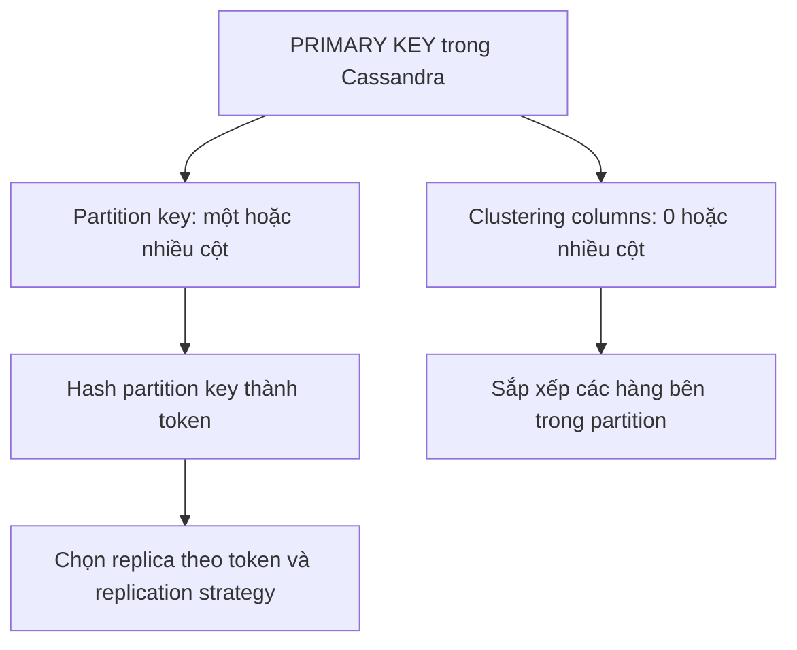
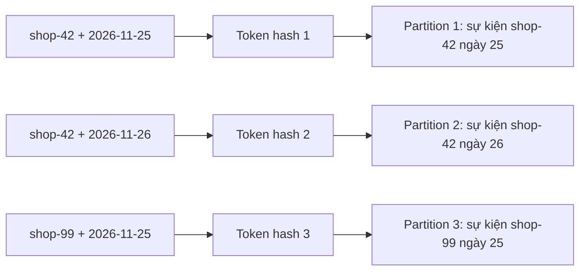

# Partition key đơn và partition key ghép trong Apache Cassandra

Trong Apache Cassandra, **partition key** quyết định các hàng thuộc cùng một *partition* và là đầu vào để xác định những node lưu bản sao dữ liệu. Vì vậy, lựa chọn partition key ảnh hưởng trực tiếp đến cách truy vấn CQL, mức phân tán tải, kích thước partition, khả năng mở rộng và hiệu năng của ứng dụng.

Bài học thuộc chương **Khóa và phân vùng** của module **Spring Data Cassandra** phân biệt hai dạng **partition key đơn** (*single-column partition key*) và **partition key ghép** (*composite partition key*). Ta sẽ dùng ví dụ bảng, CQL và entity mapping trong Spring Data Cassandra để hiểu cách chọn khóa theo truy vấn thực tế.

## 1. Partition key là gì, khác primary key ở đâu?

Cassandra không tổ chức truy vấn theo quan hệ và phép JOIN như cơ sở dữ liệu quan hệ. Mỗi bảng thường được thiết kế phục vụ một hoặc một nhóm truy vấn cụ thể. Trong định nghĩa bảng:

- **Partition key** quyết định những hàng nào nằm trong cùng một partition logic, giúp Cassandra xác định token và các replica cần truy cập.
- **Clustering columns** xác định tính duy nhất và thứ tự sắp xếp của hàng *bên trong* cùng partition.
- **Primary key** của Cassandra gồm **partition key** cộng với **các clustering columns** (nếu có).

Cùng xem các cú pháp dễ nhầm:

| CQL định nghĩa khóa | Partition key | Clustering columns | Ý nghĩa |
| --- | --- | --- | --- |
| `PRIMARY KEY (user_id)` | `user_id` | Không có | Khóa partition đơn; mỗi partition có tối đa một hàng. |
| `PRIMARY KEY (user_id, created_at)` | `user_id` | `created_at` | Khóa partition **vẫn là đơn**; nhiều hàng theo thời gian trong một partition. |
| `PRIMARY KEY ((tenant_id, event_day))` | `(tenant_id, event_day)` | Không có | Khóa partition **ghép** gồm hai cột; mỗi partition có tối đa một hàng. |
| `PRIMARY KEY ((tenant_id, event_day), event_ts, event_id)` | `(tenant_id, event_day)` | `event_ts`, `event_id` | Khóa partition ghép; mỗi partition chứa nhiều sự kiện theo thứ tự clustering. |

Điểm phân biệt nằm ở **cặp ngoặc kép** bao quanh danh sách thành phần partition key. Với `PRIMARY KEY (a, b)`, **chỉ `a`** là partition key, `b` là clustering column. Với `PRIMARY KEY ((a, b))`, **cả `a` và `b`** tạo thành một partition key ghép.



**Partition key đơn/ghép** là cách mô tả *số cột tạo nên partition key*; không nói có bao nhiêu replica, và không nói bảng có bao nhiêu clustering columns.

## 2. Partition key đơn: một cột xác định partition

Giả sử ứng dụng cần tìm hồ sơ người dùng theo `user_id`:

```sql
-- Giả sử keyspace commerce đã được tạo với replication phù hợp.
CREATE TABLE commerce.profile_by_user (
    user_id uuid PRIMARY KEY,
    display_name text,
    email text,
    registered_at timestamp
);

-- Truy vấn theo khóa partition duy nhất.
SELECT user_id, display_name, email
FROM commerce.profile_by_user
WHERE user_id = 11111111-1111-1111-1111-111111111111;
```

Ở đây, `user_id` vừa là **partition key đơn** vừa là toàn bộ **primary key**. Cùng một `user_id` không tạo ra nhiều hàng có primary key khác nhau; thao tác ghi vào đúng khóa đó là cập nhật các cột của hàng tương ứng theo quy tắc Cassandra.

Partition key đơn phù hợp khi:

- Ứng dụng đã biết chính xác một định danh để truy vấn, chẳng hạn `user_id`, `device_id` hoặc `order_id`.
- Giá trị khóa có đủ độ phân tán để lưu lượng không dồn lên một vài partition.
- Kích thước dữ liệu của từng partition được kiểm soát.

### Một cột partition key vẫn có thể chứa nhiều hàng

Số cột trong partition key không quyết định số hàng trong partition:

```sql
CREATE TABLE commerce.events_by_user (
    user_id uuid,
    occurred_at timestamp,
    event_id uuid,
    event_type text,
    PRIMARY KEY (user_id, occurred_at, event_id)
) WITH CLUSTERING ORDER BY (occurred_at DESC, event_id ASC);
```

Bảng này vẫn dùng **partition key đơn `user_id`**. Cùng một người dùng có thể có hàng triệu sự kiện, đều thuộc *một partition logic* nếu không có cơ chế chia nhỏ. `occurred_at` và `event_id` chỉ là clustering columns, **không** giúp các sự kiện của cùng người dùng tự động trải sang các partition khác.

Truy vấn được định tuyến tốt:

```sql
SELECT occurred_at, event_id, event_type
FROM commerce.events_by_user
WHERE user_id = 11111111-1111-1111-1111-111111111111
LIMIT 20;
```

Nếu một số người dùng tạo lượng sự kiện rất lớn, việc chỉ dựa vào `user_id` có thể gây **large partition** hoặc **hot partition**. Đây là lý do cân nhắc partition key ghép trong bài toán chuỗi sự kiện.

## 3. Partition key ghép: nhiều cột cùng xác định partition

Một sàn thương mại điện tử đa khách hàng (*multi-tenant*) muốn đọc các sự kiện của **một tenant trong một ngày**. Chọn `(tenant_id, event_day)` làm partition key giúp chia dữ liệu của tenant theo từng ngày.

```sql
CREATE TABLE commerce.events_by_tenant_day (
    tenant_id text,
    event_day date,
    event_ts timestamp,
    event_id uuid,
    event_type text,
    payload text,
    PRIMARY KEY ((tenant_id, event_day), event_ts, event_id)
) WITH CLUSTERING ORDER BY (event_ts DESC, event_id ASC);
```

Phân tích khóa:

- **`tenant_id` và `event_day` kết hợp thành một partition key ghép.** Mỗi cặp `('shop-42', '2026-11-25')` là một partition logic.
- **`event_ts` và `event_id` là clustering columns.** Chúng sắp xếp và định danh hàng bên trong partition, không trực tiếp quyết định node chứa partition.
- `event_type` và `payload` là cột thông thường, không tham gia định tuyến partition.



Mỗi cặp giá trị tạo ra một khóa đầu vào băm khác nhau, thường phân bố tới các token khác nhau. **Không có đảm bảo rằng hai cặp khác nhau sẽ nằm trên các node khác nhau**, vì token range có thể do cùng node hoặc cùng tập replica nắm giữ.

Ví dụ ghi và đọc:

```sql
INSERT INTO commerce.events_by_tenant_day (
    tenant_id, event_day, event_ts, event_id, event_type, payload
) VALUES (
    'shop-42',
    '2026-11-25',
    '2026-11-25T10:30:00Z',
    22222222-2222-2222-2222-222222222222,
    'ORDER_CREATED',
    '{"orderId":"O-1001"}'
);

-- Lấy sự kiện mới nhất trong partition đã xác định đầy đủ.
SELECT event_ts, event_id, event_type
FROM commerce.events_by_tenant_day
WHERE tenant_id = 'shop-42'
  AND event_day = '2026-11-25'
LIMIT 20;
```

Do `CLUSTERING ORDER BY (event_ts DESC, event_id ASC)`, các sự kiện mới hơn được xếp trước trong partition theo `event_ts`. Nếu nhiều sự kiện cùng timestamp, `event_id` giúp phân biệt các hàng và cung cấp thứ tự tiếp theo.

### CQL phải biết đủ thành phần partition key

Với bảng trên, truy vấn đọc có định tuyến tốt khi chỉ định **đầy đủ** `tenant_id` và `event_day`:

```sql
-- Hợp lý: full partition key, thêm điều kiện range trên clustering column.
SELECT event_ts, event_type
FROM commerce.events_by_tenant_day
WHERE tenant_id = 'shop-42'
  AND event_day = '2026-11-25'
  AND event_ts >= '2026-11-25T08:00:00Z'
LIMIT 50;
```

Ngược lại, những truy vấn sau không khớp với partition key của bảng:

```sql
-- Thiếu event_day: không thể định vị một partition duy nhất.
SELECT * FROM commerce.events_by_tenant_day
WHERE tenant_id = 'shop-42';

-- Chỉ biết ngày: không thể truy cập theo prefix còn lại của partition key.
SELECT * FROM commerce.events_by_tenant_day
WHERE event_day = '2026-11-25';
```

Trong truy vấn CQL thông thường, Cassandra **không hỗ trợ truy xuất hiệu quả bằng một phần** partition key ghép. Một số trường hợp có thể dùng chỉ mục hoặc `ALLOW FILTERING`, nhưng đây không phải cách mặc định để phục vụ truy vấn sản xuất. Nếu yêu cầu nghiệp vụ cần “mọi sự kiện của tenant trong tháng” hoặc “mọi sự kiện của mọi tenant trong ngày”, hãy thiết kế **bảng truy vấn khác** hoặc điều phối đọc nhiều partition theo kế hoạch cụ thể.

## 4. Cassandra băm toàn bộ partition key như một đơn vị

Một partition không được đặt theo từng thành phần khóa riêng biệt. Cassandra dùng **partitioner** (phổ biến là `Murmur3Partitioner`) để băm *giá trị đã mã hóa của toàn bộ partition key* thành token. Với khóa ghép, các thành phần được mã hóa thành một giá trị khóa theo thứ tự đã định trong schema.

```text
Partition key đơn:
    user_id = U
    → token(U)
    → token range → replica node(s)

Partition key ghép:
    tenant_id = T, event_day = D
    → token(T, D)
    → token range → replica node(s)
```

Các lưu ý:

1. `(tenant_id, event_day)` là **một khóa partition gồm hai thành phần**, không phải hai partition key độc lập. Mọi hàng có cùng *cặp giá trị* nằm cùng partition.
2. Thứ tự các cột trong định nghĩa composite key là một phần của schema, ảnh hưởng đến cách giá trị khóa được mã hóa. Không hoán đổi thứ tự tùy ý giữa CQL schema và entity mapping.
3. Số node giữ bản sao của partition phụ thuộc vào **replication factor** và chiến lược như `NetworkTopologyStrategy`; không phụ thuộc việc partition key đơn hay ghép.
4. Nhiều partition có thể cùng do một node và các replica của nó quản lý. Khóa ghép mở rộng **số đơn vị partition logic**, không trực tiếp tăng số node hoặc replica.

Đừng dùng tên cột hay giá trị đọc được để đoán partition đang nằm ở node nào. Muốn biết phải xét partitioner, token map, RF và topology hiện thời của cluster.

## 5. So sánh trực tiếp: chọn đơn hay ghép?

| Tiêu chí | Partition key đơn | Partition key ghép |
| --- | --- | --- |
| Định nghĩa | Một cột: `PRIMARY KEY (user_id, ts)` | Nhiều cột: `PRIMARY KEY ((tenant_id, day), ts)` |
| Giá trị cần biết để định tuyến | Một giá trị partition key. | Đủ các thành phần tạo nên composite key. |
| Tập hợp dữ liệu | Nhóm mọi hàng cùng giá trị khóa đơn. | Nhóm mọi hàng cùng **tổ hợp** giá trị khóa. |
| Ưu thế | Schema và đường truy vấn đơn giản, rất hợp cho tra cứu bằng ID. | Chia dữ liệu theo nhiều chiều nghiệp vụ, ví dụ tenant + ngày. |
| Rủi ro | Một ID có thể trở thành partition cực lớn/nóng. | Phải biết đủ khóa, nhiều partition có thể gây truy vấn nhiều nơi nếu cần đọc tổng hợp. |
| Khi dùng | `profile_by_user`, `order_by_id`. | `events_by_tenant_day`, `readings_by_device_hour`. |

**Không có dạng nào mặc định nhanh hơn.** Nếu một cột đơn có cardinality cao và mỗi partition vừa phải, nó có thể rất phù hợp. Nếu một khóa như `tenant_id` dồn dữ liệu quá lớn, việc thêm `event_day` vào partition key có thể chia nhỏ và kiểm soát dữ liệu tốt hơn. Quyết định phải theo **truy vấn + phân phối dữ liệu + tải thực tế**.

### Ví dụ quyết định theo yêu cầu

**Yêu cầu A:** “Tra cứu chi tiết một sản phẩm theo `product_id`”.

Thiết kế `PRIMARY KEY (product_id)` thường đủ. Việc thêm `shop_id` vào partition key có thể buộc caller phải biết cả hai cột dù truy vấn chính chỉ có `product_id`.

**Yêu cầu B:** “Hiển thị 50 log gần nhất của một thiết bị trong một ngày”.

Nếu dùng `PRIMARY KEY (device_id, logged_at)`, mọi log từ trước tới nay của thiết bị có thể chung một partition. `PRIMARY KEY ((device_id, log_day), logged_at, log_id)` cho phép giới hạn lượng dữ liệu trên một partition theo ngày, miễn ứng dụng biết `log_day`.

**Yêu cầu C:** “Tổng hợp số log của mọi thiết bị trong toàn hệ thống”.

Dù dùng khóa đơn hay ghép, truy vấn này không phù hợp với cách đọc một partition. Nên cân nhắc bảng tổng hợp định kỳ, pipeline phân tích, hoặc cơ chế truy vấn khác phù hợp, thay vì lạm dụng `ALLOW FILTERING`.

## 6. Khi nào cần thêm bucket vào partition key?

Ghép `(tenant_id, event_day)` giải quyết vấn đề partition tăng vô hạn theo thời gian, nhưng một tenant rất lớn có thể tạo lượng ghi khổng lồ trong **một ngày**. Khi đó, cùng một partition và nhóm replica nhận tải nóng.

Có thể cân nhắc thêm một chiều **bucket**:

```sql
CREATE TABLE commerce.events_by_tenant_day_bucket (
    tenant_id text,
    event_day date,
    bucket smallint,
    event_ts timestamp,
    event_id uuid,
    event_type text,
    PRIMARY KEY ((tenant_id, event_day, bucket), event_ts, event_id)
) WITH CLUSTERING ORDER BY (event_ts DESC, event_id ASC);
```

Ví dụ ứng dụng tính `bucket` trong khoảng 0–7 theo quy tắc xác định từ `event_id`. Từ `(tenant_id, event_day)`, ta có nhiều partition độc lập: `(tenant_id, event_day, 0)`, `(..., 1)`, v.v. Đây là **bucketing/sharding ở cấp partition**, không phải khái niệm replication.

Đánh đổi quan trọng:

- **Ghi:** cùng một tenant/ngày có thể phân bố lên nhiều partition/token hơn, giảm áp lực lên một partition nóng.
- **Đọc một sự kiện:** nếu tính lại được bucket từ `event_id`, ứng dụng có thể truy vấn đúng partition.
- **Đọc toàn bộ sự kiện trong ngày:** phải đọc nhiều bucket rồi hợp nhất/sắp xếp kết quả phía ứng dụng hoặc dịch vụ tổng hợp. Cassandra không tự hợp nhất nhiều partition thành một luồng sắp xếp toàn cục.
- **Số bucket:** quá ít có thể chưa giải quyết hot partition; quá nhiều tăng fan-out và chi phí truy vấn. Cần đo và thiết kế dựa trên lưu lượng thực.

Thêm bucket chỉ khi dữ liệu đo cho thấy cần. Một partition key ghép hợp lý thường bắt đầu bằng tổ hợp **đủ để truy vấn định tuyến được** và **đủ phân tán để kiểm soát tải**.

## 7. Ánh xạ khóa trong Spring Data Cassandra

Ở tầng **Spring Data Cassandra**, entity mapping cần giữ đúng sự khác biệt giữa partition key đơn, partition key ghép và clustering columns. `CassandraRepository`, `CassandraTemplate` và CQL cuối cùng đều thao tác trên schema do Cassandra thực thi; annotation Java không làm thay đổi cách Cassandra đặt partition.

### 7.1. Một partition key đơn với `@PrimaryKey`

Giả sử có bảng `profile_by_user` ở phần 2:

```java
import java.util.UUID;
import org.springframework.data.cassandra.core.mapping.Column;
import org.springframework.data.cassandra.core.mapping.PrimaryKey;
import org.springframework.data.cassandra.core.mapping.Table;

@Table("profile_by_user")
public class UserProfile {
    @PrimaryKey("user_id")
    private UUID userId;

    @Column("display_name")
    private String displayName;

    public UserProfile() {}

    public UUID getUserId() { return userId; }
    public void setUserId(UUID userId) { this.userId = userId; }
    public String getDisplayName() { return displayName; }
    public void setDisplayName(String displayName) {
        this.displayName = displayName;
    }
}
```

```java
import java.util.UUID;
import org.springframework.data.cassandra.repository.CassandraRepository;

public interface UserProfileRepository
        extends CassandraRepository<UserProfile, UUID> {
}
```

`findById(userId)` truy vấn một khóa chính đầy đủ, cũng là một partition key đơn. `UUID` ở generic thứ hai là **kiểu khóa chính** của entity.

### 7.2. Partition key ghép cùng clustering columns với `@PrimaryKeyClass`

Bảng `events_by_tenant_day` có **full primary key** gồm bốn cột, trong đó **hai cột đầu là composite partition key**. Ta có thể biểu diễn chúng bằng một Java key class:

```java
import java.io.Serializable;
import java.time.Instant;
import java.time.LocalDate;
import java.util.Objects;
import java.util.UUID;
import org.springframework.data.cassandra.core.mapping.PrimaryKeyClass;
import org.springframework.data.cassandra.core.mapping.PrimaryKeyColumn;
import org.springframework.data.cassandra.core.mapping.PrimaryKeyType;

@PrimaryKeyClass
public class TenantEventKey implements Serializable {
    @PrimaryKeyColumn(name = "tenant_id", ordinal = 0,
            type = PrimaryKeyType.PARTITIONED)
    private String tenantId;

    @PrimaryKeyColumn(name = "event_day", ordinal = 1,
            type = PrimaryKeyType.PARTITIONED)
    private LocalDate eventDay;

    @PrimaryKeyColumn(name = "event_ts", ordinal = 2,
            type = PrimaryKeyType.CLUSTERED)
    private Instant eventTs;

    @PrimaryKeyColumn(name = "event_id", ordinal = 3,
            type = PrimaryKeyType.CLUSTERED)
    private UUID eventId;

    public TenantEventKey() {}

    public String getTenantId() { return tenantId; }
    public void setTenantId(String tenantId) { this.tenantId = tenantId; }
    public LocalDate getEventDay() { return eventDay; }
    public void setEventDay(LocalDate eventDay) { this.eventDay = eventDay; }
    public Instant getEventTs() { return eventTs; }
    public void setEventTs(Instant eventTs) { this.eventTs = eventTs; }
    public UUID getEventId() { return eventId; }
    public void setEventId(UUID eventId) { this.eventId = eventId; }

    @Override
    public boolean equals(Object value) {
        if (this == value) return true;
        if (!(value instanceof TenantEventKey)) return false;
        TenantEventKey that = (TenantEventKey) value;
        return Objects.equals(tenantId, that.tenantId)
            && Objects.equals(eventDay, that.eventDay)
            && Objects.equals(eventTs, that.eventTs)
            && Objects.equals(eventId, that.eventId);
    }

    @Override
    public int hashCode() {
        return Objects.hash(tenantId, eventDay, eventTs, eventId);
    }
}
```

`PrimaryKeyType.PARTITIONED` đánh dấu **các cột tham gia partition key**. `PrimaryKeyType.CLUSTERED` đánh dấu clustering columns. `ordinal` thể hiện thứ tự cột trong cấu trúc khóa. Nếu ứng dụng dùng Spring Data để **sinh schema**, cần cấu hình cả thứ tự clustering (`ordering`) tương ứng; ví dụ này giả định bảng đã được tạo bằng CQL với thứ tự `event_ts DESC, event_id ASC`.

Entity và repository:

```java
import java.time.LocalDate;
import java.util.List;
import org.springframework.data.cassandra.core.mapping.Column;
import org.springframework.data.cassandra.core.mapping.PrimaryKey;
import org.springframework.data.cassandra.core.mapping.Table;
import org.springframework.data.cassandra.repository.CassandraRepository;
import org.springframework.data.cassandra.repository.Query;

@Table("events_by_tenant_day")
public class TenantEvent {
    @PrimaryKey
    private TenantEventKey key;

    @Column("event_type")
    private String eventType;

    @Column("payload")
    private String payload;

    public TenantEvent() {}
    public TenantEventKey getKey() { return key; }
    public void setKey(TenantEventKey key) { this.key = key; }
    public String getEventType() { return eventType; }
    public void setEventType(String eventType) { this.eventType = eventType; }
    public String getPayload() { return payload; }
    public void setPayload(String payload) { this.payload = payload; }
}

public interface TenantEventRepository
        extends CassandraRepository<TenantEvent, TenantEventKey> {
    @Query("SELECT * FROM events_by_tenant_day " +
           "WHERE tenant_id = ?0 AND event_day = ?1")
    List<TenantEvent> findByTenantAndDay(String tenantId, LocalDate day);
}
```

Ví dụ minh họa đặt hai kiểu trong cùng khối mã; khi triển khai Java, mỗi `public` top-level type phải được đặt trong tệp riêng theo quy tắc ngôn ngữ. Key class cần `equals/hashCode` hợp lệ vì khóa chính đại diện **định danh hàng đầy đủ**. Trong dự án thật, nên quản lý schema bằng migration phù hợp và thống nhất tên keyspace với cấu hình `spring.cassandra.keyspace-name`.

Cần phân biệt:

- `repository.findById(fullKey)` yêu cầu **cả partition key lẫn clustering columns**, vì truy cập **một hàng duy nhất**.
- `findByTenantAndDay(tenantId, day)` chỉ yêu cầu **đầy đủ composite partition key**, có thể trả **nhiều hàng trong một partition**.
- Các thao tác dùng `CassandraTemplate` hoặc CQL cũng phải cung cấp điều kiện partition key phù hợp; dùng repository không khiến truy vấn thiếu thành phần khóa trở nên hiệu quả.

Không nên trả `List` không giới hạn cho partition có thể rất lớn trong production. Khi cần nhiều dữ liệu, áp dụng giới hạn, thời gian, paging hoặc cơ chế xử lý theo luồng phù hợp với phiên bản API đang sử dụng.

## 8. Những lỗi thiết kế phổ biến

### Lỗi 1: Nhầm clustering column là thành phần partition key

```sql
PRIMARY KEY (tenant_id, event_day, event_ts)
```

Schema trên chỉ có **`tenant_id` là partition key**; `event_day` và `event_ts` là clustering columns. Nó **không chia** tenant thành các partition theo ngày. Muốn chia theo `tenant_id + event_day`, cần:

```sql
PRIMARY KEY ((tenant_id, event_day), event_ts)
```

### Lỗi 2: Chọn khóa ít giá trị, khiến nhiều ghi dồn về một partition

Ví dụ `PRIMARY KEY (status, created_at)` với `status` chỉ có các giá trị như `NEW`, `DONE`, `FAILED`: tất cả hàng cùng status nằm chung một partition. Ghi nhiều sẽ gây nóng và partition tăng không giới hạn. Không phải cứ có clustering column `created_at` là dữ liệu được phân tán.

### Lỗi 3: Chọn composite key nhưng ứng dụng chỉ biết một phần

Nếu API chỉ nhận `tenant_id`, còn bảng dùng `(tenant_id, event_day)`, API phải thêm thông tin ngày hoặc có thiết kế truy cập khác. **Không dựa vào `ALLOW FILTERING` làm giải pháp chung** cho việc thiếu partition key.

### Lỗi 4: Dùng partition key ghép để kỳ vọng thao tác JOIN hoặc GROUP BY tùy ý

Composite key không tạo secondary index chung trên từng cột thành phần. Nó tạo **một cách phân nhóm partition cụ thể**. Truy vấn theo một chiều khác có thể cần bảng được tổ chức riêng cho truy vấn đó.

### Lỗi 5: Không kiểm soát kích thước và độ nóng của partition

Bảng có partition key `device_id` có thể phù hợp cho vài trăm sự kiện mỗi thiết bị, nhưng không phù hợp nếu mỗi thiết bị tạo hàng triệu sự kiện trong một partition. Cần dự báo số hàng/partition, độ lớn mỗi hàng, TTL, tỷ lệ ghi/đọc và các hot key. Không có một ngưỡng dung lượng duy nhất đúng cho mọi workload; cần đo bằng tải đại diện.

### Lỗi 6: Thay đổi partition key như cập nhật một cột thông thường

Partition key là một phần của định danh và vị trí lưu trữ. Cassandra không cho sửa primary key tại chỗ bằng `UPDATE`. Khi nghiệp vụ thay đổi cột dùng làm partition key, thông thường phải ghi hàng mới ở khóa mới và xử lý/xóa hàng cũ theo quy tắc dữ liệu, hoặc thiết kế mô hình khác phù hợp.

## 9. Quy trình chọn partition key theo truy vấn

Trước khi tạo bảng cho một use case mới, hãy trả lời lần lượt:

1. **Truy vấn quan trọng nhất cần biết những tham số nào?** Nếu chỉ biết `product_id`, một khóa partition đơn là lựa chọn dễ hiểu. Nếu luôn biết `tenant_id` và ngày, composite key có thể hợp lý.
2. **Những hàng nào cần được đọc cùng nhau?** Một partition là đơn vị giúp truy cập hiệu quả khi đọc một nhóm hàng theo clustering columns.
3. **Bao nhiêu hàng và bao nhiêu byte trong một partition sau 30, 90, 365 ngày?** Dự đoán theo lưu lượng thực, TTL và tốc độ tăng dữ liệu.
4. **Lưu lượng có bị lệch về một số khóa “hot” không?** Đánh giá tenant lớn nhất, thiết bị nhiều sự kiện nhất, và đỉnh tải chứ không chỉ trung bình.
5. **Có cần đọc nhiều partition để trả một API không?** Khi buộc phải fan-out, giới hạn số partition, số truy vấn, thời gian và cách gộp kết quả; cân nhắc bảng phục vụ truy vấn khác.
6. **Cần paging, consistency và xử lý retry như thế nào?** Cấu hình Spring Data Cassandra và Java driver cần tương thích với mô hình partition để tránh timeout/hàng cũ hoặc fan-out khó kiểm soát.

Ví dụ, một endpoint `GET /tenants/{tenantId}/events?day=2026-11-25` có đủ cặp `tenantId + day` để truy cập `events_by_tenant_day`. Endpoint `GET /tenants/{tenantId}/events` không có ngày đòi hỏi cách định nghĩa rõ phạm vi tìm kiếm; chẳng hạn giới hạn 7 ngày gần nhất và gọi tối đa 7 partition hoặc dùng bảng khác hỗ trợ truy vấn này.

## 10. Bài tập vận dụng

Cho ba thiết kế:

```sql
-- A
PRIMARY KEY (device_id, recorded_at)

-- B
PRIMARY KEY ((device_id, recorded_day), recorded_at)

-- C
PRIMARY KEY ((device_id, recorded_day, bucket), recorded_at, reading_id)
```

**Câu hỏi:**

1. Thiết kế A có bao nhiêu cột partition key? Các bản ghi của cùng thiết bị trong nhiều năm có thuộc cùng partition không?
2. Thiết kế B yêu cầu tham số nào để truy vấn một partition? `recorded_at` nằm ở vai trò gì?
3. Khi thiết bị ghi hàng trăm nghìn bản ghi một ngày, thiết kế C có thể giúp gì? Muốn đọc toàn bộ bản ghi trong ngày thì đánh đổi nào xuất hiện?
4. Nếu repository dùng full primary key có cả `recorded_at`, việc gọi `findById` và đọc mọi bản ghi của một ngày có khác nhau không?
5. Một yêu cầu “tra cứu mọi thiết bị có sự kiện hôm nay” có dùng B hiệu quả khi chỉ biết `recorded_day` không? Nên xử lý bài toán đó thế nào?

**Đáp án gợi ý:**

1. A có một cột partition key là `device_id`; mọi hàng có cùng thiết bị thuộc cùng logical partition, dù `recorded_at` khác nhau.
2. B cần đủ `device_id` và `recorded_day`; `recorded_at` là clustering column.
3. C chia một ngày thành nhiều partition/bucket để giảm hotspot; đọc cả ngày cần fan-out và gộp nhiều bucket.
4. `findById` định danh một hàng, còn đọc cả ngày theo partition key có thể trả nhiều hàng.
5. Không; chỉ biết `recorded_day` là thiếu partition key. Cần bảng truy cập theo ngày, dữ liệu tổng hợp hoặc nền tảng phân tích tùy nhu cầu.

**Ghi nhớ:** Partition key đơn dùng **một cột** để định vị partition; partition key ghép dùng **một tổ hợp cột**. Trong cả hai trường hợp, hãy chọn khóa từ **truy vấn cần phục vụ** và **đặc điểm phân phối dữ liệu**. Spring Data Cassandra hỗ trợ biểu diễn hai kiểu khóa bằng entity/repository, nhưng hiệu quả thực tế vẫn do schema CQL, kích thước partition, token distribution và cách ứng dụng đọc/ghi quyết định.
