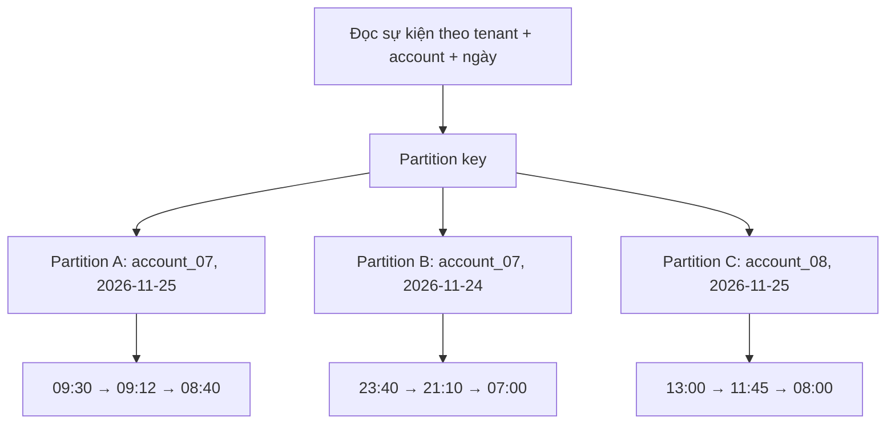
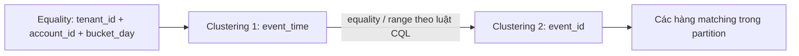

# Thứ tự clustering và phạm vi sắp xếp trong partition

Trong **Apache Cassandra**, các hàng được phân phối theo **partition key**. Bên trong mỗi partition, các hàng được tổ chức theo thứ tự của **clustering columns**. Vì vậy, việc chọn clustering key không chỉ giúp định danh một hàng mà còn quyết định **những danh sách có thể đọc theo thứ tự nào, trên phạm vi dữ liệu nào và bằng câu CQL nào**.

Khi dùng **Spring Data Cassandra**, ta có thể ánh xạ khóa bằng annotation, đọc qua repository hoặc `CassandraTemplate`, và điều khiển truy vấn CQL. Tuy nhiên, dù dùng API Java nào, Cassandra vẫn áp dụng giới hạn của partition key, clustering order và dạng truy vấn. Hiểu giới hạn đó là nền tảng để thiết kế bảng theo truy vấn, chọn partition key, phân trang và kiểm soát hiệu năng trong cơ sở dữ liệu phân tán.

Bài học thuộc chương **Khóa và phân vùng**, tập trung vào câu hỏi: *Vì sao một lệnh `ORDER BY` chạy tốt trên các hàng của một khách hàng trong một ngày, nhưng không thể được dùng như phép sắp xếp tùy ý trên toàn cluster?*

## 1. Phân biệt partition key, clustering key và thứ tự kết quả

Xét yêu cầu: “Hiển thị 20 sự kiện mới nhất của một tài khoản trong một ngày, với thứ tự ổn định để tải tiếp”.

Một thiết kế ứng viên:

```sql
CREATE TABLE events_by_account_day (
    tenant_id uuid,
    account_id uuid,
    bucket_day date,
    event_time timestamp,
    event_id uuid,
    event_type text,
    summary text,
    PRIMARY KEY (
        (tenant_id, account_id, bucket_day),
        event_time,
        event_id
    )
) WITH CLUSTERING ORDER BY (
    event_time DESC,
    event_id DESC
);
```

Các thành phần có nhiệm vụ khác nhau:

| Thành phần | Trong ví dụ | Nhiệm vụ |
| --- | --- | --- |
| Composite **partition key** | `(tenant_id, account_id, bucket_day)` | Chọn một partition chứa sự kiện của một tài khoản trong một ngày |
| Clustering column thứ nhất | `event_time` | Thứ tự ưu tiên theo thời điểm sự kiện |
| Clustering column thứ hai | `event_id` | Phân biệt sự kiện trùng thời gian và tạo thứ tự xác định |
| Regular columns | `event_type`, `summary` | Dữ liệu đọc ra; không tự tạo đường lọc hoặc sắp xếp tối ưu |
| `CLUSTERING ORDER BY` | `event_time DESC, event_id DESC` | Khai báo hướng thứ tự clustering mặc định trong partition |

Khóa chính ở đây là tổ hợp **toàn bộ partition key và các clustering columns**. Hai sự kiện có cùng `tenant_id`, `account_id`, `bucket_day`, `event_time` vẫn có thể tồn tại nếu `event_id` khác nhau.

Một partition được xác định khi biết **đầy đủ** các thành phần partition key. Cassandra băm partition key để định vị nhóm replica; mỗi replica lưu các hàng của partition theo thứ tự clustering. Việc phân phối replica, replication factor hoặc consistency level không biến thứ tự clustering thành thứ tự toàn cluster.

### Hình dung dữ liệu trong một partition

Giả sử cùng một `tenant_id`, `account_id` và `bucket_day = '2026-11-25'`:

```text
Partition: (tenant_01, account_07, 2026-11-25)

event_time               event_id    event_type
------------------------------------------------
2026-11-25 09:30:00Z     f...        LOGIN
2026-11-25 09:30:00Z     7...        VIEW
2026-11-25 09:12:00Z     9...        PAYMENT
2026-11-25 08:40:00Z     4...        LOGOUT
```

Đây là sơ đồ minh họa logic: `event_time` giảm dần; khi bằng nhau, `event_id` quyết định thứ tự tiếp theo. Không nên diễn giải thành cam kết về thứ tự vật lý giữa các replica hoặc thứ tự trên toàn bộ cluster.

## 2. Clustering order là thứ tự *trong partition*

Hãy xem bảng được chia thành nhiều partition:



Mỗi partition có chuỗi clustering riêng. Cassandra không duy trì một “danh sách sự kiện mới nhất của mọi tài khoản, mọi ngày” trên các partition này.

Từ đó có ba hệ quả:

1. **Đọc trong một partition** có thể khai thác thứ tự clustering mà không cần tải toàn bộ rồi sắp trong bộ nhớ.
2. **Đọc nhiều partition** cần có quy tắc điều phối/ghép kết quả nếu UI muốn một danh sách sắp xếp toàn cục.
3. **Đổi partition key** có thể làm thay đổi hoàn toàn bài toán sắp xếp, ngay cả khi các clustering columns giống hệt nhau.

Ví dụ, bảng theo tài khoản và ngày phù hợp với danh sách sự kiện trong ngày. Nó không mặc nhiên hỗ trợ “20 sự kiện mới nhất của cả tenant” hoặc “mọi sự kiện của tài khoản trong cả năm” bằng một truy vấn `ORDER BY` duy nhất.

## 3. Thứ tự mặc định: ASC, DESC và thứ tự ghép nhiều cột

### Khi không khai báo `CLUSTERING ORDER BY`

Nếu tạo bảng:

```sql
CREATE TABLE demo_events_asc (
    account_id uuid,
    event_time timestamp,
    event_id uuid,
    description text,
    PRIMARY KEY ((account_id), event_time, event_id)
);
```

Cassandra dùng **ASC** làm hướng clustering mặc định cho các clustering columns. Trong một partition, hàng có `event_time` nhỏ hơn đứng trước; các hàng có `event_time` bằng nhau được phân biệt theo `event_id`.

### Khi cần mới nhất trước

Với bảng `events_by_account_day`, hai clustering columns được khai báo:

```sql
WITH CLUSTERING ORDER BY (event_time DESC, event_id DESC);
```

Dữ liệu của *mỗi partition* được duy trì theo thứ tự lexicographic của các clustering columns với hướng đã khai báo. Có thể hình dung quy tắc so sánh:

1. So sánh `event_time`; giá trị lớn hơn đứng trước vì `DESC`.
2. Nếu `event_time` bằng nhau, so sánh `event_id`; giá trị lớn hơn đứng trước vì `DESC`.

Do đó `event_id` là **tie-breaker** để những sự kiện trùng timestamp vẫn có thứ tự xác định. Không nên chỉ dùng `event_time` làm khóa clustering nếu nghiệp vụ cho phép nhiều sự kiện cùng thời điểm: các thao tác ghi có cùng toàn bộ primary key sẽ cùng nhắm tới một hàng logic.

### Hướng hỗn hợp là một lựa chọn schema có chủ đích

Cassandra cho phép khai báo hướng trên từng clustering column, ví dụ:

```sql
CREATE TABLE leaderboard_by_group (
    group_id uuid,
    score int,
    player_id uuid,
    display_name text,
    PRIMARY KEY ((group_id), score, player_id)
) WITH CLUSTERING ORDER BY (score DESC, player_id ASC);
```

Bảng này phục vụ thứ tự điểm giảm dần, sau đó ID tăng dần trong **một nhóm**. Khi truy vấn bằng `ORDER BY`, không thể giả định mọi tổ hợp ASC/DESC đều được chấp nhận. Cassandra giới hạn thứ tự truy vấn theo schema: thông thường thứ tự được khai báo hoặc **thứ tự đảo ngược toàn bộ** trên các clustering columns tương ứng, cùng các ràng buộc CQL khác. Muốn sắp theo một thứ tự tùy ý, thường phải thiết kế read model riêng.

> Không phải cứ có cột `score` là có thể chạy `ORDER BY score` trên bất kỳ bảng nào. Cột ấy phải nằm đúng vị trí trong cấu trúc clustering của đường đọc.

## 4. Khi nào có thể dùng `ORDER BY` trong CQL?

Với bảng `events_by_account_day`, truy vấn tiêu biểu:

```sql
SELECT event_time, event_id, event_type, summary
FROM events_by_account_day
WHERE tenant_id = 11111111-1111-1111-1111-111111111111
  AND account_id = 22222222-2222-2222-2222-222222222222
  AND bucket_day = '2026-11-25'
ORDER BY event_time DESC, event_id DESC
LIMIT 20;
```

Câu truy vấn đã **xác định đầy đủ partition key** bằng equality, đồng thời dùng thứ tự tương ứng với clustering schema. Cassandra có thể đọc trực tiếp phần đầu chuỗi clustering của partition đó.

Với bảng đã khai báo `DESC, DESC`, cũng có thể đọc theo chiều ngược lại:

```sql
SELECT event_time, event_id, event_type
FROM events_by_account_day
WHERE tenant_id = 11111111-1111-1111-1111-111111111111
  AND account_id = 22222222-2222-2222-2222-222222222222
  AND bucket_day = '2026-11-25'
ORDER BY event_time ASC, event_id ASC
LIMIT 20;
```

Đọc đảo chiều có thể được phục vụ bằng cách quét ngược thứ tự clustering. Dù hợp lệ, chi phí thực tế của các chiều đọc có thể khác nhau tùy dữ liệu, phiên bản và workload; nên đo với đường truy vấn quan trọng.

### Quy tắc thực hành

- **Chỉ định rõ partition** là trường hợp đơn giản, dễ dự đoán và dễ tối ưu nhất cho truy vấn có `ORDER BY`.
- `ORDER BY` của Cassandra gắn với **clustering columns**, không phải tùy chọn sắp xếp arbitrary như SQL quan hệ.
- Các cột xuất hiện trong `ORDER BY` và chiều của chúng phải phù hợp **thứ tự clustering và các quy tắc CQL** của bảng.
- Một số dạng `IN` hoặc hạn chế trên partition key có quy tắc riêng theo phiên bản Cassandra; không nên dùng chúng để giả định có thứ tự toàn cục giữa nhiều partition.
- `LIMIT 20` giới hạn số hàng trả về cho câu truy vấn; nó không làm một truy vấn quét nhiều partition trở thành một truy vấn có thứ tự toàn cục.

### Ví dụ sai hoặc không phù hợp

**Sai mục tiêu 1 — thiếu partition key đầy đủ:**

```sql
-- Không thể dùng như truy vấn "20 sự kiện mới nhất toàn hệ thống"
SELECT *
FROM events_by_account_day
ORDER BY event_time DESC
LIMIT 20;
```

**Sai mục tiêu 2 — sắp trên regular column:**

```sql
-- event_type không phải clustering column của bảng này
SELECT *
FROM events_by_account_day
WHERE tenant_id = 11111111-1111-1111-1111-111111111111
  AND account_id = 22222222-2222-2222-2222-222222222222
  AND bucket_day = '2026-11-25'
ORDER BY event_type ASC;
```

**Sai mục tiêu 3 — trộn chiều tùy ý:**

```sql
-- Không khớp thứ tự DESC/DESC và cũng không đảo ngược cả hai chiều
SELECT *
FROM events_by_account_day
WHERE tenant_id = 11111111-1111-1111-1111-111111111111
  AND account_id = 22222222-2222-2222-2222-222222222222
  AND bucket_day = '2026-11-25'
ORDER BY event_time DESC, event_id ASC;
```

Các ví dụ này cho thấy cùng tên cột nhưng **đường truy cập** khác nhau sẽ cần thiết kế bảng hoặc luồng xử lý khác. `ALLOW FILTERING` không bổ sung khả năng sắp xếp tổng quát cho bảng.

## 5. Điều kiện equality và range trên clustering columns

Thứ tự clustering còn giúp đọc một **khoảng liên tục trong partition**. Ví dụ, trong ngày 25/11 chỉ lấy sự kiện từ 09:00 đến trước 10:00:

```sql
SELECT event_time, event_id, event_type
FROM events_by_account_day
WHERE tenant_id = 11111111-1111-1111-1111-111111111111
  AND account_id = 22222222-2222-2222-2222-222222222222
  AND bucket_day = '2026-11-25'
  AND event_time >= '2026-11-25T09:00:00Z'
  AND event_time < '2026-11-25T10:00:00Z'
LIMIT 100;
```

Cassandra tìm partition bằng ba trường equality, sau đó quét khoảng `event_time` cần thiết trong thứ tự clustering. **Chiều DESC của schema không đổi ý nghĩa toán học của dấu `>=` hoặc `<`**: điều kiện vẫn so sánh giá trị timestamp thông thường.

### Nguyên tắc tiền tố (prefix) của clustering key

Với khóa clustering `(event_time, event_id)`:

- Có thể dùng range cho `event_time` vì đó là clustering column đầu tiên.
- Nếu muốn ràng buộc `event_id` như cột clustering độc lập, thông thường cần ràng buộc thích hợp cho những clustering columns đứng trước. Trong ví dụ đơn giản, đó là `event_time = ...` rồi mới lọc `event_id`.
- Khi đã dùng range trên clustering column trước, không thể tùy ý nối mọi filter trên cột sau như một chỉ mục đa chiều. Một số kiểu **tuple restriction** có quy tắc riêng; phải đối chiếu với schema và phiên bản CQL.
- `event_type` là regular column, không nằm trên trục clustering; dùng nó làm điều kiện sẽ cần một đường truy cập khác hoặc cơ chế index phù hợp, không phải “range miễn phí”.

Ví dụ equality trên cột trước, range trên cột sau:

```sql
SELECT event_time, event_id, event_type
FROM events_by_account_day
WHERE tenant_id = 11111111-1111-1111-1111-111111111111
  AND account_id = 22222222-2222-2222-2222-222222222222
  AND bucket_day = '2026-11-25'
  AND event_time = '2026-11-25T09:30:00Z'
  AND event_id > 00000000-0000-0000-0000-000000000010;
```

Yêu cầu “lọc tất cả sự kiện có `event_id` lớn hơn X trong một ngày, bất kể thời gian” không nên được hiểu là truy vấn hiệu quả chỉ vì `event_id` có trong primary key. Nó là clustering column **đứng sau** `event_time`.

### Sơ đồ khả năng đọc theo clustering key



Sơ đồ mô tả thứ tự khóa, không có nghĩa mọi điều kiện trên cột thứ hai đều hợp lệ khi cột thứ nhất chỉ có range.

## 6. Điều gì xảy ra nếu đổi thứ tự các clustering columns?

So sánh hai schema ứng viên:

**Thiết kế A — mới nhất trước trong một tài khoản/ngày:**

```sql
PRIMARY KEY ((tenant_id, account_id, bucket_day), event_time, event_id)
-- ưu tiên truy vấn theo khoảng thời gian và thứ tự thời gian
```

**Thiết kế B — phân nhóm loại sự kiện trước thời gian:**

```sql
PRIMARY KEY ((tenant_id, account_id, bucket_day), event_type, event_time, event_id)
-- ưu tiên truy vấn theo loại sự kiện rồi tới thời gian
```

Với thiết kế B, dữ liệu được nhóm theo `event_type` trước, rồi mới sắp theo thời gian **trong từng nhóm loại**. Bảng này có thể phục vụ truy vấn với `event_type = 'LOGIN'`, nhưng không tự tạo một dòng thời gian duy nhất trộn mọi loại sự kiện theo `event_time`.

| Nhu cầu | Thiết kế A | Thiết kế B |
| --- | --- | --- |
| 20 sự kiện mới nhất, mọi loại | Tự nhiên | Không có trục thời gian chung đứng đầu |
| 20 sự kiện `LOGIN` mới nhất | Không có đường lọc `event_type` trực tiếp | Tốt nếu filter loại là bắt buộc |
| Sự kiện trong khoảng thời gian bất kỳ | Tốt trong partition | Cần ràng buộc loại phù hợp để đọc theo trục thời gian |
| Dòng thời gian được phân nhóm theo loại | Có thể cần xử lý ứng dụng | Gần với thứ tự khóa hơn |

Không tồn tại một thứ tự clustering duy nhất tối ưu cho mọi kết hợp filter và sort. Cassandra thường chấp nhận **nhiều bảng được thiết kế theo mẫu đọc**; cái giá là phải cập nhật nhiều read model khi dữ liệu thay đổi.

## 7. Composite partition key khác composite clustering key

Hai cách viết thường gây nhầm lẫn:

```sql
-- tenant_id và account_id cùng nằm trong partition key
PRIMARY KEY ((tenant_id, account_id), event_time, event_id)
```

```sql
-- tenant_id là partition key; account_id là clustering column
PRIMARY KEY (tenant_id, account_id, event_time, event_id)
```

Với dạng thứ nhất, mỗi cặp tenant–account có một partition độc lập; sự kiện của tài khoản này không nằm cùng partition với tài khoản khác chỉ vì cùng tenant.

Với dạng thứ hai, **toàn bộ tenant** được gom vào một partition logic, còn `account_id` là cột clustering đầu tiên. Điều đó có thể khiến partition rất lớn hoặc nóng nếu tenant có nhiều tài khoản và sự kiện. Đồng thời, truy vấn “mới nhất trong toàn tenant” vẫn không được giải quyết chỉ bằng `event_time` vì các hàng trước hết được nhóm theo `account_id`.

Do vậy, hãy phân biệt:

- **Dấu ngoặc kép `((...))` ở composite partition key**: quyết định dữ liệu nào được gom vào cùng partition.
- **Thứ tự các cột sau partition key**: quyết định thứ tự dữ liệu *trong* partition đó.

Thiết kế clustering đúng nhưng partition key sai vẫn có thể dẫn đến độ trễ cao, hot partition hoặc truy vấn không phù hợp.

## 8. Partition size, bucket và giới hạn của sắp xếp

Nếu tất cả sự kiện của một tài khoản được lưu trong một partition không giới hạn thời gian:

```sql
PRIMARY KEY ((tenant_id, account_id), event_time, event_id)
```

thì đọc 20 sự kiện mới nhất có vẻ thuận tiện. Nhưng sau nhiều năm, một tài khoản hoạt động mạnh có thể tạo partition quá lớn và gây vấn đề về lưu trữ, compaction, repair và truy vấn.

Thêm `bucket_day` vào partition key giúp chia lịch sử theo ngày:

```sql
PRIMARY KEY ((tenant_id, account_id, bucket_day), event_time, event_id)
```

Đánh đổi:

1. **Mỗi ngày là một partition khác nhau**.
2. Danh sách “20 sự kiện mới nhất trong ngày” vẫn đơn giản.
3. Danh sách “20 sự kiện mới nhất của tháng” cần tìm theo nhiều bucket hoặc có read model phù hợp khác.
4. Các bucket vẫn có thể nóng nếu một tài khoản tạo lưu lượng cao trong một ngày; cần xem histogram/số liệu thực tế để quyết định bucket ngày, giờ hoặc cách chia khác.

### Không có `ORDER BY` toàn cục giữa các bucket

Giả sử ta cần đọc hai ngày:

```text
Partition 2026-11-25: 09:30, 09:12, 08:40, ...
Partition 2026-11-24: 23:50, 22:00, 18:10, ...
```

Hai chuỗi riêng đã sắp xếp, nhưng Cassandra không tự biến chúng thành một chuỗi chung bằng một `ORDER BY` áp vào mọi partition. Ứng dụng phải biết cần quét bucket nào, giữ giới hạn cho từng lần đọc và nối/merge theo thứ tự nghiệp vụ. Với bucket là ngày liên tiếp và truy vấn giảm dần theo thời gian, có thể đọc hết ngày mới rồi mới sang ngày cũ. Với nhiều nguồn có thể chồng lấn thời gian, cần thuật toán merge có thứ tự rõ ràng.

Đừng nhầm **`IN` trên partition key** với việc có sắp xếp toàn cục an toàn, rẻ và có thể mở rộng. Hiệu năng và quy tắc `ORDER BY` khi truy cập nhiều partition có các giới hạn riêng.

## 9. Phân trang theo thứ tự clustering

Tình huống phổ biến: API trả 20 sự kiện mới nhất, sau đó người dùng nhấn “Xem thêm”.

```sql
SELECT event_time, event_id, event_type, summary
FROM events_by_account_day
WHERE tenant_id = 11111111-1111-1111-1111-111111111111
  AND account_id = 22222222-2222-2222-2222-222222222222
  AND bucket_day = '2026-11-25'
LIMIT 20;
```

`LIMIT 20` không tương đương `OFFSET 0 LIMIT 20` của một số hệ SQL; Cassandra không thiết kế pagination kiểu bỏ qua N hàng tùy ý.

Có hai khái niệm cần phân biệt:

| Khái niệm | Mục đích | Lưu ý |
| --- | --- | --- |
| **Driver paging state** | Tiếp tục cùng truy vấn tại vị trí driver đã đọc đến | Token opaque; giữ đúng query, tham số và cấu hình liên quan; không tự giải mã |
| **Application cursor** | Đánh dấu vị trí nghiệp vụ, ví dụ `(bucket_day, event_time, event_id)` | Ứng dụng tự định nghĩa điều kiện tiếp theo và xử lý dữ liệu thay đổi giữa các lần đọc |

Driver paging thuận tiện khi người dùng tải lần lượt các trang của **cùng một truy vấn**. Token phân trang cần được ràng buộc an toàn với cùng user/tenant/filter và không được coi là quyền truy cập dữ liệu.

Với cursor nghiệp vụ dựa trên clustering key, phải xem xét cách xây dựng điều kiện biên chính xác, đặc biệt khi có **hai clustering columns**, chiều DESC và dữ liệu mới tiếp tục được chèn. Không thể chỉ dùng `event_time < last_event_time` nếu có nhiều sự kiện cùng thời điểm: có thể bỏ sót những sự kiện còn lại với cùng timestamp.

### Đổi phạm vi hoặc thứ tự phải đổi cursor

Khi người dùng chuyển từ:

- ngày 25/11 sang ngày 24/11;
- thứ tự mới nhất sang cũ nhất;
- mọi sự kiện sang chỉ sự kiện thanh toán;

thì đó là một truy vấn hoặc read model khác. Không tiếp tục dùng paging state của truy vấn cũ; cũng không thể giả định một cursor trên clustering key cũ có ý nghĩa cho bộ lọc/sort mới.

### Dữ liệu thay đổi khi phân trang

Nếu có sự kiện mới chèn vào đầu danh sách sau khi người dùng tải trang đầu, các trang sau không tự trở thành “snapshot cố định”. Nếu có yêu cầu không lặp, không sót hoặc ảnh chụp tại một thời điểm, cần thiết kế hợp đồng paging rõ ràng và thử nghiệm với ghi đồng thời.

## 10. Ánh xạ clustering order trong Spring Data Cassandra

Spring Data Cassandra cho phép biểu diễn composite key và thứ tự clustering bằng annotation trên khóa entity. Ví dụ dưới đây minh họa cấu trúc mapping dùng trong **Spring Data Cassandra**; getters/setters và constructor có thể thêm theo quy ước dự án.

```java
import java.io.Serializable;
import java.time.Instant;
import java.time.LocalDate;
import java.util.UUID;

import org.springframework.data.cassandra.core.cql.Ordering;
import org.springframework.data.cassandra.core.cql.PrimaryKeyType;
import org.springframework.data.cassandra.core.mapping.PrimaryKeyClass;
import org.springframework.data.cassandra.core.mapping.PrimaryKeyColumn;

@PrimaryKeyClass
public class EventKey implements Serializable {

    @PrimaryKeyColumn(name = "tenant_id", ordinal = 0,
        type = PrimaryKeyType.PARTITIONED)
    private UUID tenantId;

    @PrimaryKeyColumn(name = "account_id", ordinal = 1,
        type = PrimaryKeyType.PARTITIONED)
    private UUID accountId;

    @PrimaryKeyColumn(name = "bucket_day", ordinal = 2,
        type = PrimaryKeyType.PARTITIONED)
    private LocalDate bucketDay;

    @PrimaryKeyColumn(name = "event_time", ordinal = 3,
        type = PrimaryKeyType.CLUSTERED,
        ordering = Ordering.DESCENDING)
    private Instant eventTime;

    @PrimaryKeyColumn(name = "event_id", ordinal = 4,
        type = PrimaryKeyType.CLUSTERED,
        ordering = Ordering.DESCENDING)
    private UUID eventId;

    // Constructor, getter/setter và equals/hashCode phù hợp với dự án.
}
```

Entity chứa primary key:

```java
import org.springframework.data.cassandra.core.mapping.Column;
import org.springframework.data.cassandra.core.mapping.PrimaryKey;
import org.springframework.data.cassandra.core.mapping.Table;

@Table("events_by_account_day")
public class EventByAccountDay {

    @PrimaryKey
    private EventKey key;

    @Column("event_type")
    private String eventType;

    @Column("summary")
    private String summary;

    // Constructor và getter/setter phù hợp với dự án.
}
```

Trong mapping:

- Các trường `PrimaryKeyType.PARTITIONED` hợp thành **partition key** theo ordinal.
- Các trường `PrimaryKeyType.CLUSTERED` là **clustering columns** theo thứ tự ordinal.
- `Ordering.DESCENDING` nêu hướng clustering mong muốn cho mỗi cột.
- Java entity phải nhất quán với **schema CQL thực tế**. Annotation Java không phải cơ chế tự động đổi thứ tự clustering của một bảng Cassandra đã tồn tại.
- Nếu tạo bảng bằng migration/script, hãy xem schema trong Cassandra là nguồn xác nhận cấu trúc đã triển khai.

**Lưu ý triển khai:** Đoạn mapping tập trung vào annotation; để sử dụng trực tiếp trong ứng dụng, cần bổ sung constructor, accessor, `equals/hashCode` phù hợp và cấu hình Spring Data theo phiên bản dự án. Với tên property/annotation hoặc cơ chế schema generation, luôn kiểm tra phiên bản Spring Data Cassandra và Cassandra driver đang chạy.

### Repository thể hiện đường đọc phù hợp

```java
import java.time.LocalDate;
import java.util.List;
import java.util.UUID;

import org.springframework.data.cassandra.repository.CassandraRepository;
import org.springframework.data.cassandra.repository.Query;

public interface EventByAccountDayRepository
        extends CassandraRepository<EventByAccountDay, EventKey> {

    @Query("""
        SELECT tenant_id, account_id, bucket_day,
               event_time, event_id, event_type, summary
        FROM events_by_account_day
        WHERE tenant_id = ?0
          AND account_id = ?1
          AND bucket_day = ?2
        LIMIT 20
        """)
    List<EventByAccountDay> findLatestInDay(
        UUID tenantId,
        UUID accountId,
        LocalDate bucketDay
    );
}
```

Vì bảng đã khai báo clustering `DESC, DESC` nên query đơn giản này khai thác thứ tự mặc định khi đọc các hàng trong partition. Một repository có tên dạng `findByEventTypeOrderByEventTimeDesc(...)` nhưng **không có partition key** sẽ không trở thành truy vấn tốt chỉ vì được viết bằng cú pháp Java hợp lệ.

Khi ứng dụng cần tùy chỉnh paging, statement hoặc query options, có thể dùng `CassandraTemplate` hoặc khả năng của driver phù hợp. Dù chọn cách nào, CQL sau cùng phải tuân theo partition key và clustering order đã định nghĩa.

### Không nhầm `Sort` của framework với `ORDER BY` tùy ý

Một API nhận trường sort do client truyền, ví dụ `sort=summary,asc`, có thể là trải nghiệm phổ biến với SQL database. Với Cassandra, không nên chuyển trực tiếp mọi trường đó thành một `ORDER BY`. Hãy công bố một **tập sort options được hỗ trợ** dựa trên bảng CQL thực tế; những lựa chọn còn lại cần read model hoặc bộ máy khác.

Nếu UI thật sự đòi nhiều thứ tự khác nhau trên cùng dữ liệu, cần cân nhắc chi phí duy trì nhiều bảng đối chiếu với nhu cầu sản phẩm, thay vì mở API sort tự do rồi xử lý lỗi truy vấn lúc chạy.

## 11. Thứ tự clustering và consistency là hai quyết định khác nhau

Giả sử một keyspace có RF = 3 và truy vấn sự kiện chạy với `LOCAL_QUORUM`. Cassandra yêu cầu quorum replica cục bộ phản hồi theo consistency policy; **clustering order vẫn là thứ tự của các hàng trong partition**.

- **Partition key**: xác định partition và nơi lưu replica.
- **Clustering columns/order**: xác định thứ tự và phạm vi đọc *trong partition*.
- **Consistency level**: xác định điều kiện xác nhận của request khi tương tác với replica.
- **Paging**: xác định cách trả kết quả nhiều trang, không đổi khóa hoặc consistency.

Kết quả được sắp đúng theo clustering key không bảo đảm rằng mọi DC đang có dữ liệu mới nhất tại đúng thời điểm đó. Đối với các yêu cầu quan trọng, phải chọn CL phù hợp và hiểu độ trễ hội tụ của cluster. Ngược lại, tăng CL không giúp `ORDER BY summary` trở thành truy vấn hợp lệ.

## 12. Đánh giá hiệu năng của một truy vấn có thứ tự

“Có thể chạy” và “chạy tốt ở quy mô thật” là hai mức khác nhau. Với bảng theo tài khoản/ngày, hãy xem:

| Câu hỏi | Ý nghĩa với hiệu năng |
| --- | --- |
| Có equality đầy đủ trên partition key không? | Tránh truy vấn quá nhiều partition |
| Clustering order có khớp thứ tự màn hình không? | Hạn chế xử lý sort ngoài database |
| Kết quả có thể bị giới hạn bằng `LIMIT`/page size không? | Giảm dữ liệu và bộ nhớ ở mỗi lần đọc |
| Số hàng/partition tăng thế nào? | Phát hiện partition lớn |
| Có một số tài khoản quá “nóng” không? | Phát hiện lệch tải theo token/partition |
| Truy vấn có đọc đảo chiều thường xuyên không? | Cần đo latency thực cho workload đó |
| Có phải đọc/merge nhiều bucket không? | Tăng số request và độ phức tạp cursor |
| Có phải đồng bộ nhiều read model không? | Tăng số write và rủi ro lệch dữ liệu |

Một quy trình kiểm tra thực tế:

1. Viết **mẫu đọc thật**: đầu vào, sort, filter, page size.
2. Viết câu CQL trên schema ứng viên, không chỉ repository method.
3. Kiểm tra query hợp lệ trên phiên bản Cassandra sẽ dùng.
4. Thử với nhiều kích thước partition và tải đồng thời; ghi lại p95/p99, read timeout, kích thước dữ liệu trả về và mức tải node.
5. Điều chỉnh khóa/bucket hoặc thêm read model nếu không đáp ứng yêu cầu.

Không dùng `ALLOW FILTERING` như cách thay thế cho việc thiết kế clustering key; nó không cung cấp cơ chế sort phân tán tổng quát.

## 13. Các mẫu thiết kế điển hình

### Mẫu A — nhật ký theo thiết bị

**Yêu cầu:** xem bản ghi nhiệt độ của một thiết bị trong một ngày, mới nhất trước.

```sql
CREATE TABLE readings_by_device_day (
    device_id uuid,
    bucket_day date,
    recorded_at timestamp,
    reading_id uuid,
    temperature double,
    PRIMARY KEY ((device_id, bucket_day), recorded_at, reading_id)
) WITH CLUSTERING ORDER BY (recorded_at DESC, reading_id DESC);
```

Ưu điểm: dùng equality `device_id`/`bucket_day`, range trên `recorded_at` và đọc phần đầu partition hiệu quả. Giới hạn: không thể lấy “100 nhiệt độ cao nhất của mọi thiết bị” bằng `ORDER BY temperature` trên bảng này.

### Mẫu B — lịch sử phiên bản của một tài liệu

**Yêu cầu:** phiên bản mới nhất theo thời gian của một tài liệu.

```sql
CREATE TABLE versions_by_document (
    document_id uuid,
    version_no bigint,
    created_at timestamp,
    author_id uuid,
    PRIMARY KEY ((document_id), version_no)
) WITH CLUSTERING ORDER BY (version_no DESC);
```

`version_no` là clustering column; truy vấn đúng partition với `LIMIT 1` cho bản ghi có version lớn nhất. Đây là ví dụ cho thấy thứ tự clustering không nhất thiết theo thời gian: nó phải theo **khóa sắp xếp nghiệp vụ**. Cần bảo đảm việc cấp version number không va chạm khi có ghi đồng thời.

### Mẫu C — bảng xếp hạng theo nhóm

**Yêu cầu:** 50 người chơi có điểm cao nhất của một giải/nhóm.

```sql
CREATE TABLE scores_by_group (
    group_id uuid,
    score int,
    player_id uuid,
    updated_at timestamp,
    PRIMARY KEY ((group_id), score, player_id)
) WITH CLUSTERING ORDER BY (score DESC, player_id ASC);
```

Bảng phục vụ xếp hạng **trong một group**. Khi `score` đổi, khóa clustering cũng đổi, nghĩa là quy trình cập nhật phải xóa bản ghi ở khóa cũ và ghi bản ghi ở khóa mới, có tính đến idempotency và tính nhất quán. Nếu mọi người chơi chung một group quá lớn/nóng, phải xem lại mô hình và khối lượng.

## 14. Sai lầm thường gặp

| Hiểu sai | Hệ quả | Cách hiểu đúng |
| --- | --- | --- |
| “Có `CLUSTERING ORDER BY` nghĩa là sắp toàn cluster.” | Thiết kế API lấy top N toàn hệ thống sai | Thứ tự clustering chỉ nằm **trong từng partition** |
| “Mọi cột trong bảng đều có thể đưa vào `ORDER BY`.” | CQL bị từ chối hoặc phải xử lý sort lớn ngoài DB | `ORDER BY` bị giới hạn bởi clustering schema |
| “`ORDER BY` có thể đảo từng cột độc lập.” | Tổ hợp chiều không hợp lệ | Chọn thứ tự đã khai báo hoặc thứ tự đảo phù hợp |
| “Hai clustering columns có thể filter tùy ý, không quan tâm thứ tự.” | Query sai hoặc không hiệu quả | Xem nguyên tắc prefix và range |
| “Dùng cùng tên cột nhưng đổi partition key không ảnh hưởng gì.” | Dữ liệu bị gom vào partition quá lớn | Partition key quyết định phạm vi được sắp |
| “`LIMIT 20` là đủ để tạo trang 2.” | Không có vị trí để tải tiếp | Dùng paging state hoặc cursor nghiệp vụ |
| “ASC/DESC quyết định dữ liệu mới hay cũ.” | Nhầm ý nghĩa thứ tự với sự tồn tại dữ liệu | Đây là thứ tự hiển thị; freshness còn phụ thuộc ghi, CL và replica |
| “Spring Data hỗ trợ `Sort` nên Cassandra hỗ trợ mọi kiểu sort.” | Gặp lỗi runtime hoặc truy vấn không phù hợp | Thiết kế sort options theo khả năng CQL |
| “Đọc qua nhiều ngày rồi `ORDER BY` sẽ có danh sách tháng đã sắp.” | Hiển thị thứ tự sai | Thiết kế merge và cursor nhiều bucket |

## 15. Bài tập thực hành

### Bài 1 — xác định partition và thứ tự

Cho bảng:

```sql
CREATE TABLE comments_by_post (
    post_id uuid,
    created_at timestamp,
    comment_id uuid,
    author_id uuid,
    body text,
    PRIMARY KEY ((post_id), created_at, comment_id)
) WITH CLUSTERING ORDER BY (created_at DESC, comment_id ASC);
```

Hãy trả lời:

1. Có thể lấy 10 bình luận mới nhất của **một post** không?
2. Có thể lấy 10 bình luận mới nhất **trên toàn bộ hệ thống** bằng một `ORDER BY created_at DESC` không?
3. Với schema này, thứ tự hợp lệ đảo ngược cả hai clustering columns là gì?
4. Hai bình luận cùng `created_at` được sắp theo tiêu chí nào?

<details>
<summary>Gợi ý đáp án</summary>

1. Có, dùng `WHERE post_id = ... LIMIT 10` trong đúng partition.
2. Không. Các post thuộc các partition khác nhau và không có thứ tự clustering toàn hệ thống.
3. `ORDER BY created_at ASC, comment_id DESC` là thứ tự đảo tương ứng.
4. Theo `comment_id ASC` khi `created_at` bằng nhau.

</details>

### Bài 2 — đánh giá filter và sort

Với bảng `events_by_account_day` ở đầu bài, đánh giá các yêu cầu:

| Mẫu đọc | Có phù hợp với schema hiện tại? | Vì sao? |
| --- | --- | --- |
| Xem 20 sự kiện mới nhất của một tài khoản trong ngày | ... | ... |
| Xem sự kiện của một tài khoản trong ngày từ 08:00 tới 10:00 | ... | ... |
| Xem tất cả sự kiện `LOGIN` của mọi tài khoản trong tenant | ... | ... |
| Sắp sự kiện của một tài khoản trong ngày theo `summary ASC` | ... | ... |

<details>
<summary>Gợi ý đáp án</summary>

- Hai yêu cầu đầu phù hợp vì có partition key đầy đủ và dùng clustering `event_time`.
- Yêu cầu thứ ba cần một đường truy cập/read model khác hoặc hệ thống chỉ mục phù hợp sau khi phân tích dữ liệu.
- Yêu cầu thứ tư không được hỗ trợ bằng clustering order hiện tại; `summary` là regular column.

</details>

### Bài 3 — chọn thứ tự khóa

Bài toán: hệ thống quản lý giao việc, màn hình hiển thị các task của một nhóm có `status = 'OPEN'`, theo mức độ ưu tiên giảm dần, sau đó thời gian tạo tăng dần.

Hãy đề xuất partition key và clustering columns, đồng thời cho biết điều gì xảy ra khi task đổi trạng thái hoặc độ ưu tiên.

<details>
<summary>Gợi ý đáp án</summary>

Một read model ứng viên:

```sql
CREATE TABLE tasks_by_group_status (
    group_id uuid,
    status text,
    priority int,
    created_at timestamp,
    task_id uuid,
    title text,
    PRIMARY KEY ((group_id, status), priority, created_at, task_id)
) WITH CLUSTERING ORDER BY (
    priority DESC,
    created_at ASC,
    task_id ASC
);
```

Truy vấn đúng `group_id` và `status` sẽ đọc theo `priority DESC` rồi `created_at ASC`. Nếu task chuyển trạng thái hoặc độ ưu tiên đổi, khóa của hàng trong read model đổi; phải xử lý xóa bản cũ/ghi bản mới và kiểm soát nhất quán. Với nhóm quá lớn, cần bổ sung chiến lược chia partition hoặc giới hạn nghiệp vụ.

</details>

## 16. Checklist thiết kế trước khi viết repository

- [ ] Đã xác định mẫu đọc cụ thể và partition key được cung cấp trong mỗi request.
- [ ] Đã phân biệt **các trường partition key** với **thứ tự clustering columns**.
- [ ] Đã chọn chiều ASC/DESC đúng với nhu cầu đọc phổ biến nhất.
- [ ] Đã thêm tie-breaker nếu có khả năng trùng giá trị khóa sắp xếp.
- [ ] Đã kiểm tra các yêu cầu range theo thứ tự clustering columns.
- [ ] Đã xác nhận các trường sort/filter tùy chọn thực sự được schema hỗ trợ.
- [ ] Đã xác định ranh giới partition/bucket và trường hợp cần ghép nhiều kết quả.
- [ ] Đã có giải pháp paging state/cursor cho danh sách dài.
- [ ] Đã cân nhắc kích thước partition, hot partition, độ trễ và tác động của ghi đồng thời.
- [ ] Đã kiểm tra entity mapping, annotation về clustering order và câu CQL thực tế của Spring Data Cassandra.
- [ ] Đã tách yêu cầu về tính nhất quán replica khỏi yêu cầu về thứ tự dữ liệu.
- [ ] Đã thử truy vấn với dữ liệu gần tải thật và giới hạn CQL của phiên bản đang sử dụng.

**Kết luận cần nhớ:** Partition key trả lời câu hỏi *“sắp xếp trong tập dữ liệu nào?”*; clustering columns trả lời *“các hàng trong tập đó được sắp theo trục nào?”*; `CLUSTERING ORDER BY` trả lời *“chiều mặc định của trục đó là gì?”*. Khi phạm vi truy vấn vượt một partition, ứng dụng phải có thiết kế đọc/ghép dữ liệu phù hợp. Khi yêu cầu sort vượt thứ tự clustering, cần điều chỉnh read model thay vì giả định repository có thể tự tạo một phép sắp xếp phân tán.
