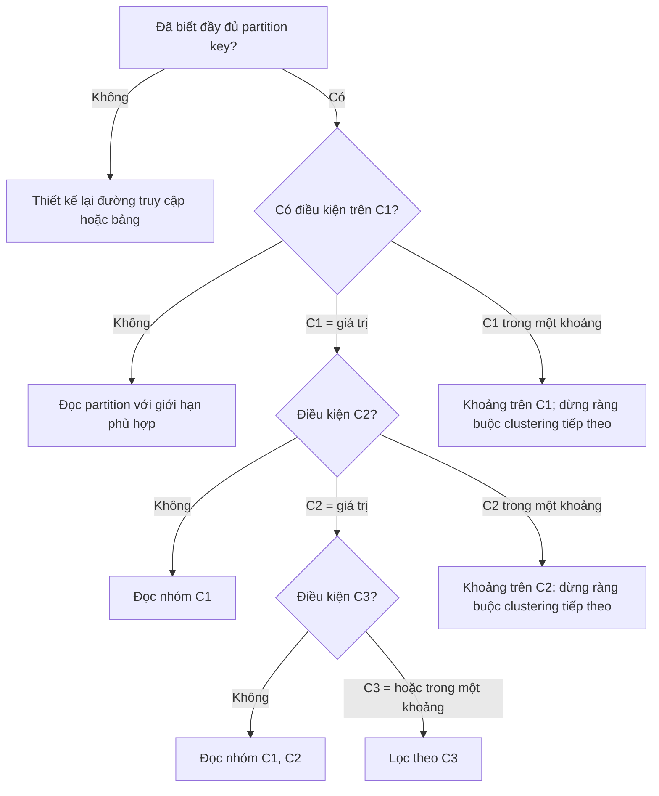
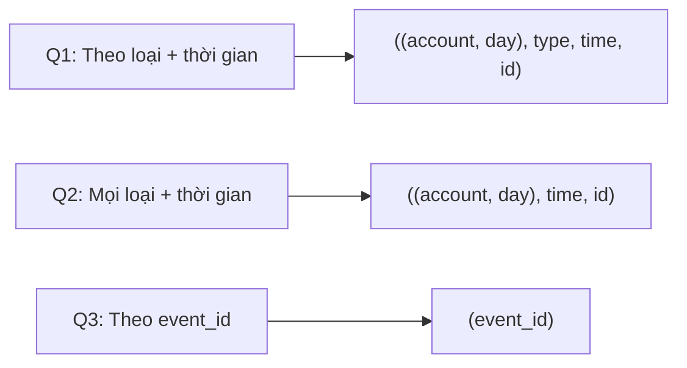

# Ràng buộc tiền tố clustering khi lọc theo khoảng trong Cassandra

Trong Apache Cassandra, câu lệnh `SELECT` không thể tùy ý đặt điều kiện trên các cột của primary key giống như khi truy vấn một bảng quan hệ có nhiều chỉ mục. Dữ liệu trước hết được phân bố theo **partition key**, rồi được tổ chức theo thứ tự của các **clustering columns** trong từng partition. Vì vậy, khi lọc theo khoảng (`>`, `>=`, `<`, `<=`), vị trí cột cần lọc trong **thứ tự clustering** quyết định một truy vấn có được Cassandra hỗ trợ hiệu quả hay không.

Bài học trong chương **Khóa và phân vùng** của `SPRING_DATA_CASSANDRA` tập trung vào quy tắc **tiền tố clustering**: phải ràng buộc đúng các cột đứng trước trước khi lọc theo khoảng trên cột tiếp theo. Kiến thức này ảnh hưởng trực tiếp đến thiết kế bảng theo truy vấn, repository, CassandraTemplate, paging và hiệu năng của ứng dụng Spring Data Cassandra.

## 1. Vì sao Cassandra yêu cầu tiền tố clustering?

Xem một primary key gồm partition key và ba clustering columns:

```sql
PRIMARY KEY (
    (account_id, bucket_day), -- composite partition key
    event_type,               -- clustering 1
    occurred_at,              -- clustering 2
    event_id                  -- clustering 3
)
```

Trong một partition được xác định bởi `account_id + bucket_day`, các hàng được tổ chức theo thứ tự từ trái sang phải của clustering key: **`event_type` → `occurred_at` → `event_id`**. Thứ tự đó giống việc sắp một danh sách theo loại sự kiện, rồi theo thời điểm và cuối cùng theo mã sự kiện để phân biệt các hàng trùng thời điểm.

Cassandra tận dụng thứ tự này để tìm các đoạn dữ liệu liền kề. Ví dụ, khi đã biết `event_type = 'PAYMENT'`, các sự kiện cùng loại nằm trong một nhóm có thứ tự theo thời gian, nên lọc `occurred_at` từ thời điểm A đến B tương đối trực tiếp. Ngược lại, nếu bỏ qua `event_type`, các sự kiện cùng khoảng thời gian có thể nằm rải rác dưới nhiều giá trị `event_type` khác nhau.

```text
Partition: account_id = A, bucket_day = 2026-11-25

event_type   occurred_at          event_id
------------------------------------------------
LOGIN        10:30:00             L-03
LOGIN        10:00:00             L-02
LOGIN        08:45:00             L-01
PAYMENT      11:15:00             P-03
PAYMENT      09:20:00             P-02
PAYMENT      07:10:00             P-01
VIEW         11:10:00             V-02
VIEW         09:00:00             V-01
```

Đây là biểu diễn logic để giải thích thứ tự clustering; SSTable và cấu trúc lưu trữ thật phức tạp hơn. Vì `event_type` là cột clustering đầu tiên, các hàng `PAYMENT` liền nhau trong partition, còn mọi hàng của ngày đó trong khoảng 09:00–11:00 **không tạo thành một nhóm liên tiếp theo thời gian trên toàn bộ loại sự kiện**.

> **Quy tắc cốt lõi:** Với truy vấn CQL thông thường trên clustering key, hãy cung cấp **đầy đủ partition key**, ràng buộc các clustering columns đứng trước bằng **đẳng thức**, rồi có thể đặt điều kiện **khoảng trên clustering column tiếp theo**. Sau cột đã dùng điều kiện khoảng, không tiếp tục ràng buộc cột clustering phía sau như một bộ lọc độc lập thông thường.

Quy tắc trên là cách thiết kế an toàn cho các đường đọc hiệu quả. Một số dạng cú pháp đặc biệt như quan hệ tuple, `IN`, chỉ mục hoặc lọc do engine hỗ trợ có các điều kiện riêng; chúng không thay thế việc hiểu thứ tự primary key.

## 2. Một bảng ví dụ dùng xuyên suốt

Giả sử nền tảng cần truy vấn nhật ký sự kiện của tài khoản theo ngày:

```sql
CREATE TABLE events_by_account_day (
    account_id uuid,
    bucket_day date,
    event_type text,
    occurred_at timestamp,
    event_id uuid,
    payload text,
    PRIMARY KEY (
        (account_id, bucket_day),
        event_type,
        occurred_at,
        event_id
    )
) WITH CLUSTERING ORDER BY (
    event_type ASC,
    occurred_at DESC,
    event_id DESC
);
```

Các thành phần của khóa:

| Thành phần | Vai trò | Ảnh hưởng đến truy vấn |
|---|---|---|
| `account_id`, `bucket_day` | Hai cột cùng tạo **partition key** | Truy vấn mục tiêu phải truyền **cả hai** để xác định partition |
| `event_type` | Clustering column thứ nhất | Có thể lọc `event_type = ?` hoặc một khoảng trên chính cột này |
| `occurred_at` | Clustering column thứ hai, thứ tự giảm dần | Muốn lọc khoảng thời gian hiệu quả thì trước đó cần `event_type = ?` |
| `event_id` | Clustering column thứ ba | Phân biệt hai sự kiện trùng timestamp; muốn lọc khoảng trên nó thì các cột đứng trước cần đẳng thức |

Giá trị `bucket_day` được tính theo múi giờ nghiệp vụ đã quy định, chẳng hạn lấy ngày của `occurred_at` theo UTC. Ứng dụng phải tính nhất quán giá trị đó khi ghi và khi truy vấn; `bucket_day` không tự động được suy ra từ `occurred_at` bởi câu `CREATE TABLE`.

Ví dụ này giả định mã sự kiện ổn định, đủ duy nhất theo từng timestamp trong partition. Khi tạo `event_id` mới, ứng dụng cần tránh tạo lại ID khác trong mỗi lần retry cùng một sự kiện nghiệp vụ.

## 3. Quy tắc tiền tố: đẳng thức trước, khoảng sau

Gọi thứ tự clustering trong bảng là:

```text
C1 = event_type, C2 = occurred_at, C3 = event_id
```

Các mẫu lọc thông thường và hiệu quả có thể hình dung theo bảng:

| Mẫu trên clustering key | Ví dụ | Kết quả |
|---|---|---|
| Không ràng buộc clustering | Chỉ đủ `account_id`, `bucket_day` | Đọc partition, có thể dùng `LIMIT`; cần kiểm soát kích thước partition |
| `C1 = ?` | `event_type = ?` | Hợp lệ |
| `C1 = ? AND C2 = ?` | `event_type = ? AND occurred_at = ?` | Hợp lệ |
| `C1 = ? AND C2 >= ? AND C2 < ?` | Loại sự kiện + khoảng thời gian | Hợp lệ; dạng rất thường dùng |
| `C1 = ? AND C2 = ? AND C3 > ?` | Loại + thời điểm chính xác + khoảng ID | Hợp lệ |
| `C1 >= ?` | Khoảng trên clustering column đầu tiên | Hợp lệ về nguyên tắc, cần giới hạn lượng dữ liệu |
| `C2 >= ?` nhưng không có `C1` | Lọc thời gian mọi loại sự kiện | Không thỏa tiền tố clustering |
| `C1 = ? AND C2 > ? AND C3 = ?` | Ràng buộc cột sau khi đã lấy khoảng trên `C2` | Không thỏa mẫu hạn chế clustering thông thường |
| `C1 = ? AND C3 = ?` nhưng bỏ `C2` | Bỏ qua cột clustering ở giữa | Không thỏa tiền tố clustering |

**Mọi hàng trong bảng trên giả định truy vấn cũng cung cấp đầy đủ `account_id` và `bucket_day`.** Nếu thiếu một thành phần của partition key, việc chỉ có điều kiện clustering không biến câu truy vấn thành point lookup hiệu quả. Các truy vấn bị hạn chế có thể bị Cassandra từ chối, hoặc đòi hỏi cơ chế đặc biệt/ lọc bổ sung; không nên coi `ALLOW FILTERING` là cách sửa mô hình dữ liệu.

Có thể ghi nhớ bằng sơ đồ:



## 4. Những truy vấn CQL hợp lệ

### 4.1. Tất cả sự kiện của một loại trong một ngày

```sql
SELECT event_type, occurred_at, event_id, payload
FROM events_by_account_day
WHERE account_id = ?
  AND bucket_day = ?
  AND event_type = ?
LIMIT 50;
```

Hai thành phần partition key đã đầy đủ; `event_type` là clustering column đầu tiên, dùng đẳng thức. Kết quả trong nhóm `event_type` được sắp theo `occurred_at DESC, event_id DESC` theo schema.

### 4.2. Lọc khoảng thời gian: trường hợp điển hình

```sql
SELECT occurred_at, event_id, payload
FROM events_by_account_day
WHERE account_id = ?
  AND bucket_day = ?
  AND event_type = ?
  AND occurred_at >= ?
  AND occurred_at < ?
LIMIT 100;
```

Ví dụ dùng khoảng nửa mở **`[start, end)`** từ 09:00:00 đến trước 11:00:00 của ngày đã chọn. Dùng `>= start` và `< end` giúp tách các cửa sổ kề nhau mà không tính trùng phần tử đúng tại mốc `end`.

Điều kiện `event_type = ?` đứng trước `occurred_at` trong clustering key và là đẳng thức, vì thế Cassandra có thể xác định đoạn thời gian cần đọc trong nhóm loại sự kiện. Dù `occurred_at` được cấu hình **DESC**, toán tử `>=` và `<` vẫn so sánh **giá trị timestamp**, không đảo nghĩa thành “lớn hơn về vị trí vật lý”.

### 4.3. Lọc khoảng trên cột clustering đầu tiên

```sql
SELECT event_type, occurred_at, event_id
FROM events_by_account_day
WHERE account_id = ?
  AND bucket_day = ?
  AND event_type >= 'LOGIN'
  AND event_type < 'VIEW'
LIMIT 100;
```

Về mặt thứ tự clustering, khoảng trên `event_type` có thể được xem là một phạm vi liên tiếp. Nhưng điều kiện so sánh chuỗi dựa vào thứ tự giá trị, **không có nghĩa nghiệp vụ** “loại sự kiện từ LOGIN đến VIEW” trừ khi hệ thống định nghĩa và kiểm soát rõ bộ giá trị. Mẫu này chủ yếu giúp hiểu nguyên tắc; thực tế nên dùng đẳng thức trên loại sự kiện khi yêu cầu là “một loại cụ thể”.

### 4.4. Lọc cột thứ ba khi hai cột trước bằng nhau

```sql
SELECT event_id, payload
FROM events_by_account_day
WHERE account_id = ?
  AND bucket_day = ?
  AND event_type = ?
  AND occurred_at = ?
  AND event_id >= ?;
```

Ở đây `event_type` và `occurred_at` đều được ràng buộc bằng `=`, nên có thể đặt khoảng trên `event_id`. Tuy nhiên, `uuid` thường không mang thứ tự thời gian có ý nghĩa nghiệp vụ; truy vấn theo khoảng ID chỉ hợp lý nếu yêu cầu thực sự dùng thứ tự giá trị của kiểu ID đó. Không nên thay paging state bằng `event_id > ?` một cách máy móc.

### 4.5. Truy vấn một hàng xác định

```sql
SELECT *
FROM events_by_account_day
WHERE account_id = ?
  AND bucket_day = ?
  AND event_type = ?
  AND occurred_at = ?
  AND event_id = ?;
```

Khi đã biết tất cả thành phần primary key, truy vấn xác định một hàng cụ thể. Đây là ví dụ đầy đủ nhất của **chuỗi đẳng thức** trên clustering prefix.

## 5. Những câu truy vấn có vấn đề và nguyên nhân

### 5.1. Bỏ qua clustering column đầu tiên

```sql
-- Không thỏa mô hình truy vấn theo clustering prefix.
SELECT *
FROM events_by_account_day
WHERE account_id = ?
  AND bucket_day = ?
  AND occurred_at >= ?
  AND occurred_at < ?;
```

Truy vấn thiếu `event_type`. Vì dữ liệu cùng thời gian nhưng khác `event_type` nằm ở những nhóm khác nhau, không thể đọc một dải thời gian duy nhất theo cấu trúc hiện tại.

**Cách xử lý:** nếu ứng dụng thường cần “mọi loại sự kiện trong khoảng thời gian”, hãy tạo một bảng phục vụ truy vấn đó, với `occurred_at` đứng đầu clustering key. Ví dụ ở mục 8.

### 5.2. Bỏ cột clustering ở giữa

```sql
-- Thiếu occurred_at giữa event_type và event_id.
SELECT *
FROM events_by_account_day
WHERE account_id = ?
  AND bucket_day = ?
  AND event_type = ?
  AND event_id = ?;
```

Biết `event_type` và `event_id` không tương đương biết giá trị `occurred_at`. Các hàng cùng `event_type` trước hết được chia theo timestamp, nên không có đường tìm trực tiếp theo `event_id` ở vị trí thứ ba nếu bỏ qua timestamp.

**Cách xử lý:** nếu thường tra cứu sự kiện chỉ bằng ID, tạo bảng `events_by_id` có `event_id` làm partition key, hoặc thay primary key của projection phù hợp với pattern thực tế.

### 5.3. Lọc tiếp một clustering column sau điều kiện khoảng

```sql
-- C2 đã là khoảng; ràng buộc C3 độc lập không theo prefix thông thường.
SELECT *
FROM events_by_account_day
WHERE account_id = ?
  AND bucket_day = ?
  AND event_type = ?
  AND occurred_at >= ?
  AND event_id = ?;
```

`event_id` không thể được dùng như một bộ lọc độc lập hiệu quả cho toàn bộ khoảng thời gian chỉ vì nó nằm trong primary key. Nó được sắp **bên trong từng giá trị timestamp**; để tìm một ID trên mọi timestamp cần cách bố trí dữ liệu khác.

**Cách xử lý:** nếu biết chính xác timestamp thì thay `occurred_at >= ?` bằng `occurred_at = ?`. Nếu cần tìm bằng `event_id` trên mọi thời điểm, dùng một bảng tra cứu theo ID.

### 5.4. Thiếu partition key

```sql
-- Thiếu account_id, không xác định được partition mục tiêu.
SELECT *
FROM events_by_account_day
WHERE bucket_day = ?
  AND event_type = ?
  AND occurred_at >= ?;
```

`bucket_day` chỉ là **một thành phần** của partition key tổng hợp. `event_type` và `occurred_at` dù là clustering columns cũng không bù được thành phần còn thiếu.

**Cách xử lý:** dựa trên mẫu truy vấn thật để chọn partition key khác, bổ sung bảng projection, hoặc dùng hệ thống tìm kiếm/phân tích chuyên dụng nếu cần truy vấn toàn cluster tùy ý.

### 5.5. Vì sao không dùng `ALLOW FILTERING` cho tất cả?

```sql
-- Ví dụ giải pháp nguy hiểm khi dữ liệu tăng:
SELECT *
FROM events_by_account_day
WHERE account_id = ?
  AND bucket_day = ?
  AND occurred_at >= ?
ALLOW FILTERING;
```

Trong một số trường hợp, Cassandra cho phép chạy truy vấn phải lọc bổ sung nếu dùng `ALLOW FILTERING`, nhưng từ khóa này **không tạo lại trật tự clustering** theo `occurred_at`. Để trả ít hàng, node vẫn có thể phải xem xét rất nhiều hàng trong partition. Chi phí tăng theo dữ liệu và độ chọn lọc của điều kiện, thay vì phụ thuộc chủ yếu vào số hàng thực sự cần trả.

Không nên dùng `ALLOW FILTERING` như cách xử lý lỗi mô hình khóa trên đường đọc có SLA nghiêm ngặt. Nếu cân nhắc dùng nó cho một tập dữ liệu nhỏ, cố định và được kiểm soát, vẫn phải đo trên dữ liệu đại diện.

## 6. “Tiền tố” không đồng nghĩa “phải lọc mọi cột”

Cho primary key `((account_id, bucket_day), event_type, occurred_at, event_id)`, hoàn toàn có thể:

- Chỉ lọc **partition key**: đọc một phần hoặc toàn bộ partition có giới hạn hợp lý.
- Lọc partition key và **`event_type = ?`**: đọc một nhóm loại sự kiện.
- Lọc partition key, `event_type = ?` rồi **khoảng `occurred_at`**: đọc một đoạn thời gian.
- Lọc partition key, `event_type = ?`, `occurred_at = ?` rồi điều kiện trên **`event_id`**: đọc phần con dưới một timestamp.

Đó là các **tiền tố liên tiếp** của thứ tự clustering, không đòi hỏi mọi cột cuối đều có điều kiện. Vấn đề phát sinh khi bỏ qua một cột đứng trước, hoặc muốn tiếp tục dùng những cột phía sau sau khi đã mở một khoảng không được thu hẹp bằng đẳng thức.

Đặc biệt, điều kiện khoảng **có thể gồm cả cận dưới và cận trên cùng trên một clustering column**, chẳng hạn `occurred_at >= ? AND occurred_at < ?`. Đây vẫn chỉ là **một cột đang được lọc theo khoảng**, không vi phạm quy tắc.

## 7. Các trường hợp dễ nhầm: `IN`, tuple, `ORDER BY` và paging

### 7.1. `IN` không tự động thay thế chuỗi đẳng thức

Đôi khi ứng dụng muốn cùng lúc lấy `event_type IN ('LOGIN', 'PAYMENT')`. `IN` có các quy tắc và giới hạn riêng khi kết hợp với các điều kiện clustering khác; không nên mặc định đổi `event_type = ?` thành `event_type IN (...)` rồi giữ mọi điều kiện khoảng theo sau sẽ luôn hợp lệ hoặc tối ưu trên mọi phiên bản Cassandra.

Nếu truy vấn theo **một số loại xác định** là nhu cầu ổn định, một chiến lược rõ ràng là thực hiện những truy vấn có `event_type = ?` trên cùng partition rồi hợp nhất kết quả phía ứng dụng khi cần. Đo chi phí của cách fan-out này và giới hạn số loại; nếu pattern chính là “mọi loại theo thời gian”, hãy xem xét bảng mới với `occurred_at` đứng trước.

### 7.2. So sánh tuple là cú pháp đặc biệt

CQL có hỗ trợ các dạng điều kiện nhiều clustering columns theo tuple trong những trường hợp được engine/phiên bản cho phép. Ví dụ, cặp `(occurred_at, event_id)` có thể được xét theo **thứ tự từ điển** của hai giá trị, chứ không phải hai bộ lọc độc lập tùy ý.

Cú pháp nhiều cột này **khác** với viết `occurred_at > ? AND event_id > ?`: biểu thức sau yêu cầu cả hai điều kiện độc lập, có thể loại bỏ những hàng nằm trong đoạn thứ tự mong muốn. Khi dùng tuple để thực hiện seek pagination, còn phải xét chiều `ASC/DESC` của schema, trường hợp trùng timestamp và các giới hạn phiên bản. Với phần lớn luồng phân trang Cassandra, **driver paging state** dễ an toàn hơn tự chế điều kiện so sánh tuple.

### 7.3. `ORDER BY` không sửa được sai thứ tự clustering

Với schema đã cho, trong nhóm `event_type`, các sự kiện được lưu theo `occurred_at DESC`. Query đúng prefix có thể tận dụng thứ tự này.

```sql
SELECT occurred_at, event_id
FROM events_by_account_day
WHERE account_id = ?
  AND bucket_day = ?
  AND event_type = ?
LIMIT 20;
```

Không thể thêm tùy ý `ORDER BY payload` để biến `payload` thành cột sắp xếp hiệu quả: Cassandra chỉ hỗ trợ những dạng `ORDER BY` tương thích với clustering order và điều kiện partition tương ứng. Nếu màn hình cần sắp xếp theo trường không thuộc clustering key, hãy cân nhắc bảng đọc riêng hoặc xử lý tập kết quả nhỏ ở ứng dụng.

### 7.4. `LIMIT` và paging state giải quyết các vấn đề khác nhau

`LIMIT 20` giới hạn số hàng trả về, **không** giúp một truy vấn sai access path trở thành hiệu quả. Đối với danh sách dài, dùng page size và paging state của driver để lấy các trang tiếp theo của **cùng truy vấn, cùng điều kiện**, tránh lối tư duy `OFFSET 10000` thường gặp ở SQL quan hệ.

Ví dụ, khoảng `[09:00, 11:00)` có 500 sự kiện `PAYMENT` có thể được đọc từng trang 50 hàng. Nếu yêu cầu nối ngày 24 và ngày 25, mỗi ngày có partition key khác; ứng dụng phải quản lý truy vấn theo bucket và xử lý thứ tự/kết quả khi chuyển bucket.

Paging state không phải chỉ số hàng, không nên tự sửa, và không nên sử dụng tùy tiện với một query khác hoặc sau khi thay đổi bộ tham số quan trọng.

## 8. Khi cần lọc thời gian mà không biết `event_type`: thiết kế bảng khác

Giả sử màn hình lịch sử muốn lấy **50 sự kiện gần nhất của một tài khoản trong một ngày, bất kể loại**. Bảng hiện tại có `event_type` đứng trước `occurred_at`, nên không phù hợp cho một dải thời gian toàn bộ các loại sự kiện.

Thiết kế projection bổ sung:

```sql
CREATE TABLE events_by_account_day_time (
    account_id uuid,
    bucket_day date,
    occurred_at timestamp,
    event_id uuid,
    event_type text,
    payload text,
    PRIMARY KEY (
        (account_id, bucket_day),
        occurred_at,
        event_id
    )
) WITH CLUSTERING ORDER BY (
    occurred_at DESC,
    event_id DESC
);
```

Lúc này, `occurred_at` là **clustering column đầu tiên**:

```sql
SELECT occurred_at, event_id, event_type, payload
FROM events_by_account_day_time
WHERE account_id = ?
  AND bucket_day = ?
  AND occurred_at >= ?
  AND occurred_at < ?
LIMIT 50;
```

Đây là truy vấn đúng prefix cho bảng mới. Tuy nhiên, nếu cần **chỉ sự kiện PAYMENT**, bảng mới không có `event_type` trong primary key để lọc riêng một cách hiệu quả theo mọi khoảng thời gian. Vì vậy, có thể cần **hai bảng đọc** cho hai mẫu truy vấn:

| Mẫu truy vấn | Bảng đọc phù hợp | Tại sao |
|---|---|---|
| Loại sự kiện + ngày + khoảng thời gian | `events_by_account_day` | `event_type = ?` rồi range trên `occurred_at` |
| Tất cả loại sự kiện + ngày + khoảng thời gian | `events_by_account_day_time` | Range trực tiếp trên clustering column đầu tiên `occurred_at` |

**Đánh đổi:** cùng một sự kiện có thể được ghi vào cả hai bảng. Ứng dụng cần có cơ chế ghi/đồng bộ, retry idempotent, giám sát độ trễ projection và quy tắc xóa/TTL tương ứng. Consistency level như `LOCAL_QUORUM` xác định cách xác nhận **mỗi mutation** giữa replica, nhưng không tự biến hai lần ghi vào hai bảng thành một giao dịch ACID đa partition có tính cô lập.

Một phương án khác là đưa `event_type` vào **partition key** thay vì clustering key:

```sql
CREATE TABLE events_by_account_type_day (
    account_id uuid,
    event_type text,
    bucket_day date,
    occurred_at timestamp,
    event_id uuid,
    payload text,
    PRIMARY KEY (
        (account_id, event_type, bucket_day),
        occurred_at,
        event_id
    )
) WITH CLUSTERING ORDER BY (
    occurred_at DESC,
    event_id DESC
);
```

Phương án này phân tách các loại sự kiện thành các partition riêng, hữu ích nếu bảng gốc có partition `account_id + bucket_day` quá lớn hoặc nóng. Khi truy vấn một loại, phải cung cấp **đầy đủ `account_id`, `event_type`, `bucket_day`**; sau đó lọc khoảng `occurred_at`. Nó không tự đáp ứng mẫu truy vấn “mọi loại” mà không biết `event_type`.

## 9. Chọn thứ tự clustering dựa trên truy vấn ưu tiên

Giả sử có ba yêu cầu:

- **Q1:** sự kiện PAYMENT của một tài khoản trong ngày, từ thời gian A đến B.
- **Q2:** mọi sự kiện của tài khoản trong ngày, từ A đến B.
- **Q3:** tra cứu một sự kiện chỉ từ `event_id`.

Một primary key không nhất thiết phục vụ tối ưu cả ba:



Nếu Q3 là truy vấn rất thường gặp, có thể tạo bảng tra cứu:

```sql
CREATE TABLE events_by_id (
    event_id uuid PRIMARY KEY,
    account_id uuid,
    bucket_day date,
    event_type text,
    occurred_at timestamp,
    payload text
);
```

Nếu chỉ cần Q3 hiếm khi và đã biết đủ các khóa còn lại, có thể dùng bảng gốc thay vì tạo bảng mới. Quyết định phụ thuộc chi phí lưu trữ, số mutation bổ sung, SLA và khả năng duy trì bản sao dữ liệu.

**Điểm mấu chốt:** thay đổi thứ tự clustering là thay đổi **các truy vấn có thể thực hiện hiệu quả**. Thêm cột vào cuối clustering key không tạo khả năng lọc tùy ý theo cột đó; muốn đọc theo cột đó độc lập, nó thường cần xuất hiện sớm hơn trong một primary key khác.

## 10. Ràng buộc clustering trong Spring Data Cassandra

Spring Data Cassandra cung cấp **entity mapping**, **repository**, **CassandraTemplate** và khả năng gửi truy vấn CQL. Các API này không nới lỏng quy tắc prefix của Cassandra: phương thức Java chỉ hiệu quả khi CQL cuối cùng phù hợp với partition/clustering key.

### 10.1. Ánh xạ composite primary key

Ví dụ ánh xạ bảng `events_by_account_day`:

```java
import java.io.Serializable;
import java.time.Instant;
import java.time.LocalDate;
import java.util.UUID;

import org.springframework.data.cassandra.core.cql.Ordering;
import org.springframework.data.cassandra.core.mapping.PrimaryKeyClass;
import org.springframework.data.cassandra.core.mapping.PrimaryKeyColumn;
import org.springframework.data.cassandra.core.mapping.PrimaryKeyType;

@PrimaryKeyClass
public class AccountDayEventKey implements Serializable {

    @PrimaryKeyColumn(name = "account_id", ordinal = 0,
            type = PrimaryKeyType.PARTITIONED)
    private UUID accountId;

    @PrimaryKeyColumn(name = "bucket_day", ordinal = 1,
            type = PrimaryKeyType.PARTITIONED)
    private LocalDate bucketDay;

    @PrimaryKeyColumn(name = "event_type", ordinal = 2,
            type = PrimaryKeyType.CLUSTERED, ordering = Ordering.ASCENDING)
    private String eventType;

    @PrimaryKeyColumn(name = "occurred_at", ordinal = 3,
            type = PrimaryKeyType.CLUSTERED, ordering = Ordering.DESCENDING)
    private Instant occurredAt;

    @PrimaryKeyColumn(name = "event_id", ordinal = 4,
            type = PrimaryKeyType.CLUSTERED, ordering = Ordering.DESCENDING)
    private UUID eventId;

    // Bổ sung constructor, getter/setter, equals/hashCode.
}
```

```java
import org.springframework.data.cassandra.core.mapping.Column;
import org.springframework.data.cassandra.core.mapping.PrimaryKey;
import org.springframework.data.cassandra.core.mapping.Table;

@Table("events_by_account_day")
public class AccountDayEvent {

    @PrimaryKey
    private AccountDayEventKey key;

    @Column("payload")
    private String payload;

    // Bổ sung constructor, getter/setter.
}
```

Trong dự án Java, các lớp `public` đặt ở file riêng. Đây là ví dụ mapping tập trung vào thứ tự của primary key, chưa bao gồm cấu hình keyspace, driver/session và mã tạo đối tượng. `AccountDayEventKey` cần triển khai đầy đủ `equals/hashCode` để biểu diễn khóa ổn định.

### 10.2. Repository: viết đúng câu CQL theo tiền tố

```java
import java.time.Instant;
import java.time.LocalDate;
import java.util.List;
import java.util.UUID;

import org.springframework.data.cassandra.repository.CassandraRepository;
import org.springframework.data.cassandra.repository.Query;

public interface AccountDayEventRepository
        extends CassandraRepository<AccountDayEvent, AccountDayEventKey> {

    @Query("SELECT * FROM events_by_account_day " +
           "WHERE account_id = ?0 AND bucket_day = ?1 " +
           "AND event_type = ?2 " +
           "AND occurred_at >= ?3 AND occurred_at < ?4 " +
           "LIMIT 50")
    List<AccountDayEvent> findEventsInRange(
            UUID accountId,
            LocalDate bucketDay,
            String eventType,
            Instant fromInclusive,
            Instant toExclusive);
}
```

Trình tự `account_id + bucket_day` (partition), `event_type = ?` (clustering prefix), `occurred_at >= ? AND occurred_at < ?` (range) phù hợp schema. Mẫu `LIMIT 50` minh họa cách lấy tối đa 50 hàng; nếu cần đọc tất cả kết quả theo từng trang, hãy thiết kế truy vấn paging riêng thay vì coi `List` này là cơ chế phân trang tổng quát.

Ngược lại, một phương thức tự đặt tên kiểu `findByOccurredAtBetween(...)` **không thể tự biến** điều kiện thiếu `event_type` thành truy vấn có đường đọc tối ưu. Nếu query do Spring Data sinh ra bỏ qua clustering prefix hoặc partition key bắt buộc, Cassandra có thể từ chối truy vấn hoặc buộc người dùng chọn chiến lược lọc khác.

### 10.3. CassandraTemplate và driver

Khi cần xây truy vấn động, thiết lập page size hoặc consistency ở mức statement, có thể dùng `CassandraTemplate`/Spring Data query API và driver. Dù dùng tầng nào, vẫn phải kiểm tra **CQL thực tế** gửi tới Cassandra.

Ví dụ với Java Driver để minh họa việc giữ điều kiện theo key và page size:

```java
import com.datastax.oss.driver.api.core.CqlSession;
import com.datastax.oss.driver.api.core.cql.SimpleStatement;
import com.datastax.oss.driver.api.core.cql.ResultSet;

SimpleStatement query = SimpleStatement.builder(
        "SELECT event_type, occurred_at, event_id, payload " +
        "FROM events_by_account_day " +
        "WHERE account_id = ? AND bucket_day = ? AND event_type = ? " +
        "AND occurred_at >= ? AND occurred_at < ?")
    .addPositionalValues(accountId, bucketDay, eventType, from, to)
    .setPageSize(50)
    .build();

ResultSet result = session.execute(query);
```

`session` là một `CqlSession` được cấu hình sẵn; các biến đầu vào được ứng dụng cung cấp. Trong code thực tế, nên chuẩn bị/cached prepared statement khi truy vấn lặp lại nhiều lần, dùng paging state qua API driver phù hợp và xác định timeout/CL theo nhu cầu nghiệp vụ. `setPageSize(50)` định kích thước trang fetch, **khác** với `LIMIT 50` về giới hạn tổng số hàng của truy vấn.

Nếu dùng `CassandraTemplate` để biểu diễn cùng các điều kiện, các `Criteria` cũng phải giữ đầy đủ partition key và `event_type = ?` trước khi giới hạn `occurred_at`. Không có lớp abstraction nào tự sửa được mô hình bảng mà ứng dụng thiết kế sai với access pattern.

## 11. Hiệu năng và giới hạn khi áp dụng đúng tiền tố

Việc câu CQL hợp lệ và đúng prefix là **điều kiện cần**, chưa đủ để bảo đảm độ trễ tốt. Còn phải đánh giá:

| Khía cạnh | Rủi ro | Cách kiểm soát |
|---|---|---|
| Partition quá rộng | Một `account_id + bucket_day` có hàng triệu sự kiện | Bucket theo giờ hoặc thêm khóa phân phối phù hợp; chấp nhận logic đọc nhiều partition |
| Hot partition | Tài khoản có lưu lượng đột biến tạo tải tập trung | Xem phân phối ghi thực tế; cân nhắc thêm thành phần shard vào partition key |
| Khoảng thời gian quá lớn | Đọc gần như cả partition dù điều kiện CQL hợp lệ | Bắt buộc khoảng thời gian giới hạn, trả dữ liệu theo trang |
| `LIMIT` nhưng không đúng khóa | Vẫn có thể phải quét/lọc nhiều dữ liệu | Thiết kế đúng khóa, tránh dựa vào `ALLOW FILTERING` |
| TTL/xóa nhiều | Tombstone làm đường đọc tốn công | Thiết kế TTL phù hợp, quản lý repair/compaction và kiểm tra tombstone |
| Lặp dữ liệu ở nhiều bảng | Tốn ghi, lưu trữ, khó đồng bộ | Chỉ tạo projection cho pattern quan trọng; có retry và reconciliation |
| Paging qua nhiều bucket | Cursor của một partition không bao phủ partition khác | Quản lý cursor theo bucket và quy tắc merge ở tầng ứng dụng |

Chẳng hạn một partition ngày chứa 2 triệu sự kiện của một tài khoản. Ngay cả khi ràng buộc `event_type = ? AND occurred_at >= ?` đúng, câu hỏi “lấy tất cả PAYMENT trong 24 giờ” vẫn có thể trả rất nhiều dữ liệu. Clustering prefix giúp truy vấn **tìm đúng dải**, chứ không giới hạn kích thước dải hoặc bảo đảm partition luôn nhỏ.

Thiết kế một bảng theo truy vấn phải phối hợp **partition key**, **clustering prefix**, **cửa sổ thời gian**, **số hàng/trang**, **consistency level** và **khả năng phân phối tải**. Đo latency, số hàng đọc, tombstone, SSTable, compaction và tài nguyên node với dữ liệu giống production trước khi chốt schema.

## 12. Tình huống thực hành: chọn truy vấn phù hợp

Cho bảng `events_by_account_day` đã định nghĩa, giả sử `account_id` và `bucket_day` luôn được cung cấp:

| Yêu cầu | Cách viết điều kiện clustering | Phù hợp? | Giải thích |
|---|---|---|---|
| A. Lấy LOGIN từ 10:00 tới 11:00 | `event_type = 'LOGIN' AND occurred_at >= t1 AND occurred_at < t2` | Có | Đẳng thức trên C1 trước khoảng C2 |
| B. Lấy mọi loại sự kiện từ 10:00 tới 11:00 | `occurred_at >= t1 AND occurred_at < t2` | Không theo schema hiện tại | Bỏ C1 |
| C. Lấy sự kiện PAYMENT đúng lúc 10:15 | `event_type = 'PAYMENT' AND occurred_at = t` | Có | Chuỗi đẳng thức C1, C2 |
| D. Tìm một `event_id` nhưng không biết timestamp | `event_type = 'LOGIN' AND event_id = id` | Không theo schema hiện tại | Bỏ C2 |
| E. Tìm ID trong khoảng tại timestamp cố định | `event_type = 'LOGIN' AND occurred_at = t AND event_id >= id` | Có về cấu trúc | C1 và C2 bằng nhau, range ở C3 |
| F. Lấy một số timestamp và lọc một ID cụ thể trên toàn khoảng | `event_type = 'LOGIN' AND occurred_at >= t1 AND event_id = id` | Không theo prefix thông thường | Ràng buộc C3 độc lập sau range C2 |

**Bài tập:** sản phẩm yêu cầu tìm sự kiện chỉ qua `event_id` trên tất cả tài khoản và mọi ngày, với độ trễ thấp. Có thể đổi thứ tự của điều kiện `WHERE` để chạy nhanh trên bảng hiện tại không?

**Đáp án:** không. Thứ tự viết các mệnh đề `WHERE` không thay đổi thứ tự thành phần trong primary key. Bảng hiện tại phân bố theo `account_id + bucket_day` và sắp xếp trong partition theo `event_type`, `occurred_at`, `event_id`. Nên tạo một bảng tra cứu theo `event_id` hoặc thay đổi yêu cầu để ứng dụng truyền đủ khóa đã thiết kế. Một bảng mới đòi hỏi quy trình ghi, cập nhật, xóa và đồng bộ projection rõ ràng.

## 13. Checklist khi thiết kế truy vấn khoảng trên clustering key

1. **Có đầy đủ partition key chưa?** Với composite partition key, đã truyền mọi thành phần của nó chưa?
2. **Cột cần range đứng thứ mấy trong clustering key?** Tất cả clustering columns đứng trước đã được ràng buộc bằng đẳng thức phù hợp chưa?
3. **Có lọc cột phía sau range không?** Nếu có, kiểm tra lại thiết kế; không giả định có thể đặt mọi điều kiện lên primary key tùy ý.
4. **Khoảng có cận rõ ràng không?** Ưu tiên `[start, end)` cho cửa sổ thời gian liên tiếp và tính bucket nhất quán.
5. **Thứ tự kết quả có khớp schema?** `ASC/DESC` của clustering key có phục vụ cách hiển thị/paging thực tế không?
6. **Một partition có quá lớn hoặc quá nóng không?** Đánh giá tốc độ ghi, độ lệch khóa, kích thước hàng và TTL.
7. **Cần truy vấn theo một thứ tự khác không?** Xem xét bảng projection phù hợp thay vì lọc toàn partition.
8. **Ứng dụng dùng API nào?** Đảm bảo `@Query`, repository, CassandraTemplate và driver đều phát sinh CQL đúng với khóa.
9. **Phân trang và consistency ra sao?** Dùng paging state đúng ngữ cảnh; phân biệt CL từng mutation với đồng bộ dữ liệu giữa nhiều bảng.
10. **Đã kiểm thử với tải thật chưa?** Kiểm tra p95/p99, số hàng, tombstone và mức độ phân phối partition.

Hãy nhớ trật tự suy nghĩ: **partition key xác định nơi đọc → các clustering columns đứng trước được cố định bằng đẳng thức → clustering column tiếp theo xác định khoảng cần đọc**. Khi một mẫu truy vấn không đi theo trật tự đó, hãy đánh giá lại thiết kế primary key hoặc tạo một bảng đọc mới. Spring Data Cassandra giúp biểu diễn truy vấn bằng Java, nhưng kiến trúc dữ liệu phân tán của Cassandra mới là yếu tố quyết định truy vấn có đúng và hiệu quả hay không.
