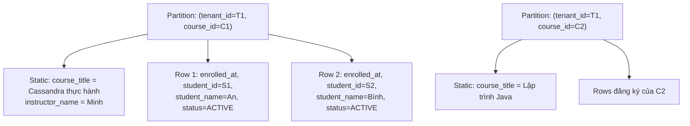

# Static column và dữ liệu dùng chung trong một partition

Trong **Apache Cassandra**, một bảng có thể lưu nhiều hàng (row) cùng **partition key** nhưng khác **clustering key**. Đôi khi những hàng đó cần đọc chung một thông tin, chẳng hạn **tên khóa học** cho toàn bộ danh sách học viên đăng ký khóa học. Nếu cột này được lưu như cột thông thường ở từng hàng, mỗi thay đổi tên khóa học sẽ phải cập nhật nhiều hàng trong cùng partition.

**Static column** (cột `STATIC`) là cơ chế của CQL cho phép lưu một giá trị **dùng chung ở cấp partition**, đồng thời vẫn giữ các cột thông thường ở cấp hàng. Đây là một lựa chọn thiết kế bảng hữu ích khi dữ liệu chung thực sự có cùng phạm vi với partition key.

Trong module **Spring Data Cassandra**, cần hiểu sự khác nhau giữa khóa phân vùng, cột clustering và cột static trước khi viết entity, repository hoặc câu truy vấn với `CassandraTemplate`. Các API Java hỗ trợ ánh xạ và thực thi CQL; phạm vi chia sẻ của static column vẫn do **Cassandra schema** quyết định.

Sau bài này, bạn có thể:

- Giải thích chính xác nơi lưu trữ và phạm vi tác động của một static column.
- Thiết kế bảng có partition key ghép, clustering columns và static columns phù hợp với đường truy cập CQL.
- Phân biệt cập nhật cột static với cập nhật cột thông thường và đọc static bằng `SELECT DISTINCT`.
- Ánh xạ static column trong Spring Data Cassandra và tránh lỗi ghi đè giá trị chung khi lưu entity.
- Nhận diện giới hạn về partition lớn, thay đổi khóa, TTL, xóa dữ liệu, consistency và mô hình bảng theo truy vấn.

## 1. Từ partition key đến static column

Giả sử cần hiển thị học viên đã đăng ký của một khóa học. Một API nhận `tenantId` và `courseId`, sau đó trả về các đăng ký theo thời gian giảm dần:

```text
GET /tenants/{tenantId}/courses/{courseId}/enrollments
```

Thiết kế có thể dùng partition key `(tenant_id, course_id)` để đọc đúng các đăng ký của một khóa học trong một tenant. Mỗi đăng ký được phân biệt bởi `enrolled_at` và `student_id`.

Giả sử khóa học có hai học viên:

| tenant_id | course_id | enrolled_at | student_id | student_name | course_title |
| --- | --- | --- | --- | --- | --- |
| T1 | C1 | 2026-11-20 09:00 | S1 | An | Cassandra thực hành |
| T1 | C1 | 2026-11-19 14:00 | S2 | Bình | Cassandra thực hành |

Hai hàng có chung `course_title` vì cùng khóa học C1. Nếu tên khóa học đổi, việc lưu `course_title` như một cột thông thường buộc ứng dụng cập nhật cả S1 lẫn S2, và tiếp tục cập nhật mọi hàng đăng ký khác.

Khi `course_title` là **static**, Cassandra duy trì giá trị dùng chung cho **partition T1/C1**, còn mỗi hàng đăng ký chỉ giữ dữ liệu riêng:



**Một giá trị static dùng chung trong một partition**. Cùng tên cột ở partition khác có giá trị độc lập. Nó không phải biến toàn cục của bảng, keyspace, tenant hay toàn cụm Cassandra.

### Phân biệt ba loại cột

| Loại cột | Đặc điểm | Trong ví dụ |
| --- | --- | --- |
| **Partition key** | Xác định partition logic và cách định tuyến dữ liệu | `tenant_id`, `course_id` |
| **Clustering column** | Xác định hàng bên trong partition và thứ tự lưu/đọc | `enrolled_at`, `student_id` |
| **Regular column** | Giá trị riêng theo từng hàng được xác định bởi toàn bộ primary key | `student_name`, `enrollment_status` |
| **Static column** | Giá trị chung của mọi hàng trong cùng partition, không phụ thuộc clustering key | `course_title`, `instructor_name` |

Điều này khác với **replication factor**. Cassandra vẫn sao chép dữ liệu của partition sang các replica theo cấu hình keyspace. `STATIC` mô tả **phạm vi logic của cột trong một bảng**, không mô tả số bản sao trên các node.

## 2. Định nghĩa static column bằng CQL

Giả sử keyspace `learning` đã tồn tại. Bảng phục vụ truy vấn học viên theo khóa học:

```sql
CREATE TABLE IF NOT EXISTS learning.enrollments_by_course (
    tenant_id uuid,
    course_id uuid,
    enrolled_at timestamp,
    student_id uuid,

    course_title text STATIC,
    instructor_name text STATIC,

    student_name text,
    enrollment_status text,

    PRIMARY KEY ((tenant_id, course_id), enrolled_at, student_id)
) WITH CLUSTERING ORDER BY (enrolled_at DESC, student_id ASC);
```

Đọc từng phần của schema:

1. **`(tenant_id, course_id)`** là partition key ghép. Mỗi cặp tenant/khóa học tạo thành một partition logic riêng.
2. **`enrolled_at`** là clustering column đầu tiên. Cassandra sắp xếp các hàng trong partition theo thời điểm giảm dần do `CLUSTERING ORDER BY`.
3. **`student_id`** là clustering column tiếp theo để phân biệt hai hàng có cùng `enrolled_at`.
4. **`course_title`** và **`instructor_name`** có từ khóa `STATIC`: mỗi cột có một giá trị logic cho cả partition.
5. **`student_name`** và **`enrollment_status`** là regular columns; từng đăng ký có thể có giá trị khác nhau.

Các cột static **không nằm trong primary key**. Chúng không giúp định tuyến truy vấn hay tạo thêm thứ tự sắp xếp; chúng chỉ thay đổi cách dữ liệu được tổ chức **trong partition đã xác định**.

### Điều kiện để khai báo `STATIC`

Theo mô hình CQL:

- Bảng **phải có ít nhất một clustering column**. Bảng chỉ có partition key vốn đã có tối đa một hàng logic cho mỗi partition; việc khai báo `STATIC` khi đó không hợp lệ.
- Chỉ cột **không thuộc primary key** mới được khai báo `STATIC`.
- Việc khai báo `STATIC` không thay thế yêu cầu thiết kế partition key phù hợp với truy vấn.
- Kiểu dữ liệu và cách lưu của cột vẫn tuân theo quy tắc CQL; từ khóa `STATIC` không làm cột trở thành chỉ mục hay ràng buộc duy nhất.

Ví dụ **không hợp lệ** vì thiếu clustering column:

```sql
-- Sai: PRIMARY KEY chỉ có partition key.
CREATE TABLE learning.course_metadata_invalid (
    course_id uuid PRIMARY KEY,
    title text STATIC
);
```

Nếu chỉ cần **một bản ghi metadata cho mỗi khóa học**, thay vì ép dùng `STATIC`, hãy dùng bảng riêng:

```sql
CREATE TABLE IF NOT EXISTS learning.course_metadata_by_id (
    tenant_id uuid,
    course_id uuid,
    title text,
    instructor_name text,
    PRIMARY KEY ((tenant_id, course_id))
);
```

Ở bảng metadata này, một partition chỉ có một hàng logic. Các cột `title` và `instructor_name` là regular columns nhưng về mặt sử dụng đã nằm trong hàng duy nhất của partition.

## 3. Ghi và đọc dữ liệu static

### 3.1. Ghi các hàng thuộc cùng partition

Ví dụ sau dùng các tham số `?` được bind từ ứng dụng bằng prepared statement; chúng không phải dữ liệu nhập trực tiếp vào `cqlsh`:

```sql
INSERT INTO learning.enrollments_by_course (
    tenant_id, course_id, enrolled_at, student_id,
    course_title, instructor_name, student_name, enrollment_status
) VALUES (?, ?, ?, ?, ?, ?, ?, ?);

INSERT INTO learning.enrollments_by_course (
    tenant_id, course_id, enrolled_at, student_id,
    student_name, enrollment_status
) VALUES (?, ?, ?, ?, ?, ?);
```

Giả sử cả hai lệnh ghi vào partition `(T1, C1)` với hai `student_id` khác nhau. Lệnh đầu gán `course_title = 'Cassandra thực hành'` và `instructor_name = 'Minh'`. Lệnh sau không truyền các cột này, vì thế **không tạo ra một bản sao riêng cho học viên thứ hai**.

Khi đọc tất cả đăng ký:

```sql
SELECT enrolled_at, student_id, student_name,
       enrollment_status, course_title, instructor_name
FROM learning.enrollments_by_course
WHERE tenant_id = ? AND course_id = ?;
```

Kết quả logic của hai hàng có thể hiển thị như sau:

```text
enrolled_at       student_id  student_name  status  course_title
2026-11-20 09:00  S1          An            ACTIVE  Cassandra thực hành
2026-11-19 14:00  S2          Bình          ACTIVE  Cassandra thực hành
```

**Cột static xuất hiện trong từng hàng kết quả được trả về**, nhưng trong mô hình lưu trữ của Cassandra, nó là giá trị dùng chung trong partition. Đừng nhầm “giá trị lặp trong `ResultSet`” với “ghi một bản sao static cho mỗi hàng”.

### 3.2. Thay đổi static chỉ cần partition key

Khi đổi tên khóa học C1, ứng dụng có thể cập nhật một lần bằng **đầy đủ partition key**, không cần liệt kê `enrolled_at` hay `student_id`:

```sql
UPDATE learning.enrollments_by_course
SET course_title = ?
WHERE tenant_id = ? AND course_id = ?;
```

Sau cập nhật, các hàng của partition đó hiển thị tên mới. Các partition của C2 hoặc tenant khác không bị ảnh hưởng.

So sánh với việc sửa trạng thái một đăng ký:

```sql
UPDATE learning.enrollments_by_course
SET enrollment_status = ?
WHERE tenant_id = ? AND course_id = ?
  AND enrolled_at = ? AND student_id = ?;
```

Vì `enrollment_status` là **regular column**, lệnh phải xác định **đầy đủ primary key**, gồm partition key và clustering columns. Nếu ứng dụng chỉ biết `tenant_id` và `course_id`, nó không thể cập nhật hàng riêng của một học viên theo cách này.

> **Lưu ý:** `UPDATE` thông thường của Cassandra có ngữ nghĩa ghi kiểu upsert. Một lệnh cập nhật static với partition key hợp lệ có thể tạo dữ liệu static cho partition ngay cả khi chưa có hàng đăng ký nào. Đừng dùng sự thành công của `UPDATE` để suy ra rằng một enrollment đã tồn tại.

### 3.3. Chỉ đọc thông tin chung bằng `SELECT DISTINCT`

Nếu chỉ cần metadata của một khóa học, không cần trả về từng học viên, dùng `SELECT DISTINCT` với **partition key và các static columns**:

```sql
SELECT DISTINCT tenant_id, course_id, course_title, instructor_name
FROM learning.enrollments_by_course
WHERE tenant_id = ? AND course_id = ?;
```

Truy vấn này tìm đúng partition và lấy dữ liệu chung mà không buộc ứng dụng nhận một hàng kết quả cho mỗi học viên.

`SELECT DISTINCT` ở đây có quy tắc khác với việc khử trùng lặp tùy ý trong SQL quan hệ: tập cột được chọn chỉ được gồm **partition key và static columns**. Ví dụ sau không hợp lệ vì cố đưa clustering/regular columns vào `DISTINCT`:

```sql
-- Sai: student_id là clustering column,
-- student_name là regular column.
SELECT DISTINCT tenant_id, course_id, student_id, student_name
FROM learning.enrollments_by_course
WHERE tenant_id = ? AND course_id = ?;
```

Chọn `DISTINCT` vì thực sự cần một hàng thông tin chung của partition. Nếu API cần danh sách học viên, truy vấn đầy đủ hàng vẫn là lựa chọn đúng.

### 3.4. Partition chỉ còn dữ liệu static

Một điểm dễ gây lỗi nghiệp vụ là **static data có vòng đời riêng với từng hàng clustering**:

- Cập nhật static có thể thực hiện ngay cả khi chưa có hàng clustering.
- Sau khi xóa mọi hàng đăng ký riêng lẻ, giá trị static vẫn có thể tồn tại.
- Một truy vấn theo partition có thể cho thấy biểu diễn **static-only** với các giá trị clustering/regular rỗng khi không có hàng clustering sống.

Vì vậy, **không được coi một kết quả mang static column là bằng chứng luôn có học viên đăng ký**. API kiểm tra danh sách hoặc đếm học viên phải có logic phù hợp với hàng clustering thực sự. Khi khóa học bị xóa hoàn toàn, cần quyết định có xóa cả dữ liệu static của partition không.

## 4. Cách dữ liệu chung tương tác với khóa phân vùng

`STATIC` chỉ có ý nghĩa khi thông tin thực sự **đồng nhất theo partition key**. Hãy hỏi:

> Với mọi hàng có cùng partition key, trường này có bắt buộc mang cùng một ý nghĩa và giá trị không?

Ví dụ:

| Partition key | Static field đề xuất | Phù hợp? | Lý do |
| --- | --- | --- | --- |
| `(tenant_id, course_id)` | Tên hiện tại của khóa học | Thường phù hợp | Tên được xác định bởi tenant và khóa học |
| `(tenant_id, course_id)` | Tên giảng viên phụ trách duy nhất | Có điều kiện | Chỉ đúng nếu mỗi khóa học có một thông tin giảng viên chung |
| `(tenant_id, course_id)` | Trạng thái đăng ký của học viên | Không | Mỗi học viên có thể có trạng thái khác nhau |
| `(tenant_id, course_id)` | Điểm bài kiểm tra của học viên | Không | Giá trị thuộc về từng học viên/bài kiểm tra |
| `(tenant_id, student_id)` | Tên khóa học | Không | Một học viên có thể đăng ký nhiều khóa học |
| `(tenant_id, course_id, month_bucket)` | Tên hiện tại của khóa học | Có điều kiện | Chỉ dùng chung **trong một bucket**, không tự chia sẻ qua các bucket khác |

Bài học quan trọng: `STATIC` không thể “nhìn xuyên” các partition. Nếu cùng một `course_id` xuất hiện ở nhiều partition do chia tháng, chia shard hoặc phân tenant, mỗi partition có **bản static độc lập**.

### Trường hợp một partition quá lớn

Bảng `enrollments_by_course` có thể tạo partition rất lớn đối với khóa học có hàng triệu học viên. Trong Cassandra, partition quá lớn hoặc quá nóng có thể làm tăng độ trễ, chi phí đọc, compaction và tải trên replica.

Một phương án là chia bucket:

```sql
CREATE TABLE IF NOT EXISTS learning.enrollments_by_course_month (
    tenant_id uuid,
    course_id uuid,
    month_bucket int,
    enrolled_at timestamp,
    student_id uuid,

    course_title text STATIC,
    student_name text,
    enrollment_status text,

    PRIMARY KEY ((tenant_id, course_id, month_bucket),
                 enrolled_at, student_id)
) WITH CLUSTERING ORDER BY (enrolled_at DESC, student_id ASC);
```

Nhưng bây giờ `course_title` là static **theo từng partition tháng**. Khóa học C1 có đăng ký trong các tháng 202611 và 202612 thì mỗi tháng có giá trị static riêng. Đổi tên khóa học chỉ cập nhật một bucket sẽ làm API theo tháng khác hiển thị tên cũ.

Có hai hướng thiết kế:

1. Cập nhật mọi bucket liên quan, kèm cơ chế theo dõi và đối soát. Phải biết những bucket nào đã tồn tại.
2. Bỏ `course_title STATIC` khỏi bảng danh sách, chỉ lưu `course_id` ở hàng và lấy tên hiện hành từ bảng `course_metadata_by_id` khi cần.

Phương án thứ hai thường dễ kiểm soát hơn khi thông tin chung thay đổi thường xuyên hoặc một khóa học được trải trên rất nhiều partition. Chi phí đổi lại là thêm một lần đọc hoặc lớp cache, tùy mô hình API.

## 5. Ánh xạ static column trong Spring Data Cassandra

Spring Data Cassandra sử dụng mapping metadata để chuyển kết quả CQL thành entity. Với các phiên bản Spring Data Cassandra hỗ trợ thuộc tính này, có thể dùng **`@Column(value = "...", isStatic = true)`** để mô tả cột static ở phía Java.

Ví dụ dưới đây minh họa cấu trúc entity. Các lớp thực tế nên được đặt vào tệp Java riêng và bổ sung constructor, getter/setter, `equals` và `hashCode` cho khóa ghép theo quy ước dự án.

```java
import java.io.Serializable;
import java.time.Instant;
import java.util.UUID;

import org.springframework.data.cassandra.core.cql.PrimaryKeyType;
import org.springframework.data.cassandra.core.mapping.PrimaryKeyClass;
import org.springframework.data.cassandra.core.mapping.PrimaryKeyColumn;

@PrimaryKeyClass
public class EnrollmentKey implements Serializable {

    @PrimaryKeyColumn(name = "tenant_id", ordinal = 0,
                      type = PrimaryKeyType.PARTITIONED)
    private UUID tenantId;

    @PrimaryKeyColumn(name = "course_id", ordinal = 1,
                      type = PrimaryKeyType.PARTITIONED)
    private UUID courseId;

    @PrimaryKeyColumn(name = "enrolled_at", ordinal = 2,
                      type = PrimaryKeyType.CLUSTERED)
    private Instant enrolledAt;

    @PrimaryKeyColumn(name = "student_id", ordinal = 3,
                      type = PrimaryKeyType.CLUSTERED)
    private UUID studentId;

    // Constructors, getters/setters, equals và hashCode.
}
```

Entity:

```java
import org.springframework.data.annotation.ReadOnlyProperty;
import org.springframework.data.cassandra.core.mapping.Column;
import org.springframework.data.cassandra.core.mapping.PrimaryKey;
import org.springframework.data.cassandra.core.mapping.Table;

@Table("enrollments_by_course")
public class EnrollmentByCourse {

    @PrimaryKey
    private EnrollmentKey key;

    @Column("student_name")
    private String studentName;

    @Column("enrollment_status")
    private String enrollmentStatus;

    @ReadOnlyProperty
    @Column(value = "course_title", isStatic = true)
    private String courseTitle;

    @ReadOnlyProperty
    @Column(value = "instructor_name", isStatic = true)
    private String instructorName;

    // Constructors, getters/setters.
}
```

Ở đây:

- `@PrimaryKeyClass` và `@PrimaryKeyColumn` biểu diễn khóa ghép, phân biệt phần partition và phần clustering.
- `@Column(isStatic = true)` mô tả tính chất static trong metadata mapping, đặc biệt hữu ích khi Spring Data tham gia tạo schema.
- **Cassandra schema là nguồn xác định hành vi lưu trữ**. Chỉ thêm annotation trong Java không tự làm biến đổi cột regular đã tồn tại trên cluster thành static.
- `@ReadOnlyProperty` được dùng **có chủ đích trong ví dụ này** để các thao tác lưu entity đăng ký không tự mang theo giá trị metadata chung. Dữ liệu static được ghi qua một luồng cập nhật riêng. Không bắt buộc mọi entity dùng static đều phải có annotation này; hãy thiết kế theo chiến lược ghi của ứng dụng.

### Vì sao cần thận trọng với `repository.save(...)`?

Giả sử một request tạo đăng ký mới đã giữ bản `course_title` cũ trong entity. Nếu code ghi đồng thời mọi field của entity, giá trị static cũ có thể bị ghi lại vào partition và ảnh hưởng đến **mọi hàng khác**. Khi nhiều luồng cùng ghi một static column, giá trị quan sát được phụ thuộc các quy tắc ghi/hòa giải của Cassandra, không phụ thuộc việc entity nào được tải đầu tiên trong ứng dụng.

Để tránh tình trạng này, có thể:

- Dùng entity đọc có `@ReadOnlyProperty` cho static columns, ghi riêng metadata bằng CQL.
- Dùng DTO cho thao tác tạo đăng ký chỉ chứa các regular fields cần ghi.
- Quy định một dịch vụ/luồng sở hữu cập nhật metadata static, kèm quy tắc xử lý cập nhật đồng thời.

### Ghi static qua Java Driver

Spring Boot thường tạo và quản lý `CqlSession` khi ứng dụng cấu hình Spring Data Cassandra. Có thể inject session và thực thi câu CQL cập nhật static:

```java
import java.util.UUID;

import com.datastax.oss.driver.api.core.CqlSession;
import com.datastax.oss.driver.api.core.cql.PreparedStatement;
import org.springframework.stereotype.Repository;

@Repository
public class CourseStaticMetadataWriter {
    private final CqlSession session;
    private final PreparedStatement updateTitle;

    public CourseStaticMetadataWriter(CqlSession session) {
        this.session = session;
        this.updateTitle = session.prepare(
            "UPDATE enrollments_by_course " +
            "SET course_title = ? " +
            "WHERE tenant_id = ? AND course_id = ?");
    }

    public void renameCourse(
            UUID tenantId, UUID courseId, String newTitle) {
        session.execute(updateTitle.bind(newTitle, tenantId, courseId));
    }
}
```

Ví dụ giả định keyspace mặc định của `CqlSession` là `learning`. Nếu không, dùng tên bảng đầy đủ `learning.enrollments_by_course`. Prepared statement phù hợp khi câu CQL được thực thi lặp lại; nên tái sử dụng session do ứng dụng quản lý.

Dùng `CassandraTemplate` cũng cần tôn trọng quy tắc đó: các phương thức ghi entity có thể mang theo những field được mapping là persistent. Khi chỉ muốn cập nhật một static column, cách dễ kiểm soát là **thao tác chỉ định đúng cột và đầy đủ partition key**, không lưu lại toàn bộ entity đã đọc từ một hàng clustering.

### Đọc qua repository hoặc template

Repository đọc danh sách đăng ký theo partition:

```java
import java.util.List;
import java.util.UUID;
import org.springframework.data.cassandra.repository.CassandraRepository;
import org.springframework.data.cassandra.repository.Query;

public interface EnrollmentRepository
        extends CassandraRepository<EnrollmentByCourse, EnrollmentKey> {

    @Query("SELECT * FROM enrollments_by_course " +
           "WHERE tenant_id = ?0 AND course_id = ?1 LIMIT 50")
    List<EnrollmentByCourse> firstEnrollments(
            UUID tenantId, UUID courseId);
}
```

Mỗi entity được trả về có thể mang cùng `courseTitle` và `instructorName`. Đó là hành vi đúng khi ánh xạ từng hàng kết quả.

Nếu API chỉ cần metadata, truy vấn `SELECT DISTINCT` bằng `CqlSession` hoặc một projection/DTO phù hợp sẽ tránh truyền cả danh sách học viên. Không cần đọc 50 entity chỉ để lấy `getCourseTitle()` của entity đầu tiên.

## 6. Vòng đời của static: cập nhật, xóa và TTL

### Cập nhật và xung đột ghi

Các lần ghi đến một static column tại cùng partition có thể cạnh tranh. Cassandra hòa giải theo quy tắc timestamp và xử lý xung đột ở cấp cell; nên một request mang dữ liệu cũ vẫn có thể ghi đè thay đổi mới nếu quy trình không quản lý phiên bản/thứ tự thích hợp.

Ví dụ:

```text
T1: course_title = "Cassandra cơ bản"
T2: course_title = "Cassandra thực hành"

Writer A giữ tên cũ từ một bản đọc trước.
Writer B cập nhật tên mới.
Writer A ghi lại tên cũ muộn hơn.
```

`STATIC` không cung cấp optimistic locking tự động. Nếu trường này cần ràng buộc thứ tự cập nhật, cần thiết kế cơ chế kiểm soát phiên bản, đầu mối ghi hoặc điều kiện cập nhật phù hợp; chỉ đổi tên field hoặc tăng consistency level không giải quyết được mọi xung đột nghiệp vụ.

### Xóa một hàng khác xóa toàn partition

Xóa một đăng ký bằng đầy đủ primary key:

```sql
DELETE FROM learning.enrollments_by_course
WHERE tenant_id = ? AND course_id = ?
  AND enrolled_at = ? AND student_id = ?;
```

Lệnh này nhắm tới hàng clustering cụ thể; dữ liệu static của partition vẫn có thể tồn tại.

Xóa toàn bộ partition:

```sql
DELETE FROM learning.enrollments_by_course
WHERE tenant_id = ? AND course_id = ?;
```

Lệnh thứ hai nhắm tới cả partition, bao gồm các hàng clustering và dữ liệu static. Chỉ nên dùng khi nghiệp vụ thực sự yêu cầu xóa toàn bộ dữ liệu của khóa học trong bảng này.

Nếu chỉ cần bỏ một static field, có thể xóa riêng cột bằng partition key:

```sql
DELETE course_title FROM learning.enrollments_by_course
WHERE tenant_id = ? AND course_id = ?;
```

Cần phân biệt: **xóa tên dùng chung** không đồng nghĩa với **xóa các đăng ký**.

### TTL và tombstone

Static column có thể có chính sách hết hạn khác các regular columns tùy statement và schema. Đối với metadata cần tồn tại lâu hơn đăng ký, đừng vô tình áp dụng TTL ngắn khiến tên khóa học biến mất trong khi hàng đăng ký vẫn còn sống.

Ngược lại, nếu các đăng ký đã hết hạn nhưng static data vẫn tồn tại, có thể còn một biểu diễn chỉ chứa metadata. Các thao tác xóa và TTL tạo tombstone, cần quan sát tải đọc và compaction khi có nhiều cập nhật/xóa. Hãy xác định rõ **tuổi thọ dữ liệu chung** có đi theo vòng đời của partition hay theo vòng đời của từng đăng ký.

## 7. Nhất quán và hiệu năng thực tế

### Static không thay thế cơ chế consistency

Static column vẫn là dữ liệu Cassandra được ghi/đọc qua các replica. Chọn `LOCAL_ONE` hay `LOCAL_QUORUM` thay đổi yêu cầu về replica và cân bằng độ trễ/tính nhất quán cho thao tác; nó không tự cung cấp transaction liên bảng.

Đặc biệt, `course_title STATIC` trong `enrollments_by_course` và `title` trong `course_metadata_by_id` **là hai giá trị ở hai bảng khác nhau**. Đổi một bên không tự đồng bộ bên còn lại, ngay cả khi chọn consistency level cao hơn. Nếu cùng giữ tên hiện hành ở nhiều bảng, ứng dụng cần nguồn sự thật và quy trình cập nhật/đối soát rõ ràng.

### Một giá trị lưu chung không có nghĩa mọi truy vấn đều rẻ

`STATIC` có thể giảm số mutation cần thực hiện khi cập nhật một giá trị dùng chung **trong một partition**. Nhưng:

- Truy vấn trả về hàng nghìn đăng ký vẫn phải truyền static columns lặp lại trong **mỗi hàng kết quả được chọn** nếu câu `SELECT` yêu cầu chúng.
- `STATIC` không tạo index để tìm các partition theo tên khóa học hay giảng viên.
- `WHERE course_title = ?` không phải truy vấn truy cập ngẫu nhiên hiệu quả chỉ vì `course_title` được đánh dấu `STATIC`.
- Một partition quá lớn hoặc hot không được chữa khỏi nhờ đặt vài cột thành static.
- Khi tăng partition bằng bucket, dữ liệu static bị tách theo từng bucket; chi phí cập nhật một giá trị dùng chung có thể tăng trở lại.

Chọn số cột được trả về, page size, giới hạn truy vấn và đường truy cập phù hợp với API. Nếu cần duyệt hàng trăm nghìn đăng ký, dùng paging state/khả năng paging của driver hoặc Spring Data thay vì tải toàn bộ hàng vào một `List`. Cassandra không cung cấp phân trang offset tùy ý giống một số hệ SQL.

### Theo dõi điều gì?

| Tình huống | Quan sát hữu ích | Hướng xử lý |
| --- | --- | --- |
| Đổi tên khóa học chậm | Latency của `UPDATE` static, tải trên partition/replica | Kiểm tra hot partition, consistency, timeout và ghi đồng thời |
| API danh sách trả dữ liệu quá lớn | Số hàng/trang, dung lượng trả về, p95/p99 latency | Chỉ chọn cột cần thiết, phân trang theo CQL/driver |
| Khóa học có quá nhiều học viên | Kích thước partition, độ trễ đọc, compaction | Đánh giá bucket hoặc bảng phân chia khác |
| Tên khóa học khác nhau giữa các màn hình | Dữ liệu ở các bảng/bucket, độ trễ đồng bộ | Quy định nguồn sự thật, cập nhật projection và đối soát |
| Danh sách trống nhưng vẫn thấy metadata | Có static-only data hay không | Phân biệt dữ liệu static với hàng clustering thực sự |
| Kết quả đọc tên vừa cập nhật chưa mới | Mức consistency, trạng thái replica, ghi cạnh tranh | Kiểm tra policy đọc/ghi và thứ tự cập nhật |

Không suy diễn hiệu năng chỉ từ số lượng static fields. Quy mô partition, phân phối traffic, số mutation và cách dùng API quyết định phần lớn chi phí vận hành.

## 8. Khi nào nên dùng, khi nào nên tách bảng?

| Bối cảnh | Lựa chọn nên cân nhắc | Giải thích |
| --- | --- | --- |
| Nhiều hàng trong cùng partition đều cần một thông tin chung, thay đổi ít | `STATIC` cùng bảng | Cùng phạm vi với partition key, cập nhật theo partition |
| Cần đọc metadata độc lập thường xuyên | Bảng metadata riêng, hoặc `SELECT DISTINCT` nếu phù hợp | Không cần tải toàn bộ hàng clustering |
| Một khóa học được chia thành rất nhiều partition/bucket | Bảng metadata riêng thường rõ ràng hơn | Static ở mỗi bucket là một bản riêng |
| Thông tin chung thay đổi liên tục hoặc có nhiều bên cùng ghi | Cân nhắc bảng nguồn chuẩn + cache/tra cứu | Tránh xung đột ghi và fan-out |
| Mỗi học viên có trạng thái, điểm hoặc tiến độ riêng | Regular column | Giá trị phụ thuộc clustering key của từng hàng |
| Cần tìm tất cả partition theo một thuộc tính chung | Thiết kế bảng/query/index chuyên biệt | `STATIC` không tạo đường truy cập theo cột |
| Bảng không có clustering column | Regular columns trong hàng duy nhất của partition | `STATIC` không hợp lệ trong schema đó |

Một quy trình thiết kế ngắn:

1. Viết truy vấn chính xác mà API cần: đầu vào, thứ tự, giới hạn kết quả và paging.
2. Xác định partition key cùng clustering columns.
3. Hỏi từng trường: **giá trị này có luôn giống nhau trong một partition không?**
4. Nếu có, so sánh `STATIC` với bảng metadata riêng theo nhu cầu đọc độc lập, số partition và tần suất thay đổi.
5. Quy định ai được ghi static, làm gì khi retry, sửa tên, xóa và hết hạn.
6. Đối chiếu entity mapping với **CQL schema hiện có**, chạy truy vấn với dữ liệu đại diện và đo hiệu năng.

## 9. Bài tập thực hành

Giả sử ứng dụng lưu các buổi học (`sessions`) theo `(tenant_id, course_id)`, mỗi hàng có khóa clustering `session_start` và `session_id`. API cần hiển thị lịch học cùng tên khóa học hiện tại; khóa học có thể có hàng nghìn buổi học. Hệ thống còn lưu tiến độ của từng học viên ở các bảng khác.

Hãy thiết kế và giải thích:

1. Nếu `course_title` giống nhau ở mọi buổi học của một khóa, có thể dùng `STATIC` không? Khóa chính tối thiểu cần có các phần gì?
2. `room_name` có nên là static nếu mỗi buổi học có thể diễn ra ở phòng khác nhau?
3. CQL nào đổi tên khóa học mà không cần biết `session_start` hay `session_id`?
4. CQL nào chỉ trả về `tenant_id`, `course_id` và `course_title` một lần, không trả các buổi học?
5. Nếu chia lịch học theo tháng bằng `month_bucket` trong partition key, tên khóa học còn dùng chung toàn khóa học không?
6. Nếu xóa tất cả buổi học riêng lẻ, có thể còn lại dữ liệu static không? API “khóa học có buổi học nào?” cần kiểm tra gì?
7. Với Spring Data Cassandra, vì sao lưu một entity buổi học chứa tên khóa học đã cũ có thể nguy hiểm?

**Gợi ý lời giải:**

- Bảng có thể dùng `PRIMARY KEY ((tenant_id, course_id), session_start, session_id)`, với `course_title text STATIC` và `room_name text` thông thường.
- Thay đổi tên khóa học bằng `UPDATE ... SET course_title = ? WHERE tenant_id = ? AND course_id = ?`.
- Đọc metadata bằng `SELECT DISTINCT tenant_id, course_id, course_title FROM ... WHERE tenant_id = ? AND course_id = ?`.
- Nếu partition key thêm `month_bucket`, static được chia theo tháng; thay đổi tên phải xử lý từng bucket hoặc đọc metadata từ bảng riêng.
- Dữ liệu static có thể tồn tại mà không còn hàng buổi học nào; không dùng static-only row như bằng chứng đã có lịch học.
- Với Spring Data, tránh vô tình ghi static từ nhiều entity hàng khác nhau; ưu tiên một luồng cập nhật metadata có chủ đích.

## 10. Những điểm cần ghi nhớ

**Static column là dữ liệu dùng chung theo partition key, không theo toàn bảng.** Nó phù hợp khi nhiều hàng clustering trong cùng partition cùng cần một thuộc tính giống nhau. CQL cho phép sửa static chỉ với partition key và đọc các cột chung bằng `SELECT DISTINCT`.

Khi dùng **Spring Data Cassandra**, mapping như `@Column(isStatic = true)` giúp biểu diễn schema, còn hành vi thực tế vẫn nằm ở Cassandra. Repository, `CassandraTemplate` và Java Driver không biến static thành index, không tự đồng bộ dữ liệu qua nhiều bảng hay bucket, và không thay thế quyết định thiết kế partition.

Trước khi chọn `STATIC`, luôn kiểm tra ba điều: **phạm vi của giá trị có thật sự trùng partition key, ai chịu trách nhiệm cập nhật giá trị đó, và phân vùng sẽ thay đổi thế nào khi dữ liệu tăng**.

### Tài liệu tham khảo

- [Apache Cassandra — Static columns](https://cassandra.apache.org/doc/stable/cassandra/reference/static.html).
- [Apache Cassandra — Data Definition / Static columns](https://cassandra.apache.org/doc/stable/cassandra/developing/cql/ddl.html).
- [Spring Data Cassandra — Object Mapping](https://docs.spring.io/spring-data/cassandra/reference/object-mapping.html).
- [Spring Data Cassandra — `@Column` annotation](https://docs.spring.io/spring-data/cassandra/docs/current/api/org/springframework/data/cassandra/core/mapping/Column.html).
