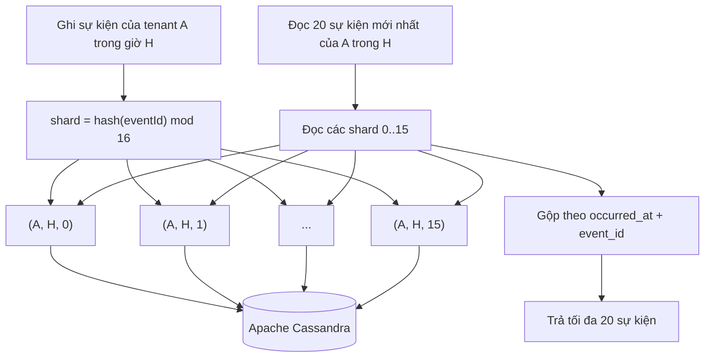

# Thêm shard vào khóa và chi phí đọc nhiều partition

Trong **Spring Data Cassandra**, việc thiết kế khóa chính quyết định cách ứng dụng phân bố dữ liệu, đọc dữ liệu và chịu tải trên Apache Cassandra. Khi một partition nhận quá nhiều bản ghi hoặc quá nhiều thao tác trong thời gian ngắn, một giải pháp thường được cân nhắc là **thêm shard vào partition key** để tách luồng ghi thành nhiều partition. Đổi lại, một truy vấn vốn đọc một partition có thể phải đọc **tất cả các shard**, gộp và sắp xếp kết quả tại ứng dụng.

Đây là bài học trong chương **Khóa và phân vùng**. Nội dung tập trung vào việc quyết định *khi nào cần shard, chọn shard như thế nào, lợi ích ghi và chi phí đọc là bao nhiêu*, sau đó thể hiện thiết kế bằng CQL, entity mapping và repository của Spring Data Cassandra. Các vấn đề như consistency, paging và khả năng mở rộng cần được xem xét cùng thiết kế bảng, không thể giải quyết chỉ bằng cách đổi `Repository` sang `CassandraTemplate` hay `CqlTemplate`.

## 1. Ôn lại: partition key khác clustering column

Xét bảng lưu sự kiện mới nhất của một tenant trong một giờ:

```sql
CREATE TABLE events_by_tenant_hour (
    tenant_id   text,
    bucket_hour text,
    occurred_at timestamp,
    event_id    text,
    event_type  text,
    payload     text,
    PRIMARY KEY ((tenant_id, bucket_hour), occurred_at, event_id)
) WITH CLUSTERING ORDER BY (occurred_at DESC, event_id DESC);
```

- **Partition key** là `(tenant_id, bucket_hour)`. Cassandra băm toàn bộ khóa phân vùng để xác định token và nơi lưu các replica tương ứng. Với mỗi tenant và giờ, các bản ghi thuộc cùng một partition logic.
- **Clustering columns** là `occurred_at` và `event_id`. Chúng xác định thứ tự hàng *bên trong* partition, đồng thời cho phép nhiều bản ghi có cùng thời điểm mà vẫn mang khóa hàng riêng.
- **Khóa chính** gồm partition key và clustering columns. Đổi clustering columns có thể thay đổi cách lấy kết quả theo thứ tự; đổi partition key còn thay đổi cách dữ liệu phân bố trên cluster và cách truy vấn phải định tuyến.

Câu truy vấn dưới đây biết toàn bộ partition key, nên đường đọc có phạm vi rõ ràng:

```sql
SELECT * FROM events_by_tenant_hour
WHERE tenant_id = ? AND bucket_hour = ?
LIMIT 20;
```

Đối với tenant có lưu lượng vừa phải, bảng này có thể đáp ứng cả ghi và danh sách sự kiện mới nhất. Nhưng nếu một tenant tạo lượng sự kiện rất lớn, tất cả sự kiện cùng giờ tập trung vào một partition; replica sở hữu partition phải xử lý lượng ghi và đọc cao. Đó là một dạng **hot partition**.

## 2. Khi nào cần thêm shard?

**Shard ở đây là một giá trị do ứng dụng tính**, được đưa vào partition key để tạo thêm các partition logic. Nó không phải shard vật lý do Cassandra tự quản lý, cũng không đồng nghĩa với token của Cassandra.

Một số dấu hiệu đáng đánh giá:

| Triệu chứng | Cần kiểm tra | Shard giúp gì? |
| --- | --- | --- |
| Một tenant ghi nhiều hơn hẳn tenant khác | Tốc độ ghi theo từng partition, phân bố tenant lớn nhất | Chia ghi của một khóa nóng thành nhiều partition |
| Partition lớn do giữ dữ liệu lâu | Số hàng, kích thước partition, TTL và bucket thời gian | Giảm hàng/dung lượng trên mỗi partition nếu phân phối đều |
| Độ trễ tăng ở các partition rất nóng | Latency theo access pattern, tải replica, hàng đợi và compaction | Phân tán tải, nhưng phải đo trên cluster |
| Một API đã phải đọc nhiều ngày/giờ | Số bucket cần đọc trong một request | Thêm shard có thể **làm fan-out tệ hơn** |
| Tốc độ ghi cao nhưng mỗi sự kiện cần tìm theo ID | Có biết bucket và shard khi đọc lại không? | Chỉ tốt nếu hệ thống định tuyến được tới partition đúng |

Không có số shard tối ưu cho mọi hệ thống. Nếu nguyên nhân chậm thực tế là payload quá lớn, truy vấn không có partition key, retry quá nhiều hoặc thiếu dung lượng toàn cluster, thêm shard có thể không giúp và còn làm tăng số lần đọc.

## 3. Thêm shard vào partition key

Từ bảng ban đầu, bổ sung `shard_id` vào **nhóm partition key**:

```sql
CREATE TABLE events_by_tenant_hour_shard (
    tenant_id   text,
    bucket_hour text,
    shard_id    int,
    occurred_at timestamp,
    event_id    text,
    event_type  text,
    payload     text,
    PRIMARY KEY (
        (tenant_id, bucket_hour, shard_id),
        occurred_at, event_id
    )
) WITH CLUSTERING ORDER BY (occurred_at DESC, event_id DESC);
```

Với `shard_id` trong khoảng `0..15`, một tenant trong một giờ có thể sử dụng **16 partition** thay vì một partition. `occurred_at` và `event_id` vẫn chỉ sắp xếp *bên trong từng shard*.



Trong sơ đồ, `hash(eventId) mod 16` là **phép định tuyến logic phía ứng dụng**. Sau khi ứng dụng chọn `shard_id`, Cassandra tiếp tục áp dụng cơ chế partitioner của cluster lên **partition key ghép** `(tenant_id, bucket_hour, shard_id)` để đặt replica. Hai phép băm phục vụ hai mục đích khác nhau.

### 3.1. Định tuyến ghi phải ổn định

Với mỗi sự kiện, cùng một ID và cùng cấu hình shard phải dẫn tới cùng `shard_id`. Cách minh họa đơn giản khi ID là UUID ngẫu nhiên phiên bản 4:

```java
import java.time.Instant;
import java.time.ZoneOffset;
import java.time.format.DateTimeFormatter;
import java.util.UUID;

public final class EventPartitioning {
    private static final DateTimeFormatter HOUR_FORMAT =
            DateTimeFormatter.ofPattern("uuuuMMddHH")
                    .withZone(ZoneOffset.UTC);

    private EventPartitioning() {}

    public static String hourBucket(Instant occurredAt) {
        return HOUR_FORMAT.format(occurredAt);
    }

    public static int shardFor(UUID eventId, int shardCount) {
        if (shardCount <= 0) {
            throw new IllegalArgumentException("shardCount phải > 0");
        }
        return Math.floorMod(eventId.hashCode(), shardCount);
    }
}
```

Ví dụ ghi một sự kiện:

```java
UUID eventId = UUID.randomUUID();
Instant occurredAt = Instant.now();
String bucketHour = EventPartitioning.hourBucket(occurredAt);
int shardId = EventPartitioning.shardFor(eventId, 16);

// Lưu tenantId, bucketHour, shardId, occurredAt,
// eventId.toString(), eventType và payload vào bảng.
```

`UUID.hashCode()` ổn định cho cùng UUID. Ví dụ này giả định ID là UUID v4 phân bố tương đối đều; nếu ID đến từ nguồn có quy luật hoặc nhiều kiểu khác nhau, nên dùng **hàm băm ổn định, có khả năng phân bố tốt** và đo tỷ lệ sự kiện thực tế trên từng shard. Không dùng `hash(tenantId)` nếu mục tiêu là chia tải *một tenant nóng*: cùng tenant sẽ luôn được đưa vào cùng một shard.

Cần tạo `eventId`, `occurredAt` và `shardId` **một lần cho sự kiện**, rồi tái sử dụng khi retry để tránh ghi thành nhiều hàng không mong muốn. Với schema CQL dùng `timestamp`, hệ thống cũng cần thống nhất độ chính xác thời gian ở mức millisecond khi tạo key/cursor.

### 3.2. Shard theo ID, người dùng hay theo thời gian?

| Cách chọn shard | Ưu điểm | Đánh đổi |
| --- | --- | --- |
| `hash(eventId) mod S` | Các sự kiện ID phân bố đều thường được rải đều | Danh sách sự kiện theo tenant/giờ phải đọc S partition |
| `hash(actorId) mod S` | Truy vấn cho một actor có thể tìm shard nhanh | Actor quá nóng có thể tạo hot shard; dữ liệu nhiều actor có thể lệch |
| Shard ngẫu nhiên | Có thể trải tải ghi | Muốn đọc lại đúng hàng phải lưu hoặc tìm được shard đã chọn; retry phải ổn định |
| Bucket giờ/ngày, không thêm shard | Đơn giản; đọc một khoảng bucket xác định | Không đủ nếu lưu lượng tập trung trong một bucket vẫn quá cao |
| Bucket thời gian **và** shard theo ID | Chặn tăng trưởng theo thời gian và phân tán tải trong bucket | Truy vấn qua B bucket có thể phải đọc `B × S` partition |

Không nên xem shard là bước bắt buộc. Ưu tiên thay đổi **bucket thời gian** nếu nguyên nhân chủ yếu là partition lớn do lưu quá lâu và việc đọc chỉ cần một khoảng thời gian nhỏ. Thêm shard khi **cùng một bucket vẫn nóng**, đồng thời chấp nhận chi phí đọc tăng.

## 4. Chi phí đọc nhiều partition: fan-out

Khi không có shard, truy vấn “20 sự kiện mới nhất của tenant A trong giờ H” chỉ cần một partition:

```sql
SELECT * FROM events_by_tenant_hour
WHERE tenant_id = ? AND bucket_hour = ?
LIMIT 20;
```

Khi `shard_id` trở thành một thành phần partition key, truy vấn thiếu shard không còn là đường đọc một partition hợp lệ của thiết kế. Ứng dụng phải xác định các shard cần đọc, ví dụ:

```sql
-- Lặp trên shard_id = 0, 1, ... 15; truyền đủ khóa cho mỗi lệnh.
SELECT tenant_id, bucket_hour, shard_id,
       occurred_at, event_id, event_type, payload
FROM events_by_tenant_hour_shard
WHERE tenant_id = ?
  AND bucket_hour = ?
  AND shard_id = ?
LIMIT 20;
```

Sau đó ứng dụng **merge** các danh sách đã sắp xếp, lấy 20 sự kiện đứng đầu toàn cục. Vì mỗi shard có clustering order riêng, không thể chỉ lấy kết quả của shard `0` hoặc ghép mảng theo thứ tự shard. Sắp xếp trong một partition **không đồng nghĩa** với sắp xếp toàn bộ S partition.

### 4.1. Ước lượng fan-out

Gọi:

- `S`: số shard cho mỗi bucket.
- `B`: số bucket thời gian cần truy vấn.
- `K`: số kết quả cần trả về cho client.
- `N`: số partition được đọc.

Với mô hình mỗi bucket có S shard:

\[
N = B \times S
\]

Để tính **top K** chính xác trên tập dữ liệu ổn định, mỗi partition có thể trả tối đa K hàng trước khi merge; từ đó:

\[
\text{Số hàng ứng dụng có thể nhận} \le B \times S \times K
\]

Đây là **giới hạn trên**, không phải mọi truy vấn đều có đủ hàng trong mỗi shard. Logic là: một bản ghi xếp ngoài top K của chính shard đó không thể thuộc top K toàn cục, vì ít nhất K bản ghi trong cùng shard đã đứng trước nó. Do vậy, lấy tối đa K ứng viên từ mỗi shard rồi merge là đủ để chọn top K, miễn truy vấn dùng cùng tiêu chí sắp xếp tổng quát và các partition được đọc thành công. Với dữ liệu ghi đồng thời, đây không phải một snapshot xuyên partition.

Ví dụ:

| Yêu cầu | Bucket `B` | Shard `S` | Top `K` | Partition cần đọc | Ứng viên tối đa |
| --- | ---: | ---: | ---: | ---: | ---: |
| 20 sự kiện mới nhất của 1 giờ, chưa shard | 1 | 1 | 20 | 1 | 20 |
| 20 sự kiện mới nhất của 1 giờ, 16 shard | 1 | 16 | 20 | 16 | 320 |
| 20 sự kiện mới nhất trong 24 giờ, 16 shard/giờ | 24 | 16 | 20 | 384 | 7.680 |

Trường hợp cuối rất đáng chú ý: một API chỉ muốn trả **20 bản ghi** nhưng về lý thuyết có thể đọc tới **384 partition và 7.680 ứng viên** trước khi chọn kết quả. Đây là chi phí đánh đổi khi thiết kế ưu tiên phân tán tải ghi.

### 4.2. Những chi phí không xuất hiện trong kết quả API

1. **Số request và round trip:** mỗi partition cần được định tuyến, thực thi và trả dữ liệu; một request nghiệp vụ có thể tạo nhiều request CQL.
2. **Độ trễ đuôi (tail latency):** nếu cần đủ dữ liệu từ tất cả shard, shard chậm nhất có thể chi phối thời gian trả kết quả. Chạy song song giúp giảm thời gian so với chạy tuần tự, nhưng không xóa được rủi ro fan-out.
3. **Tải trên client/cluster:** số statement đang thực thi, kết nối, bộ nhớ chứa ứng viên, network và việc phối trộn kết quả đều tăng.
4. **Retry và lỗi một phần:** nếu một shard timeout, danh sách top K có thể thiếu hàng đứng đầu. Cần chính sách retry có giới hạn và cách báo kết quả không đầy đủ, hoặc cho phép toàn bộ yêu cầu thất bại.
5. **Phân trang phức tạp:** muốn tiếp tục đọc đúng vị trí của nhiều shard cần quản lý cursor cho từng shard hoặc một cơ chế cursor tổng hợp.
6. **Phân quyền tenant:** service phải tự ràng buộc `tenant_id` từ context đã xác thực và kiểm soát số shard/bucket mà client được phép yêu cầu.

Không dùng số shard càng lớn càng tốt. Lợi ích giảm tải ghi trên một partition sẽ giảm dần trong khi chi phí đọc thường tăng theo số partition phải mở.

## 5. Ví dụ ước lượng kích thước và throughput

Giả sử một tenant lớn tạo **160 sự kiện/giây**, trung bình **1 KiB dữ liệu thô/sự kiện**, và ứng dụng có chức năng xem sự kiện mới nhất:

| Thiết kế | Sự kiện/partition trong khoảng thời gian được chọn | Dữ liệu thô ước lượng/partition | Tốc độ ghi trung bình/partition |
| --- | ---: | ---: | ---: |
| 1 partition/tenant/ngày | 13.824.000/ngày | ~13,2 GiB | 160 sự kiện/giây |
| 1 partition/tenant/giờ | 576.000/giờ | ~562,5 MiB | 160 sự kiện/giây |
| 16 shard/tenant/giờ | ~36.000/giờ/shard | ~35,2 MiB | ~10 sự kiện/giây |

Các con số chỉ minh họa phép chia đều trong điều kiện tải ổn định, **chưa tính overhead, index, compression, replica, tombstone hay đỉnh tải**. Cassandra không có một ngưỡng kích thước partition “an toàn” áp dụng cho mọi workload; phải thử tải trên schema và cluster đại diện.

Ước lượng bước đầu:

\[
\text{Rows/shard/bucket} \approx
\frac{\text{Events/second} \times \text{Seconds/bucket}}{S}
\]

\[
\text{Writes/second/shard} \approx
\frac{\text{Writes/second của khóa nóng}}{S}
\]

Nếu một partition cần giữ dưới một ngân sách tải hoặc kích thước do thử nghiệm xác định, chọn S để đáp ứng **cả hai ràng buộc**, rồi kiểm tra lại tổng fan-out của các truy vấn nóng. Phép chia trên không bảo đảm tỷ lệ shard cân bằng hoàn hảo; cần đo phân bố thực tế và p95/p99 của từng đường đọc.

## 6. Mapping vào Spring Data Cassandra

Giữ nguyên cấu trúc CQL ở mục 3, dùng `@PrimaryKeyClass` để ánh xạ toàn bộ khóa ghép. Ba cột đầu thuộc **partition key** và hai cột sau thuộc **clustering key**:

```java
import java.io.Serializable;
import java.time.Instant;
import org.springframework.data.cassandra.core.cql.Ordering;
import org.springframework.data.cassandra.core.mapping.PrimaryKeyClass;
import org.springframework.data.cassandra.core.mapping.PrimaryKeyColumn;
import org.springframework.data.cassandra.core.mapping.PrimaryKeyType;

@PrimaryKeyClass
public class EventKey implements Serializable {

    @PrimaryKeyColumn(name = "tenant_id", ordinal = 0,
            type = PrimaryKeyType.PARTITIONED)
    private String tenantId;

    @PrimaryKeyColumn(name = "bucket_hour", ordinal = 1,
            type = PrimaryKeyType.PARTITIONED)
    private String bucketHour;

    @PrimaryKeyColumn(name = "shard_id", ordinal = 2,
            type = PrimaryKeyType.PARTITIONED)
    private int shardId;

    @PrimaryKeyColumn(name = "occurred_at", ordinal = 3,
            type = PrimaryKeyType.CLUSTERED,
            ordering = Ordering.DESCENDING)
    private Instant occurredAt;

    @PrimaryKeyColumn(name = "event_id", ordinal = 4,
            type = PrimaryKeyType.CLUSTERED,
            ordering = Ordering.DESCENDING)
    private String eventId;

    public EventKey() {}

    // Hoàn thiện constructor, getters/setters, equals() và hashCode().
}
```

```java
import org.springframework.data.cassandra.core.mapping.Column;
import org.springframework.data.cassandra.core.mapping.PrimaryKey;
import org.springframework.data.cassandra.core.mapping.Table;

@Table("events_by_tenant_hour_shard")
public class EventRecord {
    @PrimaryKey
    private EventKey key;

    @Column("event_type")
    private String eventType;

    @Column("payload")
    private String payload;

    public EventRecord() {}

    // Hoàn thiện constructor và getters/setters, bao gồm getKey().
}
```

Các đoạn mã là phần khung ánh xạ, cần hoàn thiện những phương thức được ghi chú trước khi biên dịch. `EventKey` phải có `equals()` và `hashCode()` theo giá trị vì là khóa của entity. Hai cột `occurred_at` và `event_id` cùng tạo thứ tự giảm dần; `event_id` được lưu dạng chữ thường theo chuẩn UUID nhằm tạo một khóa phụ nhất quán khi nhiều sự kiện có cùng millisecond.

### 6.1. Repository buộc người gọi cung cấp shard

```java
import java.util.List;
import org.springframework.data.cassandra.repository.CassandraRepository;
import org.springframework.data.cassandra.repository.Query;

public interface EventRepository
        extends CassandraRepository<EventRecord, EventKey> {

    @Query("SELECT * FROM events_by_tenant_hour_shard " +
           "WHERE tenant_id = ?0 AND bucket_hour = ?1 " +
           "AND shard_id = ?2 LIMIT ?3")
    List<EventRecord> findRecentInShard(
            String tenantId, String bucketHour,
            int shardId, int limit);
}
```

Phương thức nhận đủ `tenantId`, `bucketHour` và `shardId`, tức toàn bộ partition key. Spring Data ánh xạ hàng trả về thành `EventRecord`; nó **không tự tìm các shard còn lại** nếu service cần kết quả của cả tenant. Cũng không nên đặt một phương thức `findByTenantIdAndBucketHour(...)` mà giả định bỏ `shardId` vẫn đọc hiệu quả một partition.

### 6.2. Service fan-out rồi chọn top K

Một triển khai minh họa đơn giản:

```java
import java.util.ArrayList;
import java.util.Comparator;
import java.util.List;
import org.springframework.stereotype.Service;

@Service
public class EventFeedService {
    private final EventRepository repository;

    public EventFeedService(EventRepository repository) {
        this.repository = repository;
    }

    public List<EventRecord> latestInHour(
            String tenantId, String bucketHour,
            int shardCount, int limit) {

        if (shardCount < 1 || shardCount > 128
                || limit < 1 || limit > 100) {
            throw new IllegalArgumentException("Cấu hình đọc không hợp lệ");
        }

        List<EventRecord> candidates = new ArrayList<>();

        for (int shard = 0; shard < shardCount; shard++) {
            candidates.addAll(repository.findRecentInShard(
                    tenantId, bucketHour, shard, limit));
        }

        candidates.sort(Comparator
                .comparing((EventRecord e) ->
                        e.getKey().getOccurredAt())
                .thenComparing(e ->
                        e.getKey().getEventId())
                .reversed());

        return List.copyOf(candidates.subList(
                0, Math.min(limit, candidates.size())));
    }
}
```

Ví dụ chỉ trình bày logic **truy vấn từng shard → gom ứng viên → sắp xếp → cắt top K**. Giả định `occurred_at` có độ chính xác millisecond nhất quán khi ghi/đọc và `event_id` là chuỗi UUID chuẩn hóa, để thứ tự Java tương ứng với hai clustering column đã định nghĩa trong CQL.

Triển khai trên gọi từng shard **tuần tự**, phù hợp để giải thích thuật toán chứ chưa phù hợp với fan-out lớn. Khi đưa vào production, cần:

- Hạn chế mức độ đồng thời và dùng driver async/reactive có kiểm soát, thay vì tạo vô hạn request song song.
- Cân nhắc **k-way merge** trên các dòng kết quả đã sắp xếp để giảm công việc và bộ nhớ so với gom rồi sort toàn bộ `S × K` ứng viên.
- Đặt timeout/retry phù hợp và xác định rõ một shard lỗi thì API trả lỗi hay kết quả có đánh dấu không đầy đủ.
- Đọc `shardCount` từ cấu hình đáng tin cậy **ứng với bucket đó**, không nhận tùy ý từ client; giới hạn `limit` và số bucket được truy vấn.
- Xác minh hiệu quả với dữ liệu và tải gần thực tế; shard nhiều có thể khiến chi phí network/CPU tăng nhanh.

`CassandraTemplate` có thể thực hiện những lệnh đọc từng partition thông qua `Query`/`Criteria`, còn `CqlTemplate` hay `CqlSession` phù hợp khi cần kiểm soát statement, page size hoặc tùy chọn driver. **Đổi tầng API không xóa chi phí fan-out** vì tất cả vẫn phải đọc các partition tương ứng.

## 7. Paging qua nhiều shard: vấn đề thường bị bỏ sót

Với một partition, Cassandra hỗ trợ cơ chế **paging state** để tiếp tục đọc; không có cơ chế `OFFSET N` tùy ý như SQL truyền thống. Khi kết quả nằm ở nhiều shard, việc phân trang còn phải giữ thứ tự **toàn cục**.

Giả sử trang đầu có 20 sự kiện. Để trả trang thứ hai chính xác:

1. Biết khóa sắp xếp cuối cùng của trang đầu, ví dụ cặp `(occurred_at, event_id)`, hoặc lưu vị trí đã tiêu thụ của từng shard.
2. Tiếp tục đọc dữ liệu ở vị trí phù hợp của **tất cả shard** còn có thể chứa kết quả mới.
3. Merge theo đúng comparator chung và trả 20 bản ghi tiếp theo.
4. Ràng buộc cursor với tenant, bucket, version cấu hình shard, các filter và quyền của người gọi.

Một cursor tổng hợp có thể chứa **trạng thái tiếp tục của từng shard**, nhưng không được nhầm một paging state của Cassandra với trạng thái của cả truy vấn liên-shard. Khi phân trang bằng khóa thời gian, cần **tie-breaker ổn định**: chỉ nhớ `occurred_at` sẽ bỏ sót hoặc lặp sự kiện nếu nhiều bản ghi cùng millisecond. Với mô hình clustering `(occurred_at, event_id)`, hãy giữ cả cặp khóa và dùng điều kiện tiếp tục phù hợp với thứ tự CQL đã chọn.

Lưu ý thêm:

- Không có snapshot nguyên tử xuyên nhiều partition: sự kiện mới đến giữa các trang có thể thay đổi tập kết quả. Cần thống nhất UX là **feed cập nhật liên tục** hay **kết quả cố định tại một mốc thời gian**.
- Nếu yêu cầu kết quả nhất quán tại một mốc, có thể chốt ranh giới thời gian của feed từ trang đầu; điều này hạn chế nhưng không giải quyết mọi vấn đề về đồng bộ và clock skew.
- `LIMIT K` giới hạn hàng trả về của một câu CQL; `page size` của driver điều chỉnh từng lần lấy dữ liệu qua mạng. Chúng không thay cho thuật toán phân trang toàn cục.
- Với `B × S` lớn, trả “nhảy tới trang 1000” thường là một hợp đồng API đắt đỏ; xem lại UX hoặc mô hình dữ liệu.

## 8. Consistency và lỗi khi đọc fan-out

Mỗi truy vấn tới một partition chịu **consistency level** của statement/driver như `LOCAL_ONE`, `LOCAL_QUORUM` tùy cấu hình. Ví dụ, chọn `LOCAL_QUORUM` có thể đòi hỏi nhiều replica trong local data center phản hồi hơn `LOCAL_ONE`. Lựa chọn đúng phụ thuộc replication factor, topology, SLA và yêu cầu đọc sau ghi.

Tuy nhiên, **consistency ở từng câu đọc không tạo snapshot nhất quán xuyên nhiều shard**. Nếu các sự kiện đang liên tục được ghi, các shard có thể được đọc tại những thời điểm hơi khác nhau. Hệ quả là:

- Top K trả về có thể phản ánh nhiều thời điểm đọc, nhất là khi fan-out lớn và có retry.
- Nếu một shard trả lỗi nhưng các shard khác thành công, không thể tự khẳng định tập top K đã đầy đủ.
- Khi ghi dữ liệu vào nhiều bảng để phục vụ các access pattern khác nhau, cần idempotency, phương án xử lý ghi một phần và reconciliation phù hợp; batch không phải giao dịch ACID tùy ý giữa mọi bảng.

Vì vậy, chọn consistency và xử lý lỗi là một phần của **hợp đồng truy vấn**, không phải quyết định sau cùng khi đã tạo repository.

## 9. Thay đổi số shard: nguy cơ định tuyến sai dữ liệu cũ

Giả sử ngày đầu cấu hình `S = 8`, sau đó tăng lên `S = 16`. Công thức:

```text
shard = hash(eventId) mod S
```

cho phép cùng `eventId` có kết quả **khác nhau** khi S thay đổi. Nếu code mới dùng S=16 để tìm một sự kiện cũ được ghi theo S=8, nó có thể chọn partition sai. Đồng thời, feed lịch sử chỉ đọc 16 shard theo hiểu biết mới có thể vẫn bắt gặp một số bản ghi cũ do các shard 0–7 trùng tên, nhưng không thể coi đó là chiến lược định tuyến ghi/đọc theo ID được kiểm soát.

Các cách quản lý rõ ràng hơn:

| Chiến lược | Cách thực hiện | Điều cần quản lý |
| --- | --- | --- |
| Cố định S cho mỗi bucket | Ví dụ `bucket_hour=2026112509` luôn dùng 8 shard; bucket mới dùng 16 | Cấu hình S lịch sử của mỗi bucket, áp dụng thống nhất cho writer và reader |
| Đặt version định tuyến trong partition key | Ví dụ thêm `shard_epoch` hoặc dùng namespace phân tách version | Khi đọc khoảng thời gian qua nhiều epoch, phải đọc các partition của từng version |
| Lưu địa chỉ partition theo ID | Bảng tra cứu `eventId → bucket, shard, version` | Ghi/đọc thêm một bảng, xử lý eventual consistency và retry |
| Chuyển dữ liệu có kiểm soát | Repartition/backfill dữ liệu sang key mới | Chi phí migration, giai đoạn dual-write/dual-read và việc xác nhận hoàn tất |

Với dữ liệu dạng chuỗi thời gian, thường dễ quản lý nhất khi **chốt S cho một bucket**, chỉ đổi ở bucket mới và lưu thông tin cấu hình qua các lần triển khai. Nếu hệ thống có các writer cùng chạy nhiều phiên bản, cần tránh để chúng chọn S khác nhau cho cùng bucket.

## 10. Khi nào nên đổi cách đọc thay vì tăng số shard?

Nếu API “xem 20 sự kiện mới nhất trong 30 ngày” được gọi thường xuyên, thiết kế `tenant × hour × shard` có thể phải đọc hàng nghìn partition. Khi đó cần đánh giá lại **access pattern**:

- **Tạo bảng feed phục vụ đọc riêng:** duy trì một danh sách sự kiện gần đây có giới hạn hoặc được bucket theo cửa sổ thích hợp, chấp nhận chi phí đồng bộ ghi và kiểm soát khả năng nóng của feed.
- **Giới hạn khoảng thời gian:** UI mặc định một giờ/ngày và cho phép mở rộng bằng thao tác có chủ đích.
- **Chỉ đọc bucket gần nhất trước:** khi cần top K của chuỗi thời gian, có thể đọc các bucket theo thứ tự thời gian và dừng có điều kiện nếu đã chứng minh không còn bản ghi cũ nào có thể vượt top K hiện tại; không được dừng chỉ vì đã đủ K từ một vài shard mà chưa xét shard còn lại của cùng bucket.
- **Tổ chức truy vấn bất đồng bộ:** tác vụ export hoặc báo cáo lớn dùng job nền thay vì đồng bộ hàng trăm partition trong một HTTP request.
- **Chọn shard theo access pattern khác:** nếu màn hình chủ yếu đọc theo `actorId`, một bảng có partition key `(tenant_id, actor_id, bucket)` có thể hợp lý hơn bảng shard theo event ID, với điều kiện không gây nóng theo actor.

Mỗi lựa chọn thay đổi cân bằng giữa **write amplification** (một sự kiện được ghi vào bao nhiêu bảng), **read amplification** (một thao tác phải đọc bao nhiêu partition/hàng) và độ phức tạp vận hành.

## 11. Checklist quyết định trước khi triển khai

1. **Đo đúng partition nóng:** biết tenant/bucket nào gây vấn đề, nguyên nhân là tốc độ ghi, số hàng, payload hay truy vấn thiếu khóa.
2. **Thử đổi bucket trước nếu phù hợp:** bucket nhỏ hơn thường giảm kích thước partition nhưng làm tăng số bucket cần đọc khi truy vấn lịch sử.
3. **Chọn S dựa trên tải và phân bố dữ liệu:** xác định ngân sách ghi/kích thước từng partition, đo mức lệch của thuật toán hash; không dùng số shard “chuẩn” cho mọi hệ thống.
4. **Định tuyến ghi xác định:** cùng ID, cùng bucket và cùng phiên bản cấu hình phải sinh cùng shard, kể cả khi retry.
5. **Kiểm tra mọi đường đọc:** truy vấn biết shard có thể giữ một partition; truy vấn thiếu shard phải tính `B × S` và khả năng merge.
6. **Thiết kế top K và cursor:** comparator phải khớp clustering order, có tie-breaker và trạng thái tiếp tục qua tất cả shard.
7. **Giới hạn đồng thời và xử lý lỗi:** timeout, retry, backpressure, policy cho shard lỗi và số request CQL từ một request API.
8. **Quy hoạch đổi S/migration:** giữ cấu hình lịch sử để định tuyến đúng dữ liệu cũ.
9. **Đo hiệu năng hai chiều:** p95/p99 đọc và ghi, số partition/request, số hàng tải về/request, partition size, tombstone, timeout và tải node sau thay đổi.
10. **Giữ ràng buộc tenant/consistency:** giá trị shard do server tính và chính sách truy cập luôn được thực thi ở service.

## 12. Bài tập suy luận

**Bài tập 1.** Một bảng dùng `PRIMARY KEY ((tenant_id, event_day, shard_id), occurred_at)`, `S=32`. API cần 10 sự kiện mới nhất trong 7 ngày. Nếu mỗi ngày đều phải đọc đủ 32 shard và mỗi shard trả tối đa 10 hàng, có bao nhiêu partition và tối đa bao nhiêu ứng viên?

**Đáp án:** `B × S = 7 × 32 = 224` partition; tối đa `224 × 10 = 2.240` ứng viên trước khi chọn 10 kết quả. Đây là giới hạn trên, chưa kể trang tiếp theo hoặc những bảng phục vụ truy vấn khác.

**Bài tập 2.** Một developer dùng `shard = tenantId.hashCode() mod 16` với mục tiêu giảm nóng cho tenant A. Cách làm có đạt mục tiêu không?

**Đáp án:** Không. Mọi sự kiện của tenant A luôn có cùng `tenantId`, do đó cùng shard. Cần chọn giá trị thay đổi theo từng sự kiện (chẳng hạn UUID v4 của sự kiện) hoặc một chiến lược phân phối có độ lệch được kiểm soát.

**Bài tập 3.** Hệ thống đổi S từ 8 thành 16 trong lúc tất cả writer đang chạy, nhưng không lưu version hay shardCount của dữ liệu cũ. Vấn đề nào có thể xuất hiện?

**Đáp án:** Reader tính lại shard theo S mới có thể không tìm thấy bản ghi được ghi với S cũ; các writer cũng có thể ghi cùng một sự kiện vào các partition khác nhau. Cần cố định cấu hình theo bucket/epoch hoặc xây dựng kế hoạch định tuyến và migration tương thích.

## Kết luận

**Thêm shard vào partition key** là một kỹ thuật phân tán tải và giới hạn kích thước partition khi một khóa trở nên quá nóng. Nó chỉ thực sự có lợi nếu chiến lược băm ổn định, số shard phù hợp với lưu lượng và các truy vấn đọc chấp nhận được chi phí fan-out. Với S shard và B bucket, một yêu cầu có thể phải đọc `B × S` partition rồi merge kết quả; phân trang, timeout, consistency và thay đổi số shard đều trở nên phức tạp hơn.

Trong Spring Data Cassandra, hãy **thiết kế query contract và khóa trước**, sau đó mới tạo entity, repository hoặc truy vấn template. Câu hỏi quan trọng không phải “có chia nhỏ partition được không?” mà là **“đã giảm được bao nhiêu tải ghi, đổi lại mỗi lần đọc phải truy cập bao nhiêu partition và hệ thống có chịu được chi phí ấy không?”**
