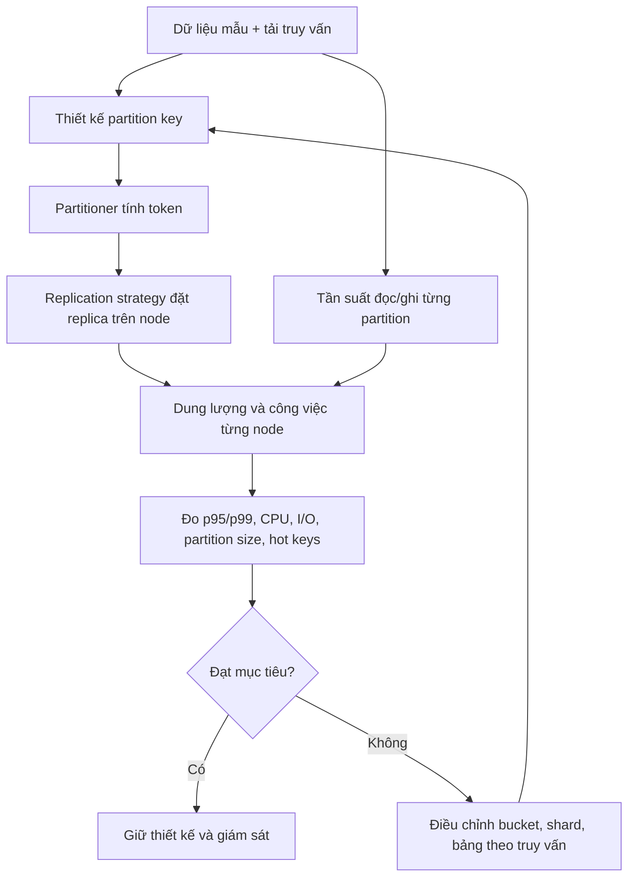

# Đánh giá phân bố dữ liệu với tải và dữ liệu mẫu đại diện

Apache Cassandra phân phối **partition** lên các node theo token tính từ partition key. Một thiết kế khóa có thể trông rất cân bằng trên dữ liệu mẫu nhỏ, nhưng lại tạo **hot partition** khi một vài khách hàng ghi hàng triệu sự kiện hoặc bị truy vấn liên tục trong giờ cao điểm. Vì vậy, muốn đánh giá phân bố dữ liệu, ta phải mô phỏng đồng thời **dữ liệu được lưu** và **tải thực tế được gửi đến hệ thống**.

Bài học thuộc chương **Khóa và phân vùng** của **Spring Data Cassandra**. Ta sẽ xây dựng bảng và truy vấn CQL phục vụ ứng dụng Java, đánh giá partition key trước khi đưa vào entity/repository hoặc `CassandraTemplate`, dùng mẫu dữ liệu đại diện để phát hiện lệch tải, rồi đo độ trễ, paging, consistency level và chi phí đọc/ghi trên cluster Cassandra.

**Mục tiêu sau bài học:**

1. Phân biệt phân bố số partition, dung lượng đĩa và lưu lượng đọc/ghi.
2. Chọn mẫu phản ánh tenant lớn/nhỏ, đỉnh tải, dữ liệu cũ/mới, TTL và các truy vấn thực tế.
3. Ước tính kích thước partition, mức tập trung của workload và ảnh hưởng của replication factor.
4. Thiết lập thử nghiệm có thể lặp lại, đọc đúng các chỉ số từ Cassandra và ứng dụng Spring.
5. So sánh partition theo ngày, theo giờ hoặc chia shard; chọn thiết kế theo kết quả đo cùng chi phí truy vấn.

## 1. Phân bố đều nghĩa là điều gì?

Trong Cassandra, partition key được mã hóa thành byte rồi chuyển thành token bằng partitioner. Token quyết định các dải token và tập replica theo cấu hình replication/topology. Vì thế một key có phân bố hash tốt vẫn **không bảo đảm** workload cân bằng.

Xét ba góc nhìn tách biệt:

| Góc nhìn | Câu hỏi | Ví dụ mất cân bằng |
| --- | --- | --- |
| **Phân bố partition** | Có bao nhiêu partition và mỗi partition lớn tới đâu? | Nhiều partition nhỏ, nhưng một partition vượt xa phần còn lại |
| **Phân bố dữ liệu trên node** | Mỗi node/replica lưu bao nhiêu dữ liệu và chịu bao nhiêu công việc nền? | Một node có dung lượng/SSTable/compaction backlog cao |
| **Phân bố lưu lượng** | Key hoặc node nào nhận nhiều đọc/ghi tại từng thời điểm? | Một tenant chiếm 50% lượt đọc dù chỉ dùng 5% dung lượng |

Ví dụ, 10.000 partition mỗi partition 5 MiB có tổng khoảng 49 GiB dữ liệu logic trước replication và overhead. Nếu **một partition được đọc 20.000 lần/giây**, nó vẫn có thể nóng hơn 9.999 partition còn lại dù tổng dung lượng giữa các node tương đối đều.



**Điểm quan trọng:** một node có token range nhỏ hơn không mặc nhiên nhận ít truy vấn hơn; một node có nhiều dữ liệu không mặc nhiên có độ trễ cao hơn. Cần kiểm tra vị trí replica, routing của driver và truy vấn đang được gửi ở đâu.

## 2. Bắt đầu bằng đường truy vấn thật, không bắt đầu bằng bảng mẫu ngẫu nhiên

Giả sử hệ thống cho thuê cần lưu nhật ký hoạt động của các tenant. Các màn hình chính gồm:

- Lấy **50 sự kiện mới nhất** của tenant trong một ngày.
- Đi đến các trang tiếp theo trong cùng ngày bằng **paging state**.
- Xem lịch sử tenant theo khoảng ngày; ứng dụng duyệt từng bucket ngày và kết hợp kết quả.
- Ghi sự kiện liên tục, đôi khi cập nhật hoặc xóa những sự kiện đã ghi sai.

Thiết kế ban đầu:

```sql
CREATE TABLE tenant_events_by_day (
    tenant_id uuid,
    event_day date,
    occurred_at timestamp,
    event_id uuid,
    event_type text,
    payload text,
    PRIMARY KEY ((tenant_id, event_day), occurred_at, event_id)
) WITH CLUSTERING ORDER BY (occurred_at DESC, event_id ASC);
```

**Partition key** là `(tenant_id, event_day)`; `occurred_at` và `event_id` là clustering columns, giúp định vị và sắp xếp các hàng bên trong partition. Tất cả sự kiện của **một tenant trong một ngày** nằm cùng partition logic, được sao chép lên nhiều replica theo replication factor.

Truy vấn chính:

```sql
SELECT occurred_at, event_id, event_type, payload
FROM tenant_events_by_day
WHERE tenant_id = 3b97ef7a-55e1-49fa-9cfa-9f6aa67fd513
  AND event_day = '2026-11-25'
LIMIT 50;
```

Câu truy vấn đã cung cấp toàn bộ partition key và tận dụng clustering order, nên có đường đọc trực tiếp trong một partition. Nhưng nếu tenant có tốc độ ghi cực lớn, **partition trong ngày** có thể rộng, bị truy cập quá thường xuyên hoặc có nhiều tombstone. Mẫu gồm 100 tenant ghi đồng đều 100 sự kiện/ngày sẽ không bộc lộ các vấn đề đó.

Không nên chuyển sang `PRIMARY KEY (event_id)` chỉ vì UUID hash đều: dạng đó hỗ trợ tra cứu một event theo ID, nhưng **không hỗ trợ trực tiếp** danh sách sự kiện theo tenant/ngày. Cassandra phải được thiết kế theo tập truy vấn cần phục vụ, có thể cần **nhiều bảng** cho những hướng truy vấn khác nhau.

## 3. Mẫu đại diện phải có cả “đuôi dài” lẫn phần gây áp lực lớn

Không có một “tập dữ liệu đại diện” chung cho mọi hệ thống. Tập mẫu chỉ hữu ích khi thể hiện **những đặc điểm làm thay đổi kích thước partition và số request trên mỗi partition**.

### 3.1. Phân tầng tenant

Giả sử số liệu sản phẩm cho biết hệ thống có **500 tenant** và tổng **12 triệu sự kiện/ngày**. Bảng sau là **kịch bản giả định để học cách thiết kế thử nghiệm**, không phải số liệu đo từ một cluster thực:

| Nhóm | Số tenant | Tỷ trọng ghi | Tỷ trọng đọc | Số event trung bình/tenant/ngày |
| --- | ---: | ---: | ---: | ---: |
| Tenant lớn | 5 (1%) | 40% | 70% | 960.000 |
| Tenant vừa | 95 (19%) | 35% | 20% | Khoảng 44.200 |
| Tenant nhỏ | 400 (80%) | 25% | 10% | 7.500 |
| **Tổng** | **500** | **100%** | **100%** | — |

Nếu chỉ lấy ngẫu nhiên 50 tenant không phân tầng, ta có thể bỏ sót cả năm tenant lớn, trong khi họ tạo **40% dữ liệu mới và 70% truy vấn đọc**.

Cách chọn mẫu tốt hơn:

1. Giữ **đầy đủ** các tenant lớn và những key có tải cao nhất.
2. Lấy tenant vừa, nhỏ theo nhiều mức lưu lượng, vòng đời dữ liệu và vùng thời gian.
3. Khi thu nhỏ dữ liệu phục vụ chạy thử, ghi lại **trọng số** để không diễn giải sai tỷ trọng trong quần thể gốc.
4. Dành riêng kịch bản cho tenant mới, tenant vừa tăng trưởng đột biến và tenant có hành vi khác bình thường.

Phân tầng theo **số tenant** và phân tầng theo **lượt request** là hai việc khác nhau: cần giữ cả hai. Một tenant có ít hàng vẫn có thể cực nóng nếu ứng dụng liên tục đọc cùng trang lịch sử.

### 3.2. Những chiều bắt buộc xem xét

| Chiều dữ liệu hoặc tải | Điều cần có trong mẫu | Sai lệch nếu thiếu |
| --- | --- | --- |
| Phân bố key | Tenant lớn/nhỏ, top tenant theo đọc/ghi, nhiều tenant ít hoạt động | Đánh giá thấp hot partition |
| Thời gian | Giờ bình thường, cao điểm, cuối tuần, cuối tháng, ngày có chiến dịch | Bỏ qua burst và chênh lệch theo giờ |
| Tuổi dữ liệu | Ngày hiện tại, 7 ngày gần đây, dữ liệu cũ, dữ liệu đã hết TTL | Bỏ qua partition lịch sử và SSTable/tombstone |
| Kích thước hàng | Trung vị, p95/p99 payload, giá trị lớn bất thường | Dự báo dung lượng partition quá thấp |
| Kiểu thao tác | Insert, update, delete, read, paging; tỷ lệ tương ứng | Mô phỏng toàn ghi hoặc toàn đọc không thực tế |
| Truy vấn | Tra cứu theo partition, nhiều ngày, lọc theo loại, trang đầu/trang sâu | Chọn khóa phù hợp một API nhưng gây fan-out ở API khác |
| Giao thoa đọc/ghi | Cùng tenant vừa được ghi vừa bị đọc trong giờ cao điểm | Không thấy cạnh tranh CPU/I/O trên replica |
| Tính nhất quán và topology | RF, số data center, consistency level, phân bố rack | So sánh không đồng điều kiện vận hành |
| Lifecycle | Retention, TTL, xóa nhiều, backfill đến muộn, cập nhật lịch sử | Không thấy tombstone, compaction và growth lâu dài |

**Dữ liệu mẫu không nhất thiết chứa thông tin cá nhân thật.** Nên dùng tenant ID giả lập ổn định, payload đã ẩn danh hoặc sinh tổng hợp nhưng vẫn giữ **phân bố kích thước và tần suất** giống sản phẩm. Việc thay mọi payload bằng chuỗi ngắn giống hệt nhau còn làm thay đổi cả tỷ lệ nén; cần dùng dữ liệu mô phỏng phản ánh độ dài và độ nén thực tế.

## 4. Tách mẫu dữ liệu tĩnh và mẫu tải động

Một snapshot chứa đúng 12 triệu sự kiện vẫn chưa cho biết Cassandra chịu bao nhiêu request/giây. Cần hai bộ đầu vào:

### A. Dataset: những gì đang nằm trong bảng

Đối với mỗi partition key `(tenant_id, event_day)`, ghi nhận:

- Số hàng/cell, byte ước tính và kích thước payload.
- Tuổi dữ liệu, có TTL hay không, tỷ lệ cập nhật/xóa.
- Số partition theo tenant/ngày và phân bố kích thước: p50, p95, p99, cực đại.
- Số bucket còn sống trong thời gian retention.

### B. Workload trace: những thao tác ứng dụng sẽ gửi

Mỗi dòng trong trace có thể chứa:

```text
timestamp_utc, operation, tenant_id, event_day, query_shape, page_size, payload_bytes
2026-11-25T09:00:00.012Z, READ_DAY, tenant-A, 2026-11-25, LATEST_EVENTS, 50, 0
2026-11-25T09:00:00.018Z, WRITE,    tenant-B, 2026-11-25, INSERT_EVENT,  0, 2300
2026-11-25T09:00:00.029Z, READ_DAY, tenant-A, 2026-11-25, NEXT_PAGE,     50, 0
```

Các tenant ID trong đoạn trace chỉ là nhãn minh họa; khi chạy SQL cần dùng UUID hợp lệ. Thuộc tính `query_shape` đặc biệt quan trọng: đọc theo ID, đọc 50 sự kiện mới nhất và đọc 10 ngày có chi phí khác nhau dù xuất phát từ cùng khách hàng.

Theo dõi **arrival rate** (tốc độ request đến) và **concurrency** (số tác vụ đồng thời). Ví dụ trung bình 8.000 ghi/giây, đỉnh 25.000 ghi/giây và nhiều đợt ngắn 60 giây sẽ tạo áp lực khác hẳn gửi đều 8.000 ghi/giây suốt ngày. Phân bố thời gian giữa request cũng quan trọng, không chỉ tổng số.

### Tránh hai lỗi lấy mẫu phổ biến

**Lỗi 1 – chỉ lấy 1% số dòng theo xác suất đều.** Phép lấy mẫu này có thể giữ tỷ lệ hàng ở tenant lớn, nhưng loại bỏ một phần lớn **số hàng trong từng partition**, khiến partition thực tế 1 GiB trông như chỉ 10 MiB. Nếu đánh giá kích thước, phải giữ được các partition lớn **đầy đủ** hoặc có cơ chế tái tạo đúng mức kích thước ban đầu.

**Lỗi 2 – sinh lưu lượng ngẫu nhiên đều trên mọi key.** Khi mọi tenant cùng xác suất được đọc, test đánh mất tình trạng vài tenant chiếm đa số QPS. Cần **phân bố có trọng số** và tái hiện cả hot key lẫn các đợt tăng đột biến.

## 5. Ước tính phân bố trước khi benchmark

### 5.1. Kích thước partition

Với partition `p`:

\[
S_p \approx \sum_{r \in p} (\text{bytes dữ liệu của hàng } r + \text{overhead lưu trữ})
\]

Kích thước này là **ước tính**, không phải giá trị chính xác trên đĩa. Cassandra còn có serialization, metadata, index, compression, tombstone và cấu trúc SSTable; kết quả thực đo trên node có thể khác đáng kể.

Với ví dụ **tenant lớn** ở mục 3, giả sử trung bình mỗi hàng có phần dữ liệu nghiệp vụ khoảng **1,5 KiB**:

\[
\frac{12\,000\,000 \times 40\%}{5} = 960\,000\ \text{hàng/tenant/ngày}
\]

\[
960\,000 \times 1{,}5\ \text{KiB}
\approx 1{,}37\ \text{GiB/partition/ngày}
\]

Con số **1,37 GiB** mới là dữ liệu hàng ước tính, chưa có overhead và ảnh hưởng nén. Nó cảnh báo partition theo ngày cho nhóm lớn có thể quá rộng. Theo hướng dẫn data modeling của Apache Cassandra, một **quy tắc kinh nghiệm** thường dùng là cố gắng giữ partition dưới khoảng **100 MB** và số cell dưới khoảng **100.000**; đây là **mốc tham khảo**, không phải hard limit, cần đo thực tế trên phiên bản và workload đang dùng.

Tính thêm các thống kê:

- `p50(S_p)`, `p95(S_p)`, `p99(S_p)` và `max(S_p)`;
- Số partition vượt ngưỡng nội bộ và tỷ trọng **byte** nằm trong những partition đó;
- Kích thước partition có tăng vô hạn theo tuổi dữ liệu hay đã có bucket thời gian.

**Chỉ nhìn kích thước trung bình sẽ che khuất đuôi phân bố.** Một triệu partition nhỏ không bù được một partition đơn lẻ gây timeout.

### 5.2. Phân bố lưu lượng theo partition

Đặt `R_p(t)` và `W_p(t)` là số đọc/ghi mỗi giây vào partition `p` tại khoảng thời gian `t`. Một số phép đo hữu ích:

| Chỉ số | Cách tính đơn giản | Ý nghĩa |
| --- | --- | --- |
| Tỷ trọng top 1% key | Tổng QPS của 1% key nóng nhất / tổng QPS | Mức tập trung lưu lượng |
| Max/median QPS | QPS nóng nhất / median QPS của **key đang hoạt động** | Độ lệch giữa key nóng và key điển hình |
| Burst ratio | QPS cao điểm / QPS trung bình của cùng nhóm key | Biên độ tăng tải |
| Read/write mix | Số truy vấn đọc so với ghi theo API và key | Phân biệt nút thắt đọc hoặc ghi |
| Hàng phải đọc/trả về | Số hàng/cell/tombstone phải quét so với hàng trả về | Độ hiệu quả của query shape |

Khi median QPS bằng 0, không dùng phép chia max/median; báo riêng số key không hoạt động và dùng phân vị có ý nghĩa. Một **heatmap theo tenant × giờ** thường dễ thấy skew theo thời gian hơn biểu đồ trung bình cả ngày.

### 5.3. Từ partition đến replica và node

Với replication factor `RF = 3` trong một data center, một partition có **ba bản sao logic** trên các replica phù hợp. Dung lượng cluster do dữ liệu bảng tạo ra gần đúng:

\[
\text{Dung lượng dữ liệu gốc} \times RF
\]

Trên thực tế phải cộng/điều chỉnh theo nén, index, commit log, compaction, snapshot, sự khác biệt giữa replica và không gian dự phòng. Đây **không phải** công thức dự đoán mức đĩa chính xác trên từng máy.

Một phép thử có 1 node/RF=1 không đại diện cho cluster production RF=3 nếu mục tiêu là đánh giá phân bố trên replica, mức độ nhất quán và network I/O. Với nhiều data center, còn cần cân nhắc replication strategy và các consistency level như `LOCAL_QUORUM`.

## 6. Thiết kế ba ứng viên partition key để so sánh

Thay vì sửa một bảng liên tục rồi so số liệu thiếu kiểm soát, tạo các **ứng viên bảng độc lập trong môi trường test**. Mỗi bảng giữ cùng nội dung nghiệp vụ nhưng thay cách tạo partition.

### Phương án A: theo tenant/ngày

```sql
CREATE TABLE tenant_events_by_day (
    tenant_id uuid,
    event_day date,
    occurred_at timestamp,
    event_id uuid,
    event_type text,
    payload text,
    PRIMARY KEY ((tenant_id, event_day), occurred_at, event_id)
) WITH CLUSTERING ORDER BY (occurred_at DESC, event_id ASC);
```

**Ưu điểm:** tra cứu một ngày chỉ cần biết tenant và ngày, đọc một partition. **Rủi ro:** tenant lớn có partition cực rộng và nhiều request dồn về cùng một tập replica.

### Phương án B: theo tenant/giờ

```sql
CREATE TABLE tenant_events_by_hour (
    tenant_id uuid,
    event_hour timestamp,
    occurred_at timestamp,
    event_id uuid,
    event_type text,
    payload text,
    PRIMARY KEY ((tenant_id, event_hour), occurred_at, event_id)
) WITH CLUSTERING ORDER BY (occurred_at DESC, event_id ASC);
```

`event_hour` phải là **mốc đầu giờ chuẩn hóa theo UTC**. Mọi client cần cùng một quy tắc tính bucket để tránh ghi nhầm partition.

**Ưu điểm:** chia partition theo thời gian, giới hạn số hàng tích tụ trong một key. **Đổi lại:** truy vấn cả ngày phải duyệt tối đa 24 bucket giờ có dữ liệu và ghép thứ tự/kết quả ở ứng dụng.

### Phương án C: theo tenant/giờ/shard

```sql
CREATE TABLE tenant_events_by_hour_shard (
    tenant_id uuid,
    event_hour timestamp,
    shard smallint,
    occurred_at timestamp,
    event_id uuid,
    event_type text,
    payload text,
    PRIMARY KEY ((tenant_id, event_hour, shard), occurred_at, event_id)
) WITH CLUSTERING ORDER BY (occurred_at DESC, event_id ASC);
```

Ứng dụng tạo `shard` ổn định từ event ID, ví dụ `shard = floorMod(hash(event_id), N)` với `N = 8`. Cùng một `event_id` phải luôn trở về cùng shard để thao tác cập nhật/xóa đúng partition. Cần lưu/truy được `N` áp dụng cho mỗi bucket nếu chính sách số shard thay đổi về sau.

**Ưu điểm:** phân tán ghi của một tenant/giờ lên nhiều partition, thường giúp giảm kích thước và tốc độ truy cập mỗi partition. **Đổi lại:** đọc đủ dữ liệu của một giờ phải đọc nhiều shard, rồi **merge sort** theo `occurred_at` và `event_id`. Chi phí fan-out, paging và hợp nhất kết quả có thể vượt lợi ích phân tải nếu số shard quá lớn.

| Câu hỏi thiết kế | A: tenant/ngày | B: tenant/giờ | C: tenant/giờ/shard |
| --- | --- | --- | --- |
| Số partition để đọc một ngày đầy đủ | Tối đa 1 | Tối đa 24 | Tối đa `24 × N` |
| Giới hạn kích thước partition nóng | Thấp | Tốt hơn nếu tải phân bố theo giờ | Tốt hơn nếu hash/shard phân tải đủ |
| Độ phức tạp đọc theo thời gian giảm dần | Thấp | Phải duyệt bucket giờ | Phải duyệt shard và hợp nhất thứ tự |
| Ghi của tenant rất nóng | Có thể tạo điểm nóng | Giảm kích thước nhưng vẫn nóng trong giờ | Có cơ hội phân tải sang nhiều token |
| Việc đổi schema/định tuyến | Đơn giản | Thêm quy tắc bucket | Thêm quy tắc shard, phiên bản và merge |

Con số “tối đa 24” giả định một ngày UTC đủ 24 giờ và API đọc tất cả giờ. Truy vấn chỉ đọc giờ gần nhất thường ít fan-out hơn. Không nên dùng shard nếu chỉ cần bucket theo giờ đã đạt mục tiêu.

## 7. Lập kế hoạch chạy thử đủ đại diện

Thiết lập một **ma trận thử nghiệm** trước khi sinh dữ liệu hoặc gửi request:

| Kịch bản | Dataset | Workload | Mục tiêu |
| --- | --- | --- | --- |
| **Khởi đầu** | Các nhóm tenant ở tỷ lệ thực, dữ liệu 7–30 ngày | Tải bình thường | Kiểm tra kích thước partition và đường đọc |
| **Giờ cao điểm** | Giữ nguyên dataset | Replay tốc độ ghi/đọc theo từng phút ở peak | Tìm hot partition và p99 khi tăng tải |
| **Một tenant đột biến** | Một tenant lớn tăng sự kiện trong một giờ | Tăng request cùng partition | Kiểm tra khả năng chịu skew nặng |
| **Đọc lịch sử** | Phân bố tuổi, TTL và xóa giống thực tế | Đọc nhiều bucket, paging các trang tiếp | Đo fan-out, tombstone và độ trễ trang sâu |
| **Backfill/cập nhật** | Sự kiện đến muộn, chỉnh sửa dữ liệu cũ | Ghi xen kẽ update/delete với read | Đo compaction, SSTable và chi phí đọc |
| **Tải kéo dài** | Dataset tăng theo retention | Tải ổn định đủ lâu cho flush/compaction | Phát hiện tình trạng kết quả đẹp lúc mới chạy |

Để phép so sánh có ý nghĩa:

1. Giữ **cùng loại máy, phiên bản Cassandra, RF, topology/DC, consistency level, chiến lược compaction và payload logic** cho các phương án; nếu thay biến nào, ghi rõ là thí nghiệm khác.
2. Đặt **mục tiêu nghiệm thu** trước khi test: ví dụ p99 của API đọc dưới 200 ms tại mức tải đã định, tỷ lệ lỗi/timeout chấp nhận được, partition p99 trong ngân sách kích thước, CPU/I/O/đĩa còn dư địa. Các con số chỉ minh họa; SLA thực tế phải do hệ thống xác định.
3. Sinh dataset **trước**, làm nóng kết nối/caches, chạy ramp-up rồi lấy số liệu trong khoảng steady state. Lặp lại nhiều lần để giảm nhiễu.
4. Với các vấn đề liên quan TTL/compaction, thời gian chạy phải đủ để thấy vòng đời dữ liệu; một benchmark 2 phút không thể chứng minh hiệu năng ổn định nhiều ngày.
5. Phân biệt **client-side latency** (từ ứng dụng), **server-side latency** (node) và tổng thời gian một API gồm nhiều truy vấn/fan-out.
6. Ghi lại số node khỏe, pending compaction, disk utilization, giới hạn tài nguyên của client load test. Client quá yếu có thể làm kết luận sai về Cassandra.

Không tạo tải lớn trên cluster production để thử nghiệm. Dùng môi trường đã định mức an toàn hoặc replay có giới hạn tài nguyên và đo trước với workload nhỏ.

### Kiểm tra query shape trước khi gửi tải

Với bảng theo ngày, truy vấn tốt phải biết đầy đủ `tenant_id` và `event_day`:

```sql
SELECT occurred_at, event_id, event_type
FROM tenant_events_by_day
WHERE tenant_id = 3b97ef7a-55e1-49fa-9cfa-9f6aa67fd513
  AND event_day = '2026-11-25'
LIMIT 50;
```

Không dùng `ALLOW FILTERING` hoặc `SELECT COUNT(*)` toàn bảng như công cụ đo kích thước dataset: những truy vấn này có thể quét rộng và gây biến dạng workload. Phần tính phân bố từ nguồn đầu vào nên được làm **ngoài đường truy vấn trực tuyến**, hoặc đo qua metrics/đường lấy mẫu được thiết kế rõ ràng.

## 8. Quan sát Cassandra bằng chỉ số đúng cấp độ

Trên node Cassandra có quyền quản trị, có thể dùng:

```bash
nodetool status
nodetool tablestats <keyspace>.tenant_events_by_day
nodetool tablehistograms <keyspace> tenant_events_by_day
nodetool toppartitions <keyspace> tenant_events_by_day 10000
nodetool compactionstats
```

Lệnh `toppartitions` ở đây dùng thời lượng lấy mẫu **10.000 ms** theo cú pháp tài liệu Cassandra 5.0; các tùy chọn và cách hiển thị có thể khác giữa phiên bản. Công cụ này lấy **mẫu hoạt động cục bộ** trên node, không phải bảng tổng hợp chính xác mọi hot key trong cluster. Khi cần so sánh toàn cluster, phải lấy mẫu ở các node và cửa sổ thời gian thích hợp.

| Quan sát | Dùng để kết luận gì? | Không nên suy ra điều gì? |
| --- | --- | --- |
| `nodetool status` | Node up/down, load và token ownership ở mức tổng quan | “Node có load bằng nhau thì QPS bằng nhau” |
| `tablestats` | Dung lượng/SSTable, số partition ước tính, read/write, tombstone, tình trạng bảng trên node | “Có thể suy ra kích thước chính xác của từng hot partition” |
| `tablehistograms` | Phân vị ước tính kích thước partition, cell count, SSTables mỗi lần đọc và latency cục bộ | “Các phân vị này là p99 API nhìn thấy ở client” |
| `toppartitions` | Những partition được lấy mẫu là nóng trong cửa sổ đo | “Đã liệt kê toàn bộ key nóng ở mọi thời điểm” |
| `compactionstats` | Compaction đang chạy/chờ, công việc nền đang tồn đọng | “Backlog bằng 0 tức partition key tối ưu” |
| Driver/application metrics | Request rate, retry, timeout, p50/p95/p99, số truy vấn mỗi API | “Chỉ cần p99 thấp khi chạy dữ liệu nhỏ là đủ” |

**Đo cả node và ứng dụng.** Ví dụ p99 của `tablehistograms` có thể thấp, nhưng API đọc 24 bucket có p99 cao do ứng dụng phải gửi nhiều truy vấn và hợp nhất kết quả. Ngược lại, CPU cao ở coordinator chưa chắc replica giữ dữ liệu lệch; cần xem cấu hình driver, token-aware routing và retry.

Để kiểm tra token của **một key đã biết**:

```sql
SELECT token(tenant_id, event_day) AS partition_token,
       tenant_id, event_day
FROM tenant_events_by_day
WHERE tenant_id = 3b97ef7a-55e1-49fa-9cfa-9f6aa67fd513
  AND event_day = '2026-11-25'
LIMIT 1;
```

Giá trị token hữu ích để hiểu ánh xạ theo partitioner, nhưng không phải “điểm số” đánh giá hot key. **Token không biểu diễn kích thước hay tần suất đọc**. Truy vấn trên chỉ có kết quả khi partition tồn tại và có hàng còn khả kiến.

## 9. Đánh giá từ Spring Data Cassandra

Spring Data Cassandra cung cấp entity mapping, repository và `CassandraTemplate`, nhưng **cách đặt partition key vẫn quyết định** request có được định tuyến đến đúng partition hay không.

### Mapping khớp CQL schema

Ví dụ các phần chính của khóa và entity ở phương án A:

```java
@PrimaryKeyClass
public class TenantEventKey implements Serializable {
    @PrimaryKeyColumn(name = "tenant_id", ordinal = 0,
                      type = PrimaryKeyType.PARTITIONED)
    private UUID tenantId;

    @PrimaryKeyColumn(name = "event_day", ordinal = 1,
                      type = PrimaryKeyType.PARTITIONED)
    private LocalDate eventDay;

    @PrimaryKeyColumn(name = "occurred_at", ordinal = 2,
                      type = PrimaryKeyType.CLUSTERED,
                      ordering = Ordering.DESCENDING)
    private Instant occurredAt;

    @PrimaryKeyColumn(name = "event_id", ordinal = 3,
                      type = PrimaryKeyType.CLUSTERED,
                      ordering = Ordering.ASCENDING)
    private UUID eventId;

    // Bổ sung constructor, getter/setter, equals và hashCode.
}

@Table("tenant_events_by_day")
public class TenantEvent {
    @PrimaryKey
    private TenantEventKey key;
    private String eventType;
    private String payload;

    // Bổ sung constructor và getter/setter.
}

public interface TenantEventRepository
        extends CassandraRepository<TenantEvent, TenantEventKey> {
}
```

Đây là **đoạn mapping minh họa**, cần thêm import và các hàm của Java class trước khi biên dịch. Nếu dùng mapping mặc định, cần kiểm tra tên cột camelCase với snake_case; nên khai báo rõ `@Column("event_type")` khi quy tắc naming không bảo đảm đồng nhất trong dự án.

Các cột `PARTITIONED` phải khớp **cả thứ tự lẫn giá trị** của partition key trong CQL. Đừng lấy kết quả benchmark bằng truy vấn CQL đúng khóa rồi cho phép repository production chạy một query thiếu `event_day`: hai đường truy vấn không còn tương đương.

### Một đường đọc trực tiếp với `CassandraTemplate`

```java
UUID tenantId = UUID.fromString("3b97ef7a-55e1-49fa-9cfa-9f6aa67fd513");
LocalDate day = LocalDate.of(2026, 11, 25);

Query query = Query.query(
        Criteria.where("tenant_id").is(tenantId),
        Criteria.where("event_day").is(day)
).limit(50);

List<TenantEvent> events =
        cassandraTemplate.select(query, TenantEvent.class);
```

Đoạn ví dụ chỉ lấy **trang kết quả giới hạn 50 hàng** trong một partition; phần cài đặt cần import `Query`, `Criteria` và cấu hình `CassandraTemplate`. Với truy vấn đi nhiều trang, dùng **paging state**/`Slice` theo hỗ trợ của Spring Data Cassandra/driver. Cassandra paging thường tiến **theo chiều tiếp nối**; API “nhảy thẳng đến offset 500.000” không phải đường phân trang tự nhiên như SQL có `OFFSET`.

### Instrument ứng dụng và driver

Nên lưu metrics với những chiều có thể phân tích và không gây nổ số lượng nhãn:

| Metric hoặc thuộc tính | Ví dụ |
| --- | --- |
| Query shape | `READ_LATEST_DAY`, `READ_HISTORY_WEEK`, `WRITE_EVENT` |
| Mức tải | QPS hiện tại, request đang đồng thời, bytes/giây |
| Latency | p50, p95, p99 từ client; thời gian server theo bảng |
| Kết quả | Số hàng trả về, page size, số trang, timeout, retry |
| Khóa nóng | Top key từ sampling/tracing/khảo sát có kiểm soát |
| Topology | DC, RF, consistency level, node nhận request theo metadata thích hợp |

Tránh gắn **raw `tenant_id` hoặc `event_id` thành nhãn metric trên mọi request**: cardinality có thể rất lớn. Để phân tích tenant nóng, dùng log lấy mẫu/aggregate theo cửa sổ và lưu ngoài hệ thống metrics độ phân giải cao; nếu dữ liệu nhạy cảm, dùng ID đã ẩn danh ổn định.

Driver có token-aware routing có thể ưu tiên replica phù hợp khi truy vấn chứa đủ routing key, nhưng nó **không phân tán được một hot partition thành các partition nhỏ**. Khi số request dồn vào một key quá lớn, cần thay đổi thiết kế bucket/shard hoặc phân bổ workload, chứ không chỉ đổi API repository thành template.

## 10. Đọc kết quả và chọn thiết kế

Giả sử phép thử với cùng dữ liệu/tải có **kết quả giả lập** như sau (số liệu chỉ để minh họa phương pháp phân tích, **không phải benchmark thật**):

| Chỉ số | A: theo ngày | B: theo giờ | C: giờ + 8 shard |
| --- | ---: | ---: | ---: |
| Partition lớn nhất quan sát | 1,45 GiB | 110 MiB | 17 MiB |
| p99 API “50 sự kiện mới nhất” | 380 ms | 130 ms | 110 ms |
| p99 API “lịch sử cả ngày” | 410 ms | 180 ms | 360 ms |
| Số partition có thể cần đọc cho một ngày | 1 | 24 | 192 |
| CPU cao nhất ở replica nóng trong peak | 93% | 71% | 64% |
| Số request bổ sung do fan-out | Thấp | Trung bình | Cao |

Giả sử ngưỡng p99 cho hai API là 200 ms, và ngân sách vận hành muốn giữ partition phần lớn dưới khoảng 100 MiB:

- **A** thất bại ở kích thước partition và độ trễ của cả hai API, dù cách đọc một partition rất đơn giản.
- **B** cải thiện rõ rệt nhưng partition cao nhất 110 MiB vẫn cần điều tra theo phân bố giờ và payload; có thể tinh chỉnh bucket ở tenant cực lớn.
- **C** giảm partition/CPU nóng nhất, song **lịch sử cả ngày chậm hơn B** vì fan-out sang nhiều shard, ngay cả khi từng partition nhỏ.

**Không chọn phương án C chỉ vì partition nhỏ nhất.** Nếu chức năng chính là xem lịch sử một ngày, B có thể có tổng chi phí tốt hơn. Nếu sản phẩm ưu tiên ingest hàng trăm nghìn event/giây của tenant lớn, C có thể đáng giá hơn khi chi phí đọc được kiểm soát.

Một bảng quyết định nên gồm cả:

1. **Tính đúng:** các query shape cần thiết còn truy vấn được, thứ tự kết quả và sự nhất quán có được bảo toàn?
2. **Tốc độ:** p99 theo API trong peak, timeout/retry, throughput bền vững.
3. **Dung lượng:** max/p99 partition, tổng SSTable, disk headroom cho compaction.
4. **Vận hành:** tính phức tạp của bucket/shard, thay đổi `N`, backfill, TTL, repair, scale-out.
5. **Phát triển:** nếu traffic tăng 2–5 lần, thiết kế còn an toàn hay phải chia lại dữ liệu?

Trong ứng dụng thực tế, thay đổi partition key thường đồng nghĩa **tạo bảng mới, backfill, đồng bộ ghi/đọc trong giai đoạn chuyển đổi**, vì không thể đơn giản `ALTER TABLE` để thay đổi primary key. Chi phí migration phải nằm trong quyết định.

## 11. Những sai lầm dễ tạo kết quả thử nghiệm “đẹp giả”

| Sai lầm | Vì sao kết luận sai | Cách tránh |
| --- | --- | --- |
| Chỉ sinh UUID ngẫu nhiên và mỗi key có số hàng bằng nhau | Hash có thể đều nhưng không mô phỏng tenant nóng | Giữ phân bố volume và QPS theo từng nhóm |
| Sample 1% số dòng rồi đo partition size trực tiếp | Partition lớn bị thu nhỏ 100 lần | Tái tạo partition kích thước thật cho nhóm quan trọng |
| Chỉ test một ngày dữ liệu vừa ghi | Chưa thấy TTL, tombstone, nhiều SSTable, compaction | Bổ sung dữ liệu theo tuổi và bài test kéo dài |
| Test RF=1 rồi suy cho RF=3 | Sai chi phí replica, network, consistency | Giữ topology/RF nhất quán khi so sánh |
| Chỉ đọc `nodetool status` | Load/ownership không mô tả hot keys hay p99 API | Kết hợp histogram, toppartitions, driver metrics |
| Chỉ đo median latency | Bỏ qua tenant lớn và các đợt spike | Theo dõi p95/p99 và timeout theo từng query shape |
| Mỗi phương án dùng payload/TTL/consistency khác nhau | Không còn phép đối chứng | Cố định biến và ghi rõ mọi khác biệt |
| “Tăng node là xong” | Một hot partition vẫn gắn với một tập replica | Đánh giá lại partitioning, shard và lượng request theo key |
| Bật `ALLOW FILTERING` để chạy mọi truy vấn | Dễ phát sinh quét rộng, che lỗi data model | Thiết kế bảng theo truy vấn thật |
| Tăng số shard tùy ý | Read fan-out và chi phí merge/paging tăng | Chỉ tăng khi có bằng chứng về hot partition |

### Lưu ý về consistency và paging

Tăng consistency level có thể tăng số replica phải phản hồi và thay đổi latency, nhưng **không sửa được partition key mất cân bằng**. Khi so sánh hai cách chia partition, dùng cùng consistency level (chẳng hạn `LOCAL_QUORUM` nếu đó là cấu hình production) và kiểm tra lỗi/timeout cùng tỷ lệ retry.

Với API đọc nhiều bucket hoặc shard, mỗi luồng truy vấn có **paging state riêng**. Muốn trình bày một trang kết quả toàn cục theo thời gian, ứng dụng phải giữ trạng thái các luồng và hợp nhất có thứ tự; không thể ghép ngẫu nhiên các `Slice` rồi mặc định đó là một trang toàn cục chính xác.

## 12. Quy trình đánh giá có thể áp dụng cho dự án

| Bước | Đầu ra cần bàn giao | Câu hỏi kiểm tra |
| --- | --- | --- |
| 1. Liệt kê truy vấn | Query shape, điều kiện WHERE, sort, LIMIT, paging | Mỗi truy vấn có bảng/partition key hỗ trợ trực tiếp chưa? |
| 2. Thu thập phân bố | Dataset phân tầng tenant, QPS theo key/giờ, payload, TTL | Đã có cả hot key và long tail chưa? |
| 3. Ước tính partition | p50/p95/p99/max số hàng, cell, byte và growth | Có partition quá lớn hoặc tăng không giới hạn không? |
| 4. Chuẩn bị ứng viên | Schema CQL và mapping Spring cho từng phương án | Ghi và đọc luôn tính bucket/shard giống nhau không? |
| 5. Chạy thử | Tập kết quả theo baseline, peak, skew, history | RF, consistency, payload, phần cứng đã tương đương chưa? |
| 6. Phân tích | p99 API, hot keys, partition histograms, compaction/disk | Điểm nghẽn thực sự nằm ở key, query hay tài nguyên khác? |
| 7. Quyết định | Phương án chọn, đánh đổi, kế hoạch tăng tải/migration | Đạt SLA và vẫn vận hành được sau tăng trưởng không? |

Ghi lại seed của data generator, phiên bản schema và tập tham số load test để có thể tái chạy cùng một kịch bản sau khi tối ưu. So sánh theo **cùng đơn vị nghiệp vụ và quy mô dữ liệu**, không so số hàng trả về ở phương án này với số hàng khác ở phương án kia.

## 13. Tự kiểm tra kiến thức

**Câu 1.** Một cluster hiển thị disk load gần đều trên các node nhưng p99 đọc dữ liệu của một tenant luôn cao. Có thể kết luận partition key đã tốt vì token được phân bố đều không?

<details>
<summary>Gợi ý trả lời</summary>

Không. Disk load và token ownership không phản ánh độ nóng của partition. Kiểm tra QPS/tần suất đọc theo key, kích thước partition, số tombstone, routing và p99 của truy vấn tenant đó.
</details>

**Câu 2.** Trong 500 tenant, 5 tenant lớn tạo 40% số sự kiện. Vì sao lấy một mẫu 1% số hàng rồi chỉ đo kích thước partition của mẫu thường không đủ?

<details>
<summary>Gợi ý trả lời</summary>

Mẫu dòng thu nhỏ số hàng của mỗi partition, trong khi production lưu **toàn bộ** các hàng tương ứng vào partition. Tập mẫu cần tái tạo partition lớn với mật độ dữ liệu thật và mô phỏng đúng lưu lượng của những tenant nóng.
</details>

**Câu 3.** Bucket theo giờ làm giảm kích thước partition 24 lần. Có chắc p99 của API xem toàn bộ một ngày giảm 24 lần?

<details>
<summary>Gợi ý trả lời</summary>

Không. API có thể phải đọc tới 24 partition rồi hợp nhất kết quả. Chi phí fan-out, network, paging và tổng số hàng quét có thể khiến API chậm hơn dù từng partition nhỏ.
</details>

**Câu 4.** Dùng shard từ `hash(event_id) mod 8`, sau đó nâng thành mod 16. Một sự kiện cũ được xóa theo key gì?

<details>
<summary>Gợi ý trả lời</summary>

Phải dùng **quy tắc shard đã áp dụng khi ghi sự kiện cũ**, tức chính sách `N = 8` nếu đó là quy tắc của bucket/phiên bản dữ liệu đó. Nếu tính lại bằng 16, lệnh xóa có thể nhắm sai partition. Cần lưu/truy được phiên bản chính sách shard hoặc thực hiện migration rõ ràng.
</details>

**Câu 5.** Vì sao phải đo p99 ở tầng Spring/driver bên cạnh `tablehistograms` tại node?

<details>
<summary>Gợi ý trả lời</summary>

Vì một request ứng dụng có thể phát nhiều CQL tới nhiều bucket/shard, phải đợi network, retry, paging và merge kết quả. Thời gian một truy vấn xử lý tại node không đại diện đầy đủ cho thời gian API mà người dùng thấy.
</details>

## 14. Ghi nhớ

- **Phân bố hash đều ≠ dung lượng đều ≠ tải đều.** Cả ba phải được đo riêng.
- **Dữ liệu mẫu đại diện phải giữ các partition rất lớn và các tenant nóng**; đồng thời workload trace phải phản ánh giờ cao điểm, kiểu truy vấn, đọc/ghi, TTL và tuổi dữ liệu.
- **Đánh giá partition key theo SLA truy vấn**, số partition một request cần đọc và độ nóng ở replica, không chỉ theo dung lượng trung bình.
- **Bucket** giúp giới hạn dữ liệu tích lũy; **shard** có thể phân tán hot partition nhưng làm tăng fan-out và độ phức tạp merge/paging.
- Với **Spring Data Cassandra**, entity, repository và `CassandraTemplate` cần sử dụng đúng partition key đã kiểm chứng trong CQL, và phải đo latency/timeout ở tầng ứng dụng.

### Tài liệu tham khảo

- [Apache Cassandra – Data modeling: Introduction](https://cassandra.apache.org/doc/latest/cassandra/developing/data-modeling/intro.html)
- [Apache Cassandra – Evaluating and refining data models](https://cassandra.apache.org/doc/latest/cassandra/developing/data-modeling/data-modeling_refining.html)
- [Apache Cassandra – nodetool toppartitions](https://cassandra.apache.org/doc/latest/cassandra/managing/tools/nodetool/toppartitions.html)
- [Apache Cassandra – nodetool tablestats](https://cassandra.apache.org/doc/latest/cassandra/managing/tools/nodetool/tablestats.html)
- [Apache Cassandra – nodetool tablehistograms](https://cassandra.apache.org/doc/stable/cassandra/managing/tools/nodetool/tablehistograms.html)
- [Spring Data for Apache Cassandra – Persisting entities with CassandraTemplate](https://docs.spring.io/spring-data/cassandra/reference/cassandra/template.html)
- [Spring Data for Apache Cassandra – Cassandra repositories](https://docs.spring.io/spring-data/cassandra/reference/cassandra/repositories/repositories.html)
