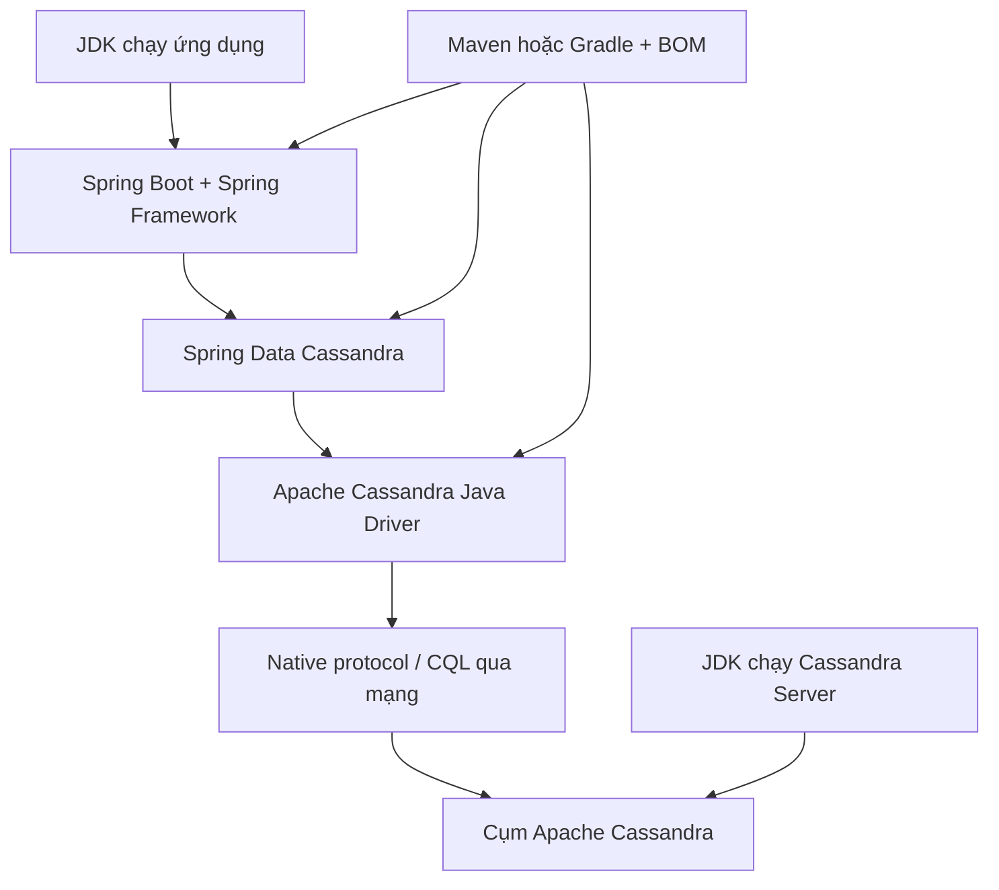

# Chọn bộ phiên bản Java, Spring Boot, Spring Data, Driver và Cassandra tương thích

## 1. Vì sao phải chọn **cả bộ** phiên bản?

Khi xây dựng ứng dụng **Spring Data Cassandra**, chúng ta thường viết entity, repository, dùng `CassandraTemplate` và thực hiện truy vấn CQL. Tuy nhiên, giữa mã Java và dữ liệu trong Apache Cassandra có nhiều lớp phụ thuộc nhau:



Các lớp này có **hai kiểu tương thích khác nhau**:

1. **Tương thích build/runtime của ứng dụng:** phiên bản Java chạy Spring Boot, thế hệ Spring Framework và Spring Data, API của Java Driver, phiên bản Maven/Gradle. Nếu lệch nhau, ứng dụng có thể không biên dịch hoặc gặp `NoSuchMethodError`, `ClassNotFoundException`, lỗi khởi tạo Spring context.
2. **Tương thích kết nối với máy chủ:** Java Driver kết nối Cassandra qua native protocol, mã hóa, authentication, topology và CQL. Ứng dụng có thể khởi động nhưng thất bại khi mở `CqlSession`, hoặc chỉ hỏng khi dùng một kiểu dữ liệu/tính năng CQL mới.

**JDK của ứng dụng và JDK chạy Cassandra là hai việc riêng.** Ví dụ, một API chạy Java 21 không bắt buộc Cassandra server cũng chạy Java 21: Cassandra có chính sách hỗ trợ Java của chính phiên bản máy chủ. Nếu Cassandra chạy bằng Docker, JDK bên trong image cũng khác JDK dùng để build API.

Không nên chọn từng thành phần theo tiêu chí "bản mới nhất" rồi ghép tùy ý. Điểm xuất phát an toàn là **chọn một bản Spring Boot ổn định trước**, để cơ chế quản lý dependency của Boot xác định Spring Data và Driver; sau đó chọn JDK và phiên bản Cassandra phù hợp với hệ thống cần triển khai.

## 2. Nguyên tắc xác định độ tương thích

| Thành phần | Phải kiểm tra gì? | Nguồn quyết định |
| --- | --- | --- |
| Java/JDK ứng dụng | Phiên bản thấp nhất, cao nhất được Boot hỗ trợ; JDK được tổ chức cho phép sử dụng | **Spring Boot System Requirements** của đúng nhánh phát hành |
| Spring Boot | Phiên bản ổn định và nhánh hỗ trợ; thay đổi khi nâng major | Release notes, tài liệu tham chiếu Boot |
| Spring Framework | Thế hệ framework đi cùng Boot | BOM/dependency management của Boot |
| Spring Data Cassandra | Phiên bản phù hợp với Spring Framework và Spring Data Commons | Spring Boot BOM và release train Spring Data |
| Java Driver | Version, Maven coordinates, API và native protocol có thể dùng | Spring Boot BOM; tài liệu Apache Cassandra Java Driver |
| Cassandra Server | Nhánh phát hành và patch; tính năng CQL, topology, bảo mật; JDK riêng của server | Tài liệu chính thức Apache Cassandra và hướng dẫn nâng cấp |
| Maven/Gradle | Toolchain có chạy được plugin Boot đã chọn không? | Spring Boot System Requirements |

### 2.1. BOM là gì và vì sao nên dùng?

**BOM (Bill of Materials)** là danh sách phiên bản dependency đã được căn chỉnh. Khi dùng `spring-boot-starter-parent` với Maven hoặc plugin Spring Boot và dependency management phù hợp với Gradle, ta thường chỉ cần khai báo starter, **không ghi version thủ công cho Spring Data Cassandra và driver**.

Ví dụ:

```xml
<dependency>
    <groupId>org.springframework.boot</groupId>
    <artifactId>spring-boot-starter-data-cassandra</artifactId>
</dependency>
```

Starter đưa vào Spring Data Cassandra, Cassandra Java Driver và các thành phần liên quan theo dependency management của Spring Boot. Người học nên đọc cây dependency thực tế của dự án, vì BOM cho biết **phiên bản được quản lý**, còn cây dependency cho biết **phiên bản thực sự đã giải quyết** sau các khai báo, exclusions hoặc overrides của dự án.

Khi dự án thêm trực tiếp `spring-data-cassandra` hay `java-driver-core` với một phiên bản khác, có thể vô tình phá sự căn chỉnh mà starter đã thiết lập. Chỉ override khi thực sự cần, kiểm tra cả release notes, compatibility và integration tests.

### 2.2. Native protocol không đồng nhất với phiên bản Cassandra

Java Driver trao đổi với Cassandra qua **native protocol**. Driver 4.x có cơ chế thương lượng phiên bản protocol với cụm; các thế hệ Cassandra 3.x và 4.x có thể dùng phiên bản protocol khác nhau. Điều này giúp một driver phục vụ nhiều phiên bản server, nhưng **không bảo đảm mọi tính năng mới của Cassandra đều được driver cũ hiểu đầy đủ**.

Ví dụ, với Cassandra 5.0, tính năng hoặc kiểu dữ liệu mới cần được kiểm tra riêng về mức hỗ trợ của driver và Spring Data. Cũng cần kiểm tra quá trình rolling upgrade khi cluster có các node ở phiên bản khác nhau. Không tự ép `advanced.protocol.version` nếu chưa có lý do và ma trận hỗ trợ cụ thể; ưu tiên cơ chế thương lượng mặc định của driver.

## 3. Hai bộ phiên bản tham khảo

Bảng dưới đây ghi lại **hai ví dụ phiên bản cụ thể được đối chiếu với tài liệu dependency management chính thức ngày 25/11/2026**. Đây là các mốc học tập và kiểm chứng cấu hình, không phải lời cam kết rằng mọi cặp môi trường, mọi tính năng và mọi topology đã được kiểm thử.

| Thành phần | Nhánh 3.5 để duy trì ứng dụng đã có | Nhánh 4.2 cho dự án mới |
| --- | --- | --- |
| Java chạy API | **Java 21** | **Java 21** |
| Spring Boot | **3.5.16** | **4.2.0** |
| Spring Framework | **6.2.x** do Boot quản lý | **7.1.x** do Boot quản lý |
| Spring Data Cassandra | **4.5.13** do Boot quản lý | **5.2.0** do Boot quản lý |
| Apache Cassandra Java Driver | **4.19.3** do Boot quản lý | **4.19.4** do Boot quản lý |
| Cassandra server để học và kiểm thử | **4.1.x** hoặc **5.0.x** sau kiểm thử tính năng | **5.0.x** sau kiểm thử tích hợp |
| Maven/Gradle | Dùng các bản được Boot 3.5 hỗ trợ | Dùng các bản được Boot 4.2 hỗ trợ |

Theo tài liệu yêu cầu hệ thống tại thời điểm đối chiếu, cả Boot 3.5 và Boot 4.2 đều yêu cầu tối thiểu **Java 17**. Việc chọn **Java 21** trong bảng là lựa chọn cho ứng dụng học tập có JDK LTS phổ biến và phù hợp hai nhánh; đây **không phải** tuyên bố Boot yêu cầu Java 21.

**Cách đọc bảng:**

- Một hàng Spring Data hoặc Driver nói **"do Boot quản lý"** nghĩa là không cần khai báo trực tiếp version đó trong Maven/Gradle khi đang dùng đúng BOM.
- Dòng Cassandra server là **đích triển khai cần kiểm chứng**, vì phiên bản database server không phải là thư viện do Spring Boot quản lý.
- Các số patch có thể thay đổi khi Spring phát hành bản sửa lỗi. Khi triển khai thật, mở đúng trang **Managed Dependency Coordinates** ứng với phiên bản Spring Boot đang dùng để xem các phiên bản chính xác.
- Một nhánh Spring Boot mới có thể thay đổi cấu trúc module/starter và API được sử dụng ở nơi khác trong ứng dụng. Không nâng major chỉ bằng việc sửa số version trong `pom.xml`.

Nguồn để kiểm tra lại các mốc:

- [Spring Boot 3.5 – System Requirements](https://docs.spring.io/spring-boot/3.5/system-requirements.html)
- [Spring Boot 3.5 – Managed Dependency Coordinates](https://docs.spring.io/spring-boot/3.5/appendix/dependency-versions/coordinates.html)
- [Spring Boot – System Requirements (nhánh hiện hành)](https://docs.spring.io/spring-boot/system-requirements.html)
- [Spring Boot – Managed Dependency Coordinates (nhánh hiện hành)](https://docs.spring.io/spring-boot/appendix/dependency-versions/coordinates.html)
- [Apache Cassandra Java Driver – Native Protocol](https://apache.github.io/cassandra-java-driver/4.19.0/core/native_protocol/)

### Khi nào chọn nhánh nào?

Với **dự án đang chạy Boot 3.5**, thông thường tiếp tục dùng nhánh 3.5 và nâng các bản patch theo kế hoạch bảo trì. Nếu chuyển lên Boot 4.2, cần xem migration guide của Boot 4, Spring Data 5.x, các thay đổi Spring Framework, thư viện bên thứ ba và chạy lại toàn bộ test tích hợp.

Với **dự án học mới**, có thể chọn Boot 4.2 + Java 21 + Cassandra 5.0.x để tiếp cận thế hệ mới; nếu hệ thống mẫu hay thư viện đi kèm chỉ hỗ trợ Boot 3.5, nên ưu tiên một bộ đồng nhất với môi trường đó.

## 4. Tạo ứng dụng Maven theo một bộ phiên bản

Ví dụ sau chọn **Java 21 + Spring Boot 4.2.0**; Spring Data và driver lấy version từ BOM của Boot.

```xml
<?xml version="1.0" encoding="UTF-8"?>
<project xmlns="http://maven.apache.org/POM/4.0.0"
         xmlns:xsi="http://www.w3.org/2001/XMLSchema-instance"
         xsi:schemaLocation="http://maven.apache.org/POM/4.0.0
           https://maven.apache.org/xsd/maven-4.0.0.xsd">
    <modelVersion>4.0.0</modelVersion>

    <parent>
        <groupId>org.springframework.boot</groupId>
        <artifactId>spring-boot-starter-parent</artifactId>
        <version>4.2.0</version>
        <relativePath/>
    </parent>

    <groupId>dev.learning</groupId>
    <artifactId>spring-cassandra-demo</artifactId>
    <version>0.0.1-SNAPSHOT</version>

    <properties>
        <java.version>21</java.version>
    </properties>

    <dependencies>
        <dependency>
            <groupId>org.springframework.boot</groupId>
            <artifactId>spring-boot-starter-data-cassandra</artifactId>
        </dependency>
        <dependency>
            <groupId>org.springframework.boot</groupId>
            <artifactId>spring-boot-starter-test</artifactId>
            <scope>test</scope>
        </dependency>
    </dependencies>

    <build>
        <plugins>
            <plugin>
                <groupId>org.springframework.boot</groupId>
                <artifactId>spring-boot-maven-plugin</artifactId>
            </plugin>
        </plugins>
    </build>
</project>
```

Không cần thêm `com.datastax.oss:java-driver-core` bằng tay. Với các bản driver 4.18 trở lên được Apache tiếp quản, **Maven coordinates được quản lý có thể mang groupId `org.apache.cassandra`**, trong khi các Java package công khai như `com.datastax.oss.driver.api.core.CqlSession` vẫn dùng namespace quen thuộc. Phân biệt **groupId trong dependency** với **package import trong Java** để tránh kết luận sai rằng có hai driver khác nhau.

Nếu dùng **Gradle**, ý tưởng tương đương:

```groovy
dependencies {
    implementation 'org.springframework.boot:spring-boot-starter-data-cassandra'
    testImplementation 'org.springframework.boot:spring-boot-starter-test'
}
```

Phải cấu hình phiên bản plugin Spring Boot, Java toolchain và cơ chế dependency management/BOM trong file build của dự án; đoạn trên chỉ minh họa **không ghi version riêng** cho starter. Lựa chọn Gradle tương ứng phải thỏa trang System Requirements của đúng phiên bản Boot.

### Xác minh dependency thực sự được dùng

```bash
java -version
mvn -version
mvn dependency:tree
```

Trong kết quả, tìm:

```text
org.springframework.boot:spring-boot-starter-data-cassandra
org.springframework.data:spring-data-cassandra
org.apache.cassandra:java-driver-core
```

Ở dự án Gradle, có thể dùng:

```bash
./gradlew dependencyInsight --dependency spring-data-cassandra --configuration runtimeClasspath
./gradlew dependencyInsight --dependency java-driver-core --configuration runtimeClasspath
```

Nếu kết quả khác BOM dự kiến, kiểm tra parent/BOM thực tế, version được override, dependency transitives và dependency resolution. Khi có nhiều version xung đột, sửa ở cấu hình quản lý dependency thay vì thêm tiếp một version khác để "ép" biên dịch.

## 5. Chuẩn bị Cassandra Server đúng nhánh

Để thử local, có thể chạy **Cassandra 5.0.x bằng Docker**. Chọn một patch version cụ thể có sẵn và cố định image digest trong CI/production để tránh thay đổi ngầm. Lệnh dưới dùng tag nhánh `5.0` cho môi trường học; hãy thay bằng tag patch đã được kiểm chứng khi cần tái lập chính xác.

```bash
docker run --name cassandra-lab \
  -p 9042:9042 \
  -d cassandra:5.0
```

Sau khi Cassandra sẵn sàng, kiểm tra từ container:

```bash
docker exec cassandra-lab nodetool status
docker exec cassandra-lab cqlsh -e "SELECT release_version FROM system.local;"
docker exec cassandra-lab cqlsh -e "SELECT data_center FROM system.local;"
```

`nodetool status` cần cho thấy node ở trạng thái **UN (Up/Normal)**. Giá trị `release_version` là phiên bản **Cassandra Server thực sự đang chạy**; `data_center` cần khớp với cấu hình driver phía Spring Boot. Với Docker local đơn node, tên datacenter thường là `datacenter1`, nhưng phải kiểm tra thay vì giả định trong mọi môi trường.

Lưu ý:

- Máy chủ Cassandra có quy định riêng về JDK hỗ trợ. Đối với nhánh Cassandra 5.0, tài liệu Apache nêu Java 11 và Java 17 cho quy trình cài đặt/chạy; kiểm tra hướng dẫn của bản server cụ thể nếu tự cài ngoài Docker. **Không suy ra** Cassandra server được hỗ trợ trên Java 21 chỉ vì ứng dụng Spring Boot dùng Java 21.
- Đối với cụm thật, kiểm tra release/patch, topology, replication, bảo mật, tài nguyên và kế hoạch nâng cấp; một node Docker chỉ dùng để học, không đại diện cho hành vi phân tán khi node lỗi.
- Native port mặc định thường là **9042**; không nhầm với cổng giao diện web hoặc cổng internode.

### Tạo keyspace và bảng thử nghiệm

```bash
docker exec -it cassandra-lab cqlsh
```

Trong `cqlsh`, chạy:

```sql
-- Chỉ dùng cho Cassandra local một node.
CREATE KEYSPACE IF NOT EXISTS spring_demo
WITH replication = {
  'class': 'SimpleStrategy',
  'replication_factor': 1
};

CREATE TABLE IF NOT EXISTS spring_demo.books_by_id (
    id uuid PRIMARY KEY,
    title text
);

INSERT INTO spring_demo.books_by_id (id, title)
VALUES (11111111-1111-1111-1111-111111111111, 'Spring Data Cassandra');

SELECT id, title FROM spring_demo.books_by_id
WHERE id = 11111111-1111-1111-1111-111111111111;
```

`SimpleStrategy` với replication factor 1 chỉ phù hợp ví dụ local đơn node. Trong production nhiều datacenter/nodes, lựa chọn replication theo topology thực tế và sử dụng **`NetworkTopologyStrategy`**. Không lấy nguyên cấu hình minh họa cho môi trường production.

## 6. Cấu hình Spring Boot và kiểm tra kết nối

Đặt trong `src/main/resources/application.yml` của ứng dụng:

```yaml
spring:
  cassandra:
    contact-points: 127.0.0.1:9042
    local-datacenter: datacenter1
    keyspace-name: spring_demo
    schema-action: none
```

Các property `spring.cassandra.*` là cơ chế cấu hình tự động do Spring Boot cung cấp. Với Cassandra thật, thay contact points, datacenter, credential và TLS theo môi trường. `schema-action: none` thể hiện việc **không tự thay đổi schema khi khởi động**; các câu CQL tạo keyspace/bảng nên được quản lý chủ động.

Nếu ứng dụng chạy trong **một container khác trên cùng Docker network**, `127.0.0.1` sẽ là chính container của ứng dụng, không phải container Cassandra. Khi đó dùng tên dịch vụ/hostname có thể phân giải trên network, ví dụ `cassandra-lab:9042`, và bảo đảm hai container cùng network.

### Kiểm tra ánh xạ entity và repository

```java
import java.util.UUID;

import org.springframework.data.cassandra.core.mapping.PrimaryKey;
import org.springframework.data.cassandra.core.mapping.Table;

@Table("books_by_id")
public class Book {

    @PrimaryKey
    private UUID id;

    private String title;

    protected Book() {
    }

    public Book(UUID id, String title) {
        this.id = id;
        this.title = title;
    }

    public UUID getId() {
        return id;
    }

    public String getTitle() {
        return title;
    }
}
```

```java
import java.util.UUID;
import org.springframework.data.cassandra.repository.CassandraRepository;

public interface BookRepository extends CassandraRepository<Book, UUID> {
}
```

Khi ứng dụng đã cấu hình đúng keyspace, Spring Data Cassandra có thể ánh xạ `Book` vào `spring_demo.books_by_id`. Một integration test hữu ích là gọi `repository.findById(...)` với UUID đã chèn từ `cqlsh` và xác nhận title; sau đó lưu một UUID mới bằng `save` và đọc lại bằng CQL.

Ngoài repository, có thể inject `CqlSession`, `CqlTemplate` hoặc `CassandraTemplate` vào Spring bean để kiểm tra đường truy cập thấp hơn. Ví dụ:

```java
import com.datastax.oss.driver.api.core.CqlSession;

public String cassandraVersion(CqlSession session) {
    var row = session.execute(
        "SELECT release_version FROM system.local"
    ).one();
    if (row == null) {
        throw new IllegalStateException("Không đọc được system.local");
    }
    return row.getString("release_version");
}
```

Phương thức trên chỉ là đoạn minh họa gọi driver, không phải một endpoint production. Nó giúp xác nhận **phiên bản server mà kết nối thực sự đi tới**, tránh chỉ đọc version mong muốn trong file cấu hình Docker.

### Nếu repository không hoạt động, cô lập lỗi theo lớp

1. **`cqlsh` không kết nối:** kiểm tra server đã sẵn sàng, port/network, DNS, TLS hoặc authentication.
2. **`cqlsh` kết nối nhưng Spring Boot không tạo `CqlSession`:** kiểm tra `spring.cassandra.contact-points`, `local-datacenter`, credential, driver và thông báo khởi tạo context.
3. **Session có nhưng query lỗi:** kiểm tra keyspace, tên bảng/cột, quyền truy cập và CQL; không quy ngay cho version.
4. **Query đơn giản chạy nhưng tính năng mới lỗi:** đối chiếu phiên bản Cassandra, driver, CQL native protocol và mức hỗ trợ kiểu dữ liệu/tính năng.
5. **Lỗi `NoSuchMethodError` hoặc `ClassNotFoundException`:** xem lại `dependency:tree`, các dependency trực tiếp và xung đột phiên bản Spring Data/driver.

## 7. Một ma trận kiểm thử tối thiểu trước khi chốt bộ phiên bản

Không thể chỉ dựa vào việc **ứng dụng khởi động thành công** để kết luận cả bộ tương thích. Hãy kiểm tra những đường đọc/ghi và tính năng cụ thể sẽ dùng:

| Phép kiểm | Thao tác | Kết quả mong đợi |
| --- | --- | --- |
| Toolchain | `java -version`, `mvn -version` hoặc `gradle --version` | JDK và build tool thuộc phạm vi Boot hỗ trợ |
| Dependency | In cây dependency | Đúng Spring Data/Driver được BOM quản lý; không có bản lạ chen vào |
| Cassandra Server | `SELECT release_version FROM system.local` | Đúng nhánh/patch server dự kiến |
| Topology | `SELECT data_center FROM system.local` | Khớp `local-datacenter` |
| Kết nối | Khởi tạo `CqlSession` qua Boot | Không lỗi contact points, protocol, auth, TLS |
| CQL cơ bản | `INSERT`, `SELECT` theo partition key | Đọc/ghi đúng kiểu dữ liệu và schema |
| Entity mapping | Repository `save` và `findById` | Round trip không sai UUID, kiểu dữ liệu hay tên cột |
| Template | Đọc CQL qua `CassandraTemplate` | Ánh xạ kết quả đúng với entity |
| Paging | Truy vấn đủ nhiều hàng để qua nhiều trang | Không bỏ sót/đọc trùng khi phân trang đúng cách |
| Consistency | Kiểm thử consistency level theo topology thật | Thời gian đáp ứng và hành vi khi replica lỗi đúng kỳ vọng |
| Tính năng mới | SAI, vector, kiểu dữ liệu hoặc CQL đặc thù nếu dùng | Driver và server đều hỗ trợ, kiểm thử đúng workload |
| Tải và lỗi | Đọc/ghi đồng thời, restart node, timeout | Có retry chính sách phù hợp, quan sát p95/p99 |

**Paging và consistency có mặt trong bài toán phiên bản** vì API của driver hoặc cách xử lý của Spring Data có thể thay đổi giữa các thế hệ. Bản thân việc nâng version không làm một partition key kém phù hợp trở nên tốt: vẫn cần thiết kế bảng theo truy vấn, giới hạn partition, chọn consistency theo yêu cầu và giám sát hiệu năng.

### Quy tắc nâng cấp không phá tương thích

1. **Ghi lại bộ version đang chạy** từ JDK, Spring Boot, cây dependency và `system.local`. Thêm trạng thái môi trường, bộ CQL tính năng sử dụng và kết quả kiểm thử hiện tại.
2. **Nâng patch trong cùng nhánh trước**, ưu tiên các bản sửa lỗi/bảo mật, xem release notes và kiểm thử.
3. **Nâng major có kế hoạch:** ví dụ Boot 3.5 → 4.2 kéo theo thay đổi Spring Framework 6 → 7 và Spring Data Cassandra 4.x → 5.x; kiểm tra tài liệu migration và các API bị thay đổi.
4. **Tách nâng server Cassandra khỏi nâng ứng dụng** khi có thể; đọc hướng dẫn rolling upgrade, native protocol và hỗ trợ tính năng mới. Đừng nâng đồng thời mọi thành phần nếu không có chiến lược rollback.
5. **Kiểm thử integration trên server thật/cluster đại diện** trước khi rollout. Ghi lại phiên bản thành một compatibility matrix trong dự án và cập nhật mỗi lần nâng cấp.

## 8. Những sai lầm phổ biến

| Sai lầm | Hậu quả có thể gặp | Cách tránh |
| --- | --- | --- |
| Gắn Java 21 cho cả API và máy chủ Cassandra chỉ vì API chạy Java 21 | Cassandra Server có thể không hỗ trợ JDK đó | Đọc yêu cầu Java của **hai tiến trình** riêng |
| Chọn Spring Data Cassandra mới nhất nhưng giữ Boot cũ | Xung đột Spring Framework/Spring Data Commons | Dùng BOM của đúng Boot |
| Khai báo driver bằng một version không khớp BOM | Lỗi runtime hoặc hành vi khác kỳ vọng | Đọc dependency tree, chỉ override có kiểm thử |
| Nhầm package `com.datastax.oss` với groupId Maven | Thêm dependency sai hoặc trùng | Phân biệt Java import và Maven coordinates |
| Dùng tag `latest` cho mọi môi trường | Kết quả build/test khó tái lập | Pin patch image/library và cập nhật có kiểm soát |
| Chỉ thấy CQL cơ bản chạy là coi mọi tính năng đều được hỗ trợ | Lỗi khi dùng vector/SAI hoặc khi nâng server | Kiểm thử từng tính năng và protocol cần dùng |
| Chỉ kiểm tra startup | Không phát hiện lỗi mapping, paging, consistency hay tải | Thêm integration tests và kiểm thử workload thật |
| Đổi contact-points thành `127.0.0.1` trong môi trường container | Driver kết nối nhầm container | Cấu hình DNS/network đúng môi trường |

## 9. Bài tập thực hành

**Tình huống 1 – Nâng ứng dụng cũ:** Một dịch vụ đang dùng Java 17, Boot 3.5, Spring Data Cassandra 4.5 và Cassandra 4.1. Nhóm muốn nâng Spring Data Cassandra lên 5.2 mà không đổi Boot. Hãy giải thích vì sao cần kiểm tra Spring Framework, BOM và migration guide trước khi quyết định, rồi nêu thứ tự nâng cấp hợp lý.

**Tình huống 2 – Docker:** API chạy Java 21 trong container, Cassandra 5.0 chạy container khác. Ứng dụng dùng `127.0.0.1:9042` và báo không kết nối được. Hãy phân biệt lỗi mạng với lỗi version, đề xuất cách sửa `contact-points` và xác minh `local-datacenter`.

**Tình huống 3 – Ma trận hỗ trợ:** Dự án dùng paging bằng `Slice`, repository với khóa phức hợp và truy vấn CQL cho một tính năng mới của Cassandra 5.0. Hãy xây bảng version, xác nhận các thư viện thực tế từ Maven/Gradle, viết integration tests cho cả ba chức năng và mô tả tín hiệu cho phép nâng cấp.

**Tự kiểm tra:**

1. Vì sao Spring Boot BOM nên là nguồn chọn phiên bản Spring Data Cassandra và Java Driver?
2. Java chạy ứng dụng có phải đúng bằng Java chạy Cassandra Server không?
3. Điều gì khác nhau giữa tương thích native protocol và tương thích API Spring Data?
4. Vì sao `CqlSession` kết nối thành công vẫn chưa đủ chứng minh paging hoặc tính năng CQL mới hoạt động?
5. Khi nâng Boot major, những thành phần nào phải kiểm tra lại ngoài số version trong build file?

## Tổng kết

Chọn bộ phiên bản Spring Data Cassandra phù hợp là quyết định **có thể kiểm chứng bằng tài liệu và thử nghiệm**. Bắt đầu từ một bản Spring Boot ổn định, dùng BOM để căn chỉnh Spring Data và Java Driver, chọn JDK nằm trong phạm vi Boot hỗ trợ, rồi xác minh Cassandra Server bằng native protocol, schema, CQL, mapping, paging và các điều kiện vận hành thực tế. Giữ JDK của API và JDK của Cassandra Server như hai yêu cầu riêng. Một bộ version chỉ được coi là phù hợp với dự án khi **các truy vấn và tính năng dự án cần đã được kiểm thử trên đúng môi trường triển khai**.

### Tài liệu chính thức để tra cứu

- [Spring Boot – Cassandra auto-configuration](https://docs.spring.io/spring-boot/reference/data/nosql.html)
- [Spring Boot 3.5 – Dependency versions](https://docs.spring.io/spring-boot/3.5/appendix/dependency-versions/coordinates.html)
- [Spring Boot – Dependency versions hiện hành](https://docs.spring.io/spring-boot/appendix/dependency-versions/coordinates.html)
- [Spring Data Cassandra – Reference](https://docs.spring.io/spring-data/cassandra/reference/)
- [Apache Cassandra Java Driver – Native Protocol](https://apache.github.io/cassandra-java-driver/4.19.0/core/native_protocol/)
- [Apache Cassandra – Installing](https://cassandra.apache.org/doc/stable/cassandra/installing/installing.html)
- [Apache Cassandra – Production recommendations](https://cassandra.apache.org/doc/stable/cassandra/getting-started/production.html)
