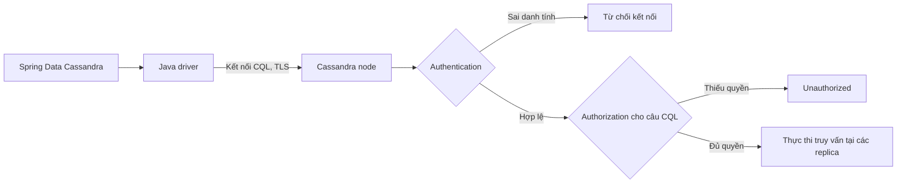
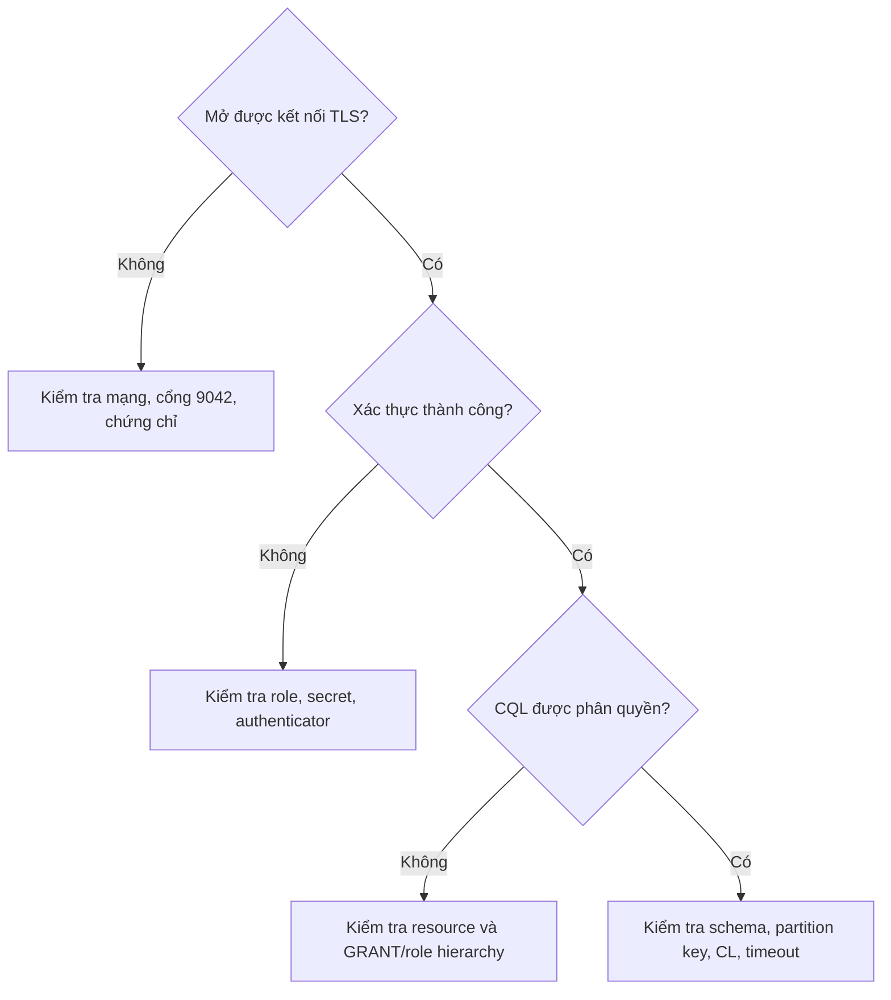

# Tài khoản ứng dụng, quyền truy cập và thông tin xác thực trong Spring Data Cassandra

Khi kết nối **Spring Data Cassandra** đến Apache Cassandra, ứng dụng cần biết **đang đăng nhập bằng danh tính nào**, **được phép thực hiện những thao tác CQL nào**, và **thông tin xác thực được bảo vệ ra sao**. Ba vấn đề này thuộc cấu hình môi trường và bảo mật truy cập, nhưng tác động trực tiếp đến hoạt động của entity mapping, `CassandraRepository`, `CassandraTemplate`, phân trang và các truy vấn theo partition key.

Bài thuộc chương **Môi trường** giải thích cách tổ chức tài khoản dành riêng cho ứng dụng, cấp quyền tối thiểu, truyền credentials vào Spring Boot, cấu hình đường kết nối an toàn, kiểm tra quyền, xử lý lỗi và luân chuyển bí mật. Các ví dụ dùng Apache Cassandra tự quản lý với authentication bằng mật khẩu; nếu dùng dịch vụ Cassandra được quản lý, cơ chế nhận dạng hoặc cú pháp tích hợp có thể khác.

## 1. Phân biệt authentication, authorization và encryption

| Cơ chế | Câu hỏi giải quyết | Ví dụ trong Cassandra |
| --- | --- | --- |
| **Authentication (xác thực)** | Kết nối này đại diện cho ai? | Driver gửi username/password của role có `LOGIN = true`; `PasswordAuthenticator` xác thực. |
| **Authorization (phân quyền)** | Danh tính đã xác thực được phép làm gì? | `CassandraAuthorizer` cho phép/không cho phép `SELECT`, `MODIFY` trên một bảng. |
| **Encryption in transit (mã hóa đường truyền)** | Thông tin trên đường mạng có bị đọc hoặc can thiệp không? | TLS bảo vệ kết nối native CQL giữa ứng dụng và node Cassandra. |

Đăng nhập thành công **không** có nghĩa tài khoản được quyền đọc tất cả bảng. Ngược lại, cấu hình GRANT đúng không hữu ích nếu ứng dụng không xác thực được với node. Và kể cả có authentication, nếu dùng mật khẩu qua kết nối không được bảo vệ, bí mật có thể bị lộ trên đường truyền.



Sơ đồ đơn giản hóa luồng xử lý: node nhận kết nối đóng vai trò coordinator cho yêu cầu; Cassandra tiếp tục phối hợp với các replica theo topology và consistency level. Cấp quyền không thay đổi cơ chế chọn partition/replica.

## 2. Role và tài khoản ứng dụng trong Cassandra

Trong hệ Cassandra dùng bộ quản lý role tiêu chuẩn, **role** là đối tượng được dùng để gắn khả năng đăng nhập, quyền và quan hệ kế thừa quyền. Một role có thể:

- Có `LOGIN = true`: đại diện danh tính mà ứng dụng/nhân sự có thể dùng để đăng nhập, nếu đã cấu hình authenticator phù hợp.
- Có `LOGIN = false`: dùng làm **nhóm quyền** để cấp cho các role đăng nhập khác.
- Có `SUPERUSER = true`: có quyền quản trị rất rộng. Tài khoản ứng dụng thông thường phải dùng `SUPERUSER = false`.

**Không dùng chung tài khoản quản trị cho ứng dụng.** Trong môi trường phát triển hoặc bài hướng dẫn, người học đôi khi kết nối bằng tài khoản admin cho nhanh. Nhưng trong thực tế, một bug hoặc lộ secret của ứng dụng có thể khiến tài khoản có quyền thay schema, đọc dữ liệu không liên quan hay thay quyền của người khác.

Một cách phân vai:

| Vai trò | Nhiệm vụ | Phạm vi quyền gợi ý |
| --- | --- | --- |
| `cassandra_admin` (tên minh họa) | Vận hành cluster và cấp quyền | Quyền quản trị thích hợp; chỉ dùng qua quy trình quản trị. |
| `schema_migrator` | Chạy migration có kiểm soát | `CREATE`/`ALTER`/`DROP` trên tài nguyên cần thiết theo quy trình; không dùng cho traffic thông thường. |
| `orders_api` | Truy vấn dữ liệu đơn hàng từ REST API | `SELECT` trên đúng bảng phục vụ đọc. |
| `orders_worker` | Xử lý cập nhật đơn hàng nền | `SELECT`, `MODIFY` trên đúng bảng cần thao tác. |
| `orders_read_access` | Nhóm quyền dùng chung | Không có LOGIN; giữ quyền đọc bảng đơn hàng. |

Role là khái niệm **toàn cluster** theo hệ quản trị role tiêu chuẩn, còn phân quyền dữ liệu có thể áp dụng cho keyspace/bảng cụ thể. Tên role nên theo dịch vụ và môi trường, ví dụ `orders_api_prod`; không nên dùng cùng một mật khẩu cho tất cả môi trường.

## 3. Bật authentication và authorization ở phía Cassandra

Một hệ Cassandra tự quản lý có thể được cài theo cấu hình mặc định cho phép kết nối mà không xác thực/kiểm tra quyền. Vì vậy, chỉ thêm username/password vào Spring Boot **không tự bật bảo mật trên server**.

Ví dụ các mục cấu hình quan trọng trong `cassandra.yaml` (minh họa; phiên bản và cách rollout cần được kiểm tra trước khi triển khai):

```yaml
# Authentication: xác nhận username/password
authenticator: PasswordAuthenticator

# Authorization: kiểm tra GRANT/REVOKE cho tài nguyên
authorizer: CassandraAuthorizer

# Quản lý role tiêu chuẩn
role_manager: CassandraRoleManager
```

Ý nghĩa:

- `PasswordAuthenticator` kiểm tra thông tin đăng nhập do CQL client cung cấp.
- `CassandraAuthorizer` kiểm soát quyền đối với tài nguyên Cassandra theo GRANT/REVOKE.
- `CassandraRoleManager` lưu và quản lý các role; có thể dùng `CREATE ROLE`, `ALTER ROLE`, `GRANT role`.

Những thành phần này cần được cấu hình **nhất quán trên các node** theo hướng dẫn vận hành của phiên bản cluster. Thay đổi authentication/authorization trong hệ đang chạy phải có kế hoạch bootstrap danh tính quản trị, cập nhật client, thử nghiệm và khả năng khôi phục; bật một phía trước khi các client sẵn sàng có thể làm gián đoạn dịch vụ.

### Bảo vệ dữ liệu xác thực trong `system_auth`

Với các thành phần xác thực/role tiêu chuẩn, Cassandra lưu metadata bảo mật trong keyspace hệ thống **`system_auth`**. Khi cluster hoạt động nhiều node hoặc nhiều datacenter, cần thiết kế **replication strategy** cho keyspace này đủ chịu lỗi. Chỉ dựa vào một replica dễ biến một node hỏng thành vấn đề đăng nhập/kiểm tra quyền của nhiều dịch vụ.

Ví dụ với một DC thực sự có ít nhất ba node phù hợp và tên DC là `dc1`:

```sql
-- Chỉ là ví dụ cho quản trị viên; phải xác minh topology thực tế.
ALTER KEYSPACE system_auth
WITH replication = {
    'class': 'NetworkTopologyStrategy',
    'dc1': 3
};
```

Sau thay đổi replication, cần thực hiện quy trình dữ liệu/repair phù hợp để các replica mới có dữ liệu `system_auth`, và kiểm tra khả năng xác thực từ nhiều node. Nếu có nhiều DC, cấu hình đúng số replica cho từng DC. **Không sao chép ví dụ này vào cluster sản xuất mà chưa kiểm tra topology, phiên bản và kế hoạch bảo trì.**

## 4. Cấp quyền tối thiểu bằng CQL

Giả sử keyspace `commerce` và bảng `orders_by_customer` đã tồn tại:

```sql
CREATE TABLE commerce.orders_by_customer (
    customer_id uuid,
    created_at timestamp,
    order_id uuid,
    status text,
    total decimal,
    PRIMARY KEY ((customer_id), created_at, order_id)
) WITH CLUSTERING ORDER BY (created_at DESC, order_id ASC);
```

Với mô hình truy cập theo `customer_id`, API đọc đơn hàng chỉ cần `SELECT` trên bảng; worker cập nhật trạng thái cần `MODIFY`. Việc cấp quyền **không** giúp truy vấn thiếu partition key trở nên hợp lệ hay nhanh hơn.

### 4.1. Dùng role không đăng nhập để gom quyền đọc

```sql
-- Chạy bởi tài khoản quản trị có đủ quyền tạo role và cấp quyền.
CREATE ROLE orders_read_access
WITH LOGIN = false
AND SUPERUSER = false;

GRANT SELECT ON TABLE commerce.orders_by_customer
TO orders_read_access;

-- Tạo danh tính ứng dụng. Giá trị mật khẩu dưới đây chỉ là placeholder!
CREATE ROLE orders_api
WITH PASSWORD = '<inject-strong-secret-during-provisioning>'
AND LOGIN = true
AND SUPERUSER = false;

-- orders_api kế thừa quyền SELECT của role nhóm.
GRANT orders_read_access TO orders_api;
```

Đây là cú pháp minh họa quy trình tạo role. **Không ghi mật khẩu thật vào repository, migration SQL được commit, chat, log hoặc shell history.** Trong vận hành thực tế, công cụ cấp tài khoản lấy secret từ kho bí mật an toàn và tránh ghi lại giá trị này.

Role `orders_api` có thể truy vấn:

```sql
SELECT created_at, order_id, status
FROM commerce.orders_by_customer
WHERE customer_id = 11111111-1111-1111-1111-111111111111
LIMIT 20;
```

Nhưng nếu chỉ có quyền trên, role này **không được thực hiện** `INSERT`, `UPDATE` hoặc `DELETE` trên bảng.

### 4.2. Role cho tiến trình có quyền ghi

```sql
CREATE ROLE orders_worker
WITH PASSWORD = '<inject-different-strong-secret>'
AND LOGIN = true
AND SUPERUSER = false;

-- Worker cần đọc để quyết định cập nhật và ghi trạng thái.
GRANT SELECT ON TABLE commerce.orders_by_customer TO orders_worker;
GRANT MODIFY ON TABLE commerce.orders_by_customer TO orders_worker;
```

Cassandra dùng **`MODIFY`** cho `INSERT`, `UPDATE`, `DELETE`; quyền này bao phủ nhiều loại thao tác ghi, nên cần giới hạn theo đúng bảng. Nếu worker chỉ cần ghi mà không cần đọc, không cấp `SELECT` một cách máy móc.

### 4.3. Kiểm tra và điều chỉnh quyền

```sql
-- Thực hiện với tài khoản quản trị được phép xem role và permission.
LIST ROLES OF orders_api;
LIST ALL PERMISSIONS OF orders_api;

-- Khi thu hồi quyền trực tiếp khỏi một role:
REVOKE MODIFY ON TABLE commerce.orders_by_customer FROM orders_worker;
```

Lệnh `REVOKE` chỉ minh họa cách thu hồi; chạy nó sẽ khiến worker trong ví dụ không thể ghi vào bảng nữa. Khi truy vết quyền thực tế phải tính cả các **role được kế thừa**, quyền cấp trực tiếp và quyền cấp ở cấp cao hơn, chẳng hạn keyspace.

| Permission | Áp dụng điển hình | Cẩn trọng |
| --- | --- | --- |
| `SELECT` | Đọc dữ liệu trong keyspace/bảng được cấp. | Không có cơ chế lọc tự động đến từng dòng theo `tenant_id`. |
| `MODIFY` | Ghi, cập nhật, xóa dữ liệu được cấp. | Không phân biệt “chỉ INSERT” hay “chỉ DELETE” ở cấp quyền này. |
| `CREATE`, `ALTER`, `DROP` | Quản lý schema và tài nguyên tương ứng. | Dành cho migration/admin; phạm vi áp dụng phụ thuộc loại tài nguyên. |
| `AUTHORIZE` | Cấp/thu hồi quyền trên tài nguyên được phép. | Không cấp cho tài khoản ứng dụng thông thường. |

**Cấp quyền ở bảng hay ở keyspace?** Nếu ứng dụng chỉ đọc một bảng, `GRANT SELECT ON TABLE ...` thu hẹp phạm vi rõ hơn. `GRANT SELECT ON KEYSPACE commerce ...` có phạm vi rộng hơn đối với các bảng trong keyspace đó, kể cả khi schema phát triển. Hãy xem schema tương lai trước khi chọn quyền cấp rộng.

### 4.4. Phân quyền Cassandra không thay thế phân quyền nghiệp vụ

Nếu một bảng chứa đơn hàng của hàng nghìn khách hàng và role `orders_api` có `SELECT` trên bảng, Cassandra không tự hiểu rằng request HTTP của khách A chỉ được truy cập partition của khách A. Kiểm tra chủ sở hữu/tenant phải đặt ở tầng ứng dụng hoặc kiến trúc cô lập dữ liệu phù hợp.

Ví dụ, ứng dụng cần xác thực người dùng HTTP, xác minh `customer_id` được yêu cầu thuộc người dùng đó, rồi mới gọi repository. **Partition key là cơ chế định tuyến dữ liệu, không phải hàng rào phân quyền theo từng khách hàng.**

## 5. Cấu hình credentials trong Spring Boot

Spring Data Cassandra dựa vào **Java driver** để tạo và quản lý phiên kết nối CQL. Sau khi xác thực, `CassandraRepository`, `CassandraTemplate` và các câu truy vấn CQL dùng quyền của danh tính kết nối.

Ví dụ `application.yml` cho **Spring Boot 3.x**:

```yaml
spring:
  cassandra:
    contact-points: 10.10.0.11:9042,10.10.0.12:9042
    local-datacenter: dc1
    keyspace-name: commerce
    username: ${CASSANDRA_APP_USERNAME}
    password: ${CASSANDRA_APP_PASSWORD}
```

- `contact-points`: các endpoint ban đầu để driver khám phá cluster, không cần là toàn bộ danh sách node.
- `local-datacenter`: tên DC logic chính xác theo topology Cassandra; điều này giúp driver ưu tiên kết nối tới DC mong muốn.
- `keyspace-name`: keyspace mặc định của session; quyền trên bảng/keyspace vẫn phải được cấp bởi server.
- `username` và `password`: lấy từ biến môi trường đã được hệ thống triển khai cung cấp, tránh đặt giá trị bí mật vào source.

Ví dụ môi trường chạy ứng dụng:

```text
CASSANDRA_APP_USERNAME=orders_api
CASSANDRA_APP_PASSWORD=<secret supplied securely at runtime>
```

Dòng password chỉ minh họa **tên biến**, không phải một giá trị dùng được. Môi trường thực tế nên lấy secret từ secret manager, orchestrator hoặc cơ chế cung cấp secret của tổ chức. Cần giới hạn ai có quyền đọc biến môi trường và nội dung cấu hình của tiến trình; tránh đưa giá trị này vào logging, crash report hoặc trang chẩn đoán.

**Tránh hardcode trực tiếp như sau:**

```yaml
# Không sử dụng cách này trong cấu hình được commit:
spring:
  cassandra:
    username: orders_api
    password: my-real-password
```

Việc có `application.yml` chứa các biến tham chiếu không đảm bảo secret luôn được bảo vệ: phải quản lý quyền truy cập kho bí mật, pipeline CI/CD, cách tiêm secrets vào runtime và chính sách ghi log.

### Ví dụ repository chạy bằng role ứng dụng

```java
import java.util.List;
import java.util.UUID;
import org.springframework.data.cassandra.repository.CassandraRepository;
import org.springframework.data.cassandra.repository.Query;

public interface OrderRepository extends CassandraRepository<Order, OrderKey> {

    @Query("SELECT * FROM orders_by_customer WHERE customer_id = ?0 LIMIT 20")
    List<Order> findRecentOrders(UUID customerId);
}
```

Ví dụ giả định đã có entity `Order` và lớp khóa `OrderKey` khớp schema; `OrderRepository` chỉ để minh họa đường truy cập. Khi gọi `findRecentOrders`, driver thực thi `SELECT` bằng danh tính `orders_api` từ cấu hình. Nếu role thiếu `SELECT`, Cassandra sẽ từ chối truy vấn dù entity mapping đúng.

Ngược lại, nếu ứng dụng gọi `save(order)` trong khi role chỉ có `SELECT`, thao tác ghi sẽ bị từ chối vì thiếu `MODIFY`. Không nên phản ứng bằng cách đổi tài khoản ứng dụng thành superuser; cần xác minh nghiệp vụ có cần ghi không, sau đó cấp quyền đúng bảng cho role thích hợp.

## 6. Bảo vệ kết nối bằng TLS

Username/password không tự mã hóa CQL traffic. Trong môi trường vượt ra ngoài máy phát triển cô lập, cần bảo vệ kết nối **client-to-node** bằng TLS, đồng thời xác minh danh tính máy chủ thông qua truststore/chứng chỉ phù hợp.

Ở phía Cassandra, một cấu hình minh họa trong `cassandra.yaml`:

```yaml
client_encryption_options:
    enabled: true
    optional: false
    # Cấu hình keystore và chứng chỉ theo phiên bản Cassandra.
```

Ở phía Spring Boot/Java driver, cần bật TLS và cấu hình trust material theo phiên bản framework/driver đang sử dụng. Với một số phiên bản Spring Boot 3.x có thể khai báo:

```yaml
spring:
  cassandra:
    ssl:
      enabled: true
```

Bật TLS ở client **chưa đủ** nếu server không hỗ trợ TLS, chứng chỉ không được tin cậy, hoặc tên host trên chứng chỉ không khớp chính sách kiểm tra máy chủ. Hệ thống thực tế có thể cần SSL bundle, truststore hoặc cấu hình driver riêng cho mutual TLS. Không tắt kiểm tra chứng chỉ để “chữa nhanh” lỗi handshake trong production.

Phân biệt **client-to-node TLS** với **node-to-node encryption**: phần thứ hai bảo vệ lưu lượng nội bộ giữa các node Cassandra và được cấu hình riêng. Các dịch vụ Cassandra managed cũng có thể yêu cầu cơ chế kết nối riêng do nhà cung cấp cấp.

## 7. Vòng đời của mật khẩu và role ứng dụng

Bảo mật không dừng ở lệnh `CREATE ROLE`. Một role ứng dụng tồn tại lâu dài nên có quy trình vận hành:

1. **Cấp phát:** tạo tài khoản riêng cho từng dịch vụ/môi trường với `LOGIN = true`, `SUPERUSER = false`; chỉ cấp đúng quyền cần dùng.
2. **Phân phối secret:** lưu trong secret manager; giới hạn người/quy trình có thể đọc, không gửi qua file cấu hình công khai hay log.
3. **Triển khai:** inject secret vào runtime và bảo đảm TLS đã hoạt động; theo dõi lỗi xác thực sau release.
4. **Xoay vòng:** tạo secret mới và cập nhật ứng dụng có kiểm soát; lưu ý các session/pool kết nối cũ có thể còn hoạt động.
5. **Thu hồi:** bỏ quyền hoặc vô hiệu hóa role cũ sau khi chắc chắn không còn client cần dùng; kiểm tra lại kết nối và audit.

Với hệ thống cần tránh gián đoạn khi thay credential, có thể dùng **hai danh tính tương đương tạm thời** (ví dụ `orders_api_v1` và `orders_api_v2`): tạo role mới, gán đúng quyền, chuyển dần các instance sang secret mới, xác minh ứng dụng hoạt động, rồi mới vô hiệu hóa role cũ. Cách này cho phép rollback trong thời gian chuyển đổi nhưng tăng tạm thời số danh tính cần theo dõi.

Nếu chỉ cập nhật mật khẩu trên cùng role bằng `ALTER ROLE ... WITH PASSWORD ...`, các kết nối mới sẽ cần secret mới ngay, trong khi một số pool hiện có vẫn giữ các session cũ; có thể phát sinh lỗi khi ứng dụng mở lại kết nối. Chọn chiến lược phù hợp với khả năng rollout và cách driver quản lý session.

Khi phát hiện secret bị lộ, cần **xoay vòng hoặc thu hồi ngay** theo quy trình ứng cứu, đánh giá phạm vi quyền của role và kiểm tra log/audit liên quan. Việc xóa secret khỏi Git HEAD không đồng nghĩa bí mật đã bị xóa khỏi lịch sử và những nơi từng sao chép.

## 8. Xử lý lỗi thường gặp khi triển khai

| Biểu hiện | Nguyên nhân có thể | Cách xác minh/khắc phục |
| --- | --- | --- |
| Kết nối thất bại vì authentication | Sai username/password, role không có LOGIN, secret không được inject, server cấu hình khác kỳ vọng. | Kiểm tra tên biến, quyền role, thông báo driver và phương thức authenticator trên cluster; không in mật khẩu ra log. |
| `Unauthorized` khi gọi repository | Role đăng nhập được nhưng thiếu `SELECT`/`MODIFY` trên bảng, hoặc quyền role kế thừa chưa đúng. | `LIST ALL PERMISSIONS OF <role>` qua tài khoản quản trị; đối chiếu CQL thực tế với GRANT. |
| TLS handshake thất bại | Server/client không cùng chế độ TLS, chứng chỉ hết hạn, truststore sai, xác minh hostname lỗi. | Kiểm tra log handshake, chain chứng chỉ và endpoint; không vô hiệu hóa xác minh certificate. |
| Thao tác migration chạy lỗi, API vẫn đọc tốt | Role API chỉ có quyền dữ liệu, không có quyền tạo/sửa schema. | Chạy migration bằng danh tính riêng có quyền schema đúng phạm vi; không tăng quyền API. |
| Chỉ một vài node xác thực bất thường | Cấu hình authenticator/authorizer khác nhau, vấn đề `system_auth` hoặc cache metadata. | Kiểm tra đồng bộ cấu hình, trạng thái node và replication/repair của `system_auth`. |
| Chuyển secret xong xuất hiện lỗi từng đợt | Một số instance vẫn dùng secret cũ hoặc pool tạo kết nối mới ở thời điểm khác nhau. | Soát rollout instance, thời điểm rotation và trạng thái session; hoàn tất thay đổi trước khi thu hồi role cũ. |
| Đọc được đơn của tenant khác | Ứng dụng không kiểm tra quyền nghiệp vụ cho `customer_id`. | Thực thi authorization ở tầng API/service; không nhầm quyền `SELECT` của Cassandra với row-level security. |

Khi chẩn đoán, luôn tách ba lớp:



Một lỗi query do thiếu partition key có thể xuất hiện dù tài khoản đã có đầy đủ quyền; một truy vấn chậm ở `LOCAL_QUORUM` cũng không nhất thiết là lỗi authentication. Cần đọc đúng loại lỗi và ngữ cảnh request trước khi thay cấu hình quyền.

## 9. Thực hành theo kịch bản

**Bối cảnh:** Ứng dụng thương mại điện tử có hai thành phần: REST API chỉ đọc đơn hàng gần đây theo `customer_id`, và worker cập nhật trạng thái đơn hàng. Cả hai kết nối cùng keyspace `commerce` bằng Spring Data Cassandra nhưng có đường đời triển khai độc lập.

**Thiết kế đề xuất:**

- REST API dùng `orders_api` kế thừa `orders_read_access` và chỉ có `SELECT` trên `orders_by_customer`.
- Worker dùng `orders_worker` có `SELECT` (nếu cần kiểm tra trạng thái) và `MODIFY` trên đúng bảng.
- Pipeline migration dùng một role khác, có đủ quyền quản lý schema trong phạm vi được giao.
- Mỗi role có secret riêng, được inject từ secret manager; driver kết nối vào đúng local DC qua TLS.
- Ứng dụng kiểm tra user/tenant trước khi gọi repository, vì Cassandra không giới hạn `SELECT` theo từng `customer_id`.

**Bài tập tự kiểm tra:**

1. Vì sao không nên dùng role superuser cho `CassandraRepository` trong ứng dụng production?
2. Khi `orders_api` đọc được đơn hàng nhưng `save()` bị `Unauthorized`, cần xem permission nào?
3. Nếu đặt `username`/`password` trong `application.yml` nhưng server đang dùng `AllowAllAuthenticator` và `AllowAllAuthorizer`, đã có hệ thống phân quyền thực sự chưa?
4. Tại sao GRANT `SELECT ON TABLE commerce.orders_by_customer` không tự ngăn người dùng A yêu cầu partition của người dùng B?
5. Khi luân chuyển mật khẩu, vì sao cần chú ý các instance/pool mở kết nối ở những thời điểm khác nhau?
6. Vì sao phải bảo vệ kết nối bằng TLS dù Cassandra đã xác thực username/password?

**Gợi ý trả lời:** (1) Hạn chế phạm vi ảnh hưởng khi ứng dụng hoặc secret bị lộ. (2) `MODIFY` trên bảng được ghi. (3) Chưa: server phải bật bộ kiểm tra danh tính và phân quyền phù hợp. (4) GRANT này áp dụng cho bảng, còn quyền truy cập từng khách hàng thuộc kiểm tra nghiệp vụ. (5) Các kết nối mới dùng credentials tại thời điểm khởi tạo, cần chuyển đổi có kiểm soát. (6) Authentication xác định danh tính nhưng không tự mã hóa dữ liệu và thông tin trên đường truyền.

**Ghi nhớ:** Với **Spring Data Cassandra**, danh tính và quyền truy cập thực tế do Cassandra/Java driver thực thi. Cấu hình ứng dụng phải truyền secret an toàn, sử dụng TLS, cấp quyền tối thiểu trên đúng bảng, giữ tài khoản migration tách biệt và luôn kiểm tra quyền nghiệp vụ trước khi truy vấn partition của người dùng.
