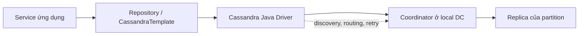
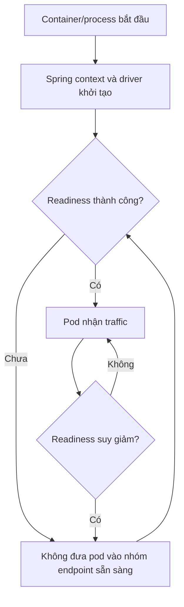

# Kiểm tra node sẵn sàng trước khi ứng dụng bắt đầu

Khi ứng dụng **Spring Data Cassandra** khởi động, việc có địa chỉ IP và cổng Cassandra không đồng nghĩa với việc cơ sở dữ liệu đã có thể phục vụ truy vấn. Một node có thể đang mở cổng nhưng còn bootstrap, vừa tham gia lại cluster, chưa đồng bộ schema, chưa có quyền truy cập cho ứng dụng, hoặc không đủ replica để đáp ứng consistency level cần thiết.

Trong chương **Môi trường**, bài này hướng dẫn cách xác nhận Cassandra sẵn sàng trước khi cho ứng dụng nhận lưu lượng: từ trạng thái node, kết nối CQL, keyspace và schema, đến khả năng đọc/ghi thực tế theo consistency level. Ta sẽ kết nối các kiểm tra đó với **Spring Data Cassandra**, repository, `CassandraTemplate`, Cassandra Java Driver, Spring Boot Actuator và Kubernetes.

> **Mục tiêu thực tế:** Chỉ cho ứng dụng nhận request khi đường truy cập Cassandra mà nghiệp vụ phụ thuộc đã đủ sẵn sàng, đồng thời phân biệt việc **node đang chạy**, **cluster có thể phục vụ truy vấn** và **ứng dụng được phép nhận traffic**.

## 1. “Node sẵn sàng” có nhiều tầng ý nghĩa

Cassandra là hệ quản trị phân tán. Không có một tín hiệu duy nhất bảo đảm tất cả bảng, mọi partition, các replica và các consistency level đều hoạt động tốt.

| Tầng kiểm tra | Câu hỏi | Ví dụ bằng chứng | Điều chưa được chứng minh |
| --- | --- | --- | --- |
| **Tiến trình** | Cassandra có đang chạy? | Process/service đang hoạt động | CQL đã sẵn sàng |
| **Mạng** | Từ ứng dụng có tới được cổng native transport không? | TCP 9042 kết nối được | TLS, xác thực hay truy vấn thành công |
| **Cluster membership** | Node đang ở trạng thái nào trong ring? | `nodetool status` báo `UN` | Mọi replica của dữ liệu ứng dụng đều khỏe |
| **CQL** | Driver/cqlsh có tạo phiên và thực thi CQL không? | `SELECT ... FROM system.local` thành công | Bảng nghiệp vụ đã tồn tại hoặc app có quyền |
| **Schema và quyền** | Keyspace, table, column và account ứng dụng có đúng không? | Truy vấn `system_schema` và query bảng thật | Đủ replica cho consistency level mong muốn |
| **Đường đọc/ghi nghiệp vụ** | Query từ ứng dụng có đáp ứng CL, độ trễ và yêu cầu dữ liệu? | Query kiểm tra theo partition key/CL thành công | Toàn bộ partition của cluster đều khỏe |
| **Application readiness** | Ứng dụng đã hoàn tất khởi tạo và có thể nhận request? | Health readiness trả trạng thái thành công | Lúc nào trong tương lai cũng sẽ khỏe |

Hãy kiểm tra từ tầng thấp đến tầng cao. Nếu cổng 9042 không truy cập được, không cần đo độ trễ query. Nếu cổng đã mở nhưng tài khoản không có quyền `SELECT`, phải xử lý quyền trước khi thay đổi connection pool.

### Node `UN` chưa đủ để khẳng định ứng dụng đã sẵn sàng

Khi chạy `nodetool status`, `UN` thường biểu thị node **Up/Normal** theo góc nhìn của cluster: node đang hoạt động và ở trạng thái normal trong ring. Tuy nhiên:

- Native transport CQL vẫn có thể không truy cập được từ container/pod ứng dụng do mạng, cấu hình bind, firewall hoặc TLS.
- Node có thể quá tải, ổ đĩa gần đầy, đang có quá nhiều pending tasks, dù chưa bị đánh dấu Down.
- Truy vấn với `LOCAL_QUORUM` có thể thất bại khi không đủ replica cục bộ cho partition cần đọc.
- Migrations/schema chưa hoàn tất hoặc account ứng dụng thiếu quyền.
- Một node khỏe không chứng minh mọi replica, mọi rack/datacenter đều khỏe.

Vì vậy, **`nodetool status` là bước quan sát topology, không phải phép kiểm tra readiness hoàn chỉnh**.

## 2. Hiểu luồng từ ứng dụng đến các replica

Một truy vấn qua Spring Data Cassandra thường đi theo chuỗi:



**Contact points** giúp driver khám phá cluster; chúng không có nghĩa mọi truy vấn phải chạy vào đúng một node contact point. Khi session sẵn sàng, driver chọn coordinator theo routing policy, local datacenter và trạng thái node. Coordinator liên hệ replica dựa trên partition key, replication strategy và consistency level.

Một kiểm tra TCP thành công tới contact point chỉ chứng minh mạng tới **địa chỉ đó**. Một query CQL thành công kiểm tra sâu hơn, nhưng vẫn là phép kiểm tra tại thời điểm và trên đường truy cập cụ thể.

Ba loại sẵn sàng cần tách ra:

1. **Node readiness:** node cụ thể có thể tham gia và phục vụ CQL.
2. **Cluster/query readiness:** với keyspace, partition và CL đã chọn, có đủ replica phù hợp để trả lời.
3. **Application readiness:** ứng dụng đủ điều kiện tiếp nhận traffic theo hợp đồng nghiệp vụ.

Trong triển khai có nhiều replica và nhiều ứng dụng, **application readiness** thường là tín hiệu hợp lý để load balancer/Kubernetes quyết định có gửi request tới một instance hay không.

## 3. Chuẩn bị thông tin trước khi kiểm tra

Trước khi vận hành, cần xác nhận:

| Thông tin | Tại sao cần |
| --- | --- |
| Các endpoint Cassandra đã cấu hình | Biết contact points, DNS và cổng native transport, thường là 9042 |
| **Tên local datacenter** | Driver cần biết DC ứng dụng ưu tiên kết nối; tên phải khớp topology Cassandra |
| Phiên bản Cassandra và driver | Lệnh `nodetool`, tùy chọn `cqlsh` và properties có thể khác |
| Keyspace và tên bảng ứng dụng | Kiểm tra đúng schema mà repository hoặc `CassandraTemplate` thực sự truy vấn |
| Tài khoản/role ứng dụng | Kiểm tra authentication, authorization và quyền CQL |
| TLS/certificate nếu bật | Phải hoàn tất handshake, xác minh chứng chỉ và hostname |
| RF/replication strategy | Biết số replica mong muốn trong từng DC |
| Consistency level của request | Xác định số replica cần phản hồi |
| Query mẫu có partition key | Kiểm tra đường đọc thật mà không quét dữ liệu |
| Yêu cầu nghiệp vụ khi Cassandra chậm hoặc mất kết nối | Quyết định fail-fast, chờ/retry hay tạm ngừng nhận traffic |

**Chạy kiểm tra từ đúng môi trường mạng của ứng dụng.** Lệnh `cqlsh` thành công trên máy vận hành không bảo đảm pod ứng dụng có route, chứng chỉ hoặc quyền tương tự.

### Không đưa bí mật kết nối vào ví dụ hoặc log

Các thông tin như password, token, private key phải lấy từ secret store hoặc cơ chế quản lý bí mật của môi trường. Không nên ghi password trực tiếp vào command-line, URL, YAML commit trong repository hoặc log lỗi. Ví dụ dưới đây dùng host nội bộ minh họa và không chứa thông tin xác thực thật.

## 4. Bước 1 — Xác minh node trong cluster

Trên máy được cấp quyền vận hành, chạy:

```bash
nodetool status
```

Ví dụ đầu ra rút gọn:

```text
Datacenter: dc_hcm
Status=Up/Down
|/ State=Normal/Leaving/Joining/Moving
--  Address          Load       Tokens  Owns  Host ID ...
UN  10.10.1.11       ...        16      ...   ...
UN  10.10.1.12       ...        16      ...   ...
DN  10.10.1.13       ...        16      ...   ...
```

Đây là dữ liệu minh họa để đọc hai ký tự trạng thái. `UN` là Up/Normal; `DN` là Down/Normal. Trong thực tế, số token, địa chỉ và số node thay đổi theo cấu hình.

Cần chú ý:

- **Có bao nhiêu node `UN` trong local DC?** Số lượng này chỉ là điều kiện gợi ý; phải xét đúng replica của partition khi kết luận về CL.
- **Có node `UJ`/`UL`/`UM` không?** Joining/Leaving/Moving cho thấy topology đang chuyển đổi; cần kiểm tra quy trình thay đổi cluster trước khi coi môi trường ổn định.
- **Các DC/rack có đúng với cấu hình replication không?** Tên DC sai có thể dẫn đến routing hoặc replica placement không như dự kiến.
- **Có thay đổi topology gần đây không?** Thêm node/DC, thay RF hoặc decommission có thể đòi hỏi streaming và repair theo kế hoạch vận hành.

Có thể xem thêm:

```bash
nodetool info
nodetool netstats
nodetool describecluster
```

- `info` giúp quan sát thông tin node cụ thể.
- `netstats` hỗ trợ kiểm tra hoạt động streaming/network ở một số phiên bản.
- `describecluster` cung cấp bối cảnh cluster/topology/schema theo khả năng của phiên bản đang chạy.

Không phải thông số nào cũng là tín hiệu pass/fail tuyệt đối. Nếu quá trình bootstrap/streaming đang diễn ra, phải đánh giá yêu cầu sẵn sàng của ứng dụng và mức nhất quán dự kiến.

## 5. Bước 2 — Kiểm tra TCP, DNS, TLS và xác thực CQL

Từ cùng network namespace/container hoặc đường kết nối tương đương môi trường ứng dụng, kiểm tra DNS và đường mạng tới native transport:

```bash
# Ví dụ dùng công cụ có sẵn trong môi trường Linux
nc -vz cassandra-hcm-1.example.internal 9042
```

Kết nối TCP thành công **chưa** chứng minh CQL sẵn sàng. Nếu TCP thất bại, kiểm tra lần lượt hostname/DNS, route, firewall/security group/network policy, port, service binding và native transport.

Sau đó tạo kết nối bằng công cụ CQL với TLS và xác thực đúng cấu hình, chẳng hạn:

```bash
# Ví dụ: bật TLS nếu cluster yêu cầu; nhập thông tin bí mật qua cơ chế an toàn
cqlsh cassandra-hcm-1.example.internal 9042 --ssl -u app_reader
```

Tùy phiên bản/cài đặt, `cqlsh` có thể cần thêm CA/cấu hình TLS trong file cấu hình riêng. Tài khoản `app_reader` chỉ là tên minh họa. Không bỏ TLS chỉ để “cho kết nối được” khi cluster yêu cầu bảo vệ kết nối.

Trong phiên `cqlsh` thành công:

```sql
SELECT release_version, data_center, rack
FROM system.local;
```

Truy vấn metadata này xác minh được session CQL đã hình thành và node đang phản hồi. Nó **không xác minh đầy đủ quyền trên bảng nghiệp vụ hoặc quorum khi truy vấn dữ liệu ứng dụng**.

### Cùng cổng 9042 nhưng vẫn có thể kết nối lỗi

| Triệu chứng | Khả năng cần kiểm tra |
| --- | --- |
| Không phân giải được hostname | DNS/service discovery |
| Connection refused | Cassandra chưa lắng nghe cổng, sai port, cấu hình native transport |
| Kết nối timeout | Firewall, network policy, routing, network partition |
| TLS handshake/certificate error | CA trust, chứng chỉ, hostname, TLS version |
| Authentication failed | Role, password/cơ chế xác thực, cấu hình driver |
| Unauthorized trên bảng | Quyền keyspace/table của account ứng dụng |
| Kết nối được một node nhưng driver không tìm thấy host phù hợp | `local-datacenter`, contact point, topology/discovery, host filtering |

**Ưu tiên chẩn đoán đúng lớp lỗi.** Tăng timeout của driver không giải quyết được quyền truy cập sai hoặc tên DC không tồn tại.

## 6. Bước 3 — Kiểm tra schema và keyspace đúng với ứng dụng

Một môi trường có Cassandra khỏe nhưng bảng ứng dụng chưa được tạo vẫn chưa sẵn sàng cho repository.

Xem replication của keyspace:

```sql
SELECT keyspace_name, replication
FROM system_schema.keyspaces
WHERE keyspace_name = 'orders_ks';
```

Kiểm tra danh sách bảng trong keyspace:

```sql
SELECT keyspace_name, table_name
FROM system_schema.tables
WHERE keyspace_name = 'orders_ks';
```

Xem cột khóa và dữ liệu bảng bằng `DESCRIBE TABLE` trong `cqlsh` khi tài khoản đủ quyền:

```text
DESCRIBE TABLE orders_ks.orders_by_id;
```

`DESCRIBE` là lệnh hỗ trợ của công cụ `cqlsh`; không phải câu `SELECT` chuẩn để gửi trực tiếp qua driver.

Đối chiếu với cấu hình entity:

- Tên `@Table` có đúng bảng thật không?
- `@PrimaryKey`, `@PrimaryKeyClass` hoặc `@PrimaryKeyColumn` có đúng partition/clustering key không?
- Tên cột và kiểu dữ liệu có tương thích entity mapping không?
- Repository và `CassandraTemplate` có dùng đúng keyspace không?
- Role ứng dụng có quyền `SELECT`, `INSERT`/`UPDATE` theo nhu cầu không?
- Nếu vừa migration, các node có hội tụ schema chưa và đã kiểm tra thành công truy vấn nghiệp vụ chưa?

Đừng mặc định chạy DDL như `CREATE TABLE` hay `ALTER KEYSPACE` ở mỗi lần pod khởi động. Trong production, thay đổi schema nên đi qua quy trình migration/triển khai riêng và được kiểm tra trước khi cho traffic vào ứng dụng.

### Schema agreement là một điều kiện cần xem sau migration

Cassandra truyền thay đổi schema giữa các node theo cơ chế cluster. Sau migration hoặc thay topology, các node có thể chưa nhìn thấy cùng phiên bản schema tại một thời điểm. Driver và công cụ quản trị có cơ chế theo dõi/đợi schema agreement; cách kiểm tra cụ thể khác nhau theo phiên bản.

Thực hành hợp lý là **đợi migration hoàn tất, kiểm tra schema và chạy truy vấn thực tế**, thay vì chỉ thấy một câu lệnh DDL trả thành công rồi mở traffic ngay.

## 7. Bước 4 — Kiểm tra truy vấn theo keyspace, partition key và consistency level

Đây là bước gần với “ứng dụng thực sự dùng được Cassandra” nhất.

Giả sử ứng dụng có bảng đã được triển khai trước:

```sql
CREATE TABLE orders_ks.orders_by_id (
    tenant_id uuid,
    order_id uuid,
    status text,
    created_at timestamp,
    PRIMARY KEY ((tenant_id, order_id))
);
```

DDL này chỉ mô tả bảng mẫu để hiểu truy vấn; không cần chạy tạo bảng trong lúc kiểm tra startup nếu bảng đã tồn tại.

Chọn cùng consistency level với đường đọc mà ứng dụng dự định sử dụng:

```text
CONSISTENCY LOCAL_QUORUM;
```

Dòng trên là lệnh của **`cqlsh`**, không phải câu lệnh CQL để nhúng trong `@Query`. Sau đó thực thi truy vấn có đầy đủ partition key:

```sql
SELECT tenant_id, order_id, status
FROM orders_ks.orders_by_id
WHERE tenant_id = 11111111-1111-1111-1111-111111111111
  AND order_id = 22222222-2222-2222-2222-222222222222;
```

Truy vấn trả về **0 hàng** vẫn có thể là thành công: ta đang kiểm tra session, schema, quyền đọc, routing và khả năng thực thi request ở CL đã chọn. Nếu muốn kiểm tra tính đúng đắn dữ liệu, cần thêm một tập dữ liệu probe có kỳ vọng rõ ràng.

Một truy vấn như `SELECT * FROM orders_by_id LIMIT 1` không có partition key có thể không kiểm tra đúng đường đọc quan trọng của ứng dụng. Với Cassandra, **kiểm tra khả năng phục vụ một partition cụ thể thường có giá trị hơn một câu query tùy ý trên metadata**.

### RF và CL quyết định bao nhiêu replica phải phản hồi

Giả sử `orders_ks` dùng `NetworkTopologyStrategy` với `dc_hcm: 3`:

- `LOCAL_ONE` thường cần một replica trong DC của coordinator.
- `LOCAL_QUORUM` cần ít nhất `floor(3 / 2) + 1 = 2` replica trong DC đó.
- `ALL` với chỉ một DC RF = 3 đòi đủ ba replica xác nhận.
- Nếu có thêm DC, `QUORUM` tính trên **tổng RF**, còn `LOCAL_QUORUM` tính theo RF của DC cục bộ.

Vì thế, **một node `UN` không có nghĩa `LOCAL_QUORUM` đã sẵn sàng**. Ngược lại, không cần bắt buộc *mọi node của cluster* đều `UN` nếu loại truy vấn và CL của ứng dụng vẫn có thể được phục vụ theo mục tiêu availability đã chọn.

### Một query probe không đại diện cho mọi partition

Cassandra chọn replica dựa trên token của **partition key**. Một query tới một partition thành công không chứng minh mọi partition có đủ replica hoặc không có hotspot. Hãy kết hợp:

1. Topology và trạng thái node từ vận hành.
2. Kiểm tra một số đường đọc đại diện theo keyspace/CL.
3. Metric request thực tế: timeout, unavailable, độ trễ, lỗi ứng dụng.
4. Kiểm tra theo DC khi ứng dụng hoạt động ở nhiều khu vực.

Nếu hệ thống cần bảo đảm khả năng **ghi**, không được giả định một query chỉ đọc đã kiểm tra đầy đủ quyền ghi, dung lượng và xác nhận ghi. Có thể xây dựng phép kiểm tra ghi/xóa hoặc ghi TTL vào **bảng probe riêng được cấp phép**, nhưng phải kiểm soát tần suất, tải, idempotency và cơ chế dọn dữ liệu. Không nên viết/xóa bản ghi nghiệp vụ thật chỉ để kiểm tra health.

## 8. Cấu hình Spring Boot kết nối đúng local datacenter

Ví dụ ứng dụng Spring Boot 3.x dùng Spring Data Cassandra:

```yaml
spring:
  cassandra:
    contact-points:
      - cassandra-hcm-1.example.internal
      - cassandra-hcm-2.example.internal
    port: 9042
    local-datacenter: dc_hcm
    keyspace-name: orders_ks
    request:
      consistency: LOCAL_QUORUM
      timeout: 5s
```

Đây là cấu hình minh họa; tên property và tính năng hỗ trợ phải đối chiếu với **phiên bản Spring Boot, Spring Data Cassandra và Cassandra Java Driver** đang dùng. Cấu hình authentication/TLS được quản lý riêng bằng bí mật môi trường.

Những điểm cần kiểm tra:

- `contact-points` phải có tên/IP mà pod ứng dụng thực sự truy cập được. Nên chuẩn bị nhiều endpoint hợp lệ theo chiến lược vận hành để hỗ trợ khám phá cluster.
- `local-datacenter` phải khớp **chính xác** tên DC trong topology Cassandra. Đây là tham số quan trọng của Cassandra Java Driver khi định tuyến.
- `keyspace-name` phải tồn tại và account ứng dụng có quyền phù hợp.
- `request.consistency` nên tương thích RF, mức chịu lỗi và yêu cầu nhất quán của nghiệp vụ.
- `timeout` cần phù hợp SLO, không quá ngắn khi cluster cần ổn định sau startup và không quá dài đến mức treo request không kiểm soát.

**Contact points là nơi bắt đầu khám phá, không phải danh sách cố định của tất cả coordinator.** Driver có thể khám phá và định tuyến tới các node khác theo metadata và policy của nó. Một cấu hình chỉ trỏ tới địa chỉ chưa thể truy cập sẽ làm bước khởi tạo khó thành công, dù trong cluster có node khỏe khác.

### Tránh đánh đồng kết nối thành công với nghiệp vụ đã sẵn sàng

Lỗi khi Spring Data Cassandra khởi tạo có thể đến từ:

- Sai contact points, port hoặc TLS.
- Driver không xác định được local DC phù hợp.
- Sai credentials.
- Keyspace cấu hình không tồn tại.
- Entity mapping hoặc câu CQL không khớp schema.
- Không đủ replica để đạt CL trên truy vấn thực tế.

Một health check chỉ thử tạo `CqlSession` có thể bỏ sót lỗi của bảng nghiệp vụ; vì vậy nên bổ sung kiểm tra schema và query phù hợp với yêu cầu triển khai.

## 9. Kiểm tra trước khi mở traffic: ba lựa chọn

### Lựa chọn A — Preflight trước khi deploy

CI/CD hoặc runbook vận hành kiểm tra Cassandra từ mạng gần môi trường triển khai trước khi rollout:

1. Chạy `nodetool status` và đánh giá các DC/node quan trọng.
2. Kết nối CQL từ vùng mạng dành cho ứng dụng.
3. Kiểm tra schema và quyền.
4. Chạy query đại diện theo consistency level yêu cầu.
5. Ghi nhận kết quả rồi mới tiếp tục rollout.

Ưu điểm: phát hiện lỗi môi trường trước khi deploy hàng loạt. Giới hạn: hệ thống có thể thay đổi ngay sau preflight, nên vẫn phải có readiness động.

### Lựa chọn B — Fail-fast khi chạy `ApplicationRunner`

Nếu sản phẩm **bắt buộc** kiểm tra Cassandra trước khi instance được đánh dấu sẵn sàng, có thể dùng `ApplicationRunner` để xác minh một query đọc đã biết. Ví dụ dưới đây giả định bảng `orders_by_id` ở trên đã tồn tại và hai UUID chỉ dùng để xác định một partition kiểm tra, không yêu cầu có bản ghi thật.

```java
import java.time.Duration;
import java.util.UUID;

import com.datastax.oss.driver.api.core.CqlSession;
import com.datastax.oss.driver.api.core.DefaultConsistencyLevel;
import com.datastax.oss.driver.api.core.cql.SimpleStatement;
import org.springframework.boot.ApplicationArguments;
import org.springframework.boot.ApplicationRunner;
import org.springframework.boot.autoconfigure.condition.ConditionalOnProperty;
import org.springframework.stereotype.Component;

@Component
@ConditionalOnProperty(
    prefix = "app.cassandra",
    name = "startup-preflight-enabled",
    havingValue = "true")
public class CassandraStartupPreflight implements ApplicationRunner {

    private final CqlSession session;

    public CassandraStartupPreflight(CqlSession session) {
        this.session = session;
    }

    @Override
    public void run(ApplicationArguments args) {
        UUID tenantId = UUID.fromString(
            "11111111-1111-1111-1111-111111111111");
        UUID orderId = UUID.fromString(
            "22222222-2222-2222-2222-222222222222");

        SimpleStatement statement = SimpleStatement.newInstance(
                "SELECT tenant_id, order_id FROM orders_ks.orders_by_id " +
                "WHERE tenant_id = ? AND order_id = ?",
                tenantId, orderId)
            .setConsistencyLevel(DefaultConsistencyLevel.LOCAL_QUORUM)
            .setTimeout(Duration.ofSeconds(5));

        // Nếu thất bại, exception làm bước khởi tạo ứng dụng thất bại.
        // 0 hàng là hợp lệ: phép kiểm tra xác nhận khả năng thực thi query.
        session.execute(statement);
    }
}
```

Bật khi thật sự cần fail-fast:

```yaml
app:
  cassandra:
    startup-preflight-enabled: true
```

Trong Spring Boot, `ApplicationRunner` chạy trong giai đoạn khởi động; trạng thái readiness của Boot thường chỉ chuyển sang chấp nhận traffic sau khi runner hoàn tất. Tuy nhiên, runner vẫn chạy **sau khi application context đã được tạo** và không thay thế được cơ chế readiness của orchestrator.

**Giới hạn quan trọng:**

- Đây là kiểm tra **một lần lúc startup**; nó không phát hiện Cassandra mất kết nối sau đó.
- Query dùng một cặp UUID minh họa nên chỉ kiểm tra đường truy cập của partition đó. Production cần định nghĩa dữ liệu/probe policy phù hợp và không dùng dữ liệu nhạy cảm.
- Nếu session không thể tạo ngay từ đầu, Spring có thể thất bại trước khi runner chạy.
- Exception làm instance khởi động lỗi; nếu cả cluster đang hồi phục chậm, có thể tạo nhiều lần restart. Cần cân nhắc deadline/backoff của nền tảng và chính sách rollout, tránh vòng crash liên tục.

Nếu yêu cầu chỉ là **chưa nhận traffic khi Cassandra tạm thời chưa sẵn sàng**, readiness probe thường cho hành vi linh hoạt hơn một bước fail-fast tuyệt đối.

### Lựa chọn C — Readiness liên tục qua Spring Boot Actuator

Spring Boot Actuator hỗ trợ **health indicators** và các nhóm health cho readiness/liveness. Khi ứng dụng có Cassandra và Actuator tương thích, có thể có health contributor mang tên `cassandra` để kiểm tra kết nối cơ bản.

Ví dụ cấu hình minh họa:

```yaml
management:
  endpoint:
    health:
      probes:
        enabled: true
      group:
        readiness:
          include: readinessState,cassandra
```

Với cấu hình và phiên bản phù hợp, endpoint `/actuator/health/readiness` kết hợp **trạng thái readiness của ứng dụng** với health contributor Cassandra. Cần xác minh health contributor `cassandra` thật sự được đăng ký trong ứng dụng; nếu chưa có, cần kiểm tra dependency/auto-configuration hoặc xây health contributor thích hợp.

Một endpoint health kiểm tra Cassandra cơ bản vẫn không chắc thử đúng bảng, CL, partition key và mức tải nghiệp vụ. Với dịch vụ có yêu cầu đặc biệt, hãy cân nhắc **health indicator riêng** sử dụng truy vấn nhẹ, giới hạn timeout và có kiểm soát tần suất.

**Không đưa Cassandra vào liveness chỉ vì readiness cần Cassandra.** Liveness trả lời ứng dụng có bị hỏng đến mức cần restart không; Cassandra đang mất kết nối trong vài phút không có nghĩa khởi động lại mọi instance ứng dụng sẽ sửa được database.

## 10. Kubernetes: startup, readiness và liveness khác nhau

Một triển khai dùng Spring Boot Actuator có thể khai báo probe như sau:

```yaml
startupProbe:
  httpGet:
    path: /actuator/health/liveness
    port: 8080
  periodSeconds: 5
  failureThreshold: 30

readinessProbe:
  httpGet:
    path: /actuator/health/readiness
    port: 8080
  periodSeconds: 5
  timeoutSeconds: 2
  failureThreshold: 3

livenessProbe:
  httpGet:
    path: /actuator/health/liveness
    port: 8080
  periodSeconds: 10
  timeoutSeconds: 2
  failureThreshold: 3
```

Các ngưỡng thời gian chỉ minh họa, cần chọn theo SLO, thời gian startup thực và khả năng chịu tải.

| Probe | Hỏi điều gì? | Nếu thất bại |
| --- | --- | --- |
| **startupProbe** | Ứng dụng đã vượt qua giai đoạn khởi động ban đầu chưa? | Cho phép thời gian khởi động; quá giới hạn có thể bị restart |
| **readinessProbe** | Instance hiện tại có nên nhận request không? | Loại pod khỏi tập endpoint sẵn sàng; pod thường vẫn chạy |
| **livenessProbe** | Process có còn hoạt động bình thường không? | Có thể khiến kubelet restart container |

Khi readiness nhóm cả Cassandra health, mất kết nối có thể khiến **mọi instance của service cùng unready**. Điều này phù hợp với service hoàn toàn không thể phục vụ bất kỳ request nào nếu không có Cassandra. Nhưng nếu service vẫn có endpoint cache, static content hoặc hoạt động dự phòng, cần thảo luận policy readiness theo khả năng thực tế; tránh làm cả deployment biến mất khỏi load balancer chỉ vì một dependency có thể xử lý suy giảm.

### “Ứng dụng bắt đầu” có nghĩa là gì trong Kubernetes?

Một container có thể đã chạy nhưng **chưa ready**. Đó là hành vi bình thường:



Vì thế mục tiêu vận hành thường không phải “cấm JVM chạy khi Cassandra chưa chạy”; thay vào đó là “không chuyển traffic nghiệp vụ sang instance chưa thể phục vụ”. Cách này tránh phụ thuộc vào thứ tự khởi động tuyệt đối giữa các dịch vụ phân tán.

## 11. Xử lý lỗi thoáng qua mà không làm tình hình xấu hơn

Cassandra có thể mất kết nối vài giây khi node restart, failover, cập nhật topology hoặc xảy ra sự cố mạng. Ứng dụng cần cơ chế phục hồi có giới hạn.

### Nguyên tắc cho driver và startup

- Cấu hình **nhiều contact points hợp lệ** để hỗ trợ khám phá, nhưng vẫn phải hiểu rằng driver không thể kết nối nếu toàn bộ đường mạng không tới được node nào.
- Dùng **timeout có giới hạn** cho tạo session và request; không treo startup vô thời hạn.
- Để driver xử lý **reconnection** theo cơ chế chính thức, tránh tự tạo `CqlSession` mới cho mỗi lần truy vấn.
- Nếu cần retry ở tầng ứng dụng, dùng số lần có giới hạn, backoff và jitter. Không retry vô hạn khi lỗi là xác thực, quyền, schema hoặc CQL sai.
- Không tự động retry mọi lệnh ghi: timeout có thể xảy ra sau khi một số replica đã ghi thành công. Phải đánh giá **idempotency** và cách tránh tạo dữ liệu trùng hoặc thay đổi trạng thái sai.
- Dùng readiness để phản ánh khả năng phục vụ theo thời gian, tránh biến mọi gián đoạn ngắn thành làn sóng restart qua liveness.

### Kiểm tra quá nặng cũng gây mất sẵn sàng

Một readiness probe không nên:

- Quét toàn bảng hoặc đọc partition lớn.
- Tạo bảng, thay schema hoặc chạy repair.
- Ghi bản ghi nghiệp vụ thật liên tục.
- Mỗi lần health request lại tạo và đóng session mới.
- Chạy quá thường xuyên với thời gian timeout dài, gây chồng hàng loạt truy vấn.
- Trả công khai thông tin nội bộ về topology, mật khẩu hay lỗi CQL chi tiết.

Nên ưu tiên một truy vấn nhẹ, ổn định, dùng session sẵn có, theo chính sách bảo mật và tần suất hợp lý.

## 12. Chẩn đoán nhanh theo biểu hiện

| Hiện tượng | Kiểm tra đầu tiên | Hướng khắc phục |
| --- | --- | --- |
| `nodetool status` báo node `DN` | Node/process, network/gossip, tài nguyên, log Cassandra | Khôi phục node hoặc xử lý sự cố mạng theo runbook |
| Node `UN` nhưng app connection timeout | Kết nối **từ pod**, DNS, port 9042, network policy | Sửa network/contact points/native transport |
| `NoNodeAvailable` hoặc driver không chọn được host | Discovery, local DC, các host reachable, driver log | Đúng tên local DC và tuyến mạng |
| TLS handshake lỗi | CA, chứng chỉ, hostname, cấu hình TLS giữa app/server | Đồng bộ trust và cấu hình bảo mật |
| Authentication/authorization lỗi | Role, secrets, grants trên keyspace/table | Cấp quyền tối thiểu cần thiết |
| `InvalidQuery`, bảng/cột không tồn tại | Schema và migration, keyspace mặc định, entity mapping | Sửa migration/mapping hoặc query |
| `Unavailable` tại `LOCAL_QUORUM` | RF local DC, replica của partition, số node đáp ứng | Khôi phục đủ replica hoặc xem lại CL theo yêu cầu nghiệp vụ |
| `ReadTimeout`/`WriteTimeout` | Node quá tải, network, CL, latency, GC, disk | Phân tích metric, query profile và giới hạn tải |
| Health `cassandra` UP nhưng endpoint nghiệp vụ lỗi | Schema bảng thật, quyền, CL, query có partition key | Bổ sung kiểm tra đường đọc/ghi nghiệp vụ |
| Startup liên tục crash khi Cassandra chưa lên | Fail-fast runner, session init, retry policy, probe timeout | Điều chỉnh chiến lược startup và readiness |
| Sau khi thêm DC, query chậm hoặc không ổn định | Replication strategy, RF, streaming, local DC, WAN | Hoàn tất quy trình mở rộng và xác minh theo DC |

Các lỗi timeout và unavailable không đồng nghĩa cùng nguyên nhân: **unavailable** thường liên quan việc không đủ replica khả dụng cho CL ngay khi coordinator đánh giá; **timeout** có thể xảy ra khi replica không phản hồi đủ trong thời gian yêu cầu. Cần đọc chi tiết exception và metric thực tế.

### Tình huống 1 — Node `UN` nhưng `LOCAL_QUORUM` thất bại

Cluster có RF = 3 trong `dc_hcm`, ứng dụng đặt `LOCAL_QUORUM`. Hai replica của một partition không khả dụng; node còn lại vẫn `UN`.

- `LOCAL_QUORUM` của RF = 3 cần hai replica phản hồi.
- Việc một node khỏe và kết nối TCP thành công không đủ đáp ứng truy vấn đó.
- Cần khôi phục replica/mạng hoặc đánh giá chính sách degraded mode đã được nghiệp vụ phê duyệt; không nên tự động chuyển toàn hệ thống sang `ONE` khi gặp lỗi.

### Tình huống 2 — Actuator UP nhưng repository gặp `Unauthorized`

Health check chỉ truy vấn `system.local`, trong khi role ứng dụng không có quyền đọc `orders_ks.orders_by_id`.

- Health cơ bản chứng minh CQL session, không chứng minh mọi quyền.
- Kiểm tra grants và chạy query thật bằng **chính role ứng dụng**.
- Nên bổ sung pre-deploy schema/permission check, hoặc health chuyên biệt nếu tính khả dụng của bảng đó là điều kiện readiness.

### Tình huống 3 — Khi rolling restart, toàn bộ service mất traffic

Nếu readiness yêu cầu tất cả các node Cassandra đều `UN` hoặc nếu liveness cũng gọi Cassandra, sự cố ngắn có thể khiến pod không ready hoặc bị restart hàng loạt.

- Xem lại tiêu chí readiness theo **khả năng phục vụ của ứng dụng**, không cứng nhắc đòi mọi node tuyệt đối khỏe.
- Chỉ dùng liveness cho lỗi mà restart ứng dụng có khả năng khắc phục.
- Hiệu chỉnh startup/readiness thresholds theo thời gian hồi phục đã quan sát, tránh probe quá dày.

## 13. Kiểm tra theo môi trường development, staging và production

| Môi trường | Mục tiêu kiểm tra | Độ sâu hợp lý |
| --- | --- | --- |
| **Local development** | Developer truy cập được Cassandra và schema mẫu | Docker/service sẵn sàng, cqlsh, query mẫu |
| **CI / integration test** | Ứng dụng khởi tạo và thực thi repository với keyspace test | Đợi service CQL, tạo schema qua test setup, chạy integration query |
| **Staging** | Cấu hình gần production đúng, CL và mapping phù hợp | Check multi-node/DC nếu có, quyền app, migration, latency và tải đại diện |
| **Production pre-deploy** | Cluster ổn định, schema/role/route đúng trước rollout | Runbook, schema agreement, CQL với role app, dashboard và cảnh báo |
| **Production runtime** | Instance có thể tiếp tục nhận request | Readiness/liveness rõ ràng, metric và giám sát liên tục |

Mỗi môi trường có topology, RF và mức chịu lỗi khác nhau. Một bài test chạy tốt trên Cassandra một node ở local **không xác minh** khả năng vận hành `LOCAL_QUORUM` của production ba node hoặc định tuyến theo nhiều DC.

## 14. Bài tập thực hành

### Bài 1 — Phân biệt các tín hiệu readiness

Một node `UN`, TCP 9042 kết nối được, `SELECT release_version FROM system.local` thành công. Tuy nhiên `SELECT` trên bảng đơn hàng bị `Unauthorized`.

**Câu hỏi:** Cassandra node có đang chạy không? Ứng dụng đã đủ sẵn sàng để nhận request đơn hàng chưa?

<details>
<summary>Gợi ý trả lời</summary>

Node có dấu hiệu đang hoạt động và có thể xử lý CQL metadata, nhưng **ứng dụng chưa sẵn sàng phục vụ đường đọc đơn hàng** vì quyền trên bảng chưa đúng. Cần kiểm tra role app, grants, keyspace và query bảng thật trước khi mở traffic.

</details>

### Bài 2 — Tính điều kiện quorum

Keyspace cấu hình `NetworkTopologyStrategy` với `dc_hcm: 3`, `dc_hn: 3`. Ứng dụng đặt `local-datacenter: dc_hcm` và đọc bằng `LOCAL_QUORUM`.

**Câu hỏi:** Khi HCM chỉ còn một replica của partition khả dụng, nhưng HN vẫn khỏe, truy vấn có đáp ứng CL không?

<details>
<summary>Gợi ý trả lời</summary>

Không. `LOCAL_QUORUM` tại HCM cần ít nhất **hai trong ba replica cục bộ** của partition. Replica ở HN không được tính thay cho quorum HCM. Nếu nghiệp vụ cần chịu mất cả DC, phải thiết kế chính sách chuyển hướng client và consistency phù hợp từ trước.

</details>

### Bài 3 — Chọn probe đúng

Bạn có ba đề xuất:

1. Liveness thực hiện một `SELECT` Cassandra mỗi hai giây; khi DB lỗi thì restart pod.
2. Readiness dùng health contributor Cassandra, liveness chỉ kiểm tra trạng thái process, có metric theo dõi query thật.
3. Mỗi lần readiness gọi `SELECT * FROM orders_ks.orders_by_id` không có partition key để “kiểm tra nhiều dữ liệu”.

**Câu hỏi:** Đề xuất nào thích hợp nhất làm điểm khởi đầu, và cần bổ sung điều gì?

<details>
<summary>Gợi ý trả lời</summary>

**Đề xuất 2** là điểm khởi đầu phù hợp hơn. Cần xác minh health contributor hoạt động và readiness có phản ánh đúng yêu cầu nghiệp vụ. Với dịch vụ cần kiểm tra bảng/CL cụ thể, bổ sung phép query nhẹ có partition key, chạy với role ứng dụng. Không nên cho liveness phụ thuộc trực tiếp Cassandra hoặc chạy truy vấn quét lớn làm health check.

</details>

### Bài 4 — Thiết kế checklist deploy

Tình huống: ứng dụng mới dùng Spring Data Cassandra, truy vấn danh sách đơn hàng qua repository, phân trang và dùng `LOCAL_QUORUM`. Sau deploy, một số pod không ready.

Hãy liệt kê thứ tự kiểm tra.

<details>
<summary>Gợi ý trả lời</summary>

1. Đọc readiness/Actuator và log lỗi khởi tạo session/driver.
2. Xác minh pod truy cập DNS/port/TLS của contact points.
3. Kiểm tra `local-datacenter`, trạng thái node/replica trong local DC và RF.
4. Thử `cqlsh` bằng role ứng dụng qua đường mạng tương đương.
5. Xác minh keyspace, bảng, partition key và quyền.
6. Chạy truy vấn đại diện theo `LOCAL_QUORUM`; kiểm tra timeout/unavailable.
7. Kiểm tra cấu hình paging và câu query thật của repository; không dùng filtering/sort không phù hợp schema.
8. Điều chỉnh readiness hoặc rollout theo kết quả, tránh tự động tăng timeout hoặc giảm CL mà không đánh giá nghiệp vụ.

</details>

## 15. Checklist trước khi cho ứng dụng nhận traffic

- [ ] Đã xác định đúng địa chỉ, DNS, cổng native transport và đường mạng từ ứng dụng.
- [ ] Đã kiểm tra trạng thái node/DC/rack và hiểu giới hạn của trạng thái `UN`.
- [ ] TLS và authentication hoạt động với account ứng dụng.
- [ ] `spring.cassandra.local-datacenter` khớp tên DC thật; contact points có thể truy cập.
- [ ] Keyspace, replication strategy và RF phù hợp với topology.
- [ ] Bảng/cột/khóa được kiểm tra sau migration, không còn thay đổi schema chưa hoàn tất.
- [ ] Entity mapping, repository và `CassandraTemplate` trỏ đúng keyspace/bảng/CQL.
- [ ] Đã kiểm tra một truy vấn thật có partition key với CL theo yêu cầu nghiệp vụ.
- [ ] Nếu cần ghi, đã có chính sách kiểm tra quyền ghi an toàn; không dùng bản ghi thật để làm health test.
- [ ] Có chiến lược phân trang, timeout và giới hạn tải cho các query dài.
- [ ] Startup preflight, readiness và liveness có vai trò tách biệt.
- [ ] Readiness phản ánh khả năng phục vụ thực tế và không tự tạo tải lớn lên Cassandra.
- [ ] Có metric, alert và runbook cho lỗi kết nối, `Unavailable`, `ReadTimeout`, `WriteTimeout`.
- [ ] Đã thử tình huống một node lỗi, Cassandra khởi động chậm và mất kết nối sau startup theo phạm vi môi trường cho phép.

**Ghi nhớ:** Một node Cassandra có thể **Up/Normal** mà ứng dụng vẫn chưa thể chạy truy vấn của mình. Hãy kiểm tra dần từ mạng và CQL đến schema, quyền, partition key, replication/consistency và query nghiệp vụ. Sau cùng, dùng readiness để điều khiển thời điểm instance được phép nhận traffic, đồng thời giữ cơ chế phục hồi khi Cassandra tạm thời suy giảm hoặc khởi động lại.
