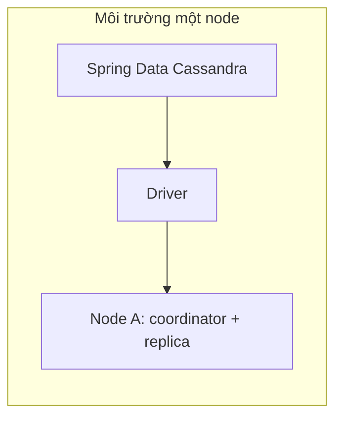
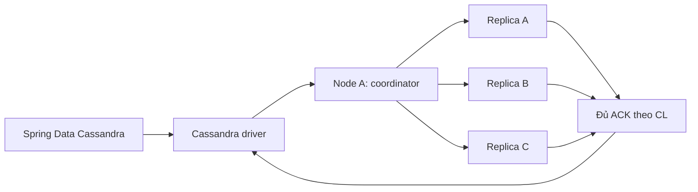

# Phân biệt cấu hình một node với cụm nhiều node trong Cassandra

Khi phát triển ứng dụng bằng **Spring Data Cassandra**, có thể chạy Apache Cassandra trên một node ở máy cá nhân hoặc kết nối đến một cụm gồm nhiều node trong môi trường kiểm thử và production. Cú pháp CQL, entity mapping, repository và CassandraTemplate về cơ bản vẫn giống nhau, nhưng **cách cấu hình và các bảo đảm vận hành thay đổi đáng kể**: dữ liệu có được nhân bản hay không, hệ thống chịu được lỗi node nào, client khám phá topology ra sao và consistency level nào thực sự khả dụng.

Bài học thuộc chương **Môi trường** của module `SPRING_DATA_CASSANDRA`. Mục tiêu là nhận diện chính xác cấu hình một node và nhiều node, thiết lập keyspace/driver phù hợp, kiểm tra cluster đang hoạt động và tránh những giả định sai khi chuyển ứng dụng từ môi trường phát triển sang cụm phân tán.

## 1. Những khái niệm không được nhầm lẫn

| Khái niệm | Ý nghĩa | Ví dụ |
|---|---|---|
| **Node** | Một tiến trình Cassandra với dữ liệu cục bộ, commit log, memtable và SSTable riêng | Một máy ảo chạy một tiến trình Cassandra |
| **Cluster** | Tập các node Cassandra phối hợp lưu và phục vụ dữ liệu | Cluster `orders-prod` gồm ba node |
| **Datacenter (DC)** | Nhóm node logic được đặt tên; replication và một số consistency level được xác định theo DC | `dc1`, `dc2` |
| **Rack** | Nhóm node biểu diễn miền lỗi trong một DC, hỗ trợ chiến lược đặt replica | `rack1`, `rack2`, `rack3` |
| **Partition** | Đơn vị dữ liệu được xác định bởi partition key; vị trí được quyết định theo token và topology | Sự kiện của khách X trong tháng 11 |
| **Replica** | Một node giữ bản sao của một partition; mỗi partition có thể có nhiều replica | RF=3: tối đa ba bản sao theo chiến lược phân bố |
| **Replication factor (RF)** | Số replica được cấu hình cho một keyspace, thường theo từng DC | `{'dc1': 3}` |
| **Consistency level (CL)** | Số lượng/nhóm phản hồi replica cần cho một thao tác đọc hoặc ghi | `LOCAL_ONE`, `LOCAL_QUORUM` |
| **Seed node** | Điểm liên lạc giúp các node khám phá cluster qua gossip khi khởi động | `10.20.0.11` và `10.20.0.12` |
| **Contact point** | Địa chỉ Cassandra driver dùng để kết nối ban đầu và tìm hiểu topology | `10.20.0.11:9042` |

Một cluster **có thể chỉ gồm một node**. Vì vậy, cụm từ “cluster Cassandra” không mặc nhiên có nghĩa là hệ thống chịu được hỏng một máy. Ngược lại, có ba node cũng không tự động đồng nghĩa mọi partition có ba replica: **RF phải được cấu hình trong keyspace**, và còn phụ thuộc số node khả dụng cũng như chiến lược replication.

Các node tham gia cùng một cluster cần thống nhất những thuộc tính liên quan đến định danh và cấu trúc cluster; các node riêng biệt có địa chỉ và đường lưu trữ riêng. Mỗi node có thể phục vụ vai trò **coordinator** khi nhận yêu cầu từ driver, sau đó chuyển thao tác đến các replica phụ trách partition.

## 2. So sánh nhanh: một node và nhiều node

| Đặc điểm | Một node để học/phát triển | Cụm ba node cùng DC |
|---|---|---|
| Số tiến trình Cassandra | 1 | 3 |
| Mục đích thường gặp | Chạy CQL, entity/repository, học schema | Kiểm tra replication, lỗi node, routing, CL, tải |
| RF minh họa trong `dc1` | 1 | 3 |
| Tính sẵn sàng khi một node ngừng | Không còn node phục vụ dữ liệu | Có thể vẫn phục vụ ở mức CL phù hợp |
| Số bản sao khi RF minh họa có hiệu lực | 1 | 3, thường trên ba node khác nhau |
| Kết nối client | Có thể dùng một contact point | Nên cấu hình nhiều contact point khả dụng |
| Metadata topology | Một node, một DC/rack logic | Nhiều node, có thể nhiều rack hoặc DC |
| Kiểm thử lỗi phân tán | Hạn chế | Có thể mô phỏng node mất kết nối, thiếu replica |
| Chi phí vận hành | Thấp | Cao hơn: mạng, đĩa, repair, compaction, giám sát |
| Phù hợp production | Thường không nên dùng làm hệ HA | Có nền tảng HA, nhưng vẫn cần cấu hình và vận hành đúng |

**RF và CL không phải các “công tắc” tự tạo độ sẵn sàng.** Một node với RF=1 không có bản sao để failover. Ba node với RF=3 và topology phù hợp cho phép một số thao tác tiếp tục được xác nhận khi mất một node, nhưng giới hạn chính xác tùy CL, tình trạng replica, DC và loại sự cố.

## 3. Đường đi của một yêu cầu trong hai môi trường

Cassandra dùng cùng kiểu client/server và CQL ở cả hai môi trường, nhưng số bước mạng khác nhau.



Ở cấu hình một node với RF=1, tiến trình nhận yêu cầu cũng là nơi giữ bản sao của partition. Dữ liệu vẫn đi qua commit log, memtable và SSTable; không có node khác để tiếp tục phục vụ nếu node này ngừng hoạt động.



Ở cluster nhiều node, **coordinator** nhận CQL rồi xác định các replica dựa trên token của partition key, topology và cấu hình keyspace. Một replica có thể trùng node coordinator; hình vẽ tách vai trò để dễ theo dõi. Coordinator chỉ cần nhận đủ phản hồi **theo CL được yêu cầu**, không nhất thiết phải chờ toàn bộ replica ở mọi CL.

Nếu cùng một câu lệnh `repository.save(event)` chạy trên hai cấu hình khác nhau, mã Java có thể không đổi. Nhưng số replica được ghi, rủi ro khi một node hỏng và độ trễ do phối hợp giữa các node đều có thể khác.

## 4. Cấu hình một node: đủ để học, nhưng không mô phỏng đầy đủ phân tán

Mục tiêu của môi trường một node là tạo một Cassandra instance có thể truy cập qua CQL, dùng keyspace RF=1 và xác minh Spring Boot kết nối thành công.

Ví dụ cấu hình **minh họa các tham số quan trọng** trong `cassandra.yaml` khi chạy trực tiếp trên máy phát triển:

```yaml
cluster_name: 'cassandra-local'
listen_address: 127.0.0.1
rpc_address: 127.0.0.1
native_transport_port: 9042

seed_provider:
  - class_name: org.apache.cassandra.locator.SimpleSeedProvider
    parameters:
      - seeds: "127.0.0.1"
```

Các dòng trên là **một trích đoạn**, không phải nội dung `cassandra.yaml` hoàn chỉnh. Tên tham số và cách xác định snitch/rack có thể thay đổi theo bản phát hành; cần giữ các trường còn lại từ cấu hình phù hợp với phiên bản đang cài. Nếu chạy Docker, Kubernetes hoặc máy ảo có giao diện mạng riêng, không thể dùng `127.0.0.1` làm địa chỉ liên lạc giữa các node.

Với snitch đọc thông tin DC/rack từ file, ví dụ `cassandra-rackdc.properties`:

```properties
dc=dc1
rack=rack1
```

Tên `dc1` có ý nghĩa vì nó phải tương ứng với tên DC trong cấu hình replication của keyspace và `local-datacenter` phía driver.

### Tạo keyspace một node

Đối với môi trường học tập, ví dụ dùng **NetworkTopologyStrategy** với một replica tại `dc1`:

```sql
CREATE KEYSPACE IF NOT EXISTS shop_dev
WITH replication = {
    'class': 'NetworkTopologyStrategy',
    'dc1': 1
}
AND durable_writes = true;
```

Sau đó:

```sql
USE shop_dev;

CREATE TABLE events_by_customer_day (
    customer_id uuid,
    bucket_day date,
    occurred_at timestamp,
    event_id uuid,
    event_type text,
    PRIMARY KEY ((customer_id, bucket_day), occurred_at, event_id)
) WITH CLUSTERING ORDER BY (occurred_at DESC, event_id DESC);
```

Trong môi trường này, `LOCAL_ONE` là lựa chọn CL phù hợp để học cách ghi/đọc. `LOCAL_QUORUM` với RF=1 cũng chỉ yêu cầu **một** replica trong DC, vì đa số của một là một; nó **không biến dữ liệu thành nhiều bản sao**. Tương tự, CL `ALL` khi RF=1 vẫn chỉ là một phản hồi. Vì vậy, không thể đánh giá khả năng chịu lỗi đa node chỉ bằng việc đổi CL trên môi trường một node.

Một số hướng dẫn cũ dùng `SimpleStrategy` cho keyspace local. Khi học replication theo DC và chuẩn bị chuyển sang cluster, `NetworkTopologyStrategy` với `dc1: 1` làm sự khác biệt rõ hơn. Đối với production nhiều DC, nên sử dụng chiến lược replication nhận biết DC/rack phù hợp với topology.

## 5. Cấu hình nhiều node: thống nhất cluster, khác địa chỉ node

Giả sử triển khai **ba node trong cùng datacenter `dc1`**:

| Node | IP nội bộ minh họa | Datacenter | Rack logic |
|---|---|---|---|
| A | `10.20.0.11` | `dc1` | `rack1` |
| B | `10.20.0.12` | `dc1` | `rack2` |
| C | `10.20.0.13` | `dc1` | `rack3` |

Địa chỉ dùng trong ví dụ **không phải địa chỉ hạ tầng thực**. Rack chỉ có giá trị cho chịu lỗi khi tên rack phản ánh những miền lỗi thật sự độc lập; đặt ba tên rack khác nhau cho ba máy cùng một điểm lỗi vật lý không tạo thêm khả năng chịu lỗi.

Mỗi node có cấu hình riêng nhưng **cùng `cluster_name`** và cùng danh sách seed thích hợp. Ví dụ với node A:

```yaml
# Trích đoạn cassandra.yaml của node A
cluster_name: 'shop-cluster'
listen_address: 10.20.0.11
rpc_address: 0.0.0.0
broadcast_rpc_address: 10.20.0.11
native_transport_port: 9042

seed_provider:
  - class_name: org.apache.cassandra.locator.SimpleSeedProvider
    parameters:
      - seeds: "10.20.0.11,10.20.0.12"
```

Với node B và C, đặt `listen_address` bằng IP **của chính node đó**; `broadcast_rpc_address` cũng phải là địa chỉ client có thể truy cập từ mạng triển khai. Không sao chép nguyên `listen_address` của node A sang mọi máy. Khi `rpc_address` là `0.0.0.0`, Cassandra cần quảng bá địa chỉ client phù hợp thay vì `0.0.0.0`; mục đích của `broadcast_rpc_address` là cung cấp địa chỉ có thể dùng từ bên ngoài node.

Trong `cassandra-rackdc.properties` của từng node khi dùng snitch tương ứng:

```properties
# Node A
dc=dc1
rack=rack1
```

```properties
# Node B
dc=dc1
rack=rack2
```

```properties
# Node C
dc=dc1
rack=rack3
```

Hãy đảm bảo loại snitch/topology mechanism mà bản Cassandra thực tế sử dụng khớp với cách cung cấp DC/rack. Với các bản cài dùng `GossipingPropertyFileSnitch`, DC/rack được khai báo bằng file như trên. Cấu hình `endpoint_snitch` cụ thể là một phần của thiết lập Cassandra phía server, không phải thuộc tính `spring.cassandra.*` của ứng dụng.

### Seed node thực sự làm gì?

Seed là **điểm liên lạc khi node tham gia hoặc tái gia nhập cluster**; seed giúp các node tìm ra thành viên khác qua gossip. Seed **không phải** “node chủ”, không giữ toàn bộ dữ liệu và không chịu trách nhiệm xử lý mọi truy vấn. Cassandra không hoạt động theo mô hình một master duy nhất cho mọi mutation.

Nên chọn một số địa chỉ seed ổn định và có thể tiếp cận; tất cả node cần cấu hình seed hợp lý theo topology. Nếu toàn bộ seed không thể liên lạc trong một số tình huống khởi động, node mới có thể không khám phá được cluster, dù những node đang chạy khác vẫn phục vụ dữ liệu.

**Đừng nhầm seed của Cassandra với contact point của driver:**

- Seed là cấu hình **server-to-server** cho việc khám phá cluster.
- Contact point là cấu hình **client-to-server** để Cassandra driver kết nối ban đầu.
- Cả hai đều là địa chỉ ban đầu, không phải danh sách “toàn bộ những node được phép lưu dữ liệu”.

Khả năng kết nối giữa node còn phụ thuộc cổng mạng nội bộ, firewall, định tuyến, phân giải DNS, bảo mật và cấu hình advertise/broadcast address. Cổng CQL thông dụng là **9042**; lưu lượng internode thường sử dụng các cổng khác theo phiên bản và cấu hình. Không nên chỉ mở cổng client rồi cho rằng cluster có thể giao tiếp đầy đủ.

## 6. Keyspace quyết định replication, không phải số node tự thân

Với ba node cùng DC, tạo keyspace production minh họa:

```sql
CREATE KEYSPACE IF NOT EXISTS shop_prod
WITH replication = {
    'class': 'NetworkTopologyStrategy',
    'dc1': 3
}
AND durable_writes = true;
```

`'dc1': 3` chỉ định **replication factor 3 trong `dc1`**. Khi topology có đủ ba node phù hợp, Cassandra sẽ chọn ba replica cho mỗi partition theo cơ chế phân bố token và placement. Nó **không** có nghĩa một lệnh ghi phải chờ ba ACK: số ACK tùy consistency level của từng request.

Các trường hợp cần phân biệt:

| Node trong `dc1` | RF cấu hình | Ý nghĩa thực tế |
|---:|---:|---|
| 1 | 1 | Một bản sao, không có failover theo node |
| 3 | 1 | Mỗi partition thường chỉ có một replica; có thêm node nhưng thiếu nhân bản dữ liệu |
| 3 | 2 | Mỗi partition có hai replica; số phản hồi `LOCAL_QUORUM` là 2 |
| 3 | 3 | Mỗi partition có ba replica; số phản hồi `LOCAL_QUORUM` là 2 |
| 3 | Lớn hơn 3 | Cấu hình thiếu đủ node cho RF mong muốn; không thể có đủ bản sao độc lập theo yêu cầu |

RF còn ảnh hưởng dung lượng. Nếu RF=3 trên đúng ba node, xét tổng thể mỗi node sẽ lưu một bản sao của phần lớn dữ liệu thuộc mỗi partition trong DC. **Không thể suy ra rằng ba node RF=3 cung cấp dung lượng dữ liệu hữu ích gấp ba một node RF=1**; replication tiêu tốn thêm đĩa, băng thông ghi, tài nguyên repair và compaction.

Khi mở rộng số node mà vẫn giữ RF=3, dữ liệu replica được phân bố lại trên tập node lớn hơn theo token và topology. Việc thêm node không tự tăng RF; còn việc đổi RF không tự thay đổi số node.

### Không dùng RF sai cho môi trường một node

Nếu mang nguyên keyspace `{'dc1': 3}` sang môi trường chỉ có một node, không thể có ba replica độc lập. Những CL yêu cầu nhiều phản hồi replica có thể thất bại hoặc không có đủ replica sống. Hãy thiết lập keyspace phù hợp môi trường và kiểm tra replication thực tế, thay vì copy schema deployment mà không xem xét topology.

## 7. Consistency level: cùng lệnh CQL, số ACK khác nhau

Với RF=3 trong **một DC**, hãy xét các mức ghi phổ biến:

| CL | Điều kiện xác nhận minh họa | Khi một replica ngừng hoạt động |
|---|---|---|
| `LOCAL_ONE` | Ít nhất một replica ở DC cục bộ phản hồi | Thường vẫn xác nhận được nếu có replica phù hợp hoạt động |
| `LOCAL_QUORUM` | Đa số replica ở DC cục bộ: **2/3** | Có thể vẫn xác nhận với hai replica sống |
| `ALL` | Cần tất cả replica được yêu cầu: **3/3** trong ví dụ | Không thể hoàn thành thành công nếu một replica bắt buộc không khả dụng |

Các con số chỉ áp dụng cho giả định **RF=3, một DC, các replica được đặt đúng**. Khi RF hoặc topology thay đổi, số phản hồi thay đổi theo. Ví dụ RF=2 thì quorum là 2; RF=1 thì quorum là 1.

Ở `cqlsh`, có thể minh họa một phiên làm việc bằng:

```sql
CONSISTENCY LOCAL_QUORUM;

SELECT *
FROM shop_prod.events_by_customer_day
WHERE customer_id = ?
  AND bucket_day = ?
LIMIT 20;
```

`CONSISTENCY` trong `cqlsh` là lệnh của công cụ client để chọn CL cho những câu lệnh tiếp theo; đó **không phải** mệnh đề của câu lệnh `SELECT` và không tạo cấu hình CL toàn cluster. Khi thử trực tiếp trong `cqlsh`, thay dấu `?` bằng literal phù hợp; trong ứng dụng dấu `?` là chỗ dành cho bind parameter.

Đối với một partition có RF=3, tổ hợp **đọc `LOCAL_QUORUM` và ghi `LOCAL_QUORUM`** có tính giao nhau của tập replica phản hồi trong DC khi các giả định thông thường được đáp ứng. Tuy nhiên, điều đó không tự mang lại giao dịch ACID đa partition, không loại bỏ xung đột timestamp và cũng không thay thế repair khi một replica đã bỏ lỡ cập nhật.

**Một lời gọi client bị timeout không chứng minh mutation chưa được ghi.** Khi chuyển từ một node sang nhiều node, retry, idempotency, chính sách timeout và độ trễ mạng cần được thiết kế rõ hơn. Đặc biệt, tránh tạo ID mới mỗi lần retry một sự kiện nghiệp vụ vì có thể làm phát sinh bản ghi trùng.

## 8. Từ một datacenter sang nhiều datacenter

“Một node” và “nhiều node” là một trục khác với “một DC” và “nhiều DC”. Một cluster có thể có ba node trong `dc1`, hoặc hai DC mỗi nơi có ba node.

Ví dụ keyspace cho **hai DC**, mỗi nơi RF=3:

```sql
CREATE KEYSPACE IF NOT EXISTS shop_multi_dc
WITH replication = {
    'class': 'NetworkTopologyStrategy',
    'dc1': 3,
    'dc2': 3
}
AND durable_writes = true;
```

Bảng sau mô tả ý nghĩa khái quát:

| Cấu hình | Hệ quả |
|---|---|
| `dc1: 3` | Ba bản sao trong DC1 khi đủ node |
| `dc2: 3` | Ba bản sao trong DC2 khi đủ node |
| `LOCAL_ONE` ở DC1 | Xác nhận trên một replica tại DC1 theo ngữ nghĩa của thao tác |
| `LOCAL_QUORUM` ở DC1 | Cần quorum tại DC1, không bắt buộc chờ quorum của DC2 |
| `EACH_QUORUM` | CL ghi có yêu cầu quorum ở từng DC được cấu hình; phải đánh giá mục tiêu sẵn sàng và độ trễ giữa DC |

Không nên tự động chọn `ALL` khi có nhiều DC vì độ trễ và khả năng sẵn sàng sẽ phụ thuộc thêm kết nối liên vùng. `LOCAL_*` thường là lựa chọn đáng cân nhắc để tránh một yêu cầu thường ngày phải chờ DC ở xa, nhưng quyết định cuối cùng thuộc yêu cầu nhất quán, độ bền, khả năng chịu lỗi và chiến lược phục hồi.

**Driver phải biết local datacenter** của ứng dụng. Một ứng dụng chạy ở `dc1` không nên tùy tiện khai báo `dc2` chỉ vì contact point đầu tiên có địa chỉ ở DC2. Local DC ảnh hưởng chính sách định tuyến và ý nghĩa của CL `LOCAL_*`.

## 9. Cấu hình Spring Data Cassandra: code ứng dụng hầu như giữ nguyên

Spring Data Cassandra sử dụng Cassandra Java Driver để kết nối và gửi CQL. Trong Spring Boot 3.x, nhóm thuộc tính thường sử dụng tiền tố `spring.cassandra.*`. Với dự án dùng phiên bản Spring Boot cũ, nhóm thuộc tính có thể nằm ở `spring.data.cassandra.*`; cần đối chiếu đúng dependency đang chạy.

### 9.1. Môi trường một node — ví dụ `application-dev.yml`

```yaml
spring:
  cassandra:
    contact-points: 127.0.0.1
    port: 9042
    local-datacenter: dc1
    keyspace-name: shop_dev
```

Ứng dụng kết nối tới Cassandra local qua native CQL port. `local-datacenter: dc1` phải khớp tên DC Cassandra báo cáo. Không suy đoán DC chỉ từ tên profile `dev`; ngay cả một node cũng có tên DC thực.

### 9.2. Môi trường ba node — ví dụ `application-prod.yml`

```yaml
spring:
  cassandra:
    contact-points: 10.20.0.11,10.20.0.12,10.20.0.13
    port: 9042
    local-datacenter: dc1
    keyspace-name: shop_prod
```

Danh sách contact point giúp driver có nhiều lựa chọn để **khởi tạo kết nối và khám phá cluster**. Sau khi có topology, driver có thể kết nối và định tuyến đến các node phù hợp, dựa trên load-balancing policy và token metadata. Danh sách contact point **không phải** chỉ thị ghi một lần vào từng IP.

Trong thực tế có thể dùng tên DNS ổn định, cơ chế khám phá phù hợp với nền tảng và thiết lập xác thực/TLS. Địa chỉ mà server quảng bá phải có thể truy cập từ mạng của client; một địa chỉ chỉ dùng được trong nội bộ container có thể khiến ứng dụng khám phá node nhưng không kết nối được sau đó.

### 9.3. Cùng một mapping và repository

Schema `events_by_customer_day` có thể giống nhau ở dev và production. Một entity Java tối giản:

```java
import java.io.Serializable;
import java.time.Instant;
import java.time.LocalDate;
import java.util.UUID;

import org.springframework.data.cassandra.core.cql.Ordering;
import org.springframework.data.cassandra.core.mapping.PrimaryKeyClass;
import org.springframework.data.cassandra.core.mapping.PrimaryKeyColumn;
import org.springframework.data.cassandra.core.mapping.PrimaryKeyType;

@PrimaryKeyClass
public class CustomerDayEventKey implements Serializable {
    @PrimaryKeyColumn(name = "customer_id", ordinal = 0,
        type = PrimaryKeyType.PARTITIONED)
    private UUID customerId;

    @PrimaryKeyColumn(name = "bucket_day", ordinal = 1,
        type = PrimaryKeyType.PARTITIONED)
    private LocalDate bucketDay;

    @PrimaryKeyColumn(name = "occurred_at", ordinal = 2,
        type = PrimaryKeyType.CLUSTERED, ordering = Ordering.DESCENDING)
    private Instant occurredAt;

    @PrimaryKeyColumn(name = "event_id", ordinal = 3,
        type = PrimaryKeyType.CLUSTERED, ordering = Ordering.DESCENDING)
    private UUID eventId;

    // Thêm constructor, getters/setters, equals/hashCode.
}
```

```java
import org.springframework.data.cassandra.core.mapping.Column;
import org.springframework.data.cassandra.core.mapping.PrimaryKey;
import org.springframework.data.cassandra.core.mapping.Table;

@Table("events_by_customer_day")
public class CustomerDayEvent {
    @PrimaryKey
    private CustomerDayEventKey key;

    @Column("event_type")
    private String eventType;

    // Thêm constructor, getters/setters.
}
```

Việc khai báo `@Column("event_type")` giúp tên cột CQL được ánh xạ rõ ràng và không phụ thuộc vào naming strategy. Khóa cần hoàn thiện `equals/hashCode`; mỗi lớp `public` được đặt trong tệp Java tương ứng.

Repository có thể giữ nguyên:

```java
import org.springframework.data.cassandra.repository.CassandraRepository;

public interface CustomerDayEventRepository
        extends CassandraRepository<CustomerDayEvent, CustomerDayEventKey> {
}
```

```java
repository.save(event); // Dùng cùng một lệnh ở cả dev và prod.
```

Sự khác nhau nằm ở **keyspace, topology, RF, CL, bảo mật, timeout, retry và monitoring**, không nằm ở việc phải viết lại `repository.save()` thành một vòng lặp ghi ba node.

Với `CassandraTemplate` hay CQL trực tiếp, lập luận tương tự. Không cần tạo ba `CassandraTemplate` để ghi ba replica trong cùng cluster; coordinator và Cassandra xử lý replication theo keyspace.

## 10. Kiểm soát consistency ở mức driver/statement

Việc khai báo ba contact point **không tự đặt CL thành `LOCAL_QUORUM`**. Nếu workload yêu cầu mức nhất quán cụ thể, cấu hình driver hoặc statement cho phù hợp.

Ví dụ CQL statement với Java Driver 4.x:

```java
import com.datastax.oss.driver.api.core.DefaultConsistencyLevel;
import com.datastax.oss.driver.api.core.cql.SimpleStatement;

SimpleStatement statement = SimpleStatement.builder(
        "INSERT INTO shop_prod.events_by_customer_day " +
        "(customer_id, bucket_day, occurred_at, event_id, event_type) " +
        "VALUES (?, ?, ?, ?, ?)")
    .addPositionalValues(customerId, bucketDay, occurredAt, eventId, eventType)
    .setConsistencyLevel(DefaultConsistencyLevel.LOCAL_QUORUM)
    .build();

session.execute(statement);
```

`session` là một `CqlSession` đã được cấu hình và quản lý vòng đời; các biến đầu vào được ứng dụng cung cấp. Đoạn mã minh họa việc **chỉ định CL cho một statement**, không cần dựng vòng kết nối riêng cho mỗi replica. Khi thao tác qua repository hoặc CassandraTemplate, cần hiểu CL mà driver thực tế áp dụng hoặc dùng cơ chế cấu hình/request API tương ứng.

Chọn CL phải đi cùng RF. Nếu chuyển một đoạn mã luôn yêu cầu `LOCAL_QUORUM` từ `shop_prod` RF=3 sang `shop_dev` RF=1, số ACK cần có giảm từ hai xuống một; **cùng tên CL nhưng mức nhân bản vật lý khác nhau**. Nếu cần kiểm thử đường lỗi quorum, phải có đủ node và RF phù hợp.

## 11. Mở rộng từ một node lên nhiều node không chỉ là đổi danh sách IP

Chuyển production sang nhiều node là một thay đổi **hạ tầng và mô hình lưu trữ**, không đơn thuần thay `contact-points` trong file cấu hình.

Quy trình khái quát:

1. **Thiết kế topology:** chọn số node theo DC/rack, ước lượng tải, dung lượng đĩa và miền lỗi thật sự.
2. **Thiết lập mạng và danh tính cluster:** mỗi node có `listen_address` riêng, cùng cluster name, seed hợp lý, DC/rack nhất quán và đường liên lạc cần thiết.
3. **Tham gia cluster đúng quy trình:** node mới phải bootstrap/stream dữ liệu phù hợp; không coi việc bật tiến trình ở IP mới là đã có đầy đủ replica.
4. **Xác minh membership:** chạy `nodetool status` và kiểm tra node ở trạng thái hoạt động bình thường, topology phản ánh đúng mong đợi.
5. **Cấu hình RF cho keyspace:** xác định số replica muốn có trong từng DC; nếu đổi RF, thực hiện quy trình đồng bộ/repair cần thiết theo phiên bản và chiến lược vận hành.
6. **Kiểm tra driver:** cập nhật các contact point, local DC, định tuyến, xác thực và khả năng client liên hệ địa chỉ được quảng bá.
7. **Thử tải và lỗi:** chạy truy vấn thật, đo latency và thử tình huống mất node/đứt mạng ở CL cần phục vụ.

Nếu đang có dữ liệu thật trên một node và muốn mở rộng tại chỗ, cần làm theo quy trình thêm node, bootstrap và thay đổi RF tương ứng. Nếu dựng cluster mới, có thể dùng quy trình di chuyển dữ liệu có kiểm soát. **Không sao chép thủ công thư mục dữ liệu của một node làm “bản nhân bản” sang những node mới** rồi kỳ vọng topology tự đồng bộ.

Việc đổi replication của keyspace là thay đổi cấu hình dữ liệu ở mức cluster. Khi tăng RF, những replica mới có thể cần được bổ sung dữ liệu qua repair/streaming; chỉ chạy `ALTER KEYSPACE` mà bỏ qua đồng bộ dữ liệu có thể để lại các bản sao thiếu dữ liệu cũ.

## 12. Cách kiểm tra node, DC, rack và replication

Dùng công cụ quản trị của Cassandra để xem topology thực tế, thay vì chỉ nhìn file cấu hình ứng dụng.

### 12.1. Kiểm tra node trong cluster

Ở máy có quyền chạy `nodetool` phù hợp:

```bash
nodetool status
```

Trong kết quả thường có DC, trạng thái như `UN` (*Up/Normal*), địa chỉ node, token, rack và các thông tin liên quan. Một node hiện `UN` chứng minh nó được cluster nhận biết ở trạng thái up/normal tại thời điểm quan sát, **không đảm bảo mọi replica đã đồng bộ và mọi truy vấn đều khỏe**.

Có thể kiểm tra thông tin cluster:

```bash
nodetool describecluster
```

Với các phiên bản Cassandra khác nhau, một số trường trong đầu ra có thể khác; không viết automation chỉ dựa vào định dạng văn bản không ổn định của công cụ.

### 12.2. Kiểm tra thông tin DC của node qua CQL

```sql
SELECT cluster_name, data_center, rack
FROM system.local;
```

Nếu client được cấu hình `local-datacenter: dc1` mà node báo DC là `datacenter1`, cần kiểm tra lại topology và cấu hình driver. Không giải quyết bằng cách tùy tiện đổi DC client trên production mà chưa hiểu chiến lược replica placement.

### 12.3. Kiểm tra replication của keyspace

Trong `cqlsh`:

```sql
DESCRIBE KEYSPACE shop_prod;
```

Hoặc dùng metadata CQL:

```sql
SELECT keyspace_name, replication
FROM system_schema.keyspaces
WHERE keyspace_name = 'shop_prod';
```

Hãy đối chiếu **ba thứ**: số node thực đang tham gia DC, RF khai báo của keyspace và CL đọc/ghi của ứng dụng. Nếu chỉ xem một trong ba, dễ kết luận sai về tính chịu lỗi.

## 13. Các lỗi cấu hình thường gặp và dấu hiệu nhận biết

| Triệu chứng | Nguyên nhân cần kiểm tra | Cách xác minh/giải quyết |
|---|---|---|
| Chạy local được, production không kết nối được | Contact point không truy cập được, cổng 9042 bị chặn, TLS/auth chưa đúng | Kiểm tra kết nối client, network, security settings và log driver |
| Driver kết nối được một node rồi lỗi khi truy vấn | Địa chỉ node được quảng bá không truy cập được từ client | Kiểm tra `broadcast_rpc_address`/DNS, topology metadata |
| Node mới không xuất hiện trong `nodetool status` | Seed, mạng internode, cluster name hoặc DC/rack sai; join/bootstrapping lỗi | Kiểm tra log startup, kết nối giữa node và cấu hình gossip |
| `UnavailableException` khi dùng `LOCAL_QUORUM` | Không đủ replica phù hợp hoạt động cho RF/CL | Đối chiếu RF của keyspace, tình trạng replica, datacenter |
| `WriteTimeout`/`ReadTimeout` | Replica hoặc mạng chậm, timeout quá ngắn, tài nguyên quá tải | Xem latency, CPU, disk, compaction, pending tasks, network |
| Mất một node rồi dữ liệu không đọc được | RF=1 hoặc CL yêu cầu nhiều replica hơn số sống | Kiểm tra RF/CL; thiết kế chịu lỗi theo yêu cầu nghiệp vụ |
| Node thêm vào nhưng tải mất cân bằng | Phân phối token/partition, bootstrap hoặc workload có hot key | Kiểm tra token, ownership, kích thước partition, tải từng node |
| Thấy ba node nhưng dữ liệu chưa đủ ba bản sao | Keyspace vẫn RF=1 hoặc quá trình đồng bộ chưa hoàn tất | Kiểm tra `system_schema.keyspaces` và tình trạng repair/streaming |

Một sai lầm đặc biệt phổ biến là **đếm contact point như số replica**. Ví dụ, khai báo ba địa chỉ trong `application-prod.yml` nhưng tạo keyspace RF=1: driver vẫn biết ba node, nhưng **mỗi partition chỉ có một replica theo RF**. Tương tự, một node có thể làm coordinator cho một partition nhưng bản thân nó không phải là một trong các replica của partition đó.

### Sự khác biệt giữa lỗi node và lỗi toàn DC

Với RF=3 trong một DC có ba node, mất một node thường vẫn có khả năng hoàn thành yêu cầu `LOCAL_QUORUM`. Nếu toàn bộ DC ngừng hoạt động và chỉ có replica trong DC ấy, client sẽ không thể lấy dữ liệu từ DC khác vốn không tồn tại. Khả năng chống lỗi **node**, **rack** và **datacenter** là những mục tiêu riêng, cần quyết định topology và replication tương ứng.

Một hệ thống nhiều DC vẫn có thể mất sẵn sàng nếu CL quá nghiêm ngặt đòi hỏi phản hồi từ DC đã hỏng. Thiết kế độ sẵn sàng phải xem cả **RF theo DC, CL, vị trí client và giả định về miền lỗi**.

## 14. Hiệu năng: vì sao nhiều node không tự động khiến mọi truy vấn nhanh hơn?

Thêm node có thể tăng khả năng xử lý đồng thời và giảm tải trên mỗi máy khi dữ liệu được phân bố tốt. Tuy nhiên, điều đó không bảo đảm từng truy vấn riêng lẻ sẽ có độ trễ thấp hơn:

- **Network hop:** coordinator có thể phải gửi yêu cầu đến replica khác và chờ phản hồi.
- **CL cao hơn:** nhiều ACK giúp tăng mức xác nhận nhưng có thể tăng thời gian chờ so với `LOCAL_ONE`.
- **Replication:** ghi thêm bản sao gây thêm lưu lượng mạng, đĩa và compaction.
- **Repair và streaming:** cần tài nguyên nền để giữ các replica hội tụ và tái cân bằng dữ liệu.
- **Hot partition:** nếu partition key dồn phần lớn yêu cầu vào một partition, thêm node không tự chia partition đó thành nhiều khóa.
- **Tombstone và partition rộng:** vẫn làm đọc tốn công dù cluster có nhiều máy.

Ví dụ, bảng theo dõi sự kiện sử dụng:

```sql
PRIMARY KEY ((customer_id, bucket_day), occurred_at, event_id)
```

Nếu một khách tạo hàng triệu sự kiện mỗi ngày, partition theo `customer_id + bucket_day` có thể trở nên rất lớn hoặc nóng. Mở rộng từ một lên ba node **không thay đổi cách xác định partition**. Cần thiết kế lại bucket/sharding theo mẫu truy vấn, kiểm soát TTL và theo dõi phân phối khóa.

Đối với paging, driver có thể lấy dữ liệu theo trang qua Cassandra paging state; sử dụng page size hợp lý, tránh cố đọc toàn bộ partition vào bộ nhớ ứng dụng. Mỗi trang vẫn đi qua coordinator/replica ở topology hiện tại, nên cần xem tải và latency thay vì chỉ kiểm tra câu truy vấn có chạy đúng trên local.

## 15. Thử nghiệm có kiểm soát để hiểu sự khác biệt

Một bài lab hữu ích có thể dùng cùng bảng `events_by_customer_day` trên hai môi trường độc lập.

### Bài A — Một node

1. Khởi chạy Cassandra một node, xác minh `nodetool status` chỉ có một node `UN`.
2. Tạo `shop_dev` với `NetworkTopologyStrategy`, `dc1: 1`.
3. Cấu hình `spring.cassandra.contact-points` trỏ về node đó và `local-datacenter: dc1`.
4. Ghi vài sự kiện bằng repository; đọc lại theo `customer_id + bucket_day`.
5. Dừng node. Quan sát ứng dụng không còn nơi phục vụ yêu cầu; khởi động lại và xác minh dữ liệu trên storage bền vững.

### Bài B — Ba node

1. Khởi chạy ba node, đảm bảo cluster name và thông tin DC/rack đúng, kiểm tra cả ba là `UN`.
2. Tạo `shop_prod` với `dc1: 3`; ghi/đọc cùng mẫu sự kiện.
3. Thiết lập CL phù hợp, ví dụ `LOCAL_QUORUM`, đo độ trễ và kết quả.
4. **Trong môi trường lab**, tạm dừng một node; xác minh câu lệnh ở `LOCAL_QUORUM` còn có thể thành công khi hai replica sống.
5. Thử trường hợp CL `ALL` để quan sát yêu cầu đủ replica khi một node không khả dụng.
6. Khôi phục node, theo dõi membership và quá trình đồng bộ/repair phù hợp trước khi kết luận cluster đã trở lại trạng thái khỏe.

**Không chạy thí nghiệm dừng node trên production.** Nếu lab có chạy Cassandra qua container, cần cấp tài nguyên CPU/RAM/đĩa đủ và mạng container ổn định; thiếu tài nguyên có thể tạo lỗi giả, khiến người học nhầm hiện tượng hệ thống bị quá tải với vấn đề consistency.

### Kết quả mong đợi

| Quan sát | Một node RF=1 | Ba node RF=3 |
|---|---|---|
| `repository.save()` hoạt động khi khỏe | Có | Có |
| Có thể xác nhận CL `LOCAL_QUORUM` khi mất một node | Không có replica dự phòng | Có thể, nếu còn hai replica phù hợp |
| Khi tắt node duy nhất | Không có node phục vụ | Không áp dụng |
| Khi tắt một node trong ba node | Không áp dụng | Có thể vẫn đọc/ghi tùy CL và health |
| Phải tính chuyện repair/streaming giữa replica | Không có replica khác để repair cùng partition | Có |
| Nhu cầu giám sát network giữa node | Thấp | Cao |

## 16. Checklist trước khi chuyển ứng dụng sang cụm nhiều node

1. **Đã xác minh node thực tế?** `nodetool status` phản ánh đúng số node, DC, rack và trạng thái.
2. **Cluster name và gossip đúng?** Node dùng địa chỉ internode hợp lệ, seed tiếp cận được, không nhầm seed với contact point.
3. **RF theo keyspace đúng?** Số replica trong từng DC phù hợp số node và mục tiêu chịu lỗi.
4. **CL phù hợp RF và SLA?** Hiểu số ACK thực tế, các tình huống node/DC lỗi và khả năng timeout.
5. **Driver định tuyến được?** `local-datacenter`, contact points, địa chỉ broadcast, TLS/auth phù hợp.
6. **Schema hỗ trợ query-driven design?** Partition key phân bố tải, clustering phục vụ truy vấn, không phụ thuộc `ALLOW FILTERING` cho đường đọc chính.
7. **Có chiến lược retry và idempotency?** Xử lý timeout mà không tự tạo thêm bản ghi nghiệp vụ.
8. **Có kế hoạch mở rộng và phục hồi?** Bootstrap, thay RF, repair, backup/restore, rolling maintenance được kiểm chứng theo phiên bản.
9. **Có giám sát?** Latency p95/p99, node health, pending tasks, streaming, compaction, tombstone, đĩa, mạng.
10. **Đã kiểm thử lỗi trong lab?** Ít nhất thử mất một node với CL đang dùng, quan sát kết quả thật.

Điểm cần nhớ là: **một node** giúp kiểm chứng CQL, entity mapping, repository và CassandraTemplate với chi phí thấp; **một cluster nhiều node** bổ sung replication và khả năng chịu lỗi chỉ khi **topology, keyspace RF, consistency level, cấu hình driver và quy trình vận hành** được thiết lập phù hợp. Chuyển từ local sang production không chỉ là đổi IP kết nối, mà là kiểm chứng lại những bảo đảm dữ liệu và hiệu năng mà ứng dụng cần.
