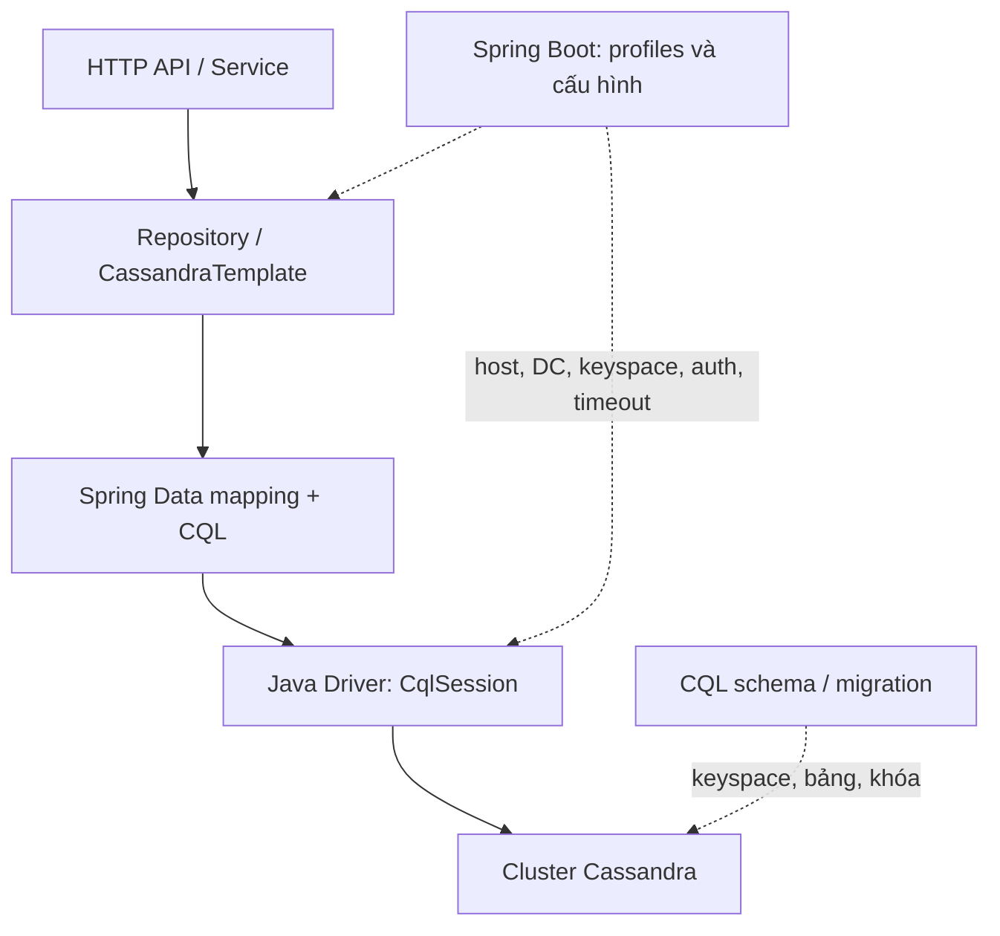
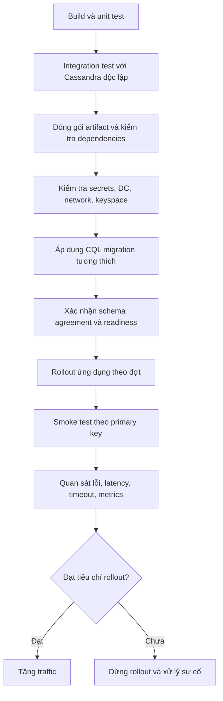

# Tổ chức cấu hình phát triển, kiểm thử và triển khai

Khi phát triển ứng dụng truy cập **Apache Cassandra bằng Spring Data Cassandra**, cùng một codebase thường phải chạy trên máy lập trình viên, môi trường kiểm thử tự động, staging và production. Những môi trường này khác nhau về địa chỉ cluster, keyspace, replication, datacenter, tài khoản kết nối, độ an toàn của dữ liệu và yêu cầu vận hành.

Mục tiêu không chỉ là thay `host` và `password`. Một hệ thống vận hành được cần tổ chức **Spring Boot profiles**, cấu hình **Apache Cassandra Java Driver**, vòng đời **CQL schema**, isolation cho integration test và quy trình triển khai tương thích. Các entity `@Table`, repository và `CassandraTemplate` nên có cùng ý nghĩa nghiệp vụ ở mọi môi trường; chỉ những thông số kết nối và chính sách thực thi hợp lý mới thay đổi theo môi trường.

Bài này tập trung vào các phiên bản Spring Boot hiện đại dùng nhóm thuộc tính `spring.cassandra.*`. Tên cấu hình và API có thể khác giữa các dòng phiên bản; khi áp dụng vào dự án thực, cần đối chiếu tài liệu đúng phiên bản Spring Boot, Spring Data Cassandra, Java Driver và Testcontainers.

Sau bài học, bạn cần có thể:

- Thiết kế cấu trúc `application.yml` và profile local/test/prod rõ ràng, không hardcode bí mật.
- Khởi tạo Cassandra local và test có khả năng tái lập, với keyspace và bảng đúng CQL.
- Viết integration test cho entity mapping, repository và câu CQL trên Cassandra thật.
- Quản lý schema qua migration thay vì phụ thuộc tạo bảng tự động khi startup.
- Chuẩn bị kết nối production với datacenter, authentication, TLS, quyền truy cập và cấu hình consistency phù hợp.
- Theo dõi paging, hiệu năng, timeout, retry và triển khai thay đổi mà không làm hỏng dữ liệu hiện có.

## 1. Các lớp cấu hình phải tách bạch

Trong ứng dụng Spring Boot, bốn lớp khác nhau phối hợp để thực hiện một truy vấn:

| Lớp | Trách nhiệm | Ví dụ |
| --- | --- | --- |
| **Spring Boot** | Nạp profile, biến môi trường, tạo bean, quản lý lifecycle | `application-prod.yml`, dependency injection |
| **Spring Data Cassandra** | Entity mapping, repository, template và tạo truy vấn | `@Table`, `@PrimaryKey`, `CassandraRepository`, `CassandraTemplate` |
| **Apache Cassandra Java Driver** | Kết nối cluster, gửi CQL, paging, timeout, consistency theo statement | `CqlSession`, prepared statement, execution profile |
| **Apache Cassandra cluster** | Phân vùng, replica, keyspace, schema và lưu trữ | partition key, clustering column, replication factor |



Spring Boot cấu hình hạ tầng chứ không phải một tầng mạng mà mỗi truy vấn phải đi qua. Spring Data Cassandra sử dụng Java Driver để giao tiếp với cluster. Không API nào có thể sửa sai một bảng thiếu partition key cho câu truy vấn đang cần.

Ví dụ, nếu bảng có khóa `PRIMARY KEY ((tenant_id, student_id), course_id)`, truy vấn tiến độ theo `tenant_id` và `student_id` là hướng truy cập được thiết kế; đổi từ repository sang template hoặc đổi profile **không** làm truy vấn theo `course_id` trên toàn bảng tự nhiên hiệu quả hơn.

## 2. Lập hợp đồng môi trường trước khi viết YAML

Bảng sau giúp team thống nhất điều gì được cố định và điều gì phải thay đổi:

| Yếu tố | Development (local) | Integration test / CI | Staging / Production |
| --- | --- | --- | --- |
| Cluster | Cassandra một node riêng, thường bằng Docker | Container tạm hoặc cluster test cô lập | Cluster thực, topology được quản lý |
| Keyspace | `learning_dev` | `learning_test` hoặc tên riêng theo test run | `learning_stage` / `learning_prod` |
| Replication | RF=1 cho một node local | RF phù hợp phạm vi test | `NetworkTopologyStrategy` theo DC và SLA |
| Authentication / TLS | Có thể đơn giản hóa trong network local | Kiểm thử trường hợp cần hỗ trợ | Theo chính sách bảo mật; secret tách biệt |
| Schema | Script CQL tái lập được | Fixture/migration áp dụng vào môi trường sạch | Migration có kiểm soát, tương thích rollout |
| Dữ liệu | Giả lập, không nhạy cảm | Độc lập và có thể xóa | Dữ liệu thật, cần quyền truy cập và backup |
| Consistency, timeout | Hợp lý cho local | Test cả nhánh lỗi và hành vi quan trọng | Chọn theo RF, SLA, độ trễ mạng và sản phẩm |
| Logging / metrics | Chi tiết vừa đủ debug | Phục vụ điều tra test fail | Có theo dõi, cảnh báo, không lộ credentials |

Các tên keyspace và mức replication trong bảng là **ví dụ lựa chọn thiết kế**, không phải giá trị có sẵn từ Spring Boot.

Hai nguyên tắc quan trọng:

1. **Test không được dùng dữ liệu production.** Một test gọi `deleteAll()` hoặc `DROP KEYSPACE` trên cluster chia sẻ có thể gây mất dữ liệu. Dùng instance hoặc keyspace test độc lập, với tài khoản và quyền được giới hạn.
2. **Production không được fallback âm thầm về local.** Thiếu contact points, datacenter hoặc keyspace cần được phát hiện trước khi nhận traffic.

## 3. Tổ chức cấu hình Spring Boot

Một cấu trúc dễ quản lý:

```text
src/
  main/
    resources/
      application.yml
      application-local.yml
      application-prod.yml
  test/
    resources/
      application-test.yml
      cql/
        test-schema.cql
  main/
    java/
      .../repository/
      .../service/
db/
  cassandra/
    V001__create_courses_by_id.cql
    V002__create_progress_by_student.cql
```

Các đường dẫn ở trên là ví dụ bố cục của một dự án Java. Schema migration không tự chạy chỉ vì tệp có tiền tố `V001`; cần có pipeline hoặc công cụ chuyên dụng thực thi và ghi nhận lịch sử của chúng.

### 3.1. File chung: `application.yml`

Chỉ đặt cấu hình áp dụng chung ở file gốc:

```yaml
spring:
  application:
    name: learning-api
  cassandra:
    schema-action: none
```

`schema-action: none` có nghĩa Spring Data Cassandra không tự tạo hoặc chỉnh schema khi khởi động. Đây là lựa chọn phù hợp nếu schema được quản lý độc lập bằng CQL migration. Nó làm rõ trách nhiệm của từng bước triển khai và tránh việc startup vô tình tạo bảng có định nghĩa khác giữa môi trường.

Không cố định `spring.profiles.active: prod` trong file chung. Chọn profile từ lệnh chạy hoặc cấu hình deployment.

### 3.2. Local: `application-local.yml`

```yaml
spring:
  config:
    activate:
      on-profile: local
  cassandra:
    contact-points: ${CASSANDRA_CONTACT_POINTS:127.0.0.1}
    port: ${CASSANDRA_PORT:9042}
    local-datacenter: ${CASSANDRA_LOCAL_DC:datacenter1}
    keyspace-name: ${CASSANDRA_KEYSPACE:learning_dev}
    schema-action: none
```

`${NAME:default}` là placeholder của Spring; ứng dụng dùng giá trị từ môi trường nếu có, ngược lại dùng fallback sau dấu `:`. Chỉ nên dùng fallback thuận tiện cho local. Trong cấu hình này:

- `contact-points` là điểm kết nối ban đầu để driver khám phá cluster, không phải cơ chế định tuyến query thay cho partition key.
- `port` là cổng CQL, thường là `9042`. Docker có thể ánh xạ sang host port khác.
- `local-datacenter` phải khớp datacenter thực tế được Cassandra công bố, kể cả khi chỉ có một node.
- `keyspace-name` xác định keyspace mặc định của session. Keyspace phải tồn tại trước khi Spring Data làm việc với bảng của nó.

Khi chạy Java **trên máy host**, `127.0.0.1` có thể truy cập port do Docker publish. Khi Java chạy **trong container khác**, `127.0.0.1` là chính container Java. Lúc đó cần dùng hostname service Cassandra trong network, ví dụ `cassandra`, cùng port nội bộ phù hợp.

### 3.3. Production: `application-prod.yml`

```yaml
spring:
  config:
    activate:
      on-profile: prod
  cassandra:
    contact-points: ${CASSANDRA_CONTACT_POINTS}
    port: ${CASSANDRA_PORT:9042}
    local-datacenter: ${CASSANDRA_LOCAL_DATACENTER}
    keyspace-name: ${CASSANDRA_KEYSPACE}
    username: ${CASSANDRA_USERNAME}
    password: ${CASSANDRA_PASSWORD}
    schema-action: none
```

Ví dụ trên giả định cluster dùng **xác thực username/password**. Nếu tổ chức dùng cơ chế xác thực khác, cần cấu hình driver theo cơ chế đó. Những giá trị quan trọng không có fallback local; nên kiểm tra chúng ở pipeline hoặc startup.

Các biến `CASSANDRA_USERNAME` và `CASSANDRA_PASSWORD` phải do cơ chế quản lý secret của môi trường cung cấp. **Không commit** secret vào Git, Docker image hoặc manifest công khai; cũng tránh in toàn bộ environment ra log.

### 3.4. Chọn profile và hiểu thứ tự ưu tiên

```bash
# Ví dụ chạy local:
java -jar learning-api.jar --spring.profiles.active=local

# Ví dụ chạy production sau khi đã cấp config và secrets:
java -jar learning-api.jar --spring.profiles.active=prod
```

Có thể đặt `SPRING_PROFILES_ACTIVE` trong môi trường chạy. Spring Boot hợp nhất nhiều nguồn cấu hình như file, environment variables và command-line arguments theo thứ tự ưu tiên của framework. Khi debug, cần xem **giá trị cấu hình cuối cùng có hiệu lực**, không chỉ nội dung một file YAML.

Với nhiều datacenter hoặc cơ chế TLS phức tạp, một phần cấu hình có thể cần native Java Driver configuration hoặc customizer của Spring Boot. Cần dựa trên phiên bản đang dùng thay vì đoán tên property.

## 4. Chạy Cassandra local có thể tái lập

Ví dụ `compose.yml` cho **một node phát triển**:

```yaml
services:
  cassandra:
    image: cassandra:4.1
    ports:
      - "127.0.0.1:9042:9042"
    environment:
      CASSANDRA_CLUSTER_NAME: learning-local
      CASSANDRA_DC: datacenter1
    volumes:
      - cassandra_dev_data:/var/lib/cassandra

volumes:
  cassandra_dev_data:
```

Cấu hình gắn cổng CQL vào loopback của máy host; không dùng nguyên cấu hình này làm cluster production. Kiểm tra máy có đủ tài nguyên để chạy Cassandra.

Khởi động và xác minh dịch vụ:

```bash
docker compose up -d
docker compose ps
docker compose exec cassandra cqlsh -e "DESCRIBE KEYSPACES"
```

**Container đang chạy chưa chắc Cassandra đã sẵn sàng nhận CQL.** Trong script tự động, chờ readiness bằng truy vấn CQL/health phù hợp và có timeout, thay vì phụ thuộc một khoảng `sleep` cố định.

### 4.1. Bootstrap keyspace và bảng local

Ví dụ CQL chạy sau khi cluster sẵn sàng:

```sql
CREATE KEYSPACE IF NOT EXISTS learning_dev
WITH replication = {
    'class': 'SimpleStrategy',
    'replication_factor': 1
};

CREATE TABLE IF NOT EXISTS learning_dev.courses_by_id (
    course_id uuid PRIMARY KEY,
    title text,
    published boolean
);

CREATE TABLE IF NOT EXISTS learning_dev.progress_by_student (
    tenant_id uuid,
    student_id uuid,
    course_id uuid,
    completed_lessons int,
    updated_at timestamp,
    PRIMARY KEY ((tenant_id, student_id), course_id)
);
```

`SimpleStrategy` với RF=1 ở đây phục vụ môi trường **một node**. Production đa node/đa DC cần replication policy phù hợp, không sao chép cấu hình local.

Tại sao bảng `progress_by_student` dùng `PRIMARY KEY ((tenant_id, student_id), course_id)`? Vì API học tập có thể cần “lấy tiến độ tất cả khóa học của một học viên trong một tenant”. Câu truy vấn tương ứng:

```sql
SELECT course_id, completed_lessons, updated_at
FROM learning_dev.progress_by_student
WHERE tenant_id = ? AND student_id = ?;
```

Các dấu `?` là tham số bind của prepared statement trong ứng dụng. Chúng không có ý nghĩa là biến tự khai báo trực tiếp trong `cqlsh`.

Thiết kế partition key là quyết định nghiệp vụ và hiệu năng. Dùng repository, `CassandraTemplate` hoặc Java Driver vẫn phải tuân thủ đường truy cập của Cassandra.

### 4.2. Dữ liệu và volume local

Volume `cassandra_dev_data` giữ dữ liệu qua các lần dừng/chạy lại thông thường. `docker compose down -v` sẽ xóa volume của Compose, vì vậy **chỉ sử dụng khi chủ động muốn hủy dữ liệu local và dựng lại**. Không đưa thao tác này vào script triển khai production.

Một môi trường phát triển tốt có thể tái lập bằng script schema/fixture nhưng không tự động xóa dữ liệu người đang lập trình khi chỉ khởi động lại ứng dụng.

## 5. Entity mapping và CQL schema phải khớp nhau

Spring Data Cassandra giúp viết Java entity:

```java
import java.util.UUID;
import org.springframework.data.cassandra.core.mapping.Column;
import org.springframework.data.cassandra.core.mapping.PrimaryKey;
import org.springframework.data.cassandra.core.mapping.Table;

@Table("courses_by_id")
public class Course {

    @PrimaryKey("course_id")
    private UUID courseId;

    @Column("title")
    private String title;

    @Column("published")
    private boolean published;

    protected Course() { }

    public Course(UUID courseId, String title, boolean published) {
        this.courseId = courseId;
        this.title = title;
        this.published = published;
    }

    public UUID getCourseId() { return courseId; }
    public String getTitle() { return title; }
    public boolean isPublished() { return published; }

    // Setter/equals/hashCode nếu mô hình ứng dụng cần.
}
```

Repository:

```java
import java.util.UUID;
import org.springframework.data.cassandra.repository.CassandraRepository;

public interface CourseRepository
        extends CassandraRepository<Course, UUID> {
}
```

`findById(courseId)` đọc dữ liệu theo primary key và dùng Java Driver để thực thi CQL bên dưới. Tuy nhiên, `@Table("courses_by_id")` **không thể làm bảng tự xuất hiện** khi `schema-action: none`. Nếu schema chưa được triển khai, ứng dụng sẽ gặp lỗi CQL/schema dù Java code biên dịch thành công.

Đối với `@PrimaryKeyClass` và composite partition/clustering keys, tên cột, thứ tự và kiểu dữ liệu Java cũng phải khớp với CQL. Cần test mapping thực tế thay vì chỉ kiểm tra phương thức repository compile.

## 6. Quản lý schema qua migration

Một thay đổi schema thường tác động cùng lúc tới code cũ, code mới, dữ liệu đang tồn tại và cluster nhiều node.

Ví dụ bổ sung cột là thay đổi có thể triển khai theo giai đoạn:

```sql
ALTER TABLE learning_dev.courses_by_id
ADD category text;
```

Các hàng cũ có thể đọc `category = null`. Code mới phải chịu được dữ liệu thiếu cột; code cũ chưa đọc cột vẫn có thể chạy.

Ngược lại, đổi partition key để phục vụ truy vấn “các khóa học theo category” thường đòi hỏi **bảng mới** như `courses_by_category`, ghi song song/backfill và chuyển hướng đọc. Không thể xem đó chỉ là đổi một annotation Java.

Quy trình đề xuất:

1. **Expand schema:** tạo bảng hoặc cột mới trước khi code bắt đầu phụ thuộc.
2. **Deploy write path:** cho code mới ghi dữ liệu theo mô hình mới; xử lý lỗi ghi một phần và idempotency.
3. **Backfill:** di chuyển dữ liệu lịch sử bằng job giới hạn tải; theo dõi tiến độ và đối soát.
4. **Switch read path:** chỉ chuyển API đọc sang bảng mới khi dữ liệu đủ và đáp ứng tiêu chí.
5. **Contract:** ở đợt sau, ngừng ghi/xóa mô hình cũ khi chắc chắn không còn phiên bản ứng dụng cần đến.

Nếu dùng migration tool, chọn công cụ thật sự hỗ trợ **Cassandra CQL** và kiểm tra cơ chế ghi nhận version, khóa chạy, retry và schema agreement. Đừng giả định hành vi của công cụ migration JDBC cũng áp dụng nguyên vẹn cho Cassandra.

Trong production, nên tách **quyền schema migration** khỏi quyền truy cập dữ liệu của application principal. Service bình thường không cần quyền tạo/drop keyspace hoặc bảng khi startup.

## 7. Integration test với Cassandra thật

Unit test có thể dùng mock repository để kiểm tra logic nghiệp vụ, nhưng không phát hiện đủ các lỗi về CQL, mapping, partition key, consistency hoặc paging.

Đối với truy cập Cassandra, một **integration test** nên chạy trên Cassandra riêng, có schema khởi tạo được và fixture độc lập. **Testcontainers** giúp khởi động Cassandra container tạm cho quá trình test.

### 7.1. Test schema

Ví dụ file `src/test/resources/cql/test-schema.cql`:

```sql
CREATE KEYSPACE IF NOT EXISTS learning_test
WITH replication = {
    'class': 'SimpleStrategy',
    'replication_factor': 1
};

CREATE TABLE IF NOT EXISTS learning_test.courses_by_id (
    course_id uuid PRIMARY KEY,
    title text,
    published boolean
);
```

Nên xây dựng schema test từ cùng nguồn migration với ứng dụng nếu có thể, để giảm sai lệch với production. Fixture giả lập cần dựa trên dữ liệu nhỏ, không chứa thông tin thật nhạy cảm.

### 7.2. JUnit 5 và Testcontainers

Ví dụ minh họa cho **Testcontainers 1.x**, Spring Boot và JUnit 5; package của module Cassandra có thể khác ở các dòng Testcontainers mới. Phụ thuộc Maven/Gradle cần chọn theo BOM và phiên bản của dự án.

```java
import java.util.UUID;

import org.junit.jupiter.api.Test;
import org.springframework.beans.factory.annotation.Autowired;
import org.springframework.boot.test.context.SpringBootTest;
import org.springframework.test.context.DynamicPropertyRegistry;
import org.springframework.test.context.DynamicPropertySource;
import org.testcontainers.containers.CassandraContainer;
import org.testcontainers.junit.jupiter.Container;
import org.testcontainers.junit.jupiter.Testcontainers;
import org.testcontainers.utility.DockerImageName;

import static org.assertj.core.api.Assertions.assertThat;

@SpringBootTest
@Testcontainers
class CourseRepositoryIntegrationTest {

    @Container
    static final CassandraContainer<?> cassandra =
        new CassandraContainer<>(DockerImageName.parse("cassandra:4.1"))
            .withInitScript("cql/test-schema.cql");

    @DynamicPropertySource
    static void configureCassandra(DynamicPropertyRegistry registry) {
        registry.add("spring.cassandra.contact-points", cassandra::getHost);
        registry.add("spring.cassandra.port",
            () -> cassandra.getMappedPort(9042));
        registry.add("spring.cassandra.local-datacenter",
            () -> "datacenter1");
        registry.add("spring.cassandra.keyspace-name",
            () -> "learning_test");
        registry.add("spring.cassandra.schema-action", () -> "none");
    }

    @Autowired
    CourseRepository repository;

    @Test
    void saveAndFindByPrimaryKey() {
        UUID id = UUID.randomUUID();
        try {
            repository.save(new Course(id, "Spring Data Cassandra", true));

            Course result = repository.findById(id).orElseThrow();
            assertThat(result.getTitle()).isEqualTo("Spring Data Cassandra");
            assertThat(result.isPublished()).isTrue();
        } finally {
            repository.deleteById(id);
        }
    }
}
```

Đoạn code gắn host và **cổng động** Testcontainers cung cấp lúc chạy, không mặc định kết nối `127.0.0.1:9042`. `datacenter1` trong ví dụ giả định image Cassandra 4.1 đang dùng có tên DC đó; hãy xác minh với container thực tế.

`withInitScript("cql/test-schema.cql")` chạy CQL khởi tạo cho container test; thông tin schema phải sẵn sàng trước khi Spring khởi tạo các repository. Ở các phiên bản Spring Boot hỗ trợ `@ServiceConnection`, có thể dùng service connection thay cho một phần `@DynamicPropertySource` nếu module phù hợp.

Không dùng dữ liệu fixture có khóa cố định rồi chạy test song song không có isolation. Dùng UUID riêng, xóa đúng hàng mà test tạo ra; tránh `deleteAll()` trên một cluster dùng chung vì có thể quét/xóa dữ liệu lớn.

### 7.3. Kiểm thử phải bao phủ hành vi Cassandra

| Loại test | Điều cần xác minh |
| --- | --- |
| Entity mapping | `@Table`, composite key, UUID/timeuuid, timestamp, converter, null |
| Repository/CQL | `WHERE` theo partition key, clustering constraints, không dựa bừa vào `ALLOW FILTERING` |
| Paging | Đọc sang trang kế tiếp với cùng câu CQL/parameters và paging state tương thích |
| Ghi dữ liệu | Upsert, retry, conditional update/LWT nếu sử dụng |
| Schema migration | Code mới xử lý dữ liệu cũ; code cũ chịu được thay đổi expand |
| Tải | Partition lớn, latency p95/p99, số hàng mỗi page, backfill |
| Phân tán | Replica không sẵn sàng, consistency, timeout và failover trên topology tương ứng |

Một container **một node, RF=1** đủ để xác minh nhiều truy vấn và mapping, nhưng không mô phỏng được đầy đủ lỗi replica hoặc consistency của cluster RF=3. Những tình huống này cần môi trường kiểm thử nhiều node hoặc diễn tập chuyên biệt.

## 8. Production: kết nối, security và topology

### 8.1. Contact points và datacenter

Driver dùng contact points để khám phá topology; các node được khám phá cũng phải có địa chỉ mạng mà runtime ứng dụng truy cập được. Trước deploy, kiểm tra DNS, firewall, routing và cổng CQL từ **đúng môi trường chạy ứng dụng**, không chỉ từ laptop quản trị.

`spring.cassandra.local-datacenter` phải khớp tên DC thực tế. Nếu cluster production sử dụng `dc-prod-east`, copy `datacenter1` từ local sang production có thể làm kết nối hoặc định tuyến gặp lỗi.

### 8.2. Replication keyspace

Ví dụ production **một datacenter tên `dc1`, có đủ node**:

```sql
CREATE KEYSPACE IF NOT EXISTS learning_prod
WITH replication = {
    'class': 'NetworkTopologyStrategy',
    'dc1': 3
};
```

Đây chỉ là ví dụ. **Tên DC và RF phải dựa vào topology thật**, số node, mục tiêu chịu lỗi, năng lực cluster và chính sách vận hành. Thay đổi RF của keyspace đang có dữ liệu cần một quy trình vận hành riêng; không tự làm từ startup của ứng dụng.

### 8.3. Authentication, TLS và phân quyền

Trong production, nên có:

- **Credentials** được cấp qua secret manager hoặc cơ chế deployment an toàn; không ghi vào repository, image hoặc log.
- **TLS** với trust chain/hostname verification phù hợp; cấu hình native driver hoặc customizer theo phiên bản thực tế.
- **Tài khoản ứng dụng** chỉ có quyền `SELECT`/`MODIFY` cần thiết; migration principal có quyền thay đổi schema riêng.
- **Network policy** giới hạn thành phần nào được truy cập cổng CQL.
- **Secret/certificate rotation** có kế hoạch và kiểm thử để giảm gián đoạn kết nối.

Không giả định một property `ssl.enabled` không xác minh ở phiên bản dùng thực tế là đủ bảo vệ kết nối. Một số trường hợp yêu cầu custom truststore, cấu hình Java Driver hoặc tích hợp nền tảng quản lý chứng chỉ.

## 9. Consistency, timeout, retry và paging

Các chính sách thực thi thường phụ thuộc mục tiêu nghiệp vụ và topology. Không nên dùng một giá trị mặc định chưa được giải thích cho tất cả API.

### 9.1. Consistency level

Với RF=3 trong một datacenter, `LOCAL_QUORUM` thường cần phản hồi từ ít nhất hai replica phù hợp; `LOCAL_ONE` yêu cầu ít hơn nhưng có khác biệt về cân bằng latency/availability/độ nhất quán.

Điều này không biến nhiều bảng Cassandra thành **transaction quan hệ**. Nếu ghi một đăng ký vào hai bảng phi chuẩn hóa, một lệnh có thể thành công và lệnh khác thất bại. Cần luồng retry/đối soát và nguồn sự thật rõ ràng, dù cả hai thao tác dùng `LOCAL_QUORUM`.

Spring Data và Java Driver có thể cấu hình consistency ở mức phù hợp như default, execution profile hoặc statement. Khi tùy chỉnh, nên xác định nơi cấu hình được áp dụng và kết hợp với replication của môi trường, thay vì rải rác giá trị ở nhiều lớp.

### 9.2. Timeout và retry

Độ trễ yêu cầu phụ thuộc kích thước partition, tải coordinator, network, page size, consistency và nhiều yếu tố khác. Timeout nên được đo theo SLA thực tế.

Cần nhớ: khi Java Driver báo timeout, **lệnh ghi có thể đã được Cassandra áp dụng**. Vì vậy retry tùy tiện có thể tạo tác dụng phụ không mong muốn, đặc biệt với counter, thay đổi có điều kiện hoặc nghiệp vụ phát sinh nhiều mutation. Cần xác định thao tác nào idempotent, khóa nào ổn định và có cơ chế xử lý sự kiện lặp.

### 9.3. Paging

Cassandra hỗ trợ **paging state** của cùng truy vấn, không cung cấp kiểu nhảy đến trang số 1.000 bằng `OFFSET` tùy ý như nhiều hệ SQL.

Một API danh sách nên:

1. Thiết kế câu `WHERE` có partition key và clustering order đúng nhu cầu.
2. Đặt page size thích hợp; tránh nạp hàng trăm nghìn hàng thành `List` rồi mới cắt.
3. Duy trì cùng CQL, bind parameters và ngữ cảnh paging cho lần đọc tiếp theo.
4. Kiểm soát token tiếp diễn trước khi đưa ra bên ngoài API.
5. Hiểu rằng dữ liệu có thể thay đổi giữa hai lần đọc; paging không tự tạo snapshot bất biến.

Test chỉ có vài bản ghi trên local khó phát hiện vấn đề này; cần thêm test vượt một trang và dữ liệu đại diện.

## 10. Pipeline triển khai và khả năng rollback

Một trình tự tham khảo:



Với thay đổi mô hình đọc lớn, pipeline có thể cần nhiều vòng triển khai **expand → ghi song song → backfill → chuyển đọc → thu hẹp**. Không đặt toàn bộ migration dữ liệu nặng ở lúc start một instance Java: nhiều instance cùng khởi động có thể thực thi trùng hoặc gây tải cluster không kiểm soát.

**Rollback code không đồng nghĩa rollback dữ liệu/schema.** Một migration đã ghi hàng triệu bản ghi hoặc thay đổi cách lưu không nhất thiết có phép đảo ngược an toàn. Ưu tiên thay đổi tương thích ngược và kế hoạch forward fix khi có lỗi.

### 10.1. Pre-deploy checks

Trước khi chuyển traffic nên xác minh:

- Profile/giá trị cấu hình có hiệu lực, không trỏ nhầm cluster.
- DNS, cổng, TLS, secret và quyền truy cập.
- Datacenter, keyspace, replication và tình trạng node phù hợp.
- Schema các bảng/cột code mới sử dụng đã tồn tại, metadata cluster đã hội tụ.
- Job migration/backfill không làm cluster quá tải.
- Cơ chế quan sát và rollback/forward fix đã được chuẩn bị.

### 10.2. Smoke test có giới hạn

Ví dụ đọc bằng primary key trên một bản ghi canary được quản lý:

```sql
SELECT course_id, title
FROM learning_prod.courses_by_id
WHERE course_id = ?;
```

Không quét toàn bộ bảng production để smoke test. Nếu cần thử ghi, sử dụng bản ghi canary và quy trình dọn dẹp hợp lệ; không tạo/xóa ngẫu nhiên dữ liệu nghiệp vụ thật.

Metrics hữu ích: lỗi kết nối, request latency p95/p99, timeout, unavailable, tải coordinator/node, page size, kích thước partition, tombstone/compaction và độ trễ đồng bộ giữa các bảng. Spring Boot Actuator có thể cung cấp health/metrics ứng dụng nếu được cấu hình; nó không thay thế metrics của Cassandra cluster.

## 11. Chẩn đoán lỗi theo tầng

| Triệu chứng | Điểm kiểm tra đầu tiên |
| --- | --- |
| Không kết nối, `AllNodesFailedException` | Contact points, DNS/port, network policy, địa chỉ node sau discovery |
| Driver không chấp nhận local DC | Tên `local-datacenter` có khớp metadata cluster không |
| `Keyspace does not exist` | Keyspace đã tạo ở đúng môi trường chưa, cấu hình `keyspace-name` có sai không |
| `Unconfigured table` | Migration đã chạy, table/keyspace đúng, schema agreement đã đạt |
| Entity mapping lỗi | `@Table`, `@Column`, primary key, kiểu Cassandra/Java và converters |
| Query cần `ALLOW FILTERING` | CQL thiếu partition key hoặc clustering conditions không hợp lệ; xem lại mô hình bảng |
| Local nhanh, production timeout | Partition lớn/hot, tải node, network, consistency, pool, page size |
| Trang tiếp theo sai | Paging state có dùng với cùng CQL, bind parameters và ngữ cảnh không |
| Test chập chờn | Shared cluster, fixture đụng nhau, cổng cố định, schema chưa ready |
| Hai API thấy dữ liệu khác nhau | Ghi hai bảng/projection một phần, consumer chậm hoặc retry chưa đủ |
| App trong container không thấy Cassandra local | `localhost` đang trỏ về container app, cần dùng service DNS |

Quy trình debug nên đi từ **profile có hiệu lực → mạng và xác thực → DC/keyspace/schema → CQL/partition key → driver/cluster metrics**. Tránh tăng timeout hoặc bật `ALLOW FILTERING` theo phản xạ khi chưa xác định nguyên nhân.

## 12. Tình huống thực hành và tự kiểm tra

Giả sử một team gặp ba vấn đề:

- Developer A có keyspace `learning_dev` nên chạy được; developer B kéo code về nhưng ứng dụng không khởi động vì keyspace chưa tồn tại.
- Integration test đôi khi fail vì cùng xóa một hàng test có UUID cố định trên cluster chia sẻ.
- Production dùng `LOCAL_QUORUM` nhưng API “đăng ký theo học viên” và API “học viên theo khóa học” thỉnh thoảng hiển thị trạng thái khác nhau.

Hãy trả lời:

1. Bố cục `application.yml` và `application-local.yml` nên giải quyết phần nào? Vì sao vẫn cần script CQL?
2. Làm thế nào để test dùng Cassandra riêng với host/port động và không phụ thuộc thứ tự chạy?
3. Cần test gì để phát hiện query thiếu partition key hoặc lỗi composite key mapping?
4. Tại sao `LOCAL_QUORUM` không đồng bộ tự động hai bảng phi chuẩn hóa?
5. Nếu thêm `progress_by_course`, nên triển khai schema, code ghi, backfill và code đọc theo thứ tự nào?
6. Tại sao không copy `datacenter1` của Docker local sang một cluster production có datacenter tên khác?
7. Khi một request timeout sau lệnh ghi, có thể kết luận dữ liệu chưa được ghi không? Điều kiện nào khiến retry an toàn?

**Hướng giải:** cung cấp profile và biến môi trường giúp kết nối đúng instance; script CQL tạo keyspace/bảng độc lập với code startup; Testcontainers và UUID riêng giúp test cô lập. Query phải được kiểm chứng bằng CQL thực tế và schema primary key. Consistency level xử lý replica của từng thao tác, còn hai bảng đọc cần thiết kế cập nhật/retry/đối soát riêng. Thay đổi bảng theo hướng mở rộng rồi chuyển dần; chỉ retry khi hiểu đúng ngữ nghĩa ghi.

## Ghi nhớ

**Tổ chức cấu hình phát triển, kiểm thử và triển khai** trong Spring Data Cassandra gồm bốn quyết định luôn đi cùng nhau:

1. **Kết nối đúng môi trường:** profile, contact points, local datacenter, keyspace, TLS và secret.
2. **Dữ liệu đúng mô hình:** schema CQL, partition key, clustering, entity mapping và truy vấn phù hợp.
3. **Hành vi phân tán đúng yêu cầu:** consistency, paging, timeout, retry và đồng bộ khi lưu lặp dữ liệu.
4. **Vòng đời triển khai có kiểm soát:** migration, integration test độc lập, rollout tương thích, observability và kế hoạch khôi phục.

Khi phân biệt rõ trách nhiệm của Spring Boot, Spring Data Cassandra, Java Driver và cluster Cassandra, cùng một ứng dụng có thể đi từ local đến production với thay đổi cấu hình có chủ đích, đồng thời giảm rủi ro phát sinh từ mô hình dữ liệu phân tán.

### Tài liệu chính thức để đối chiếu phiên bản

- [Spring Boot — Externalized Configuration](https://docs.spring.io/spring-boot/reference/features/external-config.html)
- [Spring Boot — Working with NoSQL Technologies](https://docs.spring.io/spring-boot/reference/data/nosql.html)
- [Spring Data Cassandra — Reference](https://docs.spring.io/spring-data/cassandra/reference/)
- [Apache Cassandra — CQL](https://cassandra.apache.org/doc/stable/cassandra/developing/cql/)
- [Testcontainers — Cassandra Module](https://java.testcontainers.org/modules/databases/cassandra/)
