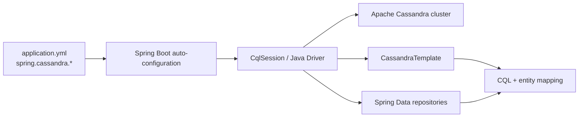

# Cấu hình nhóm thuộc tính `spring.cassandra`

## 1. Vai trò của cấu hình kết nối trong Spring Data Cassandra

Ứng dụng sử dụng **Spring Data Cassandra** để ánh xạ entity, khai báo repository, truy vấn bằng `CassandraTemplate` hoặc trực tiếp thực thi CQL qua Java Driver. Trước khi những tầng đó hoạt động, ứng dụng cần biết **kết nối đến cụm Cassandra nào, dùng datacenter nào, truy cập keyspace nào, xác thực ra sao và mỗi yêu cầu đọc/ghi nên có chính sách mặc định gì**.

Với các thế hệ **Spring Boot 3.x và 4.x**, phần lớn cấu hình này đặt trong nhóm thuộc tính `spring.cassandra.*` của `application.yml` hoặc `application.properties`. Spring Boot liên kết (bind) các thuộc tính vào cấu hình của Cassandra Java Driver và tự tạo các bean cần thiết khi dependency Spring Data Cassandra phù hợp xuất hiện trên classpath.



Các thuộc tính `spring.cassandra` là **cấu hình phía ứng dụng**, không thay thế việc tạo keyspace, định nghĩa replication, tạo bảng, lựa chọn partition key hay cấu hình chính sách bảo mật ở Cassandra Server. Một kết nối hoạt động cũng chưa đủ chứng minh một truy vấn CQL có hiệu năng tốt: cách thiết kế bảng theo truy vấn, nhất quán, paging và phân bố tải vẫn cần được kiểm tra riêng.

> **Phạm vi phiên bản:** Với những ứng dụng Spring Boot **2.x cũ**, tài liệu có thể dùng prefix `spring.data.cassandra.*`. Khi làm việc với Boot 3.x/4.x, dùng `spring.cassandra.*`; không trộn hai prefix hoặc sao chép ví dụ của phiên bản Boot khác mà không đối chiếu metadata cấu hình của đúng bản đang chạy.

## 2. Cấu hình tối thiểu để chạy local

Giả sử Cassandra đang chạy ở `127.0.0.1:9042`, datacenter có tên `datacenter1`, keyspace `learning_app` đã tồn tại.

```yaml
# src/main/resources/application.yml
spring:
  cassandra:
    contact-points: 127.0.0.1:9042
    local-datacenter: datacenter1
    keyspace-name: learning_app
    schema-action: none
```

Tương đương với `application.properties`:

```properties
spring.cassandra.contact-points=127.0.0.1:9042
spring.cassandra.local-datacenter=datacenter1
spring.cassandra.keyspace-name=learning_app
spring.cassandra.schema-action=none
```

Ý nghĩa từng thuộc tính:

| Thuộc tính | Chức năng | Lưu ý thực tế |
| --- | --- | --- |
| `spring.cassandra.contact-points` | Một hoặc nhiều địa chỉ liên hệ ban đầu để driver khám phá topology | Địa chỉ phải được **tiến trình ứng dụng** truy cập; không nhất thiết là danh sách mọi node |
| `spring.cassandra.local-datacenter` | Datacenter mà driver coi là local để chọn node và định tuyến yêu cầu | Phải khớp **chính xác** tên DC mà Cassandra báo cáo |
| `spring.cassandra.keyspace-name` | Keyspace mặc định cho các thao tác và tên bảng không có tiền tố keyspace | Keyspace thường phải được tạo trước khi ứng dụng khởi động |
| `spring.cassandra.schema-action` | Chính sách để Spring Data Cassandra xử lý schema dựa trên entity khi khởi động | Dùng `none` trong môi trường quản lý schema bằng migration/CQL riêng |

**`contact-points` là địa chỉ bootstrap, không phải danh sách cố định tất cả node sẽ nhận truy vấn.** Sau khi kết nối, driver lấy metadata và topology từ cụm, rồi định tuyến đến các node phù hợp. Trong cụm thật, khai báo một vài contact point ổn định; tránh phụ thuộc vào một địa chỉ duy nhất nếu có thể.

Ví dụ có nhiều contact point:

```yaml
spring:
  cassandra:
    contact-points:
      - cassandra-1.internal:9042
      - cassandra-2.internal:9042
    local-datacenter: dc1
    keyspace-name: learning_app
    schema-action: none
```

Tên `dc1` chỉ là ví dụ: phải kiểm tra thực tế bằng CQL hoặc công cụ quản trị. Giá trị `127.0.0.1` chỉ hợp lệ nếu Cassandra thực sự có thể truy cập từ **chính nơi tiến trình Spring Boot đang chạy**. Khi API và Cassandra nằm trong hai container khác nhau, `localhost` bên trong container API không phải container database.

### `port` và địa chỉ `host:port`

Trong các phiên bản Boot hỗ trợ `spring.cassandra.port`, đây là cổng native transport mặc định khi contact point chỉ gồm hostname; cổng phổ biến của Cassandra là `9042`. Một số cấu hình khai báo thẳng `host:9042` trong từng contact point. Hãy chọn **một quy ước rõ ràng**, đồng nhất giữa các môi trường; không nhầm cổng `9042` với cổng internode hay HTTP.

```yaml
spring:
  cassandra:
    contact-points: cassandra.internal
    port: 9042
    local-datacenter: dc1
```

## 3. Xác định đúng datacenter và keyspace

### Local datacenter: nguyên nhân thường gặp của lỗi khởi tạo

Driver sử dụng thông tin datacenter để chọn node gần ứng dụng và tránh định tuyến không mong muốn qua nhiều DC. Nếu `local-datacenter` ghi `dc1` nhưng cụm thực tế dùng `datacenter1`, session có thể không khởi tạo được hoặc không tìm thấy node phù hợp với chính sách load balancing.

Trong `cqlsh`, kiểm tra:

```sql
SELECT data_center, release_version
FROM system.local;
```

Giá trị `data_center` nhận được mới là căn cứ thiết lập `spring.cassandra.local-datacenter`, không phải tên tự đặt trong file YAML. Với các cụm nhiều datacenter, lựa chọn local DC còn liên quan đến nơi ứng dụng được triển khai và cấu hình replication của keyspace.

### Keyspace và replication

Ví dụ tạo keyspace cho một cụm thực hành **đơn node**:

```sql
CREATE KEYSPACE IF NOT EXISTS learning_app
WITH replication = {
  'class': 'SimpleStrategy',
  'replication_factor': 1
};

CREATE TABLE IF NOT EXISTS learning_app.notes_by_id (
  id uuid PRIMARY KEY,
  title text
);
```

Lưu ý `SimpleStrategy` và replication factor 1 ở đây chỉ dùng cho học tập đơn node. Với cụm nhiều node/DC, cân nhắc `NetworkTopologyStrategy` và replication factor theo từng datacenter. Property `keyspace-name` chỉ chọn keyspace để truy cập; **nó không định nghĩa replication hay tự bảo đảm keyspace tồn tại**.

Nếu keyspace sai hoặc thiếu, ứng dụng có thể lỗi ngay khi khởi tạo session hoặc khi chạy câu lệnh, tùy cách cấu hình và thời điểm truy cập. Không sửa lỗi bằng cách cho ứng dụng tự tạo toàn bộ schema trên production.

## 4. Xác thực và quản lý thông tin nhạy cảm

Cassandra có thể được cấu hình authentication/authorization; nếu cụm yêu cầu đăng nhập, cung cấp username/password cho driver:

```yaml
spring:
  cassandra:
    contact-points: ${CASSANDRA_CONTACT_POINTS}
    local-datacenter: ${CASSANDRA_LOCAL_DC}
    keyspace-name: ${CASSANDRA_KEYSPACE}
    username: ${CASSANDRA_USERNAME}
    password: ${CASSANDRA_PASSWORD}
    schema-action: none
```

`${CASSANDRA_USERNAME}` và `${CASSANDRA_PASSWORD}` là cách Spring Boot đọc giá trị từ môi trường hoặc nguồn cấu hình đã tích hợp. Không commit password thật vào Git, không đưa credential vào log và tránh in toàn bộ Spring Environment khi xử lý sự cố.

Một số nguyên tắc:

1. Dùng tài khoản Cassandra có quyền phù hợp với các thao tác thực tế; API chỉ đọc không cần quyền thay đổi schema.
2. Đặt secret trong secret manager, environment do hệ thống triển khai cung cấp hoặc cơ chế quản lý cấu hình an toàn của tổ chức.
3. Tách tài khoản migration/schema khỏi tài khoản chạy API khi vận hành production.
4. Nếu cần thay đổi credential, phải hiểu vòng đời session/connection và cơ chế triển khai để ứng dụng nhận credential mới.

Các biến môi trường như `CASSANDRA_PASSWORD` chỉ tự được map khi **được tham chiếu** trong YAML như trên. Một cách khác là sử dụng tên env theo quy tắc relaxed binding, ví dụ `SPRING_CASSANDRA_USERNAME`; khi đó cần chắc chắn giá trị được cấp từ môi trường chạy ứng dụng.

## 5. Kết nối mã hóa: TLS và SSL bundle

Nếu Cassandra yêu cầu client-to-node TLS, client phải bật TLS và tin cậy certificate của máy chủ. Không thể giải quyết handshake TLS bằng cách thay đổi consistency level hoặc timeout.

Trong các phiên bản Spring Boot hỗ trợ **SSL bundle** cho Cassandra, có thể tách cấu hình truststore khỏi property kết nối:

```yaml
spring:
  ssl:
    bundle:
      jks:
        cassandra-client:
          truststore:
            location: ${CASSANDRA_TRUSTSTORE_LOCATION}
            password: ${CASSANDRA_TRUSTSTORE_PASSWORD}

  cassandra:
    contact-points: ${CASSANDRA_CONTACT_POINTS}
    local-datacenter: ${CASSANDRA_LOCAL_DC}
    keyspace-name: ${CASSANDRA_KEYSPACE}
    username: ${CASSANDRA_USERNAME}
    password: ${CASSANDRA_PASSWORD}
    ssl:
      bundle: cassandra-client
```

Trong một số bản Boot có thuộc tính `spring.cassandra.ssl.enabled`; cách cấu hình và mức hỗ trợ `ssl.bundle` cần được kiểm tra từ metadata/tài liệu **của phiên bản Boot đang dùng**. Không dùng tùy chọn tắt kiểm tra chứng chỉ làm giải pháp lâu dài cho lỗi kết nối. Tên DNS trên chứng chỉ, trust chain, hạn dùng certificate và chính sách TLS của server cần đúng với môi trường.

Khi chạy local Cassandra không bật TLS, **không thêm cấu hình TLS chỉ để cho “đầy đủ”**: client bật TLS trong khi server chỉ nói native protocol không mã hóa cũng sẽ thất bại.

## 6. Timeout và chính sách request mặc định

`spring.cassandra.request.*` và `spring.cassandra.connection.*` ảnh hưởng tới hành vi client. Chúng không thay đổi độ hiệu quả của partition key hay giải quyết query phải quét lượng dữ liệu lớn.

```yaml
spring:
  cassandra:
    request:
      timeout: 3s
      page-size: 500
      consistency: LOCAL_QUORUM
      serial-consistency: LOCAL_SERIAL
    connection:
      connect-timeout: 5s
```

| Thuộc tính | Ý nghĩa | Cách đánh giá |
| --- | --- | --- |
| `spring.cassandra.request.timeout` | Thời gian chờ mặc định cho một request CQL | Cân đối SLO API, độ trễ cụm và chính sách retry; không tăng vô hạn |
| `spring.cassandra.connection.connect-timeout` | Thời gian chờ khi thiết lập kết nối đến node | Phải phù hợp network và môi trường deploy |
| `spring.cassandra.request.page-size` | Số hàng mục tiêu cho mỗi page/fetch của driver | Không phải số hàng toàn API hay thay thế `LIMIT` |
| `spring.cassandra.request.consistency` | Consistency level mặc định cho read/write | Chọn theo replication factor, topology và cam kết nghiệp vụ |
| `spring.cassandra.request.serial-consistency` | Serial consistency dùng cho lightweight transaction (LWT) | Chỉ có ý nghĩa cho các thao tác điều kiện tương ứng |

**Tách rõ timeout và giới hạn dữ liệu:** `request.timeout: 3s` không có nghĩa CQL sẽ dừng đọc đúng sau ba giây ở mọi thành phần; ứng dụng vẫn phải định nghĩa timeout tổng của endpoint, retry budget và giới hạn số partition/tài nguyên được phép sử dụng.

### `page-size` khác `LIMIT` như thế nào?

Với CQL:

```sql
SELECT id, title
FROM learning_app.notes_by_id
LIMIT 20;
```

`LIMIT 20` giới hạn số hàng tối đa mà câu query sẽ trả về; `page-size`/fetch size điều khiển lượng hàng driver dự kiến lấy ở mỗi lần truy xuất trang từ server, **không bảo đảm tổng số hàng của truy vấn là 20**. Nếu muốn API phân trang theo cursor, service còn phải quản lý paging state và quyền truy cập của người dùng.

Trong Spring Data Cassandra, kết quả dạng `Slice` hoặc những API paging phù hợp giúp đọc dần; paging state gắn với **câu query cụ thể**, không phải offset tùy ý. Không nhúng state thô vào URL công khai khi chưa có cơ chế đóng gói, kiểm tra tham số và xác thực.

### Consistency level: hiểu đúng phạm vi

`LOCAL_QUORUM` phù hợp với nhiều use case triển khai replication trong một datacenter khi muốn cân đối nhất quán/khả dụng, nhưng **không phải lựa chọn đúng cho mọi workload**. `LOCAL_ONE` có thể giảm độ trễ và tăng khả năng đáp ứng ở một số tình huống, đổi lại có thể quan sát dữ liệu cũ sau ghi. Nếu các replica ở nhiều DC, `LOCAL_*` liên quan đến DC local đã khai báo; cần cấu hình replication đúng.

Với `LOCAL_SERIAL`, phân biệt serial consistency (giai đoạn điều kiện của LWT) với consistency read/write thường. Khai báo mặc định không làm các truy vấn không có `IF` trở thành LWT. Tính nhất quán của **nhiều bảng phi chuẩn hóa** cũng không được bảo đảm chỉ bằng việc thay một property mặc định.

## 7. Các thuộc tính mở rộng và file cấu hình driver

Spring Boot cung cấp các thuộc tính thường dùng, nhưng Java Driver còn có nhiều tùy chỉnh nâng cao: telemetry/metrics, load balancing, speculative execution, request throttling, reconnection, metadata, TLS phức tạp, v.v.

Những nhóm cần biết ở mức định hướng:

| Nhóm | Ví dụ thuộc tính Spring Boot | Nên dùng khi |
| --- | --- | --- |
| Kết nối | `spring.cassandra.connection.connect-timeout` | Node ở xa, mạng có biến động |
| Yêu cầu | `spring.cassandra.request.timeout`, `page-size` | Có SLO và giới hạn tải rõ ràng |
| Throttling | `spring.cassandra.request.throttler.*` (nếu bản Boot hỗ trợ) | Cần giới hạn request đồng thời/queue phía client |
| Pool | `spring.cassandra.pool.*` (nếu bản Boot hỗ trợ) | Cần điều chỉnh sau khi quan sát số kết nối |
| Schema | `spring.cassandra.schema-action` | Phân tách phát triển local và production |
| Driver config | `spring.cassandra.config` | Tùy chọn driver nâng cao không được expose trực tiếp |

Ví dụ cách khai báo file cấu hình driver ở những bản Boot có property `spring.cassandra.config`:

```yaml
spring:
  cassandra:
    config: classpath:application-driver.conf
```

Nội dung HOCON minh họa của `application-driver.conf`:

```hocon
datastax-java-driver {
  basic {
    request {
      timeout = 3 seconds
    }
  }
}
```

Nếu một thiết lập có cả trong `spring.cassandra.*` và file cấu hình driver, cần đối chiếu **quy tắc ưu tiên của phiên bản Spring Boot/Driver đang dùng** và kiểm tra giá trị có hiệu lực. Nên giữ một nguồn khai báo chính cho mỗi tùy chọn để giảm rủi ro cấu hình chồng lấn.

**Không tự tăng pool size, timeout hoặc bật speculative execution để che các truy vấn kém hiệu quả.** Các tính năng này có thể tăng tải lên cụm. Trước khi điều chỉnh, kiểm tra CQL có partition key phù hợp không, bao nhiêu partition được đọc, request có paging/`LIMIT` hợp lý không, tombstone và p95/p99 thay đổi ra sao.

## 8. Quản lý cấu hình theo môi trường

Một ứng dụng thường có môi trường dev local, staging và production. Thay vì copy/paste rồi sửa thủ công các endpoint trong source code, có thể sử dụng **Spring profiles** và biến môi trường.

Ví dụ cấu hình mặc định:

```yaml
# application.yml
spring:
  cassandra:
    contact-points: ${CASSANDRA_CONTACT_POINTS:127.0.0.1:9042}
    local-datacenter: ${CASSANDRA_LOCAL_DC:datacenter1}
    keyspace-name: ${CASSANDRA_KEYSPACE:learning_app}
    schema-action: none
    request:
      timeout: 3s
      page-size: 200
```

Ví dụ cấu hình chỉ áp dụng cho profile `prod`:

```yaml
# application-prod.yml
spring:
  cassandra:
    contact-points: ${CASSANDRA_CONTACT_POINTS}
    local-datacenter: ${CASSANDRA_LOCAL_DC}
    keyspace-name: ${CASSANDRA_KEYSPACE}
    username: ${CASSANDRA_USERNAME}
    password: ${CASSANDRA_PASSWORD}
    schema-action: none
    request:
      timeout: 2s
      page-size: 200
      consistency: LOCAL_QUORUM
```

Lưu ý cấu hình mẫu cố ý để các biến production **không có fallback**, giúp phát hiện việc thiếu thông số triển khai. Chính sách TLS, truststore, consistency level và timeout phải được xác định theo cụm thật. Không nên đưa những giá trị mặc định local như `127.0.0.1` vào production nếu thực tế không có Cassandra tại loopback.

Spring Boot có nhiều nguồn property (file cấu hình, environment, command-line, secret/config integration, v.v.) và có quy tắc ưu tiên. Khi một giá trị không như mong đợi, xem giá trị đang được bind và nguồn cấu hình tương ứng bằng công cụ vận hành được bảo vệ; **không công khai mật khẩu, token hoặc toàn bộ environment** trong actuator/log.

### Vài trường hợp networking dễ nhầm

| Ứng dụng chạy ở đâu? | Cassandra chạy ở đâu? | Contact point thường dùng |
| --- | --- | --- |
| Cùng máy với Cassandra local | Native port expose tại loopback | `127.0.0.1:9042` |
| Container khác trong cùng Docker network | Container dịch vụ Cassandra | DNS service name, ví dụ `cassandra:9042` |
| Pod trong Kubernetes | Service/địa chỉ Cassandra reachable | DNS của service hoặc endpoint được driver hỗ trợ |
| Máy chủ/cloud khác | Cluster Cassandra private | DNS/IP nội bộ, TLS và thông tin xác thực phù hợp |

Đối với cluster nhiều node, cần kiểm tra **địa chỉ các node mà driver khám phá được có thể đi tới từ vị trí ứng dụng**. Việc chỉ truy cập được bootstrap contact point nhưng không định tuyến được đến các node được quảng bá vẫn có thể gây lỗi sau khi session đã khởi tạo.

## 9. Kết nối `CqlSession` với repository, template và CQL

Với dependency Spring Data Cassandra do Boot quản lý:

```xml
<dependency>
    <groupId>org.springframework.boot</groupId>
    <artifactId>spring-boot-starter-data-cassandra</artifactId>
</dependency>
```

Spring Boot thường tự cấu hình `CqlSession` khi có các dependency tương ứng và điều kiện auto-configuration được thỏa mãn. Spring Data Cassandra sử dụng kết nối đó cho repository và `CassandraTemplate`. Không nên tạo một `CqlSession` mới cho **mỗi HTTP request**; session của driver được thiết kế để tái sử dụng và quản lý tài nguyên kết nối.

Ví dụ smoke check đường CQL cơ bản:

```java
import com.datastax.oss.driver.api.core.CqlSession;
import com.datastax.oss.driver.api.core.cql.Row;

public final class CassandraConnectionCheck {

    public static String serverVersion(CqlSession session) {
        Row row = session.execute(
            "SELECT release_version FROM system.local"
        ).one();

        if (row == null) {
            throw new IllegalStateException("Không đọc được system.local");
        }

        return row.getString("release_version");
    }
}
```

Đoạn mã trên minh họa cách **kiểm tra session được inject từ Spring Boot**, không phải hướng dẫn tạo một session thứ hai. Câu CQL đọc `system.local` có mục đích quan sát môi trường; khi kiểm thử nghiệp vụ, dùng một truy vấn theo **partition key thật** của bảng ứng dụng.

Ví dụ sau thể hiện đường đọc theo ID và yêu cầu mapping:

```sql
SELECT id, title
FROM learning_app.notes_by_id
WHERE id = 11111111-1111-1111-1111-111111111111;
```

Sau khi kết nối thành công, nên kiểm tra tiếp:

- Entity `@Table` có ánh xạ đúng tên bảng và keyspace?
- Repository hoặc `CassandraTemplate` có đọc/ghi được dữ liệu thật?
- Truy vấn CQL có biết partition key, không dựa vào `ALLOW FILTERING` vô tội vạ?
- Các lựa chọn `request.page-size`, timeout và consistency có phù hợp với kiểu truy vấn?
- API duyệt nhiều trang có xử lý paging state, giới hạn số partition và dữ liệu thay đổi đồng thời?

**Kết nối là điều kiện cần, nhưng thiết kế dữ liệu theo truy vấn mới quyết định khả năng duy trì hiệu năng** trong Cassandra phân tán.

## 10. Chẩn đoán lỗi cấu hình theo triệu chứng

| Triệu chứng | Khả năng cần kiểm tra đầu tiên | Hướng xử lý |
| --- | --- | --- |
| Không kết nối được bất kỳ contact point nào | DNS, IP, port 9042, firewall, Cassandra chưa sẵn sàng | Kiểm tra network từ nơi Spring Boot đang chạy |
| Báo local datacenter không phù hợp | `local-datacenter` khác `system.local.data_center` | Đối chiếu tên DC thực tế, cả topology |
| Authentication failed | Sai credential/quyền hoặc server có cấu hình auth khác | Kiểm tra role và cơ chế authentication, không ghi secret ra log |
| TLS handshake failed | Server không bật TLS, sai truststore/CA, hostname không khớp | Kiểm tra chính sách TLS hai phía |
| Keyspace không tồn tại | `keyspace-name` sai hoặc chưa tạo | Tạo keyspace bằng migration/CQL phù hợp |
| App khởi động, repository query báo bảng không tồn tại | Sai tên bảng, keyspace, mapping hoặc schema chưa triển khai | Kiểm tra schema và `@Table` |
| Request timeout hoặc p99 cao | Truy vấn tốn tài nguyên, hot partition, chờ network/coordinator | Đo CQL, partition, tombstone và tải; chỉnh timeout sau khi hiểu nguyên nhân |
| Phân trang thiếu/trùng dữ liệu | Dùng offset giả, tái sử dụng paging state sai query, dữ liệu bị thay đổi | Dùng cursor theo query, kiểm soát thứ tự và ranh giới |
| Driver hoạt động ở local nhưng lỗi trong container | `localhost` trỏ sai, DNS container chưa giải quyết | Dùng endpoint reachable từ container ứng dụng |

Đừng suy ra mọi lỗi liên quan Cassandra đều do `spring.cassandra.*`. Ví dụ một câu truy vấn cần lọc trên cột không có trong đường truy cập của partition không được sửa bằng cách tăng `request.timeout`.

### Quy trình xác minh trước khi đưa lên staging/production

1. **Xác nhận phiên bản:** Java, Spring Boot, Spring Data Cassandra, Java Driver và Cassandra Server có bộ version tương thích; xem dependency tree thay vì chỉ đọc `pom.xml`.
2. **Xác nhận mạng:** từ runtime của API, contact points reachable; các node mà driver khám phá cũng truy cập được.
3. **Xác nhận topology:** tên DC và keyspace đúng; keyspace có replication phù hợp.
4. **Xác nhận bảo mật:** account, quyền, TLS/truststore đúng; secret được cấp an toàn.
5. **Xác nhận đường dữ liệu:** chạy `INSERT/SELECT` bằng CQL, entity mapping, repository và `CassandraTemplate`.
6. **Xác nhận vận hành:** đo timeout, số request, p95/p99, read/write throughput; kiểm thử paging và consistency khi nhiều node hoặc sự cố replica.

## 11. Bài tập thực hành

**Bài 1 – Local sang Docker:** API chạy trên máy host và Cassandra chạy trong container có publish port `9042`. Viết YAML cần thiết. Sau đó chuyển API vào một container khác cùng Docker network: thuộc tính nào phải đổi, thuộc tính nào có thể giữ nguyên và cần xác minh DC bằng câu CQL nào?

**Bài 2 – Chọn consistency:** Một keyspace có `NetworkTopologyStrategy` và replication factor 3 trong DC local. Hãy so sánh `LOCAL_ONE` với `LOCAL_QUORUM` cho API đọc đơn hàng ngay sau ghi; nêu ảnh hưởng đến nhất quán, độ trễ và yêu cầu availability. Khi có bảng phi chuẩn hóa, vì sao consistency của một truy vấn không đủ chứng minh tất cả bảng đã được đồng bộ?

**Bài 3 – Phân trang:** Repository lấy lịch sử sự kiện theo `tenant_id`. Nếu cấu hình `page-size: 200` nhưng API đặt `limit=50`, hai con số có ý nghĩa gì? Vì sao tăng `page-size` lên 20.000 có thể tăng bộ nhớ/độ trễ thay vì làm truy vấn nhanh hơn?

**Bài 4 – Điều tra lỗi:** Ứng dụng ghi `local-datacenter: dc1`, Cassandra báo `datacenter1`, và `spring.cassandra.contact-points=127.0.0.1:9042` được dùng bên trong container API khác container Cassandra. Xác định hai vấn đề riêng biệt, cách sửa và phép kiểm sau khi sửa.

**Tự kiểm tra:**

1. Những thuộc tính nào là tối thiểu để Spring Boot biết kết nối Cassandra ở đâu và dùng keyspace nào?
2. `contact-points` có yêu cầu liệt kê toàn bộ node trong cluster không?
3. `schema-action: none` có tự tạo bảng không? Ai chịu trách nhiệm quản lý schema?
4. `request.page-size` khác `LIMIT` và giới hạn số kết quả API ra sao?
5. Khi nào cần đặt `username`, `password`, SSL bundle và làm thế nào để tránh lộ secret?
6. Vì sao `local-datacenter` phải đúng với topology thực tế?

## Kết luận

Nhóm thuộc tính **`spring.cassandra`** xác định điểm kết nối, datacenter, keyspace, xác thực/TLS, chính sách request và một số điều chỉnh kết nối cho Spring Data Cassandra. Bắt đầu với cấu hình tối thiểu, chỉ bổ sung timeout/consistency/paging và tùy chọn driver khi đã hiểu nhu cầu truy vấn, topology và SLO. Dùng Spring profiles hoặc secret manager để quản lý giá trị theo môi trường. Sau khi kết nối thành công, luôn xác minh entity mapping, repository, `CassandraTemplate`, CQL theo partition key và hành vi phân trang/nhất quán trên cụm thực tế.
