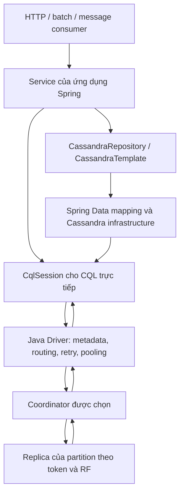
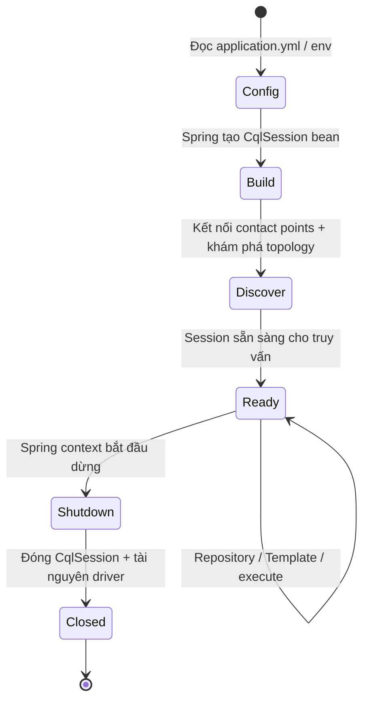

# CqlSession và vòng đời tài nguyên kết nối

Khi ứng dụng Spring truy cập Apache Cassandra, **`CqlSession`** là đối tượng trung tâm của Java Driver dùng để gửi CQL, nhận kết quả và quản lý tài nguyên kết nối đến cluster. Trong **Spring Data Cassandra**, `CassandraRepository` và `CassandraTemplate` hoạt động trên hạ tầng kết nối này. Hiểu `CqlSession` giúp bạn cấu hình đúng cluster, dùng lại tài nguyên an toàn, xử lý sự cố kết nối và dừng ứng dụng mà không tạo rò rỉ socket hoặc luồng xử lý.

Bài học thuộc chương **Cấu hình kết nối** của module **`SPRING_DATA_CASSANDRA`**. Bối cảnh học tập là truy cập Cassandra bằng entity mapping, repository, `CassandraTemplate` và CQL; thiết kế bảng theo truy vấn, partition key, consistency level và paging vẫn quyết định phần lớn hiệu năng ở tầng dữ liệu phân tán. Cấu hình phiên kết nối tốt phải hỗ trợ đúng những đặc điểm đó.

**Mục tiêu sau bài học:**

1. Phân biệt `CqlSession` với một kết nối TCP, một truy vấn CQL và một Spring repository.
2. Hiểu các giai đoạn **khởi tạo → khám phá cluster → sử dụng chung → dừng → đóng**.
3. Cấu hình Spring Boot hoặc tự khai báo bean `CqlSession` và xác định ai sở hữu trách nhiệm đóng.
4. Sử dụng prepared statement, token-aware routing, paging và consistency level mà không tạo session cho mỗi request.
5. Nhận diện lỗi cấu hình datacenter, keyspace, timeout, quá tải và tài nguyên bị đóng sớm.

## 1. `CqlSession` là gì?

`CqlSession` thuộc Java Driver 4.x cho Cassandra, thường dùng qua các lớp trong package `com.datastax.oss.driver.api.core`. Nó là **đầu mối giao tiếp logic với cluster**, không đồng nghĩa với một socket duy nhất.

Sau khi được xây dựng, session phối hợp những phần việc như:

- Dùng **contact points** để khởi đầu việc tìm node và đọc metadata topology.
- Theo dõi node nào đang khả dụng; dùng **load-balancing policy** và thông tin token/replica để chọn nơi gửi request.
- Quản lý các kết nối mạng đến node theo cấu hình driver, thực thi CQL đồng bộ hoặc bất đồng bộ.
- Dùng thông tin keyspace, loại dữ liệu, codec và metadata để mã hóa giá trị, giải mã kết quả.
- Áp dụng timeout, retry policy, consistency level và execution profile theo cấu hình từng thao tác.
- Đóng những tài nguyên mà chính session/driver đã tạo khi hết vòng đời.

Trong khi đó, **Spring Data Cassandra** bổ sung mapping giữa entity Java và bảng CQL, chuyển các thao tác repository/template thành câu lệnh driver. Nó **không thay đổi** cách Cassandra tính token từ partition key, chọn replica hay thu hồi tombstone.

| Thành phần | Vai trò | Vòng đời phù hợp |
| --- | --- | --- |
| `CqlSession` | Đầu mối kết nối logic tới một cluster, quản lý driver và pool tài nguyên | Thường **một bean dùng chung** cho một kết nối cluster trong Spring context |
| Kết nối TCP bên dưới | Truyền request/response đến các node theo quyết định của driver | Driver tự tạo, tái sử dụng và thay thế khi cần |
| `PreparedStatement` | Mô tả câu CQL đã prepare và metadata tham số | Chuẩn bị một lần, tái sử dụng cho nhiều request thích hợp |
| `BoundStatement` | Statement gắn giá trị thực, tùy chọn per-request | Tạo theo từng thao tác; không thay `CqlSession` |
| `CassandraTemplate` | API thao tác dữ liệu có mapping và truy vấn CQL | Bean Spring dùng lại infrastructure kết nối |
| `CassandraRepository` | Trừu tượng repository dựa trên entity/key | Bean Spring dùng lại infrastructure kết nối |

**Hệ quả thực tế:** việc tạo `CqlSession` có chi phí thiết lập kết nối, đọc metadata, dựng tài nguyên I/O và khám phá node. Nếu mở một session trong mỗi API request, ứng dụng vừa tốn thời gian vừa làm số socket, luồng và công việc điều phối tăng nhanh. `CqlSession` được thiết kế để **dùng chung giữa nhiều luồng**.

## 2. Sơ đồ đường đi từ Spring đến replica



**Contact point không phải một node duy nhất phải xử lý mọi request.** Đó là địa chỉ giúp driver khởi tạo liên hệ với cluster. Sau khi tìm topology, driver có thể chọn node phù hợp cho từng truy vấn. Với token-aware routing, khả năng suy ra đúng routing key — thường từ **đầy đủ partition key** — giúp driver ưu tiên replica của partition.

Ví dụ bảng:

```sql
CREATE TABLE bookings_by_customer_day (
    customer_id uuid,
    booking_day date,
    created_at timestamp,
    booking_id uuid,
    status text,
    PRIMARY KEY ((customer_id, booking_day), created_at, booking_id)
) WITH CLUSTERING ORDER BY (created_at DESC, booking_id ASC);
```

Truy vấn phù hợp với khóa:

```sql
SELECT created_at, booking_id, status
FROM bookings_by_customer_day
WHERE customer_id = 4a8be92e-4ad0-49c5-8eef-df547d2c5c3d
  AND booking_day = '2026-11-25'
LIMIT 30;
```

Ở đây `(customer_id, booking_day)` xác định partition. Các cột clustering sắp xếp hàng trong partition. **Session giúp chuyển và điều phối câu lệnh**; việc thiết kế partition đúng vẫn do tác giả schema và query quyết định. Nếu ứng dụng cố tìm tất cả đơn hàng của mọi khách bằng một truy vấn không có partition key phù hợp, mở thêm session không giải quyết được lỗi mô hình dữ liệu.

## 3. Vòng đời tài nguyên: từ startup đến shutdown

Một vòng đời tiêu biểu trong ứng dụng Spring Boot gồm các bước sau:



### 3.1. Khởi tạo

Khi xây dựng session, driver cần biết cách tìm node, **local datacenter** cho chính sách định tuyến, cùng thông tin xác thực/TLS nếu cluster yêu cầu. Quá trình kết nối có thể thất bại nếu:

- DNS/địa chỉ/port sai, node chưa chạy hoặc firewall chặn cổng CQL (thường `9042`).
- Local datacenter cấu hình không khớp topology mà driver nhìn thấy.
- Username/password, chứng chỉ TLS hoặc cấu hình bảo mật sai.
- Keyspace dùng làm mặc định chưa tồn tại, hoặc tên keyspace viết không đúng.
- Node seed liên hệ được nhưng không đủ thông tin/khả năng kết nối các node còn lại.

**Startup tạo session là hoạt động có thể tốn thời gian** và phụ thuộc vào trạng thái cluster. Đừng tự bỏ qua lỗi startup rồi cho ứng dụng báo “ready” dù không phục vụ được các API cần Cassandra.

### 3.2. Trong thời gian ứng dụng chạy

Sau khi session sẵn sàng, nhiều service và repository có thể sử dụng **cùng session** đồng thời. Driver tự quản lý pool, node selection và tài nguyên I/O. Những request đang thực thi có thể dùng các kết nối khác nhau trong session đó.

Một thao tác thường đi theo chuỗi: tạo statement → gắn tham số → chọn consistency/profile → `execute` hoặc `executeAsync` → đọc kết quả/paging state. Việc tạo statement mới rất khác việc tạo session mới: **statement có thể tạo theo request; session nên được dùng lại**.

### 3.3. Khi ứng dụng dừng

Ứng dụng cần ngừng nhận thêm công việc phù hợp với luồng shutdown, cho các tác vụ đang chạy cơ hội hoàn tất trong thời gian được cho phép, rồi để **Spring context đóng bean quản lý session**. Việc gọi `close()` hoặc `closeAsync()` trên session giải phóng tài nguyên driver; sau khi đóng không được tiếp tục gửi query qua session đó.

Chỉ gọi `close()` trong code nếu code **tự sở hữu** session và chịu trách nhiệm vòng đời của nó. Không gọi `session.close()` trong `finally` của mỗi request hoặc trong một service bất kỳ khi session đang là bean dùng chung, vì các request khác vẫn cần sử dụng.

## 4. Cấu hình bằng Spring Boot: để container sở hữu session

Với ứng dụng Spring Boot có Spring Data Cassandra starter, cách thông dụng là khai báo cấu hình và **tiêm `CqlSession` được tự động cấu hình** vào bean cần dùng.

Ví dụ phụ thuộc Maven:

```xml
<dependency>
    <groupId>org.springframework.boot</groupId>
    <artifactId>spring-boot-starter-data-cassandra</artifactId>
</dependency>
```

Ví dụ `application.yml` cho một **cluster phát triển**, theo kiểu cấu hình `spring.cassandra.*` ở Spring Boot 3.x:

```yaml
spring:
  cassandra:
    contact-points:
      - 127.0.0.1
    port: 9042
    local-datacenter: datacenter1
    keyspace-name: rental_demo
```

**Ý nghĩa các trường:**

| Cấu hình | Ý nghĩa | Kiểm tra |
| --- | --- | --- |
| `contact-points` | Các địa chỉ bootstrap để driver biết cách liên lạc cluster | Reachable từ môi trường chạy ứng dụng, không chỉ từ máy lập trình |
| `port` | Cổng CQL của contact point | Khớp `native_transport_port`/cổng được expose |
| `local-datacenter` | Data center mà driver coi là cục bộ để ưu tiên routing | Khớp tên DC được cluster công bố, phân biệt chính tả |
| `keyspace-name` | Keyspace mặc định cho câu CQL không ghi tên keyspace | Keyspace phải tồn tại trước khi ứng dụng sử dụng |

Ví dụ trên không chứa tên người dùng hay mật khẩu vì cluster local minh họa có thể không yêu cầu xác thực. Khi dùng cluster có authentication, lấy bí mật từ secret manager hoặc biến môi trường:

```yaml
spring:
  cassandra:
    username: ${CASSANDRA_USERNAME}
    password: ${CASSANDRA_PASSWORD}
```

Đoạn cấu hình credentials này **bổ sung** cho phần contact points/port/datacenter/keyspace ở trên, không phải một file YAML hoàn chỉnh đứng độc lập. Với môi trường production, kiểm tra TLS, xác minh chứng chỉ, quyền truy cập keyspace, secret rotation và cấu hình driver đúng theo phiên bản đang dùng.

**Lưu ý phiên bản:** tùy thế hệ Spring Boot, tiền tố và các property có thể khác (nhiều dự án Boot cũ dùng `spring.data.cassandra.*`). Khi nâng cấp, tra cứu metadata cấu hình của **đúng phiên bản Spring Boot**; không sao chép đồng thời hai tiền tố với hy vọng cả hai có tác dụng.

### Keyspace phải được chuẩn bị trước

`CqlSession` được cấu hình với `keyspace-name` sẽ cần keyspace đó tồn tại. Ứng dụng production thường tạo/migrate keyspace và bảng trong một quy trình deploy được kiểm soát. Ví dụ CQL chỉ dành cho **môi trường học tập một DC**:

```sql
CREATE KEYSPACE IF NOT EXISTS rental_demo
WITH replication = {
    'class': 'NetworkTopologyStrategy',
    'datacenter1': 1
};
```

Trong ví dụ phát triển một node, RF = 1 có thể đủ để chạy thử. **Không lấy RF = 1 làm mặc định production**: replication factor, data center và consistency level là quyết định triển khai phải dựa trên topology và yêu cầu chịu lỗi. Tạo bảng `bookings_by_customer_day` trong keyspace `rental_demo` trước khi truy vấn.

## 5. Tiêm bean: một session dùng chung cho nhiều service

Ví dụ truy vấn CQL trực tiếp từ một service, tái sử dụng prepared statement:

```java
import com.datastax.oss.driver.api.core.CqlSession;
import com.datastax.oss.driver.api.core.DefaultConsistencyLevel;
import com.datastax.oss.driver.api.core.cql.BoundStatement;
import com.datastax.oss.driver.api.core.cql.PreparedStatement;
import com.datastax.oss.driver.api.core.cql.ResultSet;
import com.datastax.oss.driver.api.core.cql.Row;
import jakarta.annotation.PostConstruct;
import org.springframework.stereotype.Service;

import java.time.LocalDate;
import java.util.ArrayList;
import java.util.List;
import java.util.UUID;

@Service
public class BookingQueries {
    private final CqlSession session;
    private PreparedStatement byCustomerDay;

    public BookingQueries(CqlSession session) {
        this.session = session;
    }

    @PostConstruct
    void prepareQueries() {
        byCustomerDay = session.prepare("""
            SELECT created_at, booking_id, status
            FROM bookings_by_customer_day
            WHERE customer_id = ? AND booking_day = ?
            LIMIT 30
            """);
    }

    public List<String> latestStatuses(UUID customerId, LocalDate day) {
        BoundStatement statement = byCustomerDay.bind(customerId, day)
                .setConsistencyLevel(DefaultConsistencyLevel.LOCAL_QUORUM)
                .setPageSize(30);

        ResultSet result = session.execute(statement);
        List<String> statuses = new ArrayList<>();

        for (Row row : result) {
            statuses.add(row.getString("status"));
        }
        return statuses;
    }
}
```

Đây là ví dụ cho Java hỗ trợ text block và hệ Spring sử dụng `jakarta.annotation.PostConstruct` (chẳng hạn Spring Boot 3.x). Các import và API phải khớp dependency driver được Spring Boot quản lý.

**Phân tích trách nhiệm:**

- Spring tạo `BookingQueries` và tiêm **bean `CqlSession` dùng chung**, không tạo session trong constructor.
- `@PostConstruct` prepare câu truy vấn sau khi bean được tạo. `PreparedStatement` có thể tái sử dụng giữa các request.
- `bind(customerId, day)` gắn **đầy đủ partition key**, giúp truy vấn phù hợp data model và tạo cơ sở cho token-aware routing.
- `LOCAL_QUORUM` là consistency level **minh họa**, cần chọn dựa trên replication strategy/RF, nhiều DC và mục tiêu nhất quán của hệ thống.
- `setPageSize(30)` quy định số dòng một lần fetch của driver; `LIMIT 30` giới hạn tổng số hàng câu truy vấn, đây là **hai khái niệm khác nhau**.
- Không có `try-with-resources` hoặc `close()` cho `session` trong phương thức vì Spring quản lý vòng đời của bean.

**Tối ưu cho dự án thực:** nếu cần trả về dữ liệu có thứ tự và nhiều cột, định nghĩa DTO thay vì `List<String>`; code trên chủ ý tối giản để tập trung vào session. Với workload lớn, không nên lặp qua mọi hàng của một `ResultSet` không giới hạn: iterator đồng bộ có thể fetch các trang tiếp theo và khiến request kéo dài. Dùng paging state do driver/Spring Data cung cấp để kiểm soát số hàng và số trang mỗi API.

### `CassandraTemplate` và repository có cần session riêng không?

Không. Khi Spring Boot tự cấu hình Spring Data Cassandra, repository và template sử dụng hạ tầng Cassandra đã được cấu hình từ session trong application context. Bạn có thể tiêm `CassandraTemplate` hoặc repository vào service mà **không phải tự mở session**:

```java
@Service
public class BookingService {
    private final CassandraTemplate cassandraTemplate;

    public BookingService(CassandraTemplate cassandraTemplate) {
        this.cassandraTemplate = cassandraTemplate;
    }

    // Dùng cassandraTemplate.select(...), insert(...), update(...)
    // theo entity mapping và partition key của bảng.
}
```

Để code trên hoạt động, cần có entity mapping phù hợp với bảng và import `org.springframework.data.cassandra.core.CassandraTemplate`. Repository/template thêm lợi ích ánh xạ dữ liệu; CQL thủ công bằng `CqlSession` hữu ích với những câu truy vấn đặc thù hoặc thao tác cần toàn quyền kiểm soát statement.

**Tránh trùng lặp:** nếu có một `CqlSession` do Boot tạo và bạn lại tạo session mới trong từng repository/service, ứng dụng sẽ quản lý nhiều cluster connection/pool độc lập không cần thiết, làm việc giám sát và shutdown phức tạp.

## 6. Khi cần tự khai báo `CqlSession` bean

Trong những ứng dụng không dùng auto-configuration, hoặc cần tuỳ biến sâu ở mức driver, bạn có thể để Spring sở hữu session bằng một `@Bean`. Ví dụ sau là **phương án thay thế** phần auto-configuration, không nên copy chung với một cấu hình Boot đã có bean session khác:

```java
import com.datastax.oss.driver.api.core.CqlIdentifier;
import com.datastax.oss.driver.api.core.CqlSession;
import org.springframework.context.annotation.Bean;
import org.springframework.context.annotation.Configuration;

import java.net.InetSocketAddress;

@Configuration
class CassandraSessionConfiguration {

    @Bean(destroyMethod = "close")
    CqlSession cqlSession() {
        return CqlSession.builder()
                .addContactPoint(new InetSocketAddress("127.0.0.1", 9042))
                .withLocalDatacenter("datacenter1")
                .withKeyspace(CqlIdentifier.fromCql("rental_demo"))
                .build();
    }
}
```

`destroyMethod = "close"` biểu đạt rõ Spring chịu trách nhiệm gọi phương thức đóng khi bean bị hủy. Một số phiên bản Spring có thể tự suy ra phương thức đóng của bean nếu không khai báo, nhưng chỉ nên dựa vào hành vi đó khi đã hiểu cấu hình project.

Các điểm cần quyết định trước khi tự tạo bean:

1. **Sở hữu:** ai tạo, ai đóng và khi nào đóng session? Nếu Boot quản lý thì để Boot làm trọn vòng đời; nếu Spring config tự tạo thì để context quản lý.
2. **Cấu hình:** port, DC, keyspace, authentication, TLS, policy/profile/metrics phải nhất quán giữa môi trường.
3. **Tùy biến:** tạo session có thể làm các cơ chế tự cấu hình của framework thay đổi; các bean template/repository phải tham chiếu đến đúng session.
4. **Nhiều cluster:** có thể cần nhiều session có tên/qualifier khác nhau, tương ứng nhiều cấu hình và tài nguyên; phải gắn từng template/service đúng session. Không nên tạo session vô danh tại chỗ khi không có mô hình sở hữu rõ ràng.

### Ứng dụng độc lập, không có Spring

Chỉ đối với **lệnh CLI, ứng dụng ngắn hạn hoặc mã tự quản lý vòng đời**, có thể dùng `try-with-resources`:

```java
try (CqlSession session = CqlSession.builder()
        .addContactPoint(new InetSocketAddress("127.0.0.1", 9042))
        .withLocalDatacenter("datacenter1")
        .withKeyspace(CqlIdentifier.fromCql("rental_demo"))
        .build()) {

    Row row = session.execute(
            "SELECT release_version FROM system.local"
    ).one();
    System.out.println(row == null ? "No row" : row.getString("release_version"));
}
```

`try-with-resources` ở ví dụ này **đóng session khi kết thúc khối**. Nếu đặt khối tương tự vào mỗi HTTP request, các request sẽ liên tục mở/đóng kết nối, làm tăng latency và chi phí driver.

## 7. Phân biệt session, statement, execution profile và consistency

Một **session** có thể thực thi nhiều **statement** đồng thời với các tùy chọn khác nhau. Không nên nhân số session theo số consistency level hoặc số query shape nếu cùng cluster và cùng danh tính kết nối.

| Yếu tố | Phạm vi áp dụng | Tác dụng |
| --- | --- | --- |
| Contact points và local DC | Khởi tạo/cấu hình session | Bootstrap và đặt phạm vi node hợp lệ |
| Keyspace mặc định | Session/câu lệnh không ghi tên keyspace | Giúp phân giải bảng, không phải cơ chế cách ly tenant |
| Prepared/bound statement | Từng kiểu truy vấn và lần thực thi | Gắn tham số, routing key, giảm parse/prepare lặp lại |
| Consistency level | Mặc định profile hoặc override per-statement | Quy định mức xác nhận cần từ replica |
| Request timeout | Profile/cấu hình thực thi | Giới hạn thời gian chờ; không tự sửa bottleneck |
| Page size / paging state | Từng statement và chuỗi trang | Giới hạn trang trả về; không phải offset truyền thống |
| Retry/speculative execution policy | Cấu hình driver/profile | Có thể thử lại request theo chính sách; cần tránh khuếch đại tải |

### Consistency level gắn với mô hình replica

Ví dụ RF = 3 trong một DC, `LOCAL_QUORUM` cần hai replica cục bộ đáp ứng đối với đọc/ghi theo quy tắc consistency. Trong cluster có nhiều DC, số replica cần phản hồi được tính theo **RF ở DC cục bộ**. Consistency level không làm Cassandra tái băm partition key và không làm session tự tách một hot partition.

Đừng giải quyết timeout bằng cách hạ consistency level tùy ý: điều này có thể thay đổi bảo đảm đọc/ghi mà nghiệp vụ đang dựa vào. Khi tối ưu, so sánh cùng topology, RF, consistency, dataset và query shape.

### Prepared statement và tính an toàn khi dùng chung

`PreparedStatement` nên được tái sử dụng cho câu CQL lặp lại; mỗi thao tác `bind` tạo một `BoundStatement` mang giá trị cụ thể. Không dùng chuỗi nối trực tiếp giá trị người dùng vào CQL nếu có thể bind tham số.

Ví dụ:

```java
PreparedStatement byCustomer = session.prepare(
    "SELECT booking_id, status FROM bookings_by_customer_day " +
    "WHERE customer_id = ? AND booking_day = ? LIMIT 30");

BoundStatement query = byCustomer.bind(customerId, bookingDay)
    .setConsistencyLevel(DefaultConsistencyLevel.LOCAL_QUORUM);

ResultSet result = session.execute(query);
```

Đặc điểm **đủ partition key** còn hữu ích cho token-aware routing. Nếu câu CQL cần truy vấn theo cột khác hoàn toàn, phải đánh giá thêm bảng được thiết kế theo chiều truy vấn đó, chứ không phụ thuộc vào session hoặc `ALLOW FILTERING` để bù một data model không phù hợp.

## 8. Phân trang đúng cách mà không kéo dài vòng đời session

Phân trang Cassandra và vòng đời connection là hai vấn đề khác nhau:

- **Session** sống theo vòng đời ứng dụng.
- **Paging state** sống theo chuỗi truy vấn phân trang tương ứng, cần dùng đúng câu truy vấn và tham số.
- **ResultSet/AsyncResultSet** mô tả kết quả một lần thực thi và các trang dữ liệu, không yêu cầu mở session mới cho trang tiếp theo.

Với driver đồng bộ, duyệt toàn bộ `ResultSet` có thể tự động tải trang tiếp theo. Với driver bất đồng bộ, cần chủ động lấy trang kế tiếp từ `AsyncResultSet` theo API driver. Tại tầng Spring Data, các API `Slice`/paging hỗ trợ trả về từng phần; hành vi chi tiết tùy phiên bản.

Khi xây API “trang tiếp”, nên:

1. Giữ cùng câu truy vấn, partition key, sort, tham số và tùy chọn paging tương ứng.
2. Trả về **opaque paging state** (token trạng thái phân trang do driver cấp) qua một cơ chế an toàn; không tự xem nó như offset số nguyên.
3. Giới hạn page size, số truy vấn fan-out và lượng dữ liệu được nạp vào bộ nhớ.
4. Kiểm soát lifetime của paging token, dữ liệu bị thay đổi giữa các lần lấy trang và lỗi khi token không còn phù hợp.
5. Không đưa session object vào HTTP session và không tạo `CqlSession` mới chỉ để xử lý trang tiếp theo.

Nếu phải đọc nhiều partition (ví dụ lịch sử nhiều ngày), mỗi đường truy vấn có thể có trạng thái phân trang riêng. Ứng dụng cần hợp nhất dữ liệu có trật tự và lưu đủ trạng thái để phục vụ trang sau; một token của driver không tự biến truy vấn nhiều partition thành phân trang global có offset.

## 9. Bất đồng bộ, reactive và giới hạn đồng thời

`CqlSession.executeAsync(...)` cho phép gửi request không chặn luồng gọi trong thời gian chờ I/O theo cách dùng driver. Spring Data Cassandra cũng có API reactive trong các cấu hình phù hợp. Dù theo mô hình nào, **session vẫn cần được dùng chung** và mỗi request chỉ tạo các statement/công việc cần thiết.

Ví dụ API bất đồng bộ ở mức driver:

```java
CompletionStage<AsyncResultSet> stage = session.executeAsync(
    byCustomer.bind(customerId, bookingDay)
              .setPageSize(30)
);

stage.thenAccept(page -> {
    for (Row row : page.currentPage()) {
        // Xử lý các hàng có trong trang hiện tại.
    }
    // Nếu cần trang tiếp theo, dùng API fetchNextPage() có kiểm soát.
});
```

Ví dụ giả định đã khai báo `byCustomer` là `PreparedStatement` và import các kiểu liên quan. Không được gọi `session.close()` ngay sau `executeAsync` rồi vẫn kỳ vọng các callback sau đó luôn hoạt động.

**Bất đồng bộ không có nghĩa là tài nguyên vô hạn.** Nếu nhận 100.000 request cùng lúc, driver/cluster vẫn chịu giới hạn số request in-flight, số kết nối, CPU, bộ nhớ và khả năng xử lý trên replica. Cần giới hạn concurrency, timeout hợp lý, backpressure và phương án xử lý khi cluster chậm. Retry hàng loạt có thể làm tình trạng quá tải nặng thêm.

## 10. Dừng ứng dụng an toàn và tránh đóng session quá sớm

Ví dụ một request đang đọc trang 1 trong khi ứng dụng được yêu cầu shutdown:

1. Tầng HTTP/consumer ngừng tiếp nhận công việc mới theo chính sách graceful shutdown của ứng dụng.
2. Các request đang chạy được phép hoàn tất trong giới hạn thời gian cấu hình; tác vụ vượt thời hạn cần có xử lý lỗi/hủy thích hợp.
3. Spring context hủy các bean; với session được quản lý, nó gọi đường đóng tài nguyên tương ứng.
4. Sau khi đóng, mọi yêu cầu `execute` mới trên session cũ đều không hợp lệ.

Nếu code tự gọi `closeAsync()` trong một công cụ không dùng Spring:

```java
CompletionStage<Void> closing = session.closeAsync();
closing.toCompletableFuture().join();
```

Đợi hoàn thành `closeAsync()` bảo đảm đường đóng của driver đã hoàn thành. Nó **không thay thế** việc phối hợp ngừng request mới hoặc xử lý các thao tác đang chạy ở tầng ứng dụng. Trong bean do Spring quản lý, ưu tiên để lifecycle của context thực hiện việc đóng.

### Những mẫu code cần tránh

**Sai: tạo session cho mỗi request**

```java
// Không áp dụng trong controller/service của Spring:
try (CqlSession session = CqlSession.builder()
        .addContactPoint(new InetSocketAddress("127.0.0.1", 9042))
        .withLocalDatacenter("datacenter1")
        .build()) {
    session.execute("SELECT release_version FROM system.local");
}
```

**Sai: đóng bean dùng chung trong service**

```java
// Session được Spring inject, các request khác vẫn cần nó:
public void lookup() {
    try {
        session.execute("SELECT release_version FROM system.local");
    } finally {
        session.close(); // Làm các truy vấn sau của toàn ứng dụng lỗi.
    }
}
```

**Đúng:** tiêm session/template từ Spring, tạo statement theo request, xử lý kết quả, để Spring đóng session khi context dừng.

### Điều chỉnh timeout shutdown

Với ứng dụng Spring Boot có graceful shutdown, thời hạn shutdown của các pha Spring lifecycle có thể cấu hình qua `spring.lifecycle.timeout-per-shutdown-phase`. Việc ngừng listener, xử lý request, đóng tài nguyên phải phối hợp với thời gian timeout và giao thức triển khai (container orchestrator, load balancer, consumer) để tránh cắt giữa chừng tác vụ quan trọng.

## 11. Session dùng chung vẫn có thể cần nhiều cấu hình

Một ứng dụng có thể truy cập:

- Cùng cluster nhưng nhiều keyspace.
- Nhiều cluster độc lập.
- Nhiều danh tính xác thực hoặc execution profile khác nhau.

**Cùng cluster, cùng cấu hình kết nối:** ưu tiên dùng chung session và định danh bảng bằng `keyspace.table` khi cần truy vấn sang keyspace khác đã được cấp quyền. Hạn chế chạy `USE other_keyspace` trong luồng request của một session dùng chung: đổi keyspace mặc định có thể ảnh hưởng các truy vấn đồng thời vốn giả định một keyspace cố định.

**Nhiều cluster hoặc đặc quyền kết nối riêng biệt:** có thể cần nhiều `CqlSession` bean có tên rõ ràng và `@Qualifier` cho từng consumer. Khi đó mỗi session có tài nguyên, cấu hình và vòng đời đóng riêng; cần đo mức tiêu thụ và không tạo trùng lặp không cần thiết.

**Nhiều workload với timeout/consistency khác nhau trên cùng cluster:** trước khi mở session mới, cân nhắc execution profile hoặc per-statement override của driver. Một session có thể phục vụ nhiều query shape an toàn nếu đã có giới hạn tải phù hợp.

## 12. Xử lý lỗi cấu hình và lỗi vận hành

Không phải mọi lỗi request đều nghĩa là session “bị hỏng”. Phân loại đúng sẽ tránh hành động mở session mới liên tục gây thêm tải.

| Triệu chứng | Khả năng cần kiểm tra | Hướng xử lý |
| --- | --- | --- |
| Startup không kết nối được bất kỳ node nào | Contact points, DNS, mạng, cổng CQL, TLS, authentication | Kiểm tra kết nối từ **môi trường chạy app**, log driver và cấu hình cluster |
| Driver không tìm thấy node phù hợp trong local DC | `local-datacenter` sai tên hoặc metadata topology/driver config không khớp | So sánh tên DC cluster công bố với cấu hình ứng dụng |
| Lỗi keyspace không tồn tại | `keyspace-name` sai hoặc migration chạy sau lúc session được tạo | Chuẩn bị keyspace/schema trước khi khởi động service phụ thuộc |
| Lỗi quyền truy cập | Account không có quyền trên keyspace/table | Cấp quyền tối thiểu cần dùng, kiểm tra identity đang hoạt động |
| Query timeout khi cao điểm | Hot partition, replica chậm, I/O/CPU, request in-flight, truy vấn quét rộng | Đo p95/p99, retry, metrics driver và cluster; tối ưu truy vấn/tải |
| Exception vì session đã đóng | Bean dùng chung bị đóng trong service/test hoặc context đã shutdown | Chuyển trách nhiệm đóng về đúng owner; kiểm tra vòng đời job |
| Số thread/socket tăng theo số request | Code tạo `CqlSession` mới cho mỗi request hoặc không đóng session tự quản lý | Dùng singleton bean theo context, rà soát session ownership |
| Client không thấy dữ liệu mới như kỳ vọng | Consistency, replica, TTL/tombstone, timestamp, schema/query | Điều tra ở mô hình dữ liệu và consistency, không tự rebuild session |
| Quá nhiều retry/tải tăng khi node lỗi | Retry policy, timeout, số request đồng thời, topology | Giới hạn retry/backoff, backpressure và cảnh báo; tránh vòng lặp vô hạn |

**Một cách điều tra có thứ tự:**

1. Xác nhận ứng dụng dùng **đúng một nhóm session mong đợi**, không sinh session khi nhận request.
2. Kiểm tra connection/bootstrap errors, local DC, keyspace và authentication.
3. Lấy số liệu latency, timeout, retry, throughput trên phía ứng dụng/driver.
4. So với tình trạng node/replica, partition key, compaction, kích thước partition và truy vấn thực tế.
5. Thay đổi **một biến một lần** (timeout, concurrency, query shape, tải) và đo lại dưới dataset đại diện.

Không nên sửa mọi timeout/retry bằng cách tăng giá trị rất lớn: điều đó có thể giữ nhiều request chờ, làm tiêu thụ bộ nhớ và che khuất nguyên nhân chậm ở cluster.

## 13. Quan sát sức khỏe kết nối và truy vấn

Một ứng dụng đã tạo session thành công lúc startup vẫn có thể mất kết nối với node hoặc bị suy giảm độ trễ trong quá trình chạy. Vì thế cần phân biệt:

- **Liveness:** process và các thành phần nội bộ còn hoạt động.
- **Readiness:** service có đủ điều kiện để nhận traffic phụ thuộc Cassandra.
- **Hiệu năng đường truy vấn:** p95/p99 và error rate khi truy vấn dataset thực tế.

Spring Boot Actuator có thể cung cấp health integration với Cassandra nếu dependency và cấu hình tương ứng có mặt. Kiểm tra hành vi cụ thể theo phiên bản Boot, không mặc định mọi health probe đều kiểm tra đầy đủ tất cả query shape hoặc replica. Đừng chạy truy vấn nặng mỗi giây chỉ để báo health.

Các nhóm metric nên theo dõi:

| Nhóm | Ví dụ thông tin cần thu |
| --- | --- |
| Kết nối/driver | Node up/down, pool và số request in-flight, lỗi transport/auth/TLS |
| Request | Throughput, p50/p95/p99 latency, timeout, lỗi, retry |
| Topology | Local DC, contact points, RF, consistency level, route của request |
| Data model | Partition hot, kích thước partition, số tombstone phải đọc |
| Cluster | CPU, I/O, disk, compaction backlog, tình trạng replica |
| Vòng đời app | Thời gian tạo session, readiness sau startup, thời gian shutdown và lỗi sau đóng |

Một số metric cần bật riêng ở driver, Spring/Micrometer hoặc tầng giám sát phù hợp; đừng giả định tất cả tự động được xuất ngay khi thêm starter. Để kiểm tra trạng thái cluster ở môi trường quản trị có thể dùng `nodetool status` và các chỉ số Cassandra phù hợp; chúng không thay thế latency ở tầng ứng dụng.

### Bài kiểm tra kết nối tối thiểu

Trong môi trường học tập, sau khi chuẩn bị keyspace và khởi động ứng dụng, một truy vấn nhẹ có thể xác nhận session thực thi được CQL:

```sql
SELECT release_version FROM system.local;
```

Truy vấn thành công cho thấy **ít nhất một đường CQL hợp lệ tại thời điểm kiểm tra**. Nó không chứng minh mọi node khỏe, mọi replica đồng bộ, schema nghiệp vụ đã đúng hay p99 dưới tải đạt mục tiêu. Tiếp theo phải thử một query thật **đủ partition key** qua repository/template và kiểm tra kết quả trả về.

## 14. Tình huống vận hành: một API chậm sau khi tăng số người dùng

Một API `GET /customers/{id}/bookings?day=...` có p99 tăng từ 80 ms lên 900 ms trong giờ cao điểm. Nhóm phát triển dự định khởi tạo `CqlSession` mới cho từng request để “mỗi request có kết nối riêng”.

Hành động đó thường khiến sự cố nặng hơn:

1. Từng request phải chờ khởi tạo session và metadata, làm tăng latency.
2. Driver tạo thêm kết nối và tài nguyên I/O; tổng tải lên cluster và máy ứng dụng tăng.
3. Các session mới không thay đổi partition key hoặc tập replica của một hot partition.
4. Nếu resource không được đóng đúng, lỗi socket/thread còn tích lũy theo thời gian.

Quy trình hợp lý là:

- Xác nhận Spring đang dùng **một session bean dùng chung** và không tự đóng trong request.
- Đo QPS theo khách/ngày, p99 theo query shape và số request đồng thời.
- Kiểm tra kích thước partition `(customer_id, booking_day)`, clustering order, các lần cập nhật/xóa/tombstone.
- Xác minh driver có đủ routing key, đang dùng local DC/consistency đúng và không retry quá mức.
- So sánh metrics của node/replica nóng với các node khác; kiểm tra có cần bucket theo giờ hoặc shard có kiểm soát không.
- Chỉ chỉnh timeout/pool/concurrency dựa trên phép đo, có giới hạn và tải thử đại diện.

Như vậy **vòng đời session ổn định** giúp giảm chi phí kết nối, còn **thiết kế dữ liệu và truy vấn** xử lý nguyên nhân tiềm ẩn của hot partition.

## 15. Những nhầm lẫn thường gặp

| Nhận định | Giải thích đúng |
| --- | --- |
| “Mỗi truy vấn phải mở `CqlSession` mới.” | Session dùng chung, statement tạo theo truy vấn. |
| “`CqlSession` là một socket TCP.” | Session là đối tượng logic, driver có thể quản lý nhiều kết nối tới nhiều node. |
| “Contact point nhận mọi request.” | Contact point dùng bootstrap; routing dựa trên topology, chính sách và khả năng xác định partition. |
| “`CassandraTemplate` và repository mỗi cái cần session riêng.” | Chúng dùng chung infrastructure nếu cấu hình chung một Spring context. |
| “Có `try-with-resources` ở service thì luôn an toàn.” | Chỉ đúng khi service tự sở hữu session; đóng bean được inject làm hỏng consumer khác. |
| “Session càng nhiều thì hot partition càng phân tán.” | Cùng partition key vẫn map vào tập replica tương ứng. |
| “Tăng page size nghĩa là phân trang theo offset.” | Page size và paging state của Cassandra không phải OFFSET. |
| “Hạ consistency level sửa được mọi timeout.” | Có thể thay đổi bảo đảm nhất quán và không sửa nguyên nhân mất cân bằng/đọc quá nhiều. |
| “Health query thành công nghĩa là cluster luôn khỏe.” | Chỉ cho thấy một đường truy vấn chạy được tại thời điểm đo. |
| “Spring tự động đóng mọi session mình tạo thủ công.” | Chỉ những tài nguyên thuộc vòng đời container và được cấu hình lifecycle phù hợp mới được Spring đóng. |

## 16. Tự kiểm tra

**Câu 1.** Một service khởi tạo `CqlSession` trong mỗi phương thức `findById` rồi đóng bằng `finally`. Khi QPS tăng, hậu quả có thể là gì?

<details>
<summary>Gợi ý trả lời</summary>

Mỗi request phải trả chi phí khởi tạo/đóng kết nối, driver metadata và tài nguyên I/O. Lượng socket/thread và công việc bootstrap tăng theo tải, trong khi các partition vẫn giữ nguyên cách phân phối. Tạo một session bean dùng chung trong Spring sẽ phù hợp hơn.
</details>

**Câu 2.** Vì sao không nên gọi `close()` lên session được inject khi một truy vấn gặp timeout?

<details>
<summary>Gợi ý trả lời</summary>

Timeout của một request không có nghĩa session dùng chung đã hết hiệu lực. Đóng session làm mọi request khác và những lần gọi sau thất bại. Cần điều tra nguyên nhân timeout, xử lý lỗi ở tầng statement và để Spring quản lý session theo vòng đời context.
</details>

**Câu 3.** Truy vấn bằng `CassandraTemplate` bị chậm dù driver đã bật token-aware routing. Cần xem gì trước khi mở thêm session?

<details>
<summary>Gợi ý trả lời</summary>

Kiểm tra truy vấn có đủ partition key không, kích thước/hotness của partition, mức fan-out, tombstone, QPS, consistency và tình trạng replica. Token-aware routing giảm bước điều phối khi có routing key, nhưng không sửa được mô hình truy vấn hoặc hot partition.
</details>

**Câu 4.** `setPageSize(50)` và `LIMIT 50` có khác nhau không?

<details>
<summary>Gợi ý trả lời</summary>

Có. `LIMIT 50` giới hạn tổng số hàng có thể được trả về theo câu CQL; `setPageSize(50)` điều khiển số dòng mỗi trang fetch của driver. Một truy vấn không có LIMIT nhưng page size 50 có thể tiếp tục lấy các trang sau, nên phải quản lý paging.
</details>

**Câu 5.** Khi dùng nhiều keyspace trên cùng cluster, có nên chạy `USE keyspace` trước mỗi truy vấn trên một session dùng chung?

<details>
<summary>Gợi ý trả lời</summary>

Không nên vì session có thể được sử dụng đồng thời và keyspace mặc định không phải trạng thái an toàn để thay đổi tùy tiện theo request. Ưu tiên dùng tên bảng có keyspace hoặc cấu hình hạ tầng/session riêng khi thật sự cần quyền/tách biệt kết nối.
</details>

## 17. Ghi nhớ khi làm việc với Spring Data Cassandra

- **`CqlSession` là tài nguyên cấp ứng dụng/cluster**, được thiết kế cho nhiều request và nhiều luồng; để Spring quản lý việc tạo và đóng khi có thể.
- **Statement là tài nguyên cấp truy vấn**; `PreparedStatement` có thể dùng lại, `BoundStatement` chứa giá trị và tùy chọn cho lần thực thi cụ thể.
- Khai báo contact points, local datacenter, keyspace, authentication và TLS đúng với môi trường; chuẩn bị keyspace/schema trước khi phục vụ request.
- Repository, `CassandraTemplate` và CQL trực tiếp có thể cùng dựa trên một session, nhưng **partition key, consistency và paging** phải được thiết kế đúng ngay từ đầu.
- Phân biệt lỗi connection/bootstrap với lỗi truy vấn, replica hoặc dữ liệu; mở thêm session hiếm khi là cách chữa hiệu năng.
- Khi shutdown, **owner tạo session cũng là owner đóng session**. Với bean Spring được quản lý, để lifecycle của container đảm trách.

### Tài liệu tham khảo

- [Apache Cassandra Java Driver – Core driver manual](https://docs.datastax.com/en/developer/java-driver/4.17/manual/core/)
- [Apache Cassandra Java Driver – Connection pooling](https://docs.datastax.com/en/developer/java-driver/4.17/manual/core/pooling/)
- [Apache Cassandra Java Driver – Prepared statements](https://docs.datastax.com/en/developer/java-driver/4.17/manual/core/statements/prepared/)
- [Apache Cassandra Java Driver – Paging](https://docs.datastax.com/en/developer/java-driver/4.17/manual/core/paging/)
- [Spring Data for Apache Cassandra – Reference](https://docs.spring.io/spring-data/cassandra/reference/)
- [Spring Data for Apache Cassandra – CassandraTemplate](https://docs.spring.io/spring-data/cassandra/reference/cassandra/template.html)
- [Spring Boot – Cassandra](https://docs.spring.io/spring-boot/reference/data/nosql.html#data.nosql.cassandra)
