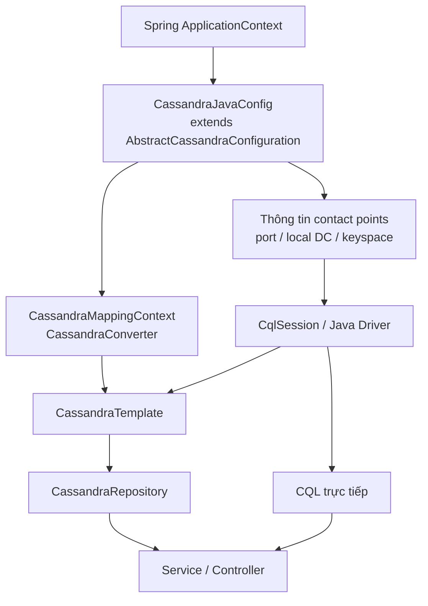
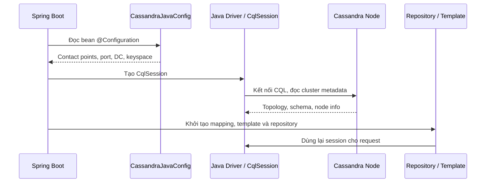

# Cấu hình Java với AbstractCassandraConfiguration

## 1. Bài toán: ai cấu hình kết nối Cassandra trong ứng dụng Spring?

Khi dùng **Spring Data Cassandra** để làm việc với Apache Cassandra, một ứng dụng cần biết ít nhất địa chỉ node để kết nối ban đầu, cổng CQL, **local data center**, keyspace và cách ánh xạ entity. Từ thông tin đó, Spring Data cùng Java Driver thiết lập phiên CQL, converter, template và hạ tầng repository.

Có hai hướng cấu hình phổ biến:

1. **Spring Boot auto-configuration:** khai báo các thuộc tính `spring.cassandra.*`; Spring Boot tạo phần lớn bean cần thiết. Đây thường là lựa chọn đơn giản nhất khi ứng dụng dùng cấu hình thông thường.
2. **Java configuration bằng `AbstractCassandraConfiguration`:** viết một class `@Configuration` kế thừa lớp cấu hình nền của Spring Data Cassandra, override các phương thức như `getKeyspaceName()`, `getContactPoints()`, `getPort()` và `getLocalDataCenter()`. Cách này hữu ích khi muốn kiểm soát rõ cách dựng session, phạm vi quét entity hoặc các tùy biến hạ tầng.

Bài này đi sâu vào cách thứ hai. Mục tiêu là hiểu **lúc nào nên dùng Java configuration, lớp đó tạo ra điều gì, cách nối repository/`CassandraTemplate` và cách tránh cấu hình trùng với Spring Boot**. Những ví dụ tập trung vào Spring Data Cassandra thế hệ dùng **Java Driver 4.x** (thường gặp trong Spring Boot 3.x/Spring Data Cassandra 4.x); với phiên bản khác, cần đối chiếu API tương ứng.

> `AbstractCassandraConfiguration` thuộc **Spring Data Cassandra**. Nó là một class cung cấp cấu hình cơ sở; nó **không phải** coordinator của Cassandra và không vận hành cluster. Coordinator là vai trò của một **node Cassandra** nhận và xử lý từng yêu cầu CQL trong hệ thống phân tán.

## 2. Luồng khởi tạo và vai trò của từng thành phần



Ý nghĩa của các thành phần:

| Thành phần | Chức năng | Khi nào ứng dụng chạm tới? |
| --- | --- | --- |
| `AbstractCassandraConfiguration` | Cung cấp nhiều bean hạ tầng Spring Data Cassandra, dựa trên các phương thức cấu hình được override. | Khi cần tự quản lý cấu hình bằng Java thay vì chỉ dựa vào Boot. |
| `CqlSession` | Phiên của Java Driver 4.x để gửi CQL và quản lý metadata cluster, connection pooling, load balancing. | Khi chạy statement CQL trực tiếp hoặc khi Spring Data thực thi request. |
| `CassandraMappingContext` / `CassandraConverter` | Mô tả entity và chuyển đổi đối tượng Java với dữ liệu Cassandra. | Phía sau `@Table`, `@PrimaryKey`, template và repository. |
| `CassandraTemplate` | API thực thi thao tác dữ liệu có hỗ trợ mapping, `Query` và kết quả Java. | Khi một query cần kiểm soát linh hoạt hơn phương thức repository. |
| `CassandraRepository` | Abstraction repository cho thao tác dữ liệu theo entity và khóa. | Khi triển khai các thao tác CRUD và các query có cấu trúc phù hợp. |
| `@EnableCassandraRepositories` | Kích hoạt quét repository trong các package được chỉ định. | Khi chủ động đăng ký repository qua Java configuration. |

Lớp `AbstractCassandraConfiguration` được Spring tạo khi startup. Nó dùng các giá trị bạn cung cấp để tạo hạ tầng kết nối và mapping; sau đó repository/template sẽ sử dụng cùng cấu hình này. **Không tạo một `CqlSession` mới cho mỗi request HTTP**: session được thiết kế để tái sử dụng, giữ kết nối và metadata lâu dài; Spring quản lý vòng đời session do nó tạo.

## 3. Chuẩn bị Cassandra và các dependency

Giả sử đã có Cassandra đang chạy trên máy học tập, native CQL port là `9042` và node thuộc data center `dc1`. Ví dụ sẽ dùng keyspace `app_learning`.

Trước hết, vào `cqlsh` rồi chuẩn bị schema. Ví dụ ở môi trường Docker Compose với service tên `cassandra`:

```bash
docker compose exec cassandra cqlsh
```

Trong `cqlsh`, chạy:

```sql
SELECT data_center, cluster_name FROM system.local;

CREATE KEYSPACE IF NOT EXISTS app_learning
WITH replication = {
  'class': 'NetworkTopologyStrategy',
  'dc1': 1
};

CREATE TABLE IF NOT EXISTS app_learning.customer_by_id (
    customer_id uuid PRIMARY KEY,
    display_name text,
    tier text
);
```

Ở đây `'dc1': 1` phù hợp **lab một node**. Cluster nhiều node phục vụ production cần RF theo topology và khả năng chịu lỗi thực tế; không giữ RF = 1 chỉ vì cấu hình mẫu.

**Tại sao phải tạo keyspace trước?** Giá trị `getKeyspaceName()` chỉ cho session biết keyspace cần dùng; nó không tự tạo keyspace khi server chưa có. Việc quản lý keyspace, replication, migration bảng và dữ liệu cần một quy trình rõ ràng. Với bài học này ta tạo schema chủ động qua CQL.

Trong một ứng dụng Spring Boot sử dụng Gradle, dependency chính là:

```groovy
dependencies {
    implementation 'org.springframework.boot:spring-boot-starter-data-cassandra'
}
```

Nếu dùng Maven, artifact tương ứng là `org.springframework.boot:spring-boot-starter-data-cassandra`, và phiên bản cần được quản lý đồng bộ theo Spring Boot BOM/parent. Không tự ghép ngẫu nhiên các phiên bản Spring Data, Java Driver và Spring Framework.

Ví dụ dưới đây giả định ứng dụng đã có Spring Boot và đang dùng một nhánh Spring Data Cassandra tương thích với package `org.springframework.data.cassandra.*` và Java Driver 4.x `com.datastax.oss.driver.api.core.*`.

## 4. Cấu hình `AbstractCassandraConfiguration` bằng Java

### 4.1. Đặt thuộc tính kết nối ngoài source code

Ví dụ `application.yml` của ứng dụng:

```yaml
app:
  cassandra:
    contact-points: 127.0.0.1
    port: 9042
    local-datacenter: dc1
    keyspace: app_learning
```

Ở đây dùng prefix riêng `app.cassandra.*` để **phân biệt cấu hình do class Java dưới đây đọc** với thuộc tính tự động của Spring Boot `spring.cassandra.*`. Khi chạy trong Docker network và service Cassandra tên `cassandra`, ứng dụng trong container phải dùng hostname `cassandra` thay vì `127.0.0.1` của chính container đó.

**Không viết credential hoặc secret thực vào Git.** Nếu cluster có xác thực/TLS, sử dụng secret manager, biến môi trường hoặc cấu hình được quản lý an toàn; điều chỉnh Java Driver theo yêu cầu bảo mật của môi trường.

### 4.2. Class Java đầy đủ

Giả sử có package `com.example.orders.domain` chứa entity và `com.example.orders.repository` chứa repository:

```java
package com.example.orders.config;

import org.springframework.beans.factory.annotation.Value;
import org.springframework.context.annotation.Configuration;
import org.springframework.data.cassandra.config.AbstractCassandraConfiguration;
import org.springframework.data.cassandra.config.SchemaAction;
import org.springframework.data.cassandra.repository.config.EnableCassandraRepositories;

@Configuration
@EnableCassandraRepositories(
    basePackages = "com.example.orders.repository")
public class CassandraJavaConfig extends AbstractCassandraConfiguration {

    private final String contactPoints;
    private final int port;
    private final String localDatacenter;
    private final String keyspace;

    public CassandraJavaConfig(
            @Value("${app.cassandra.contact-points}") String contactPoints,
            @Value("${app.cassandra.port:9042}") int port,
            @Value("${app.cassandra.local-datacenter}") String localDatacenter,
            @Value("${app.cassandra.keyspace}") String keyspace) {

        this.contactPoints = contactPoints;
        this.port = port;
        this.localDatacenter = localDatacenter;
        this.keyspace = keyspace;
    }

    @Override
    protected String getKeyspaceName() {
        return keyspace;
    }

    @Override
    protected String getContactPoints() {
        return contactPoints;
    }

    @Override
    protected int getPort() {
        return port;
    }

    @Override
    protected String getLocalDataCenter() {
        return localDatacenter;
    }

    @Override
    public String[] getEntityBasePackages() {
        return new String[] {"com.example.orders.domain"};
    }

    @Override
    public SchemaAction getSchemaAction() {
        return SchemaAction.NONE;
    }
}
```

Ở đoạn mã này:

- `@Configuration` đưa class vào Spring ApplicationContext. Package của class phải nằm trong phạm vi component scanning hoặc được import từ cấu hình khác.
- `@EnableCassandraRepositories` khai báo package chứa repository cần tạo bean; nếu bỏ hoặc cấu hình sai package, bean repository có thể không được tìm thấy.
- `getKeyspaceName()` trỏ tới keyspace đã có. Tên keyspace khác tên database trong các ví dụ SQL quan hệ, và nó đi kèm chính sách replication của Cassandra.
- `getContactPoints()` trả về các host ban đầu mà driver dùng để khám phá cluster. **Contact points không phải danh sách mọi replica**: driver có thể khám phá các node khác từ metadata sau khi kết nối.
- `getPort()` là cổng **CQL native transport**, thông thường là `9042`; không phải cổng HTTP.
- `getLocalDataCenter()` là data center mà driver coi là địa phương. Nó cần khớp chính xác giá trị phía Cassandra, ví dụ `dc1`. Khai báo sai có thể làm driver không tìm được node phù hợp hoặc không định tuyến như mong đợi.
- `getEntityBasePackages()` cho mapping context biết nơi tìm entity. Nó **khác** `basePackages` của `@EnableCassandraRepositories`: một bên quét entity, bên kia quét interface repository.
- `getSchemaAction()` trả `SchemaAction.NONE` để ứng dụng **không tự thay đổi schema** khi startup. Schema được quản lý bằng CQL/migration riêng trong ví dụ này.

Sử dụng constructor injection cho cấu hình giúp các giá trị bắt buộc được xác định khi tạo bean. Cách làm này vẫn là **một nguồn cấu hình duy nhất**: giá trị từ file/env truyền vào các phương thức cấu hình Spring Data, thay vì vừa dựng session bằng tay vừa để một đường auto-config khác tạo session cạnh tranh.

### 4.3. Điều gì xảy ra khi Spring khởi động?



Cụ thể, startup có thể **thất bại** khi không kết nối được Cassandra, chọn sai local DC hoặc keyspace chưa tồn tại. Điều này khác việc REST endpoint nhận request sau khi ứng dụng đã sẵn sàng; lỗi khởi tạo hạ tầng cần được xử lý như lỗi cấu hình/môi trường.

## 5. Sử dụng entity, repository và CassandraTemplate với cấu hình vừa tạo

Cấu hình kết nối chỉ là bước đầu. Spring Data sẽ mapping object Java vào bảng Cassandra **theo primary key của bảng**, không thể tự sửa một mô hình dữ liệu không phù hợp truy vấn.

### 5.1. Entity mapping cho bảng mẫu

```java
package com.example.orders.domain;

import java.util.UUID;
import org.springframework.data.cassandra.core.mapping.Column;
import org.springframework.data.cassandra.core.mapping.PrimaryKey;
import org.springframework.data.cassandra.core.mapping.Table;

@Table("customer_by_id")
public class CustomerById {

    @PrimaryKey("customer_id")
    private UUID customerId;

    @Column("display_name")
    private String displayName;

    private String tier;

    protected CustomerById() {
    }

    public CustomerById(UUID customerId, String displayName, String tier) {
        this.customerId = customerId;
        this.displayName = displayName;
        this.tier = tier;
    }

    public UUID getCustomerId() {
        return customerId;
    }

    public String getDisplayName() {
        return displayName;
    }

    public String getTier() {
        return tier;
    }
}
```

Ở đây `customer_id` là partition key đơn giản và khóa chính của bảng. Nếu bảng thực tế có composite partition key và clustering columns, phải ánh xạ đầy đủ bằng `@PrimaryKeyClass`/`@PrimaryKeyColumn` và thiết kế query theo partition. Đừng suy luận rằng entity Java có thể truy vấn mọi field như trong RDBMS.

### 5.2. Repository

```java
package com.example.orders.repository;

import java.util.UUID;
import org.springframework.data.cassandra.repository.CassandraRepository;
import com.example.orders.domain.CustomerById;

public interface CustomerRepository
        extends CassandraRepository<CustomerById, UUID> {
}
```

Ví dụ một service thực hiện truy cập qua repository:

```java
package com.example.orders.service;

import java.util.Optional;
import java.util.UUID;
import org.springframework.stereotype.Service;
import com.example.orders.domain.CustomerById;
import com.example.orders.repository.CustomerRepository;

@Service
public class CustomerService {
    private final CustomerRepository repository;

    public CustomerService(CustomerRepository repository) {
        this.repository = repository;
    }

    public Optional<CustomerById> findCustomer(UUID customerId) {
        return repository.findById(customerId);
    }
}
```

Nhờ `@EnableCassandraRepositories`, Spring tạo bean `CustomerRepository`. Lời gọi `findById` sử dụng hạ tầng mapping/session đã cấu hình. Nếu repository ở sai package scan, ứng dụng thường báo thiếu bean trong quá trình startup.

### 5.3. CassandraTemplate và CQL trực tiếp

Trong cùng ứng dụng, ta có thể inject `CassandraTemplate` khi cần điều khiển truy vấn qua abstraction của Spring Data:

```java
import java.util.UUID;
import org.springframework.data.cassandra.core.CassandraTemplate;
import com.example.orders.domain.CustomerById;

public class CustomerLookup {
    private final CassandraTemplate template;

    public CustomerLookup(CassandraTemplate template) {
        this.template = template;
    }

    public CustomerById get(UUID customerId) {
        return template.selectOneById(customerId, CustomerById.class);
    }
}
```

`CustomerLookup` ở trên minh họa cách dùng template; để Spring quản lý nó, hãy đặt trong một class có stereotype phù hợp như `@Service` hoặc tạo bean. Với các câu lệnh CQL đặc thù, có thể inject trực tiếp `CqlSession`. Cả ba đường repository, template và CQL trực tiếp đều sử dụng **một cluster Cassandra phía sau**, không phải ba database khác nhau.

Một phép kiểm tra CQL đơn giản tại startup:

```java
import com.datastax.oss.driver.api.core.CqlSession;
import com.datastax.oss.driver.api.core.cql.Row;
import org.springframework.boot.CommandLineRunner;
import org.springframework.context.annotation.Bean;
import org.springframework.context.annotation.Configuration;

@Configuration
class CassandraSmokeTestConfig {

    @Bean
    CommandLineRunner verifyCassandra(CqlSession session) {
        return args -> {
            Row row = session.execute(
                "SELECT data_center, release_version FROM system.local")
                .one();

            if (row == null) {
                throw new IllegalStateException(
                    "Cassandra system.local khong co du lieu");
            }

            System.out.printf("Cassandra DC=%s, version=%s%n",
                row.getString("data_center"),
                row.getString("release_version"));
        };
    }
}
```

Kết nối thành công với `system.local` chỉ xác nhận session có thể chạy CQL; muốn xác nhận đúng keyspace và mapping cần thực hiện thêm thao tác đọc/ghi có kiểm soát trên bảng `app_learning.customer_by_id`. Đoạn smoke test phù hợp cho môi trường học; trong production, nên dùng health indicator/metric và chính sách startup rõ ràng.

## 6. Những chỗ dễ nhầm với Spring Boot auto-configuration

**Khi chỉ cần kết nối thông thường**, Spring Boot thường có thể tự cấu hình bằng:

```yaml
spring:
  cassandra:
    contact-points: 127.0.0.1
    port: 9042
    local-datacenter: dc1
    keyspace-name: app_learning
    schema-action: NONE
```

Khi chọn lối này, **không nhất thiết phải viết class kế thừa `AbstractCassandraConfiguration`**. Spring Boot sẽ tạo bean thích hợp nếu các điều kiện auto-configuration thỏa mãn.

Ngược lại, ví dụ Java configuration ở phần 4 đọc từ `app.cassandra.*`; các giá trị `spring.cassandra.*` **không tự động ghi đè** các phương thức override `getContactPoints()`/`getKeyspaceName()`. Nếu trộn cả hai cách mà không hiểu điều kiện auto-configuration, ứng dụng có thể thấy:

- Nhiều bean hạ tầng không tương thích hoặc bị đăng ký trùng tên.
- Một cấu hình kết nối chạy nhưng lại trỏ sai keyspace/DC so với dự định.
- Cấu hình credential, SSL, timeout hay retry trên `spring.cassandra.*` không được áp dụng như mong muốn vì custom bean/session đang chi phối.
- Repository được quét bởi nhiều đường khác nhau hoặc thiếu package scan.

| Tình huống | Hướng nên cân nhắc | Lý do |
| --- | --- | --- |
| Một Cassandra cluster, thuộc tính kết nối cơ bản | Boot auto-config với `spring.cassandra.*` | Ít mã Java, dễ quản lý theo profile/env. |
| Cần tự khai báo mapping/repository scan và hook cấu hình session | `AbstractCassandraConfiguration` | Chủ động lifecycle/hạ tầng Spring Data theo yêu cầu. |
| Có custom `CqlSession`, auth/TLS hoặc driver settings phức tạp | Chọn một đường tạo session rõ ràng, áp dụng API/driver configuration tương thích | Tránh hai session hoặc cấu hình chồng chéo. |
| Nhiều keyspace hoặc nhiều cluster độc lập | Thiết kế bean/session/template/repository rõ phạm vi | Cần quản lý định tuyến repository đến đúng session/template; không giải quyết chỉ bằng sửa một keyspace string. |

Một nguyên tắc hữu ích: **chỉ định rõ ai sở hữu `CqlSession` và Cassandra infrastructure beans**. Khi sửa cấu hình, kiểm tra context để chắc chắn ứng dụng đang dùng bean được kỳ vọng. Nếu dự án đang hoạt động với Boot auto-config, chỉ thêm custom Java configuration khi có yêu cầu cụ thể về khả năng điều khiển.

### Nâng cấp phiên bản: những gì cần kiểm tra

- Spring Data Cassandra 4.x dùng Java Driver 4.x với class `com.datastax.oss.driver.api.core.CqlSession`. Các hướng dẫn rất cũ dùng `com.datastax.driver.core.Session` thuộc driver đời trước và không thể copy nguyên vào dự án mới.
- Thuộc tính Boot 3.x thường nằm dưới `spring.cassandra.*`, còn các ví dụ Boot 2.x có thể sử dụng `spring.data.cassandra.*`. Kiểm tra đúng tài liệu của **phiên bản Boot đang chạy**.
- Các hook cấu hình đặc thù (driver builder, SSL/auth, load balancing, schema action, lifecycle) có thể khác giữa các nhánh Spring Data. Khi tùy biến sâu, kiểm tra chữ ký API và thứ tự khởi tạo thay vì áp dụng snippet cũ không kiểm chứng.

## 7. Local data center, partition routing và tính nhất quán

### 7.1. Local DC không chỉ là một chuỗi cấu hình

Java Driver được cấu hình local DC để chọn node phù hợp theo topology. Khi ứng dụng chạy ở DC `dc1`, giá trị `getLocalDataCenter()` thường phải khớp tên mà Cassandra công bố cho DC đó. Trên môi trường học tập, kiểm tra bằng:

```sql
SELECT data_center, rack FROM system.local;
```

Đặt local DC sai có thể làm driver không có node phù hợp, mặc dù TCP port mở. Trong môi trường đa DC, không mặc định lấy DC của một node ngẫu nhiên nếu ứng dụng được triển khai tại DC khác; xác định địa điểm ứng dụng, contact points, replication và chính sách định tuyến cùng nhóm vận hành.

### 7.2. Keyspace replication khác consistency level

**RF (replication factor)** là số bản sao của mỗi partition theo phạm vi cấu hình; **CL (consistency level)** là số phản hồi cần có để coordinator trả thành công cho một thao tác. `AbstractCassandraConfiguration` cấu hình kết nối **không tự quyết định CL phù hợp nghiệp vụ**.

Ví dụ cluster một DC có RF = 3:

| CL | Số phản hồi cần thiết | Ứng dụng nên hiểu |
| --- | --- | --- |
| `LOCAL_ONE` | 1 từ local DC | Thường ít phải chờ hơn; có thể đọc bản chưa cập nhật. |
| `LOCAL_QUORUM` | 2 từ local DC | Hai trong ba replica phải phản hồi hợp lệ. |
| `ALL` | 3 | Nhạy với một replica không phản hồi. |

Với **lab một node, RF = 1**, quorum của local DC cũng chỉ cần một replica. Không dùng lab này để kết luận về khả năng chịu lỗi khi một replica down trong RF = 3.

Ứng dụng cần đánh giá read/write CL, retry và idempotency cùng nhau. **Write timeout không chứng minh ghi thất bại hoàn toàn**, vì một hoặc nhiều replica có thể đã áp dụng mutation trước khi client nhận lỗi. Việc điều chỉnh CL nên xuất phát từ yêu cầu nghiệp vụ và topology, không chỉ từ nhu cầu “hết timeout”.

### 7.3. Tùy biến CL/timeout thuộc về driver hoặc từng statement

`AbstractCassandraConfiguration` cung cấp nền tảng session; các lựa chọn như CL mặc định, request timeout, load balancing, paging, retry policy thường cấu hình qua **Java Driver configuration/execution profile** hoặc từng statement. Chúng không được quyết định bằng cách sửa tên keyspace hoặc port.

Ví dụ dùng `CqlSession` và Java Driver để đặt CL cho một thao tác **đọc** cụ thể:

```java
import java.util.UUID;
import com.datastax.oss.driver.api.core.CqlSession;
import com.datastax.oss.driver.api.core.DefaultConsistencyLevel;
import com.datastax.oss.driver.api.core.cql.SimpleStatement;

public class CustomerCqlReader {
    private final CqlSession session;

    public CustomerCqlReader(CqlSession session) {
        this.session = session;
    }

    public void readCustomer(UUID customerId) {
        var statement = SimpleStatement.newInstance(
                "SELECT customer_id, display_name, tier " +
                "FROM app_learning.customer_by_id WHERE customer_id = ?",
                customerId)
            .setConsistencyLevel(DefaultConsistencyLevel.LOCAL_ONE)
            .setPageSize(50);

        session.execute(statement);
    }
}
```

Ví dụ dùng `LOCAL_ONE` vì keyspace lab có RF = 1. Trên cluster thực, CL cần được chọn theo mức nhất quán và khả năng chịu lỗi; page size ở đây chỉ là kích thước fetch và **không phải** giới hạn số hàng tối đa cho mọi loại truy vấn. Các câu lệnh truy cập dữ liệu nhiều lần nên cân nhắc prepared statement để tối ưu hiệu năng và định tuyến theo partition key.

## 8. Một số tùy biến nâng cao và ranh giới trách nhiệm

Không nên nhồi mọi thiết lập của Cassandra Server vào class `AbstractCassandraConfiguration`. Cần phân biệt:

| Phạm vi | Ví dụ | Ai xử lý? |
| --- | --- | --- |
| **Spring Data mapping** | Entity package, converter, `CassandraTemplate`, repository scan, schema action | Nhóm ứng dụng |
| **Driver/session** | Contact points, local DC, authentication, TLS, request timeout, retry, connection pooling, load balancing | Nhóm ứng dụng phối hợp nền tảng |
| **Schema dữ liệu** | Partition key, clustering key, TTL, bảng theo query, migration | Nhóm ứng dụng thiết kế; nhóm nền tảng đánh giá tài nguyên |
| **Cluster/server** | RF theo DC, node/rack placement, repair, compaction, backup, nâng cấp | Nhóm vận hành Cassandra |

**Auth và TLS:** không đưa mật khẩu, private key hay chứng chỉ bí mật trực tiếp vào class Java. Driver hỗ trợ các tùy chọn xác thực và TLS nhưng cách cấu hình cụ thể phụ thuộc phiên bản và hạ tầng. Khi cần thêm các tùy biến này trong Java configuration, dùng extension point của phiên bản Spring Data đang có hoặc cấu hình driver phù hợp; xác nhận session thực tế dùng những thông số đó, và tránh tạo thêm session thứ hai chỉ để áp dụng auth.

**SchemaAction:** `SchemaAction.NONE` giúp tránh những thay đổi DDL bất ngờ khi ứng dụng khởi chạy. Nếu chủ động dùng schema action khác trong bài lab, cần hiểu hành vi chính xác của lựa chọn đó, các rủi ro xóa/tạo bảng và tác động giữa các phiên bản; production nên dùng migration có kiểm soát.

**Nhiều cluster:** nếu ứng dụng cần truy cập hai cluster độc lập, một class đơn giản kế thừa `AbstractCassandraConfiguration` không đủ để tự động định tuyến đúng mọi repository. Cần thiết kế session/template/converter/transaction boundary và package repository tách biệt, đồng thời kiểm tra đầy đủ bean names và lifecycle. Nên bắt đầu từ một cluster cho mục tiêu học tập.

**Hiệu năng:** session tái sử dụng metadata và connection pool; tránh khởi tạo session trên mỗi thao tác. Giới hạn kích thước partition, truy vấn theo partition key, dùng paging state khi kết quả lớn, theo dõi latency/timeout và số retry. Tăng connection pool hoặc timeout không cứu được query phải đọc quá nhiều partition.

## 9. Lỗi thường gặp khi cấu hình thủ công

| Triệu chứng | Nguyên nhân có thể | Cách kiểm tra |
| --- | --- | --- |
| Startup báo không kết nối được tới Cassandra/`AllNodesFailedException` | Cassandra chưa sẵn sàng, sai host/port, Docker port chưa publish hoặc firewall. | Dùng `cqlsh`, xác minh host/port từ môi trường chạy **ứng dụng**, xem log Cassandra và driver. |
| Driver báo local DC không hợp lệ hoặc không có node khả dụng | `getLocalDataCenter()` không khớp topology hoặc contact points trỏ sang DC khác. | Chạy `SELECT data_center FROM system.local;`, đối chiếu DC thực tế của node/app. |
| Keyspace `app_learning` không tồn tại | Chưa tạo keyspace, sai cluster hoặc nhầm cấu hình `getKeyspaceName()`. | Kiểm tra `DESCRIBE KEYSPACE app_learning;` bằng `cqlsh` trên đúng cluster. |
| `Unconfigured table` hoặc repository truy vấn thất bại | Chưa tạo bảng, sai keyspace, sai tên cột, entity mapping không khớp schema. | Kiểm tra bảng qua CQL; đối chiếu `@Table`, `@PrimaryKey`, `@Column`. |
| `No qualifying bean of type CustomerRepository` | Repository không nằm trong `@EnableCassandraRepositories` hoặc config không được scan. | Kiểm tra package, `@Configuration` và bootstrap Spring. |
| Entity mapping sai hoặc báo không tìm thấy persistent entity | `getEntityBasePackages()` chưa quét đúng package, entity thiếu khóa hoặc sai annotation. | Kiểm tra tên package, các annotation mapping và primary key của bảng. |
| `NoUniqueBeanDefinitionException` hoặc bean config bị trùng | Tạo nhiều bean `CqlSession`/`CassandraTemplate` hoặc kích hoạt cấu hình trùng giữa Boot và Java. | Kiểm tra tất cả class `@Configuration`, bean definitions và auto-config condition report. |
| App chạy trên Docker nhưng `127.0.0.1:9042` không tới Cassandra | `localhost` ở trong container chỉ chính container đó. | Dùng Docker service name trên cùng network, ví dụ `cassandra:9042`. |
| Không thấy thay đổi khi sửa `spring.cassandra.*` | Cấu hình thủ công đọc `app.cassandra.*` hoặc bean riêng đang chi phối. | Xem constructor Java config và nguồn properties; thống nhất một cơ chế. |
| API chậm dù kết nối thành công | Partition quá lớn, truy vấn không có partition key, CL cao, retries, tombstone hoặc node chậm. | Đo query, CL, key, page size, node health; không chỉ tăng timeout. |

### Cách khoanh vùng có thứ tự

1. **Phía Cassandra:** node có chạy và chấp nhận CQL không? Dùng `cqlsh` và kiểm tra `system.local`.
2. **Phía network:** ứng dụng đang chạy ở host hay container? `contact-points` và `port` có thể truy cập từ đúng môi trường đó không?
3. **Phía topology:** giá trị `getLocalDataCenter()` có trùng data center thực tế không?
4. **Phía schema:** keyspace có tồn tại; bảng và primary key có phù hợp entity không?
5. **Phía Spring:** config class có được scan; repository/entity có nằm trong đúng package; có bean trùng không?
6. **Phía nghiệp vụ:** câu truy vấn đi theo partition key, CL phù hợp, pagination/retry hợp lý không?

Cách này giúp tách lỗi **không khởi tạo được session** khỏi lỗi **đã kết nối nhưng query/mapping không đúng**.

## 10. Bài thực hành tự kiểm tra

Hãy dùng đúng ví dụ `app_learning`, tạo một bản ghi rồi đọc từ repository:

```sql
INSERT INTO app_learning.customer_by_id
    (customer_id, display_name, tier)
VALUES
    (11111111-1111-1111-1111-111111111111, 'Lan', 'GOLD');

SELECT customer_id, display_name, tier
FROM app_learning.customer_by_id
WHERE customer_id = 11111111-1111-1111-1111-111111111111;
```

Sau đó:

1. Khởi chạy ứng dụng có `CassandraJavaConfig`, xác nhận smoke test in đúng DC và phiên bản Cassandra.
2. Gọi `CustomerRepository.findById(...)` với UUID trong ví dụ, đối chiếu `displayName` và `tier` với kết quả `cqlsh`.
3. Sử dụng `CassandraTemplate.selectOneById(...)` và kiểm tra hai cách cho cùng một record.
4. Đổi thử `app.cassandra.keyspace` sang keyspace không tồn tại **trong lab** để quan sát lỗi startup; khôi phục giá trị đúng sau thử nghiệm.
5. Đổi thử `app.cassandra.local-datacenter` thành một giá trị sai **trong lab**, quan sát lỗi và sửa về DC được `system.local` công bố.
6. Đưa repository sang ngoài package scan trong một nhánh thực hành để thấy vì sao `@EnableCassandraRepositories` quan trọng.
7. So sánh cấu hình Java thủ công với cách dùng duy nhất `spring.cassandra.*`; xác định bean nào thực sự được tạo trong từng cách.

### Checklist trước khi triển khai

- [ ] Chọn một cơ chế sở hữu session rõ ràng: Boot auto-configuration hoặc custom Java configuration.
- [ ] `getContactPoints()`, `getPort()` và `getLocalDataCenter()` phù hợp môi trường chạy thực tế.
- [ ] `getKeyspaceName()` trỏ đến keyspace đã được quản lý và tồn tại trên cluster.
- [ ] Package quét entity và repository chính xác; entity ánh xạ primary key đúng cấu trúc bảng.
- [ ] Không nhúng secrets vào Java/yaml lưu trong Git; có kế hoạch auth/TLS khi cần.
- [ ] Schema action/migration được kiểm soát; không tự thay đổi bảng bất ngờ khi startup.
- [ ] Read/write CL, timeout, retry, paging và hiệu năng được thiết kế theo query pattern và RF/topology.
- [ ] Có smoke test kết nối và kiểm thử repository/template trên schema thực tế.

**Điểm mấu chốt:** `AbstractCassandraConfiguration` giúp khai báo rõ ràng **cách Spring Data Cassandra kết nối, mapping và cung cấp hạ tầng truy cập dữ liệu**. Dù dùng Java config, phần quan trọng của Cassandra vẫn nằm ở **thiết kế bảng theo truy vấn, partition key, consistency level, paging và kiểm soát hiệu năng phân tán**. Chọn một nguồn cấu hình nhất quán, hiểu vòng đời `CqlSession` và kiểm thử trên đúng cluster sẽ giúp ứng dụng dễ bảo trì hơn.
