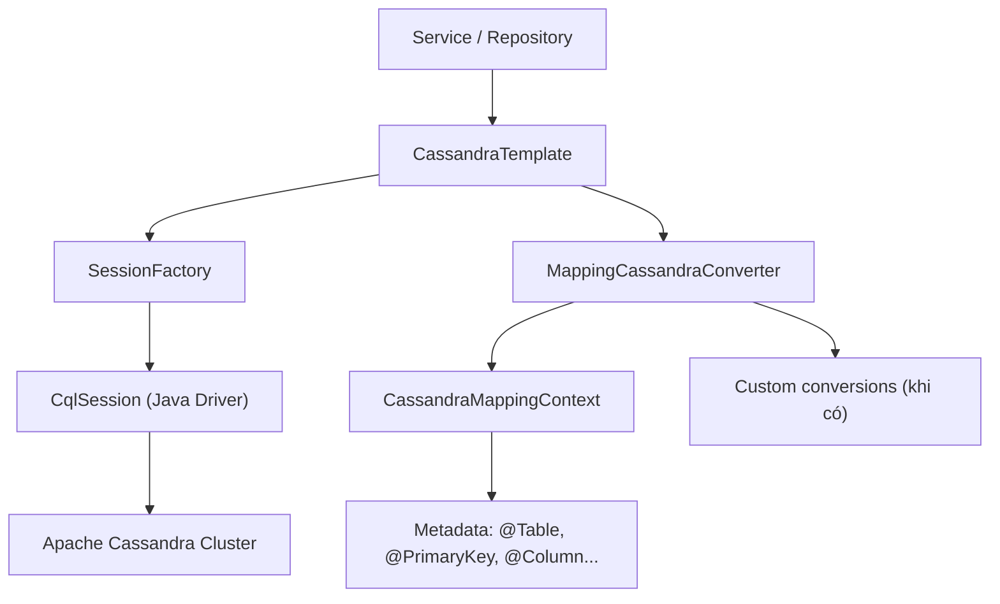

# SessionFactory, CassandraMappingContext và MappingCassandraConverter

## Mục tiêu học tập

Khi dùng **Spring Data Cassandra**, phần lớn mã nghiệp vụ chỉ làm việc với repository hoặc `CassandraTemplate`. Tuy nhiên, để hiểu một đối tượng Java được chuyển thành câu lệnh CQL rồi ghi vào Apache Cassandra như thế nào, cần phân biệt các thành phần hạ tầng bên dưới: **`CqlSession`**, **`SessionFactory`**, **`CassandraMappingContext`** và **`MappingCassandraConverter`**.

Sau bài này, bạn có thể:

- Giải thích vai trò riêng của `SessionFactory`, `CassandraMappingContext` và `MappingCassandraConverter` trong kiến trúc Spring Data Cassandra.
- Phân biệt kết nối cấp driver với metadata ánh xạ và thao tác chuyển đổi dữ liệu.
- Theo dõi luồng ghi/đọc từ entity qua `CassandraTemplate` đến bảng CQL.
- Cấu hình một ứng dụng Spring Boot ở mức phù hợp, nhận biết khi nào nên để autoconfiguration tạo các bean hạ tầng.
- Phân tích các lỗi phổ biến liên quan đến keyspace, tên bảng/cột, partition key, kiểu dữ liệu và custom conversions.
- Hiểu vì sao cấu hình mapping đúng không thể thay thế thiết kế bảng theo truy vấn, consistency, paging hay đo lường hiệu năng.

## 1. Bức tranh tổng thể: kết nối và ánh xạ là hai trách nhiệm khác nhau

Một ứng dụng Cassandra cần đồng thời giải quyết hai việc:

1. **Giao tiếp với cụm Cassandra:** biết contact points, datacenter cục bộ, xác thực, bảo mật, keyspace, timeout và cách gửi lệnh CQL.
2. **Chuyển đổi giữa Java và dữ liệu CQL:** biết lớp Java nào ứng với bảng nào, trường nào là khóa phân vùng/clustering column, tên và kiểu cột ra sao.

Spring Data Cassandra ghép hai khả năng này thành API thao tác dữ liệu, nhưng mỗi khả năng được cung cấp bởi các thành phần khác nhau:



Sơ đồ là **mô hình khái niệm** của các trách nhiệm. Từng phiên bản Spring Data hoặc chế độ autoconfiguration có thể có thêm các bean trung gian, nhưng phân tách vai trò vẫn giữ nguyên.

| Thành phần | Câu hỏi nó giải quyết | Không nên nhầm với |
| --- | --- | --- |
| **`CqlSession`** | “Gửi CQL đến cụm Cassandra bằng driver như thế nào?” | Một Java entity, một repository hoặc session giao dịch kiểu ORM. |
| **`SessionFactory`** | “Spring Data truy cập một session CQL qua lớp hạ tầng thống nhất như thế nào?” | Cấu hình entity mapping hay mỗi HTTP request phải tạo một session mới. |
| **`CassandraMappingContext`** | “Lớp/thuộc tính Java này tương ứng với bảng/cột/khóa nào?” | Kết nối mạng hoặc bộ thực thi CQL. |
| **`MappingCassandraConverter`** | “Chuyển dữ liệu giữa entity và giá trị/hàng CQL bằng metadata và quy tắc chuyển đổi nào?” | Trình tối ưu truy vấn hoặc cơ chế phân bố partition. |
| **`CassandraTemplate`** | “Ứng dụng gọi các thao tác CRUD/query và áp dụng mapping ra sao?” | Tính năng `JOIN`, transaction ACID kiểu RDBMS hay đảm bảo hiệu năng tự động. |

Trong bài này, tên `SessionFactory` chỉ **abstraction của Spring Data Cassandra**. Nó không đồng nghĩa với `SessionFactory` của Hibernate/JPA.

## 2. Tầng kết nối: CqlSession và SessionFactory

### 2.1. CqlSession làm những gì?

`CqlSession` là API trung tâm của **Apache Cassandra Java Driver**. Nó đại diện cho một phiên làm việc với cụm Cassandra và là nơi ứng dụng hoặc framework thực thi CQL.

Việc khởi tạo `CqlSession` thường liên quan đến:

- **Contact points:** điểm truy cập ban đầu để driver khám phá topology; không nhất thiết là toàn bộ node.
- **Local datacenter:** thông tin cần thiết để driver định tuyến đến replica phù hợp với chiến lược load balancing.
- **Keyspace mặc định:** không gian tên mặc định cho các câu lệnh CQL khi sử dụng tên bảng không định tính.
- **Xác thực, TLS và tùy chọn driver:** tùy môi trường triển khai.
- **Timeout, retry và các chính sách thực thi:** cấu hình theo ứng dụng và đặc điểm workload.

Một `CqlSession` thường được **tạo một lần và dùng lại trong vòng đời ứng dụng**, thay vì tạo mới cho mỗi truy vấn. Driver quản lý các kết nối vật lý và việc gửi request bên dưới session; liên tục xây session mới thường làm tăng chi phí kết nối/khởi tạo.

Ví dụ Java Driver thuần để hình dung tầng thấp nhất:

```java
import com.datastax.oss.driver.api.core.CqlSession;
import java.net.InetSocketAddress;

try (CqlSession session = CqlSession.builder()
        .addContactPoint(new InetSocketAddress("127.0.0.1", 9042))
        .withLocalDatacenter("datacenter1")
        .withKeyspace("app_data")
        .build()) {

    session.execute("SELECT release_version FROM system.local");
}
```

Đoạn mã minh họa **driver thuần**, không phải cách khuyến nghị viết mỗi lần cần truy cập dữ liệu trong service Spring Boot. Giá trị `datacenter1` và `app_data` chỉ là ví dụ: datacenter và keyspace cần tồn tại, phù hợp cấu hình cụm thực tế. `try-with-resources` đóng session cuối khối; trong ứng dụng Spring, vòng đời session thường do container quản lý.

### 2.2. SessionFactory bổ sung gì?

`SessionFactory` là một **abstraction của Spring Data Cassandra** để các thành phần thao tác dữ liệu của Spring làm việc với session CQL. Một triển khai thường gặp là `DefaultSessionFactory`, dùng `CqlSession` do driver tạo.

Có thể hình dung:

```text
Spring Repository / CassandraTemplate
                   |
            SessionFactory
                   |
          CqlSession (driver)
                   |
         Cassandra cluster
```

Lợi ích là tầng dữ liệu của Spring Data có một điểm tích hợp thống nhất với session thực thi lệnh CQL. **SessionFactory không phải công cụ định nghĩa partition key hay chuyển entity thành Row**; đó là trách nhiệm của mapping.

Lưu ý về vòng đời: giữ session/SessionFactory theo phạm vi ứng dụng và để Spring quản lý khởi tạo/đóng khi có thể. Không gọi `close()` trên session được inject vào service sau từng thao tác, vì service khác còn sử dụng session đó.

### 2.3. Khi cấu hình mạng sai, sửa ở tầng nào?

Nếu không kết nối được cụm hoặc driver báo lỗi xác thực/datacenter, ưu tiên kiểm tra thông tin của `CqlSession` và cấu hình driver:

- Contact points, port và khả năng kết nối mạng đến cluster.
- Local datacenter có đúng tên datacenter trong Cassandra hay không.
- Credential, TLS và chính sách mạng.
- Keyspace có tồn tại, tài khoản có quyền truy cập hay không.

Việc thêm `@Table` hay viết lại converter không thể xử lý lỗi kết nối TCP, TLS hoặc datacenter.

## 3. CassandraMappingContext: bản đồ metadata từ Java sang CQL

`CassandraMappingContext` là thành phần Spring Data theo dõi **metadata của các persistent entity**. Nó giúp framework hiểu lớp nào cần được lưu, tên bảng là gì, thuộc tính nào tương ứng với cột và khóa chính được cấu thành ra sao.

Các annotation thường gặp:

| Annotation | Vai trò |
| --- | --- |
| `@Table` | Gắn entity với bảng CQL. |
| `@PrimaryKey` | Đánh dấu khóa chính, bao gồm trường hợp khóa tổng hợp được biểu diễn bằng một đối tượng Java. |
| `@PrimaryKeyClass` | Khai báo lớp đại diện cho khóa chính tổng hợp. |
| `@PrimaryKeyColumn` | Xác định các thành phần khóa với `PARTITIONED` hoặc `CLUSTERED`, thứ tự và tùy chọn sắp xếp. |
| `@Column` | Khai báo tên cột ánh xạ từ thuộc tính. |
| `@UserDefinedType` | Ánh xạ kiểu UDT trong Cassandra khi ứng dụng cần. |

Metadata không chỉ là tên class. Với khóa chính tổng hợp:

```sql
CREATE TABLE events_by_device_day (
    device_id uuid,
    bucket_day date,
    event_time timestamp,
    event_id uuid,
    event_type text,
    payload text,
    PRIMARY KEY ((device_id, bucket_day), event_time, event_id)
) WITH CLUSTERING ORDER BY (event_time DESC, event_id ASC);
```

Spring Data phải hiểu rằng `device_id` và `bucket_day` **cùng tạo thành partition key**, còn `event_time` và `event_id` là **clustering columns**. Đặt nhầm một clustering column thành partition key sẽ thay đổi ý nghĩa khóa, tạo câu lệnh không tương thích schema hoặc khiến cách đọc đã thiết kế không còn phù hợp.

### 3.1. Ví dụ ánh xạ khóa tổng hợp

```java
import java.io.Serializable;
import java.time.Instant;
import java.time.LocalDate;
import java.util.UUID;

import org.springframework.data.cassandra.core.cql.Ordering;
import org.springframework.data.cassandra.core.mapping.PrimaryKeyClass;
import org.springframework.data.cassandra.core.mapping.PrimaryKeyColumn;
import org.springframework.data.cassandra.core.mapping.PrimaryKeyType;

@PrimaryKeyClass
public class DeviceEventKey implements Serializable {

    @PrimaryKeyColumn(
        name = "device_id", type = PrimaryKeyType.PARTITIONED, ordinal = 0)
    private UUID deviceId;

    @PrimaryKeyColumn(
        name = "bucket_day", type = PrimaryKeyType.PARTITIONED, ordinal = 1)
    private LocalDate bucketDay;

    @PrimaryKeyColumn(
        name = "event_time", type = PrimaryKeyType.CLUSTERED,
        ordinal = 2, ordering = Ordering.DESCENDING)
    private Instant eventTime;

    @PrimaryKeyColumn(
        name = "event_id", type = PrimaryKeyType.CLUSTERED,
        ordinal = 3, ordering = Ordering.ASCENDING)
    private UUID eventId;

    // Constructor, getter/setter, equals/hashCode theo quy ước dự án.
}
```

Đây là **khung ánh xạ minh họa**: cần bổ sung constructor và các phương thức của lớp khóa theo chuẩn mã nguồn thực tế. Đối với dữ liệu khóa tổng hợp, hãy đảm bảo quy tắc so sánh bằng nhau của đối tượng Java phản ánh đúng các thành phần khóa.

Entity chứa khóa này:

```java
import org.springframework.data.cassandra.core.mapping.Column;
import org.springframework.data.cassandra.core.mapping.PrimaryKey;
import org.springframework.data.cassandra.core.mapping.Table;

@Table("events_by_device_day")
public class DeviceEvent {

    @PrimaryKey
    private DeviceEventKey key;

    @Column("event_type")
    private String eventType;

    @Column("payload")
    private String payload;

    // Constructor và getter/setter theo quy ước dự án.
}
```

Nhờ mapping context, Spring Data biết đường đi từ `DeviceEvent.key.deviceId` đến cột `device_id`, cũng như các cột thông thường. Tên thuộc tính Java có thể khác tên cột CQL nếu cấu hình/annotation thể hiện rõ sự khác biệt.

### 3.2. Điều mà MappingContext không làm

`CassandraMappingContext` **không tự động tối ưu thiết kế dữ liệu**. Nó không quyết định nên bucket theo giờ hay ngày, không tự tạo thêm bảng theo từng mẫu truy vấn, không phân bổ dữ liệu qua các node, và không giải quyết partition nóng.

Nó cũng **không phải nơi thực thi `SELECT`**. Mapping context mô tả dữ liệu; khi thực thi CQL, tầng session/driver mới giao tiếp với Cassandra.

## 4. MappingCassandraConverter: chuyển entity và giá trị CQL

`MappingCassandraConverter` sử dụng metadata từ `CassandraMappingContext` để chuyển dữ liệu giữa biểu diễn Java và biểu diễn phù hợp với Cassandra.

Ở chiều **ghi**, nó giúp đọc thuộc tính của entity, xác định tên cột/khóa và chuyển các giá trị Java sang kiểu có thể bind vào câu lệnh CQL. Ở chiều **đọc**, nó giúp tạo entity từ hàng dữ liệu trả về, ánh xạ các cột sang thuộc tính và áp dụng quy tắc chuyển đổi tương ứng.

```text
Chiều ghi:
  DeviceEvent (Java)
      |
      v
  MappingCassandraConverter
      |  dùng metadata từ CassandraMappingContext
      v
  giá trị cột/khóa để Spring Data bind và thực thi CQL
      |
      v
  SessionFactory -> CqlSession -> Cassandra

Chiều đọc:
  Cassandra -> CqlSession -> SessionFactory
      |
      v
  Row kết quả CQL
      |
      v
  MappingCassandraConverter
      |
      v
  DeviceEvent (Java)
```

### 4.1. Converter xử lý điều gì trong ví dụ?

Với bảng `events_by_device_day`:

| Dữ liệu Java | Kiểu CQL | Ý nghĩa mapping |
| --- | --- | --- |
| `UUID deviceId` | `uuid device_id` | Thành phần thứ nhất của partition key. |
| `LocalDate bucketDay` | `date bucket_day` | Thành phần thứ hai của partition key. |
| `Instant eventTime` | `timestamp event_time` | Clustering column theo thời gian. |
| `UUID eventId` | `uuid event_id` | Clustering column giúp các event trùng thời điểm vẫn khác hàng. |
| `String eventType` | `text event_type` | Trường dữ liệu bình thường. |
| `String payload` | `text payload` | Trường dữ liệu bình thường. |

Các kiểu trên có mapping thông dụng qua Spring Data/Java driver. Khi mô hình có kiểu miền riêng, kiểu lồng nhau hoặc UDT, có thể cần thêm annotation và cấu hình chuyển đổi.

**Converter không thay partition key:** nếu entity truyền vào sai giá trị `bucketDay`, converter vẫn có thể ánh xạ chính xác sang CQL nhưng dữ liệu sẽ được ghi vào partition khác với mong đợi nghiệp vụ. Cần thống nhất quy tắc tạo bucket (ví dụ từ timestamp UTC) ngay tại tầng ứng dụng.

### 4.2. Custom conversions: khi kiểu Java không ánh xạ trực tiếp

Một số ứng dụng dùng value object, ví dụ `OrderCode`, `Money` hoặc kiểu định danh có ràng buộc riêng. Có thể cần đăng ký chuyển đổi từ value object sang kiểu Cassandra hỗ trợ và chiều ngược lại.

Luồng cấu hình khái niệm:

```text
Value object (Java)
     |
     | @WritingConverter
     v
Kiểu CQL hỗ trợ (ví dụ text hoặc bigint)
     |
     | @ReadingConverter khi đọc lại
     v
Value object (Java)
```

Trong Spring Data Cassandra, các converter tùy biến được tập hợp trong **`CassandraCustomConversions`** và được sử dụng bởi `MappingCassandraConverter` khi đã đăng ký đúng. Tùy phiên bản, cách khai báo bean/cấu hình khác nhau; trong Spring Boot nên ưu tiên cơ chế cấu hình custom conversions được phiên bản đang dùng hỗ trợ, tránh tạo song song nhiều bean converter cạnh tranh nhau.

Khi thêm một conversion, cần kiểm tra:

1. **Có cả chiều đọc và chiều ghi** nếu dữ liệu cần round-trip.
2. **Không mất thông tin** do đổi kiểu, làm tròn hoặc thay đổi múi giờ.
3. **CQL schema vẫn phù hợp** với kiểu đích, ví dụ không ghi chuỗi bất kỳ vào cột `uuid`.
4. **Khóa chính vẫn ổn định**: một conversion không nhất quán có thể khiến cùng đối tượng nghiệp vụ thành những giá trị partition key khác nhau.

### 4.3. Converter khác RowMapper thủ công

Khi dùng `CassandraTemplate` thao tác với entity đã được mapping, framework có thể sử dụng converter để đọc/ghi entity. Nếu ứng dụng gọi `CqlSession.execute(...)` trực tiếp và lấy `Row` của driver, mã ứng dụng sẽ phải đọc cột và chuyển dữ liệu theo cách riêng hoặc gọi API mapping phù hợp.

Ví dụ tầng driver:

```java
// Ví dụ trích đọc giá trị từ Row ở tầng driver:
Row row = resultSet.one();
if (row != null) {
    UUID deviceId = row.getUuid("device_id");
    Instant eventTime = row.getInstant("event_time");
}
```

Ở đây giả định đã có `resultSet` từ một câu truy vấn phù hợp và các import driver cần thiết. Spring Data converter sẽ hữu ích khi muốn nhận về `DeviceEvent` thay vì tự đọc từng cột như trên.

## 5. Các thành phần phối hợp với CassandraTemplate và repository

Một service thường gọi repository hoặc `CassandraTemplate`:

```java
import java.time.LocalDate;
import java.util.List;
import java.util.UUID;

import org.springframework.data.cassandra.repository.Query;
import org.springframework.data.cassandra.repository.CassandraRepository;

public interface DeviceEventRepository
        extends CassandraRepository<DeviceEvent, DeviceEventKey> {

    @Query("""
        SELECT * FROM events_by_device_day
        WHERE device_id = ?0 AND bucket_day = ?1
        LIMIT ?2
        """)
    List<DeviceEvent> latestInDay(UUID deviceId, LocalDate day, int limit);
}
```

Trong ví dụ, repository thể hiện **mẫu truy vấn biết đủ partition key**. Khi chạy:

1. Repository xác định thao tác cần thực hiện theo phương thức và câu CQL khai báo.
2. Spring Data bind tham số, gửi truy vấn qua tầng thực thi dùng session.
3. Driver nhận các hàng kết quả của Cassandra.
4. Converter phối hợp với mapping context chuyển hàng trả về thành `DeviceEvent`.

Một thay đổi mapping có thể ảnh hưởng đồng thời nhiều repository, vì chúng cùng sử dụng metadata/converter của cấu hình ứng dụng. Đó là lý do lỗi tên cột, entity ID và custom conversion nên được tìm tại tầng mapping, thay vì sửa từng query một cách tùy tiện.

### Khi nào dùng CassandraTemplate?

`CassandraTemplate` hữu ích khi cần thao tác CQL/đối tượng có kiểm soát hơn so với CRUD mặc định của repository. Tùy nhu cầu, ứng dụng có thể xây truy vấn theo API của Spring Data hoặc cung cấp CQL phù hợp.

Tuy nhiên, dù dùng repository, `CassandraTemplate` hay truy vấn driver trực tiếp:

- `WHERE` vẫn phải đáp ứng quy tắc partition key và clustering columns của Cassandra.
- `LIMIT` không tự khiến một truy vấn quét nhiều partition trở thành rẻ.
- Paging, consistency level và timeout vẫn cần cấu hình theo workload.
- Mapping không làm Cassandra hỗ trợ `JOIN` hay transaction quan hệ.

Tầng truy cập Java làm việc với schema đã chọn; **thiết kế bảng theo truy vấn vẫn là trách nhiệm của người phát triển**.

## 6. Cấu hình với Spring Boot: bắt đầu từ mức tối thiểu

Trong nhiều dự án dùng Spring Boot và starter Spring Data Cassandra tương thích với phiên bản Boot, phần hạ tầng có thể được **autoconfigure**. Nhờ đó thường không cần tự tạo tất cả các bean `CqlSession`, `SessionFactory`, `CassandraMappingContext`, `MappingCassandraConverter` và `CassandraTemplate`.

Ví dụ `application.yml` cho một môi trường local có Cassandra đang chạy:

```yaml
spring:
  cassandra:
    contact-points: 127.0.0.1
    port: 9042
    local-datacenter: datacenter1
    keyspace-name: app_data
```

Các tên thuộc tính `spring.cassandra.*` là cách cấu hình phổ biến ở các thế hệ Spring Boot hiện đại. Một số thế hệ cũ dùng namespace khác; luôn kiểm tra tài liệu đúng **phiên bản Spring Boot đang chạy**, không trộn cấu hình từ hai thế hệ.

**Điều kiện để ví dụ hoạt động:** keyspace `app_data` đã tồn tại, Cassandra có datacenter tên `datacenter1`, driver có quyền truy cập và dependency Spring Data Cassandra tương thích. Cấu hình trên chưa bao gồm authentication/TLS của môi trường thật.

### 6.1. Vì sao nên để Boot tự tạo bean khi không có yêu cầu đặc biệt?

Các thành phần hạ tầng phụ thuộc nhau. Nếu tự tạo mỗi `MappingCassandraConverter` mà bỏ sót custom conversions, entity scan hoặc metadata kiểu tùy chỉnh, hành vi đọc/ghi có thể khác với cấu hình mặc định mong đợi.

Một cách tiếp cận an toàn:

1. Bắt đầu bằng cấu hình kết nối và một entity đơn giản.
2. Kiểm tra repository đọc/ghi đúng với schema đã tồn tại.
3. Chỉ thay đổi bean/converter khi có **nhu cầu cụ thể**, chẳng hạn custom value object, naming strategy hoặc cấu hình driver không thể diễn đạt bằng property.
4. Khi tùy biến, đảm bảo các bean vẫn dùng **cùng một mapping context và bộ conversions** phù hợp.

### 6.2. Khi cấu hình thủ công thì thành phần nào phụ thuộc thành phần nào?

Ví dụ mô tả wiring bằng mã giả, **không phải cấu hình copy-paste hoàn chỉnh**:

```text
CqlSession                    <- driver + topology/security/keyspace
    |
    v
DefaultSessionFactory         <- adapter cho SessionFactory
    |
    +-------------------------+
                              |
CassandraMappingContext       |
    |                         |
    v                         |
MappingCassandraConverter     |
    |                         |
    +------------+------------+
                 |
                 v
           CassandraTemplate
                 |
                 v
          Repository / Service
```

Trong cấu hình không dùng Spring Boot hoặc tùy biến sâu, cần xét cả **entity scanning**, custom conversions, naming strategy, ánh xạ UDT và lifecycle của session. Dựa vào các abstract configuration classes hoặc extension points do phiên bản Spring Data Cassandra cung cấp thường dễ bảo trì hơn là tự lắp ráp toàn bộ graph bean từ đầu.

### 6.3. Không trộn lẫn hai nguồn cấu hình

Một lỗi thường gặp là cấu hình `spring.cassandra.*` để Boot tạo `CqlSession`, rồi tự tạo thêm session khác bằng `CqlSession.builder()` trong một `@Configuration` khác. Kết quả có thể là nhiều session tới các keyspace hoặc datacenter khác nhau, gây nhầm lẫn bean và sử dụng tài nguyên không cần thiết.

Nếu cần một session tùy biến, phải xác định rõ bean nào chịu trách nhiệm và cách Boot/Spring Data sẽ sử dụng nó. Không thêm bean “cho chắc” khi chưa kiểm tra phần đã được auto-configure.

## 7. Tình huống thực tế: dữ liệu lưu được nhưng đọc sai

Giả sử bảng CQL định nghĩa:

```sql
CREATE TABLE users_by_id (
    user_id uuid PRIMARY KEY,
    display_name text,
    joined_at timestamp
);
```

Entity Java:

```java
@Table("users_by_id")
public class UserProfile {

    @PrimaryKey("user_id")
    private UUID userId;

    @Column("display_name")
    private String displayName;

    @Column("joined_at")
    private Instant joinedAt;

    // Constructor và getter/setter theo quy ước dự án.
}
```

Nếu bỏ `@Column("display_name")` và dùng tên thuộc tính `displayName`, framework có thể áp dụng naming strategy mặc định hoặc tùy chỉnh. Không nên suy ra kết quả nếu chưa biết cấu hình mapping: tên cột được tạo từ property có thể khác mong đợi, nhất là với tên CQL có quote và phân biệt chữ hoa/chữ thường.

Quy trình gỡ lỗi:

1. Kiểm tra **schema thực** của bảng trong keyspace ứng dụng.
2. Đối chiếu `@Table`, `@PrimaryKey`, `@Column` và cấu hình naming strategy.
3. Kiểm tra metadata entity mà mapping context sử dụng.
4. Xác nhận kiểu Java tương thích kiểu CQL và custom converters được đăng ký.
5. Chạy một truy vấn CQL có partition key đầy đủ để phân biệt lỗi mapping với lỗi cách truy vấn.

Nếu truy vấn CQL trực tiếp thành công nhưng đọc qua repository lỗi chuyển kiểu hoặc không tìm được cột, cần tập trung điều tra mapping/converter. Nếu cả driver trực tiếp đều thất bại vì keyspace không tồn tại hoặc không có quyền, cần xử lý ở tầng kết nối/cấu hình Cassandra.

## 8. Lỗi thường gặp và cách phân biệt nguyên nhân

| Biểu hiện | Tầng cần kiểm tra trước | Ví dụ nguyên nhân |
| --- | --- | --- |
| Không kết nối được Cassandra | `CqlSession`/driver | Sai contact point, local datacenter, TLS hoặc credential. |
| Bảng không được tìm thấy | Keyspace và schema | Session ở keyspace khác, bảng chưa được tạo, tên định tính không đúng. |
| Đọc/ghi sai tên cột | `CassandraMappingContext` | Mapping annotation hoặc naming strategy khác schema CQL. |
| Không chuyển được kiểu Java ↔ CQL | `MappingCassandraConverter` | Giá trị không tương thích, custom conversions thiếu hoặc sai chiều. |
| Query lỗi do thiếu partition key | Thiết kế schema/CQL | Repository tìm bằng regular column khi bảng không hỗ trợ kiểu truy vấn đó. |
| Truy vấn chậm dù mapping đúng | Mô hình dữ liệu và vận hành | Hot partition, tombstone, fan-out, payload lớn, consistency/timeout chưa phù hợp. |
| Ứng dụng có nhiều bean session/converter | Spring configuration | Khai báo thủ công trùng với autoconfiguration, injection mơ hồ. |

### Những nhầm lẫn nên tránh

**Nhầm 1 — “SessionFactory tạo một kết nối mỗi lần gọi repository.”** Trong kiến trúc phổ biến, `CqlSession` là thành phần sống lâu và được dùng lại; driver quản lý các kết nối vật lý. Không thiết kế repository theo giả định mỗi method call mở/đóng một kết nối độc lập.

**Nhầm 2 — “MappingContext đã biết khóa chính nên tự tối ưu được truy vấn.”** Metadata cho biết khóa gồm những cột nào; Spring Data không thể tạo thêm index hay thay schema để một `WHERE` tùy ý trở nên hiệu quả.

**Nhầm 3 — “Converter biến mọi kiểu Java thành CQL.”** Chỉ các kiểu được hỗ trợ hoặc có conversion được cấu hình đúng mới ánh xạ được. Kiểu dữ liệu Cassandra có ràng buộc riêng.

**Nhầm 4 — “Đổi annotation là đổi schema.”** Annotation ánh xạ cách Spring Data hiểu entity; nó không bảo đảm schema đang chạy đã được di chuyển an toàn. Với production, cần kế hoạch quản lý schema riêng và không phụ thuộc việc ứng dụng khởi động sẽ tự sửa mọi bảng.

**Nhầm 5 — “Dùng CassandraTemplate là bỏ qua consistency và paging.”** Template giúp gọi thao tác dữ liệu; yêu cầu về consistency, page size, timeout và phân bố partition vẫn tồn tại.

## 9. Liên hệ partition key, consistency và hiệu năng

Ví dụ `events_by_device_day` có partition key `(device_id, bucket_day)` để đọc sự kiện của một thiết bị trong một ngày. Dù mapping hoàn toàn đúng, hai cách truy vấn có chi phí khác nhau:

```sql
-- Phù hợp: có đủ hai thành phần partition key
SELECT *
FROM events_by_device_day
WHERE device_id = 11111111-1111-4111-8111-111111111111
  AND bucket_day = '2026-11-25'
LIMIT 100;

-- Không phù hợp với partition key hiện tại:
-- Tìm sự kiện của thiết bị qua mọi ngày mà không biết bucket_day.
-- SELECT * FROM events_by_device_day WHERE device_id = ...;
```

`CassandraMappingContext` vẫn biết cách ánh xạ cả hai câu truy vấn về entity; nhưng nó không loại bỏ yêu cầu truy vấn đúng partition key. Nếu API cần truy vấn nhiều ngày, ứng dụng phải biết những bucket cần đọc và có thể cần thiết kế bảng khác.

Tương tự:

- **Consistency level** điều khiển mức phản hồi của các replica theo cấu hình và topology; không sửa được mapping sai.
- **Paging** cho phép đọc tuần tự các phần kết quả bằng paging state, không tương đương truy vấn `OFFSET` tùy ý của SQL.
- **Partition key** tác động đến nơi dữ liệu nằm và tải phân bố; converter không thay đổi vị trí partition.
- **Driver metrics** và theo dõi latency giúp phân biệt vấn đề kết nối/timeout với vấn đề mô hình dữ liệu.

Đặt mục tiêu rõ cho mỗi tầng: **driver kết nối và thực thi**, **mapping mô tả cấu trúc**, **converter chuyển đổi dữ liệu**, **template/repository tạo API thao tác**, **schema CQL và luồng nghiệp vụ quyết định truy vấn có phù hợp hay không**.

## 10. Cách tự kiểm tra cấu hình trong dự án

Trước khi đưa một entity mới vào sử dụng, hãy đi theo thứ tự:

1. **Kiểm tra lớp kết nối:** ứng dụng tạo được `CqlSession` tới đúng datacenter, keyspace và có quyền truy cập.
2. **Kiểm tra bean graph:** có đúng thành phần session factory, mapping context, converter và template mà cấu hình dự kiến dùng; hạn chế bean trùng lặp.
3. **Kiểm tra schema:** bảng và cột thực tồn tại, kiểu CQL tương ứng với kiểu Java dự kiến.
4. **Kiểm tra mapping:** `@Table`, `@PrimaryKey`, `@PrimaryKeyClass`, `@PrimaryKeyColumn`, `@Column`; đặc biệt là partition và clustering columns.
5. **Kiểm tra chuyển đổi:** các kiểu cơ bản, kiểu ngày giờ, UDT hoặc value object có mapping đọc/ghi đúng.
6. **Kiểm tra truy vấn:** `WHERE` có đủ partition key; clustering columns được dùng theo thứ tự mà CQL hỗ trợ.
7. **Kiểm tra ngữ nghĩa vận hành:** consistency, paging, timeout và kích thước partition phù hợp với request thực tế.
8. **Kiểm tra đường lỗi:** phân biệt không kết nối, không có bảng, thiếu quyền, dữ liệu sai kiểu và truy vấn không phù hợp.

Với custom conversion, nên kiểm tra vòng ghi → đọc lại (*round-trip*) trên dữ liệu đại diện. Với khóa tổng hợp, nên kiểm tra các bản ghi khác nhau ở clustering columns vẫn thuộc cùng partition khi partition key bằng nhau và có thể đọc theo mẫu truy vấn dự kiến.

## 11. Bài tập vận dụng

**Tình huống A — Sai datacenter**

Ứng dụng không khởi tạo được `CqlSession` vì local datacenter cấu hình không khớp datacenter của Cassandra. Có nên sửa `MappingCassandraConverter`?

**Gợi ý:** Không. Đây là vấn đề cấu hình topology/driver ở tầng `CqlSession`. Mapping converter chỉ có vai trò khi xử lý ánh xạ dữ liệu.

**Tình huống B — Tên cột khác nhau**

Bảng có cột `created_at timestamp`, entity có property `createdAt` và bạn nhận lỗi liên quan đến tên cột. Cần kiểm tra thành phần nào?

**Gợi ý:** Đối chiếu schema CQL với `@Column`, naming strategy và metadata của `CassandraMappingContext`; sau đó xác nhận converter đọc/ghi đúng kiểu `Instant`.

**Tình huống C — Truy vấn thiếu bucket**

Repository muốn lấy toàn bộ event của `device_id` trong một năm, nhưng bảng dùng `PRIMARY KEY ((device_id, bucket_day), event_time, event_id)`. Có thể sửa bằng cách thêm một custom converter không?

**Gợi ý:** Không. Converter không thay quy tắc partition key. Ứng dụng phải biết các `bucket_day` phù hợp và đọc nhiều partition, hoặc tạo bảng khác dành riêng cho truy vấn đó.

**Tình huống D — Bean trùng nhau**

Dự án Spring Boot đã auto-configure Cassandra nhưng một cấu hình tự viết lại tạo thêm `CqlSession`, `SessionFactory` và `MappingCassandraConverter`. Những rủi ro nào có thể xuất hiện?

**Gợi ý:** Bean injection có thể mơ hồ hoặc các thành phần sử dụng session, keyspace, mapping conventions và custom conversions khác nhau. Cần xác định một chiến lược cấu hình rõ ràng theo phiên bản Spring Boot/Spring Data đang dùng.

## Tổng kết

Ba thành phần **`SessionFactory`**, **`CassandraMappingContext`** và **`MappingCassandraConverter`** nằm ở những tầng khác nhau của Spring Data Cassandra. `SessionFactory` đưa khả năng thực thi CQL của `CqlSession` vào tầng dữ liệu Spring; `CassandraMappingContext` mô tả metadata giữa entity và schema; `MappingCassandraConverter` dùng metadata và quy tắc chuyển đổi để đọc/ghi dữ liệu Java. `CassandraTemplate` và repository phối hợp các trách nhiệm này thành API ứng dụng.

Khi gặp lỗi, xác định đúng tầng sẽ giúp sửa nhanh và đúng nguyên nhân: **kết nối** ở session/driver, **tên bảng/cột/khóa** ở mapping, **kiểu dữ liệu** ở converter, và **chi phí truy vấn** ở thiết kế partition, CQL và vận hành Cassandra. Hiểu các lớp hạ tầng này là nền tảng để truy cập Apache Cassandra bằng Spring Data Cassandra một cách rõ ràng, an toàn và hiệu quả.
