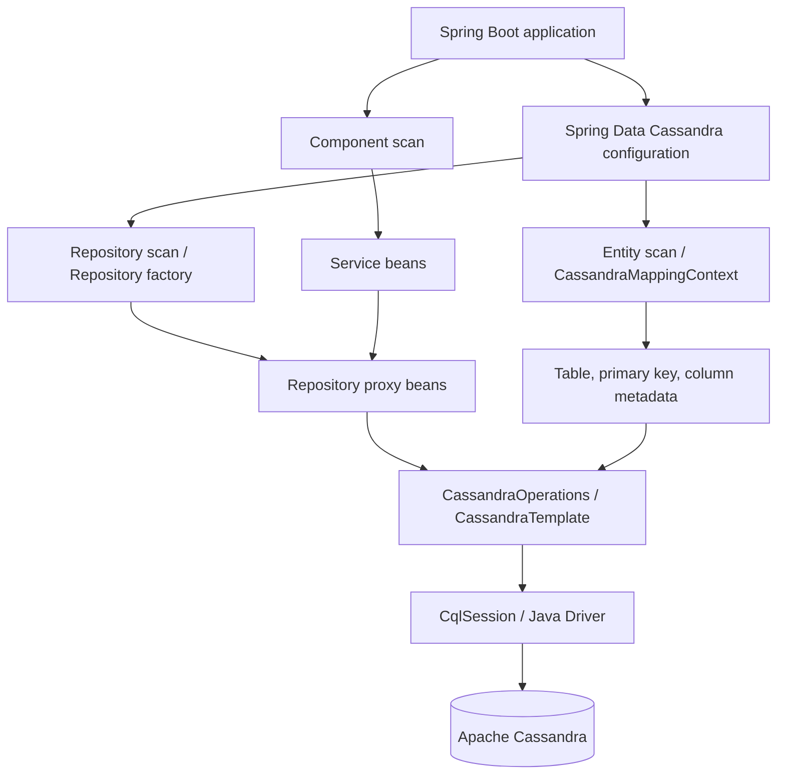

# Phạm vi quét entity và kích hoạt repository

Trong **Spring Data Cassandra**, cấu hình kết nối tới Apache Cassandra mới giải quyết được một nửa vấn đề: ứng dụng còn phải nhận diện đúng **entity** cần ánh xạ và **repository** cần tạo thành Spring bean. Khi mã nguồn được chia thành nhiều package hoặc module, kết nối có thể hoạt động bình thường nhưng service vẫn báo không tìm thấy repository, hoặc các entity không nằm trong phạm vi được cấu hình cho hệ thống ánh xạ.

Vì vậy, trước khi viết `@Repository`, `@EntityScan` hay `@EnableCassandraRepositories`, cần hiểu ba cơ chế khác nhau: quét Spring component, xác định phạm vi entity và kích hoạt Spring Data repository. Mục tiêu của bài học thuộc chương **Cấu hình kết nối** là cấu hình ba cơ chế này đúng phạm vi, nhận biết khi nào Spring Boot tự làm được và chẩn đoán chính xác khi ứng dụng không khởi tạo bean như mong muốn.

## 1. Ba phạm vi quét thường bị nhầm lẫn

| Cơ chế | Đối tượng được tìm | Thành phần điều khiển phổ biến | Kết quả |
| --- | --- | --- | --- |
| **Component scan** | Class mang `@Component`, `@Service`, `@Configuration` và các stereotype Spring phù hợp | `@SpringBootApplication` / `@ComponentScan` | Tạo bean Spring thông thường, ví dụ `AuditService` |
| **Entity scan** | Kiểu dữ liệu ánh xạ Cassandra, thường mang `@Table`, cùng metadata của key và column | Quy ước package của Boot, `@EntityScan`, hoặc cấu hình mapping context | Xác định entity để `CassandraMappingContext` quản lý metadata |
| **Repository scan** | Interface Spring Data Cassandra repository | Auto-configuration của Boot hoặc `@EnableCassandraRepositories` | Đăng ký bean repository bằng Spring Data repository factory |

**Ba phạm vi không thay thế cho nhau.** Đặt `@Table` lên class không biến nó thành một Spring component để inject. Thêm `@Service` vào service không tự khiến Spring Data quét được repository nằm ngoài phạm vi tìm kiếm. Và việc quét được entity không tự đăng ký bean `CassandraRepository` tương ứng.



Sơ đồ cho thấy repository sử dụng cấu hình mapping và kết nối có sẵn để thực thi thao tác trên entity. Với truy vấn CQL đặc thù, service cũng có thể dùng `CassandraTemplate`, `CqlTemplate` hoặc `CqlSession`, nhưng các cách này không tự khắc phục lỗi quét package của một repository mà ứng dụng đang cần.

## 2. Trường hợp đơn giản: Spring Boot tự cấu hình

Trong ứng dụng dùng Spring Boot với dependency Spring Data Cassandra thích hợp, auto-configuration thường tạo các thành phần như `CqlSession`, `CassandraTemplate` và cấu hình repository khi các điều kiện cần thiết được đáp ứng. Nếu đặt class khởi động ở **package gốc chung**, dự án thông thường không cần thêm `@EntityScan` và `@EnableCassandraRepositories` chỉ để truy cập entity/repository cùng cây package.

Ví dụ:

```text
com.example.audit
├── AuditApplication.java
├── service
│   └── AuditService.java
└── cassandra
    ├── model
    │   └── AuditEvent.java
    └── repository
        └── AuditEventRepository.java
```

```java
package com.example.audit;

import org.springframework.boot.SpringApplication;
import org.springframework.boot.autoconfigure.SpringBootApplication;

@SpringBootApplication
public class AuditApplication {
    public static void main(String[] args) {
        SpringApplication.run(AuditApplication.class, args);
    }
}
```

Với cấu trúc này, các package con như `com.example.audit.service` thuộc phạm vi component scan mặc định. Spring Boot còn biết **auto-configuration base package**, nhờ đó cấu hình dữ liệu tự động có thể xác định nơi tìm repository và entity.

Một ví dụ cấu hình kết nối cho **Spring Boot 3.x**:

```yaml
spring:
  cassandra:
    contact-points: 127.0.0.1
    port: 9042
    local-datacenter: datacenter1
    keyspace-name: audit
```

Đây là giá trị minh họa: keyspace `audit` phải tồn tại, `local-datacenter` phải khớp data center của cluster, và địa chỉ/tài khoản phải phù hợp môi trường triển khai. Những phiên bản Spring Boot cũ hơn có thể dùng nhóm property `spring.data.cassandra.*`; luôn đối chiếu với **phiên bản thực tế** của dự án. Kết nối đúng chỉ là điều kiện cần: ứng dụng còn phải đăng ký được đúng mapping và repository.

**Không phải cứ dùng Spring Boot là bắt buộc tự thêm `@EnableCassandraRepositories`.** Nếu repository đã được Boot tự phát hiện, khai báo thủ công mà không có nhu cầu rõ ràng có thể làm cấu hình phức tạp hơn. Khi package nằm ngoài phạm vi mặc định hoặc dùng cấu hình riêng, khai báo tường minh mới có ích.

## 3. Phân biệt entity với Spring bean

Giả sử hệ thống đọc sự kiện theo ID. Bảng Cassandra minh họa:

```sql
CREATE TABLE audit_events_by_id (
    event_id   uuid PRIMARY KEY,
    tenant_id  text,
    event_type text
);
```

Entity tương ứng:

```java
package com.example.audit.cassandra.model;

import java.util.UUID;
import org.springframework.data.cassandra.core.mapping.Column;
import org.springframework.data.cassandra.core.mapping.PrimaryKey;
import org.springframework.data.cassandra.core.mapping.Table;

@Table("audit_events_by_id")
public class AuditEvent {
    @PrimaryKey("event_id")
    private UUID eventId;

    @Column("tenant_id")
    private String tenantId;

    @Column("event_type")
    private String eventType;

    public AuditEvent() {}

    public AuditEvent(UUID eventId, String tenantId, String eventType) {
        this.eventId = eventId;
        this.tenantId = tenantId;
        this.eventType = eventType;
    }

    public UUID getEventId() { return eventId; }
    public String getTenantId() { return tenantId; }
    public String getEventType() { return eventType; }
}
```

Đây là **đối tượng dữ liệu**, không phải một bean singleton để gọi `@Autowired AuditEvent`. `@Table`, `@PrimaryKey` và `@Column` cung cấp metadata cho Spring Data Cassandra ánh xạ hàng Cassandra với Java object.

Repository:

```java
package com.example.audit.cassandra.repository;

import java.util.UUID;
import com.example.audit.cassandra.model.AuditEvent;
import org.springframework.data.cassandra.repository.CassandraRepository;

public interface AuditEventRepository
        extends CassandraRepository<AuditEvent, UUID> {
}
```

`CassandraRepository<AuditEvent, UUID>` khai báo kiểu entity và kiểu ID đúng với `event_id uuid PRIMARY KEY`. Nếu package repository thuộc phạm vi kích hoạt, Spring Data tạo **proxy bean** thực hiện các thao tác như `save`, `findById` và `deleteById`. Không cần tự viết class `AuditEventRepositoryImpl` để có CRUD mặc định, và cũng không cần thêm `@Repository` vào interface này chỉ để factory phát hiện.

Service sử dụng repository thông qua constructor:

```java
package com.example.audit.service;

import java.util.Optional;
import java.util.UUID;
import com.example.audit.cassandra.model.AuditEvent;
import com.example.audit.cassandra.repository.AuditEventRepository;
import org.springframework.stereotype.Service;

@Service
public class AuditService {
    private final AuditEventRepository repository;

    public AuditService(AuditEventRepository repository) {
        this.repository = repository;
    }

    public Optional<AuditEvent> findById(UUID eventId) {
        return repository.findById(eventId);
    }
}
```

Ví dụ dùng partition key là `event_id` để tập trung vào cấu hình quét. Trong hệ thống đa tenant, service còn phải kiểm tra quyền truy cập, hoặc dùng một bảng có khóa gồm tenant phù hợp với query contract. Entity scan và repository activation **không thay thế** việc thiết kế partition key, consistency hay paging đúng với Apache Cassandra.

## 4. Khi entity và repository ở ngoài package gốc

Đây là tình huống thường gặp khi tách code dùng chung thành một module:

```text
com.example.audit
├── AuditApplication.java
└── service
    └── AuditService.java

com.example.shared.cassandra
├── model
│   └── AuditEvent.java
└── repository
    └── AuditEventRepository.java
```

`AuditApplication` nằm ở `com.example.audit`; trong khi entity và repository nằm ở `com.example.shared.cassandra`, là **package anh em** chứ không phải package con của `com.example.audit`. Vì vậy không nên mặc định rằng các component và repository bên ngoài sẽ được tìm thấy.

Một cách cấu hình tường minh với Spring Boot:

```java
package com.example.audit;

import com.example.shared.cassandra.model.AuditEvent;
import com.example.shared.cassandra.repository.AuditEventRepository;
import org.springframework.boot.SpringApplication;
import org.springframework.boot.autoconfigure.SpringBootApplication;
import org.springframework.boot.autoconfigure.domain.EntityScan;
import org.springframework.data.cassandra.repository.config.EnableCassandraRepositories;

@SpringBootApplication
@EntityScan(basePackageClasses = AuditEvent.class)
@EnableCassandraRepositories(
        basePackageClasses = AuditEventRepository.class)
public class AuditApplication {
    public static void main(String[] args) {
        SpringApplication.run(AuditApplication.class, args);
    }
}
```

Hai annotation giải quyết hai phạm vi độc lập:

- **`@EntityScan(basePackageClasses = AuditEvent.class)`** chỉ ra package chứa entity để cơ chế cấu hình ánh xạ dữ liệu của Boot tìm đến. Nó không tự tạo một instance `AuditEvent` dưới dạng Spring bean.
- **`@EnableCassandraRepositories(basePackageClasses = AuditEventRepository.class)`** hướng repository factory quét package chứa interface và các package con. Nó tạo bean cho repository phù hợp.

`basePackageClasses` sử dụng **class làm mốc package**, nên khi refactor đổi tên package, IDE và compiler có thể giúp phát hiện vị trí tham chiếu cần cập nhật. Đây thường là lựa chọn ít lỗi hơn chuỗi ký tự trong `basePackages`.

Đặc biệt, chú ý rằng ví dụ đổi package của `AuditEvent` và `AuditEventRepository` so với mục 3. Nếu sao chép ví dụ vào dự án, cần cập nhật `package` trong chính các file đó để khớp sơ đồ package mới. Cấu hình này giả định `AuditService` vẫn nằm trong cây `com.example.audit` và tiếp tục được component scan mặc định tìm thấy.

### Nếu có nhiều package entity hoặc repository

Có thể khai báo nhiều class mốc:

```java
@EntityScan(basePackageClasses = {
        AuditEvent.class,
        ReportingEntity.class
})
@EnableCassandraRepositories(basePackageClasses = {
        AuditEventRepository.class,
        ReportingRepository.class
})
```

Trong đó `ReportingEntity` và `ReportingRepository` là các class/interface minh họa nằm ở package khác. Khi dùng nhiều module, có thể tạo **marker class/interface** riêng trong từng package để phạm vi được diễn đạt ổn định hơn, thay vì gắn vào một entity dễ bị xóa.

Cũng có thể dùng chuỗi:

```java
@EntityScan(basePackages = "com.example.shared.cassandra.model")
@EnableCassandraRepositories(
        basePackages = "com.example.shared.cassandra.repository")
```

Chuỗi package thuận tiện khi cấu hình từ quy ước kiến trúc, nhưng compiler không xác nhận package viết đúng. Quét quá rộng từ một package cha chung có thể kéo vào repository của module khác, dẫn tới khởi tạo bean không mong muốn.

## 5. Khi nào cần `@ComponentScan`?

Trong ví dụ ở trên, `AuditService` vẫn thuộc `com.example.audit.service` nên không cần chỉnh component scan. Nếu một `@Service` hoặc `@Configuration` cũng được đặt ở `com.example.shared.service`, việc cấu hình entity và repository **không làm service đó xuất hiện**.

Khi thực sự cần, có thể mở rộng component scan:

```java
@SpringBootApplication(scanBasePackages = {
        "com.example.audit",
        "com.example.shared.service"
})
```

Tuy nhiên, thuộc tính `scanBasePackages` của `@SpringBootApplication` điều chỉnh **component scan**, không phải lối thay thế đáng tin cậy cho `@EntityScan` hay `@EnableCassandraRepositories`. Hãy cấu hình đúng cơ chế theo loại bean cần tìm.

Không nên thêm `@Component` vào entity để “sửa” lỗi mapping. Mỗi bản ghi được ánh xạ thành object dữ liệu riêng, trong khi Spring component thường có vòng đời của bean do container quản lý.

## 6. Quan hệ với `CassandraMappingContext`, template và kết nối

Các tầng Spring Data Cassandra hoạt động theo luồng khái quát:

1. **Cấu hình kết nối** tạo hoặc cung cấp `CqlSession` qua Java Driver để liên hệ cluster.
2. **Cấu hình mapping** khởi tạo `CassandraMappingContext` và converter với metadata entity, primary key, column và type conversion.
3. **`CassandraTemplate`** cung cấp các thao tác ánh xạ entity và CQL qua `CassandraOperations`.
4. **Repository factory** dùng các thành phần phù hợp để tạo proxy cho interface `CassandraRepository`.
5. **Service bean** inject repository và gọi use case.

Điểm cần hiểu: phạm vi entity scan thường xác định **tập entity khởi tạo/được nhận diện trước** cho mapping context. Spring Data có thể phát hiện và ánh xạ một số kiểu khi chúng được sử dụng qua template; vì vậy thiếu entity scan **không đồng nghĩa mọi thao tác mapping đều chắc chắn thất bại**. Tuy nhiên, cấu hình rõ ràng rất quan trọng với metadata được đăng ký từ đầu, schema initialization và các tích hợp phụ thuộc vào tập entity đã biết.

Ngược lại, nếu repository interface **không được repository scan tìm thấy**, ứng dụng sẽ không có bean repository tương ứng để inject, dù class `@Table` có thể được ánh xạ bằng template.

| Hiện tượng | Lỗi phạm vi có thể xảy ra | Bước kiểm tra đầu tiên |
| --- | --- | --- |
| Inject `AuditEventRepository` báo không có bean | Repository package ngoài phạm vi hoặc auto-configuration repository không hoạt động | `@EnableCassandraRepositories`, package của interface, dependency và điều kiện auto-config |
| Inject `AuditService` báo không có bean | Component scan bỏ qua package service | Vị trí `@SpringBootApplication`, `scanBasePackages`, annotation `@Service` |
| Repository đã có, nhưng mapping/schema không như mong đợi | Entity package hoặc annotation/khóa ánh xạ chưa đúng | `@EntityScan`, `@Table`, `@PrimaryKey`, converter và cấu hình schema |
| Repository tồn tại nhưng đọc/ghi lỗi kết nối | Cluster, session hoặc keyspace sai | Contact points, local datacenter, credentials, network, keyspace |
| Repository có bean nhưng CQL bị từ chối | Schema/partition key/access pattern không phù hợp | CQL thực tế, partition key, clustering columns, consistency |

Lỗi kết nối và lỗi quét package có thể xuất hiện cùng nhau, nhưng là **những nguyên nhân độc lập**. Một thao tác `findById` vẫn có thể thất bại sau khi Spring đã tạo đúng repository bean nếu cluster không truy cập được hoặc bảng không tồn tại.

## 7. Khác biệt giữa repository đồng bộ và reactive

Spring Data Cassandra có hai kiểu API:

- **Đồng bộ/imperative:** interface kế thừa `CassandraRepository<Entity, Id>` và có thể được kích hoạt bằng `@EnableCassandraRepositories`.
- **Reactive:** interface kế thừa `ReactiveCassandraRepository<Entity, Id>`, sử dụng `Mono`/`Flux` và có thể được kích hoạt bằng `@EnableReactiveCassandraRepositories`.

Ví dụ repository reactive:

```java
import java.util.UUID;
import org.springframework.data.cassandra.repository.ReactiveCassandraRepository;

public interface ReactiveAuditEventRepository
        extends ReactiveCassandraRepository<AuditEvent, UUID> {
}
```

Và cấu hình khi cần kích hoạt tường minh:

```java
import org.springframework.data.cassandra.repository.config
        .EnableReactiveCassandraRepositories;

@EnableReactiveCassandraRepositories(
        basePackageClasses = ReactiveAuditEventRepository.class)
```

Đoạn cấu hình thứ hai minh họa annotation đặt trên **class `@Configuration` hoặc class ứng dụng**, không phải chú thích trực tiếp trên interface repository. Khi sử dụng reactive, cần đủ cấu hình template/operations reactive và các dependency tương ứng. Không nhầm `@EnableCassandraRepositories` với `@EnableReactiveCassandraRepositories`: chúng kích hoạt các factory phục vụ hai kiểu repository khác nhau.

Để tránh khởi tạo nhầm trong một dự án có cả hai kiểu, hãy quy hoạch package repository rõ ràng và kiểm tra chế độ auto-configuration của **phiên bản Spring Boot đang dùng**. Chỉ thêm chế độ reactive khi use case và chuỗi xử lý thực sự được thiết kế theo mô hình reactive.

## 8. Tự cấu hình Spring Data Cassandra không qua Boot

Trong dự án Spring Framework không dùng Boot auto-configuration, một cấu hình kế thừa `AbstractCassandraConfiguration` có thể định nghĩa keyspace, kết nối và phạm vi entity. Ví dụ **phần phương thức cấu hình entity** trong một class như vậy:

```java
@Override
public String[] getEntityBasePackages() {
    return new String[] {
        "com.example.shared.cassandra.model"
    };
}
```

Kết hợp với một `@Configuration` chứa:

```java
@EnableCassandraRepositories(
        basePackages = "com.example.shared.cassandra.repository")
```

Ở đây cần cung cấp thêm cấu hình session/keyspace và các bean hạ tầng theo phiên bản Spring Data, chứ hai đoạn code không đủ để tạo một ứng dụng chạy độc lập. Khi dùng Spring Boot, ưu tiên sử dụng auto-configuration hiện có và chỉ tự khai báo cấu hình khi cần chủ động kiểm soát những thành phần đó.

**Đừng nhầm `getEntityBasePackages()` với package repository.** Phương thức của `AbstractCassandraConfiguration` liên quan đến entity mapping; `@EnableCassandraRepositories` liên quan đến việc đăng ký repository proxy.

## 9. Nhiều module dữ liệu trong cùng một ứng dụng

Một ứng dụng có thể dùng Cassandra cùng JPA, MongoDB hoặc các module Spring Data khác. Khi nhiều repository factory tồn tại, việc phân biệt store và phạm vi interface càng quan trọng.

Ví dụ tổ chức package có chủ đích:

```text
com.example.persistence
├── cassandra
│   ├── model
│   └── repository
└── jpa
    ├── entity
    └── repository
```

Các lưu ý:

1. Dùng đúng loại interface, ví dụ `CassandraRepository` cho Cassandra, `JpaRepository` cho JPA. Annotation `@Table` của Cassandra là `org.springframework.data.cassandra.core.mapping.Table`, khác hệ annotation của JPA.
2. Giới hạn `@EnableCassandraRepositories` vào package Cassandra; nếu có JPA, cấu hình repository scan của JPA vào package tương ứng. Tránh quét chung một package lớn khi không có lý do.
3. `@EntityScan` của Spring Boot có thể ảnh hưởng phạm vi entity của nhiều Spring Data store được Boot hỗ trợ. Khi ứng dụng có nhiều store, cần kiểm tra phạm vi entity cho **tất cả store liên quan** thay vì thêm một `@EntityScan` chỉ trỏ vào Cassandra rồi giả định các store khác không đổi.
4. Nếu dùng nhiều kết nối/keyspace Cassandra và nhiều template, cần quyết định repository nào sử dụng bộ `CassandraOperations` nào theo cấu hình. **Quét được interface chỉ là bước đăng ký bean**; nó không tự xác định mọi repository dùng đúng cluster/keyspace.
5. Mở rộng phạm vi quét có thể làm xuất hiện bean trùng tên hoặc nạp những repository không mong muốn. Ưu tiên phạm vi rõ ràng và kiểm tra lỗi khởi động thay vì chỉ mở rộng package cho đến khi hết lỗi.

## 10. Chẩn đoán khi khởi động

Khi service báo thiếu bean repository, hãy kiểm tra theo một thứ tự có thể xác nhận:

### Bước 1: Repository có thực sự được đăng ký?

```java
import org.springframework.context.ApplicationContext;

// context được Spring cung cấp tại thời điểm ứng dụng khởi động.
boolean registered =
        context.getBeansOfType(AuditEventRepository.class).size() > 0;
```

Đây là phép kiểm tra bean trong `ApplicationContext`, **không kiểm tra được cluster đang truy vấn thành công**. Với một repository cấu hình hợp lệ, kết quả thường là `true`. Nếu `false`, xem lại package, dependency, kiểu repository và điều kiện tự cấu hình.

Có thể dùng một bài integration test có Spring context, ví dụ `@SpringBootTest`, để xác nhận Spring inject được repository; bài test này cần môi trường Cassandra phù hợp hoặc Cassandra thử nghiệm nếu việc khởi tạo session yêu cầu kết nối thật. Không cần viết một test chỉ phản chiếu `@EntityScan`; hãy kiểm tra luồng có ý nghĩa: tạo context, tìm được bean và đọc/ghi thử trên schema đúng.

### Bước 2: Kiểm tra package gốc và vị trí annotation

- Class có `@SpringBootApplication` nằm ở package nào?
- Interface repository có nằm dưới package đó hoặc package được `@EnableCassandraRepositories` chỉ định không?
- Entity có đúng `@Table`, `@PrimaryKey` và package được cấu hình không?
- `@EnableCassandraRepositories` có đặt trên **class cấu hình thực sự được nạp** không? Annotation đặt trên một class không được Spring đưa vào context cũng không có tác dụng.
- Nếu dùng class mốc `basePackageClasses`, class đó đã chuyển package khi refactor chưa?

### Bước 3: Phân biệt lỗi đăng ký bean với lỗi chạy CQL

| Thời điểm và triệu chứng | Nhóm nguyên nhân thường gặp | Cách xử lý hướng tới |
| --- | --- | --- |
| Startup: không có bean `AuditEventRepository` để inject | Sai phạm vi repository scan, thiếu dependency/auto-config | Kiểm tra `@EnableCassandraRepositories` hoặc cấu trúc package Boot |
| Startup: không có bean service | Component scan hoặc cấu hình service chưa được nạp | Kiểm tra `@SpringBootApplication`, `@Service`, `@Import` |
| Startup: trùng bean repository | Trùng vùng quét hoặc cấu hình tự động/thủ công chồng lấn | Thu hẹp phạm vi, xác định một nơi chịu trách nhiệm |
| Mapping: không tìm được ID hoặc cột ánh xạ sai | Entity annotation và kiểu khóa không khớp CQL | Kiểm tra mapping, converter, schema Cassandra |
| Runtime: không kết nối được node | `CqlSession`, data center, network, authentication | Kiểm tra cấu hình kết nối và cluster |
| Runtime: truy vấn yêu cầu partition key khác | Thiết kế bảng và CQL không phù hợp | Sửa query contract/khóa, không tăng phạm vi scan |

**Không dùng cách sửa “thêm `@ComponentScan` quét toàn bộ `com.example`” cho mọi loại lỗi.** Cách đó có thể nạp thêm service/configuration nhưng vẫn không tạo đúng repository factory, thậm chí làm xuất hiện nhiều bean không mong muốn.

## 11. Checklist cấu hình trước khi triển khai

1. **Có đường kết nối rõ ràng:** Boot starter/dependency, `CqlSession`, keyspace và data center phù hợp môi trường.
2. **Phân loại đúng các package:** đâu là service/configuration, đâu là entity `@Table`, đâu là repository interface.
3. **Dùng mặc định khi đủ:** nếu tất cả nằm trong package gốc của Boot và auto-configuration hoạt động, không cần thêm annotation quét một cách máy móc.
4. **Mở rộng đúng phạm vi khi cần:** `@EntityScan` cho entity, `@EnableCassandraRepositories` cho repository, `@ComponentScan` cho component.
5. **Ưu tiên class mốc:** `basePackageClasses` thường an toàn hơn chuỗi `basePackages` khi refactor.
6. **Xác định imperative hay reactive:** loại repository, annotation kích hoạt và operations phải tương ứng.
7. **Với nhiều store hoặc nhiều keyspace:** tách package, factory và template để tránh gắn nhầm.
8. **Kiểm tra context và truy vấn thật:** có repository bean, mapping đúng schema, câu CQL phù hợp partition key, phân trang và consistency.
9. **Theo dõi lỗi khởi động:** log liên quan đến repository discovery, mapping context và session giúp phân biệt lỗi sớm.

## 12. Bài tập tự kiểm tra

**Tình huống A.** `AuditApplication` ở `com.acme.app`, `AuditService` ở `com.acme.app.service`, `AuditEvent` ở `com.acme.data.model` và `AuditEventRepository` ở `com.acme.data.repo`. Service không inject được repository. Cần kiểm tra annotation nào?

**Gợi ý:** `AuditService` đã thuộc component scan mặc định. Hãy kiểm tra repository discovery và thêm `@EnableCassandraRepositories(basePackageClasses = AuditEventRepository.class)` nếu đang tự cấu hình ngoài vùng quét. Đồng thời xem lại entity scan qua `@EntityScan(basePackageClasses = AuditEvent.class)`, đúng dependency và điều kiện auto-configuration.

**Tình huống B.** Một class `@Table` không inject được bằng `@Autowired`, nhưng service cần tạo một sự kiện mới để lưu. Có nên thêm `@Component` vào entity?

**Gợi ý:** Không. Tạo object dữ liệu bằng constructor, rồi gọi repository `save`. `@Table` cung cấp metadata ánh xạ, không khai báo singleton bean.

**Tình huống C.** Repository đã xuất hiện trong context nhưng `findByActorId(...)` không hoạt động vì truy vấn không có partition key phù hợp. Mở rộng `@EntityScan` có giải quyết được không?

**Gợi ý:** Không. Đã qua bước tạo bean; cần điều chỉnh schema hoặc access pattern để truy vấn CQL hợp lệ và hiệu quả trên Cassandra.

## Kết luận

Trong Spring Data Cassandra, **phạm vi quét entity** xác định metadata dữ liệu, còn **kích hoạt repository** đăng ký các proxy bean để service truy cập dữ liệu. Spring Boot có thể thực hiện phần lớn công việc theo quy ước package, nhưng khi tách module hoặc dùng nhiều store cần khai báo phạm vi rõ ràng bằng `@EntityScan`, `@EnableCassandraRepositories` và khi cần, `@ComponentScan`.

Hãy kiểm tra theo thứ tự **package và bean → mapping → kết nối → CQL/partition key**. Nhờ vậy, khi ứng dụng gặp lỗi, bạn sẽ biết vấn đề nằm ở việc Spring chưa tìm thấy component, chưa tạo repository hay Cassandra đang từ chối chính câu truy vấn; mỗi nguyên nhân cần một cách sửa khác nhau.
