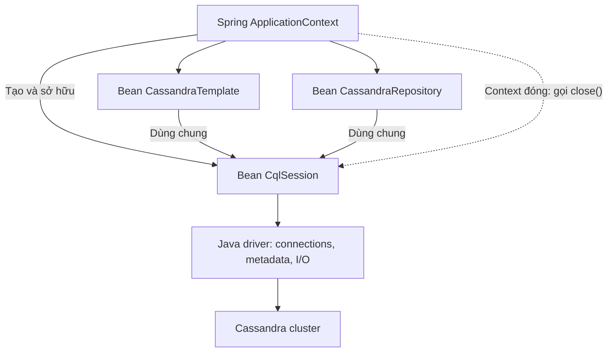
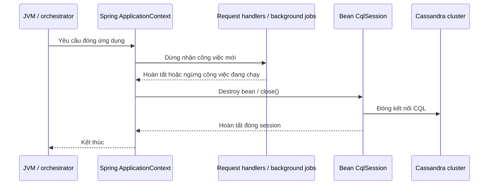

# Đóng session theo vòng đời Spring ApplicationContext

Trong ứng dụng **Spring Data Cassandra**, `CqlSession` là đối tượng trung tâm kết nối tới Apache Cassandra. `CassandraRepository`, `CassandraTemplate` và các truy vấn CQL phía dưới dùng session này để gửi yêu cầu tới cluster. Khi ứng dụng khởi động, session phải được tạo **trước khi** các thao tác dữ liệu bắt đầu; khi ứng dụng dừng, session cần được đóng **sau khi** những thành phần đang dùng nó đã ngừng công việc.

Bài học thuộc chương **Cấu hình kết nối** giải thích cách gắn vòng đời của `CqlSession` với **Spring `ApplicationContext`**: để Spring tạo bean, quản lý quyền sở hữu, gọi thao tác đóng phù hợp và tránh rò rỉ connection/thread. Các ví dụ dành cho Spring Boot 3.x, Spring Data Cassandra hiện đại và Java driver 4.x; nếu phiên bản dự án khác, cần đối chiếu API và tên cấu hình tương ứng.

## 1. Vì sao `CqlSession` cần được quản lý theo vòng đời ứng dụng?

`CqlSession` của Java driver không đơn thuần là một socket TCP. Nó quản lý những tài nguyên có vòng đời dài, chẳng hạn kết nối CQL tới các node phù hợp, metadata về topology/schema, cơ chế cân bằng tải, request handling và tài nguyên thực thi nội bộ của driver.

- Việc tạo session có chi phí kết nối và khởi tạo; **không nên tạo session mới cho mỗi HTTP request hay mỗi truy vấn**.
- Session được thiết kế để sử dụng đồng thời từ nhiều luồng, nên một session được quản lý chung thường phù hợp cho một ứng dụng kết nối tới cùng một cluster/keyspace mặc định.
- Khi ngừng ứng dụng, phải giải phóng tài nguyên của session thay vì chỉ bỏ tham chiếu Java rồi chờ garbage collector.
- Dù connection pool do driver quản lý, **vòng đời session vẫn do phía ứng dụng/Spring sở hữu**, không do từng repository sở hữu.

Ví dụ luồng sử dụng:



Các mũi tên “dùng chung” mô tả quan hệ logic; trong thực tế repository thường đi qua các thành phần Spring Data trung gian. Điểm quan trọng là **đóng một session có thể ảnh hưởng đến mọi đối tượng còn đang sử dụng session đó**.

## 2. Những trạng thái vòng đời của session

Khi Spring điều phối startup và shutdown thông thường:

| Giai đoạn | Spring/ApplicationContext | `CqlSession` | Điều ứng dụng cần làm |
| --- | --- | --- | --- |
| Khởi tạo | Đăng ký và tạo bean theo dependency | Driver mở session, khám phá kết nối/topology | Cấu hình contact points, local DC, authentication, TLS phù hợp. |
| Hoạt động | Các bean service/repository phục vụ yêu cầu | Session còn mở, dùng chung cho nhiều thao tác | Không tự đóng trong hàm nghiệp vụ. |
| Bắt đầu dừng | Context nhận yêu cầu đóng | Session vẫn cần phục vụ công việc đang hoàn tất | Ngừng nhận việc mới, chờ tác vụ đang xử lý theo giới hạn shutdown. |
| Hủy bean | Spring hủy các singleton do mình quản lý | Gọi phương thức destroy/`close()` của session | Bảo đảm session có một chủ sở hữu rõ ràng. |
| Kết thúc | Context đã đóng | Kết nối và tài nguyên driver đã được giải phóng theo quá trình close | Không tiếp tục dùng repository/template của context cũ. |

Thứ tự tổng quan:



Sơ đồ này là mục tiêu vận hành, không phải cam kết rằng Spring tự hiểu mọi luồng do ứng dụng tự tạo. Với background job, thread, scheduler hoặc callback bất đồng bộ, lập trình viên phải bảo đảm chúng dừng phù hợp trước khi session bị hủy.

## 3. Cách khuyến nghị: để Spring Boot quản lý `CqlSession`

Nếu dự án dùng Spring Boot có Spring Data Cassandra starter và không định nghĩa session riêng, **auto-configuration** sẽ tạo các bean kết nối phù hợp với cấu hình Cassandra. Spring sở hữu bean session trong `ApplicationContext` và quản lý việc hủy bean khi context đóng.

Ví dụ `application.yml`:

```yaml
spring:
  cassandra:
    contact-points: cassandra-1.internal:9042,cassandra-2.internal:9042
    local-datacenter: dc1
    keyspace-name: commerce
    username: ${CASSANDRA_APP_USERNAME}
    password: ${CASSANDRA_APP_PASSWORD}
```

Các địa chỉ, tên DC, keyspace và biến môi trường chỉ là ví dụ. Cluster cần được cấu hình mạng, authentication và TLS đúng với môi trường triển khai. Những credentials này được cung cấp an toàn tại runtime; **không commit mật khẩu thật** vào repository.

Ở cấu hình tiêu chuẩn:

1. Spring Boot đọc các thuộc tính `spring.cassandra.*`.
2. Auto-configuration khởi tạo `CqlSession` phù hợp.
3. Hạ tầng Spring Data Cassandra tạo các thành phần như template/repository sử dụng session.
4. Khi đóng context, Spring xử lý lifecycle của các bean do mình tạo, bao gồm việc đóng session.
5. Một lần truy vấn không cần và không nên gọi `session.close()`.

Ví dụ service chỉ dùng repository:

```java
import java.util.UUID;
import org.springframework.stereotype.Service;

@Service
public class CustomerQueryService {
    private final CustomerRepository customers;

    public CustomerQueryService(CustomerRepository customers) {
        this.customers = customers;
    }

    public Customer findById(UUID customerId) {
        return customers.findById(customerId).orElse(null);
    }
}
```

Ví dụ giả định `CustomerRepository` là repository hợp lệ và `Customer` đã được ánh xạ đúng theo schema. Service **không tự tạo hoặc tự đóng session**; Spring Data sử dụng session do context quản lý.

### Vì sao không đặt `close()` trong service?

Xét đoạn mã **sai về quyền sở hữu**:

```java
// Ví dụ phản diện: KHÔNG làm như sau trong mỗi request.
public Customer load(UUID id) {
    try {
        return repository.findById(id).orElse(null);
    } finally {
        cqlSession.close(); // Đóng tài nguyên dùng chung của cả ứng dụng!
    }
}
```

Đóng session ở cuối một request có thể khiến các request đồng thời hoặc tiếp theo không còn kết nối để thực thi CQL. Hành vi truy vấn khi session đã đóng sẽ thất bại; thông báo cụ thể phụ thuộc driver và code path.

Quy tắc: **thành phần tạo/sở hữu session chịu trách nhiệm đóng nó**. Repository, service hay controller chỉ “mượn” session của Spring để làm việc.

## 4. Khi tự tạo session: khai báo rõ phương thức hủy bean

Có những dự án cần cấu hình driver đặc biệt, hoặc không dùng auto-configuration. Khi tự tạo `CqlSession`, hãy đăng ký nó làm **Spring bean có lifecycle xác định**.

Ví dụ Java configuration:

```java
import java.net.InetSocketAddress;

import com.datastax.oss.driver.api.core.CqlIdentifier;
import com.datastax.oss.driver.api.core.CqlSession;
import org.springframework.context.annotation.Bean;
import org.springframework.context.annotation.Configuration;

@Configuration(proxyBeanMethods = false)
public class CassandraSessionConfiguration {

    @Bean(destroyMethod = "close")
    public CqlSession cqlSession() {
        return CqlSession.builder()
            .addContactPoint(new InetSocketAddress("127.0.0.1", 9042))
            .withLocalDatacenter("dc1")
            .withKeyspace(CqlIdentifier.fromCql("commerce"))
            .build();
    }
}
```

**Đọc ví dụ:**

- `CqlSession.builder().build()` tạo session dùng chung và có thể sử dụng từ nhiều repository/template.
- `@Bean` đưa session vào phạm vi quản lý của `ApplicationContext`.
- `destroyMethod = "close"` chỉ định Spring gọi `close()` khi hủy bean singleton này.
- Contact point `127.0.0.1` và tên `dc1` là ví dụ local; dự án thực tế phải dùng thông tin topology hợp lệ.
- Nếu bật xác thực/TLS, builder phải được cấu hình credential/trust material phù hợp (hoặc đọc driver configuration tương ứng).

Spring có cơ chế suy luận destroy method đối với các kiểu tài nguyên phù hợp (chẳng hạn `close`), nhưng khai báo `destroyMethod = "close"` làm **quyền sở hữu và hành vi shutdown minh bạch** khi viết cấu hình thủ công.

Nếu đã để Spring Boot tạo session, **không thêm một `@Bean CqlSession` thứ hai chỉ để đóng**. Việc thay thế auto-configuration bằng session tùy chỉnh phải là quyết định có chủ đích; tùy cách khởi tạo, thêm bean tùy chỉnh có thể khiến auto-configuration lùi lại (*back off*).

### Trường hợp dùng `AbstractCassandraConfiguration` hoặc `CqlSessionFactoryBean`

Spring Data Cassandra cũng có các cấu hình dựa trên `AbstractCassandraConfiguration` và factory bean cho session. Khi dùng những đường cấu hình này, cần xác định bean/factory nào đang **sở hữu session** và đã đăng ký lifecycle hủy ra sao theo phiên bản Spring Data. Đừng tạo một session trong custom factory rồi đóng thêm lần nữa ở nhiều `@PreDestroy` khác nhau.

Không nên trộn các cách tạo session nếu không cần thiết:

| Cách khởi tạo | Chủ sở hữu session | Việc đóng |
| --- | --- | --- |
| Spring Boot auto-configuration | Context qua bean do Boot tạo | Để cơ chế lifecycle của Boot/Spring xử lý. |
| `@Bean(destroyMethod = "close")` trả về session tự xây | Context qua bean tự định nghĩa | Spring gọi `close()` khi hủy bean. |
| Factory bean Spring Data quản lý session | Factory/bean lifecycle của Spring Data | Theo cơ chế hủy đã được factory tích hợp; không đóng thủ công từ mỗi service. |
| `CqlSession.builder().build()` bên ngoài Spring | Code đã tạo session | Chính code đó phải gọi `close()` khi kết thúc; tránh để resource sống vô thời hạn. |

## 5. `close()` và `closeAsync()` khác nhau thế nào?

Java driver cung cấp phương thức đóng đồng bộ và cơ chế đóng bất đồng bộ:

- `session.close()`: yêu cầu đóng session và chờ quá trình đóng hoàn tất theo contract của driver. Đây là cách dễ tích hợp vào destroy method đồng bộ của Spring.
- `session.closeAsync()`: khởi tạo quá trình đóng theo API bất đồng bộ, trả về kết quả có thể theo dõi (ví dụ `CompletionStage` ở Java driver 4.x). Code quản lý vòng đời cần chờ hoặc theo dõi hoàn tất trước khi tuyên bố shutdown đã xong.

Ví dụ nếu **chính code của bạn là chủ sở hữu session bên ngoài Spring**:

```java
CqlSession session = CqlSession.builder()
    .addContactPoint(new InetSocketAddress("127.0.0.1", 9042))
    .withLocalDatacenter("dc1")
    .build();

try {
    // Sử dụng session để thực thi CQL trong một công cụ chạy ngắn.
    session.execute("SELECT keyspace_name FROM system_schema.keyspaces");
} finally {
    session.close();
}
```

Đoạn mã trên dùng biến `session` tồn tại trong scope của công cụ/batch ngắn và chính scope đó chịu trách nhiệm đóng. Nó **không** phải mẫu áp dụng cho từng request trong ứng dụng web dùng session singleton.

Nếu muốn dùng `closeAsync()` để kiểm soát shutdown phức tạp, hãy xử lý hoàn tất/timeout một cách có chủ đích. **Không gọi `closeAsync()` rồi thoát JVM ngay và mặc định cho rằng mọi tài nguyên đã đóng xong.**

## 6. Thứ tự shutdown: dừng tác vụ trước, đóng session sau

Một ứng dụng vừa nhận HTTP request, vừa có scheduled job/consumer xử lý Cassandra thường cần quy trình dừng:

1. **Ngừng nhận công việc mới:** đóng luồng nhận request/queue consumer hoặc đặt cờ không nhận thêm task.
2. **Chờ công việc đang chạy:** để những CQL write/read quan trọng hoàn tất trong thời hạn cho phép; quyết định retry/recovery nếu hết hạn.
3. **Dừng producer/worker và giải phóng tài nguyên của chúng:** scheduler, executor, listener, queue consumer.
4. **Đóng `CqlSession`:** Spring hủy bean session sau khi các thành phần đang phụ thuộc hoàn tất vòng đời của mình.
5. **Kết thúc tiến trình:** observability/log xác nhận shutdown đã hoàn tất.

Spring công bố sự kiện `ContextClosedEvent` khi context bắt đầu đóng, điều phối các bean tham gia `Lifecycle`/`SmartLifecycle` dừng theo pha và thực hiện hủy singleton sau đó. **`ContextClosedEvent` không có nghĩa session đã đóng**: những bean phụ thuộc vẫn có thể cần session trong giai đoạn dừng.

### Dùng `SmartLifecycle` cho tác vụ nền

Nếu ứng dụng có polling worker, scheduler tự quản hoặc consumer đang ghi Cassandra, có thể triển khai `SmartLifecycle`:

- `start()` bắt đầu nhận và xử lý dữ liệu khi ứng dụng sẵn sàng.
- `stop(Runnable callback)` ngừng nhận dữ liệu mới, chờ các tác vụ đang chạy đến điểm an toàn, rồi gọi `callback.run()` để báo đã dừng.
- `getPhase()` cho phép điều phối thứ tự dừng giữa nhiều nhóm thành phần (các phase lớn thường được dừng trước).
- Tránh giữ callback vô thời hạn; cần bounded shutdown, cancel/retry policy và theo dõi dữ liệu chưa xử lý.

Mẫu rút gọn cho **logic**, không phải hiện thực consumer hoàn chỉnh:

```text
stop(callback):
    stopTakingNewMessages()
    requestCurrentTasksToFinish()
    whenTasksDrainedOrDeadlineReached():
        releaseConsumerResources()
        callback.run()

Spring tiếp tục hủy bean:
    ... -> cqlSession.close()
```

Trong dự án dùng `TaskScheduler`, `Executor`, Kafka listener hoặc message listener framework, ưu tiên dùng lifecycle/shutdown tích hợp sẵn của framework thay vì viết lại cơ chế dừng.

### Cấu hình graceful shutdown của Spring Boot

Ví dụ với dịch vụ HTTP:

```yaml
server:
  shutdown: graceful

spring:
  lifecycle:
    timeout-per-shutdown-phase: 30s
```

Cấu hình này giúp Spring Boot dành thời gian cho các pha graceful shutdown, ví dụ hoàn tất những HTTP request đang xử lý. **Nó không bảo đảm mọi scheduled task hoặc async query tự hoàn thành**, và cũng không tự nâng thời hạn của bộ điều phối (Docker/Kubernetes/systemd). Timeout tổng thể cần phù hợp với `terminationGracePeriodSeconds` hoặc cơ chế stop của hệ triển khai.

### Quan hệ phụ thuộc giúp hủy theo thứ tự hợp lý

Spring thường hủy singleton theo quan hệ phụ thuộc đảo ngược: một bean phụ thuộc vào session sẽ được xử lý hủy **trước** bean session. Hãy thể hiện quan hệ qua constructor injection khi cần:

```java
import com.datastax.oss.driver.api.core.CqlSession;
import org.springframework.stereotype.Component;

@Component
public class CassandraHealthProbe {
    private final CqlSession session;

    public CassandraHealthProbe(CqlSession session) {
        this.session = session;
    }

    public boolean isSessionAvailable() {
        return !session.isClosed();
    }
}
```

`isClosed()` chỉ cho biết trạng thái đóng của session, **không chứng minh cluster khỏe hoặc truy vấn sẽ thành công**. Kiểm tra readiness đầy đủ cần một tín hiệu kết nối/truy vấn an toàn, có timeout và chi phí hợp lý.

Constructor injection thể hiện rõ dependency giữa `CassandraHealthProbe` và session. Để bảo đảm thứ tự dừng các tác vụ nền phức tạp, vẫn cần cơ chế lifecycle cụ thể, không chỉ dựa vào tham chiếu bean.

## 7. Điều gì xảy ra khi context đóng?

### Trường hợp A — Ứng dụng web Spring Boot bình thường

1. JVM nhận yêu cầu dừng hợp lệ, chẳng hạn `SIGTERM` từ hệ điều phối.
2. Shutdown hook của Spring đóng `ApplicationContext` theo cơ chế cấu hình.
3. Spring thực hiện graceful shutdown các thành phần đang phục vụ, dừng lifecycle beans, hủy singleton.
4. Bean `CqlSession` được đóng; driver giải phóng các kết nối và tài nguyên do session quản lý.

Trong trường hợp tiến trình bị buộc chết đột ngột (ví dụ `SIGKILL`, crash nặng, mất điện), shutdown hook **không được bảo đảm chạy**. Hệ điều hành sẽ thu hồi tài nguyên tiến trình, còn Cassandra xử lý kết nối bị ngắt theo cơ chế của server. Không đặt tính đúng đắn nghiệp vụ chỉ dựa vào callback shutdown chạy thành công.

### Trường hợp B — Batch/command-line application tạo context rồi kết thúc

Khi một ứng dụng chạy lệnh ngắn cần tự quyết định khi nào hoàn tất:

```java
import org.springframework.boot.WebApplicationType;
import org.springframework.boot.builder.SpringApplicationBuilder;
import org.springframework.context.ConfigurableApplicationContext;

public class BatchMain {

    public static void main(String[] args) {
        try (ConfigurableApplicationContext context =
                 new SpringApplicationBuilder(BatchApplication.class)
                     .web(WebApplicationType.NONE)
                     .run(args)) {

            context.getBean(OrderImportService.class).importOrders();
        } // context.close() tự chạy khi thoát try-with-resources.
    }
}
```

Ví dụ giả định các lớp `BatchApplication` và `OrderImportService` đã được định nghĩa; phương thức `importOrders()` phải đồng bộ hoặc tự chờ các tác vụ bất đồng bộ hoàn tất. Khi scope `try` kết thúc, context đóng và hủy session bean thuộc sở hữu của nó.

**Không áp dụng cùng mẫu `try-with-resources` quanh `SpringApplication.run(...)` trong `main` của server HTTP thông thường**, vì phương thức `main` sẽ đóng context quá sớm ngay sau khi khởi động.

### Trường hợp C — Test dùng Spring TestContext

Với `@SpringBootTest` hoặc kiểm thử tích hợp có Spring TestContext:

- Context có thể được **cache và tái sử dụng** giữa các test để tăng tốc.
- Test không nên gọi `CqlSession.close()` trên bean được inject, vì có thể làm hỏng các test khác dùng cùng context.
- Framework đóng context khi bị loại khỏi cache hoặc kết thúc vòng đời test tương ứng; `@DirtiesContext` đánh dấu context cần tạo lại, nhưng không nên lạm dụng chỉ để “dọn session” sau từng phương thức test.
- Nếu tự tạo context trong test bằng API thủ công, test phải đóng đúng context do mình tạo (ví dụ `try-with-resources`).

Trong một test cần đóng session để kiểm tra hành vi sau shutdown, nên dùng **context riêng** thay vì đóng bean trong context dùng chung.

## 8. Nhiều context hoặc nhiều cluster: ai là chủ sở hữu?

Không phải lúc nào cũng có một `CqlSession` duy nhất trong JVM. Một tiến trình có thể kết nối đến hai cluster khác nhau, hoặc triển khai parent/child `ApplicationContext`. Lúc này cần xác định rõ:

- Mỗi session thuộc bean/context nào?
- Bean nào dùng session nào? Có cấu hình `@Qualifier`/bean name rõ không?
- Có session nào được tạo **ngoài Spring** rồi đưa cùng instance vào nhiều context khác nhau không?
- Context nào được phép đóng session? Có code bên ngoài vẫn dùng session sau khi context đó đóng không?

Ví dụ một bean đã có chủ sở hữu lifecycle ở hệ thống bên ngoài được đăng ký vào Spring để sử dụng có thể cần **tắt destroy method của bean adapter**, nhưng chỉ khi vòng đời ngoài Spring thực sự đảm nhận `close()`. Với session do Spring sở hữu, giữ destroy method là lựa chọn chuẩn.

Bất kể số session, **tránh double ownership**: hai context hoặc hai thành phần cùng nghĩ mình có trách nhiệm đóng một instance có thể gây lỗi yêu cầu đang chạy. Gọi `close()` lần thứ hai có thể được driver xử lý an toàn trong một số trường hợp, nhưng thiết kế không nên phụ thuộc vào việc đóng trùng.

## 9. Lỗi thường gặp và cách xác minh

| Biểu hiện | Nguyên nhân khả dĩ | Cách kiểm tra |
| --- | --- | --- |
| Sau request đầu, mọi truy vấn Cassandra tiếp theo lỗi | Controller/service gọi `session.close()` sau mỗi request | Tìm chỗ tạo/đóng session; chuyển quyền sở hữu về Spring bean. |
| Ứng dụng đã dừng nhưng vẫn thấy tài nguyên driver còn sống | Session được tạo bằng `new`/`builder` ngoài Spring và không được đóng | Đăng ký làm managed bean hoặc đóng trong scope của chủ sở hữu thực sự. |
| Đang shutdown thì job cuối bị lỗi vì session đã đóng | Producer/scheduler vẫn gửi CQL sau thời điểm hủy session | Dừng nhận việc trước, await in-flight, dùng lifecycle có thứ tự. |
| Test A chạy được, test B lỗi “session closed” | Test A đóng bean của context được TestContext cache | Không đóng injected bean; dùng context riêng khi kiểm thử shutdown. |
| Startup chậm hoặc connection tăng bất thường | Tạo nhiều `CqlSession` cho từng repository/request | Chia sẻ session Spring singleton ở mức ứng dụng/cluster phù hợp. |
| Ứng dụng thoát ngay sau khi khởi động | Dùng `try-with-resources` cho `ApplicationContext` của web server trong `main` | Để Boot tự quản lý vòng đời server. |
| Shutdown bị timeout | Async task chưa hoàn tất, driver close đang chờ, hoặc shutdown grace quá ngắn | Đo thời gian dừng các thành phần; giới hạn in-flight, điều chỉnh deadline hợp lý. |
| Sau khi restart, một số tác vụ mất | Công việc nền bị ngắt trong lúc dừng | Thiết kế idempotency, checkpoint/ack, retry và xử lý lỗi ở tầng nghiệp vụ. |

### Checklist kiểm tra một môi trường trước khi đưa vào vận hành

1. **Bean ownership:** chỉ có các `CqlSession` cần thiết và mỗi session có một owner rõ ràng.
2. **Tạo bean:** dùng auto-configuration Spring Boot hoặc `@Bean`/factory được quản lý, tránh tạo session trong từng phương thức repository.
3. **Đóng bean:** có destroy method phù hợp; không tự gọi `close()` trong controller/service.
4. **Thứ tự dừng:** HTTP handlers, message consumers, schedulers và tác vụ bất đồng bộ ngừng trước khi session bị đóng.
5. **Môi trường:** contact points, local datacenter, authentication, TLS và keyspace được cấu hình đúng.
6. **Giới hạn shutdown:** timeout Spring phù hợp với timeout của orchestrator và ngân sách xử lý request đang chạy.
7. **Thử nghiệm:** khởi động dịch vụ, thực hiện truy vấn mẫu, gửi tín hiệu dừng hợp lệ, quan sát log/tài nguyên và xác minh dịch vụ kết thúc trong thời hạn.
8. **Độ bền nghiệp vụ:** công việc nền có chính sách retry/ack/checkpoint khi process bất ngờ kết thúc.

Các bước kiểm tra này là kiểm thử vận hành và tích hợp; không suy luận được chỉ từ việc bean có annotation đúng. Cassandra có replication, consistency và paging riêng: một session sống ổn định giúp các thao tác diễn ra nhưng **không thay thế** thiết kế partition key đúng hoặc cơ chế xử lý công việc có thể thử lại.

## 10. Bài tập tình huống

**Tình huống 1:** Một REST API dùng `CassandraRepository` để tra cứu dữ liệu. Nhóm lập trình gọi `session.close()` trong `finally` của phương thức controller nhằm “giải phóng kết nối sau khi trả lời”.

- Điều gì có thể xảy ra với request đồng thời và request tiếp theo?
- Ai mới là chủ sở hữu của session khi Spring Boot auto-configure nó?
- Cần sửa ở đâu?

**Tình huống 2:** Một service nhận message từ queue, ghi Cassandra bất đồng bộ và vừa nhận `SIGTERM` từ Kubernetes. Hệ thống đóng `ApplicationContext` trong khi callback ghi vẫn có thể chạy.

- Thành phần nào cần ngừng nhận message trước?
- Vì sao phải chờ công việc đang xử lý trước khi đóng `CqlSession`?
- Tại sao `spring.lifecycle.timeout-per-shutdown-phase` phải phù hợp với giới hạn dừng tiến trình bên ngoài?

**Tình huống 3:** Một nhóm viết batch app tạo `ConfigurableApplicationContext` để xử lý một lần rồi kết thúc. Họ muốn bảo đảm session được đóng kể cả khi xử lý ném exception.

- Có thể dùng cấu trúc Java nào để đóng context trong `finally` tự động?
- Vì sao pattern ấy phù hợp với batch nhưng không phù hợp nếu đặt tương tự quanh `SpringApplication.run(...)` của web server?

**Đáp án gợi ý:**

1. Repository dùng chung session sẽ lỗi khi session bị đóng sớm; Boot/Spring sở hữu session; loại bỏ `close()` khỏi controller và để Spring lifecycle xử lý.
2. Consumer dừng nhận việc mới, sau đó chờ/cancel an toàn các ghi đang chạy; session chỉ đóng sau khi chúng không còn cần kết nối. Giới hạn shutdown của bên ngoài phải đủ cho những pha dừng mong muốn, nếu không process có thể bị buộc kết thúc.
3. `try (ConfigurableApplicationContext context = ...) { ... }` giúp `close()` luôn chạy khi thoát scope bình thường hoặc do exception. Batch kết thúc sau khi làm xong, còn web server cần giữ context sống để phục vụ request.

**Ghi nhớ:** Trong ứng dụng Spring Data Cassandra, hãy tạo và sử dụng **`CqlSession` như tài nguyên dài hạn thuộc quyền sở hữu của Spring `ApplicationContext`**. Để Spring gọi `close()` khi dừng, chủ động kết thúc HTTP/background work trước đó, và đừng đóng session ở cấp từng truy vấn, repository hay request.
