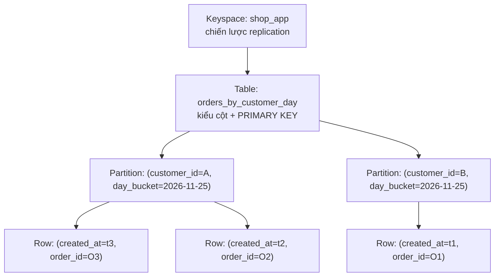

# Keyspace, bảng, cột và các ràng buộc primary key

## 1. Hiểu đúng phạm vi quản lý lược đồ trong Cassandra

**Apache Cassandra** tổ chức dữ liệu theo **keyspace → table → partition → row → column**. Khi dùng **Spring Data Cassandra**, lập trình viên khai báo entity mapping, repository, `CassandraTemplate` và câu truy vấn CQL để làm việc với các đối tượng đó. Tuy nhiên, việc ánh xạ Java không làm thay đổi cấu trúc phân tán của dữ liệu: thiết kế lược đồ CQL vẫn phải dựa vào **truy vấn mà ứng dụng thực sự cần thực hiện**.



| Đối tượng | Trách nhiệm | Điều cần phân biệt |
| --- | --- | --- |
| **Keyspace** | Gom bảng trong một namespace và khai báo chính sách nhân bản dữ liệu | Không tương đương với một database quan hệ có giao dịch xuyên bảng |
| **Table** | Định nghĩa cột, kiểu dữ liệu, primary key và tùy chọn lưu trữ | Thường được thiết kế phục vụ một hoặc một nhóm truy vấn cụ thể |
| **Partition** | Gom các hàng có cùng **partition key**, làm cơ sở định vị và phân phối dữ liệu | Có thể chứa một hoặc rất nhiều hàng |
| **Row** | Được xác định duy nhất bởi **toàn bộ primary key** trong bảng | Các clustering columns phân biệt hàng bên trong partition |
| **Column** | Chứa giá trị thuộc kiểu CQL tương ứng | Cột thường có thể vắng mặt; cột primary key có yêu cầu khác |

Đặc biệt, **`PRIMARY KEY` trong Cassandra mang ý nghĩa truy cập và sắp xếp**, ngoài việc định danh hàng. Các lựa chọn khóa sẽ ảnh hưởng đến số partition cần đọc, độ lớn từng partition, khả năng lọc theo `WHERE`, thứ tự trả kết quả và hiệu năng của API.

## 2. Keyspace: namespace và cấu hình replication

Keyspace chứa các bảng và mô tả cách Cassandra lưu các **replica** của dữ liệu. Mỗi keyspace có tên và chiến lược replication; các bảng bên trong dùng cùng chính sách replication của keyspace đó.

### 2.1. Tạo keyspace cho môi trường local một node

```sql
CREATE KEYSPACE IF NOT EXISTS shop_app
WITH replication = {
    'class': 'SimpleStrategy',
    'replication_factor': 1
}
AND durable_writes = true;
```

- `SimpleStrategy` phân bổ replica theo quy tắc đơn giản, thích hợp cho bài thực hành đơn datacenter, đơn node hoặc môi trường học.
- `replication_factor: 1` nghĩa là chỉ có một replica của dữ liệu; không đem cấu hình này sang production và kỳ vọng khả năng chịu lỗi như cụm nhiều replica.
- `durable_writes = true` là lựa chọn thông thường để ghi qua commit log; không tùy tiện tắt khi chưa hiểu rõ mất mát dữ liệu có thể xảy ra.
- `IF NOT EXISTS` chỉ tránh lỗi khi keyspace **đã tồn tại**. Nó **không kiểm tra** replication thực tế có trùng với định nghĩa được đề xuất hay không.

Ví dụ production có hai datacenter độc lập, mỗi DC có đủ node:

```sql
CREATE KEYSPACE IF NOT EXISTS shop_app
WITH replication = {
    'class': 'NetworkTopologyStrategy',
    'dc1': 3,
    'dc2': 3
}
AND durable_writes = true;
```

Các tên `dc1` và `dc2` phải trùng topology Cassandra thực tế. Mỗi DC trong ví dụ cần có đủ node để bố trí số replica mong muốn. Nếu hệ thống chỉ có **một** datacenter thì không khai báo datacenter giả; dùng `NetworkTopologyStrategy` với đúng tên DC và replication factor phù hợp.

**Replication factor không giống consistency level.** Replication mô tả có bao nhiêu bản sao dữ liệu được duy trì; consistency level (`LOCAL_ONE`, `LOCAL_QUORUM`, v.v.) xác định số replica cần tham gia để thao tác đọc/ghi đáp ứng mức nhất quán yêu cầu. Chọn giá trị consistency cần xét replication và số node khả dụng.

### 2.2. Quan sát và thay đổi keyspace

Trong `cqlsh`, có thể xem thông tin lược đồ:

```sql
DESCRIBE KEYSPACE shop_app;

SELECT keyspace_name, replication, durable_writes
FROM system_schema.keyspaces
WHERE keyspace_name = 'shop_app';
```

`DESCRIBE` là lệnh tiện ích của `cqlsh`, **không phải câu truy vấn CQL thông thường** để gửi qua Java Driver. Bảng hệ thống `system_schema.keyspaces` hữu ích để kiểm tra giá trị đã được lưu trong schema.

Ví dụ thay đổi replication của keyspace:

```sql
ALTER KEYSPACE shop_app
WITH replication = {
    'class': 'NetworkTopologyStrategy',
    'dc1': 3
};
```

Đây là **mẫu cú pháp**, không phải thao tác nên chạy nguyên xi trên một keyspace production chưa đánh giá. Thay đổi replication là thay đổi vận hành có ảnh hưởng tới phân bố dữ liệu: phải kiểm tra topology, dung lượng, trạng thái node, quy trình repair/đồng bộ replica và tài liệu nâng cấp phù hợp với phiên bản Cassandra.

## 3. Tạo bảng và hiểu đầy đủ `PRIMARY KEY`

Xét API cần trả đơn hàng mới nhất của **một khách trong một ngày**, và đọc theo khoảng thời gian. Ta có thể thiết kế:

```sql
CREATE TABLE IF NOT EXISTS shop_app.orders_by_customer_day (
    customer_id uuid,
    day_bucket date,
    created_at timestamp,
    order_id uuid,
    status text,
    total_amount decimal,
    note text,
    PRIMARY KEY ((customer_id, day_bucket), created_at, order_id)
) WITH CLUSTERING ORDER BY (created_at DESC, order_id ASC);
```

Lệnh trên định nghĩa:

1. **Partition key phức hợp** `(customer_id, day_bucket)` gồm hai cột; các đơn của cùng khách và cùng ngày nằm trong một *logical partition*.
2. **Clustering columns** `created_at`, `order_id`; các hàng trong partition được tổ chức theo thứ tự clustering. Khai báo `created_at DESC` phục vụ đọc sự kiện mới trước.
3. **Primary key đầy đủ** `(customer_id, day_bucket, created_at, order_id)` định danh một hàng; `status`, `total_amount`, `note` là cột thường, không tham gia định vị partition.

### 3.1. Ba hình thức primary key thường gặp

| Cú pháp | Partition key | Clustering columns | Tình huống |
| --- | --- | --- | --- |
| `PRIMARY KEY (order_id)` | `order_id` | Không có | Tra cứu đơn trực tiếp qua ID; một hàng cho mỗi partition key |
| `PRIMARY KEY (customer_id, created_at, order_id)` | `customer_id` | `created_at`, `order_id` | Liệt kê đơn của khách theo thời gian |
| `PRIMARY KEY ((customer_id, day_bucket), created_at, order_id)` | `customer_id`, `day_bucket` | `created_at`, `order_id` | Giới hạn dữ liệu theo từng khách và ngày |

**Dấu ngoặc tròn lồng nhau quanh partition key phức hợp có ý nghĩa.** Trong `PRIMARY KEY (customer_id, created_at, order_id)`, chỉ `customer_id` là partition key; hai cột sau là clustering columns. Trong `PRIMARY KEY ((customer_id, day_bucket), created_at, order_id)`, cả `customer_id` và `day_bucket` đều thuộc partition key.

### 3.2. Các ràng buộc quan trọng của primary key

- Mỗi bảng có **một định nghĩa primary key**, bao gồm một hay nhiều partition key columns và tùy chọn clustering columns.
- Giá trị các thành phần primary key phải được cung cấp khi ghi hàng và **không được là `null`**. Không đặt khóa chính trên trường có thể thiếu giá trị theo nghiệp vụ.
- **Không sửa được giá trị primary key bằng `UPDATE`**. Chuyển một bản ghi sang partition khác hoặc đổi clustering key thường yêu cầu ghi hàng với khóa mới, rồi xử lý hàng cũ theo quy trình ứng dụng.
- Một câu `INSERT` bình thường khi trùng toàn bộ primary key có tính chất **upsert**: ghi giá trị theo khóa đó, không phát sinh một hàng thứ hai cùng khóa. Cassandra không cung cấp cơ chế auto-increment phổ biến như nhiều database SQL.
- Cassandra không tự thi hành **foreign key**, ràng buộc `JOIN` hay uniqueness xuyên các bảng. Uniqueness của khóa chính chỉ áp dụng **trong một bảng và trên toàn bộ khóa**.
- Nếu hai đơn cùng `created_at`, cột `order_id` giúp phân biệt hàng. Chọn clustering key sao cho tránh vô tình ghi đè dữ liệu do trùng khóa.

Một lỗi thiết kế kinh điển là dùng:

```sql
PRIMARY KEY ((customer_id), created_at)
```

nếu hệ thống có thể ghi **nhiều đơn của cùng một khách vào cùng một timestamp**. Hai đơn có cùng `customer_id` và `created_at` lúc đó dùng chung primary key và có thể ghi đè giá trị. Bổ sung một ID phân biệt để định danh đúng từng đơn:

```sql
PRIMARY KEY ((customer_id), created_at, order_id)
```

Tuy vậy, thêm `order_id` **không làm cho câu `WHERE order_id = ?` trở thành truy vấn hiệu quả** trên bảng đó, bởi partition key vẫn là `customer_id`. Nếu cần lookup đơn chỉ bằng `order_id`, hãy cân nhắc bảng `order_by_id` riêng.

## 4. Schema quyết định truy vấn CQL nào khả thi

Với `shop_app.orders_by_customer_day`, truy vấn đúng đường khóa:

```sql
-- Đọc các đơn gần đây trong một partition đã biết đầy đủ khóa.
SELECT order_id, created_at, status, total_amount
FROM shop_app.orders_by_customer_day
WHERE customer_id = 11111111-1111-1111-1111-111111111111
  AND day_bucket = '2026-11-25'
LIMIT 20;

-- Đọc các đơn trong một khoảng thời gian của cùng partition.
SELECT order_id, created_at, status, total_amount
FROM shop_app.orders_by_customer_day
WHERE customer_id = 11111111-1111-1111-1111-111111111111
  AND day_bucket = '2026-11-25'
  AND created_at >= '2026-11-25T00:00:00Z'
  AND created_at < '2026-11-26T00:00:00Z'
LIMIT 20;
```

Hai câu trên định vị đúng partition bằng `customer_id` **và** `day_bucket`, rồi khai thác clustering order/range. Khi một API cần đọc nhiều ngày, backend phải liệt kê các bucket phù hợp, truy vấn những partition cần thiết và gộp kết quả; Cassandra không tự bảo đảm thứ tự toàn cục xuyên các partition.

Ngược lại, các yêu cầu sau không trực tiếp khớp với schema:

| API hoặc điều kiện | Vì sao không khớp? | Hướng thiết kế |
| --- | --- | --- |
| `WHERE customer_id = ?` | Thiếu `day_bucket`, một thành phần partition key | Tính bucket từ khoảng thời gian hoặc dùng bảng khác cho truy vấn không có ngày |
| `WHERE order_id = ?` | Không biết partition key | Bảng `order_by_id` có `order_id` làm partition key |
| `WHERE customer_id = ? AND day_bucket = ? AND status = 'PAID'` | `status` là cột thường, không thuộc đường khóa | Bảng đọc theo `(customer_id, status, day_bucket)` nếu lọc trạng thái thường xuyên |
| Sắp xếp toàn cục theo `total_amount` | `total_amount` không phải clustering column | Thiết kế bảng riêng, giới hạn phạm vi hoặc xử lý bằng read model phù hợp |

**Quy tắc thực hành:** truy vấn thường cần biết đầy đủ các thành phần partition key để truy cập có phạm vi hẹp, sau đó dùng clustering columns theo những điều kiện được CQL hỗ trợ. Với clustering columns, điều kiện trên các cột đứng sau phải tuân thủ ràng buộc theo thứ tự khóa; không coi Cassandra là SQL database cho phép kết hợp `WHERE` và `ORDER BY` tùy ý.

Tránh dùng `ALLOW FILTERING` để chữa một schema không hỗ trợ truy vấn chính. Lệnh này không bảo đảm giới hạn số partition hoặc số hàng thực đọc. Secondary index/Storage-Attached Index có thể hữu ích với một số workload và phiên bản Cassandra, nhưng cần đo độ chọn lọc, phân bố dữ liệu và tải; chúng không thay thế thiết kế bảng theo truy vấn.

## 5. Chọn cột và kiểu dữ liệu CQL

Cassandra lưu dữ liệu theo kiểu CQL. Khi thiết kế bảng, cần quan tâm đến việc kiểu đó được ánh xạ sang Java ra sao và ứng dụng sẽ ghi/đọc những gì.

| Kiểu CQL | Ý nghĩa | Ví dụ kiểu Java thường dùng |
| --- | --- | --- |
| `uuid` | Định danh UUID | `java.util.UUID` |
| `timeuuid` | UUID loại 1 có thông tin thời gian | `java.util.UUID` |
| `text`, `varchar` | Chuỗi | `String` |
| `timestamp` | Mốc thời gian | `java.time.Instant` |
| `date` | Ngày không có giờ | `java.time.LocalDate` |
| `boolean` | Đúng/sai | `Boolean` |
| `int`, `bigint` | Số nguyên | `Integer`, `Long` |
| `decimal` | Số thập phân chính xác | `java.math.BigDecimal` |
| `double` | Số thực dấu phẩy động | `Double` |
| `list<text>`, `set<text>`, `map<text,text>` | Collection CQL | `List`, `Set`, `Map` tương ứng |

Một số điểm cần lưu ý:

- Chọn `decimal` cho giá trị tiền khi cần giữ độ chính xác thập phân, thay vì dùng `double` rồi so sánh trực tiếp.
- Chọn `timestamp` và quy ước UTC nhất quán cho mốc thời gian. Nếu có `day_bucket`, application phải **tính và ghi đúng bucket**; Cassandra không tự đồng bộ nó với `created_at`.
- Một cột bình thường không được ghi hoặc có giá trị không tồn tại sẽ được ứng dụng đọc theo cách mapping tương ứng. Phân biệt cột vắng mặt, `null` ở tầng Java và thao tác xóa/tombstone trong Cassandra.
- Collections có giới hạn và chi phí cập nhật; tránh dùng một collection không giới hạn để lưu toàn bộ lịch sử của một khách hoặc thiết bị. Một bảng theo các hàng có clustering key thường phù hợp hơn cho dữ liệu tăng liên tục.
- User-defined type (UDT), `frozen`, counter và các kiểu nâng cao có quy tắc cập nhật/ánh xạ riêng. Chỉ đưa vào schema sau khi hiểu nhu cầu CQL và phiên bản Cassandra/driver đang dùng.

### Cột thường và cột `STATIC`

Một bảng có clustering columns có thể khai báo **static column**, là giá trị gắn với partition thay vì một hàng cụ thể:

```sql
CREATE TABLE readings_by_device_day (
    device_id uuid,
    day_bucket date,
    captured_at timestamp,
    event_id uuid,
    firmware_version text STATIC,
    reading_value double,
    PRIMARY KEY ((device_id, day_bucket), captured_at, event_id)
) WITH CLUSTERING ORDER BY (captured_at DESC, event_id ASC);
```

`firmware_version` trong ví dụ được chia sẻ trong partition `(device_id, day_bucket)`; cập nhật nó làm thay đổi giá trị static mà các hàng cùng partition nhìn thấy, **không ghi lại một phiên bản độc lập trên từng hàng**. Nếu firmware thực sự thay đổi nhiều lần trong một ngày và cần lưu lịch sử chính xác, cách biểu diễn static này không thích hợp. Static column cũng không phải thành phần primary key.

## 6. Ghi dữ liệu và kiểm tra tính duy nhất của khóa

Với schema `orders_by_customer_day`, hai lệnh sau tạo hai hàng khác nhau khi khác `order_id`:

```sql
INSERT INTO shop_app.orders_by_customer_day
    (customer_id, day_bucket, created_at, order_id, status, total_amount)
VALUES (
    11111111-1111-1111-1111-111111111111,
    '2026-11-25',
    '2026-11-25T08:10:00Z',
    22222222-2222-2222-2222-222222222222,
    'PENDING',
    150000.00
);

INSERT INTO shop_app.orders_by_customer_day
    (customer_id, day_bucket, created_at, order_id, status, total_amount)
VALUES (
    11111111-1111-1111-1111-111111111111,
    '2026-11-25',
    '2026-11-25T08:10:00Z',
    33333333-3333-3333-3333-333333333333,
    'PAID',
    200000.00
);
```

Có thể cập nhật một cột thường khi biết **toàn bộ primary key**:

```sql
UPDATE shop_app.orders_by_customer_day
SET status = 'PAID'
WHERE customer_id = 11111111-1111-1111-1111-111111111111
  AND day_bucket = '2026-11-25'
  AND created_at = '2026-11-25T08:10:00Z'
  AND order_id = 22222222-2222-2222-2222-222222222222;
```

Một `UPDATE` bình thường cũng có thể có tính **upsert** nếu hàng tương ứng chưa tồn tại. Khi bài toán bắt buộc “tạo một lần duy nhất nếu chưa có”, Cassandra hỗ trợ thao tác điều kiện như:

```sql
INSERT INTO shop_app.orders_by_customer_day
    (customer_id, day_bucket, created_at, order_id, status)
VALUES (
    11111111-1111-1111-1111-111111111111,
    '2026-11-25',
    '2026-11-25T09:00:00Z',
    44444444-4444-4444-4444-444444444444,
    'PENDING'
)
IF NOT EXISTS;
```

`IF NOT EXISTS` sử dụng cơ chế **lightweight transaction (LWT)** để thực hiện điều kiện trên hàng cần ghi, có chi phí và độ trễ khác lệnh ghi thường. Nó không biến nhiều bảng phi chuẩn hóa thành giao dịch ACID xuyên bảng. Không dùng LWT tràn lan chỉ vì quen với ràng buộc uniqueness ở SQL.

## 7. Thay đổi schema: thao tác nào đơn giản, thao tác nào cần di chuyển dữ liệu?

Cassandra hỗ trợ nhiều câu DDL như `CREATE`, `ALTER`, `DROP`; tuy nhiên các thay đổi này phải phù hợp đặc tính **schema được chia sẻ giữa nhiều node** và ràng buộc khóa của dữ liệu đã lưu.

### 7.1. Thêm cột thường

```sql
ALTER TABLE shop_app.orders_by_customer_day
ADD payment_method text;
```

Các hàng cũ không tự được bổ sung giá trị `payment_method`; ứng dụng phải xử lý trường hợp cột chưa có dữ liệu. Sau khi triển khai DDL, mới phát hành mã ứng dụng đọc/ghi cột mới theo kế hoạch tương thích ngược.

### 7.2. Đổi hoặc xóa cột: cần đánh giá tác động

Việc xóa cột thường có thể dùng cú pháp:

```sql
ALTER TABLE shop_app.orders_by_customer_day
DROP note;
```

Đây là thao tác **thay đổi dữ liệu có tác động lâu dài**; trước khi chạy trên dữ liệu thật, cần kiểm tra phiên bản Cassandra, hậu quả với dữ liệu cũ, vòng đời tombstone, snapshot/backup và các ứng dụng vẫn đang đọc cột đó. Không thực thi lệnh ví dụ như một bước bắt buộc trong bài thực hành.

Không nên giả định mọi kiểu dữ liệu đều có thể đổi qua một câu `ALTER TABLE ... ALTER ... TYPE`: mức hỗ trợ thay đổi kiểu cột bị hạn chế và phụ thuộc phiên bản. Với đổi kiểu phức tạp, phương án tạo cột/bảng mới và backfill thường dễ kiểm soát hơn.

### 7.3. Đổi partition key hoặc clustering columns

**Không thể đổi primary key của một bảng hiện hữu bằng cách sửa annotation Java.** Nếu ứng dụng muốn chuyển từ phân vùng theo `customer_id` sang `(customer_id, day_bucket)`, dữ liệu phải được viết vào **bảng mới có khóa khác**.

Một kế hoạch migration thường gồm:

1. Tạo bảng mới với cấu trúc khóa phục vụ truy vấn mới.
2. Triển khai đường ghi sang bảng mới, tính đúng các thành phần khóa và chuẩn hóa thời gian.
3. Backfill dữ liệu lịch sử từ nguồn phù hợp, kiểm soát tốc độ để không gây quá tải Cassandra.
4. Đối chiếu số lượng và tính đúng kết quả cho các truy vấn mẫu, kể cả phân trang và các partition lớn.
5. Chuyển dần đường đọc ứng dụng sang bảng mới; có cơ chế rollback trong giai đoạn chuyển tiếp.
6. Chỉ ngừng đọc hoặc xóa bảng cũ sau khi xác nhận dữ liệu đã chuyển và thời gian tương thích kết thúc.

Thay đổi như vậy còn ảnh hưởng API: các endpoint phải biết bucket, giới hạn phạm vi truy vấn và có thể cần cursor khác. Vì thế **schema migration và migration hợp đồng API** cần được thiết kế đồng thời.

### 7.4. `IF NOT EXISTS` không phải công cụ quản lý schema đầy đủ

Ví dụ:

```sql
CREATE TABLE IF NOT EXISTS shop_app.orders_by_customer_day (
    customer_id uuid PRIMARY KEY,
    status text
);
```

Nếu bảng **đã tồn tại với cấu trúc khác**, `IF NOT EXISTS` không tự so sánh rồi thêm/sửa các cột hoặc khóa. Vì vậy việc chạy một file `CREATE ... IF NOT EXISTS` mỗi lần ứng dụng startup **không thay thế** quy trình migration có version và kiểm tra drift.

Trong cluster Cassandra, schema changes cần được truyền giữa các node; sau DDL cần kiểm tra **schema agreement** và khả năng truy vấn từ các node trước khi bắt đầu những bước triển khai phụ thuộc vào schema mới. Tránh để hàng chục instance ứng dụng cùng lúc chạy DDL khi scale up.

## 8. Spring Data Cassandra ánh xạ bảng và primary key thế nào?

Với schema `orders_by_customer_day`, sử dụng `@PrimaryKeyClass` cùng `@PrimaryKeyColumn` để khai báo các thành phần partition/clustering key:

```java
import java.io.Serializable;
import java.time.Instant;
import java.time.LocalDate;
import java.util.UUID;

import org.springframework.data.cassandra.core.cql.Ordering;
import org.springframework.data.cassandra.core.mapping.PrimaryKeyClass;
import org.springframework.data.cassandra.core.mapping.PrimaryKeyColumn;
import org.springframework.data.cassandra.core.mapping.PrimaryKeyType;

@PrimaryKeyClass
public class OrderByCustomerDayKey implements Serializable {

    @PrimaryKeyColumn(
        name = "customer_id", ordinal = 0,
        type = PrimaryKeyType.PARTITIONED
    )
    private UUID customerId;

    @PrimaryKeyColumn(
        name = "day_bucket", ordinal = 1,
        type = PrimaryKeyType.PARTITIONED
    )
    private LocalDate dayBucket;

    @PrimaryKeyColumn(
        name = "created_at", ordinal = 2,
        type = PrimaryKeyType.CLUSTERED, ordering = Ordering.DESCENDING
    )
    private Instant createdAt;

    @PrimaryKeyColumn(
        name = "order_id", ordinal = 3,
        type = PrimaryKeyType.CLUSTERED, ordering = Ordering.ASCENDING
    )
    private UUID orderId;

    // Bổ sung constructor không tham số, getter/setter,
    // equals() và hashCode() nhất quán trên các trường khóa.
}
```

```java
import java.math.BigDecimal;

import org.springframework.data.cassandra.core.mapping.Column;
import org.springframework.data.cassandra.core.mapping.PrimaryKey;
import org.springframework.data.cassandra.core.mapping.Table;

@Table("orders_by_customer_day")
public class OrderByCustomerDay {

    @PrimaryKey
    private OrderByCustomerDayKey key;

    @Column("status")
    private String status;

    @Column("total_amount")
    private BigDecimal totalAmount;

    @Column("note")
    private String note;

    // Bổ sung constructor và accessors phù hợp với mapping của dự án.
}
```

Điểm cần nhớ:

- `@Table` ánh xạ entity với bảng; tên bảng phải khớp schema thực tế và keyspace mà session sử dụng.
- `@PrimaryKey` trỏ đến đối tượng chứa khóa phức hợp; `PrimaryKeyType.PARTITIONED`/`CLUSTERED` phải phản ánh **đúng CQL DDL**, không được đổi tùy ý.
- `ordinal` quy định vị trí các cột khóa. Hai khóa Java chứa cùng giá trị cần so sánh nhất quán qua `equals()`/`hashCode()` để tránh lỗi thao tác ở tầng ứng dụng.
- `@Column` dùng cho các cột thường. Nếu tên field Java không trùng tên cột CQL, khai báo mapping tường minh giúp tránh phụ thuộc vào naming strategy ngầm định.
- Entity mapping chỉ mô tả cách Java đọc/ghi; **annotation không tự thay đổi primary key của bảng đã tồn tại**.

Repository có thể dùng khóa phức hợp làm ID:

```java
import java.time.LocalDate;
import java.util.List;
import java.util.UUID;

import org.springframework.data.cassandra.repository.CassandraRepository;
import org.springframework.data.cassandra.repository.Query;

public interface OrderByCustomerDayRepository
        extends CassandraRepository<OrderByCustomerDay, OrderByCustomerDayKey> {

    @Query("""
        SELECT * FROM orders_by_customer_day
        WHERE customer_id = ?0 AND day_bucket = ?1
        LIMIT ?2
        """)
    List<OrderByCustomerDay> findRecentInDay(
            UUID customerId,
            LocalDate dayBucket,
            int limit);
}
```

Ở đây, câu query nêu rõ **toàn bộ partition key**. Với dữ liệu lớn hoặc API cần nhiều trang, kết quả `List` giới hạn trên chỉ là ví dụ tối giản; hãy sử dụng khả năng paging/cursor phù hợp của Spring Data Cassandra hoặc Java Driver. Dù query được khai báo bằng repository, `CassandraTemplate` hay `CqlSession`, Cassandra vẫn áp dụng những ràng buộc `PRIMARY KEY` như nhau.

### Ai nên chịu trách nhiệm tạo schema?

Spring Data Cassandra có những lựa chọn schema action khi khởi động, nhưng ứng dụng production thường nên quản lý DDL có kiểm soát và cấu hình:

```yaml
spring:
  cassandra:
    keyspace-name: shop_app
    schema-action: none
```

`schema-action: none` ngăn ứng dụng tự tạo hoặc sửa bảng dựa trên entity trong quá trình startup. DDL cho keyspace/bảng cần được triển khai bằng công cụ hoặc quy trình migration riêng; các bản nâng cấp phải được ghi lại, kiểm tra và có thứ tự rõ ràng. Không đồng nghĩa với việc Spring Data Cassandra không thể dùng entity mapping hoặc repository.

## 9. Thiết kế khóa tránh partition quá rộng hoặc truy vấn fan-out

Trong ví dụ, thêm `day_bucket` giới hạn kích thước partition của mỗi khách theo ngày. Nhưng nó cũng buộc API đọc nhiều partition nếu muốn lịch sử nhiều ngày:

| Thiết kế khóa | Số partition đọc để lấy đơn trong 7 ngày của một khách | Rủi ro chính |
| --- | --- | --- |
| `PRIMARY KEY ((customer_id), created_at, order_id)` | Có thể dùng một partition | Partition của khách có thể tăng lớn, tập trung tải |
| `PRIMARY KEY ((customer_id, day_bucket), created_at, order_id)` | Tối đa 7 partition theo ngày trong cửa sổ đủ 7 ngày | Phải lặp qua bucket, ghép/phân trang kết quả |
| `PRIMARY KEY ((customer_id, day_bucket, shard), created_at, order_id)` với 4 shard | Có thể đến 28 partition cho 7 ngày | Phải đọc nhiều shard, merge thứ tự và quản lý cursor phức tạp |

Các số trên giả định một khách, khoảng truy vấn nằm đúng trong bảy ngày UTC và **nếu cần xét toàn bộ các bucket/shard**. Một truy vấn lấy 20 đơn mới nhất có thể dừng sớm khi đủ kết quả; không nhất thiết phải chạm mọi partition.

Không có ngưỡng kích thước partition lý tưởng cho mọi workload. Cần đo số hàng, dung lượng partition, p95/p99 latency, hot keys, tombstone, số partition/request, phân bố tải trên node và thời gian retention. **Thiết kế lược đồ tốt phải đi cùng đường đọc và ngân sách truy vấn của API.**

## 10. Những lỗi phổ biến khi quản lý schema

| Lỗi | Hậu quả | Cách xử lý |
| --- | --- | --- |
| Chỉ dùng một bảng chuẩn hóa cho mọi API | Phải lọc/quét nhiều dữ liệu hoặc truy vấn không hợp lệ | Thiết kế bảng theo từng đường truy vấn quan trọng |
| Nhầm partition key với toàn bộ primary key | Không hiểu vì sao `WHERE order_id = ?` không hoạt động | Phân biệt phần trong `((...))` và clustering columns |
| Bỏ `order_id` khi `created_at` có thể trùng | Hai bản ghi ghi đè cùng primary key | Bổ sung khóa phân biệt có tính ổn định |
| Đổi annotation `@PrimaryKey` rồi nghĩ database tự đổi | Entity không khớp schema, query/ghi lỗi | Tạo bảng mới và migration dữ liệu |
| Dùng `CREATE ... IF NOT EXISTS` để “sửa” schema | Schema drift tồn tại mà không có cảnh báo | Migration có version, so sánh schema và kiểm tra schema agreement |
| Dùng `SimpleStrategy`, RF=1 trên production | Khả năng chịu lỗi/replication không phù hợp | Thiết kế `NetworkTopologyStrategy` và RF theo cụm thật |
| Thêm `ALLOW FILTERING` khi thiếu khóa | Độ trễ và tải khó dự đoán | Thiết kế lại đường đọc hoặc read model phù hợp |
| Xóa/đổi cột khi app cũ vẫn sử dụng | Lỗi đọc/ghi và dữ liệu lịch sử bị ảnh hưởng | Triển khai thay đổi tương thích ngược, có backup và lộ trình |
| Để các instance ứng dụng đồng thời chạy DDL | Race condition, schema chưa đồng bộ | Tách bước migration, kiểm tra trạng thái cluster |

## 11. Bài thực hành kiểm chứng

**Bối cảnh:** Một ứng dụng đặt hàng cần API:

1. `GET /customers/{customerId}/orders?date=2026-11-25&limit=20`: danh sách đơn của khách trong một ngày.
2. `GET /orders/{orderId}`: chi tiết đơn bằng ID.
3. `GET /customers/{customerId}/orders?status=PAID`: danh sách đơn đã thanh toán.

Hãy thực hiện lần lượt:

1. Tạo keyspace local bằng `SimpleStrategy` với RF=1 và bảng `orders_by_customer_day` như trong bài; dùng `DESCRIBE` hoặc `system_schema` để kiểm tra schema được tạo.
2. Chèn hai đơn cùng khách và cùng timestamp nhưng khác `order_id`; xác nhận chúng là **hai hàng**.
3. Thử tra cứu danh sách bằng đầy đủ `(customer_id, day_bucket)`; giải thích vì sao chỉ có `customer_id` chưa đủ cho truy vấn theo partition chính xác.
4. Thiết kế `order_by_id` để phục vụ endpoint thứ hai và `orders_by_customer_status_day` để phục vụ endpoint thứ ba. Xác định partition key, clustering columns và chi phí đồng bộ dữ liệu khi trạng thái thay đổi.
5. Tạo entity key phức hợp trong Spring Data Cassandra, gọi repository với hai tham số partition key và kiểm tra kết quả.
6. Đề xuất migration thêm trường `payment_method` theo cách không làm hỏng ứng dụng đang chạy, đồng thời giải thích vì sao thêm cột dễ hơn thay đổi primary key.

### Câu hỏi tự kiểm tra

1. Vì sao chọn partition key quyết định chi phí truy vấn Cassandra?
2. `PRIMARY KEY (a, b)` khác `PRIMARY KEY ((a, b))` như thế nào?
3. Cột `STATIC` được lưu theo phạm vi nào, và khi nào không nên dùng?
4. Khi nào `INSERT` có thể ghi đè một hàng đã có? `IF NOT EXISTS` thay đổi hành vi đó như thế nào?
5. `IF NOT EXISTS` của `CREATE TABLE` có xác minh schema đúng với entity không?
6. Vì sao đổi partition key cần bảng mới và backfill dữ liệu?
7. `@PrimaryKeyColumn(type=PARTITIONED)` và `@PrimaryKeyColumn(type=CLUSTERED)` liên hệ thế nào với cú pháp `PRIMARY KEY` trong CQL?

## Kết luận

Trong **Spring Data Cassandra**, keyspace quyết định namespace và replication; bảng định nghĩa cột, kiểu dữ liệu và cách lưu hàng; còn **primary key** quyết định nơi dữ liệu được phân phối, hàng được sắp xếp thế nào và truy vấn CQL nào khả thi. Phải đọc đúng partition key, clustering columns và tính duy nhất của **toàn bộ** primary key trước khi tạo repository hoặc API. Những thay đổi nhỏ như thêm cột thường có thể triển khai theo lộ trình tương thích; thay đổi khóa chính hoặc đường đọc thường đòi hỏi bảng mới và kế hoạch migration dữ liệu. Thiết kế và quản lý schema nên dựa trên truy vấn thực tế, khả năng chịu lỗi của cụm, nhu cầu phân trang và số đo hiệu năng.
