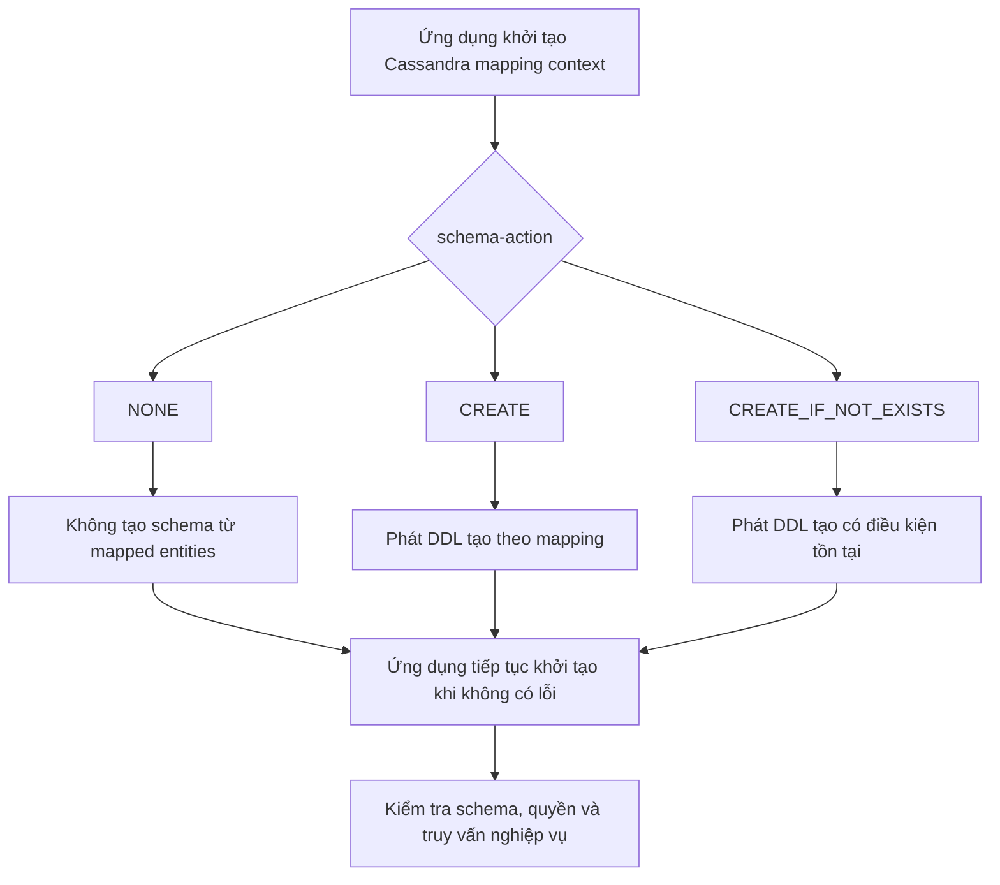
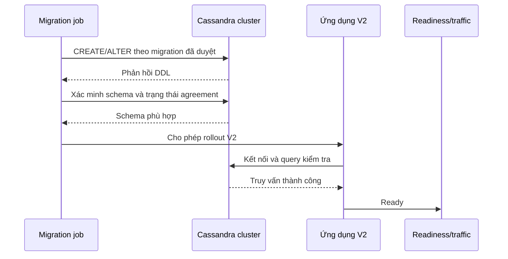

# SchemaAction.NONE, CREATE và CREATE_IF_NOT_EXISTS

Khi xây dựng ứng dụng bằng **Spring Data Cassandra**, ta định nghĩa entity, partition key, clustering key và các cột bằng Java annotation. Nhưng ai sẽ thực sự tạo bảng trong **Apache Cassandra**? Bảng đã có sẵn khi ứng dụng kết nối hay framework được phép phát lệnh DDL trong lúc khởi động?

Đó là vai trò của **`SchemaAction`** trong quản lý lược đồ (*schema management*). Ba lựa chọn nền tảng là **`NONE`**, **`CREATE`** và **`CREATE_IF_NOT_EXISTS`**. Chúng quyết định việc Spring Data Cassandra có chủ động thực hiện các thao tác tạo schema từ metadata mapping hay không; chúng không thay thế thiết kế bảng theo truy vấn, chiến lược migration hoặc kiểm tra khả năng phục vụ của cluster.

Bài này thuộc chương **Quản lý lược đồ**. Mục tiêu là chọn đúng chế độ theo vòng đời ứng dụng, hiểu kết quả khi bảng đã tồn tại, cấu hình với Spring Boot và biết cách kiểm tra schema trước khi repository, `CassandraTemplate` hoặc CQL chạy trên dữ liệu phân tán.

## 1. Bối cảnh: schema trong Cassandra là gì?

Schema Cassandra xác định cấu trúc dữ liệu mà cluster sẽ nhận và truy vấn, gồm:

- **Keyspace**: phạm vi chứa bảng và thiết lập replication strategy, replication factor theo datacenter.
- **Table**: tập cột, kiểu CQL, **partition key** và **clustering columns/order**.
- **User-defined type (UDT)** hoặc các đối tượng schema khác nếu ứng dụng sử dụng và phiên bản hỗ trợ.
- **Index** khi cần đường truy cập thích hợp, với khả năng và giới hạn tùy loại index/phiên bản Cassandra.

Ví dụ một bảng đọc danh sách đơn hàng:

```sql
CREATE TABLE orders_ks.orders_by_customer_month (
    tenant_id uuid,
    customer_id uuid,
    bucket_month text,
    created_at timestamp,
    order_id uuid,
    status text,
    total_amount decimal,
    PRIMARY KEY (
        (tenant_id, customer_id, bucket_month),
        created_at,
        order_id
    )
) WITH CLUSTERING ORDER BY (
    created_at DESC,
    order_id DESC
);
```

Trong schema này, `(tenant_id, customer_id, bucket_month)` là **composite partition key**. Hai cột `created_at` và `order_id` là clustering columns, giúp trả kết quả theo thứ tự trong một partition.

Từ phía Spring Data Cassandra, ứng dụng có thể có entity tương ứng. Metadata Java mô tả cách ánh xạ dữ liệu và có thể được dùng để **sinh DDL nếu cấu hình SchemaAction cho phép**. Nhưng metadata không tự biến một schema đã triển khai thành schema mới mỗi lần code thay đổi.

> **Nguyên tắc cốt lõi:** `SchemaAction` kiểm soát **hành vi tạo schema ở thời điểm khởi tạo**. Nó không phải công cụ migration đầy đủ, không thiết kế partition key thay ứng dụng và không kiểm chứng toàn bộ dữ liệu hoặc replica đã sẵn sàng.

## 2. Ba lựa chọn SchemaAction khác nhau thế nào?

Trong Spring Data Cassandra, `SchemaAction` là enum điều khiển cách framework xử lý phần schema của các entity được quản lý khi khởi tạo.

| Chế độ | Ý nghĩa thực tế | Khi bảng chưa có | Khi bảng đã có |
| --- | --- | --- | --- |
| **`NONE`** | Không chủ động tạo schema từ entity mapping tại startup | Ứng dụng không tạo bảng; truy vấn cần bảng có thể thất bại nếu chưa triển khai schema | Giữ nguyên bảng |
| **`CREATE`** | Yêu cầu tạo các đối tượng schema từ metadata mapped entities | Cố gắng tạo đối tượng cần thiết | Cố gắng thực hiện DDL tạo dù đối tượng đã có; thường gây lỗi “already exists” đối với bảng trùng tên |
| **`CREATE_IF_NOT_EXISTS`** | Tạo đối tượng nếu chúng chưa tồn tại, theo khả năng tạo schema của framework | Cố gắng tạo | Câu lệnh tạo có điều kiện bỏ qua đối tượng đã tồn tại; **không tự đối chiếu và sửa cấu trúc cũ** |

Điều kiện “có/không có” ở đây nói về **đối tượng schema được tạo**, không phải dữ liệu trong bảng. Các thao tác cụ thể framework sinh ra phụ thuộc phiên bản Spring Data Cassandra, loại object, entity discovery và cấu hình session. Vì vậy khi đánh giá một ứng dụng thực tế, cần kiểm tra **DDL được phát ra** hoặc schema sau khởi tạo trên phiên bản đang chạy.

### `NONE`: quyền quản lý schema ở bên ngoài ứng dụng

Với `NONE`, startup không tạo bảng từ mapping. Đây thường là lựa chọn cho production nơi DDL được thực hiện bằng migration hoặc quy trình triển khai riêng.

Ví dụ: đã có bảng `orders_ks.orders_by_customer_month`; ứng dụng chỉ kết nối, đọc và ghi theo schema có sẵn.

**Ưu điểm:**

- Không để mỗi instance ứng dụng tự động thay đổi cấu trúc schema lúc nhận traffic.
- Phân tách triển khai database với triển khai service.
- Phù hợp môi trường nhiều pod và quy trình kiểm soát thay đổi.

**Cần lưu ý:** `NONE` không tự xác minh schema đúng. Một ứng dụng có thể tạo session thành công nhưng truy vấn repository bị lỗi vì thiếu bảng, sai kiểu dữ liệu hoặc khóa không tương thích. Vì vậy phải chạy migration và kiểm tra schema/truy vấn trước khi đánh dấu ứng dụng sẵn sàng.

### `CREATE`: tạo schema không dùng điều kiện tồn tại

Với `CREATE`, framework chủ động tạo schema theo mapping. Chế độ này phù hợp nhất với ngữ cảnh thí nghiệm kiểm soát được, nơi ta biết các đối tượng cần tạo **chưa tồn tại**.

Nếu bảng đã tồn tại, DDL tạo bảng thông thường không có `IF NOT EXISTS` sẽ bị Cassandra từ chối. Quá trình khởi tạo có thể thất bại; nếu đã tạo thành công vài đối tượng trước khi gặp lỗi, việc thực thi schema không tự nhiên trở thành một giao dịch nguyên tử.

**Đặc điểm quan trọng:** `CREATE` **không tương đương “xóa bảng rồi tạo lại”**. Không được suy rằng chế độ này tự dọn dữ liệu cũ hoặc luôn dựng database sạch. Việc xóa/tạo lại thuộc các cơ chế khác và phải được xử lý với quy trình riêng.

### `CREATE_IF_NOT_EXISTS`: tạo nếu chưa có, không migration bảng đã có

Với `CREATE_IF_NOT_EXISTS`, framework sinh DDL có ý nghĩa tương đương:

```sql
CREATE TABLE IF NOT EXISTS orders_ks.orders_by_customer_month (
    tenant_id uuid,
    customer_id uuid,
    bucket_month text,
    created_at timestamp,
    order_id uuid,
    status text,
    total_amount decimal,
    PRIMARY KEY (
        (tenant_id, customer_id, bucket_month),
        created_at,
        order_id
    )
) WITH CLUSTERING ORDER BY (created_at DESC, order_id DESC);
```

Đây là **minh họa khái niệm**; DDL thực tế phải được kiểm tra theo phiên bản Spring Data Cassandra và entity. Khi bảng chưa tồn tại, nó được tạo. Khi bảng cùng tên đã tồn tại, lệnh tạo có điều kiện thường không báo lỗi trùng tên.

Nhưng giả sử code mới thêm `delivery_note` còn bảng cũ chưa có cột này:

- `CREATE_IF_NOT_EXISTS` thấy bảng đã tồn tại và **không tự chạy `ALTER TABLE ADD delivery_note`**.
- Entity mới có thể ánh xạ tới cột chưa có.
- Query dùng cột mới có thể bị Cassandra từ chối khi chạy.

Chế độ này hỗ trợ **bootstrap schema đơn giản**, không phải đồng bộ cấu trúc hay công cụ migration.

## 3. Sơ đồ quyết định khi ứng dụng bắt đầu



Lưu ý các nhánh tạo schema **có thể lỗi** do bảng đã có, tên keyspace sai, thiếu quyền DDL, lỗi kết nối hoặc schema agreement chưa đạt theo môi trường. Sơ đồ đơn giản hóa đường thành công, không bảo đảm tất cả thao tác DDL đều hoàn thành trong mọi tình huống.

Ba lựa chọn trả lời câu hỏi *“framework có thử tạo schema không?”*. Chúng **không** trả lời các câu hỏi:

1. Schema có phù hợp toàn bộ mẫu đọc của sản phẩm không?
2. Partition key và clustering columns có tối ưu cho truy vấn không?
3. RF, CL và datacenter có đủ khả năng phục vụ dữ liệu không?
4. Schema cũ có cần chuyển đổi và backfill dữ liệu không?
5. Mọi node đã nhận metadata schema mới chưa?

Những vấn đề đó cần các bước thiết kế, migration và vận hành riêng.

## 4. Cấu hình SchemaAction trong Spring Boot

Với **Spring Boot 3.x**, cách cấu hình thường gặp là property `spring.cassandra.schema-action`:

```yaml
spring:
  cassandra:
    contact-points:
      - cassandra-1.example.internal
      - cassandra-2.example.internal
    port: 9042
    local-datacenter: dc_hcm
    keyspace-name: orders_ks
    schema-action: NONE
```

Các hostname và `dc_hcm` chỉ là ví dụ; local datacenter phải khớp tên DC thực của Cassandra. Với phiên bản Spring Boot cũ, namespace property có thể khác, chẳng hạn các cấu hình dưới `spring.data.cassandra.*`. **Hãy kiểm tra tài liệu configuration properties của chính phiên bản dự án** trước khi áp dụng, vì property không nhận có thể làm ứng dụng khởi chạy với giá trị mặc định ngoài dự kiến.

Trong nhiều cấu hình Spring Boot hiện đại, mặc định là **`NONE`**. Tuy nhiên, đừng dựa vào trí nhớ về mặc định khi quyết định hành vi khởi tạo database: **khai báo tường minh** trong cấu hình môi trường quan trọng.

### Cấu hình phân biệt môi trường

Ví dụ cho môi trường học tập chỉ chạy với một keyspace test:

```yaml
# application-local.yml
spring:
  cassandra:
    schema-action: CREATE_IF_NOT_EXISTS
```

Ví dụ cho production:

```yaml
# application-prod.yml
spring:
  cassandra:
    schema-action: NONE
```

Mẫu triển khai:

- Local/test: framework có thể tạo schema thử nghiệm **trong keyspace chuyên dùng**.
- Staging/production: DDL đi qua migration riêng; ứng dụng chỉ thực hiện query sau khi schema đã được triển khai.
- CI: có thể thử cả hai chế độ trên database test sạch để phát hiện việc scan entity hoặc mapping thay đổi ngoài ý muốn.

Các đoạn YAML là **mảnh cấu hình của từng profile**, không phải một file kết hợp chạy đồng thời. Cần bảo đảm profile được kích hoạt đúng và không bị biến môi trường/command-line override ngoài kế hoạch.

### Khi cấu hình bằng Java thay vì Boot property

Spring Data Cassandra cũng có cơ chế cấu hình schema action thông qua lớp cấu hình Cassandra trong những ứng dụng sử dụng configuration Java trực tiếp. Ví dụ minh họa cho thế hệ API dùng `AbstractCassandraConfiguration`:

```java
import org.springframework.context.annotation.Configuration;
import org.springframework.data.cassandra.config.AbstractCassandraConfiguration;
import org.springframework.data.cassandra.config.SchemaAction;

@Configuration
class CassandraConfig extends AbstractCassandraConfiguration {

    @Override
    protected String getKeyspaceName() {
        return "orders_ks";
    }

    @Override
    public SchemaAction getSchemaAction() {
        return SchemaAction.NONE;
    }
}
```

Đây là mẫu có tính **phụ thuộc phiên bản/configuration style**: trước khi đưa vào dự án, hãy đối chiếu chữ ký method và cách Spring Boot auto-configuration kết hợp với cấu hình tự khai báo. Không tự thêm cả cấu hình Java và Boot rồi giả định chúng sẽ cộng dồn; một cấu hình tùy chỉnh có thể thay thế một phần auto-configuration.

## 5. Khác biệt giữa keyspace và bảng do entity mapping tạo

Đây là điểm gây nhầm lẫn phổ biến: **`schema-action: CREATE_IF_NOT_EXISTS` không có nghĩa Spring Boot luôn tự tạo keyspace từ không khí**.

Keyspace chứa thông số phân tán của cluster, ví dụ:

```sql
CREATE KEYSPACE IF NOT EXISTS orders_ks
WITH replication = {
    'class': 'NetworkTopologyStrategy',
    'dc_hcm': 3
}
AND durable_writes = true;
```

Lệnh này yêu cầu topology phù hợp: ví dụ RF = 3 tại `dc_hcm` cần đủ node phù hợp trong DC. Trong lab một node phải chọn RF và consistency level tương thích lab; cấu hình production nhiều replica không thể được xác nhận đầy đủ bởi Cassandra một node.

Bảng sau đó mới được tạo **bên trong keyspace đã chuẩn bị**:

```sql
CREATE TABLE IF NOT EXISTS orders_ks.orders_by_customer_month (
    tenant_id uuid,
    customer_id uuid,
    bucket_month text,
    created_at timestamp,
    order_id uuid,
    status text,
    total_amount decimal,
    PRIMARY KEY (
        (tenant_id, customer_id, bucket_month),
        created_at,
        order_id
    )
) WITH CLUSTERING ORDER BY (
    created_at DESC,
    order_id DESC
);
```

Phân biệt trách nhiệm:

| Đối tượng/quyết định | Ai thường chịu trách nhiệm? |
| --- | --- |
| Tên DC/rack, số node, token placement | Vận hành Cassandra |
| Keyspace replication strategy và RF | DBA/platform migration, theo thiết kế topology |
| Tạo bảng, cột, primary key và index | Migration có kiểm soát hoặc schema creation được cho phép |
| Entity mapping và câu truy vấn | Code Spring Data Cassandra |
| CL, paging và query timeout | Driver/request config và hợp đồng nghiệp vụ |
| Đồng bộ dữ liệu khi đổi bảng/khóa | Quy trình migration/backfill hoặc ứng dụng |

Framework có thể có cơ chế khởi tạo keyspace riêng tùy cách cấu hình, nhưng **không nên suy rằng một enum SchemaAction đã bao trùm toàn bộ vòng đời keyspace, replication và dữ liệu**. Với production, triển khai keyspace trước và xác minh đã đúng replication policy là cách dễ kiểm soát hơn.

## 6. Ví dụ entity mapping và schema được kỳ vọng

Giả sử chúng ta thiết kế bảng phục vụ mẫu đọc “20 đơn gần nhất của một khách hàng trong tháng”.

### Khóa chính kép trong Spring Data Cassandra

```java
import java.io.Serializable;
import java.time.Instant;
import java.util.UUID;

import org.springframework.data.cassandra.core.cql.Ordering;
import org.springframework.data.cassandra.core.cql.PrimaryKeyType;
import org.springframework.data.cassandra.core.mapping.PrimaryKeyClass;
import org.springframework.data.cassandra.core.mapping.PrimaryKeyColumn;

@PrimaryKeyClass
public class OrderByCustomerMonthKey implements Serializable {

    @PrimaryKeyColumn(
        name = "tenant_id",
        ordinal = 0,
        type = PrimaryKeyType.PARTITIONED
    )
    private UUID tenantId;

    @PrimaryKeyColumn(
        name = "customer_id",
        ordinal = 1,
        type = PrimaryKeyType.PARTITIONED
    )
    private UUID customerId;

    @PrimaryKeyColumn(
        name = "bucket_month",
        ordinal = 2,
        type = PrimaryKeyType.PARTITIONED
    )
    private String bucketMonth;

    @PrimaryKeyColumn(
        name = "created_at",
        ordinal = 3,
        type = PrimaryKeyType.CLUSTERED,
        ordering = Ordering.DESCENDING
    )
    private Instant createdAt;

    @PrimaryKeyColumn(
        name = "order_id",
        ordinal = 4,
        type = PrimaryKeyType.CLUSTERED,
        ordering = Ordering.DESCENDING
    )
    private UUID orderId;

    // Bổ sung constructor, getter/setter, equals và hashCode phù hợp.
}
```

Entity:

```java
import java.math.BigDecimal;

import org.springframework.data.cassandra.core.mapping.Column;
import org.springframework.data.cassandra.core.mapping.PrimaryKey;
import org.springframework.data.cassandra.core.mapping.Table;

@Table("orders_by_customer_month")
public class OrderByCustomerMonth {

    @PrimaryKey
    private OrderByCustomerMonthKey key;

    @Column("status")
    private String status;

    @Column("total_amount")
    private BigDecimal totalAmount;

    // Bổ sung constructor và accessor phù hợp.
}
```

Ví dụ đã rút gọn cho mục tiêu giải thích mapping; class cần hoàn chỉnh theo quy ước Java và phiên bản Spring Data Cassandra của dự án. `@PrimaryKeyClass` cùng `@PrimaryKeyColumn` mô tả composite key; `@Table` khai báo tên bảng; `@Column` ánh xạ trường dữ liệu.

**Schema kỳ vọng** của mapping là một bảng có:

- Partition key gồm `tenant_id`, `customer_id` và `bucket_month`.
- Clustering columns `created_at DESC`, `order_id DESC`.
- Cột `status text` và `total_amount decimal` theo mapping/type conversion.
- Cùng tên bảng trong keyspace ứng dụng dùng.

Đừng mặc định mỗi kiểu Java suy ra CQL chính xác theo mọi môi trường. Các kiểu ngày giờ, collection, UDT và converter tùy chỉnh có thể ảnh hưởng DDL. **Kiểm tra schema thật** sau khi framework tạo bảng, và giữ định nghĩa table thống nhất với mẫu truy vấn đã thiết kế.

### Repository được hưởng lợi từ schema, không tạo lại schema theo mỗi query

```java
import java.util.List;
import java.util.UUID;

import org.springframework.data.cassandra.repository.CassandraRepository;
import org.springframework.data.cassandra.repository.Query;

public interface OrderByCustomerMonthRepository
        extends CassandraRepository<
            OrderByCustomerMonth,
            OrderByCustomerMonthKey> {

    @Query("""
        SELECT tenant_id, customer_id, bucket_month,
               created_at, order_id, status, total_amount
        FROM orders_by_customer_month
        WHERE tenant_id = ?0
          AND customer_id = ?1
          AND bucket_month = ?2
        LIMIT 20
        """)
    List<OrderByCustomerMonth> findRecent(
        UUID tenantId,
        UUID customerId,
        String bucketMonth
    );
}
```

Khi repository chạy, nó thực hiện **đọc dữ liệu** trong bảng đã có. Việc có câu `@Query` không khiến Spring Data Cassandra tự chạy `ALTER TABLE` hay sửa keyspace.

`CassandraTemplate` cũng hoạt động dựa trên mapping và schema thực. Nếu bảng chưa được tạo, việc chuyển từ repository sang template **không giải quyết được lỗi thiếu bảng**.

## 7. Điều gì xảy ra khi thay entity?

Giả sử phiên bản V1 của ứng dụng có bảng với `status`. Sang V2, lập trình viên thêm trường:

```java
@Column("delivery_note")
private String deliveryNote;
```

Bảng cũ vẫn chỉ có các cột V1.

### Trường hợp A — đang dùng `NONE`

Không có thao tác DDL tự động. Nếu query/ghi V2 cần cột `delivery_note`, thao tác đó có thể lỗi do cột chưa tồn tại. Điều đúng cần làm là migration:

```sql
ALTER TABLE orders_ks.orders_by_customer_month
ADD delivery_note text;
```

Migration phải chạy trước khi release V2 cần cột mới, cùng quy trình kiểm tra/rollback phù hợp.

### Trường hợp B — đang dùng `CREATE`

Framework cố tạo lại **bảng cùng tên** dựa trên V2, thường gặp lỗi đối tượng đã tồn tại. Nó không tự biến thành “ALTER cột khác biệt”. Tính lặp lại của deployment vì thế kém phù hợp với database dùng chung.

### Trường hợp C — đang dùng `CREATE_IF_NOT_EXISTS`

Vì bảng đã tồn tại, lệnh tạo có điều kiện thường bỏ qua. Cột `delivery_note` vẫn chưa có. Startup có thể tiếp tục, nhưng lỗi chỉ xuất hiện khi code đọc/ghi cột mới hoặc kiểm tra schema tương ứng.

Điểm nguy hiểm chính là **schema drift âm thầm**: code và database trông có vẻ triển khai thành công, nhưng thực tế đã lệch nhau.

| Thay đổi Java/entity | `NONE` | `CREATE` | `CREATE_IF_NOT_EXISTS` |
| --- | --- | --- | --- |
| Thêm entity cho bảng mới | Không tạo | Thử tạo | Tạo nếu chưa có |
| Đổi tên `@Table` sang bảng mới | Không tạo | Thử tạo bảng tên mới | Tạo bảng mới nếu chưa có |
| Thêm cột vào bảng hiện có | Không cập nhật | Có thể lỗi do bảng đã có | **Không tự thêm cột** |
| Đổi kiểu cột | Không cập nhật | Có thể lỗi | **Không tự chuyển kiểu** |
| Đổi partition/clustering key | Không cập nhật | Có thể lỗi | **Không sửa primary key** |
| Xóa entity khỏi code | Không xóa bảng | Không nên hiểu là tự xóa bảng | Không xóa bảng |

Bảng mô tả hành vi mục tiêu của ba chế độ khi tạo bảng đã biết, **không thay thế việc xác nhận các object phụ trợ và phiên bản Spring Data cụ thể**.

## 8. Khi cần đổi primary key hoặc clustering order

Trong Cassandra, thay partition key hay clustering columns thường không phải một thao tác đổi tên cột đơn giản. Chúng quyết định **phân vùng và cách lưu/truy vấn dữ liệu**. Ví dụ V1:

```sql
PRIMARY KEY ((tenant_id, customer_id), created_at, order_id)
```

V2 muốn thêm bucket tháng:

```sql
PRIMARY KEY ((tenant_id, customer_id, bucket_month), created_at, order_id)
```

Đây là thay đổi **đường truy cập và partition placement**. `CREATE_IF_NOT_EXISTS` không thể sửa bảng V1 thành V2, và một `ALTER TABLE` thêm cột `bucket_month` không tự biến nó thành partition key.

Một lộ trình migration thường phù hợp hơn:

1. **Tạo bảng V2 mới** với partition/clustering key theo mẫu đọc đã kiểm chứng.
2. **Cập nhật luồng ghi**: ghi đúng bảng mới; nếu cần giai đoạn chuyển tiếp, thiết kế dual-write hoặc đồng bộ sự kiện có kiểm soát.
3. **Backfill dữ liệu lịch sử** theo batch có giới hạn, chọn bucket phù hợp, xử lý retry và đối soát.
4. **Triển khai đường đọc V2**, chạy kiểm thử query, paging, consistency, dữ liệu và hiệu năng thực.
5. **Chuyển traffic có quan sát**, rồi chỉ gỡ bảng V1 khi đã xác nhận không còn consumer và có phương án khôi phục.

Cassandra không có phép “thay primary key tại chỗ” tương đương nhiều thao tác schema đơn giản. Một bản ghi trong nhiều bảng read model cũng không đồng nghĩa nhiều bảng tự được đồng bộ transaction theo cách hệ quản trị quan hệ truyền thống. Phần này phải được thiết kế nghiệp vụ.

## 9. Kiểm tra schema thật bằng CQL

Đừng dừng ở việc ứng dụng báo “started successfully”. Hãy xác minh keyspace và bảng đang tồn tại đúng với mapping:

```sql
SELECT keyspace_name, replication
FROM system_schema.keyspaces
WHERE keyspace_name = 'orders_ks';
```

```sql
SELECT keyspace_name, table_name
FROM system_schema.tables
WHERE keyspace_name = 'orders_ks';
```

```sql
SELECT column_name, kind, position, type, clustering_order
FROM system_schema.columns
WHERE keyspace_name = 'orders_ks'
  AND table_name = 'orders_by_customer_month';
```

Các trường quan trọng:

| Trường hệ thống | Giải thích |
| --- | --- |
| `column_name` | Tên cột đang có trong Cassandra |
| `kind` | Loại khóa: partition key, clustering, regular hoặc static |
| `position` | Thứ tự thành phần khóa khi có ý nghĩa |
| `type` | Kiểu CQL của cột |
| `clustering_order` | Hướng ASC/DESC cho clustering column, khi áp dụng |

Trong `cqlsh` còn có thể xem DDL ở dạng dễ đọc:

```text
DESCRIBE TABLE orders_ks.orders_by_customer_month;
```

`DESCRIBE` là lệnh hỗ trợ của `cqlsh`, không phải câu CQL thông thường để gửi bằng repository.

### Kiểm tra bằng truy vấn nghiệp vụ mẫu

```sql
SELECT created_at, order_id, status, total_amount
FROM orders_ks.orders_by_customer_month
WHERE tenant_id = 11111111-1111-1111-1111-111111111111
  AND customer_id = 22222222-2222-2222-2222-222222222222
  AND bucket_month = '2026-11'
LIMIT 20;
```

Truy vấn trả **0 hàng nhưng không lỗi** vẫn có giá trị để xác minh bảng, cột, partition key, quyền đọc và cú pháp CQL. Nó không chứng minh data backfill đã đủ, dữ liệu nghiệp vụ chính xác hay mọi partition đều khỏe.

Nếu driver/request dùng `LOCAL_QUORUM`, kiểm tra cần tính cả RF cục bộ, replica availability và đường mạng; **SchemaAction không điều chỉnh consistency level**. Mỗi phép kiểm tra chỉ phản ánh thời điểm và partition đang được truy vấn.

## 10. Schema agreement khi nhiều node tham gia

Cassandra phân phối thay đổi schema trong cluster. Khi một node tiếp nhận DDL, trạng thái schema cần được truyền và hội tụ giữa các node liên quan. Trong thời gian ngắn sau migration hoặc khi có node lỗi, các node có thể chưa quan sát cùng một schema.

Điều này giải thích vì sao:

- DDL vừa trả thành công chưa chắc mọi node đã hội tụ ngay.
- Một ứng dụng mới có thể gặp lỗi cột/bảng trong thời gian rollout nếu migration và traffic không được sắp theo thứ tự.
- Chạy `CREATE` từ nhiều pod cùng lúc tạo xung đột DDL, đặc biệt với những bảng đã có.
- Dùng `CREATE_IF_NOT_EXISTS` không tự biến thao tác khởi tạo schema của nhiều instance thành quy trình migration được điều phối.

Tùy driver và phiên bản Cassandra, các công cụ có thể đợi hoặc báo trạng thái **schema agreement**. Quy trình production nên xác nhận schema đã ổn định theo công cụ vận hành phù hợp, rồi mới chuyển traffic của phiên bản ứng dụng cần schema mới.

### Một timeline triển khai an toàn hơn



Sơ đồ chỉ minh họa thứ tự điều phối. Trong thực tế cần kế hoạch rollback, kiểm soát bản ứng dụng cũ, tương thích ngược và tình huống migration một phần.

## 11. Multi-instance startup và lý do không nên giao DDL production cho mọi pod

Giả sử hệ thống chạy 20 pod cùng dùng một keyspace:

- Nếu cấu hình `CREATE`, mỗi pod có thể cố tạo cùng bảng; sau pod đầu tiên, nhiều pod khác có nguy cơ nhận lỗi “already exists”.
- Nếu cấu hình `CREATE_IF_NOT_EXISTS`, câu lệnh có điều kiện giảm lỗi bảng tồn tại nhưng **20 pod vẫn cùng tham gia phát DDL**. Việc tạo index/UDT hoặc chạy đồng thời với migration có thể làm tình hình khó quan sát.
- Nếu cấu hình `NONE`, các pod chỉ khởi tạo session/mapping và dùng schema đã triển khai riêng. Đây là mô hình dễ kiểm soát khi mở rộng quy mô.

Bởi vậy trong production, thường dùng:

1. Một **migration job/step riêng** trước rollout.
2. Ghi nhận **version/revision schema** theo quy trình của đội platform.
3. Kiểm tra schema và quyền bằng cùng account hoặc privilege phù hợp.
4. Sau khi schema tương thích, rollout ứng dụng với `NONE`.
5. Theo dõi lỗi CQL, timeout và latency; rollback code nếu cần, tránh đảo ngược DDL phá dữ liệu trong lúc sự cố.

Phân tách quyền cũng hữu ích: role migration có quyền DDL phù hợp, còn role runtime chỉ có quyền đọc/ghi bảng nghiệp vụ cần thiết. Không cấp quyền tạo/xóa bảng cho mọi instance nếu không có yêu cầu rõ ràng.

## 12. Vai trò của các chế độ trong từng môi trường

| Môi trường | Lựa chọn khởi đầu | Lý do | Điều kiện bổ sung |
| --- | --- | --- | --- |
| Bài học/lab, keyspace mới | `CREATE_IF_NOT_EXISTS` | Dựng bảng nhanh cho entity đã khai báo | Tạo keyspace trước; có quyền DDL; kiểm tra schema thực |
| Thử nghiệm schema từ đầu trên DB sạch | `CREATE` | Quan sát DDL tạo mới, phát hiện trùng tên | Không dùng dữ liệu cần giữ; kiểm soát việc chạy lại |
| Integration test với container tạm | `CREATE_IF_NOT_EXISTS` hoặc `CREATE` tùy test | Có thể tái tạo môi trường test | Tách dữ liệu test; kiểm tra mapping và query |
| Staging có migration giống production | `NONE` | Tập dượt đúng quy trình release | Migration chạy trước; xác nhận schema agreement |
| Production đa instance | **`NONE`** | Không để app phát DDL trong startup | Migration độc lập, quyền và preflight |
| Production đang có bảng lịch sử | **`NONE`** | Tránh tưởng tượng `CREATE_IF_NOT_EXISTS` sẽ sửa bảng | Có kế hoạch alter/backfill/versioning |

Đây là **khuyến nghị thực hành**, không phải quy tắc kỹ thuật tuyệt đối. Ví dụ, một hệ thống đóng gói nhỏ có thể chủ động quản lý schema khác đi. Quyết định vẫn cần xét quy mô, quyền DDL, khả năng rollback và đội chịu trách nhiệm dữ liệu.

## 13. Khi nào nên dùng migration CQL độc lập?

Các tình huống sau cần migration được quản lý thay vì trông chờ `SchemaAction`:

- Thêm, đổi tên hoặc loại bỏ cột trên bảng đang chạy.
- Thay đổi kiểu dữ liệu có ảnh hưởng tới ứng dụng.
- Đổi partition key, clustering key hoặc clustering order.
- Thêm bảng phục vụ mẫu đọc mới rồi **backfill dữ liệu cũ**.
- Thay replication factor hoặc strategy của keyspace.
- Tạo index có chi phí build và quy trình kiểm tra riêng.
- Chuyển từ một cách mapping UDT/collection sang cách khác.
- Triển khai theo nhiều phiên bản service cùng đọc/ghi một bảng.
- Thực hiện cleanup bảng cũ sau khi đã chuyển traffic.

### Ví dụ migration tương thích theo pha

Yêu cầu: thêm trường `delivery_note` vào bảng đơn hàng.

**Pha mở rộng (expand):**

```sql
ALTER TABLE orders_ks.orders_by_customer_month
ADD delivery_note text;
```

Triển khai trước khi code sử dụng trường mới. Đảm bảo phiên bản ứng dụng cũ vẫn hoạt động với schema mở rộng.

**Pha sử dụng (adopt):** Triển khai V2 hỗ trợ `delivery_note`, thực hiện các bước backfill nếu tính năng cần dữ liệu lịch sử. Theo dõi truy vấn và xử lý null.

**Pha thu gọn (contract):** Chỉ xóa đường code/schema cũ sau khi đã chứng minh không còn consumer; thao tác schema phá dữ liệu cần kế hoạch riêng, không nên giả định có thể rollback đơn giản.

Với Cassandra, các thao tác như backfill, cập nhật nhiều bảng read model, repair, thay RF có tính vận hành riêng. Một công cụ migration chỉ điều phối DDL không tự giải quyết toàn bộ chuyển đổi dữ liệu và tính nhất quán.

### Kiểm tra trước và sau migration

Một migration tốt cần ít nhất:

1. **Precondition**: đang ở phiên bản schema dự kiến; không có thay đổi ngoài kế hoạch.
2. **DDL cụ thể**: có review, chạy một lần theo thứ tự.
3. **Schema agreement**: xác minh cluster đã nhận schema phù hợp.
4. **Query validation**: thử repository/CQL theo partition key, paging, CL cần thiết.
5. **Quan sát hậu triển khai**: metric lỗi, độ trễ, dung lượng, compaction, backfill và dữ liệu mẫu.
6. **Kế hoạch khôi phục**: xác định điều gì có thể rollback code, điều gì cần phục hồi dữ liệu.

## 14. Các lỗi phổ biến và cách chẩn đoán

| Biểu hiện | Nguyên nhân khả dĩ | Cách kiểm tra |
| --- | --- | --- |
| Startup lỗi “table already exists” | `CREATE` chạy trên schema hiện hữu | Xem `schema-action` đang hiệu lực, log DDL, `system_schema.tables` |
| Startup thành công nhưng query báo unknown column | `CREATE_IF_NOT_EXISTS` bỏ qua bảng cũ; code thêm cột | So sánh `system_schema.columns` với mapping và migration |
| “Keyspace does not exist” | Keyspace chưa được tạo hoặc sai tên | Kiểm tra `spring.cassandra.keyspace-name` và `system_schema.keyspaces` |
| “Unauthorized” khi tạo bảng | Role runtime thiếu quyền DDL | Kiểm tra grants và chính sách tách role |
| Entity có annotation nhưng bảng không xuất hiện | Chế độ `NONE`, entity không được scan, mapping không hợp lệ hoặc lỗi DDL | Kiểm tra effective config, mapping context, log startup |
| Thay primary key nhưng query lỗi | Bảng cũ vẫn có primary key V1 | Xem DDL thật; thiết kế bảng mới và migration |
| Một số node báo schema chưa nhất quán | DDL mới, node chậm hoặc sự cố gossip/mạng | Kiểm tra agreement và trạng thái node qua công cụ vận hành |
| Nhiều pod cùng khởi động sinh lỗi schema | Các pod cùng thực thi DDL | Tách migration; runtime dùng `NONE` |
| Repository đọc chậm sau tạo bảng | Partition key/schema không phù hợp mẫu đọc, dữ liệu lớn, CL hoặc topology | Đánh giá query pattern, token distribution, paging và metric |
| Dữ liệu “biến mất” sau đổi bảng | Đã tạo read model mới nhưng chưa backfill hoặc query chuyển bảng sớm | Kiểm tra kế hoạch dual-write, backfill và data validation |

**Cần phân loại lỗi:** `SchemaAction` xử lý một phần **DDL**, còn quyền truy cập, routing, replica, query và dữ liệu là các tầng khác nhau. Đổi `CREATE` sang `CREATE_IF_NOT_EXISTS` có thể che lỗi trùng bảng nhưng không giải quyết lỗi dữ liệu hoặc schema drift.

## 15. Kịch bản minh họa: vì sao CREATE_IF_NOT_EXISTS dễ gây hiểu lầm?

Hãy xét tiến trình phát triển:

**Ngày 1 — tạo ứng dụng**

Entity V1:

```java
@Table("customer_profile")
class CustomerProfile {
    @PrimaryKey("customer_id")
    UUID customerId;

    @Column("display_name")
    String displayName;
}
```

Với keyspace đã tồn tại và `CREATE_IF_NOT_EXISTS`, framework có thể tạo bảng `customer_profile` từ mapping V1.

**Ngày 2 — thêm trường mới**

Developer thêm:

```java
@Column("preferred_language")
String preferredLanguage;
```

Code compile và ứng dụng có thể khởi tạo lại thành công vì bảng `customer_profile` vẫn tồn tại.

**Ngày 3 — API lỗi**

Khi repository đọc/ghi `preferred_language`, Cassandra có thể trả lỗi không có cột. Nguyên nhân: điều kiện `IF NOT EXISTS` kiểm tra **bảng tồn tại**, không xác định bảng đã giống metadata V2 hay chưa.

**Cách xử lý đúng:** tạo migration phù hợp:

```sql
ALTER TABLE orders_ks.customer_profile
ADD preferred_language text;
```

Sau đó xác minh bằng `system_schema.columns` và test truy vấn. Nếu ứng dụng có schema evolution phức tạp, nên dùng migration theo release thay vì tạo bảng ở mỗi startup.

### Một ví dụ về dữ liệu không được tự đồng bộ

Giả sử thêm bảng `orders_by_status_day` để phục vụ truy vấn mới:

- `CREATE_IF_NOT_EXISTS` có thể tạo **bảng trống**.
- Nó không đọc toàn bộ `orders_by_id` để đổ dữ liệu vào bảng mới.
- Repository đọc bảng mới có thể trả danh sách rỗng dù đơn hàng cũ vẫn còn trong bảng trước.

Vì thế bước **backfill và đồng bộ luồng ghi** là một phần thiết yếu của migration theo mẫu đọc.

## 16. Thực hành kiểm chứng ba chế độ có kiểm soát

Chỉ thực hiện trên **keyspace thử nghiệm hoặc môi trường cô lập**. Không thử `CREATE` trên schema production hoặc dữ liệu cần giữ.

### Thí nghiệm A — `NONE` khi bảng chưa có

1. Chuẩn bị keyspace test đã tồn tại nhưng chưa có bảng entity dự kiến.
2. Đặt `schema-action: NONE`.
3. Khởi động ứng dụng, quan sát log và `system_schema.tables`.
4. Thử repository đọc bảng chưa có (nếu ứng dụng cho phép khởi động).

**Kỳ vọng:** framework không tự tạo bảng; khi chạy query tới bảng thiếu có thể phát sinh lỗi CQL. Việc Spring Boot có khởi động thành công hay không còn phụ thuộc mã khởi tạo/health check thực tế.

### Thí nghiệm B — `CREATE` trên database sạch rồi chạy lại

1. Dùng keyspace test sạch và entity đơn giản.
2. Đặt `schema-action: CREATE`.
3. Khởi động lần đầu; kiểm tra schema được tạo.
4. Khởi động lại cùng cấu hình trên schema đã có.

**Kỳ vọng:** ở lần tiếp theo, lệnh tạo đối tượng không có điều kiện tồn tại có thể lỗi trùng tên. Quan sát log chính xác do phiên bản Spring Data sinh ra. Không kết luận rằng `CREATE` có hành vi “recreate” chỉ từ tên.

### Thí nghiệm C — `CREATE_IF_NOT_EXISTS` và schema drift

1. Dùng keyspace test sạch, đặt `schema-action: CREATE_IF_NOT_EXISTS` và tạo bảng V1.
2. Xem DDL thật bằng `DESCRIBE TABLE` hoặc `system_schema.columns`.
3. Thêm một `@Column` mới vào entity Java nhưng **không chạy migration**.
4. Khởi động lại và xem schema thật.
5. Thử query dùng cột mới, ghi nhận kết quả.
6. Chạy `ALTER TABLE ADD` có kiểm soát rồi thử lại.

**Kỳ vọng:** bảng cũ không tự được cập nhật chỉ vì entity có thêm cột; migration mới mang cột đó tới database.

### Bảng ghi nhận kết quả thực nghiệm

| Trường hợp | Bảng tồn tại trước startup? | Chế độ | Mong đợi | Kết quả thực tế |
| --- | --- | --- | --- | --- |
| A | Không | `NONE` | Không tạo bảng | Điền sau khi chạy |
| B1 | Không | `CREATE` | Tạo bảng | Điền sau khi chạy |
| B2 | Có | `CREATE` | Có thể lỗi trùng đối tượng | Điền sau khi chạy |
| C1 | Không | `CREATE_IF_NOT_EXISTS` | Tạo bảng | Điền sau khi chạy |
| C2 | Có, schema cũ | `CREATE_IF_NOT_EXISTS` | Giữ schema cũ | Điền sau khi chạy |

Không cần giả lập toàn bộ multi-DC để thấy khác biệt căn bản giữa ba chế độ. Tuy nhiên, trước production vẫn cần xác nhận replication, consistency level và hành vi nhiều instance.

## 17. Câu hỏi tự kiểm tra

### Câu 1 — môi trường production

Dịch vụ có 12 pod; schema được triển khai bằng migration pipeline. Nên đặt `SchemaAction` nào cho runtime và vì sao?

<details>
<summary>Đáp án gợi ý</summary>

`NONE`. Các pod runtime dùng schema đã được triển khai trước, không cùng phát DDL khi khởi động. Migration pipeline chịu trách nhiệm tạo/thay đổi schema, xác minh agreement và bảo đảm tính tương thích với ứng dụng.

</details>

### Câu 2 — thêm cột vào bảng đang có

Ứng dụng đang dùng `CREATE_IF_NOT_EXISTS`; entity được thêm trường `status_reason`. Bảng đã tồn tại từ bản cũ. Có thể dựa vào startup để có cột này chưa?

<details>
<summary>Đáp án gợi ý</summary>

Không. `CREATE_IF_NOT_EXISTS` không tự so sánh bảng cũ rồi `ALTER TABLE ADD`. Cần migration tạo cột mới, kiểm tra schema sau triển khai và bảo đảm code phù hợp trước khi nhận traffic.

</details>

### Câu 3 — thay partition key

Bảng V1 dùng `PRIMARY KEY ((customer_id), created_at)`; V2 cần bucket tháng trong partition key. Chỉ chuyển `NONE` sang `CREATE` có giải quyết được không?

<details>
<summary>Đáp án gợi ý</summary>

Không. `CREATE` cố tạo schema, không tự chuyển dữ liệu và thay primary key của bảng hiện hữu. Thông thường cần bảng V2, thay luồng ghi, backfill, xác minh truy vấn và chuyển đường đọc từng bước.

</details>

### Câu 4 — lý do startup vẫn chưa đủ

Cấu hình `CREATE_IF_NOT_EXISTS`, log báo ứng dụng đã chạy, nhưng truy vấn `LOCAL_QUORUM` bị `Unavailable`. Lỗi thuộc schema action hay consistency?

<details>
<summary>Đáp án gợi ý</summary>

`Unavailable` chỉ ra yêu cầu không đủ replica khả dụng để đáp ứng consistency level tại thời điểm xử lý, không phải bản thân việc chọn `CREATE_IF_NOT_EXISTS`. Cần kiểm tra RF, local datacenter, replica của partition, topology và tình trạng node. Cũng cần xác minh schema để loại trừ lỗi độc lập, nhưng không đổi schema action để “sửa” vấn đề quorum.

</details>

### Câu 5 — bảng mới nhưng không có dữ liệu

Chuyển màn hình từ `orders_by_id` sang `orders_by_status_day`. Bảng mới được Spring tạo thành công, nhưng tất cả đơn hàng cũ không xuất hiện. Tại sao?

<details>
<summary>Đáp án gợi ý</summary>

Schema creation chỉ tạo cấu trúc bảng; nó không sao chép dữ liệu nghiệp vụ từ bảng cũ. Cần backfill/đối soát dữ liệu và duy trì read model mới khi ghi/đổi trạng thái.

</details>

## 18. Checklist trước khi chọn SchemaAction

- [ ] Đã biết **phiên bản Spring Boot/Spring Data Cassandra** và property/method cấu hình có hiệu lực.
- [ ] Đã xác định keyspace được tạo trước và replication strategy/RF đúng topology.
- [ ] Đã phân biệt môi trường lab dùng schema tự tạo với production dùng migration.
- [ ] Đã kiểm tra entity được scan và mapping các partition/clustering columns đúng với CQL kỳ vọng.
- [ ] Đã hiểu `NONE` không tự tạo bảng, `CREATE` có thể lỗi khi bảng đã có, và `CREATE_IF_NOT_EXISTS` không migrate bảng cũ.
- [ ] Đã phân quyền riêng role runtime và role migration khi phù hợp.
- [ ] Đã xác định ai điều phối DDL nếu nhiều pod cùng khởi động.
- [ ] Đã có kế hoạch cho thay đổi cột, index, UDT và primary key.
- [ ] Đã có kế hoạch backfill khi tạo bảng đọc mới hoặc thay partition key.
- [ ] Đã xác minh `system_schema`, schema agreement và query CQL thực sự dùng trong repository/`CassandraTemplate`.
- [ ] Đã kiểm tra consistency level, paging, quyền và hiệu năng trên dữ liệu đại diện.
- [ ] Đã có hướng xử lý lỗi startup và quy trình rollback code/migration phù hợp.

**Ghi nhớ:** `NONE` giao quyền quản lý schema cho một bước triển khai khác; `CREATE` cố tạo schema từ mapping; `CREATE_IF_NOT_EXISTS` chỉ tránh tạo lại đối tượng **đã tồn tại**. Cả ba đều phục vụ bước khởi tạo, không thay thế migration, backfill hay kiểm tra tính tương thích. Với hệ thống Spring Data Cassandra chạy lâu dài, quản lý schema tốt nghĩa là thiết kế bảng đúng mẫu truy vấn, triển khai thay đổi có kiểm soát và xác minh schema thật trước khi ứng dụng nhận traffic.
