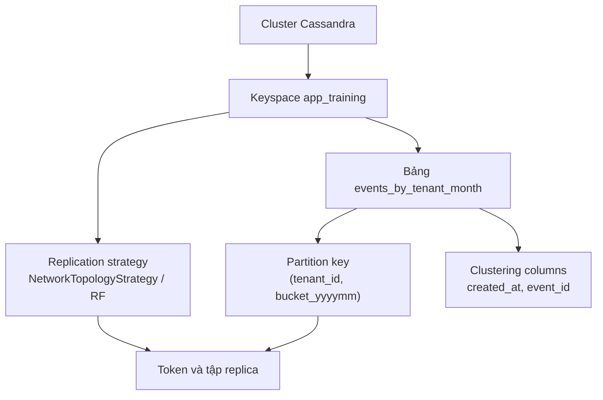

# Khởi tạo keyspace và chạy tập lệnh CQL

## 1. Mục tiêu bài học

Trong **Spring Data Cassandra**, các entity, repository và `CassandraTemplate` làm việc với bảng do **Apache Cassandra** quản lý. Trước khi ứng dụng truy cập dữ liệu, cluster phải có **keyspace** với chính sách replication phù hợp và các **bảng CQL** có partition key, clustering key đáp ứng truy vấn nghiệp vụ.

Bài này thuộc chương **Quản lý lược đồ** và hướng dẫn thiết lập schema bằng tập lệnh CQL có thể lưu trong hệ thống quản lý mã nguồn. Sau bài học, bạn sẽ biết:

1. Keyspace chứa gì, khác bảng như thế nào và vì sao phải khai báo replication theo data center (DC).
2. Tạo keyspace, bảng và dữ liệu mẫu bằng CQL theo một truy vấn cụ thể.
3. Chạy tệp `.cql` bằng `cqlsh -f`, trực tiếp hoặc từ container Docker.
4. Kiểm tra dữ liệu, metadata của keyspace/bảng và phát hiện khi schema khác kỳ vọng.
5. Phân biệt **khởi tạo lần đầu**, **chạy lại script** và **migration schema** khi ứng dụng đã có dữ liệu.
6. Giữ vai trò của Spring Data Cassandra rõ ràng: ánh xạ/truy vấn dữ liệu qua repository hoặc template, không âm thầm thay đổi schema production.

> Ví dụ dùng Cassandra **một node** trong data center `dc1` với replication factor (RF) bằng `1` để học tập. Khi chuyển sang cluster thực tế, nhóm vận hành cần thiết kế RF, node, rack và DC theo mục tiêu chịu lỗi; không sao chép nguyên cấu hình lab vào production.

## 2. Keyspace là gì và liên quan thế nào đến mô hình dữ liệu?

Một **keyspace** là không gian logic chứa các bảng và các cấu trúc schema liên quan. Keyspace còn định nghĩa cách dữ liệu được **nhân bản** giữa các node bằng thuộc tính `replication`. Cách chọn **partition key** nằm ở **từng bảng**, không nằm trong khai báo keyspace.



Các thuật ngữ cần phân biệt:

| Thuật ngữ | Quyết định gì? | Ví dụ |
| --- | --- | --- |
| **Keyspace** | Tập bảng và chính sách replication của dữ liệu. | `app_training` |
| **Data center** | Nhóm node theo topology Cassandra; ảnh hưởng replication và định tuyến theo DC. | `dc1` |
| **Replication strategy** | Cách Cassandra chọn replica. | `NetworkTopologyStrategy` |
| **Replication factor (RF)** | Số bản sao mong muốn của mỗi partition trong phạm vi được cấu hình, thường theo DC. | `'dc1': 1` trong lab |
| **Partition key** | Quyết định partition và token để tìm tập replica. | `(tenant_id, bucket_yyyymm)` |
| **Clustering columns** | Sắp xếp, xác định các hàng **trong cùng partition**. | `created_at DESC, event_id ASC` |
| **Consistency level (CL)** | Số phản hồi replica cần có trước khi thao tác dữ liệu thành công. | `LOCAL_ONE`, `LOCAL_QUORUM` |

**RF khác CL:** `CREATE KEYSPACE` định nghĩa số bản sao và placement; ứng dụng/driver hoặc câu lệnh CQL khi chạy mới quyết định mức nhất quán đọc/ghi. Ví dụ, trong một DC có RF = 3, `LOCAL_QUORUM` cần hai phản hồi; trong lab chỉ có RF = 1, quorum cũng chỉ có một replica. Không thể kiểm tra khả năng chịu lỗi của cluster ba replica bằng cách đặt RF = 3 trên một node đơn lẻ.

### Vì sao nên dùng NetworkTopologyStrategy?

Với `NetworkTopologyStrategy`, ta nêu rõ mỗi DC cần bao nhiêu replica. Đây là cách biểu diễn replication có ý nghĩa khi mở rộng sang nhiều DC. Ví dụ lý thuyết cho cụm có **đủ số node ở từng DC**:

```sql
-- Minh họa topology nhiều DC, KHÔNG chạy trong lab một node.
CREATE KEYSPACE example_multi_dc
WITH replication = {
  'class': 'NetworkTopologyStrategy',
  'dc1': 3,
  'dc2': 3
};
```

Ví dụ trong bài thực hành sẽ dùng `'dc1': 1`. Tên `dc1` phải khớp tên data center mà Cassandra node thực sự báo cáo. Đổi tên DC trong script mà không đổi topology cluster **không tạo ra** một DC mới.

## 3. Chuẩn bị môi trường thực hành

Bạn cần:

- Một Apache Cassandra instance có thể truy cập bằng CQL, ví dụ qua Docker Compose hoặc cluster thực hành đã có.
- Công cụ `cqlsh` tương thích với phiên bản Cassandra đang dùng. Với Docker image chính thức, có thể gọi `cqlsh` **bên trong container**.
- Quyền tạo keyspace và bảng trên môi trường thực hành.
- Một trình soạn thảo văn bản để tạo các tệp `.cql` dưới dạng **UTF-8**.

Để bài học có thể làm lại trên máy riêng, ví dụ dùng cấu hình Compose tối giản dưới đây. Tạo một thư mục `cassandra-schema-lab` chứa tệp `compose.yaml` và thư mục `cql`.

```text
cassandra-schema-lab/
├── compose.yaml
└── cql/
    ├── 001-create-keyspace.cql
    ├── 002-create-tables.cql
    ├── 003-seed-dev.cql
    └── 004-verify.cql
```

Nội dung `compose.yaml`:

```yaml
name: cassandra-schema-lab

services:
  cassandra:
    image: cassandra:4.1
    ports:
      - "127.0.0.1:9042:9042"
    environment:
      CASSANDRA_CLUSTER_NAME: schema-lab
      CASSANDRA_DC: dc1
      CASSANDRA_RACK: rack1
      CASSANDRA_ENDPOINT_SNITCH: GossipingPropertyFileSnitch
      MAX_HEAP_SIZE: 1024M
      HEAP_NEWSIZE: 256M
    volumes:
      - cassandra-data:/var/lib/cassandra
      - ./cql:/cql:ro

volumes:
  cassandra-data:
```

Những điểm quan trọng:

- `127.0.0.1:9042:9042` công bố cổng CQL **trên máy host**; khi `cqlsh` chạy trong container, nó dùng cổng nội bộ.
- `./cql:/cql:ro` gắn thư mục chứa script vào container ở chế độ **chỉ đọc**. Vì vậy `cqlsh -f /cql/...` có thể mở tệp theo đường dẫn trong container.
- `cassandra-data` là named volume giữ dữ liệu và metadata keyspace sau khi container được tạo lại.
- Các giá trị heap chỉ là điểm khởi đầu cho máy học. Cassandra cần RAM/CPU/đĩa đủ; giá trị production phải được đánh giá riêng.

Từ thư mục chứa `compose.yaml`, chạy:

```bash
docker compose config
docker compose up -d
docker compose ps
docker compose logs --tail=80 cassandra
```

**Container đang Up chưa đồng nghĩa CQL sẵn sàng.** Kiểm tra:

```bash
docker compose exec cassandra nodetool status
docker compose exec cassandra cqlsh -e "SELECT cluster_name, data_center FROM system.local;"
```

Khi đã sẵn sàng, node thường có trạng thái `UN` (**Up/Normal**), và query trả về `schema-lab` cùng `dc1`. Nếu `cqlsh` báo không kết nối, kiểm tra log, tài nguyên Docker và thử lại sau khi server hoàn tất khởi động.

Nếu đã có Cassandra khác, bạn có thể **bỏ qua phần Compose** và dùng `cqlsh` trỏ đến instance đó; chỉ cần chỉnh lại tên DC, RF, endpoint và quyền của tài khoản. Các tệp CQL dưới đây vẫn minh họa cùng một quy trình.

## 4. Viết script tạo keyspace

Tệp `cql/001-create-keyspace.cql`:

```sql
-- Tạo keyspace cho môi trường học tập có một node trong DC dc1.
CREATE KEYSPACE IF NOT EXISTS app_training
WITH replication = {
    'class': 'NetworkTopologyStrategy',
    'dc1': 1
}
AND durable_writes = true;
```

Giải thích từng phần:

| Cú pháp | Ý nghĩa |
| --- | --- |
| `CREATE KEYSPACE` | Tạo không gian logic và chính sách nhân bản. |
| `IF NOT EXISTS` | Nếu keyspace **đã tồn tại**, Cassandra không báo lỗi “already exists” cho câu lệnh này. |
| `app_training` | Tên keyspace; tên không trích dẫn thường được chuẩn hóa về chữ thường. |
| `'class': 'NetworkTopologyStrategy'` | Sử dụng replication dựa trên topology DC/rack. |
| `'dc1': 1` | Mỗi partition có một replica ở DC `dc1` trong lab một node. |
| `durable_writes = true` | Bật cơ chế ghi bền vững thông thường của keyspace; đây là giá trị mặc định trong những cấu hình phổ biến. |

**Điểm đặc biệt quan trọng:** `IF NOT EXISTS` chỉ giúp không lỗi khi đối tượng đã có; nó **không đối chiếu và sửa** replication strategy, RF hay những thuộc tính khác cho đúng bản script. Nếu `app_training` đã được tạo với `'dc1': 2`, chạy lại câu lệnh này sẽ không tự đổi RF thành `1`. Quy trình deploy phải có bước **kiểm tra schema thực tế**.

Mở `cqlsh` trực tiếp để thử câu lệnh khi muốn tìm hiểu:

```bash
docker compose exec cassandra cqlsh
```

Trong `cqlsh`, sau khi tạo keyspace có thể kiểm tra:

```sql
DESCRIBE KEYSPACE app_training;

SELECT keyspace_name, replication, durable_writes
FROM system_schema.keyspaces
WHERE keyspace_name = 'app_training';
```

`DESCRIBE` là **lệnh meta của `cqlsh`**, không phải một cú pháp `SELECT` CQL thông thường mà mọi Java Driver có thể thực thi. Với Spring Data/Java Driver, sử dụng metadata driver hoặc query tới system tables nếu phù hợp.

## 5. Viết script tạo bảng theo truy vấn

Giả sử yêu cầu là **lấy các sự kiện gần nhất của một tenant trong một tháng**. Một thiết kế sơ khởi là bảng có composite partition key `(tenant_id, bucket_yyyymm)` và clustering columns `created_at`, `event_id`.

Tệp `cql/002-create-tables.cql`:

```sql
-- Bảng phục vụ truy vấn sự kiện của một tenant trong một tháng.
CREATE TABLE IF NOT EXISTS app_training.events_by_tenant_month (
    tenant_id uuid,
    bucket_yyyymm int,
    created_at timestamp,
    event_id uuid,
    event_type text,
    summary text,
    PRIMARY KEY ((tenant_id, bucket_yyyymm), created_at, event_id)
) WITH CLUSTERING ORDER BY (created_at DESC, event_id ASC);
```

Đường đọc chính của bảng:

```sql
SELECT tenant_id, bucket_yyyymm, created_at, event_id,
       event_type, summary
FROM app_training.events_by_tenant_month
WHERE tenant_id = 11111111-1111-1111-1111-111111111111
  AND bucket_yyyymm = 202611
LIMIT 20;
```

Ta cần hiểu:

1. `tenant_id` và `bucket_yyyymm` **cùng** tạo partition key. Cả hai giá trị cần được cung cấp để định tuyến thẳng tới một logical partition.
2. `created_at DESC` làm các sự kiện mới hơn xuất hiện trước trong partition; `event_id` phân biệt các hàng có cùng timestamp.
3. Bucketing theo tháng giảm nguy cơ một partition tăng mãi, nhưng tenant có lượng sự kiện quá lớn trong một tháng vẫn có thể gây **hot/large partition**. Khi cần, thiết kế bucket phải dựa trên khối lượng dữ liệu thực.
4. Bảng được thiết kế cho truy vấn theo tenant/tháng, **không phải** tìm tùy ý theo `event_type` trên toàn bộ cluster. Không coi `ALLOW FILTERING` là giải pháp chung cho mẫu truy vấn chưa được thiết kế.
5. `IF NOT EXISTS` ở `CREATE TABLE` cũng **không nâng cấp một bảng cũ** nếu cột hoặc khóa khác với CQL mong muốn. Schema drift cần được phát hiện và xử lý bằng migration cụ thể.

Tại sao không tạo bảng với mọi thuộc tính business rồi cho repository tìm mọi trường? Vì Cassandra chọn replica theo partition key, sắp xếp theo clustering columns và không có join tổng quát như cơ sở dữ liệu quan hệ. Các quyết định về bảng là **quyết định hiệu năng và tính đúng đắn**, không chỉ là cấu trúc để Java object có thể serialize.

## 6. Dữ liệu mẫu và script xác minh

Tệp `cql/003-seed-dev.cql` chứa dữ liệu thử nghiệm có UUID ổn định để dễ chạy lại trong môi trường lab:

```sql
INSERT INTO app_training.events_by_tenant_month (
    tenant_id, bucket_yyyymm, created_at,
    event_id, event_type, summary
) VALUES (
    11111111-1111-1111-1111-111111111111,
    202611,
    '2026-11-25T08:00:00Z',
    22222222-2222-2222-2222-222222222222,
    'ORDER_CREATED',
    'Đã tạo đơn hàng'
);

INSERT INTO app_training.events_by_tenant_month (
    tenant_id, bucket_yyyymm, created_at,
    event_id, event_type, summary
) VALUES (
    11111111-1111-1111-1111-111111111111,
    202611,
    '2026-11-24T08:00:00Z',
    33333333-3333-3333-3333-333333333333,
    'ORDER_PAID',
    'Đơn hàng đã thanh toán'
);
```

Tệp `cql/004-verify.cql`:

```sql
-- 1. Kiểm tra thông tin keyspace.
SELECT keyspace_name, replication
FROM system_schema.keyspaces
WHERE keyspace_name = 'app_training';

-- 2. Kiểm tra bảng đã được đăng ký trong schema.
SELECT table_name
FROM system_schema.tables
WHERE keyspace_name = 'app_training';

-- 3. Kiểm tra kết quả truy vấn theo partition key.
SELECT tenant_id, bucket_yyyymm, created_at,
       event_id, event_type, summary
FROM app_training.events_by_tenant_month
WHERE tenant_id = 11111111-1111-1111-1111-111111111111
  AND bucket_yyyymm = 202611
LIMIT 20;
```

Truy vấn cuối cần trả về hai sự kiện, với `2026-11-25` trước `2026-11-24` vì cấu hình clustering order. Dùng dữ liệu mẫu **chỉ cho dev/lab**; không tự động seed dữ liệu giả vào production.

Lưu ý về việc chạy lại seed: `INSERT` của Cassandra là thao tác upsert theo primary key. Hai `INSERT` bên trên dùng cùng khóa ổn định nên không sinh thêm hàng mới mỗi lần chạy, nhưng chúng **vẫn là thao tác ghi mới** và có thể ảnh hưởng timestamp/TTL hoặc dữ liệu đã được cập nhật sau đó. Vì vậy không được suy diễn rằng script seed luôn an toàn để chạy đi chạy lại trên dữ liệu thật.

## 7. Thực thi tập lệnh CQL bằng cqlsh

### 7.1. Chạy tệp bên trong container

Vì `./cql` đã được mount vào `/cql`, các lệnh dưới đây có thể chạy lần lượt từ thư mục Compose:

```bash
docker compose exec -T cassandra cqlsh -f /cql/001-create-keyspace.cql
docker compose exec -T cassandra cqlsh -f /cql/002-create-tables.cql
docker compose exec -T cassandra cqlsh -f /cql/003-seed-dev.cql
docker compose exec -T cassandra cqlsh -f /cql/004-verify.cql
```

`-f` nhận **đường dẫn tệp nhìn từ môi trường chạy `cqlsh`**, tức `/cql/...` bên trong container trong ví dụ. `-T` tắt cấp phát pseudo-TTY của `docker compose exec`, phù hợp cho chạy không tương tác trong pipeline.

Để chạy một câu lệnh kiểm tra nhanh mà không tạo script mới:

```bash
docker compose exec -T cassandra cqlsh -e "DESCRIBE KEYSPACE app_training;"
```

`-e` chạy một chuỗi lệnh được truyền từ command line. Với những thao tác DDL hoặc seed dài, tệp `.cql` thường dễ review và tái lập hơn một lệnh `-e` nhiều dòng.

### 7.2. Nếu cqlsh đã được cài trên máy host

Có thể chạy trực tiếp từ host với endpoint đã public qua port mapping:

```bash
cqlsh 127.0.0.1 9042 -f cql/001-create-keyspace.cql
cqlsh 127.0.0.1 9042 -f cql/002-create-tables.cql
cqlsh 127.0.0.1 9042 -f cql/004-verify.cql
```

Cần cài `cqlsh` phiên bản tương thích và xác nhận quyền truy cập TCP. Việc `cqlsh` chạy được bên trong container **không chứng minh** host có thể truy cập nếu port mapping hoặc firewall sai.

### 7.3. Nếu lệnh chạy qua PowerShell/CI

Các lệnh `docker compose exec -T ... cqlsh -f ...` ở trên cũng có thể dùng trong PowerShell vì đường dẫn tệp là đường dẫn **bên trong container**. Tránh phụ thuộc vào shell redirection hoặc nội suy biến phức tạp khi có thể mount trực tiếp thư mục script.

Trong automation, phải chạy **các script theo đúng thứ tự**, kiểm tra exit code, stderr/stdout và cuối cùng **xác minh schema**. Không coi `IF NOT EXISTS` là bằng chứng mọi đối tượng đang có cấu trúc mong đợi.

Để tách riêng schema và dữ liệu thử nghiệm, pipeline production **không chạy** `003-seed-dev.cql`, và tốt nhất dùng một cơ chế migration có theo dõi phiên bản và quyền được cấp riêng.

### 7.4. Cách hiểu việc chạy nhiều script

`cqlsh -f` giúp gửi **nhiều câu lệnh CQL tuần tự**, nhưng bản thân danh sách DDL **không phải một transaction nguyên tử**. Ví dụ, nếu tạo keyspace thành công rồi tạo bảng thứ hai thất bại, hệ thống vẫn có thể giữ các thay đổi trước đó.

Do đó quy trình đáng tin cậy nên:

1. **Kiểm tra đầu vào:** phiên bản Cassandra, DC, quyền DDL, cấu hình replication và các tệp cần triển khai.
2. **Thực thi theo thứ tự phụ thuộc:** keyspace → bảng → migration tăng dần → xác minh.
3. **Kiểm tra lỗi:** dừng phát hành ứng dụng khi script lỗi hoặc phát hiện schema khác kỳ vọng.
4. **Xác minh hậu triển khai:** kiểm tra keyspace, bảng, cột, primary key, chỉ mục cần thiết và metadata/schema agreement khi triển khai nhiều node.
5. **Chỉ mở traffic cho code mới** khi schema cần thiết đã sẵn sàng trên cluster.

## 8. Kiểm tra schema thực tế và schema agreement

Sau khi chạy script, mở `cqlsh` và dùng:

```sql
DESCRIBE KEYSPACE app_training;
DESCRIBE TABLE app_training.events_by_tenant_month;
```

Đây là cách xem lại DDL mà `cqlsh` nhận diện. Để kiểm tra bằng CQL có thể dùng trong công cụ không hỗ trợ `DESCRIBE`:

```sql
SELECT keyspace_name, replication, durable_writes
FROM system_schema.keyspaces
WHERE keyspace_name = 'app_training';

SELECT table_name
FROM system_schema.tables
WHERE keyspace_name = 'app_training';

SELECT column_name, kind, position, type
FROM system_schema.columns
WHERE keyspace_name = 'app_training'
  AND table_name = 'events_by_tenant_month';
```

Trên cluster nhiều node, schema change cần được lan truyền và thống nhất. Hãy xác nhận **schema agreement** bằng công cụ/metadata của driver hoặc lệnh quản trị phù hợp trước khi rollout ứng dụng phụ thuộc schema mới. Cluster một node không thể mô phỏng độ trễ lan truyền giữa các node.

### Tại sao chỉ SELECT hai dòng mẫu là chưa đủ?

Truy vấn chạy được chứng minh **một** luồng đọc đang hoạt động. Nó chưa chứng minh:

- RF/DC đúng với kỳ vọng production.
- Primary key và clustering order đúng với **mọi** query của ứng dụng.
- Các bảng/index khác đã được tạo đầy đủ.
- Toàn bộ node đã đồng thuận về phiên bản schema.
- Ứng dụng đã xử lý phân trang, timeout và consistency đúng nghiệp vụ.

Vì vậy, cần kiểm tra **cấu trúc schema** song song với **hành vi query**.

## 9. Kết nối schema đã tạo với Spring Data Cassandra

Khi schema có sẵn, ứng dụng **Spring Boot 3.x** có thể dùng dependency `spring-boot-starter-data-cassandra` và cấu hình:

```yaml
spring:
  cassandra:
    contact-points: 127.0.0.1
    port: 9042
    local-datacenter: dc1
    keyspace-name: app_training
    schema-action: NONE
```

Giải thích:

- `contact-points` và `port` chỉ đường tới CQL endpoint. Khi ứng dụng ở **cùng Docker Compose network**, tên service `cassandra` thường thay cho `127.0.0.1`; trong container, `localhost` là container đó.
- `local-datacenter` phải phù hợp DC mà Cassandra trả về, tức `dc1` trong ví dụ. Đây là thông tin quan trọng để Java Driver định tuyến.
- `keyspace-name` phải trỏ đến keyspace **đã được tạo**; cấu hình này **không tự tạo keyspace**.
- `schema-action: NONE` giữ cho ứng dụng không tự tạo/đổi/xóa bảng khi startup. Với quy trình quản lý schema bằng script, đây là lựa chọn an toàn để dễ kiểm soát.

Nếu dùng Spring Boot ở phiên bản khác, cần kiểm tra namespace thuộc tính Cassandra của chính phiên bản đó. Những snippet Spring Boot 2.x có thể dùng `spring.data.cassandra.*` thay vì `spring.cassandra.*`.

### Ánh xạ entity phải khớp với bảng CQL

Ở bảng `events_by_tenant_month`, khóa gồm **hai partition key columns** và **hai clustering columns**. Một entity Spring Data dùng `@PrimaryKeyClass` và `@PrimaryKeyColumn` để mô tả khóa tổng hợp:

```java
import java.io.Serializable;
import java.time.Instant;
import java.util.UUID;

import org.springframework.data.cassandra.core.cql.Ordering;
import org.springframework.data.cassandra.core.mapping.PrimaryKeyClass;
import org.springframework.data.cassandra.core.mapping.PrimaryKeyColumn;
import org.springframework.data.cassandra.core.mapping.PrimaryKeyType;

@PrimaryKeyClass
public class EventKey implements Serializable {

    @PrimaryKeyColumn(name = "tenant_id", ordinal = 0,
        type = PrimaryKeyType.PARTITIONED)
    private UUID tenantId;

    @PrimaryKeyColumn(name = "bucket_yyyymm", ordinal = 1,
        type = PrimaryKeyType.PARTITIONED)
    private Integer bucketYyyymm;

    @PrimaryKeyColumn(name = "created_at", ordinal = 0,
        type = PrimaryKeyType.CLUSTERED, ordering = Ordering.DESCENDING)
    private Instant createdAt;

    @PrimaryKeyColumn(name = "event_id", ordinal = 1,
        type = PrimaryKeyType.CLUSTERED, ordering = Ordering.ASCENDING)
    private UUID eventId;

    // Bổ sung constructor, getters/setters, equals/hashCode
    // theo yêu cầu của phiên bản Java/Spring Data trong dự án.
}
```

Class trên **minh họa cấu trúc khóa**, chưa là entity hoàn chỉnh. Trong dự án thực cần `@Table("events_by_tenant_month")`, trường `@PrimaryKey` kiểu `EventKey`, các field còn lại, constructor và phương thức truy cập cần thiết. Repository dùng đúng khóa, ví dụ `CassandraRepository<EventByTenantMonth, EventKey>`.

Đừng kỳ vọng Spring Data tự sửa bảng theo khóa Java nếu `schema-action: NONE`. Khi mapping không khớp schema, ứng dụng sẽ gặp lỗi khi ghi/đọc; đó là tín hiệu cần **đối chiếu DDL và code**.

### Dùng CassandraTemplate hoặc CqlSession cho query

`CassandraTemplate` hỗ trợ thao tác dữ liệu qua abstraction Spring Data; repository thuận tiện cho truy vấn rõ ràng. Khi muốn tự viết CQL hoặc kiểm tra metadata, có thể dùng `CqlSession` (Java Driver 4.x):

```java
import java.util.UUID;

import com.datastax.oss.driver.api.core.CqlSession;
import com.datastax.oss.driver.api.core.cql.PreparedStatement;
import com.datastax.oss.driver.api.core.cql.ResultSet;

public class EventQueryService {

    private final CqlSession session;
    private final PreparedStatement findRecent;

    public EventQueryService(CqlSession session) {
        this.session = session;
        this.findRecent = session.prepare(
            "SELECT tenant_id, bucket_yyyymm, created_at, " +
            "event_id, event_type, summary " +
            "FROM app_training.events_by_tenant_month " +
            "WHERE tenant_id = ? AND bucket_yyyymm = ? LIMIT 20"
        );
    }

    public ResultSet findRecent(UUID tenantId, int bucketYyyymm) {
        return session.execute(
            findRecent.bind(tenantId, bucketYyyymm)
        );
    }
}
```

Dùng prepared statement với đủ partition key giúp driver có thông tin định tuyến theo token, đồng thời tránh ghép các giá trị vào câu CQL bằng chuỗi. Với kết quả lớn hơn, dùng page size/paging state của driver và xem lại chiến lược bucket; `LIMIT 20` ở đây chỉ giới hạn tối đa số hàng query trả về.

**Chú ý:** `CqlSession`, repository và template được ứng dụng dùng sau khi schema tồn tại; chúng không thay thế công cụ quản lý migration. Mỗi ứng dụng không nên tự chạy lại tất cả DDL khi vừa khởi động nếu có nhiều instance triển khai cùng lúc.

## 10. Khởi tạo khác migration như thế nào?

Một dự án chỉ có script `CREATE KEYSPACE IF NOT EXISTS` và `CREATE TABLE IF NOT EXISTS` chưa đủ cho vòng đời schema. Khi có dữ liệu và traffic thật, bạn sẽ cần thay đổi có phiên bản, có review, kiểm tra tương thích và kế hoạch phục hồi.

| Công việc | Ví dụ | Nguyên tắc |
| --- | --- | --- |
| **Bootstrap** | Tạo keyspace/bảng trên môi trường mới. | Chạy một lần theo thứ tự; xác minh cấu trúc. |
| **Seed dev** | Tạo vài dòng dữ liệu phục vụ kiểm thử. | Chỉ dùng ở môi trường học/dev; tránh động vào dữ liệu thật. |
| **Migration cộng thêm** | Thêm cột thường, tạo bảng mới phục vụ query mới. | Xem xét tương thích với code cũ/mới; phát hành theo nhiều bước khi cần. |
| **Migration có đổi đường đọc/ghi** | Chia partition mới, đổi primary key, thêm bảng theo truy vấn. | Thường phải tạo bảng mới, backfill dữ liệu, dual-write/đối soát rồi chuyển traffic. |
| **Thay RF/topology** | Thêm DC hoặc thay số replica. | Nhóm vận hành chủ trì; không coi đây là ALTER KEYSPACE vô hại. |
| **Thao tác phá hủy** | Xóa bảng, xóa cột/dữ liệu, đổi retention. | Có backup/restore đã kiểm chứng và quy trình phê duyệt cụ thể. |

### Ví dụ migration thêm một cột

Giả sử version tiếp theo cần ghi nguồn phát sinh sự kiện. Có thể tạo một migration mới, ví dụ `005-add-source.cql`:

```sql
ALTER TABLE app_training.events_by_tenant_month
ADD source text;
```

Khác với `CREATE ... IF NOT EXISTS`, **không được giả định** lệnh `ALTER TABLE ... ADD` này có thể chạy lại tùy ý trên schema đã cập nhật. Công cụ quản lý migration cần ghi nhận phiên bản đã áp dụng và từ chối chạy lại sai trạng thái; nếu chạy thủ công phải kiểm tra cột đã tồn tại hay chưa.

Với ứng dụng chạy nhiều instance, một chiến lược triển khai an toàn là:

1. Tạo migration **tương thích ngược** với phiên bản ứng dụng đang chạy; kiểm tra schema được áp dụng đầy đủ.
2. Triển khai code mới có thể chấp nhận dữ liệu cũ chưa có `source`.
3. Backfill hoặc chuyển luồng ghi nếu nghiệp vụ yêu cầu.
4. Chỉ xóa cấu trúc cũ sau khi code cũ không còn phụ thuộc và đã có phương án khôi phục.

**Không thể thay primary key của bảng Cassandra bằng một ALTER TABLE đơn giản** để chuyển từ partition key cũ sang partition key mới. Cách phổ biến là tạo bảng mới theo query pattern mới, chuyển/đồng bộ dữ liệu và cập nhật code. Không dùng `BEGIN BATCH` như “transaction DDL” để bảo đảm toàn bộ migration tự rollback khi một câu lệnh lỗi.

### Lưu phiên bản và kiểm tra drift

Một quy trình thực tế thường cần:

- Đánh số và lưu tệp migration bất biến trong version control.
- Chạy bằng pipeline/deploy job **duy nhất** có quyền DDL, không phải tất cả instance Spring Boot cùng chạy.
- Ghi nhận version/checksum, thời điểm và người hoặc job triển khai bằng một công cụ/quy ước migration phù hợp Cassandra.
- So sánh schema thực tế với DDL mong đợi; báo lỗi nếu `IF NOT EXISTS` che một định nghĩa không tương thích.
- Tạo snapshot/backup phù hợp trước migration rủi ro và **thử restore**, thay vì tin rằng mọi thay đổi có thể rollback trực tiếp bằng DDL ngược.

Cassandra **không có cơ chế rollback schema/data tự động** giống transaction DDL của một số hệ quản trị khác. Tách thay đổi thành bước nhỏ, có xác minh và kế hoạch phục hồi rõ ràng.

## 11. Những lỗi thường gặp

| Hiện tượng | Nguyên nhân có thể | Hướng xử lý |
| --- | --- | --- |
| `cqlsh` báo `Connection refused` hoặc timeout | Cassandra chưa sẵn sàng, sai host/port hoặc Docker network. | Xem `docker compose ps`, log; chạy `SELECT data_center FROM system.local;` khi kết nối được. |
| `CREATE KEYSPACE` thất bại vì thiếu quyền | Tài khoản không có quyền DDL. | Dùng tài khoản/deploy role được cấp quyền phù hợp; không mở quyền rộng cho runtime app. |
| Keyspace tạo xong nhưng RF không đúng script | Keyspace đã tồn tại, `IF NOT EXISTS` bỏ qua định nghĩa mới; hoặc sai DC. | Xem `system_schema.keyspaces`, đối chiếu topology và lập migration/đổi RF có kiểm soát. |
| Báo lỗi DC/replication | Tên DC trong map `replication` không khớp cluster hoặc cấu hình topology không phù hợp. | Xem `system.local` và trạng thái cluster; sửa cho khớp topology thực tế. |
| `CREATE TABLE IF NOT EXISTS` chạy “thành công” nhưng entity lỗi | Bảng cũ đã có schema khác DDL mong đợi. | `DESCRIBE TABLE` và `system_schema.columns`; tạo migration chứ không dựa vào `IF NOT EXISTS`. |
| `Unconfigured table`, `InvalidQueryException` | Chưa chạy script tạo bảng, trỏ sai keyspace hoặc query không hợp primary key. | Xem script order, keyspace/column metadata và query thực tế. |
| Script thứ hai chạy trước script tạo keyspace | Thứ tự migration sai. | Chạy `001` rồi `002`, chỉ seed khi bảng tồn tại. |
| `cqlsh -f` không thấy tệp | Tệp ở host nhưng `cqlsh` chạy **trong container** và chưa mount đường dẫn. | Dùng volume `./cql:/cql:ro` hoặc dùng `cqlsh` chạy từ host. |
| Query theo `tenant_id` nhưng thiếu `bucket_yyyymm` | Composite partition key chưa đủ. | Truyền đủ khóa partition hoặc thiết kế thêm bảng cho truy vấn khác. |
| Spring Boot startup lỗi keyspace hoặc DC | `keyspace-name` chưa tồn tại, local DC không khớp, hoặc sai endpoint. | Kiểm tra `system.local`, `DESCRIBE KEYSPACE` và cấu hình driver. |
| Schema khác nhau giữa các node sau migration | DDL chưa lan truyền đầy đủ, node mất kết nối hoặc sự cố cluster. | Chờ/kiểm tra schema agreement; phối hợp vận hành Cassandra. |
| Chạy script lại làm thay đổi dữ liệu thử nghiệm | Seed dùng upsert và ghi đè hàng cùng primary key. | Chỉ seed trên dev; version hóa và kiểm soát thao tác dữ liệu. |

### Tránh ba cách “chữa cháy” sai

- **Không bật `ALLOW FILTERING` để né lỗi mô hình dữ liệu** khi thiếu partition key; có thể gây truy vấn quét rộng khi số liệu tăng.
- **Không tăng RF/CL tùy ý để sửa lỗi DDL**; RF cần đủ node phù hợp, CL liên quan số phản hồi đọc/ghi, không thay thế xác minh schema.
- **Không để mọi instance ứng dụng tự chạy DDL khi startup** trong lúc rollout, đặc biệt nếu có nhiều bản ứng dụng cũ/mới cùng hoạt động.

## 12. Bài tập thực hành và checklist

### Bài tập

1. Tạo keyspace `app_training` bằng `001-create-keyspace.cql`, xác nhận `replication` từ `system_schema.keyspaces`.
2. Chạy `002-create-tables.cql`, xem lại `DESCRIBE TABLE` và các hàng `system_schema.columns`. Xác định đúng **hai partition-key columns** và thứ tự clustering.
3. Seed hai sự kiện, chạy `004-verify.cql`. Giải thích vì sao sự kiện có `created_at` mới hơn được hiển thị trước.
4. Chạy lại hai script `001` và `002` trên môi trường lab. Kiểm tra schema không thay đổi; giải thích vì sao điều đó **chưa chứng minh** hai script có thể nâng cấp schema cũ.
5. Tạo một **lab riêng** có bảng đã tồn tại với cấu trúc khác, sau đó chạy `CREATE TABLE IF NOT EXISTS`. Quan sát cách script không tự đưa bảng về định nghĩa bạn mong muốn.
6. Cấu hình Spring Data Cassandra với `schema-action: NONE`, thử repository hoặc `CqlSession` đọc theo `tenant_id` và `bucket_yyyymm`. Quan sát lỗi nếu keyspace hoặc table chưa được tạo.
7. Lập kế hoạch cho thay đổi partition key: đề xuất bảng mới, cách backfill, đọc/ghi trong giai đoạn chuyển và tiêu chí xác minh trước khi tắt bảng cũ.

### Checklist đưa vào dự án

- [ ] Môi trường CQL và tên DC đã được xác minh từ cluster, không suy đoán.
- [ ] Keyspace dùng replication strategy, RF theo topology thực tế và yêu cầu chịu lỗi.
- [ ] Bảng có primary key/clustering columns thiết kế theo **truy vấn cần phục vụ**.
- [ ] Script bootstrap được lưu và review trong version control, chạy theo đúng thứ tự.
- [ ] Có phân biệt bootstrap, seed dev và migration production.
- [ ] Không coi `IF NOT EXISTS` là công cụ kiểm tra/migrate schema drift.
- [ ] Đã kiểm tra schema metadata và schema agreement trước khi cho phép code mới sử dụng.
- [ ] Spring Data Cassandra dùng đúng keyspace, local DC, entity mapping và `schema-action: NONE` khi schema do script quản lý.
- [ ] Có kiểm tra paging, consistency level, partition size và hiệu năng query liên quan.
- [ ] Migration có lịch sử phiên bản, backup/restore và phương án chuyển dữ liệu khi thay đổi primary key.

**Kết luận:** Tạo keyspace là bước **xác định replication theo topology Cassandra**; chạy tập lệnh CQL là cách **triển khai schema có thể tái lập và kiểm tra được**. Spring Data Cassandra giúp viết entity/repository/template trên schema đó, nhưng tính đúng đắn và hiệu năng vẫn bắt đầu từ partition key, mẫu truy vấn, CL và quy trình migration có kiểm soát.
