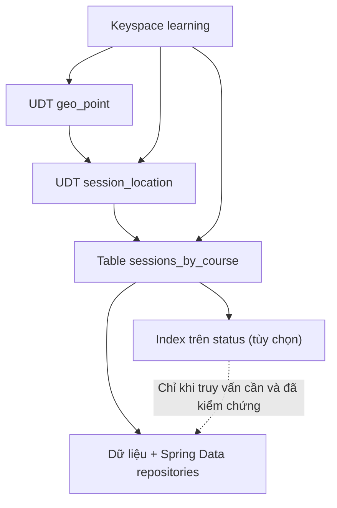
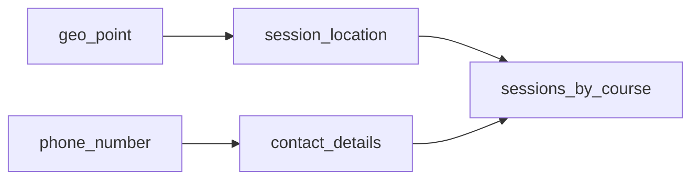
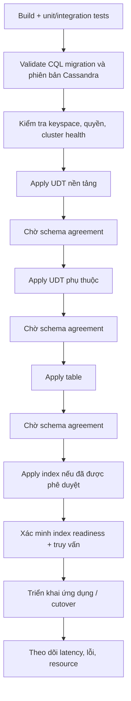

# Thứ tự tạo UDT, bảng và chỉ mục

Một ứng dụng **Spring Data Cassandra** có thể dùng entity mapping, `CassandraRepository`, `CassandraTemplate` và truy vấn CQL để truy cập Apache Cassandra. Tuy vậy, trước khi đọc hoặc ghi được dữ liệu, **lược đồ CQL (schema)** phải tồn tại và các thành phần của nó phải được tạo theo **đúng thứ tự phụ thuộc**.

Khi bảng có cột thuộc kiểu do người dùng định nghĩa (**User-Defined Type – UDT**), Cassandra cần biết kiểu đó trước khi tạo bảng. Khi tạo **secondary index**, Cassandra cần bảng và cột đích đã tồn tại. Nếu còn thiếu keyspace, cả kiểu, bảng và chỉ mục đều không thể được tạo tại vị trí mong muốn.

Bài học này tập trung vào quy tắc:

**Keyspace → UDT nền tảng → UDT phụ thuộc → bảng → chỉ mục → nạp dữ liệu và sử dụng từ ứng dụng.**

Đó là thứ tự **triển khai mới từ trạng thái trống**. Khi nâng cấp hệ thống đang chạy, có thể cần nhiều đợt migration và backfill, nhưng quan hệ phụ thuộc giữa các đối tượng CQL vẫn phải được tôn trọng.

Sau bài này, bạn sẽ có thể:

- Vẽ được đồ thị phụ thuộc giữa keyspace, UDT lồng nhau, bảng và index.
- Viết bộ CQL tạo schema có thể áp dụng theo thứ tự.
- Giải thích vì sao `IF NOT EXISTS` không đồng nghĩa kiểm tra schema tương thích.
- Biết lúc nào dùng secondary index, lúc nào cần bảng theo hướng truy vấn.
- Ánh xạ UDT và bảng bằng Spring Data Cassandra mà không phụ thuộc việc startup tự sửa schema.
- Thiết kế migration, kiểm tra schema agreement, xử lý lỗi triển khai và thay đổi schema đã có dữ liệu.

## 1. Ba khái niệm cần phân biệt

| Khái niệm | Vai trò | Phụ thuộc vào |
| --- | --- | --- |
| **UDT (`CREATE TYPE`)** | Định nghĩa một kiểu CQL chứa các trường có tên, ví dụ địa điểm buổi học | Keyspace; có thể phụ thuộc UDT khác |
| **Bảng (`CREATE TABLE`)** | Lưu các hàng Cassandra, với partition key, clustering columns và cột dữ liệu | Keyspace và mọi UDT được tham chiếu trong cột |
| **Chỉ mục (`CREATE INDEX`)** | Thêm đường truy cập theo cột cho một số kiểu truy vấn được hỗ trợ | Bảng, cột đích, loại index được phiên bản Cassandra hỗ trợ |

UDT là **kiểu dữ liệu**, không phải bảng. Tạo UDT không tạo ra các hàng độc lập để truy vấn. Nếu muốn tìm mọi địa điểm có cùng `building`, việc có trường `building` bên trong UDT không tự tạo một chỉ mục hay bảng truy vấn theo `building`.

Chỉ mục cũng không phải primary key. **Partition key** của bảng vẫn điều khiển cách Cassandra phân phối dữ liệu; index thêm khả năng tìm kiếm trên cột theo cơ chế cụ thể và có chi phí riêng.

### Ví dụ xuyên suốt: lịch học theo khóa học

Hệ thống học tập cần API:

```text
GET /tenants/{tenantId}/courses/{courseId}/sessions
```

API trả về các buổi học của một khóa học, sắp theo thời gian, có thể hiển thị địa điểm (tòa nhà, phòng) và trạng thái. Ta thiết kế:

- `geo_point`: UDT lưu tọa độ vĩ độ/kinh độ.
- `session_location`: UDT lưu tên cơ sở, tòa nhà, phòng và `geo_point`.
- `sessions_by_course`: bảng có partition key `(tenant_id, course_id)`, clustering keys `(starts_at, session_id)`, cột `location` kiểu `session_location`.
- `sessions_by_course_status_idx`: một **chỉ mục tùy chọn** trên `status`, chỉ triển khai nếu nhu cầu truy vấn và phiên bản Cassandra thực sự phù hợp.

Sơ đồ phụ thuộc:



Nếu tạo `session_location` trước `geo_point`, CQL thiếu kiểu `geo_point`. Nếu tạo bảng trước `session_location`, CQL thiếu kiểu cột `location`. Nếu tạo index trước bảng hoặc trước khi bảng có cột `status`, index không có đối tượng để bám vào.

## 2. Bước 0: xác định đúng cluster, phiên bản và keyspace

Trước khi thay đổi schema, cần biết **mình đang kết nối tới cluster nào**. Mỗi môi trường local, test, staging và production nên có keyspace/credentials được kiểm soát độc lập.

Cần kiểm tra:

1. Phiên bản Apache Cassandra thực tế và những tính năng index được hỗ trợ. Trong Apache Cassandra nguồn mở, **SAI (Storage-Attached Indexing) được tích hợp trong Cassandra 5.0**; ở các bản cũ như 4.1, không dùng cùng câu lệnh SAI trừ khi bản phân phối có hỗ trợ riêng.
2. Tên keyspace, datacenter và replication policy.
3. Quyền tạo type/table/index của tài khoản migration.
4. Schema đã có những đối tượng nào; không giả định môi trường đang trống.
5. Mức tải và thời điểm triển khai nếu tạo index trên bảng đã chứa nhiều dữ liệu.

### Tạo keyspace trước các đối tượng con

Ví dụ **local development một node**:

```sql
CREATE KEYSPACE IF NOT EXISTS learning
WITH replication = {
    'class': 'SimpleStrategy',
    'replication_factor': 1
};
```

Trong production nhiều node/datacenter, phải chọn `NetworkTopologyStrategy` và replication factor theo topology thật, không sao chép RF=1 từ local.

Keyspace là phạm vi tên của cả UDT, bảng và index. Có thể sử dụng tên đủ chuẩn `learning.geo_point` và `learning.sessions_by_course` trong script, giảm phụ thuộc `USE learning` hoặc keyspace mặc định của tool đang chạy.

> **Lưu ý:** `CREATE KEYSPACE IF NOT EXISTS` chỉ tránh lỗi khi keyspace đã tồn tại. Nó không so sánh replication policy hiện có với cấu hình mong muốn. Trong một migration production, vẫn cần kiểm tra schema thực tế và quyết định cách xử lý khác biệt.

## 3. Bước 1: tạo UDT nền tảng

UDT mô tả một nhóm thuộc tính có ý nghĩa cùng nhau. Ở đây, vị trí của cơ sở học tập có tọa độ:

```sql
CREATE TYPE IF NOT EXISTS learning.geo_point (
    latitude double,
    longitude double
);
```

`geo_point` có hai trường `double`. Kiểu này chỉ mô tả cấu trúc dữ liệu; nó **không tạo tọa độ cho mọi khóa học** và không có partition key.

### Khi nào nên dùng UDT?

UDT có thể thích hợp cho một giá trị có cấu trúc nhỏ, ví dụ địa chỉ giao hàng, địa điểm buổi học hoặc liên hệ người hướng dẫn, khi ứng dụng thường đọc/ghi như một phần của một hàng.

Không nên dùng UDT như cách thay thế bảng riêng cho một tập phần tử **tăng không giới hạn**. Ví dụ, lưu hàng triệu buổi học vào một collection UDT của một hàng sẽ khiến truy cập và cập nhật ngày càng khó kiểm soát; thay vào đó, thiết kế bảng có clustering columns.

### Frozen UDT và hệ quả cập nhật

Trong ví dụ tiếp theo, ta dùng `frozen<...>` cho UDT lồng nhau và cột của bảng. `frozen` làm cho giá trị UDT được xem như **một giá trị hợp nhất** ở vị trí khai báo, phù hợp khi địa điểm thường được ghi/đọc cùng nhau.

Đối với một cột `frozen<session_location>`, muốn thay một trường con như `room` thường cần ghi lại **toàn bộ giá trị UDT** của cột đó; không giả định có thể cập nhật độc lập từng field như một cột thường. Quy tắc chi tiết về frozen/non-frozen UDT tùy phiên bản CQL, nên lựa chọn phải tương thích với phiên bản Cassandra đang triển khai.

## 4. Bước 2: tạo UDT phụ thuộc vào UDT trước đó

Giờ tạo `session_location`, có trường `point` dùng kiểu `geo_point` vừa tạo:

```sql
CREATE TYPE IF NOT EXISTS learning.session_location (
    campus text,
    building text,
    room text,
    point frozen<geo_point>
);
```

Vì cả hai kiểu cùng thuộc keyspace `learning`, trường `point` có thể tham chiếu `geo_point` theo tên trong phạm vi keyspace. UDT phụ thuộc phải được tạo **sau** UDT mà nó sử dụng.

Thứ tự đúng:

```text
1. CREATE TYPE learning.geo_point
2. CREATE TYPE learning.session_location
```

Thứ tự sai:

```text
1. CREATE TYPE learning.session_location  -- tham chiếu geo_point chưa tồn tại
2. CREATE TYPE learning.geo_point
```

### Lập đồ thị phụ thuộc khi có nhiều UDT

Một hệ thống có thể có:



Khi đó, `geo_point` và `phone_number` có thể được tạo độc lập trước; `session_location` và `contact_details` chỉ được tạo khi kiểu của chúng đã có; bảng chờ tất cả UDT mà nó tham chiếu.

Đây là **topological order** của một đồ thị có hướng. Không nên chọn thứ tự theo tên file, tên class hay alphabetical order nếu chúng không phản ánh phụ thuộc. Đặt migration version theo quan hệ này để việc chạy lại trên cluster sạch có kết quả xác định.

### Vì sao không đổi tên trường tùy tiện?

UDT là một phần của **hợp đồng dữ liệu CQL**. Cả Java mapping và các bảng đang sử dụng đều phụ thuộc tên trường/kiểu trường. Một thao tác `ALTER TYPE` ảnh hưởng tới mọi vị trí đang dùng UDT trong keyspace, không chỉ một repository.

Nên chọn tên rõ ràng và xây kế hoạch tương thích khi sửa schema. Việc thêm field thường dễ xử lý hơn thay đổi ngữ nghĩa field đã có.

## 5. Bước 3: tạo bảng sau khi các UDT đã sẵn sàng

Bảng phục vụ truy vấn buổi học theo khóa học:

```sql
CREATE TABLE IF NOT EXISTS learning.sessions_by_course (
    tenant_id uuid,
    course_id uuid,
    starts_at timestamp,
    session_id uuid,

    title text,
    status text,
    location frozen<session_location>,

    PRIMARY KEY ((tenant_id, course_id), starts_at, session_id)
) WITH CLUSTERING ORDER BY (starts_at ASC, session_id ASC);
```

Đọc schema:

- `(tenant_id, course_id)` là **partition key ghép**. Một tenant/khóa học xác định tập buổi học cần đọc.
- `starts_at` và `session_id` là **clustering columns**, quyết định thứ tự và định danh các hàng bên trong partition.
- `title`, `status` là regular columns.
- `location` có kiểu `frozen<session_location>`. Nếu UDT `session_location` chưa được tạo, câu `CREATE TABLE` này không thể được xử lý hợp lệ.

### Truy vấn chính đã có đường truy cập tốt

```sql
SELECT starts_at, session_id, title, status, location
FROM learning.sessions_by_course
WHERE tenant_id = ? AND course_id = ?;
```

Cassandra có thể định vị đúng logical partition từ khóa ghép. Đây là cách đọc chính mà bảng được thiết kế, không cần secondary index.

Có thể giới hạn khoảng thời gian bằng clustering column:

```sql
SELECT starts_at, session_id, title, location
FROM learning.sessions_by_course
WHERE tenant_id = ? AND course_id = ?
  AND starts_at >= ? AND starts_at < ?;
```

Việc giới hạn khoảng clustering phải tuân theo thứ tự clustering và quy tắc CQL. Nên dùng driver paging nếu khóa học có nhiều buổi học, không tải tất cả vào bộ nhớ ứng dụng.

### Có cần bảng khác nếu truy vấn đổi hướng?

Nếu API mới yêu cầu “các buổi học của một giảng viên trong tháng”, bảng trên không có partition key theo giảng viên. Đừng tự ý thêm index chỉ vì bảng đã có sẵn. Cân nhắc bảng `sessions_by_instructor_month` hoặc một mô hình đọc khác được thiết kế từ truy vấn thực tế.

**UDT và index không sửa được partition key đã chọn sai**. Đây là nguyên tắc quan trọng của Cassandra khi thiết kế theo truy vấn.

## 6. Bước 4: tạo chỉ mục khi bảng đã tồn tại

Chỉ mục phụ thuộc vào **bảng cụ thể** và **cột cụ thể**. Không thể tạo index khi `sessions_by_course` hoặc `status` chưa có.

Tuy nhiên, **thứ tự phụ thuộc đúng không đồng nghĩa cần tạo chỉ mục**. Trước hết hãy xác định truy vấn chưa được bảng đáp ứng và đánh giá cardinality, phân bố dữ liệu, selectivity, quy mô cluster, tần suất đọc/ghi và loại index.

### 6.1. Secondary index truyền thống (2i)

Với Apache Cassandra có hỗ trợ loại secondary index truyền thống, cú pháp minh họa:

```sql
CREATE INDEX IF NOT EXISTS sessions_by_course_status_2i_idx
ON learning.sessions_by_course (status);
```

Index này được tạo **sau** bảng. Dù câu lệnh có thể hợp lệ, dùng 2i cho một cột có rất ít giá trị như `status` (ví dụ `DRAFT`, `PUBLISHED`) và quét diện rộng trên nhiều partition thường là lựa chọn kém hiệu quả. Không tự chuyển một báo cáo “tất cả buổi học đã xuất bản toàn hệ thống” sang 2i mà chưa kiểm chứng bằng dữ liệu/tải thật.

Một số tình huống 2i dễ xử lý hơn khi truy vấn vẫn giới hạn bằng partition key và dữ liệu có phân bố phù hợp. Hiệu năng và giới hạn của 2i phụ thuộc phiên bản và workload; cần benchmark.

### 6.2. Storage-Attached Indexing (SAI) của Cassandra 5.0

Trên **Apache Cassandra 5.0** hỗ trợ SAI, thay vì dùng 2i truyền thống, có thể tạo một SAI index trên cột tương ứng:

```sql
CREATE INDEX IF NOT EXISTS sessions_by_course_status_sai_idx
ON learning.sessions_by_course (status)
USING 'sai';
```

**Hai đoạn `CREATE INDEX` ở trên là hai lựa chọn minh họa; không phải yêu cầu tạo cả hai index trên cùng cột.** Chọn một cách phù hợp với phiên bản đang chạy, query patterns và yêu cầu vận hành.

SAI tích hợp với lưu trữ SSTable và có phạm vi tính năng khác 2i. Dù vậy, SAI **không phải công cụ tìm kiếm toàn văn tổng quát**, không biến Cassandra thành RDBMS có JOIN, và không loại bỏ nhu cầu thiết kế partition theo truy vấn. Cấu hình index, loại dữ liệu được index và điều kiện `WHERE` hợp lệ phải kiểm chứng theo **đúng phiên bản**.

Ở Apache Cassandra 4.1 nguồn mở, không giả định câu `USING 'sai'` hoạt động. Một số bản phân phối có tính năng indexing riêng; phải phân biệt rõ tài liệu của hệ quản trị được triển khai.

### 6.3. Thử nghiệm truy vấn có index

Giả sử ứng dụng muốn lọc trạng thái **trong một khóa học**:

```sql
SELECT starts_at, session_id, title
FROM learning.sessions_by_course
WHERE tenant_id = ?
  AND course_id = ?
  AND status = ?;
```

Khả năng thực thi trực tiếp câu này và chi phí thực tế phụ thuộc loại index và phiên bản. Không nên mặc định CQL hợp lệ trong mọi phiên bản hay index tự tạo đường đọc tối ưu. Hãy chạy truy vấn trên cluster test cùng loại index đã chọn, quan sát kế hoạch/thực thi phù hợp và đánh giá dữ liệu đại diện.

Với bảng có số buổi học nhỏ, có thể đọc theo đầy đủ partition key rồi lọc một số trạng thái tại tầng ứng dụng nếu chi phí chấp nhận được. Với yêu cầu truy vấn thường xuyên, khối lượng lớn, một bảng `sessions_by_course_status` được thiết kế riêng có thể đáng cân nhắc.

### 6.4. Index build không có nghĩa ứng dụng đã sẵn sàng

Tạo index trên bảng đã có dữ liệu có thể cần xây dựng cấu trúc index cho các hàng cũ. **Schema agreement** cho biết metadata schema đã hội tụ giữa các node theo cơ chế Cassandra; nó **không đồng nghĩa** mọi index đã hoàn tất xây dựng, mọi dữ liệu đã backfill hay query đã đạt latency mong muốn.

Trước khi chuyển traffic sang truy vấn phụ thuộc index mới:

1. Xác minh index đã có trong schema.
2. Xác minh index ở trạng thái sử dụng được theo cơ chế/metrics của loại index và phiên bản.
3. Thử truy vấn với dữ liệu thực tế đại diện.
4. Theo dõi tải index build, read latency, write latency, disk/memory và lỗi.
5. Chỉ bật đường đọc mới khi các điều kiện rollout đã đạt.

## 7. Bộ migration CQL theo thứ tự hoàn chỉnh

Tổ chức các file migration có version để cùng một bộ schema có thể dựng lại từ môi trường trống. Ví dụ quy ước:

```text
db/cassandra/
  V001__create_learning_keyspace.cql
  V002__create_geo_point_type.cql
  V003__create_session_location_type.cql
  V004__create_sessions_by_course_table.cql
  V005__create_session_status_index.cql
  V006__seed_demo_sessions.cql
```

`V001`, `V002`... chỉ là **quy ước đặt tên**. Spring Data Cassandra không tự phát hiện/chạy các file này. Cần pipeline hoặc migration runner chuyên biệt hỗ trợ Cassandra và có cơ chế ghi nhận migration đã chạy.

| Migration | DDL/hoạt động | Điều kiện bắt buộc trước đó |
| --- | --- | --- |
| `V001` | `CREATE KEYSPACE learning` | Có cluster và quyền tạo keyspace |
| `V002` | `CREATE TYPE learning.geo_point` | Keyspace `learning` |
| `V003` | `CREATE TYPE learning.session_location` | UDT `geo_point` |
| `V004` | `CREATE TABLE learning.sessions_by_course` | UDT `session_location` và keyspace |
| `V005` | `CREATE INDEX ... ON sessions_by_course` | Bảng/cột đích và hỗ trợ loại index |
| `V006` | Nạp dữ liệu demo (chỉ ở môi trường phù hợp) | Bảng và mapping đã sẵn sàng |

**Không nạp fixture demo vào production chỉ vì file tồn tại.** Dữ liệu seed cần được điều khiển theo môi trường. Một bộ migration production phải tách schema migrations khỏi test/demo fixtures.

### Script đầy đủ dành cho local Cassandra 5.0

Đoạn sau thể hiện thứ tự có thể thực thi trong một keyspace local một node, **với lựa chọn SAI của Cassandra 5.0**:

```sql
-- 1. Keyspace
CREATE KEYSPACE IF NOT EXISTS learning
WITH replication = {
    'class': 'SimpleStrategy',
    'replication_factor': 1
};

-- 2. UDT nền tảng
CREATE TYPE IF NOT EXISTS learning.geo_point (
    latitude double,
    longitude double
);

-- 3. UDT phụ thuộc
CREATE TYPE IF NOT EXISTS learning.session_location (
    campus text,
    building text,
    room text,
    point frozen<geo_point>
);

-- 4. Bảng
CREATE TABLE IF NOT EXISTS learning.sessions_by_course (
    tenant_id uuid,
    course_id uuid,
    starts_at timestamp,
    session_id uuid,
    title text,
    status text,
    location frozen<session_location>,
    PRIMARY KEY ((tenant_id, course_id), starts_at, session_id)
) WITH CLUSTERING ORDER BY (starts_at ASC, session_id ASC);

-- 5. Index là tùy chọn, chỉ khi yêu cầu truy vấn đã được xác minh
CREATE INDEX IF NOT EXISTS sessions_by_course_status_sai_idx
ON learning.sessions_by_course (status)
USING 'sai';
```

**Để áp dụng trên Cassandra 4.1**, bỏ lệnh tạo SAI ở cuối và chỉ sử dụng index được phiên bản hỗ trợ nếu thật sự cần. Phần keyspace, UDT và table ở trên vẫn minh họa được đúng quan hệ phụ thuộc.

Trong production, cần thay replication local, kiểm tra tên DC, quyền, đường truy cập và schema hiện có; không sao chép nguyên script local vào một cluster đang phục vụ dữ liệu thật.

### Tại sao `IF NOT EXISTS` chưa đủ cho migration?

Giả sử `learning.session_location` đã tồn tại nhưng thiếu trường `room`. Khi chạy lại:

```sql
CREATE TYPE IF NOT EXISTS learning.session_location (
    campus text,
    building text,
    room text,
    point frozen<geo_point>
);
```

Cassandra có thể bỏ qua lệnh vì type đã tồn tại, **không sửa type thành định nghĩa mới**. Tương tự, `CREATE TABLE IF NOT EXISTS` không chứng minh primary key hay kiểu cột khớp với entity Java; `CREATE INDEX IF NOT EXISTS` cũng không xác minh index hiện có dùng đúng loại và options mong muốn.

Vì vậy:

- Dùng migration **có phiên bản và lịch sử áp dụng**.
- Kiểm tra schema thực tế thay vì dựa vào no-op của `IF NOT EXISTS`.
- Với khác biệt không tương thích, báo lỗi triển khai rõ ràng; đừng âm thầm cho app tiếp tục với schema cũ.

## 8. Spring Data Cassandra tham gia vào quá trình này thế nào?

Spring Data Cassandra ánh xạ Java classes sang UDT và bảng CQL. Mapping giúp tạo truy vấn/đọc ghi thuận tiện, nhưng **không thay thế thứ tự tồn tại của các đối tượng trên Cassandra**.

### 8.1. Mapping UDT nền tảng

```java
import org.springframework.data.cassandra.core.mapping.UserDefinedType;

@UserDefinedType("geo_point")
public class GeoPoint {
    private Double latitude;
    private Double longitude;

    // Constructors, getters/setters.
}
```

### 8.2. Mapping UDT phụ thuộc

```java
import org.springframework.data.cassandra.core.mapping.Frozen;
import org.springframework.data.cassandra.core.mapping.UserDefinedType;

@UserDefinedType("session_location")
public class SessionLocation {
    private String campus;
    private String building;
    private String room;

    @Frozen
    private GeoPoint point;

    // Constructors, getters/setters.
}
```

`@UserDefinedType` xác định tên UDT. `@Frozen` biểu diễn giá trị UDT frozen ở đúng vị trí cần thiết trong mapping. Mọi class cần được scan/cấu hình bởi Spring Data và tương thích với schema CQL của keyspace đang kết nối.

### 8.3. Mapping bảng có composite primary key

```java
import java.io.Serializable;
import java.time.Instant;
import java.util.UUID;

import org.springframework.data.cassandra.core.cql.PrimaryKeyType;
import org.springframework.data.cassandra.core.mapping.PrimaryKeyClass;
import org.springframework.data.cassandra.core.mapping.PrimaryKeyColumn;

@PrimaryKeyClass
public class CourseSessionKey implements Serializable {

    @PrimaryKeyColumn(name = "tenant_id", ordinal = 0,
                      type = PrimaryKeyType.PARTITIONED)
    private UUID tenantId;

    @PrimaryKeyColumn(name = "course_id", ordinal = 1,
                      type = PrimaryKeyType.PARTITIONED)
    private UUID courseId;

    @PrimaryKeyColumn(name = "starts_at", ordinal = 2,
                      type = PrimaryKeyType.CLUSTERED)
    private Instant startsAt;

    @PrimaryKeyColumn(name = "session_id", ordinal = 3,
                      type = PrimaryKeyType.CLUSTERED)
    private UUID sessionId;

    // Constructors, getters/setters, equals, hashCode.
}
```

Entity:

```java
import org.springframework.data.cassandra.core.mapping.Column;
import org.springframework.data.cassandra.core.mapping.Frozen;
import org.springframework.data.cassandra.core.mapping.PrimaryKey;
import org.springframework.data.cassandra.core.mapping.Table;

@Table("sessions_by_course")
public class CourseSession {

    @PrimaryKey
    private CourseSessionKey key;

    @Column("title")
    private String title;

    @Column("status")
    private String status;

    @Frozen
    @Column("location")
    private SessionLocation location;

    // Constructors, getters/setters.
}
```

Các class Java trên là ví dụ mapping rút gọn; đặt trong file riêng và bổ sung constructor/accessors cần thiết. `Instant` ánh xạ sang CQL `timestamp` theo khả năng của phiên bản Spring Data/driver đang dùng. Đừng tự suy ra schema đúng chỉ vì source Java compile.

Repository:

```java
import org.springframework.data.cassandra.repository.CassandraRepository;

public interface CourseSessionRepository
        extends CassandraRepository<CourseSession, CourseSessionKey> {
}
```

Repository sử dụng mapping để đọc/ghi dữ liệu; nó cần keyspace, type và table đã tồn tại nếu không dùng schema generation. CQL tạo index không tự phát sinh chỉ vì ứng dụng có method `findByStatus`.

### 8.4. `SchemaAction`: dùng sao cho đúng?

Spring Data Cassandra hỗ trợ nhiều chế độ quản lý schema qua `SchemaAction`, thường được cấu hình trong Spring Boot bằng `spring.cassandra.schema-action`.

| Chế độ | Ý nghĩa khái quát | Phạm vi nên cân nhắc |
| --- | --- | --- |
| `none` / `NONE` | Không tự tạo hoặc xóa schema | Khuyến nghị khi schema do migration quản lý |
| `create` / `CREATE` | Tạo các đối tượng schema từ metadata mapping | Môi trường được kiểm soát, cân nhắc đối tượng đã tồn tại |
| `create_if_not_exists` / `CREATE_IF_NOT_EXISTS` | Tạo khi chưa có, bỏ qua đối tượng đã tồn tại | Tiện cho bootstrap đơn giản, **không** tự đồng bộ schema cũ |
| `recreate` / `RECREATE` | Xóa và tạo lại các đối tượng được quản lý | Chỉ trong môi trường test/dev dùng dữ liệu có thể hủy |
| `recreate_drop_unused` / `RECREATE_DROP_UNUSED` | Xóa mạnh hơn và tái tạo theo metadata được biết | Có thể làm mất dữ liệu, không dùng tùy tiện |

Tên property/các giá trị được chấp nhận cần đối chiếu đúng dòng Spring Boot đang chạy. Những lựa chọn `RECREATE` và `RECREATE_DROP_UNUSED` có thể **xóa bảng/type và mất dữ liệu**.

Spring Data có thể hỗ trợ sinh UDT, bảng và một số loại index từ annotation (chẳng hạn `@Indexed`, `@SaiIndexed` ở phiên bản phù hợp). Nhưng khi muốn một migration sản xuất có lịch sử, thứ tự phụ thuộc rõ ràng, index options xác định và review CQL trước rollout, nên sử dụng **schema-action: none** cùng pipeline CQL versioned.

Chỉ thêm `@UserDefinedType` trong code **không làm UDT tự xuất hiện** khi schema-action là `none`. Tương tự, annotation ánh xạ không chuyển đổi một cột UDT đã tồn tại sang kiểu khác.

## 9. Thay đổi UDT, bảng và index đã có dữ liệu

Tạo mới và **nâng cấp schema** là hai tình huống khác nhau. Sau khi dữ liệu thật xuất hiện, cần tính đến code cũ, code mới, schema trên cluster, cách backfill và khả năng rollback.

### 9.1. Thêm field vào UDT

Ví dụ địa điểm cần thêm tầng (`floor`):

```sql
ALTER TYPE learning.session_location
ADD floor int;
```

Đây là thay đổi thường có thể tương thích nếu code xử lý field mới **có thể vắng/null** trong dữ liệu cũ. Theo CQL, giá trị UDT được tạo trước khi field xuất hiện có thể thiếu giá trị field mới; không coi field là bắt buộc ngay lập tức.

Trình tự hợp lý:

1. Triển khai `ALTER TYPE` trước khi code bắt đầu phụ thuộc field `floor`.
2. Chờ schema agreement và xác minh định nghĩa thực tế.
3. Deploy code đọc được cả UDT cũ lẫn mới.
4. Nếu nghiệp vụ cần giá trị cho lịch sử, backfill có kiểm soát.
5. Chỉ áp dụng validation bắt buộc ở API khi dữ liệu và luồng ghi đã sẵn sàng.

Đổi tên hoặc bỏ field cần đánh giá sâu hơn vì nhiều entity/bảng có thể đang tham chiếu. Không xem `DROP TYPE` là bước sửa lỗi vô hại khi UDT đã dùng trong bảng.

### 9.2. Thêm cột thường vào bảng

```sql
ALTER TABLE learning.sessions_by_course
ADD presenter_name text;
```

Code cũ không biết `presenter_name` thường vẫn có thể hoạt động; code mới cần chấp nhận `null` cho hàng cũ. Đây là một ví dụ của rollout **expand trước, chuyển code sau**.

Ngược lại, nếu cần đổi partition key, Cassandra không cho phép coi đó là thao tác chỉnh annotation/migration nhỏ. Phải tạo **bảng khác** với key mới, ghi/backfill dữ liệu rồi chuyển truy vấn đọc.

### 9.3. Thay đổi index

Tùy loại index và phiên bản, một thay đổi về option, loại hoặc target có thể đòi hỏi **drop và tạo lại**. Với SAI, tài liệu Apache Cassandra mô tả việc thay đổi index thông qua drop/recreate, không có lệnh `ALTER INDEX` tùy ý như bảng quan hệ.

Đặc biệt lưu ý:

- Build/rebuild index trên bảng lớn có thể tiêu tốn CPU, disk, I/O và ảnh hưởng latency.
- Nếu drop index trong lúc ứng dụng còn phụ thuộc truy vấn đó, các request có thể lỗi hoặc buộc phải đổi đường đọc.
- Nếu cần thay 2i bằng SAI, phải chứng minh target version hỗ trợ SAI và chuẩn bị cutover có kiểm soát; không chỉ thay câu CQL giữa hai lần startup.

### 9.4. Gỡ schema: phụ thuộc theo thứ tự ngược

Ở **môi trường test dùng dữ liệu có thể xóa**, nếu chủ động tháo toàn bộ mô hình ví dụ, thứ tự phụ thuộc ngược lại là:

```text
1. Dừng code/query còn sử dụng mô hình.
2. DROP INDEX trên bảng.
3. DROP TABLE phụ thuộc vào UDT.
4. DROP TYPE session_location.
5. DROP TYPE geo_point.
6. Chỉ sau cùng mới cân nhắc DROP KEYSPACE nếu cần xóa toàn bộ.
```

Ví dụ lệnh **phá hủy dữ liệu** (chỉ để hiểu phụ thuộc; không chạy trên production):

```sql
DROP INDEX IF EXISTS learning.sessions_by_course_status_sai_idx;
DROP TABLE IF EXISTS learning.sessions_by_course;
DROP TYPE IF EXISTS learning.session_location;
DROP TYPE IF EXISTS learning.geo_point;
```

Các lệnh drop khác có thể đã có phụ thuộc từ đối tượng khác trong cùng keyspace; cần kiểm tra thực tế trước khi thực thi. Cassandra từ chối drop UDT còn đang được bảng/UDT khác sử dụng. `DROP TABLE` làm mất dữ liệu của bảng; `DROP KEYSPACE` phá hủy toàn bộ nội dung trong keyspace. Không coi “có thể chạy lại CREATE” là cơ chế backup/khôi phục.

## 10. Schema agreement và kiểm tra sau từng bước

Cassandra là hệ phân tán, metadata schema cần được phổ biến tới các node. Khi thực thi nhiều DDL liên tiếp, migration runner cần bảo đảm **bước phụ thuộc được nhận diện đầy đủ** trước khi chạy bước tiếp theo.

Một kịch bản lỗi thường gặp:

```text
Node A đã áp dụng CREATE TYPE geo_point
Node B còn metadata cũ

Pipeline lập tức gửi CREATE TYPE session_location qua node B
=> Có thể gặp lỗi kiểu chưa tồn tại hoặc schema chưa hội tụ
```

Cần có cơ chế chờ/kiểm tra schema agreement theo driver/tool đang dùng. Chỉ thêm `sleep 5` không phải bảo đảm đáng tin cậy khi cluster nhiều node hoặc đang tải nặng.

### Kiểm tra bằng `cqlsh`

Sau migration, có thể dùng các lệnh của **cqlsh**:

```sql
DESCRIBE KEYSPACE learning;
DESCRIBE TYPE learning.geo_point;
DESCRIBE TYPE learning.session_location;
DESCRIBE TABLE learning.sessions_by_course;
```

`DESCRIBE` là tiện ích của `cqlsh`, không phải câu SELECT dữ liệu nghiệp vụ gửi từ repository. Nếu cần truy vấn metadata hệ thống, Cassandra có các bảng `system_schema` với phạm vi và quyền truy cập tùy môi trường.

Ví dụ kiểm tra đối tượng đã tồn tại:

```sql
SELECT type_name
FROM system_schema.types
WHERE keyspace_name = 'learning';

SELECT table_name
FROM system_schema.tables
WHERE keyspace_name = 'learning';

SELECT index_name, table_name, kind
FROM system_schema.indexes
WHERE keyspace_name = 'learning';
```

Các truy vấn metadata trên dùng để xác minh sự hiện diện. Chúng **không đủ** để chứng minh mapping Java hợp lệ, index hoàn tất xây dựng hay một truy vấn lớn đã có hiệu năng tốt.

### Smoke test từ Java Driver

Ví dụ sau có thể chạy **sau khi schema đã tồn tại** bằng `CqlSession` do Spring Boot quản lý:

```java
import java.util.UUID;
import com.datastax.oss.driver.api.core.CqlSession;
import com.datastax.oss.driver.api.core.cql.SimpleStatement;
import org.springframework.stereotype.Component;

@Component
public class SessionSchemaSmokeCheck {
    private final CqlSession session;

    public SessionSchemaSmokeCheck(CqlSession session) {
        this.session = session;
    }

    public void check(UUID tenantId, UUID courseId) {
        var statement = SimpleStatement.newInstance(
            "SELECT session_id, starts_at, location " +
            "FROM sessions_by_course " +
            "WHERE tenant_id = ? AND course_id = ? LIMIT 1",
            tenantId, courseId
        );
        session.execute(statement);
    }
}
```

Ví dụ giả định keyspace mặc định là `learning`, hoặc có thể dùng tên bảng đủ `learning.sessions_by_course`. Truy vấn `SELECT` với kết quả rỗng vẫn có ích để kiểm tra bảng/cột tồn tại và câu CQL hợp lệ; nó không kiểm tra tính đúng đắn của dữ liệu nghiệp vụ.

Không nên chạy smoke check như một lệnh schema migration tự động trên mọi request; nó thuộc kiểm tra sau triển khai hoặc health/readiness được kiểm soát phù hợp.

## 11. Vì sao migration không nên phụ thuộc mỗi lần startup ứng dụng?

Giả sử deployment chạy 10 instance Spring Boot. Nếu cả 10 instance đều cố tạo UDT, bảng và index ngay khi khởi động, các trường hợp sau dễ phát sinh:

- Nhiều tác nhân cùng thay đổi schema, gây lỗi “already exists” hoặc làm kết quả khó dự đoán.
- Cấu hình `CREATE_IF_NOT_EXISTS` che giấu sự khác biệt giữa schema thực tế và mapping mong muốn.
- Tạo index trên bảng lớn có thể kéo dài, trong khi instance đã bắt đầu nhận traffic.
- Các instance code cũ/mới có mapping khác nhau, vô tình tạo sự phụ thuộc vào thứ tự startup.
- Tài khoản ứng dụng phải có quyền DDL không cần thiết cho truy cập thường ngày.

Với production, nên tách **migration step** có quyền và lịch sử riêng, thực hiện trước khi phiên bản code mới phụ thuộc schema. Ứng dụng dùng `schema-action: none` và tài khoản chỉ có quyền `SELECT`/`MODIFY` theo chức năng. Lệnh DDL được review, theo dõi và rollback/forward fix có kế hoạch.

Pipeline gợi ý:



Trong thực tế, các bước này được quản lý bằng versioned migrations và workflow triển khai; không nhất thiết có một stage CI cho từng DDL nhỏ. Điều bắt buộc là **không phá vỡ thứ tự phụ thuộc** và không chuyển traffic sớm.

## 12. Kiểm thử migration với Cassandra thật

Unit test cho service không kiểm tra được thứ tự tạo UDT/bảng/index. Cần integration test dùng **Cassandra thực**, chẳng hạn Testcontainers với đúng phiên bản target và CQL script dựng lại schema.

Kịch bản test hữu ích:

1. Khởi động Cassandra test độc lập, tạo keyspace.
2. Áp dụng tuần tự các migration.
3. Xác minh các UDT có đúng tên/field.
4. Xác minh bảng và primary key/clustering order đúng như entity.
5. Xác minh index phù hợp phiên bản; chờ trạng thái sẵn sàng nếu test yêu cầu truy vấn qua index.
6. Ghi một hàng có `SessionLocation` chứa `GeoPoint` bằng repository/template.
7. Đọc lại bằng partition key, kiểm tra nested UDT đã được mapping đúng.
8. Chạy lại theo lịch sử migration để bảo đảm không có bước vô tình bị lặp; đồng thời kiểm tra một schema lệch không bị âm thầm chấp nhận.

### Ví dụ dữ liệu với UDT

Sau khi schema đã được tạo, có thể thêm một buổi học trong `cqlsh` hoặc bằng prepared statement (ở đây dùng CQL literal để minh họa):

```sql
INSERT INTO learning.sessions_by_course (
    tenant_id,
    course_id,
    starts_at,
    session_id,
    title,
    status,
    location
) VALUES (
    11111111-1111-1111-1111-111111111111,
    22222222-2222-2222-2222-222222222222,
    '2026-12-01T09:00:00Z',
    33333333-3333-3333-3333-333333333333,
    'Cassandra và thiết kế theo truy vấn',
    'PUBLISHED',
    {
        campus: 'Cơ sở A',
        building: 'B1',
        room: '301',
        point: { latitude: 10.78, longitude: 106.69 }
    }
);
```

Đọc theo đúng partition key:

```sql
SELECT starts_at, session_id, title, status, location
FROM learning.sessions_by_course
WHERE tenant_id = 11111111-1111-1111-1111-111111111111
  AND course_id = 22222222-2222-2222-2222-222222222222;
```

Trong ứng dụng, nên dùng prepared statement/bound parameters để truyền UUID, timestamp và UDT thay vì nối chuỗi CQL từ input người dùng.

**Chú ý:** Testcontainers Cassandra 4.1 có thể kiểm chứng UDT và bảng nhưng không kiểm chứng SAI của Apache Cassandra 5.0. Nếu production dùng SAI, test tích hợp liên quan index phải chạy trên phiên bản/cấu hình hỗ trợ SAI hoặc một môi trường tương đương.

## 13. Chẩn đoán các lỗi thường gặp

| Triệu chứng | Nguyên nhân thường gặp | Hướng xử lý |
| --- | --- | --- |
| `Unknown keyspace` | Chưa tạo keyspace, trỏ nhầm môi trường, tên không đúng | Kiểm tra kết nối và chạy migration keyspace trước |
| `Unknown type` khi tạo UDT khác | UDT được tham chiếu chưa tồn tại | Sắp thứ tự UDT theo phụ thuộc |
| `Unknown type` khi tạo bảng | Chưa tạo `session_location` hoặc đang ở keyspace khác | Kiểm tra UDT và tên keyspace |
| `Unknown table` khi tạo index | Index chạy trước `CREATE TABLE` | Chạy table migration trước index |
| `Unknown column` trong index | Bảng chưa có cột được index | Xem CQL table thực tế, áp dụng `ALTER TABLE` nếu cần |
| `CREATE INDEX ... USING 'sai'` thất bại | Cassandra không hỗ trợ SAI hoặc cấu hình/index type sai | Kiểm tra phiên bản và tài liệu đúng bản phân phối |
| Migration báo thành công nhưng Java mapping lỗi | Schema tồn tại nhưng khác CQL/UDT metadata Java mong đợi | Đối chiếu type/table/field, kiểm tra version migration |
| `IF NOT EXISTS` không sửa định nghĩa cũ | Câu lệnh đã bị bỏ qua | Dùng `ALTER` có chủ đích hoặc migration tương thích |
| API lỗi ngay sau index creation | Index chưa hoàn tất xây dựng, query không được hỗ trợ hoặc không đúng điều kiện | Kiểm tra readiness, query, metrics và cutover |
| Câu truy vấn chậm sau khi thêm index | Phân bố dữ liệu/cardinality không phù hợp, đọc nhiều partition, tăng tải | Benchmark và cân nhắc bảng theo truy vấn |
| Drop UDT bị từ chối | Bảng/UDT khác vẫn tham chiếu | Xem dependency graph; không drop dữ liệu thật tùy tiện |
| Ứng dụng startup cố sửa schema production | `schema-action` hoặc quyền DDL cấu hình không phù hợp | Chuyển sang migration step riêng, dùng `schema-action: none` |

Một lỗi DDL nên được xử lý bằng việc **xem schema thực tế và quan hệ phụ thuộc** trước khi chạy lại. Không nên giải quyết lỗi “unknown type” bằng cách drop cả keyspace, và không nên chọn `RECREATE` trên cluster có dữ liệu thật.

## 14. Bài tập thiết kế và đáp án gợi ý

Giả sử nền tảng học tập có yêu cầu mới:

- Thêm `contact_info` kiểu UDT chứa số điện thoại và email của người hướng dẫn.
- Bảng `sessions_by_course` cần thêm cột `contact` với kiểu này.
- API cần lọc các buổi học theo trạng thái `PUBLISHED` trong một khóa học.
- Production hiện chạy Cassandra 4.1, dự kiến nâng cấp lên 5.0 sau này.

Hãy trả lời:

1. Cần tạo đối tượng nào trước khi dùng `contact_info` trong bảng?
2. Nếu `contact_info` có trường `phone` là UDT `phone_number`, thứ tự giữa hai UDT là gì?
3. Nếu bảng `sessions_by_course` đã tồn tại, có cần tạo lại để thêm cột `contact` không? Câu CQL nào hợp lý?
4. Trong Cassandra 4.1, có thể dùng ngay cú pháp `USING 'sai'` trong migration production không?
5. Nếu dùng index lọc `status`, có cần benchmark không? Nếu không muốn index, ứng dụng có phương án truy cập nào?
6. Vì sao `CREATE TABLE IF NOT EXISTS` không xác nhận schema đang phù hợp với mapping Spring Data?
7. Khi nào mới cho phép code đọc field `contact` hoặc dựa vào index mới?
8. Nếu cần gỡ `contact_info` sau này, vì sao không thể `DROP TYPE` ngay khi vẫn có bảng dùng nó?

**Hướng giải:**

- Tạo `phone_number` trước, sau đó tạo `contact_info`, rồi thêm cột bảng bằng `ALTER TABLE ... ADD contact frozen<contact_info>` sau khi các UDT có mặt; kiểm tra schema agreement và khả năng tương thích với code cũ.
- Cassandra 4.1 nguồn mở không hỗ trợ SAI như Cassandra 5.0, vì vậy không triển khai câu `USING 'sai'` theo ví dụ 5.0. Chỉ chọn index được phiên bản hỗ trợ và phải có benchmark. Nếu chỉ cần lọc trong một partition nhỏ, có thể đọc theo partition key rồi lọc trong ứng dụng; nếu tải lớn, cân nhắc bảng theo truy vấn.
- Chỉ bật code phụ thuộc field/index khi migration đã hoàn tất, schema/đường đọc sẵn sàng và dữ liệu có ý nghĩa theo hợp đồng.
- Muốn drop UDT cần loại bỏ mọi phụ thuộc ở bảng/UDT khác, đồng thời có kế hoạch xử lý dữ liệu.

## 15. Checklist ngắn trước khi triển khai

- [ ] Đã xác nhận Cassandra version, keyspace, DC và replication phù hợp môi trường.
- [ ] Đã xác định đồ thị phụ thuộc giữa UDT lồng nhau, bảng và index.
- [ ] Migration tạo **keyspace → UDT nền tảng → UDT phụ thuộc → bảng → index** theo đúng thứ tự.
- [ ] Không sử dụng `IF NOT EXISTS` để che giấu schema drift.
- [ ] Index chỉ được tạo khi truy vấn, khả năng hỗ trợ và chi phí đã được xác minh.
- [ ] Đã có kiểm tra schema agreement và readiness của index nếu có.
- [ ] Spring Data mapping khớp với CQL schema, `schema-action` được kiểm soát.
- [ ] Đã thử migration từ môi trường trống và môi trường có phiên bản schema cũ.
- [ ] Có kế hoạch rollout/backfill/rollback hoặc forward fix cho thay đổi đã có dữ liệu.
- [ ] Không sử dụng `DROP`/`RECREATE` tùy tiện trên môi trường production.

## Ghi nhớ

**Thứ tự tạo schema trong Cassandra được quyết định bởi quan hệ phụ thuộc của đối tượng CQL.** Keyspace phải tồn tại trước UDT, UDT nền tảng phải có trước UDT tham chiếu nó, bảng phải có mọi kiểu cột cần thiết, và index phải có bảng/cột đích.

Spring Data Cassandra giúp ánh xạ `@UserDefinedType`, `@Frozen`, `@Table`, repository và `CassandraTemplate`, nhưng cấu hình schema generation không thay thế một quy trình migration production có phiên bản, schema agreement và kiểm tra tương thích.

**Index là quyết định tối ưu truy vấn, không phải bước bắt buộc của mọi bảng.** Hãy ưu tiên mô hình bảng theo partition key; chỉ tạo 2i hoặc SAI khi phiên bản hỗ trợ, truy vấn có lợi và chi phí vận hành được kiểm chứng.

### Tài liệu tham khảo

- [Apache Cassandra — Data Types và User-Defined Types](https://cassandra.apache.org/doc/stable/cassandra/developing/cql/types.html)
- [Apache Cassandra — Data Definition Language](https://cassandra.apache.org/doc/stable/cassandra/developing/cql/ddl.html)
- [Apache Cassandra — Indexing Concepts](https://cassandra.apache.org/doc/stable/cassandra/developing/cql/indexing/indexing-concepts.html)
- [Apache Cassandra — Storage-Attached Indexing](https://cassandra.apache.org/doc/stable/cassandra/developing/cql/indexing/sai/sai-overview.html)
- [Spring Data Cassandra — Schema Management](https://docs.spring.io/spring-data/cassandra/reference/cassandra/schema-management.html)
- [Spring Data Cassandra — Object Mapping](https://docs.spring.io/spring-data/cassandra/reference/object-mapping.html)
