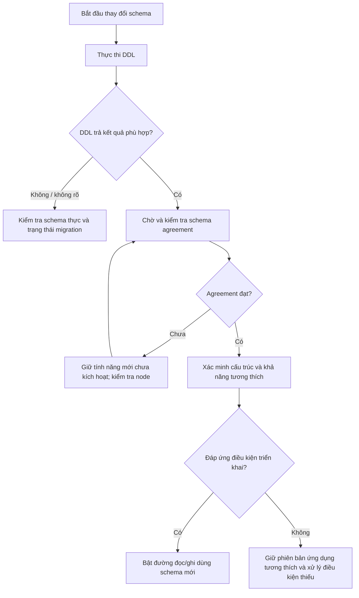
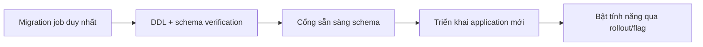

# Schema agreement và thời điểm ứng dụng có thể dùng lược đồ mới

## Mục tiêu học tập

Một câu lệnh `CREATE TABLE` hoặc `ALTER TABLE` trên Apache Cassandra có thể trả kết quả thành công trong khi việc lan truyền thông tin lược đồ đến các node khác vẫn đang tiếp diễn. Nếu ứng dụng Spring Data Cassandra bắt đầu đọc, ghi hoặc prepare câu lệnh dựa trên cấu trúc mới quá sớm, một số request có thể thất bại tùy node tiếp nhận và trạng thái metadata của driver.

Bài học này thuộc phần **Quản lý lược đồ** của `SPRING_DATA_CASSANDRA`. Sau khi học, bạn có thể:

- Giải thích **schema propagation**, **schema version** và **schema agreement** trong cụm Cassandra.
- Phân biệt lệnh DDL đã được một node chấp nhận với việc các node đã thống nhất một phiên bản schema.
- Xác định **khi nào ứng dụng có thể sử dụng lược đồ mới** dựa trên điều kiện kỹ thuật và khả năng tương thích, thay vì chỉ dựa vào một thông báo “DDL thành công”.
- Lập quy trình triển khai thay đổi bảng CQL an toàn với Spring Data Cassandra, repository, `CassandraTemplate` và prepared statements.
- Nhận biết các trường hợp **schema agreement không đủ**: node không sẵn sàng, driver metadata chưa cập nhật, chỉ mục đang xây dựng, dữ liệu cũ chưa backfill hoặc ứng dụng cũ chưa tương thích.
- Chẩn đoán các lỗi thường gặp và thiết kế cách khôi phục khi migration không hoàn tất như mong đợi.

## 1. Vì sao Cassandra cần schema agreement?

Cassandra là cơ sở dữ liệu phân tán. Các node cùng nắm thông tin về keyspace, bảng, cột, kiểu dữ liệu và nhiều đối tượng schema khác. Khi một node xử lý thay đổi schema, hệ thống cần **lan truyền** thông tin đó để các node khác cập nhật nhận thức về cấu trúc dữ liệu.

Ví dụ ứng dụng đang có bảng:

```sql
CREATE TABLE app_data.events_by_device_day (
    device_id uuid,
    event_day date,
    event_time timestamp,
    event_id uuid,
    event_type text,
    PRIMARY KEY ((device_id, event_day), event_time, event_id)
) WITH CLUSTERING ORDER BY (event_time DESC, event_id ASC);
```

Ứng dụng muốn lưu thêm nguồn sinh sự kiện:

```sql
ALTER TABLE app_data.events_by_device_day
ADD source_system text;
```

Giả sử node A xử lý lệnh trước. Trong một khoảng ngắn, các node có thể ở trạng thái:

```text
Tại thời điểm t0:  các node cùng biết schema V1

       Node A        Node B        Node C
         V1            V1            V1

Tại thời điểm t1:  DDL được chấp nhận tại A;
                   việc phổ biến schema đang diễn ra

       Node A        Node B        Node C
         V2            V1            V1

Tại thời điểm t2:  các node đang tham gia kiểm tra
                   đã cùng ghi nhận phiên bản mới

       Node A        Node B        Node C
         V2            V2            V2
```

Sơ đồ mô tả **diễn tiến logic**, không phải cam kết mọi cụm luôn chuyển trạng thái đúng theo thứ tự hoặc trong cùng một khoảng thời gian. Trạng thái thực tế còn phụ thuộc phiên bản Cassandra, topology, kết nối giữa node và hoạt động của cụm.

**Schema agreement** là trạng thái các node trong phạm vi kiểm tra đã đồng thuận về schema version. Vì vậy, mục tiêu của việc chờ schema agreement là giảm khả năng một request dùng cấu trúc mới bị chuyển đến node vẫn biết schema cũ.

### Ba khái niệm cần phân biệt

| Khái niệm | Ý nghĩa | Điều chưa được bảo đảm |
| --- | --- | --- |
| **DDL được thực thi** | Một node đã xử lý yêu cầu thay đổi schema, và client nhận được kết quả tương ứng. | Các node khác đã cập nhật schema. |
| **Schema propagation** | Các node trao đổi và áp dụng thông tin thay đổi schema. | Mọi node đã ở cùng một phiên bản tại thời điểm kiểm tra bất kỳ. |
| **Schema agreement** | Các node thuộc phạm vi kiểm tra báo cùng schema version. | Node đang offline đã được cập nhật; dữ liệu đã backfill; index đã xây xong; mọi phiên bản ứng dụng tương thích. |

Trong một cụm khỏe mạnh, agreement thường diễn ra khá nhanh. Tuy nhiên, quy trình phát hành cần **xử lý trường hợp chậm hoặc không đạt agreement**, thay vì mặc định nó luôn tức thời.

## 2. Schema version biểu thị điều gì?

Mỗi node có thể báo một định danh **schema version** tương ứng với trạng thái schema mà node biết. Công cụ quản trị và driver so sánh các phiên bản này để nhận diện tình trạng đồng thuận.

Các điểm quan trọng:

- Schema version mô tả **nhận thức về lược đồ**, không phải phiên bản Java entity, phiên bản release của service hoặc số thứ tự migration mà nhóm phát triển tự đặt.
- Khi thay đổi schema diễn ra, các node có thể tạm thời báo các version khác nhau.
- Khi các node trong phạm vi kiểm tra cùng báo một version, điều đó là tín hiệu mạnh rằng schema đã đồng bộ trong phạm vi ấy.
- Schema agreement **không đồng nghĩa** với việc dữ liệu nghiệp vụ của mọi partition đã nhất quán hoặc mọi replica đã hoàn tất read repair, compaction, streaming hay backfill.

### Schema agreement khác consistency level

Hai khái niệm đều có từ “nhất quán” nhưng giải quyết vấn đề khác nhau.

| Tiêu chí | Schema agreement | Read/write consistency level |
| --- | --- | --- |
| **Đối tượng** | Metadata về cấu trúc keyspace, bảng, cột, kiểu. | Dữ liệu khi thực hiện một thao tác đọc/ghi. |
| **Câu hỏi** | “Các node đã cùng hiểu lược đồ chưa?” | “Thao tác này cần bao nhiêu replica phản hồi?” |
| **Ví dụ** | Node A/B/C cùng biết cột `source_system`. | Đọc/ghi ở `LOCAL_QUORUM` theo topology và replication phù hợp. |
| **Không thay thế được** | Không bảo đảm tính đúng của dữ liệu nghiệp vụ. | Không làm node tự động hiểu một cột chưa được phổ biến trong schema. |

Chọn `LOCAL_QUORUM` không tự giải quyết lỗi “unknown column” do node vẫn có schema cũ. Ngược lại, schema agreement không bảo đảm một lần đọc đạt yêu cầu tính nhất quán dữ liệu của nghiệp vụ.

## 3. Điều gì có thể xảy ra nếu ứng dụng dùng schema mới quá sớm?

Tiếp tục ví dụ thêm cột `source_system`.

### 3.1. Ghi vào cột mới

```sql
INSERT INTO app_data.events_by_device_day (
    device_id, event_day, event_time, event_id,
    event_type, source_system
) VALUES (
    11111111-1111-4111-8111-111111111111,
    '2026-11-25',
    '2026-11-25T08:30:00Z',
    22222222-2222-4222-8222-222222222222,
    'PAGE_VIEW',
    'mobile-app'
);
```

Nếu request được xử lý ở node chưa biết `source_system`, câu lệnh có thể bị từ chối do tham chiếu cột chưa tồn tại trong metadata mà node đó có.

### 3.2. Prepare câu lệnh trước thời điểm phù hợp

```sql
SELECT event_time, event_id, source_system
FROM app_data.events_by_device_day
WHERE device_id = 11111111-1111-4111-8111-111111111111
  AND event_day = '2026-11-25';
```

Một prepared statement tham chiếu cột mới cần được prepare dựa trên schema biết cột đó. Nếu prepare trong giai đoạn các node chưa thống nhất, kết quả có thể khác nhau theo node tiếp nhận, và ứng dụng có thể phải prepare lại sau khi schema ổn định.

### 3.3. Entity Java đã đổi nhưng bảng CQL chưa đổi

Giả sử phiên bản service mới có thuộc tính:

```java
@Table("events_by_device_day")
public class DeviceEvent {
    // Trường khóa chính và các trường cũ được khai báo tại đây.

    @Column("source_system")
    private String sourceSystem;
}
```

Annotation `@Column` giúp **CassandraMappingContext** xác định tên cột và **MappingCassandraConverter** chuyển đổi dữ liệu. Nhưng annotation **không bảo đảm bảng trên cụm đã tồn tại cột đó**. Nếu service phát hành trước migration, lệnh lưu entity có thể tạo CQL tham chiếu đến cột chưa tồn tại.

Repository, `CassandraTemplate` và driver raw CQL đều phải tôn trọng schema thực của Cassandra; không có API Java nào biến một schema chưa sẵn sàng thành schema đã sẵn sàng.

## 4. DDL thành công và schema agreement là hai mốc khác nhau

Khi triển khai migration, nên xem ít nhất hai mốc:



Sơ đồ là **quy trình phát hành mẫu**, không phải lời khuyên lặp truy vấn kiểm tra vô hạn. Trong thực tế cần đặt **deadline**, giới hạn số lần kiểm tra và quy tắc dừng/đánh dấu migration thất bại để người vận hành xử lý.

### DDL trả về thành công có thể đã chờ agreement chưa?

Một số công cụ hoặc driver Cassandra có cơ chế chờ schema agreement **sau câu lệnh thay đổi schema**, theo cấu hình timeout của chúng. Vì vậy, đừng coi “DDL trả về thành công” là một tín hiệu có cùng ý nghĩa trong mọi công cụ và mọi cấu hình.

Khi lập quy trình tự động, cần xác minh:

1. Công cụ thực thi migration có chờ schema agreement không?
2. Khi hết thời gian chờ, nó trả **lỗi, cảnh báo hay kết quả thành công kèm trạng thái**?
3. Phạm vi các node được xem xét là gì? Có node down hoặc không liên lạc được không?
4. Nếu client timeout, thao tác DDL có thể đã được áp dụng một phần hoặc đã được xử lý rồi không?

**Timeout không đủ để kết luận rằng DDL chắc chắn chưa chạy.** Trước khi thử lại, phải kiểm tra cấu trúc hiện tại và migration state. Một lệnh `CREATE TABLE IF NOT EXISTS` có thể giúp thao tác dễ thử lại hơn nhưng không xác nhận rằng bảng đã tồn tại **đúng toàn bộ schema mong muốn**.

## 5. Schema agreement được kiểm tra như thế nào?

### 5.1. Quan sát ở cấp cụm

Trong môi trường vận hành Cassandra, có thể dùng công cụ quản trị phù hợp với phiên bản để xem các schema version mà các node biết. Chẳng hạn:

```bash
nodetool describecluster
```

Kết quả thường chứa thông tin về **schema versions**. Nếu các node được báo cáo thành nhiều nhóm phiên bản khác nhau, cụm có thể đang ở giai đoạn lan truyền schema hoặc có vấn đề đồng bộ.

Có thể đối chiếu thêm trạng thái node, topology, các log liên quan đến schema và hệ thống giám sát. Không nên kết luận chỉ từ một lần chạy công cụ, vì thông tin quan sát có thể thay đổi trong quá trình lan truyền.

**Lưu ý:** Cách trình bày output và những node được công cụ liệt kê phụ thuộc phiên bản Cassandra, trạng thái cluster và phạm vi quan sát. Một node đã down có thể không tham gia kiểm tra tại thời điểm đó.

### 5.2. Java Driver và CqlSession

Ở các phiên bản **DataStax/Apache Cassandra Java Driver 4.x** có API kiểm tra schema agreement, ứng dụng hoặc công cụ migration có thể kiểm tra qua `CqlSession`.

Ví dụ khái niệm:

```java
import com.datastax.oss.driver.api.core.CqlSession;

public final class SchemaAgreementGate {
    public static void requireAgreement(CqlSession session) {
        if (!session.checkSchemaAgreement()) {
            throw new IllegalStateException(
                "Cassandra schema agreement has not been reached"
            );
        }
    }
}
```

Khi sử dụng thực tế:

- Xem API và hành vi timeout của **phiên bản driver đang dùng**.
- Không gọi kiểm tra này trên mỗi request nghiệp vụ; chỉ dùng ở bước migration, readiness của thành phần cần schema mới hoặc vận hành theo nhu cầu.
- Kết quả `true` phản ánh **phạm vi node mà driver có thể quan sát**, không tự chứng minh các node đang offline cũng đã nhận schema.
- Kết quả `false` không chỉ ra nguyên nhân. Cần xem trạng thái các node, log và những DDL đang diễn ra.

Đây là **một điều kiện cần trong quy trình an toàn**, chưa phải xác nhận đầy đủ rằng toàn bộ ứng dụng có thể dùng schema mới.

### 5.3. Kiểm tra đúng bảng và cột mới

Ngoài agreement, migration nên xác nhận schema cuối cùng thực sự có cấu trúc mà ứng dụng cần. Ví dụ, sau khi thêm `source_system`:

- Keyspace `app_data` tồn tại.
- Bảng `events_by_device_day` tồn tại.
- Cột `source_system` có kiểu `text`.
- Khóa chính vẫn là `((device_id, event_day), event_time, event_id)`.

Có thể truy vấn metadata schema hoặc dùng công cụ CQL để kiểm tra. **Chỉ kiểm tra tên cột tồn tại là chưa đủ** nếu migration có thể trùng tên nhưng sai kiểu, sai khóa hoặc sai cấu hình bảng.

Metadata phía driver cũng có cơ chế cập nhật riêng; cần bảo đảm metadata ứng dụng đang dùng đã được refresh phù hợp. Nếu metadata driver vẫn cũ, ứng dụng có thể tiếp tục nhìn thấy mô tả schema trước migration dù cụm đã đạt agreement.

## 6. Khi nào ứng dụng thực sự được phép dùng schema mới?

Nên áp dụng một nhóm **điều kiện sẵn sàng** thay vì chỉ một cờ “schema agreement = true”.

| Điều kiện | Cách xác minh | Nếu chưa đạt |
| --- | --- | --- |
| **1. DDL đã được áp dụng** | Migration tool ghi nhận trạng thái và kiểm tra schema thực. | Không kích hoạt mã dùng cấu trúc mới. |
| **2. Agreement đạt ở phạm vi cần thiết** | Kiểm tra schema versions và trạng thái các node. | Giữ tính năng mới chưa bật, tìm nguyên nhân lan truyền chậm. |
| **3. Metadata và truy vấn phía ứng dụng sẵn sàng** | Driver thấy bảng/cột; prepared statements cần thiết prepare thành công. | Refresh metadata/reprepare theo cơ chế driver. |
| **4. Ứng dụng tương thích với dữ liệu hiện có** | Đọc hàng cũ, thử ghi hàng mới, kiểm tra null/default tại tầng nghiệp vụ. | Dùng logic tương thích hoặc backfill trước. |
| **5. Phụ thuộc bổ sung hoàn tất** | Backfill, xây index, cấp quyền, rollout các service liên quan tùy thay đổi. | Chỉ bật phần tính năng đã đáp ứng điều kiện. |

Ví dụ cột `source_system text` mới có thể tồn tại trên toàn cụm, nhưng những hàng được ghi **trước khi tạo cột** sẽ không tự nhiên có giá trị nguồn. Nếu ứng dụng yêu cầu mọi event đều có `source_system`, agreement **không thực hiện backfill** thay ứng dụng. Bạn cần quy tắc diễn giải `null`, cơ chế điền dữ liệu hoặc trì hoãn tính năng phụ thuộc.

### Điều kiện khác nhau theo loại thay đổi

| Thay đổi schema | Khi nào an toàn để phần mã mới bắt đầu dùng? |
| --- | --- |
| **Thêm regular column tùy chọn** | Sau khi schema đã được xác nhận ở phạm vi vận hành, ứng dụng/driver nhận metadata mới và mã xử lý được `null` trên hàng cũ. |
| **Tạo bảng mới** | Sau agreement, xác nhận bảng và quyền truy cập tồn tại; mã mới có thể chuẩn bị/truy vấn theo partition key của bảng. |
| **Thêm index hoặc cơ chế tìm kiếm** | Cần xét thêm trạng thái build/availability của index và kiểm thử truy vấn; agreement đơn thuần không chứng minh dữ liệu đã được index đầy đủ. |
| **Đổi mô hình partition key** | Thông thường cần bảng mới, ghi song song/backfill, chuyển truy vấn có kiểm soát; không thể chỉ sửa entity annotation. |
| **Xóa cột hoặc bảng** | Chỉ sau khi tất cả ứng dụng liên quan ngừng sử dụng và hoàn tất kế hoạch tương thích/di chuyển. |

**Nguyên tắc:** Thời điểm **schema mới được nhận biết** và thời điểm **tính năng nghiệp vụ mới an toàn để bật** có thể khác nhau.

## 7. Quy trình expand–migrate–contract cho ứng dụng Spring Data Cassandra

Giả sử phiên bản hiện tại của một service ghi bảng `events_by_device_day`, còn phiên bản mới muốn thêm `source_system`.

### Giai đoạn A — Expand: thay đổi schema theo hướng tương thích

1. Tạo migration có phiên bản và lịch sử chạy riêng; quản lý DDL tập trung, tránh nhiều instance cùng tự ý ALTER bảng.
2. Thực thi `ALTER TABLE app_data.events_by_device_day ADD source_system text;`.
3. Chờ/check schema agreement trong thời hạn xác định; kiểm tra schema thực và các node quan trọng.
4. Nếu có lỗi/timeout, ghi trạng thái và kiểm tra trước khi tiếp tục, không tự phát hành mã mới mù quáng.

Thêm regular column tùy chọn thường là thay đổi phù hợp để **phiên bản ứng dụng cũ tiếp tục hoạt động**, miễn là ứng dụng cũ không phụ thuộc vào giả định schema cố định mà thay đổi này phá vỡ.

### Giai đoạn B — Deploy: phát hành mã hiểu schema mới

Sau khi schema sẵn sàng, triển khai version mới:

```java
@Table("events_by_device_day")
public class DeviceEvent {
    @PrimaryKey
    private DeviceEventKey key;

    @Column("event_type")
    private String eventType;

    @Column("source_system")
    private String sourceSystem; // Có thể null với dữ liệu cũ.

    // Constructor và getter/setter theo quy ước dự án.
}
```

Phải đảm bảo `DeviceEventKey` ánh xạ đúng khóa của bảng. Trường `sourceSystem` là **regular column**, không thay partition key.

Khi một phần service cũ và mới cùng chạy, các service cũ có thể không ghi `source_system`; cần xác định việc thiếu giá trị này là hợp lệ trong giai đoạn chuyển tiếp. Đừng buộc một thuộc tính trở thành bắt buộc ở tầng nghiệp vụ khi dữ liệu cũ và instance cũ chưa đáp ứng.

### Giai đoạn C — Migrate data: backfill nếu cần

Nếu nghiệp vụ yêu cầu trường mới có giá trị trên dữ liệu lịch sử:

1. Xác định nguồn để suy ra `source_system` cho event cũ.
2. Thiết kế tác vụ backfill có thể tiếp tục/retry, đọc theo partition và paging phù hợp.
3. Giới hạn tốc độ để không làm quá tải cụm; ghi vào đúng primary key hiện tại.
4. Đếm và đối soát những hàng chưa có dữ liệu, xét tác động TTL và dữ liệu đang thay đổi.

Backfill có thể kéo dài nhiều giờ hoặc nhiều ngày tùy lượng dữ liệu. Không nên giữ một tiến trình khởi động HTTP service trong trạng thái chờ toàn bộ backfill nếu kiến trúc triển khai không yêu cầu như vậy; thường nên tách job dữ liệu khỏi rollout ứng dụng.

### Giai đoạn D — Enable: bật tính năng sử dụng trường mới

Khi schema, app và dữ liệu đã đáp ứng điều kiện, bật phần tính năng phụ thuộc `source_system`. Có thể dùng feature flag hoặc release có kiểm soát.

Nếu chỉ thêm **cột hiển thị tùy chọn**, việc bật tính năng có thể diễn ra sớm hơn; nếu cần báo cáo chính xác trên **toàn bộ dữ liệu**, phải xét kết quả backfill/đối soát.

### Giai đoạn E — Contract: loại bỏ cấu trúc cũ khi đã chắc chắn

Trong những migration cần chuyển sang bảng mới, chỉ xóa bảng/cột cũ khi:

- Mọi service liên quan đã đọc/ghi theo mô hình mới.
- Dữ liệu đã được backfill, đối soát và có phương án khôi phục rõ ràng.
- Không còn luồng nền, report, job hoặc consumer nào dùng schema cũ.

**Xóa cột/bảng là thay đổi khó đảo ngược ở cấp dữ liệu.** Cần thời điểm thực hiện riêng, không gộp với lần phát hành đầu tiên dùng schema mới.

## 8. Câu chuyện lỗi thực tế: startup chạy nhanh hơn migration

Một hệ thống triển khai nhiều replica Spring Boot cùng lúc:

```text
08:00  Migration pod gửi ALTER TABLE ADD source_system
08:00  Pod ứng dụng A khởi động, chuẩn bị query có source_system
08:00  Một node Cassandra vẫn đang dùng schema cũ
08:01  Prepared statement trên đường truy cập đó thất bại
08:01  Migration nhận diện cụm đã đạt agreement
08:02  Pod B chạy lại query thành công
```

Các thời điểm trên chỉ là ví dụ. Cơ chế lỗi có thể thay đổi theo driver, topology và cách load balancing.

### Vì sao lỗi này không nên sửa bằng retry vô hạn?

Retry ngắn có thể hữu ích cho lỗi tạm thời **nếu thao tác có tính an toàn khi lặp lại**, nhưng không giải quyết nguyên nhân:

- DDL chưa được áp dụng.
- Cụm chưa đồng thuận.
- Driver vẫn dùng metadata hoặc prepared statement chưa phù hợp.
- Schema mới không đúng như mong đợi.

Nếu cố retry cho mọi request, ứng dụng có thể gây bão truy vấn, che giấu sự cố migration và làm người dùng nhận timeout thất thường.

### Phương án triển khai đáng tin cậy

Tách rõ trách nhiệm:



Một **schema gate** có thể là bước của pipeline phát hành hoặc điều kiện khởi động ứng dụng cần cấu trúc mới. Cổng chỉ cho đi tiếp khi DDL đã được xác minh và các điều kiện tương thích cần thiết đã đáp ứng. Nếu timeout, dừng phát hành phần tính năng mới và yêu cầu xử lý nguyên nhân.

Không cần bắt mọi HTTP request của hệ thống chạy `checkSchemaAgreement()`. Đây là một **hàng rào ở ranh giới triển khai**, không phải một phần của logic truy vấn nghiệp vụ.

## 9. Tác động đến Spring Boot, repository và CassandraTemplate

### 9.1. Không để mỗi instance tự cạnh tranh migration

Spring Data Cassandra có những cơ chế cấu hình schema action tùy phiên bản, và Spring Boot có thể tích hợp tự động. Với hệ thống sản xuất nhiều instance, nên **quản lý DDL bằng migration job hoặc quy trình phát hành có điều phối**, thay vì để từng instance tự tạo/sửa/xóa bảng lúc startup.

Với cấu hình Spring Boot có hỗ trợ thuộc tính tương ứng, phương án không tự thực thi schema action được thể hiện như sau:

```yaml
spring:
  cassandra:
    contact-points: cassandra.internal.example
    local-datacenter: dc1
    keyspace-name: app_data
    schema-action: none
```

Đây là **ví dụ cấu hình định hướng**. Kiểm tra tên property, tập giá trị hỗ trợ và hành vi thực tế theo **phiên bản Spring Boot/Spring Data Cassandra** đang dùng. Hostname, datacenter và keyspace phải thay bằng thông tin cụm thực; authentication/TLS không được thể hiện trong đoạn này.

### 9.2. Entity mapping cần thống nhất với schema thật

`CassandraMappingContext` hiểu `@Table`, `@Column`, `@PrimaryKey` và các annotation khác. `MappingCassandraConverter` đọc/ghi dữ liệu dựa trên metadata ấy.

Nếu application đã khai báo cột mới nhưng cluster chưa áp dụng schema, việc Spring tạo mapping bean thành công **không chứng minh** các câu CQL dùng cột mới sẽ thành công. Đặc biệt, cấu hình mặc định và tính năng validate schema (nếu có) của từng phiên bản không thể thay thế toàn bộ bước chờ schema propagation và xác minh migration.

### 9.3. Prepared statements và metadata sau DDL

Prepared statements được tạo trong bối cảnh schema mà driver/node biết tại thời điểm prepare. Sau khi schema thay đổi, driver có cơ chế theo dõi topology/schema và có thể thực hiện chuẩn bị lại theo điều kiện cụ thể.

Đối với thay đổi ảnh hưởng câu CQL đang chạy:

- Đặt schema migration **trước** thời điểm mới deploy mã tham chiếu đến cột/bảng mới.
- Chỉ prepare query mới sau khi cấu trúc cần dùng đã sẵn sàng ở cụm và metadata được cập nhật phù hợp.
- Đối với lỗi phát sinh sau DDL, kiểm tra metadata/prepared statements của driver, không mặc định quy mọi lỗi về converter.
- Giám sát lỗi `InvalidQueryException`, lỗi prepare, timeout và tình trạng retry tăng bất thường.

Tùy kiểu thay đổi, có thể cần khởi tạo lại những đường truy cập hoặc cache statement của ứng dụng có giả định schema cũ; thực hiện theo hướng dẫn của phiên bản driver thay vì tự động đóng/mở `CqlSession` trên mỗi lỗi.

### 9.4. Khi CassandraTemplate chạy query hợp lệ nhưng vẫn chậm

Agreement chỉ nói về **schema**, không bảo đảm thiết kế partition key, clustering columns, paging hay consistency phù hợp với workload.

Sau migration tạo bảng mới, hãy kiểm tra:

- Query định vị partition bằng những cột khóa nào.
- Có dùng `ALLOW FILTERING` để che một truy vấn chưa phù hợp không.
- Kích thước partition, mức phân bố tải và nguy cơ hot partition.
- Page size, timeout và consistency level có phù hợp không.
- Bảng mới đã chứa đủ dữ liệu để kết quả có ý nghĩa nghiệp vụ chưa.

Schema đã “ready” mà query vẫn chậm là một **bài toán mô hình dữ liệu/hiệu năng khác**, cần điều tra riêng.

## 10. Điều kiện kiểm tra trong cụm nhiều datacenter hoặc có node down

Giả sử cụm có hai datacenter, mỗi datacenter nhiều node, và một node đang down đúng lúc migration chạy.

Ngay cả khi các node còn sống báo cùng schema version, việc node down chưa cập nhật là một **rủi ro vận hành** cần ghi nhận. Khi node đó quay lại, cụm cần xử lý trạng thái schema của nó; ứng dụng không nên tùy tiện coi một phép kiểm tra agreement ở phạm vi hạn chế là bảo đảm tuyệt đối cho tất cả node được phép nhận traffic.

Quy trình triển khai nên xác định rõ:

1. **Phạm vi node/dc phải sẵn sàng** trước khi bật đường truy cập mới.
2. **Điều kiện cluster health**: node cần thiết có up, có đang decommission/replace hay đang gặp lỗi liên lạc không.
3. **Thời hạn chờ** và cách xử lý khi chưa đạt agreement.
4. **Cách đưa node quay lại cụm** mà không gây tình trạng dùng schema cũ trên đường truy cập mới.
5. **Cách xác minh các instance ứng dụng/driver** đã cập nhật metadata và các truy vấn quan trọng có thể prepare/thực thi.

Một migration có thể chạy thành công trên datacenter hiện tại nhưng những dịch vụ ở datacenter khác chưa được chuyển sang schema mới. Kế hoạch release cần tính đến phạm vi rollout thực tế, không suy luận từ một lệnh kiểm tra tại một pod duy nhất.

## 11. Troubleshooting khi schema agreement chậm hoặc không đạt

| Hiện tượng | Khả năng cần điều tra | Hướng xử lý |
| --- | --- | --- |
| Sau `ALTER TABLE`, các node báo nhiều schema version | Lan truyền schema chưa hoàn tất hoặc có node khó liên lạc. | Kiểm tra topology, node health, logs, công cụ schema version; chờ trong giới hạn và xử lý nguyên nhân. |
| DDL bị client timeout | Lệnh có thể đã được xử lý nhưng phản hồi/chờ agreement quá thời hạn. | Đọc schema thực và trạng thái migration trước khi retry; không mặc định DDL chưa chạy. |
| Driver đọc được dữ liệu cũ nhưng query cột mới báo lỗi | Node hoặc metadata/prepared statement chưa sẵn sàng, hoặc DDL không được áp dụng đúng. | Kiểm tra schema ở cụm, agreement, driver metadata và câu CQL thực thi. |
| Repository startup thành công nhưng save entity lỗi | Mapping Java đã đổi, schema thực chưa có cột hoặc kiểu không tương thích. | Đối chiếu `@Column`/`@PrimaryKey` với schema và thứ tự rollout. |
| Migration tạo bảng nhưng truy vấn trả dữ liệu rỗng | Bảng mới chưa được backfill hoặc đường ghi vẫn dùng bảng cũ. | Kiểm tra dual-write/backfill và điều kiện feature rollout. |
| Index mới tồn tại nhưng kết quả/hiệu năng chưa đạt kỳ vọng | Index/build chưa sẵn sàng hoặc truy vấn không phù hợp với index. | Kiểm tra trạng thái index theo phiên bản và workload; không dùng agreement làm thước đo duy nhất. |
| Cụm vừa thay schema vừa có node down | Phạm vi agreement có thể không bao gồm node down. | Đặt điều kiện health, giám sát node quay lại và xác minh schema trước khi nhận traffic. |

### Khi thấy một node “lệch schema”

Không nên ngay lập tức xóa dữ liệu cục bộ, restart hàng loạt node hoặc tự ý sửa các bảng hệ thống để buộc schema khớp. Hãy kiểm tra logs, version, trạng thái mạng/topology và quy trình migration. Nếu cần can thiệp vận hành, sử dụng quy trình và công cụ dành cho phiên bản Cassandra đang triển khai.

### Khi client nhận lỗi nhưng DDL có thể đã áp dụng

Hãy thực hiện theo thứ tự:

1. Tạm ngừng triển khai mã mới phụ thuộc vào schema vừa thay đổi.
2. Kiểm tra keyspace/bảng/cột thực tế và trạng thái migration đã ghi nhận.
3. Kiểm tra agreement, node health và logs.
4. Nếu schema đã đúng, đánh dấu/tiếp tục quy trình theo công cụ migration, không phát lại DDL không cần thiết.
5. Nếu schema chưa đúng hoặc chỉ ở trạng thái trung gian, xác định bước xử lý an toàn theo hướng dẫn của phiên bản và kế hoạch migration.
6. Kiểm tra truy vấn mới trên đường truy cập thực, sau đó mới bật tính năng.

Điều quan trọng là **xác minh trạng thái hiện tại**. Kết quả timeout của client không đủ để xác định hệ thống đã hoặc chưa thay đổi.

## 12. Bảng quyết định triển khai nhanh

Giả sử tính năng mới cần cột `source_system`:

| Tình trạng | Có nên bật ghi/đọc cột mới? | Lý do |
| --- | --- | --- |
| Chưa chạy migration | **Chưa** | Cột chưa có trong schema. |
| DDL vừa chạy, agreement chưa xác nhận | **Chưa** | Một số node có thể vẫn thấy schema cũ. |
| Agreement đạt, nhưng driver vẫn chưa thấy cột | **Chưa** | Metadata/prepared statements chưa ở trạng thái phù hợp. |
| Schema đúng, driver sẵn sàng, mã xử lý được giá trị thiếu | **Có thể** | Các điều kiện kỹ thuật cho cột tùy chọn đã đáp ứng; tiếp tục theo kế hoạch rollout. |
| Schema đúng nhưng tính năng cần cột trên tất cả dữ liệu lịch sử | **Tùy kết quả backfill** | Agreement không tạo giá trị cho hàng cũ. |
| Schema đúng nhưng index cần thiết chưa sẵn sàng | **Chưa bật truy vấn phụ thuộc index** | Index readiness là điều kiện bổ sung. |

Với hệ thống nhiều service, trạng thái “Có thể” còn phụ thuộc service nào đã triển khai và phiên bản cũ có tương thích với ghi/đọc mới hay không.

## 13. Câu hỏi tự kiểm tra

**Câu 1.** Một migration chạy `ALTER TABLE ADD source_system` và câu lệnh trả thành công. Có thể lập tức triển khai repository dùng cột đó không?

**Trả lời:** Chưa thể kết luận. Cần xác minh quy trình/công cụ đã chờ schema agreement như thế nào, kiểm tra schema thực và trạng thái driver, rồi đánh giá ứng dụng có tương thích với dữ liệu cũ không.

**Câu 2.** Schema agreement đã đạt. Tại sao trường `sourceSystem` trong entity có thể vẫn là `null`?

**Trả lời:** Cassandra không tự bổ sung giá trị vào các hàng lịch sử khi thêm regular column. Hàng chưa được ghi trường mới sẽ không có giá trị này; cần quy tắc đọc `null` hoặc backfill.

**Câu 3.** Tăng consistency level của query lên `LOCAL_QUORUM` có giúp các node đang khác schema version thống nhất ngay không?

**Trả lời:** Không. Consistency level điều chỉnh số replica phản hồi khi đọc/ghi dữ liệu; schema propagation/agreement là quá trình quản lý metadata riêng.

**Câu 4.** Nếu migration cần đổi partition key của bảng `events_by_device_day`, chỉ đổi `@PrimaryKeyColumn` trong entity có đủ không?

**Trả lời:** Không. Partition key là đặc tính của schema CQL và cách đặt dữ liệu. Thường phải thiết kế bảng mới, triển khai đường ghi/đọc tương thích, backfill và chuyển đổi có kiểm soát.

**Câu 5.** Một node offline trong lúc migration. Các node đang online báo cùng schema version. Có chắc mọi node có thể phục vụ truy vấn mới không?

**Trả lời:** Không. Kiểm tra agreement của tập node quan sát được không chứng minh node offline đã cập nhật. Phải xét node health, phạm vi route traffic và quá trình node quay lại.

## Tổng kết

**Schema agreement** là tín hiệu cho biết các node trong phạm vi kiểm tra đã cùng nhận thức về một phiên bản lược đồ Cassandra. Nó giúp giảm lỗi do các node hiểu khác nhau về bảng và cột sau DDL, nhưng **không tự đảm bảo** metadata driver đã cập nhật, dữ liệu đã backfill, index đã xây xong hoặc các phiên bản ứng dụng đã tương thích.

Đối với **Spring Data Cassandra**, thời điểm dùng schema mới nên được quyết định bởi quy trình có thứ tự: **thực thi DDL → xác minh schema agreement và cấu trúc thực → xác minh metadata/truy vấn ứng dụng → kiểm tra tương thích và dữ liệu → kích hoạt tính năng**. Repository, `CassandraTemplate` và entity mapping chỉ hoạt động chính xác khi schema CQL thực sự phù hợp; quản lý lược đồ có kiểm soát là một phần thiết yếu của việc vận hành Cassandra phân tán.
