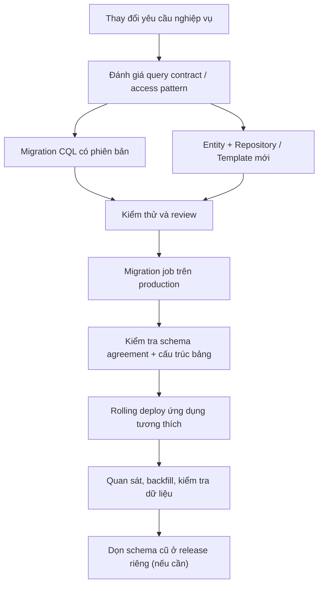
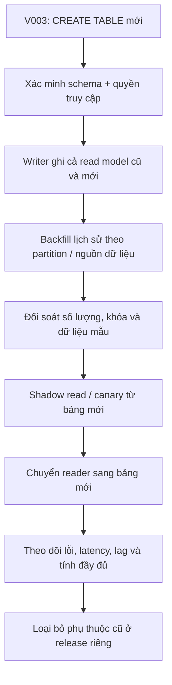

# Quản lý thay đổi lược đồ riêng cho môi trường production

Trong **Spring Data Cassandra**, các annotation như `@Table`, `@PrimaryKey` và `@Column` cho phép ánh xạ entity Java với bảng của Apache Cassandra. Nhưng khi hệ thống đã vận hành trong **production**, sửa một entity hoặc thêm phương thức repository **không đồng nghĩa** với việc thay đổi bảng Cassandra an toàn. Lược đồ tồn tại trên cluster phân tán, được nhiều phiên bản ứng dụng cùng truy cập và có thể chứa lượng dữ liệu lớn; một thay đổi tưởng nhỏ có thể gây lỗi truy vấn, tăng tải hoặc khiến phiên bản ứng dụng cũ không còn chạy được.

Vì vậy, cần một quy trình quản lý thay đổi lược đồ **riêng cho production**: lưu lịch sử thay đổi, đánh giá khả năng tương thích, triển khai CQL có kiểm soát, đợi các node thống nhất metadata, phối hợp với bản phát hành ứng dụng và có kế hoạch xử lý lỗi. Đây là chủ đề của chương **Quản lý lược đồ** trong module `SPRING_DATA_CASSANDRA`, đồng thời liên quan trực tiếp đến repository, `CassandraTemplate`, truy vấn CQL, partition key, consistency và hiệu năng của hệ thống dữ liệu phân tán.

## 1. Vì sao production cần quy trình riêng?

Ở môi trường phát triển, có thể xóa keyspace hoặc tạo lại bảng để thử nhanh. Trong production, cùng một hành động có thể xóa dữ liệu thật, chặn luồng ghi hoặc làm một phần ứng dụng không đọc được dữ liệu đang tồn tại. Hơn nữa, thay đổi lược đồ Cassandra được lan truyền qua cluster, nên không nên giả định mọi node thấy metadata mới tại chính xác cùng một thời điểm.

Các khác biệt cần lưu ý:

| Khía cạnh | Development/test | Production |
| --- | --- | --- |
| Dữ liệu | Có thể tạo lại dữ liệu giả lập | Cần giữ dữ liệu, chính sách lưu trữ và khả năng khôi phục |
| Phiên bản ứng dụng | Thường một phiên bản chạy tại một thời điểm | Có thể cùng tồn tại phiên bản cũ/mới trong rolling deployment |
| Quyền thay đổi schema | Lập trình viên có thể thao tác trực tiếp | Tách quyền DDL khỏi quyền đọc/ghi thông thường |
| Quy trình | Thử nghiệm và sửa nhanh | Migration có phiên bản, review, thử tải, triển khai từng bước và quan sát |
| Dung lượng | Dữ liệu nhỏ, ít partition | Partition lớn, replica ở nhiều node/data center, thời gian backfill dài |
| Lỗi | Có thể làm lại môi trường | Cần tránh downtime và có phương án roll-forward/khôi phục |

Một thay đổi được xem là “an toàn để phát hành” khi **schema, dữ liệu cũ, dữ liệu mới và các phiên bản ứng dụng đang chạy** có thể phối hợp với nhau trong suốt quá trình rollout. Chỉ có cú pháp `ALTER TABLE` hợp lệ là chưa đủ.

## 2. Phân chia trách nhiệm: entity mapping, repository và DDL

Ba lớp trách nhiệm không nên nhập làm một:

1. **Migration lược đồ** tạo hoặc thay đổi keyspace, table và các thành phần schema bằng CQL có phiên bản. Đây là thay đổi lên cluster, thường được chạy bằng một job/đường triển khai do nhóm vận hành dữ liệu kiểm soát.
2. **Entity mapping** mô tả cách Spring Data Cassandra ánh xạ bảng/cột đã tồn tại sang đối tượng Java. `@Table` và `@Column` chỉ cung cấp metadata; chúng không tự bảo đảm schema production đã được nâng cấp đúng.
3. **Repository/template** thực hiện truy vấn/ghi dữ liệu. `CassandraRepository`, `CassandraTemplate` và `CqlTemplate` đều phụ thuộc schema thực tế, partition key và các quy tắc của CQL.



Mấu chốt là **triển khai schema có tính đến phiên bản ứng dụng**. Ví dụ, nếu ứng dụng mới thực thi `SELECT source_system` nhưng cột `source_system` chưa tồn tại, CQL sẽ bị từ chối. Ngược lại, thêm cột mới trước khi triển khai mã sử dụng thường tương thích hơn, vì ứng dụng cũ vẫn có thể đọc những cột đang dùng.

## 3. Quy tắc thay đổi an toàn: expand → migrate → contract

Với sản phẩm cần hạn chế downtime, mô hình thực dụng là chia thay đổi thành nhiều giai đoạn:

- **Expand:** thêm thành phần schema mới trong khi schema cũ vẫn phục vụ được phiên bản ứng dụng hiện tại, chẳng hạn thêm cột hoặc tạo bảng đọc mới.
- **Migrate:** triển khai mã có khả năng tương thích, ghi dữ liệu mới, backfill dữ liệu cũ nếu cần, xác minh kết quả và chuyển dần lượt đọc sang cấu trúc mới.
- **Contract:** chỉ ngừng ghi và xóa cấu trúc cũ sau khi không còn reader/writer nào cần đến và đã hoàn tất quy trình xác nhận, lưu trữ/khôi phục.

Đây là cách **phân tách thời điểm bổ sung và loại bỏ**. Không gộp thay đổi có nguy cơ phá vỡ tương thích vào một lần deploy với giả định các service khởi động đồng thời.

| Loại thay đổi | Ví dụ | Chiến lược thường phù hợp |
| --- | --- | --- |
| Thêm cột không bắt buộc | `ALTER TABLE ... ADD source_system text` | Thêm schema trước, triển khai code đọc/ghi sau; hỗ trợ giá trị null cũ |
| Thêm bảng phục vụ truy vấn mới | `audit_events_by_actor_day` | Tạo bảng, thiết lập ghi mới, backfill có kiểm soát, xác minh rồi chuyển đọc |
| Đổi partition key hoặc clustering key | Từ `(tenant_id, day)` sang `(tenant_id, actor_id, day)` | Tạo **bảng mới** với khóa đúng; di chuyển/copy dữ liệu và đổi đường đọc |
| Đổi kiểu cột hoặc ý nghĩa dữ liệu | `text` sang cấu trúc khác | Ưu tiên cột/bảng mới và chuyển đổi dần, tránh kỳ vọng sửa kiểu in-place sẽ an toàn |
| Đổi tên hoặc xóa cột | Bỏ `legacy_status` | Dừng sử dụng và xác nhận dữ liệu trước; xóa ở bản phát hành riêng |
| Đổi replication/compaction/TTL | Thay chính sách vận hành dữ liệu | Phân tích tác động theo phiên bản Cassandra, dữ liệu và tải; triển khai theo quy trình vận hành |

Cassandra không hỗ trợ tùy ý việc sửa trực tiếp các thành phần primary key của bảng đang có. **Thay đổi access pattern thường là tạo bảng mới**, vì partition key và clustering columns là phần cốt lõi của cách dữ liệu được lưu, định tuyến và sắp xếp.

## 4. Ví dụ A: thêm cột cho bảng đang chạy

Giả sử production đã có bảng sự kiện truy vấn theo tenant và ngày:

```sql
CREATE TABLE IF NOT EXISTS audit_events_by_tenant_day (
    tenant_id   text,
    event_day   date,
    event_time  timeuuid,
    event_id    uuid,
    event_type  text,
    payload     text,
    PRIMARY KEY ((tenant_id, event_day), event_time)
) WITH CLUSTERING ORDER BY (event_time DESC);
```

Ứng dụng cần ghi thêm **hệ thống phát sinh sự kiện** `source_system`. Đây là cột thường, không nằm trong primary key. Một migration mở rộng có thể dùng:

```sql
-- Migration V002: bổ sung cột nullable.
ALTER TABLE audit_events_by_tenant_day
ADD source_system text;
```

Sau khi migration thành công và schema đã được các node nhận biết, entity mới thêm mapping:

```java
import java.util.UUID;
import org.springframework.data.cassandra.core.mapping.Column;
import org.springframework.data.cassandra.core.mapping.PrimaryKey;
import org.springframework.data.cassandra.core.mapping.Table;

@Table("audit_events_by_tenant_day")
public class AuditEvent {
    @PrimaryKey
    private AuditEventKey key;

    @Column("event_id")
    private UUID eventId;

    @Column("event_type")
    private String eventType;

    @Column("payload")
    private String payload;

    @Column("source_system")
    private String sourceSystem;

    public AuditEvent() {}
    // Constructor, getter/setter và AuditEventKey được định nghĩa trong dự án.
}
```

`AuditEventKey` ở đây là kiểu khóa ghép cho `tenant_id`, `event_day`, `event_time` được ánh xạ bằng `@PrimaryKeyClass` và `@PrimaryKeyColumn`; ví dụ chỉ nhấn mạnh thay đổi của một cột thường. Không cần thay đổi khóa của entity để thêm `source_system`.

### 4.1. Vì sao phải xử lý dữ liệu lịch sử?

Các hàng được ghi trước migration **không tự có giá trị `source_system`**; khi đọc cột mới, ứng dụng phải chấp nhận giá trị null hoặc áp dụng quy tắc hiển thị thích hợp, ví dụ “không xác định”. Cassandra không tự chạy một lệnh cập nhật toàn bộ dữ liệu cũ sau `ADD`.

Nếu nghiệp vụ yêu cầu `source_system` cho tất cả bản ghi, hãy viết **backfill riêng** với phạm vi, ngân sách tải và quy tắc suy luận dữ liệu rõ ràng. Cần tránh backfill toàn bảng theo `SELECT *` không partition key trong giờ cao điểm. Với nhiều bảng truy vấn theo partition, quá trình quét có thể rất tốn tài nguyên và cần một nguồn liệt kê partition đã biết hoặc pipeline dữ liệu chuyên trách.

### 4.2. Thứ tự triển khai đề xuất

1. Kiểm tra schema hiện có, lập migration `ADD` và kiểm thử ở staging với phiên bản ứng dụng đang chạy.
2. Chạy migration trên production bằng đường triển khai DDL được ủy quyền.
3. Xác minh schema agreement và cột `source_system` có mặt.
4. Triển khai ứng dụng mới có mapping và logic ghi `source_system`.
5. Theo dõi lỗi đọc/ghi, độ trễ, các giá trị null của bản ghi cũ; backfill nếu hợp đồng nghiệp vụ yêu cầu.

Trong rolling deployment, một số instance cũ có thể tiếp tục ghi các hàng chưa có `source_system`. Logic mới cần chịu được tình trạng đó cho đến khi tất cả writer đã được nâng cấp và việc chuyển đổi dữ liệu hoàn tất.

## 5. Ví dụ B: thay đổi partition key phải tạo bảng mới

Giả sử màn hình mới yêu cầu xem sự kiện của **một người dùng trong một ngày**, mới nhất trước. Bảng `audit_events_by_tenant_day` có partition key `(tenant_id, event_day)`, nên điều kiện `actor_id` không tự trở thành một đường đọc hiệu quả. Đổi một phương thức repository từ `findRecentByTenant` thành `findByActorId` không sửa được schema.

Một bảng mới phù hợp hơn:

```sql
-- Migration V003: tạo bảng read model mới.
CREATE TABLE IF NOT EXISTS audit_events_by_actor_day (
    tenant_id   text,
    actor_id    text,
    event_day   date,
    event_time  timeuuid,
    event_id    uuid,
    event_type  text,
    PRIMARY KEY ((tenant_id, actor_id, event_day), event_time)
) WITH CLUSTERING ORDER BY (event_time DESC);
```

Truy vấn phục vụ màn hình:

```sql
SELECT event_id, event_time, event_type
FROM audit_events_by_actor_day
WHERE tenant_id = ?
  AND actor_id = ?
  AND event_day = ?
LIMIT 50;
```

Bảng mới là **bản sao dữ liệu có chủ đích phục vụ access pattern**, không phải bảng “thay thế tự động” cho bảng cũ. Một sự kiện có thể được lưu vào nhiều bảng để đáp ứng nhiều hướng đọc khác nhau.

### 5.1. Lộ trình triển khai bảng mới



Chi tiết thực hiện:

- **Schema trước:** tạo bảng khi vẫn chưa có reader production sử dụng để tránh lỗi bảng không tồn tại trong lúc rolling deploy.
- **Writer trước reader:** writer mới ghi thêm bảng `audit_events_by_actor_day` để dữ liệu phát sinh trong lúc backfill không bị bỏ sót. Nếu cần một điểm cắt, ghi nhận mốc xử lý có thể kiểm chứng.
- **Backfill theo nguồn có thể liệt kê:** duyệt các tenant/ngày hoặc nguồn event log đã biết, dùng paging và giới hạn song song; tránh quét tùy ý toàn cluster.
- **Idempotency:** cùng một sự kiện cần được ghi với cùng khóa và cùng giá trị quy ước khi retry. Nếu có TTL hoặc timestamp ghi, cần cân nhắc tác động của việc backfill lên thời gian sống và thứ tự ghi của dữ liệu.
- **Đối soát:** kiểm tra tính đầy đủ theo bucket/tenant, khóa biên, sự kiện trùng và khoảng thời gian. Đếm mẫu bằng pipeline/đối soát theo partition thích hợp thay vì bắt một truy vấn `COUNT(*)` trên toàn bảng rất lớn.
- **Canary:** định tuyến một tỷ lệ nhỏ truy vấn sang bảng mới; so sánh kết quả tương đương khi cả hai bảng có dữ liệu tương ứng và ghi nhận khác biệt được chấp nhận.
- **Cutover có thể đảo chiều ở tầng đọc:** giữ bảng cũ trong thời gian giám sát để có thể chuyển reader về đường đọc cũ khi cần.

**Không giả định ghi hai bảng là một transaction quan hệ.** Cassandra có các cơ chế batch và tính nguyên tử theo phạm vi nhất định, nhưng batch nhiều partition không nên được dùng tùy tiện như một “giao dịch toàn năng” hoặc cách tăng tốc bulk write. Hãy có chiến lược retry, reconciliation và xử lý khi chỉ một bảng ghi thành công. Nếu yêu cầu nhất quán rất chặt, cần đánh giá lại thiết kế nghiệp vụ và cách phát sự kiện ở cấp hệ thống.

### 5.2. Dữ liệu đang được cập nhật đồng thời

Backfill và writer mới có thể chạy song song. Do đó phải xác định rõ:

- Bản ghi nào được backfill, bản ghi nào do writer mới phụ trách?
- Một bản ghi xuất hiện ở cả hai luồng có dẫn tới trùng khóa, cập nhật ngược dữ liệu mới hay làm TTL thay đổi không?
- Nếu sự kiện có thể chỉnh sửa/xóa, nguồn nào quyết định phiên bản mới nhất và tác vụ nào phải phát lại?
- Khi đối soát, tiêu chí “đủ dữ liệu” là theo số lượng, theo ID, theo hash nội dung hay theo watermark của luồng thay đổi?

Cassandra xử lý xung đột ghi dựa trên timestamp của cell và các quy tắc nội bộ; **retry với dữ liệu cũ không mặc nhiên vô hại** nếu timestamp, TTL hoặc thuộc tính bản ghi thay đổi. Một migration backfill cần định nghĩa hành vi cập nhật, không chỉ “đọc bảng A rồi insert bảng B”.

## 6. Quy ước migration có phiên bản và có thể kiểm tra

Trong production, nên lưu CQL thay đổi cùng mã nguồn dưới dạng các migration **có số phiên bản, thứ tự và lịch sử thực thi**. Các tên sau chỉ là ví dụ tổ chức ý tưởng; không nhất thiết một công cụ cụ thể:

```text
migrations/cassandra/
  V001__create_audit_events_by_tenant_day.cql
  V002__add_source_system.cql
  V003__create_audit_events_by_actor_day.cql
  V004__review_retirement_of_old_columns.cql
```

Một bản ghi migration nên có:

| Thuộc tính | Mục đích |
| --- | --- |
| Phiên bản và tên | Xác định thứ tự, phạm vi và mục tiêu thay đổi |
| Checksum nội dung | Phát hiện file migration đã được chỉnh sửa sau khi phát hành |
| Trạng thái thực thi | Biết migration nào đã chạy/chưa chạy/thất bại |
| Môi trường và keyspace | Tránh chạy nhầm staging lên production hoặc nhầm keyspace |
| Người/đường triển khai và thời điểm | Phục vụ audit và truy nguyên sự cố |
| Tiêu chí hậu kiểm | Schema agreement, metadata mong đợi, smoke test và hiệu năng |
| Phương án ứng phó | Roll-forward, tắt feature, quay reader về đường cũ, khôi phục dữ liệu nếu cần |

Khi sử dụng một công cụ migration, cần kiểm tra **mức hỗ trợ Cassandra** và cơ chế phối hợp giữa nhiều instance. Không mặc định mọi công cụ có quy trình `up/down` giống cơ sở dữ liệu SQL đều xử lý DDL Cassandra giống nhau.

Ví dụ kiểm tra metadata bằng CQL:

```sql
SELECT keyspace_name, table_name, column_name, type, kind
FROM system_schema.columns
WHERE keyspace_name = 'audit'
  AND table_name = 'audit_events_by_tenant_day';
```

Câu truy vấn này giúp xác minh thông tin một bảng cụ thể sau migration; **không thay thế** việc kiểm tra schema agreement toàn cluster, tính tương thích dữ liệu, hoặc việc thử đọc/ghi ở ứng dụng.

### Cẩn trọng với câu lệnh `IF NOT EXISTS`

`CREATE TABLE IF NOT EXISTS` hữu ích để tránh một số lỗi khi bảng đã tồn tại, nhưng **không xác minh rằng schema hiện có khớp định nghĩa mới**. Nếu bảng trùng tên nhưng sai partition key hoặc cột, lệnh này có thể không làm gì trong khi ứng dụng vẫn lỗi. Migration cần có bước kiểm tra cấu trúc, không chỉ dựa vào việc DDL trả kết quả thành công.

Tương tự, một migration đã ghi “thành công” trong bảng theo dõi nhưng schema thực tế khác mong đợi phải được coi là **schema drift**, cần điều tra trước khi triển khai tiếp.

## 7. Schema agreement và thứ tự chạy DDL

Cassandra là hệ thống phân tán: metadata schema được phổ biến giữa các node theo cơ chế cluster. Sau một `CREATE TABLE` hoặc `ALTER TABLE`, không nên lập tức triển khai tất cả reader đang yêu cầu schema mới mà không kiểm tra cluster đã nhất quán về schema.

Một quy trình vận hành hợp lý:

1. **Chỉ định một đường thực thi migration** cho cùng keyspace/cluster. Tránh nhiều instance ứng dụng đồng thời chạy DDL trong lúc startup.
2. **Chạy từng migration theo thứ tự** có ghi nhận lịch sử và điều kiện đầu vào.
3. **Chờ xác nhận schema agreement** bằng công cụ/driver phù hợp với phiên bản Cassandra và trạng thái cluster.
4. **Kiểm tra metadata thực tế**: tên bảng, kiểu cột, partition key, clustering columns và table options có đúng yêu cầu.
5. **Smoke test truy vấn** bằng phân vùng thử nghiệm và quyền tương ứng của ứng dụng, rồi mới cho reader mới hoạt động.
6. **Dừng phát hành khi không đạt** hoặc khi có node không sẵn sàng; điều tra thay vì nối tiếp một loạt DDL chưa được xác nhận.

Schema agreement chỉ chứng minh các node có cùng cách hiểu metadata trong điều kiện được kiểm tra. Nó **không chứng minh dữ liệu đã được backfill**, query contract mới đúng, hay hiệu năng đã đạt SLA.

Nếu cụm có nhiều data center, cần xem xét trạng thái các node/data center có tham gia phục vụ ứng dụng. Thời gian phát tán schema và khả năng truy cập qua mạng có thể khác nhau; không dựa vào một con số chờ cố định như “sleep 5 giây” để kết luận migration thành công.

## 8. Spring Data Cassandra: tách quản lý schema khỏi startup ứng dụng

Spring Data Cassandra có cơ chế `schema-action` để hỗ trợ tạo/điều chỉnh schema theo cấu hình và phiên bản framework. Những hành động mang ý nghĩa **recreate** hoặc loại bỏ schema có thể phù hợp với môi trường thử nghiệm nhưng rất nguy hiểm nếu vô tình áp dụng cho production.

Với ứng dụng **Spring Boot 3.x** sử dụng namespace cấu hình `spring.cassandra`, chính sách production thường là để ứng dụng **không tự thao tác DDL**:

```yaml
# application-prod.yml — minh họa
spring:
  cassandra:
    contact-points: cassandra.internal.example
    local-datacenter: dc1
    keyspace-name: audit
    schema-action: none
```

Tên property và các giá trị `schema-action` cần được đối chiếu **đúng phiên bản Spring Boot/Spring Data Cassandra** đang dùng; các phiên bản cũ có thể sử dụng namespace khác như `spring.data.cassandra.*`. Các địa chỉ và keyspace trong ví dụ chỉ mang tính minh họa.

Ý nghĩa quan trọng nhất: **ứng dụng chạy production chỉ ánh xạ và truy vấn schema đã được triển khai bởi migration có kiểm soát**. Không để việc restart một pod hoặc scale-out service trở thành thao tác tạo/xóa bảng.

Nếu dự án cấu hình Spring Data Cassandra thủ công bằng `AbstractCassandraConfiguration`, cần kiểm tra phần cấu hình schema action tương ứng của phiên bản đang dùng và bảo đảm chính sách production cũng vô hiệu hóa tự động tạo/phá schema. Đừng giả định property Boot vẫn có tác dụng nếu ứng dụng đã thay thế auto-configuration.

### Vì sao không nên cho tất cả instance chạy migration khi khởi động?

Khi hệ thống có nhiều replica ứng dụng:

- Nhiều instance có thể đồng thời thử cùng một DDL, tranh chấp thứ tự và tạo lỗi khởi động khó phân tích.
- Một instance mới có thể triển khai schema mà phiên bản cũ chưa tương thích.
- Khởi động lại do health check hoặc auto-scaling trở thành tác nhân thay đổi production không dự kiến.
- Tài khoản ứng dụng phải có thêm quyền DDL; điều này mở rộng phạm vi tác động nếu cấu hình hoặc mã lỗi.

Tách **migration job** khỏi **application runtime**, chỉ cho migration job quyền DDL cần thiết và cho runtime quyền đọc/ghi phù hợp. Việc thay đổi quyền phải được điều chỉnh theo phương thức xác thực/phân quyền mà cluster đang dùng.

## 9. Ma trận tương thích giữa schema và ứng dụng

Với migration thêm cột `source_system`, hãy nhìn vào khả năng đồng tồn tại:

| Schema | Ứng dụng cũ | Ứng dụng mới dùng cột mới | Đánh giá |
| --- | --- | --- | --- |
| V1: chưa có cột | Thường hoạt động | Có thể lỗi khi CQL tham chiếu cột chưa tồn tại | Chưa phát hành reader mới |
| V2: đã thêm cột | Thường tiếp tục hoạt động | Hoạt động nếu mapping và truy vấn đúng | Giai đoạn rolling deploy mong muốn |
| V2, dữ liệu cũ chưa backfill | Đọc dữ liệu cũ bình thường | Phải xử lý `source_system = null` | Cần tương thích dữ liệu |
| V2, dữ liệu đã backfill | Hoạt động nếu vẫn dùng cột cũ | Có thể dùng dữ liệu mới đầy đủ hơn | Chỉ khẳng định sau khi đối soát |

Trong trường hợp tạo bảng mới, ma trận còn phải xét **writer và reader** độc lập: reader mới không được yêu cầu dữ liệu lịch sử đầy đủ khi backfill chưa xong, trừ khi API chấp nhận dữ liệu thiếu tạm thời và có cách truyền đạt rõ ràng.

### Feature flag và khả năng đảo chiều

Một feature flag có thể tách ba thao tác: bật writer cho bảng mới, bật backfill/đối soát, và bật reader mới. Khi xảy ra lỗi, có thể **đưa reader về bảng cũ** mà không cần xóa bảng mới ngay. Hãy giữ khả năng tương thích cho cả mã cũ lẫn mã mới trong thời gian đủ để rollout/rollback ở tầng ứng dụng.

Rollback **schema** không đơn giản như rollback code. Đặc biệt, `DROP TABLE`, `DROP COLUMN` hoặc thay đổi có mất dữ liệu không nhất thiết đảo ngược được; nếu cần khôi phục, phải có snapshot/backup và quy trình phục hồi được thử nghiệm trước.

## 10. Dữ liệu, TTL và hiệu năng khi migration

Migration schema bản thân thường là thay đổi metadata, nhưng **backfill, ghi song song và đọc đối soát** có thể tạo tải lớn hơn nhiều so với câu DDL. Với Cassandra, cần tính toán theo partition chứ không chỉ theo số hàng toàn bảng.

### 10.1. Ngân sách tải cho backfill

Giả sử có 40 triệu sự kiện cần copy sang bảng mới; mỗi sự kiện trung bình 1 KiB và quá trình backfill được giới hạn 500 hàng/giây:

\[
\text{Thời gian lý thuyết} = \frac{40{,}000{,}000}{500}
= 80{,}000 \text{ giây} \approx 22{,}2 \text{ giờ}
\]

Đó chỉ là ước tính lý thuyết chưa tính network, số replica, retry, compaction, tombstone, thời gian quét nguồn và các thời điểm giảm tốc để bảo vệ traffic sản phẩm. Nếu giảm ngân sách xuống 100 hàng/giây để bảo vệ production, thời gian sẽ tăng lên khoảng 111 giờ. Vì vậy backfill cần checkpoint, resume và rate limit, không nên thiết kế như một lệnh chạy một lần không thể tiếp tục.

Các chỉ số cần quan sát: số partition đã xử lý, số hàng ghi thành công/thất bại, backlog, độ trễ p95/p99 của truy vấn sản phẩm, timeout, CPU/IO node, compaction, tombstone và tốc độ xử lý thực tế.

### 10.2. Bảo toàn semantics của dữ liệu

Khi copy dữ liệu từ bảng cũ sang bảng mới:

- **TTL:** nếu dữ liệu cũ còn 10 ngày trước khi hết hạn, ghi lại với TTL mới 90 ngày có thể vô tình kéo dài vòng đời. Cần xác định chính sách dùng TTL còn lại hay TTL mới, phù hợp quy định lưu trữ.
- **Timestamp và xung đột ghi:** dữ liệu có thể thay đổi trong lúc copy. Nếu cần, bảo toàn version/timestamp có chủ đích để dữ liệu cũ không ghi đè dữ liệu mới.
- **Delete/tombstone:** bản ghi đã xóa hoặc hết hạn không được “sống lại” do backfill trễ; cần xử lý dòng xóa và quy tắc đồng bộ.
- **Partition key:** bảng mới có khóa khác, nên chiến lược liệt kê và đọc partition nguồn phải thực tế, tránh fan-out không kiểm soát.
- **Consistency:** mức consistency của backfill và reader cần được chọn theo mục tiêu độ chính xác, khả năng chịu lỗi và topology; `LOCAL_QUORUM` hay `LOCAL_ONE` đều không tự tạo transaction xuyên hai bảng.

Lỗi được chấp nhận và retry phải có giới hạn, có checkpoint và có cách đối soát cuối cùng. Một migration chỉ “chạy hết vòng lặp” nhưng bỏ qua lỗi ghi hoặc sai TTL chưa thể được coi là hoàn tất.

## 11. Rủi ro của thay đổi destructive và cách loại bỏ an toàn

Một thay đổi như `DROP TABLE audit_events_by_tenant_day` có thể xóa đường đọc và dữ liệu đang được nhiều phiên bản ứng dụng sử dụng. `ALTER TABLE ... DROP legacy_column` cũng có thể gây lỗi với reader cũ và làm mất dữ liệu cột. Đây là thay đổi **destructive**, không nên kết hợp trong cùng lượt triển khai với thay đổi đường đọc mới.

Trước khi loại bỏ một bảng/cột:

1. Xác nhận **không còn** bất kỳ reader, writer, job báo cáo, job backfill, service cũ hoặc script vận hành nào phụ thuộc.
2. Quan sát traffic thực tế trong khoảng thời gian đủ dài, bao gồm job chạy theo ngày/tuần/tháng.
3. Đã chuyển mọi dữ liệu cần giữ và đối soát kết quả, tuân thủ chính sách retention và yêu cầu audit.
4. Có backup/snapshot và tài liệu phục hồi phù hợp với khả năng của cluster, đã thử trên môi trường tương đương.
5. Có bản phát hành hoặc migration riêng, review/approval đúng quy trình, và thông báo ảnh hưởng tới các nhóm sử dụng.

Sau khi đã loại bỏ schema, **không coi việc tạo lại bảng cùng tên là khôi phục dữ liệu**. `CREATE TABLE` chỉ tạo cấu trúc mới; dữ liệu đã bị xóa cần được phục hồi từ nguồn đáng tin cậy nếu còn khả năng.

## 12. Quy trình triển khai production có thể áp dụng

Quy trình sau minh họa một thay đổi schema phục vụ tính năng mới:

| Bước | Thao tác | Điều kiện để tiếp tục |
| --- | --- | --- |
| 1. Phân tích | Chốt truy vấn, khóa, schema cũ/mới, khả năng tương thích và rủi ro | Review thông qua, có kế hoạch dữ liệu |
| 2. Tạo migration | CQL có version, hậu kiểm metadata, checksum và lịch sử | CI kiểm tra định dạng và thứ tự version |
| 3. Staging | Chạy migration trên dữ liệu đại diện; kiểm thử bản cũ/mới và rollback ứng dụng | CQL đúng, ứng dụng tương thích, tải chấp nhận được |
| 4. Chuẩn bị production | Chọn cửa sổ thay đổi, backup/snapshot cần thiết, giới hạn quyền DDL | Đủ quyền và năng lực phục hồi |
| 5. Expand | Chạy CQL tạo bảng/cột mới, chờ schema agreement, smoke test | Metadata đúng và các node liên quan thống nhất |
| 6. Migrate | Triển khai writer mới, backfill có rate limit, checkpoint, đối soát | Dữ liệu đạt tiêu chí đầy đủ/đúng |
| 7. Cutover | Canary và tăng dần reader mới dưới feature flag | Không tăng lỗi/latency, kết quả nhất quán với hợp đồng |
| 8. Theo dõi | Quan sát nhiều chu kỳ tải, rollback reader khi cần | Đạt tiêu chí vận hành đã định |
| 9. Contract | Ngừng phụ thuộc và xóa cấu trúc cũ ở release riêng nếu được duyệt | Không còn consumer, đáp ứng retention/audit |

Khi một bước chưa đạt tiêu chí, **dừng bước sau**. Ví dụ, backfill chưa đạt 100% trong phạm vi yêu cầu thì không nên bật toàn bộ reader đang kỳ vọng dữ liệu đầy đủ, dù bảng mới đã tồn tại và repository mới đã khởi tạo được.

## 13. Kiểm tra, phát hiện schema drift và xử lý sự cố

**Schema drift** xảy ra khi schema production khác schema mong đợi từ lịch sử migration: có người sửa tay, migration thất bại một phần, cấu hình môi trường khác nhau, hoặc thay đổi không được ghi nhận.

Để phát hiện sớm:

- Lưu và đối chiếu metadata schema thực tế với cấu trúc đã được review, gồm partition key, clustering order, cột và table options liên quan.
- Kiểm tra các migration theo thứ tự, checksum và môi trường/keyspace thực thi.
- Theo dõi log schema change, lỗi chuẩn bị statement, lỗi `Undefined column` / `unconfigured table` và lỗi mapping ở ứng dụng.
- Sau mỗi thay đổi schema, chạy smoke test đúng query contract, không chỉ thử kết nối `CqlSession`.
- Khi phát hiện drift, dừng các migration kế tiếp và xác định chính xác trạng thái cluster trước khi sửa.

Nếu rollout mới gây lỗi, một thứ tự ứng phó hợp lý là:

1. Tắt feature flag hoặc chuyển reader về đường đọc cũ còn hoạt động.
2. Giảm/tạm dừng backfill hoặc dual-write gây tải vượt ngân sách.
3. Kiểm tra schema agreement, metadata, quyền truy cập, app version và lỗi CQL cụ thể.
4. Đưa ra migration **roll-forward** hoặc triển khai lại bản ứng dụng tương thích, tránh vội vàng `DROP` cấu trúc mới.
5. Chỉ kích hoạt trở lại khi đã xác nhận dữ liệu, tải và truy vấn đạt điều kiện.

Khả năng rollback ở tầng ứng dụng được thiết kế tốt thường đáng tin cậy hơn việc thử “undo” một thay đổi DDL đã làm mất dữ liệu.

## 14. Những sai lầm thường gặp

| Sai lầm | Vì sao nguy hiểm | Cách làm tốt hơn |
| --- | --- | --- |
| Cho mọi pod chạy tự động tạo/recreate schema khi khởi động | DDL cạnh tranh, nguy cơ xóa bảng, phiên bản lệch nhau | Migration job tách riêng; schema action production an toàn |
| Sửa `@Table` và deploy như thể bảng tự đổi | Mapping Java và schema thực tế có thể không khớp | Review migration CQL trước khi dùng entity/repository mới |
| `CREATE TABLE IF NOT EXISTS` rồi kết luận schema đúng | Bảng cũ cùng tên có thể có khóa/cột khác | Đối chiếu metadata mong đợi |
| Đổi partition key ngay trong bảng đang dùng | Đường đọc và cách phân bố dữ liệu thay đổi căn bản | Tạo bảng mới, đồng bộ và chuyển dần |
| Mở reader mới trước khi backfill | Thiếu dữ liệu lịch sử hoặc lỗi bảng chưa có | Expand → write/backfill → verify → read cutover |
| Chạy backfill không throttle | Tăng timeout và latency của traffic sản phẩm | Rate limit, checkpoint, khả năng pause/resume |
| Dùng `COUNT(*)` toàn bảng để đối soát mọi migration lớn | Có thể tạo truy vấn quét dữ liệu tốn kém | Đối soát theo partition/bucket, pipeline thống kê hoặc sampling có mục tiêu |
| Xóa cột/bảng ngay sau deploy | Instance cũ và job định kỳ còn phụ thuộc | Ngừng sử dụng trước, giữ thời gian quan sát, contract riêng |
| Coi schema agreement là hoàn tất migration | Schema đồng bộ không bảo đảm dữ liệu và hiệu năng | Kiểm tra cả dữ liệu, reader/writer và SLA |

## 15. Bài tập tình huống

**Tình huống 1 — Thêm trường bắt buộc mới.** Một màn hình cần `source_system` cho mọi sự kiện, nhưng bảng production chứa dữ liệu 2 năm và đang phục vụ hàng nghìn request/giây. Có nên thêm cột rồi lập tức đổi API để từ chối mọi hàng có giá trị null?

**Gợi ý:** Không. Đầu tiên mở rộng schema, cập nhật writer, xác định quy tắc dữ liệu lịch sử và backfill có kiểm soát; chỉ nâng điều kiện bắt buộc khi đã xác minh dữ liệu và tương thích trong quá trình rolling deploy.

**Tình huống 2 — Truy vấn theo actor.** Repository mới có method `findByActorId` nhưng bảng cũ được phân vùng theo `tenant_id, event_day`. Có nên dùng `ALLOW FILTERING` để phát hành ngay?

**Gợi ý:** Trước hết xây bảng đọc theo `tenant_id, actor_id, event_day`, tạo migration, thiết lập writer/backfill và đo tải. `ALLOW FILTERING` không tự biến truy vấn thiếu partition key phù hợp thành đường đọc có chi phí dự đoán được.

**Tình huống 3 — Deploy đa instance.** Mỗi instance được cấu hình tự tạo bảng khi khởi động. Một instance mới deploy trong lúc nhiều instance cũ vẫn xử lý request. Bạn sẽ thay đổi quy trình thế nào?

**Gợi ý:** Chuyển DDL sang migration job được kiểm soát, không cho mỗi instance chạy schema change; đợi schema agreement và kiểm tra tương thích trước khi rollout ứng dụng. Giữ đủ khả năng phục vụ của phiên bản cũ trong giai đoạn chuyển tiếp.

**Tình huống 4 — Rollback.** Đã chạy `DROP TABLE` khi phát hành nhưng phát hiện một job cuối tháng vẫn cần dữ liệu. Redeploy code cũ có giải quyết được không?

**Gợi ý:** Không tự khôi phục dữ liệu đã mất. Cần kế hoạch phục hồi từ nguồn/backup thích hợp nếu có và phải xử lý sự cố vận hành; lần sau cần kiểm kê consumer định kỳ, giai đoạn contract riêng và bản phục hồi được kiểm thử.

## Kết luận

Quản lý thay đổi lược đồ Cassandra trong **production** là công việc kết hợp giữa thiết kế dữ liệu, điều phối phiên bản ứng dụng và vận hành cluster. `@Table` và repository mô tả cách Spring Data Cassandra sử dụng bảng; migration CQL quyết định bảng tồn tại và biến đổi như thế nào. Cần ưu tiên thay đổi **có thể tương thích ngược**, chạy DDL riêng với startup ứng dụng, kiểm tra schema agreement, dùng backfill có giới hạn tải, đối soát dữ liệu và giữ khả năng chuyển reader về đường cũ.

Nguyên tắc thực hành: **thiết kế query contract trước → viết migration có phiên bản → mở rộng schema → triển khai code tương thích → chuyển dữ liệu và kiểm chứng → chỉ loại bỏ schema cũ khi mọi consumer đã ngừng dùng**. Quy trình đó giúp Spring Data Cassandra tiếp tục truy vấn đúng partition key và đạt yêu cầu về tính sẵn sàng, tính nhất quán và hiệu năng trong môi trường phân tán.
