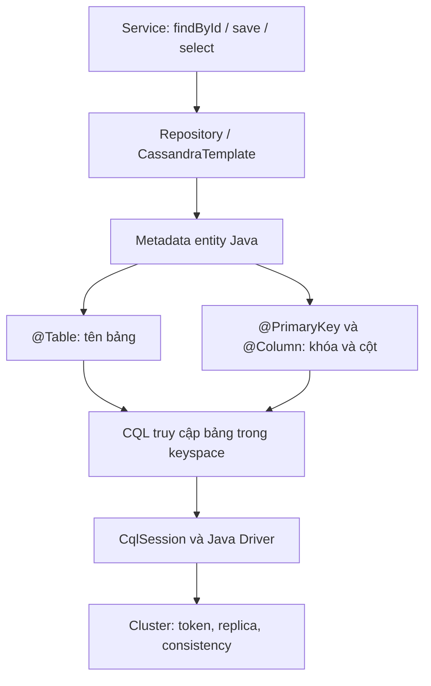

# @Table và ánh xạ tên bảng

Trong **Spring Data Cassandra**, mỗi entity Java thường tương ứng với một bảng Apache Cassandra. Annotation `@Table` xác định **tên bảng CQL** mà framework sử dụng khi đọc hoặc ghi entity đó. Việc ánh xạ đúng tên bảng là nền tảng để `CassandraRepository` và `CassandraTemplate` truy cập đúng dữ liệu; nhưng bản thân annotation không thiết kế partition key, không tạo quan hệ giữa bảng và không bảo đảm bảng đã tồn tại.

Bài này thuộc chương **Ánh xạ entity** của module **`SPRING_DATA_CASSANDRA`**. Module tập trung truy cập Apache Cassandra qua entity mapping, repository, `CassandraTemplate` và CQL; đồng thời đặt thiết kế bảng theo truy vấn, khóa phân vùng, consistency level, paging và hiệu năng phân tán vào đúng bối cảnh. Với những yêu cầu đó, ta cần trả lời rõ: **một lớp Java trỏ đến bảng nào, trong keyspace nào, với các cột và khóa nào?**

Sau khi học, bạn có thể:

1. Khai báo `@Table` đúng package và chỉ định tên bảng bất kể tên lớp Java.
2. Phân biệt ánh xạ tên bảng, ánh xạ tên cột và ánh xạ primary key.
3. Giải thích khác biệt giữa tên CQL thông thường và tên có dấu nháy kép phân biệt chữ hoa/thường.
4. Đối chiếu entity với schema CQL và keyspace được cấu hình trong ứng dụng Spring.
5. Chẩn đoán lỗi sai bảng, sai tên cột và thay đổi schema không tương thích.

## 1. Vai trò của @Table trong quá trình lưu và đọc

Khi repository thao tác với một entity, Spring Data Cassandra đọc metadata mapping của lớp đó, kết hợp thông tin cột/khóa để dựng câu lệnh CQL phù hợp rồi nhờ Java Driver thực thi.



Mỗi annotation trả lời một câu hỏi riêng:

| Annotation | Ý nghĩa | Ví dụ |
| --- | --- | --- |
| `@Table` | Entity trỏ đến bảng CQL nào? | `@Table("customer_profiles")` |
| `@Column` | Property này tương ứng cột CQL nào? | `@Column("display_name")` |
| `@PrimaryKey` | Khóa chính là property/đối tượng khóa nào? | `@PrimaryKey private UUID id;` |
| `@PrimaryKeyClass` | Lớp nào gom các thành phần khóa tổng hợp? | `BookingKey` |
| `@PrimaryKeyColumn` | Thành phần khóa là partition hay clustering, ở thứ tự nào? | `type = PrimaryKeyType.PARTITIONED` |

`@Table` được gắn trên **kiểu entity**, không gắn trên từng phương thức repository. Nó quyết định đích bảng mặc định của các thao tác mapping cho kiểu đó. Việc định vị partition và replica vẫn phụ thuộc **giá trị partition key**, partitioner, replication strategy và topology.

## 2. Ví dụ tối thiểu: entity CustomerProfile

Giả sử ứng dụng có keyspace `rental_learning` và bảng được tạo bằng CQL:

```sql
CREATE TABLE IF NOT EXISTS rental_learning.customer_profiles (
    id uuid PRIMARY KEY,
    display_name text,
    status text
);
```

Bảng tên `customer_profiles`; cột `id` là primary key duy nhất, đồng thời là partition key. Entity Java có thể đặt tên khác bảng:

```java
package example.cassandra.model;

import java.util.UUID;
import org.springframework.data.cassandra.core.mapping.Column;
import org.springframework.data.cassandra.core.mapping.PrimaryKey;
import org.springframework.data.cassandra.core.mapping.Table;

@Table("customer_profiles")
public class CustomerProfile {

    @PrimaryKey
    private UUID id;

    @Column("display_name")
    private String displayName;

    @Column("status")
    private String status;

    public CustomerProfile() {}

    public CustomerProfile(UUID id, String displayName, String status) {
        this.id = id;
        this.displayName = displayName;
        this.status = status;
    }

    public UUID getId() { return id; }
    public void setId(UUID id) { this.id = id; }

    public String getDisplayName() { return displayName; }
    public void setDisplayName(String displayName) {
        this.displayName = displayName;
    }

    public String getStatus() { return status; }
    public void setStatus(String status) { this.status = status; }
}
```

Đọc mapping từ trên xuống:

- `CustomerProfile` là tên **lớp Java**, không bắt buộc giống tên bảng.
- `@Table("customer_profiles")` khai báo **bảng vật lý** mà entity sẽ truy cập.
- `@PrimaryKey` cho biết `id` tham gia primary key; tên cột trùng với Java field trong ví dụ này.
- `@Column("display_name")` nối Java property `displayName` đến cột CQL `display_name`. Việc đặt tên tường minh giúp tránh phụ thuộc vào mặc định của naming strategy.
- Cột `status` được khai báo tường minh để ví dụ dễ đối chiếu, dù tên Java và CQL giống nhau.

`@Table("customer_profiles")` và `@Table(value = "customer_profiles")` là hai cách viết tương đương khi cần đặt tên bảng.

### Import đúng annotation

Với Spring Data Cassandra, cần:

```java
import org.springframework.data.cassandra.core.mapping.Table;
```

Không dùng nhầm:

```java
// Đây là annotation JPA, không thay thế mapping của Cassandra:
// import jakarta.persistence.Table;
// import javax.persistence.Table;
```

Đặc biệt trong dự án vừa dùng JPA vừa dùng Cassandra, trình soạn thảo có thể tự import `Table` của thư viện khác. Hãy kiểm tra phần `import` chứ không chỉ thấy dấu `@Table` trong mã.

## 3. Phân biệt tên class, tên bảng, tên cột và keyspace

| Phạm vi | Giá trị ví dụ | Được chọn ở đâu? |
| --- | --- | --- |
| Java class | `CustomerProfile` | Mã nguồn Java |
| Bảng CQL | `customer_profiles` | DDL và `@Table` |
| Java property | `displayName` | Trường/getter Java |
| Cột CQL | `display_name` | DDL và `@Column` |
| Keyspace | `rental_learning` | Cấu hình cluster/session và schema |
| Partition key | `id` | CQL `PRIMARY KEY` và mapping khóa |

Spring Data Cassandra có cơ chế suy ra tên từ Java class/property theo naming strategy. Tuy nhiên, cách suy ra này có thể phụ thuộc phiên bản framework và cấu hình dự án. Với bảng được tạo sẵn bằng CQL, **khai báo tường minh `@Table` và những `@Column` cần thiết** giúp tránh thay đổi ngoài ý muốn khi đổi tên Java class hoặc chuyển naming strategy.

Một lớp tên `CustomerProfile` không tự chứng minh bảng phải tên `customer_profile`, `customerprofile` hay `customer_profiles`. Nguồn sự thật là **schema CQL thực tế** và metadata mapping sẽ tạo ra câu lệnh.

### Bỏ @Table có được không?

Trong các cấu hình được hỗ trợ, Spring Data có thể dùng quy ước đặt tên mặc định khi không nêu tên bảng tường minh. Nhưng không nên dựa vào một quy tắc đoán tên khi dự án có schema CQL cố định hoặc đang chuyển qua nhiều phiên bản. Việc viết `@Table("customer_profiles")` làm rõ **ý định ánh xạ** và giúp reviewer đối chiếu trực tiếp.

## 4. Quy tắc tên định danh trong CQL

CQL phân biệt **identifier không quote** và **identifier trong dấu nháy kép**. Đây là nguồn gây nhầm lẫn lớn khi ánh xạ tên bảng.

### 4.1. Tên không có dấu nháy kép

Tên không quote được CQL xử lý không phân biệt chữ hoa/thường và chuẩn hóa về chữ thường. Vì vậy các câu sau cùng nhắc đến bảng `customer_profiles`:

```sql
SELECT id, display_name
FROM customer_profiles
WHERE id = 1dd933e2-d043-45f1-b9d9-c2b8110cece5;

SELECT id, display_name
FROM CUSTOMER_PROFILES
WHERE id = 1dd933e2-d043-45f1-b9d9-c2b8110cece5;
```

**Khuyến nghị:** với bảng mới, dùng tên **`lower_snake_case`**, chẳng hạn `bookings_by_customer_day`, để thống nhất giữa CQL, Java Driver, Spring Data và công cụ migration.

### 4.2. Tên có dấu nháy kép

Nếu tạo bảng:

```sql
CREATE TABLE rental_learning."CustomerProfiles" (
    id uuid PRIMARY KEY,
    display_name text
);
```

thì tên `"CustomerProfiles"` có phân biệt hoa/thường và **khác** tên `customerprofiles` hoặc `customer_profiles`. Ánh xạ đến bảng dạng này cần kiểm tra cách mapping framework tạo **CQL identifier có quote**; chỉ ghi một chuỗi chữ hoa trong annotation mà không hiểu quy tắc escaping/quoting có thể tạo tên đích sai.

| Khai báo CQL | Tên logic | Điều cần nhớ |
| --- | --- | --- |
| `CREATE TABLE customer_profiles ...` | `customer_profiles` | Phù hợp tên bảng chữ thường |
| `CREATE TABLE Customer_Profiles ...` | `customer_profiles` | Không tạo bảng hoa/thường riêng |
| `CREATE TABLE "CustomerProfiles" ...` | `CustomerProfiles` | Phải giữ đúng casing và quoting |
| `CREATE TABLE "customer_profiles" ...` | `customer_profiles` | Tên là chữ thường nhưng vẫn nên giữ quy ước rõ |

Trong nhiều dự án, **tránh quoted identifier có chữ hoa** là cách đơn giản nhất để hạn chế lỗi. Khi làm việc với schema lịch sử, phải đối chiếu **DDL, metadata mapping và câu CQL thực thi thực sự**, thay vì đoán.

## 5. Keyspace và bảng là hai phạm vi độc lập

Một cluster có thể có hai bảng cùng tên ở hai keyspace:

```text
rental_learning.customer_profiles
rental_staging.customer_profiles
```

`@Table("customer_profiles")` xác định tên bảng. Trong cấu hình Spring Boot thông dụng, **keyspace mặc định** được lấy từ cấu hình session. Ví dụ với Spring Boot 3.x:

```yaml
spring:
  cassandra:
    contact-points:
      - 127.0.0.1
    port: 9042
    local-datacenter: datacenter1
    keyspace-name: rental_learning
```

Khi câu CQL không chỉ rõ keyspace, `CqlSession` và hạ tầng mapping sẽ sử dụng ngữ cảnh keyspace phù hợp đã được cấu hình. Vì vậy lỗi “không thấy bảng” có thể xảy ra ngay cả khi `@Table` đúng, nếu ứng dụng đang dùng **keyspace hoặc cluster khác**.

**Lưu ý phiên bản:** các thế hệ Spring Boot có thể sử dụng tên property Cassandra khác nhau; ví dụ trên theo phong cách `spring.cassandra.*` của Boot 3.x. Cần đối chiếu metadata cấu hình theo phiên bản ứng dụng.

Nếu viết CQL thủ công, tên đầy đủ có thể được chỉ rõ:

```sql
SELECT id, display_name
FROM rental_learning.customer_profiles
WHERE id = 1dd933e2-d043-45f1-b9d9-c2b8110cece5;
```

Đừng xem `@Table` là chỗ lưu thông tin xác thực, cấu hình datacenter hay replication factor. Các cấu hình đó thuộc keyspace, topology và `CqlSession`/driver.

## 6. Ví dụ thực tế: tên bảng gắn với hướng truy vấn

Giả sử ứng dụng đặt chỗ cần chức năng “lấy 20 booking gần nhất của một khách trong một ngày”. Cassandra thường thiết kế bảng theo **truy vấn cần phục vụ**:

```sql
CREATE TABLE IF NOT EXISTS rental_learning.bookings_by_customer_day (
    customer_id uuid,
    booking_day date,
    created_at timestamp,
    booking_id uuid,
    status text,
    total_amount_cents bigint,
    PRIMARY KEY ((customer_id, booking_day), created_at, booking_id)
) WITH CLUSTERING ORDER BY (created_at DESC, booking_id ASC);
```

Partition key của bảng là **`(customer_id, booking_day)`**. Hai cột `created_at`, `booking_id` là clustering columns. Tên `bookings_by_customer_day` mô tả đường truy vấn; `@Table` ánh xạ entity vào đúng tên đó:

```java
@Table("bookings_by_customer_day")
public class BookingByCustomerDay {
    // Các property và khóa được ánh xạ theo schema.
}
```

### Khóa tổng hợp phải được khai báo riêng

Để mô tả primary key, có thể dùng `@PrimaryKeyClass` và `@PrimaryKeyColumn`:

```java
package example.cassandra.model;

import java.io.Serializable;
import java.time.Instant;
import java.time.LocalDate;
import java.util.UUID;
import org.springframework.data.cassandra.core.cql.Ordering;
import org.springframework.data.cassandra.core.mapping.PrimaryKeyClass;
import org.springframework.data.cassandra.core.mapping.PrimaryKeyColumn;
import org.springframework.data.cassandra.core.mapping.PrimaryKeyType;

@PrimaryKeyClass
public class BookingKey implements Serializable {

    @PrimaryKeyColumn(
        name = "customer_id", ordinal = 0,
        type = PrimaryKeyType.PARTITIONED)
    private UUID customerId;

    @PrimaryKeyColumn(
        name = "booking_day", ordinal = 1,
        type = PrimaryKeyType.PARTITIONED)
    private LocalDate bookingDay;

    @PrimaryKeyColumn(
        name = "created_at", ordinal = 2,
        type = PrimaryKeyType.CLUSTERED,
        ordering = Ordering.DESCENDING)
    private Instant createdAt;

    @PrimaryKeyColumn(
        name = "booking_id", ordinal = 3,
        type = PrimaryKeyType.CLUSTERED,
        ordering = Ordering.ASCENDING)
    private UUID bookingId;

    // Bổ sung constructor, getter/setter, equals và hashCode.
}
```

Entity:

```java
package example.cassandra.model;

import org.springframework.data.cassandra.core.mapping.Column;
import org.springframework.data.cassandra.core.mapping.PrimaryKey;
import org.springframework.data.cassandra.core.mapping.Table;

@Table("bookings_by_customer_day")
public class BookingByCustomerDay {

    @PrimaryKey
    private BookingKey key;

    @Column("status")
    private String status;

    @Column("total_amount_cents")
    private Long totalAmountCents;

    // Bổ sung constructor, getter/setter.
}
```

Các đoạn mã tổng hợp ở đây nhằm giải thích annotation; trước khi biên dịch cần bổ sung các hàm Java còn thiếu và `equals`/`hashCode` nhất quán cho khóa. `LocalDate`, `Instant`, `UUID` và `Long` tương ứng các kiểu CQL thường dùng `date`, `timestamp`, `uuid` và `bigint`.

Điểm cần nắm:

1. `@Table` **chỉ định bảng** `bookings_by_customer_day`.
2. `@PrimaryKey` gắn trường `key` với khóa của hàng.
3. `@PrimaryKeyColumn(type = PARTITIONED)` xác định phần khóa để Cassandra tính token.
4. `@PrimaryKeyColumn(type = CLUSTERED)` xác định thứ tự và nhận diện hàng trong partition.
5. `@Column("total_amount_cents")` ánh xạ tên cột khác tên property `totalAmountCents`.

Một `@Table` đúng nhưng partition key sai vẫn có thể khiến request không hợp lệ, ghi nhầm partition hoặc đọc thiếu dữ liệu. **Mapping phải khớp toàn bộ primary key trong CQL**, không chỉ tên bảng.

## 7. Repository và CassandraTemplate dùng tên bảng như thế nào?

Với entity `CustomerProfile` ở mục 2, repository có thể khai báo:

```java
package example.cassandra.repository;

import java.util.UUID;
import org.springframework.data.cassandra.repository.CassandraRepository;
import example.cassandra.model.CustomerProfile;

public interface CustomerProfileRepository
        extends CassandraRepository<CustomerProfile, UUID> {
}
```

Ví dụ thao tác:

```java
UUID id = UUID.fromString("1dd933e2-d043-45f1-b9d9-c2b8110cece5");

repository.save(new CustomerProfile(id, "Mai", "ACTIVE"));
CustomerProfile customer = repository.findById(id).orElse(null);
```

Repository đọc metadata của `CustomerProfile` nên sử dụng bảng `customer_profiles` và mapping các cột tương ứng. Đổi tên Java class nhưng giữ `@Table("customer_profiles")` không đồng nghĩa đổi tên bảng vật lý.

`CassandraTemplate` cũng sử dụng metadata mapping khi bạn truyền kiểu entity:

```java
import org.springframework.data.cassandra.core.CassandraTemplate;
import org.springframework.data.cassandra.core.query.Criteria;
import org.springframework.data.cassandra.core.query.Query;

Query byId = Query.query(Criteria.where("id").is(id));
CustomerProfile found =
        cassandraTemplate.selectOne(byId, CustomerProfile.class);
```

Đường đọc theo `id` phù hợp partition key của bảng `customer_profiles`. Nếu truy vấn không dùng partition key phù hợp, template/repository không thể tự tạo phép JOIN hoặc phân tán lại dữ liệu để tối ưu.

### CQL thủ công có sử dụng metadata @Table không?

Khi tự viết câu CQL dưới dạng chuỗi bằng `CqlSession`:

```java
session.execute(
    "SELECT id, display_name, status " +
    "FROM rental_learning.customer_profiles " +
    "WHERE id = 1dd933e2-d043-45f1-b9d9-c2b8110cece5"
);
```

Driver gửi chính **tên bảng có trong câu CQL**, chứ không lấy `@Table` từ một Java class bất kỳ. Khi dùng song song repository, template và CQL trực tiếp, phải bảo đảm chúng trỏ đến cùng bảng.

Đối với dữ liệu đầu vào thay đổi theo request, ưu tiên `PreparedStatement` và bind giá trị. **Tên bảng/định danh CQL không phải giá trị cột để bind bằng dấu `?`**; tên bảng động cần được kiểm soát chặt chẽ và thường là dấu hiệu nên xem lại thiết kế dữ liệu.

## 8. @Table không tự tạo hoặc đổi tên bảng vật lý

Định nghĩa:

```java
@Table("customer_profiles")
public class CustomerProfile {
    // ...
}
```

không mặc nhiên có nghĩa Cassandra đã có bảng `customer_profiles`. `@Table` là **metadata ánh xạ**. Việc tạo bảng phụ thuộc migration CQL hoặc chính sách schema action được cấu hình riêng theo phiên bản Spring Data/ứng dụng.

Quy trình thường an toàn hơn:

1. Thiết kế bảng CQL theo query và partition key cần phục vụ.
2. Tạo/migrate bảng vào keyspace dự kiến trong môi trường tương ứng.
3. Viết `@Table`, `@PrimaryKey`/`@PrimaryKeyColumn` và `@Column` bám sát DDL.
4. Đọc/ghi một dữ liệu kiểm thử qua repository hoặc template.
5. So sánh kết quả với truy vấn CQL trực tiếp, xác nhận consistency và paging theo nhu cầu.

Để xem schema trong `cqlsh`:

```sql
DESCRIBE TABLE rental_learning.customer_profiles;

SELECT id, display_name, status
FROM rental_learning.customer_profiles
WHERE id = 1dd933e2-d043-45f1-b9d9-c2b8110cece5;
```

`DESCRIBE TABLE` cho biết tên và cột thực tế. Khi ứng dụng đọc lỗi, phải so sánh cả **tên bảng**, **tên cột**, **kiểu dữ liệu**, **primary key** và **keyspace**.

### Đổi @Table không di chuyển dữ liệu

Giả sử ban đầu entity dùng:

```java
@Table("bookings_by_customer_day")
public class BookingByCustomerDay {
    // ...
}
```

Sau đó đổi thành `@Table("bookings_by_customer_hour")`. Spring Data sẽ cố truy cập bảng mới, nhưng **không copy các hàng cũ** sang đó. Nếu muốn đổi từ partition theo ngày sang partition theo giờ, thường cần tạo schema mới, backfill, điều chỉnh luồng ghi/đọc, kiểm tra dữ liệu rồi chuyển traffic.

Cassandra không cho phép thay đổi primary key của bảng đã có dữ liệu chỉ bằng một lệnh `ALTER TABLE` đơn giản. Vì vậy một sửa đổi annotation có thể mang theo **chi phí migration lớn**.

## 9. Đặt tên theo truy vấn, tránh bảng động theo tenant

Trong Cassandra, các bảng thường được thiết kế theo từng hướng tra cứu:

| Truy vấn cần phục vụ | Tên bảng có thể đặt | Phần partition key cần xem xét |
| --- | --- | --- |
| Hồ sơ khách theo ID | `customer_profiles` | `id` |
| Booking một khách theo ngày | `bookings_by_customer_day` | `(customer_id, booking_day)` |
| Booking của một căn hộ theo ngày | `bookings_by_property_day` | `(property_id, booking_day)` |
| Event tenant trong một giờ | `events_by_tenant_hour` | `(tenant_id, event_hour)` |

`@Table("bookings_by_customer_day")` không giúp tự động query mọi booking theo `property_id` nếu bảng không có đường truy vấn đó. Có thể cần bảng khác theo `property_id`, kèm logic đồng bộ dữ liệu và yêu cầu consistency phù hợp.

Không nên mặc định tạo một bảng riêng cho mỗi tenant rồi tìm cách thay `@Table` tại runtime. Annotation được dùng để ánh xạ kiểu entity theo metadata, **không phải tham số chọn tên bảng theo HTTP request**. Với multi-tenant, cần thiết kế khóa phân vùng, keyspace, phân quyền và kết nối dựa trên yêu cầu thực tế.

Nếu nhiều bảng cùng lưu những lát cắt khác nhau của cùng một đối tượng nghiệp vụ, nên có các entity/DAO rõ ý nghĩa hoặc câu CQL được kiểm soát. Việc tái sử dụng một entity và thay bảng không rõ ràng dễ gây lỗi khi partition key/schema khác nhau.

## 10. Những lỗi thường gặp

| Triệu chứng | Nguyên nhân có thể | Cách kiểm tra |
| --- | --- | --- |
| Repository báo bảng không tồn tại | Sai `@Table`, sai keyspace hoặc bảng chưa được tạo | Kiểm tra `DESCRIBE TABLE` và cấu hình session |
| CQL trực tiếp chạy, repository lỗi | `FROM` trong CQL khác tên mà entity ánh xạ | Đối chiếu câu CQL và `@Table` |
| Framework truy cập cột tên `displayName` không tồn tại | Mapping property sang `display_name` chưa đúng | Kiểm tra `@Column` và naming strategy |
| Có `@Table` nhưng framework không nhận ra | Import annotation của JPA thay vì Spring Data Cassandra | Kiểm tra full package của `Table` |
| Bảng tên chữ hoa bị báo không tồn tại | Quoted identifier sai casing hoặc cách tạo identifier | Kiểm tra DDL và CQL phát sinh |
| Ứng dụng ghi sang môi trường không mong muốn | Session dùng keyspace hoặc cluster khác | Soát `keyspace-name`, contact points và thông tin kết nối |
| Đọc theo điều kiện khác bị chậm | Partition key của bảng không phù hợp câu truy vấn | Xem lại schema và bảng theo truy vấn |
| Thay tên `@Table` thì dữ liệu cũ “mất” | Mapping đã trỏ sang bảng mới, chưa có backfill | Lập migration và kiểm tra song song |

### Quy trình tìm lỗi có thể lặp lại

1. Xem `import` và giá trị `@Table` trong entity.
2. Xác minh **cluster/keyspace** mà `CqlSession` thực sự sử dụng.
3. Dùng `DESCRIBE TABLE` để kiểm tra bảng đã có và cấu trúc cột.
4. Đối chiếu `@Column`, `@PrimaryKey` và `@PrimaryKeyColumn` với DDL.
5. Chạy một truy vấn **đúng partition key** từ `cqlsh`.
6. Chạy tương đương qua repository/template; nếu khác, xem metadata mapping, quoting, conversion và CQL thực thi.

Tránh dùng `ALLOW FILTERING` hoặc quét toàn bảng chỉ để “chứng minh truy vấn chạy được”: thành công về mặt cú pháp không đồng nghĩa truy vấn phù hợp với Cassandra phân tán.

## 11. Bài thực hành kiểm chứng ánh xạ

**Bước 1:** Trong keyspace `rental_learning` đã có sẵn, tạo bảng:

```sql
CREATE TABLE IF NOT EXISTS rental_learning.customer_profiles (
    id uuid PRIMARY KEY,
    display_name text,
    status text
);
```

**Bước 2:** Dùng entity `CustomerProfile` ở mục 2, giữ `@Table("customer_profiles")`, `@PrimaryKey` trên `id` và `@Column("display_name")`.

**Bước 3:** Ghi một hồ sơ bằng repository:

```java
UUID id = UUID.fromString("1dd933e2-d043-45f1-b9d9-c2b8110cece5");

repository.save(new CustomerProfile(id, "Mai", "ACTIVE"));

CustomerProfile loaded = repository.findById(id).orElseThrow();
System.out.println(loaded.getDisplayName());
```

Kết quả mong đợi là `Mai` nếu Spring đã cấu hình session/keyspace, scanning entity/repository và schema đúng.

**Bước 4:** Đối chiếu CQL:

```sql
SELECT id, display_name, status
FROM rental_learning.customer_profiles
WHERE id = 1dd933e2-d043-45f1-b9d9-c2b8110cece5;
```

Kết quả mong đợi có `display_name = 'Mai'` và `status = 'ACTIVE'`.

**Bước 5:** Chỉ trong môi trường thí nghiệm, thử đổi annotation sang `@Table("customer_profile_wrong")` mà không tạo bảng tương ứng. Repository có thể báo bảng không tồn tại. Điều này minh họa rằng `@Table` đổi **đích truy vấn của entity**, chứ không tự tạo hay đổi tên bảng. Hoàn nguyên annotation sau bài tập.

## 12. Câu hỏi tự kiểm tra

**Câu 1.** CQL có bảng `customer_profiles` nhưng lớp Java tên `CustomerProfile`. Annotation nào dùng để chỉ rõ bảng?

<details>
<summary>Gợi ý</summary>

`@Table("customer_profiles")` từ `org.springframework.data.cassandra.core.mapping.Table`. Tên class và tên bảng có thể khác nhau.
</details>

**Câu 2.** Property `displayName` tương ứng cột `display_name`. Có thể chỉ dùng `@Table` để chắc chắn mapping đúng không?

<details>
<summary>Gợi ý</summary>

Không. `@Table` ánh xạ bảng, còn `@Column("display_name")` chỉ rõ tên cột nếu không muốn phụ thuộc vào naming strategy.
</details>

**Câu 3.** Bảng tạo dưới tên `"CustomerProfiles"`. Vì sao `@Table("customerprofiles")` có thể trỏ sai?

<details>
<summary>Gợi ý</summary>

Vì quoted identifier `"CustomerProfiles"` phân biệt chữ hoa/thường. Cần kiểm tra metadata và cách Spring Data tạo CQL identifier có quote, hoặc dùng tên chữ thường nhất quán nếu có thể.
</details>

**Câu 4.** Đổi `@Table("bookings_by_customer_day")` thành `@Table("bookings_by_customer_hour")` có chuyển dữ liệu cũ sang bảng mới không?

<details>
<summary>Gợi ý</summary>

Không. Đó là thay đổi metadata mapping; muốn chuyển dữ liệu cần schema/migration/backfill và điều chỉnh cách tính partition key.
</details>

**Câu 5.** Vì sao `@Table` đúng tên không đủ để repository lấy danh sách theo cột không thuộc partition key?

<details>
<summary>Gợi ý</summary>

Vì Cassandra định vị dữ liệu theo partition key và sắp xếp trong partition theo clustering columns. `@Table` không tạo index hay phép JOIN cho truy vấn khác. Cần thiết kế bảng theo đường truy vấn cần phục vụ.
</details>

## 13. Ghi nhớ

- **`@Table` gắn entity Spring Data Cassandra với tên bảng CQL**. Phải dùng đúng annotation của Spring Data Cassandra, tránh nhầm với JPA.
- **`@Column` ánh xạ property sang cột**; **`@PrimaryKey`/`@PrimaryKeyColumn` ánh xạ khóa**. Tên bảng đúng chưa bảo đảm data model đúng.
- **Bảng nằm trong keyspace**, session phải kết nối đúng cluster và keyspace. Khi có lỗi “table not found”, kiểm tra cả ba lớp này.
- **Tên không quote trong CQL thường quy về chữ thường**; tên trong dấu nháy kép phân biệt hoa/thường. Ưu tiên `lower_snake_case` để dễ tương thích.
- **Annotation không tự chuyển dữ liệu hoặc đổi primary key vật lý**. Mọi thay đổi schema cần kế hoạch migration phù hợp.
- **Repository và `CassandraTemplate`** dùng metadata entity; **CQL trực tiếp qua `CqlSession`** dùng tên được viết trong câu lệnh.
- Thiết kế bảng Cassandra phải xuất phát từ **truy vấn, partition key, tính nhất quán và paging**, rồi mới ánh xạ entity với `@Table` cho khớp.

### Tài liệu tham khảo

- [Spring Data for Apache Cassandra – Object mapping](https://docs.spring.io/spring-data/cassandra/reference/object-mapping.html)
- [Spring Data for Apache Cassandra – Cassandra repositories](https://docs.spring.io/spring-data/cassandra/reference/cassandra/repositories/repositories.html)
- [Spring Data for Apache Cassandra – CassandraTemplate](https://docs.spring.io/spring-data/cassandra/reference/cassandra/template.html)
- [Apache Cassandra – Data modeling](https://cassandra.apache.org/doc/stable/cassandra/developing/data-modeling/intro.html)
- [Apache Cassandra – CQL definitions](https://cassandra.apache.org/doc/stable/cassandra/developing/cql/definitions.html)
